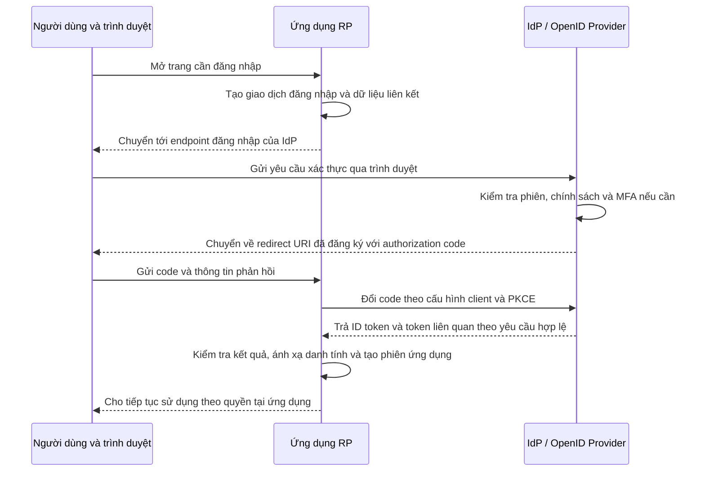

# Identity Provider

## 1. Identity Provider là gì?

**Identity Provider — IdP** là bên cung cấp thông tin danh tính trong một quan hệ liên kết danh tính. Trong luồng đăng nhập liên kết, IdP xác thực người dùng hoặc dựa vào một phiên xác thực còn hợp lệ, rồi phát hành bằng chứng để ứng dụng tiếp nhận biết người dùng là ai cùng những thuộc tính được cho phép chia sẻ.

Ví dụ, nhân viên đăng nhập vào hệ thống danh tính của công ty rồi mở ứng dụng quản lý chi phí. Ứng dụng không cần nhận mật khẩu công ty của nhân viên. Thay vào đó, nó tiếp nhận và kiểm tra bằng chứng do IdP đáng tin cậy phát hành, liên kết danh tính đó với ngữ cảnh sử dụng trong ứng dụng và tạo phiên riêng.

IdP là một vai trò trong kiến trúc, không nhất thiết là một máy chủ duy nhất. Một nền tảng có thể đồng thời cung cấp nhiều vai trò; ngược lại, xác thực, directory, quản lý chính sách và phát hành bằng chứng có thể nằm ở nhiều thành phần phối hợp.

Trong IAM, IdP giúp tập trung các kiểm soát như chính sách đăng nhập, MFA và quản lý quan hệ tin cậy. Tuy nhiên, ứng dụng vẫn phải kiểm tra bằng chứng đúng cách và thực thi quyền truy cập của mình.

## 2. Những thành phần cần phân biệt

| Thành phần | Trách nhiệm chính | Quan hệ với IdP |
|---|---|---|
| Nguồn danh tính hoặc directory | Lưu tài khoản, thuộc tính, nhóm hoặc trạng thái danh tính | Có thể cung cấp dữ liệu cho IdP |
| IdP | Xác thực và cung cấp bằng chứng về danh tính trong federation | Là bên phát hành được bên tiếp nhận tin cậy theo cấu hình |
| Service Provider — SP | Cung cấp dịch vụ và sử dụng kết quả xác thực liên kết | Thuật ngữ thường gặp trong SAML |
| Relying Party — RP | Dựa vào thông tin từ bên cung cấp danh tính | Trong OIDC, là ứng dụng client sử dụng kết quả xác thực |
| Authorization Server | Phát hành token phục vụ cấp quyền truy cập theo OAuth | Có thể cùng nền tảng với IdP nhưng là vai trò cần phân biệt |
| Resource Server | Tiếp nhận yêu cầu truy cập tài nguyên được bảo vệ, thường là API | Kiểm tra access token theo mô hình được triển khai |

Một directory không tự trở thành IdP chỉ vì nó có danh sách người dùng. Cần có cơ chế xác thực, phát hành và tiếp nhận bằng chứng cùng một quan hệ tin cậy phù hợp.

Tương tự, một ứng dụng có trang đăng nhập cục bộ không tự trở thành IdP cho các ứng dụng khác. Nó chỉ đóng vai trò IdP khi thực sự cung cấp chức năng danh tính liên kết và có các bên tiếp nhận được cấu hình để tin cậy.

### IdP không nhất thiết là nguồn gốc của mọi danh tính

IdP có thể xác thực dựa trên directory nội bộ, cơ sở dữ liệu tài khoản hoặc một IdP ở phía trước nó. Trong mô hình identity broker, một bên trung gian tiếp nhận danh tính từ nhiều tổ chức rồi cung cấp thông tin cho các ứng dụng phía sau.

Khi đó, cần biết ai xác thực ban đầu, thuộc tính đến từ đâu và chính sách nào đã được áp dụng. Việc đi qua một broker không tự làm mọi nguồn danh tính có cùng độ tin cậy hoặc cùng mức bảo đảm xác thực.

## 3. Quan hệ tin cậy quan trọng hơn việc đọc được token

Federation cho phép ứng dụng dựa vào một bên khác để biết danh tính. Đây là sự chuyển giao một phần trách nhiệm xác thực qua một ranh giới tin cậy.

Ứng dụng phải biết trước những thông tin như:

- Bên phát hành nào được chấp nhận.
- Ứng dụng được đăng ký với định danh nào và địa chỉ nhận phản hồi nào.
- Khóa hoặc metadata nào được dùng để kiểm tra bằng chứng.
- Những điều kiện thời gian, giao dịch và đối tượng nhận phải được kiểm tra.
- Thuộc tính nào được phép sử dụng và dùng cho mục đích gì.

Trong OIDC, bên cung cấp danh tính thường được gọi là **OpenID Provider — OP**. Trong SAML, IdP và SP trao đổi thông tin dựa trên định danh, endpoint và cấu hình tin cậy tương ứng. Thuật ngữ có khác nhưng nguyên tắc chung là bên tiếp nhận phải xác minh đúng nguồn và đúng ngữ cảnh.

Có thể tách việc tiếp nhận thành ba câu hỏi:

| Câu hỏi | Ví dụ kiểm tra |
|---|---|
| Ai đã phát hành bằng chứng này? | Kiểm tra chữ ký và đối chiếu issuer được cấu hình |
| Bằng chứng có dành cho ứng dụng và giao dịch này không? | Kiểm tra audience, đích nhận và liên kết với yêu cầu theo giao thức |
| Bằng chứng còn hợp lệ và đủ cho mục đích sử dụng không? | Kiểm tra thời gian, chống phát lại và yêu cầu xác thực liên quan |

Một token giải mã được hoặc có cấu trúc đúng chưa đáp ứng ba câu hỏi đó. Chữ ký hợp lệ cũng chưa đủ nếu ứng dụng chấp nhận sai issuer hoặc một token được phát hành cho ứng dụng khác.

Metadata và khóa công khai phải đến từ nguồn tin cậy đã được cấu hình. Không lấy một URL khóa bất kỳ từ dữ liệu do bên không tin cậy gửi rồi coi mọi chữ ký kiểm tra thành công tại đó là hợp lệ.

## 4. IdP làm gì trong một lần đăng nhập?

Luồng sau minh họa một ứng dụng web sử dụng OIDC Authorization Code Flow. Đây là trình tự khái niệm; việc triển khai cần dùng thư viện giao thức phù hợp và kiểm tra đầy đủ các điều kiện của luồng.



Các điểm cần hiểu:

1. Ứng dụng khởi tạo một giao dịch đăng nhập và lưu dữ liệu cần để đối chiếu phản hồi. Không tiếp nhận một kết quả rời rạc rồi tự coi là kết quả của lần đăng nhập hiện tại.
2. Người dùng nhập thông tin xác thực tại bên chịu trách nhiệm xác thực, thường là IdP trong luồng này. Ứng dụng RP không cần nhận mật khẩu IdP.
3. Nếu phiên IdP đủ điều kiện, IdP có thể không yêu cầu nhập lại mật khẩu. Nếu chính sách hoặc yêu cầu của ứng dụng đòi hỏi, IdP có thể yêu cầu xác thực mới hoặc tăng cường.
4. Authorization code được đổi theo cơ chế của client. Client bí mật phải bảo vệ credential nếu dùng; client công khai không được coi một secret nhúng trong ứng dụng là bí mật.
5. Ứng dụng kiểm tra ID token và kết quả giao dịch trước khi tạo phiên cục bộ. Các kiểm soát liên quan gồm issuer, audience, chữ ký, thời gian và những ràng buộc của luồng như state, nonce và PKCE theo cách chúng được sử dụng.
6. Sau xác thực, ứng dụng vẫn quyết định người dùng được xem hoặc thực hiện hành động nào.

State, nonce và PKCE có mục đích khác nhau trong việc bảo vệ giao dịch; không dùng một trường rồi mặc định đã thay thế mọi kiểm tra còn lại. Chi tiết triển khai thuộc hợp đồng giao thức và thư viện đang dùng, không nên tự suy ra bằng cách chỉ giải mã một JWT.

Với SAML, IdP có thể cung cấp assertion và phản hồi xác thực cho SP theo binding và cấu hình được triển khai. SP kiểm tra chữ ký, bên phát hành, đối tượng nhận, điều kiện và liên kết giao dịch phù hợp trước khi tạo phiên. Không áp dụng nguyên xi cách xử lý token OIDC cho SAML.

## 5. IdP phát hành thông tin gì?

Bằng chứng danh tính có thể chứa định danh chủ thể và các thuộc tính được chia sẻ. Trong OIDC, những thông tin này thường được biểu diễn bằng **claim** trong ID token hoặc qua cơ chế được giao thức cho phép. Trong SAML, assertion có thể chứa thông tin chủ thể, xác thực và các attribute tương ứng.

Các nhóm thông tin thường gặp gồm:

| Nhóm | Ví dụ | Lưu ý khi sử dụng |
|---|---|---|
| Bên phát hành | Issuer hoặc định danh IdP | Phải đối chiếu với quan hệ tin cậy đã cấu hình |
| Chủ thể | Subject identifier | Chỉ có ý nghĩa trong phạm vi và hợp đồng định danh liên quan |
| Đối tượng nhận | Audience | Không dùng bằng chứng dành cho bên khác |
| Điều kiện thời gian | Thời điểm phát hành, hết hạn hoặc thời gian xác thực | Các mốc có ý nghĩa khác nhau |
| Thuộc tính hồ sơ | Tên, email, đơn vị | Có thể thay đổi; không mặc định là định danh bất biến |
| Ngữ cảnh xác thực | Phương thức hoặc mức bảo đảm theo thỏa thuận | Cần hiểu đúng ngữ nghĩa và chính sách của issuer |
| Thuộc tính phục vụ chính sách | Nhóm hoặc vai trò được phép chia sẻ | Không tự đồng nghĩa với quyền quản trị tại mọi ứng dụng |

Thông tin nhận được chỉ đáng tin trong giới hạn của nguồn và quy trình đã thỏa thuận. Việc có một email trong token không tự chứng minh người dùng đã trải qua kiểm chứng danh tính ở mức cao. Xác thực tài khoản, xác minh địa chỉ email và kiểm chứng danh tính thực là những khái niệm khác nhau.

### Chữ ký và mã hóa có mục đích khác nhau

Chữ ký hỗ trợ xác minh tính toàn vẹn và nguồn phát hành theo khóa tin cậy. Nó không làm nội dung tự trở thành bí mật. Một ID token JWT được ký nhưng không mã hóa có thể có phần payload đọc được.

Chỉ gửi những thuộc tính cần thiết cho bên nhận, bảo vệ kênh truyền và lưu trữ phù hợp, tránh đưa token nguyên vẹn vào URL hoặc log không được kiểm soát. Khi sử dụng mã hóa ở cấp thông điệp, vẫn phải kiểm tra đầy đủ những điều kiện hợp lệ khác.

### ID token khác access token

ID token phục vụ client trong việc nhận biết kết quả xác thực người dùng. Access token phục vụ truy cập tài nguyên theo mô hình cấp quyền và các điều kiện mà resource server chấp nhận.

Không gửi ID token như bearer token tới một API chỉ vì nó có chữ ký và tên người dùng. API cần loại bằng chứng được thiết kế cho nó, với đúng issuer, audience và quyền hoặc điều kiện truy cập liên quan.

OAuth cung cấp cơ chế cấp quyền truy cập; riêng việc nhận được một access token không tự tạo thành một giao thức đăng nhập cho ứng dụng. OIDC bổ sung lớp danh tính trên nền OAuth để đáp ứng mục đích xác thực.

## 6. Ánh xạ danh tính bên ngoài vào ứng dụng

Sau khi xác minh bằng chứng, ứng dụng cần biết danh tính liên kết tương ứng với đối tượng nội bộ nào. Đây là nơi sai sót có thể dẫn đến truy cập nhầm tài khoản hoặc nhầm tổ chức.

Trong OIDC, ứng dụng thường dùng cặp **issuer và subject**, tức `iss` và `sub`, để phân biệt danh tính bên ngoài. Một `sub` đơn lẻ không có tính duy nhất trên mọi issuer. Cách cấp subject cũng có thể khiến cùng người dùng có các subject khác nhau giữa những client hoặc ngữ cảnh khác nhau.

Ví dụ ánh xạ nội bộ minh họa:

```yaml
internalUserId: user-842
externalIdentity:
  issuer: "https://login.example.org/workforce"
  subject: "subject-6f23c1"
organizationId: organization-a
accountState: ACTIVE
```

Đây là ví dụ dữ liệu, không phải cấu hình hay schema bắt buộc của một sản phẩm. Ứng dụng chỉ sử dụng issuer và subject sau khi đã kiểm tra bằng chứng. Tổ chức hoặc tenant nội bộ cũng phải được xác định theo cấu hình và chính sách tin cậy, không chỉ lấy từ một tham số trình duyệt.

### Không dùng email để tự ghép mọi tài khoản

Email có thể thay đổi, được tái cấp hoặc có ngữ nghĩa khác giữa các nguồn danh tính. Hai issuer cùng phát hành một email không có nghĩa hai tài khoản có cùng mức tin cậy hay cùng chủ thể theo chính sách của ứng dụng.

Nếu cần liên kết một tài khoản đang tồn tại với danh tính từ IdP mới, phải có quy trình chứng minh quyền kiểm soát và thẩm quyền phù hợp. Không tự ghép vào tài khoản đặc quyền chỉ vì chuỗi email trùng nhau.

Trong SAML, định danh liên kết có thể dựa vào NameID hoặc attribute theo thỏa thuận. Không mặc định mọi NameID đều bất biến hoặc có thể dùng như một định danh toàn cục. Hợp đồng tích hợp cần xác định phạm vi, tính ổn định và cách xử lý thay đổi hoặc tái sử dụng định danh.

### Federation không tự tạo đầy đủ vòng đời tài khoản

Ứng dụng có thể tạo hồ sơ khi đăng nhập lần đầu, thường gọi là just-in-time provisioning, hoặc nhận tài khoản và thuộc tính qua một quy trình cấp phát riêng. Những cơ chế như SCIM có thể hỗ trợ quản lý vòng đời nhưng có phạm vi khác với bằng chứng đăng nhập.

Cho phép một issuer xác thực người dùng không có nghĩa mọi người thuộc issuer đều được tạo tài khoản và nhận quyền mặc định rộng. Cần kiểm soát điều kiện gia nhập, tổ chức, trạng thái và quyền khởi tạo.

## 7. Ranh giới giữa xác thực tập trung và phân quyền

IdP có thể phát hành nhóm, vai trò hoặc thuộc tính để ứng dụng sử dụng làm đầu vào. Ứng dụng vẫn chịu trách nhiệm quyết định ý nghĩa của các thông tin đó đối với tài nguyên của mình.

Ví dụ, nhóm `finance-employees` có thể giúp xác định nhân viên tài chính. Nó không tự đồng nghĩa với quyền duyệt thanh toán, đọc mọi hồ sơ nhân sự hoặc quản trị production.

Một ứng dụng cần xác định:

- Claim nào được chấp nhận từ issuer nào.
- Claim được ánh xạ sang role nội bộ nào.
- Phạm vi tài nguyên hoặc tenant nào được phép.
- Các điều kiện bổ sung như trạng thái tài khoản, thời hạn hoặc phân tách nhiệm vụ.
- Cách cập nhật và thu hồi khi thuộc tính hoặc quan hệ tin cậy thay đổi.

Đối với ứng dụng nhiều tenant, chấp nhận chữ ký của một nền tảng danh tính chưa đủ để chấp nhận mọi tổ chức dùng nền tảng đó. Cần kiểm tra đúng issuer, tenant và quan hệ khách hàng được cho phép theo mô hình tích hợp.

Không tin một vai trò `admin` từ bất kỳ IdP nào rồi ánh xạ trực tiếp thành quản trị toàn hệ thống. Phạm vi tin cậy đối với thuộc tính cần được thiết kế riêng với việc chấp nhận danh tính.

## 8. MFA, SSO và phiên có giới hạn gì?

### Mức xác thực phải đáp ứng yêu cầu của ứng dụng

IdP có thể áp dụng MFA, kiểm soát đăng nhập theo rủi ro hoặc phương thức xác thực khác. Tuy nhiên, việc “đăng nhập qua IdP” không tự chứng minh người dùng đã dùng MFA, vừa xác thực lại hay sử dụng phương thức chống lừa đảo.

Ứng dụng nhạy cảm cần có yêu cầu rõ và kiểm tra kết quả theo ngữ nghĩa đã thỏa thuận với IdP. Ngữ cảnh hoặc phương thức xác thực có thể được truyền bằng những trường thích hợp của giao thức, nhưng chỉ đọc tên trường hoặc một nhãn chung là chưa đủ.

Cần phân biệt thời điểm phát hành token với thời điểm người dùng thực sự xác thực. Một token mới có thể được phát hành từ phiên IdP đã tồn tại; không coi nó là bằng chứng người dùng vừa nhập lại credential.

### Phiên IdP và phiên ứng dụng độc lập

Khi đăng nhập thành công, trình duyệt có thể có phiên tại IdP và một phiên khác tại ứng dụng. SSO tận dụng phiên IdP để giảm số lần người dùng phải xác thực lại khi vào các ứng dụng liên kết.

```text
Phiên tại IdP
  -> hỗ trợ đăng nhập ứng dụng A
       -> phiên riêng của A
  -> hỗ trợ đăng nhập ứng dụng B
       -> phiên riêng của B
```

Hết hạn phiên A không nhất thiết làm hết phiên B. Đăng xuất cục bộ khỏi A không nhất thiết chấm dứt phiên IdP. Khi quay lại A, phiên IdP còn hợp lệ có thể cho phép tạo một phiên A mới.

Single Logout, khi được hỗ trợ và tích hợp, cần được thiết kế cùng cách xử lý lỗi và giới hạn thực tế. Không mặc định một nút đăng xuất đã thu hồi mọi token, mọi phiên và mọi credential ở tất cả hệ thống.

### Vô hiệu hóa danh tính không tự thu hồi tức thì mọi truy cập

Chặn đăng nhập tại IdP thường giúp ngăn những lần đăng nhập mới theo quan hệ đó. Phiên cục bộ của ứng dụng hoặc token đã phát hành có thể còn hiệu lực tùy kiến trúc.

Quy trình nghỉ việc và ứng phó sự cố cần phối hợp trạng thái tài khoản, thu hồi phiên hoặc token khi cơ chế hỗ trợ, deprovisioning tại ứng dụng và đối soát quyền còn tồn tại. Không chỉ dựa vào một cờ “disabled” ở IdP để tuyên bố mọi hệ thống đã chặn truy cập.

## 9. Quản lý khóa và vận hành IdP

Khóa ký của IdP là tài sản nhạy cảm vì các bên tiếp nhận dựa vào nó để kiểm tra bằng chứng. Khóa riêng cần được bảo vệ; khóa công khai có thể được phân phối cho các bên xác minh qua cơ chế tin cậy phù hợp.

Trong OIDC, JWKS có thể cung cấp tập khóa công khai. Việc nhìn thấy một `kid` chưa biết không phải lý do tự tin một khóa bất kỳ. Ứng dụng cần tìm khóa theo nguồn đã cấu hình, kiểm soát việc tải lại và từ chối nếu không xác minh được hợp lệ.

Khi xoay khóa, các bên cần phối hợp để bằng chứng hợp lệ đang còn thời hạn được xử lý theo kế hoạch, đồng thời ngăn việc chấp nhận khóa ngoài chính sách. Khi khóa bị lộ, quy trình ứng phó có thể cần loại bỏ tin cậy khẩn cấp và xử lý bằng chứng hoặc phiên liên quan; đây khác với xoay khóa thông thường.

Những phần vận hành cần được quản lý gồm:

| Phạm vi | Rủi ro nếu thiếu kiểm soát |
|---|---|
| Tài khoản quản trị IdP | Kẻ chiếm được quyền có thể thay đổi chính sách hoặc quan hệ tin cậy |
| Đăng ký client và redirect URI | Phản hồi đăng nhập có thể đi sai ứng dụng hoặc sai đích |
| Thay đổi mapping thuộc tính | Người dùng có thể nhận sai role hoặc sai tenant |
| Quản lý khóa và metadata | Từ chối đăng nhập hợp lệ hoặc chấp nhận bằng chứng không phù hợp |
| Đồng bộ trạng thái tài khoản | Người đã rời tổ chức có thể còn truy cập |
| Audit và giám sát | Khó phát hiện thay đổi cấu hình, đăng nhập bất thường hoặc lỗi tích hợp |

IdP có thể là điểm tập trung quan trọng về cả an toàn lẫn tính sẵn sàng. Cần kế hoạch dự phòng và khôi phục được kiểm thử. Khi IdP lỗi, các phiên ứng dụng đã tồn tại có thể tiếp tục tùy chính sách, nhưng lần đăng nhập mới hoặc thao tác cần xác thực tăng cường có thể thất bại.

Không xử lý sự cố bằng cách bỏ kiểm tra chữ ký, chấp nhận mọi issuer hoặc tạo đường đăng nhập quản trị không kiểm soát. Nếu tổ chức có cơ chế truy cập khẩn cấp, cơ chế đó cần phạm vi, chủ sở hữu, kiểm soát và bằng chứng sử dụng riêng.

## 10. Ví dụ: nhân viên truy cập ứng dụng quản lý chi phí

Công ty A có IdP cho nhân viên và một ứng dụng quản lý chi phí đóng vai trò RP. Lan mở ứng dụng để xem yêu cầu hoàn tiền của mình.

1. RP chuyển trình duyệt của Lan tới đúng IdP đã cấu hình, trong một giao dịch đăng nhập được liên kết.
2. IdP kiểm tra trạng thái tài khoản và yêu cầu xác thực phù hợp. Nếu cần, Lan hoàn thành MFA tại IdP.
3. RP nhận kết quả qua luồng đã đăng ký, hoàn tất trao đổi và kiểm tra bằng chứng.
4. RP ánh xạ issuer và subject đã xác minh sang hồ sơ nội bộ của Lan.
5. RP tạo phiên ứng dụng, nhưng quyền mặc định chỉ cho Lan xem những hồ sơ thuộc phạm vi được phép.
6. Để duyệt yêu cầu của người khác, RP cần vai trò nghiệp vụ riêng và các điều kiện phân quyền; đăng nhập thành công không đủ.
7. Nếu Lan chuyển bộ phận, quyền trong ứng dụng được cập nhật theo quy trình vòng đời. Nếu Lan nghỉ việc, cần xử lý cả IdP lẫn phiên và tài khoản liên quan ở ứng dụng.

Nếu một tài khoản từ IdP của công ty B có email hiển thị giống Lan, RP không được ghép hai tài khoản chỉ dựa trên chuỗi email. Nó phải tuân theo quan hệ tin cậy và quy trình liên kết danh tính.

Nếu RP nhận một token hợp lệ dành cho một ứng dụng khác, nó vẫn phải từ chối dùng token đó để thiết lập phiên cho ứng dụng quản lý chi phí. Kiểm tra “chữ ký đúng” không thay thế kiểm tra audience và ngữ cảnh giao dịch.

## 11. Những hiểu nhầm thường gặp

| Hiểu nhầm | Cách hiểu đúng |
|---|---|
| IdP là nơi lưu mọi dữ liệu người dùng | IdP có thể sử dụng nhiều nguồn; không nhất thiết là nguồn gốc của mọi thuộc tính |
| Dùng chung IdP nghĩa là dùng chung mật khẩu giữa các ứng dụng | Ứng dụng liên kết có thể dựa vào bằng chứng mà không nhận mật khẩu IdP |
| Có chữ ký là có thể tin mọi nội dung | Cần đúng nguồn, đối tượng nhận, điều kiện và ngữ nghĩa thuộc tính |
| Email trùng nhau nghĩa là cùng tài khoản | Cần định danh liên kết và quy trình nối tài khoản an toàn |
| Đăng nhập qua IdP đồng nghĩa đã có quyền | Phân quyền vẫn cần được áp dụng tại đúng tài nguyên và phạm vi |
| Có SSO nghĩa là đăng xuất hoặc vô hiệu hóa một nơi sẽ kết thúc mọi phiên | Các phiên và token có vòng đời riêng, cần cơ chế phối hợp |
| OAuth và OIDC có cùng mục đích đăng nhập | OAuth phục vụ cấp quyền; OIDC bổ sung lớp danh tính cho xác thực |
| ID token dùng được cho mọi API | API cần loại token đúng với mô hình bảo vệ và audience của nó |

## 12. Tự kiểm tra

1. Directory khác IdP ở những trách nhiệm nào?
2. Vì sao một ứng dụng vẫn phải kiểm tra audience khi chữ ký token hợp lệ?
3. Vì sao issuer và subject cần được xét cùng nhau khi ánh xạ tài khoản OIDC?
4. Một phiên IdP còn hợp lệ có thể ảnh hưởng thế nào tới việc đăng nhập lại sau khi đăng xuất cục bộ?
5. Vì sao chặn tài khoản tại IdP chưa đủ để xác nhận deprovisioning toàn bộ ứng dụng?
6. Trong ví dụ quản lý chi phí, bên nào quyết định Lan được duyệt yêu cầu hoàn tiền của ai?
