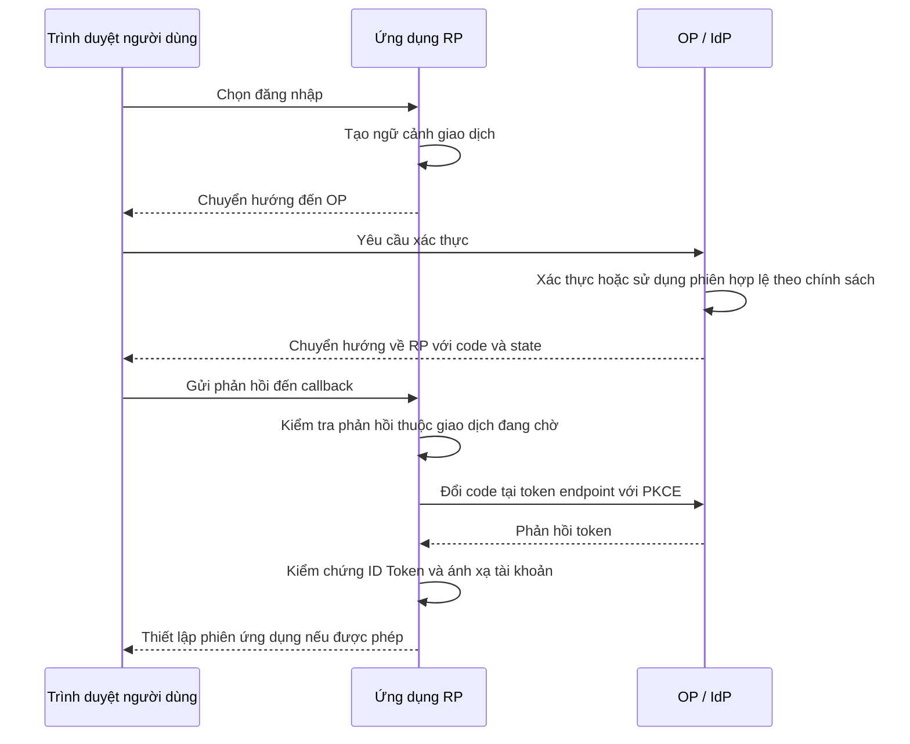

# Relying Party

## 1. Relying Party là bên nào?

**Relying Party**, viết tắt **RP**, là bên sử dụng kết quả xác thực do một bên khác cung cấp để nhận diện người dùng và thiết lập truy cập vào dịch vụ của mình. Trong federation, RP dựa vào một **Identity Provider — IdP** đã được tin cậy, thay vì trực tiếp kiểm tra phương tiện xác thực của người dùng trong giao dịch đăng nhập liên kết đó.

Ví dụ, một cổng quản lý chi phí cho phép nhân viên đăng nhập bằng danh tính công ty. Hệ thống danh tính công ty xác thực nhân viên và cung cấp kết quả theo giao thức federation. Cổng quản lý chi phí là RP: nó kiểm chứng kết quả, tìm đúng tài khoản nội bộ và quyết định người đó có được sử dụng chức năng nào trong ứng dụng.

NIST mô tả federation theo hướng IdP cung cấp assertion có thể kiểm chứng, còn RP xác minh assertion và tạo phiên cho người dùng. Sự phân công này giúp RP không cần phát hành thêm một phương tiện xác thực riêng cho cùng giao dịch. [NIST SP 800-63C-4 — Introduction](https://pages.nist.gov/800-63-4/sp800-63c/introduction/).

Từ “relying” không có nghĩa là tin mọi dữ liệu nhận được. RP chỉ chấp nhận kết quả từ đúng bên phát hành, cho đúng bên nhận, trong đúng giao dịch và theo các điều kiện đã thiết lập. Một chuỗi ký tự giống token hoặc một trang báo “đăng nhập thành công” chưa đáp ứng các điều kiện đó.

## 2. RP, IdP, client và Service Provider

| Thuật ngữ | Vai trò trong ngữ cảnh này |
|---|---|
| Người dùng | Người muốn đăng nhập và sử dụng dịch vụ |
| IdP | Bên xác thực người dùng và cung cấp thông tin xác thực liên kết |
| RP | Bên kiểm chứng kết quả liên kết và thiết lập truy cập vào dịch vụ của mình |
| OpenID Provider — OP | Tên gọi phía cung cấp xác thực trong OpenID Connect |
| OIDC client | Ứng dụng tham gia OpenID Connect; đóng vai trò RP đối với OP |
| SAML Service Provider — SP | Bên cung cấp dịch vụ và tiêu thụ assertion trong SAML; tương ứng với phía RP ở mức vai trò federation |
| Resource Server | API hoặc tài nguyên nhận access token và thực thi quyền truy cập trong OAuth |

Thuật ngữ cụ thể thay đổi theo giao thức. Không nên lấy tên trường, endpoint hoặc quy tắc của OpenID Connect áp dụng nguyên xi cho SAML chỉ vì cả hai đều có phía dựa vào kết quả xác thực.

Một sản phẩm có thể đảm nhiệm nhiều vai trò. Cổng báo cáo có thể là RP khi đăng nhập người dùng, đồng thời là OAuth client khi gọi API doanh số. API doanh số là Resource Server trong lần gọi đó. Những vai trò này phải được phân biệt để biết token nào dùng ở đâu và bên nào cần kiểm tra điều gì.

Một broker danh tính cũng có thể là RP đối với IdP ở phía trên và là IdP đối với các ứng dụng phía dưới. Khi đó có nhiều quan hệ tin cậy và nhiều giao dịch riêng, không phải một kết quả đăng nhập được truyền xuyên mọi hệ thống mà không cần kiểm chứng.

## 3. RP chịu trách nhiệm đến đâu?

RP thường chịu trách nhiệm cho các phần sau:

- Chọn và cấu hình quan hệ tin cậy với IdP phù hợp.
- Khởi tạo và theo dõi giao dịch đăng nhập theo giao thức.
- Xử lý phản hồi, kiểm chứng bằng chứng xác thực và chống nhầm giao dịch.
- Ánh xạ danh tính liên kết sang đúng tài khoản nội bộ.
- Kiểm tra trạng thái tài khoản, điều kiện gia nhập và chính sách của ứng dụng.
- Tạo, bảo vệ, hết hạn và kết thúc phiên tại ứng dụng.
- Thực thi quyền đối với từng chức năng và dữ liệu.
- Theo dõi sự kiện, bảo vệ thuộc tính danh tính và xử lý vòng đời truy cập.

IdP xác thực người dùng không làm mất trách nhiệm phân quyền của RP. Một nhân viên có thể đăng nhập hợp lệ ở IdP nhưng chưa được cấp quyền vào ứng dụng tài chính. RP cần từ chối hoặc giới hạn truy cập theo chính sách của mình.

Tương tự, RP có thể yêu cầu mức xác thực phù hợp cho một thao tác nhạy cảm. Việc nhận được một kết quả đăng nhập không tự chứng minh người dùng vừa thực hiện MFA hoặc vừa xác thực lại. RP cần có thông tin và quy tắc đủ rõ để đánh giá yêu cầu đó.

## 4. Quan hệ tin cậy phải được thiết lập rõ

Trước khi nhận người dùng, RP cần biết mình tin ai và tin điều gì. Với một ứng dụng doanh nghiệp, các thông tin thường gồm:

| Thành phần | Câu hỏi cần trả lời |
|---|---|
| Bên phát hành được chấp nhận | IdP hoặc issuer nào có thẩm quyền cung cấp danh tính? |
| Định danh của ứng dụng | Bằng chứng phải dành cho RP nào? |
| Điểm nhận phản hồi | Phản hồi được phép quay về endpoint nào? |
| Khóa và cách kiểm chứng | Nguồn khóa nào đáng tin, thuật toán nào được cho phép? |
| Phạm vi tổ chức | Tenant, đối tác hoặc nhóm người dùng nào được tiếp nhận? |
| Thuộc tính | RP cần nhận dữ liệu nào và dùng vào mục đích gì? |
| Mức và độ mới xác thực | Giao dịch nào cần xác thực mới hoặc điều kiện bổ sung? |
| Vòng đời | Tạo tài khoản, khóa tài khoản và kết thúc phiên được phối hợp ra sao? |

Trong một cấu hình OIDC thông thường, RP đăng ký `client_id` và các redirect URI với OP. `client_id` là định danh ứng dụng, không phải mật khẩu. Với client có khả năng giữ bí mật ở backend, cơ chế xác thực client phải được quản lý theo cấu hình; không đưa client secret vào mã JavaScript gửi cho trình duyệt.

Thông tin metadata và khóa công khai giúp RP xử lý giao thức, nhưng việc có thể tải metadata không tự tạo quyền tin cậy. RP không nên cho phép một giá trị issuer tùy ý từ yêu cầu của người dùng trở thành cấu hình tin cậy chỉ vì URL đó trả về dữ liệu đúng định dạng.

Ứng dụng có nhiều tenant cần thêm chính sách xác định tổ chức nào được tham gia và danh tính nào thuộc tổ chức đó. Chấp nhận chữ ký từ một nền tảng danh tính lớn chưa đồng nghĩa chấp nhận mọi tài khoản của mọi khách hàng trên nền tảng ấy.

## 5. Ví dụ một lần đăng nhập OIDC tại RP

Xét một ứng dụng web có backend, dùng Authorization Code Flow với PKCE. Đây là một mô hình minh họa; ứng dụng di động, SPA hoặc một giao thức federation khác có chi tiết triển khai riêng.



RP cần giữ ngữ cảnh để biết phản hồi nào tương ứng với yêu cầu nào: IdP đã chọn, thời điểm bắt đầu, giá trị liên kết giao dịch, thông tin PKCE và địa chỉ quay lại nội bộ đã được kiểm tra. Ngữ cảnh này phải được bảo vệ và có thời hạn.

Trong mô hình này, `state` liên kết phản hồi với giao dịch khởi tạo, `nonce` được kiểm tra với ID Token khi đã gửi trong yêu cầu, còn PKCE ràng buộc việc đổi code với bên có verifier tương ứng. Các giá trị cần riêng cho giao dịch và được ràng buộc an toàn với trình duyệt hoặc phiên khởi tạo. Chúng không phải ba tên khác nhau của cùng một bí mật.

RFC 9700 nêu yêu cầu bảo vệ các luồng chuyển hướng, chống CSRF, chống nhầm authorization server và chống lạm dụng authorization code; PKCE là một cơ chế quan trọng trong phạm vi này. Cần dùng thư viện và cấu hình theo mô hình client, không chỉ thêm vài tham số vào URL rồi coi luồng đã an toàn. [RFC 9700 — Protecting Redirect-Based Flows](https://www.rfc-editor.org/rfc/rfc9700.html#section-2.1).

Sau khi xử lý, giao dịch không nên tiếp tục được dùng để tạo thêm phiên bằng cùng một phản hồi. Đường dẫn chuyển người dùng về sau đăng nhập cũng cần được giới hạn phù hợp để không trở thành công cụ chuyển hướng đến một địa chỉ tùy ý.

## 6. Kiểm chứng kết quả trước khi dùng danh tính

### 6.1. Đúng bằng chứng và đúng ngữ cảnh

RP phải xử lý phản hồi bằng bộ kiểm chứng dành cho giao thức và loại token được mong đợi. Với OIDC, ID Token mang thông tin về sự kiện xác thực cho client; access token phục vụ truy cập tài nguyên. Không coi mọi JWT có cùng chữ ký là có thể thay thế cho nhau.

Một payload đọc được sau khi giải mã Base64url vẫn là dữ liệu chưa được tin cậy. Việc parser trả về `sub` hoặc `email` không chứng minh token hợp lệ. Các quyết định về tài khoản và phiên chỉ được thực hiện sau khi bộ kiểm chứng hoàn tất.

### 6.2. Những kiểm tra tiêu biểu trong OIDC

Với cấu hình dùng ID Token có chữ ký, các điểm kiểm tra cần bao gồm:

- Xác minh mật mã bằng khóa và thuật toán được cấu hình cho issuer tin cậy.
- `iss` khớp chính xác issuer mong đợi.
- `aud` chứa `client_id` của RP; không chấp nhận audience không phù hợp.
- Token còn hạn; áp dụng các điều kiện thời gian liên quan theo giao thức và chính sách.
- Nếu đã gửi `nonce`, yêu cầu claim tương ứng khớp giao dịch.
- Đánh giá `auth_time`, `acr` hoặc các điều kiện bổ sung khi chính sách và yêu cầu có sử dụng chúng.

Đây là các điểm định hướng, không phải danh sách thay thế toàn bộ thuật toán chuẩn hoặc các extension đang dùng. [OpenID Connect Core — ID Token Validation](https://openid.net/specs/openid-connect-core-1_0.html#IDTokenValidation).

Ví dụ, cùng một issuer phát token cho cổng nhân sự và cổng chi phí. Token dành cho cổng nhân sự không được trở thành vé đăng nhập cổng chi phí chỉ vì chữ ký đúng. Việc kiểm tra audience bảo vệ ranh giới giữa các ứng dụng đó.

### 6.3. Chọn khóa an toàn

Trường `kid` giúp tìm khóa trong ngữ cảnh đã tin cậy; nó không tự chứng minh khóa nào là hợp lệ. Không tùy tiện tải khóa từ một URL do token chưa kiểm chứng chỉ định, hoặc tự cho phép thuật toán mới chỉ vì header yêu cầu.

RFC 8725 đề cập giới hạn thuật toán, gắn khóa với issuer, kiểm tra audience và nguy cơ lấy dữ liệu theo URL không đáng tin trong header. Những kiểm tra này cần được thể hiện trong cấu hình thư viện xác minh, không chỉ trong một bước đọc payload. [RFC 8725 — JWT Best Current Practices](https://www.rfc-editor.org/rfc/rfc8725.html#section-3).

Khi luân chuyển khóa, RP cần cơ chế cập nhật và cache có kiểm soát. Nếu gặp khóa chưa biết, có thể làm mới theo chính sách và giới hạn phù hợp, nhưng không bỏ xác minh chữ ký để duy trì đăng nhập. Lỗi lấy khóa phải được phân biệt với việc token đã được chứng minh hợp lệ.

## 7. Ánh xạ danh tính liên kết sang tài khoản nội bộ

### 7.1. Phân biệt danh tính ngoài và tài khoản trong ứng dụng

RP thường có một định danh tài khoản nội bộ phục vụ dữ liệu và quyền. Danh tính liên kết là một phương tiện để tìm đúng tài khoản đó, không nhất thiết là khóa chính của mọi bảng nghiệp vụ.

Trong OIDC, một thiết kế thường dùng cặp issuer và subject để tham chiếu danh tính liên kết:

```text
federatedIdentity:
    issuer  = https://login.company.example
    subject = opaque-subject-7842

localAccountId = account-19073
```

Hai issuer có thể dùng cùng chuỗi subject cho hai người khác nhau. Vì vậy, chỉ lưu `subject = 7842` mà bỏ ngữ cảnh issuer có thể dẫn đến gộp nhầm tài khoản. Tương tự, một broker hoặc một cơ chế thay đổi định danh cần kế hoạch chuyển đổi rõ ràng, không tự sửa liên kết dựa trên tên hiển thị.

### 7.2. Email không phải chìa khóa liên kết mặc định

Email có thể thay đổi, được cấp lại hoặc mang ý nghĩa khác nhau giữa các nguồn. Không tự động gộp tài khoản có dữ liệu và quyền nhạy cảm chỉ vì một IdP mới gửi email giống tài khoản đang tồn tại.

Giả sử RP đã có tài khoản quản trị dùng email `admin@company.example`. Một phản hồi từ nguồn khác có cùng email chưa chứng minh nguồn đó có thẩm quyền xác nhận cùng người quản trị. Nếu tự gộp, RP có thể trao quyền tài khoản cũ cho sai danh tính.

Liên kết thêm phương thức đăng nhập cần một quy trình chứng minh quyền kiểm soát tài khoản hoặc quy trình quản trị có thẩm quyền. Việc có thuộc tính báo email đã xác minh vẫn cần được đánh giá trong quan hệ tin cậy cụ thể; nó không tạo định danh toàn cầu giữa mọi IdP.

### 7.3. Tạo tài khoản khi đăng nhập không đồng nghĩa cấp mọi quyền

RP có thể nhận tài khoản được cấp trước hoặc tạo tài khoản khi đăng nhập lần đầu theo chính sách. Trong trường hợp tạo khi đăng nhập, cần xác định điều kiện gia nhập, dữ liệu tối thiểu, mặc định quyền và người chịu trách nhiệm.

Không để một claim chưa được ánh xạ an toàn trở thành quyền quản trị. Ví dụ, một thuộc tính tên `role` từ IdP đối tác không nên tự động ánh xạ mọi giá trị sang vai trò nội bộ có cùng tên. Chỉ những nguồn và giá trị đã được chấp thuận mới được dùng theo quy tắc cụ thể.

## 8. RP vẫn quyết định quyền trong ứng dụng

Sau khi đã nhận diện được người dùng, RP cần kiểm tra tài khoản có còn hoạt động, đã được cấp quyền vào ứng dụng và có quyền thực hiện thao tác cụ thể hay không. Vai trò hoặc thuộc tính từ IdP có thể là đầu vào, nhưng cách sử dụng phải do chính sách của RP xác định.

Ví dụ, IdP cho biết Minh thuộc nhóm `sales`. Cổng chi phí có thể cho Minh tạo đề nghị chi phí của chính mình. Điều đó không suy ra Minh được duyệt đề nghị của mọi nhân viên hoặc đọc hóa đơn của mọi đơn vị.

Các bước xử lý ở mức nghiệp vụ có thể được hình dung như sau:

```text
Kết quả federation đã được kiểm chứng
    → Tìm đúng tài khoản nội bộ
    → Kiểm tra trạng thái và điều kiện gia nhập
    → Thiết lập phiên với ngữ cảnh phù hợp
    → Kiểm tra quyền cho từng hành động và tài nguyên
```

Không chỉ kiểm tra quyền một lần ở màn hình đăng nhập rồi tin mọi yêu cầu sau đó. Việc thực thi cần bao phủ API, thao tác nền và các đường truy cập khác của ứng dụng.

Với ứng dụng nhiều tenant, quyền phải gắn với đúng tenant. Một người có vai trò quản lý trong tenant A không được xem dữ liệu tenant B chỉ bằng cách đổi định danh tài nguyên trên URL. Federation cung cấp danh tính; ranh giới dữ liệu vẫn cần được RP thực thi.

## 9. Phiên của RP độc lập với phiên IdP

Người dùng có thể đồng thời có phiên tại IdP và tại nhiều RP. Chúng phục vụ các hệ thống khác nhau và không có cùng vòng đời một cách tự động.

Sau đăng nhập, ứng dụng web có thể tạo phiên nội bộ và dùng cookie để nhận diện các yêu cầu sau đó. RP cần bảo vệ cookie, thay định danh phiên khi cần để tránh cố định phiên, kiểm soát thời gian không hoạt động và thời gian tối đa theo rủi ro. Các thuộc tính như `Secure`, `HttpOnly` và `SameSite` phải được cấu hình phù hợp với mô hình web và luồng chuyển hướng.

NIST phân biệt thời hạn assertion với thời hạn phiên ở IdP và RP. Việc hết hạn bằng chứng đã dùng để thiết lập phiên hoặc kết thúc phiên IdP không mặc nhiên chấm dứt phiên tại mọi ứng dụng. [NIST SP 800-63C-4 — Federation and Assertions](https://pages.nist.gov/800-63-4/sp800-63c.html).

Ví dụ, nhân viên đăng nhập cổng chi phí rồi đăng xuất khỏi trang IdP ở một tab khác. Nếu chưa có cơ chế phối hợp kết thúc phiên, cổng chi phí có thể vẫn giữ phiên nội bộ. RP cần quy định rõ đăng xuất chỉ tại ứng dụng hay có phối hợp với hệ thống khác, và không hứa đăng xuất toàn bộ nếu chưa hỗ trợ hoặc xác minh điều đó.

Khi xử lý thao tác nhạy cảm, RP có thể cần yêu cầu xác thực mới theo chính sách thay vì chỉ dựa vào một phiên lâu. Nếu yêu cầu xác thực lại, phải kiểm tra kết quả đáp ứng điều kiện đã yêu cầu; token mới phát không tự chứng minh người dùng vừa nhập lại thông tin xác thực.

## 10. Vòng đời danh tính, sự cố và quyền riêng tư

### 10.1. Federation không thay thế deprovisioning

Khi người dùng nghỉ việc, khóa tại IdP có thể ngăn những lần đăng nhập mới theo cấu hình, nhưng cần đánh giá cả phiên đang tồn tại, tài khoản nội bộ và các phương thức truy cập khác tại RP. Một tài khoản ứng dụng có mật khẩu cục bộ hoặc khóa API vẫn có thể cần được xử lý riêng.

RP cần cơ chế phù hợp để cập nhật trạng thái danh tính và quyền: provisioning, sự kiện được kiểm chứng, đối soát hoặc quy trình vận hành. Không tạo một đường đăng nhập dự phòng ít kiểm soát hơn chỉ để bỏ qua lỗi federation mà không có thiết kế và thẩm quyền phù hợp.

Khi dùng thuộc tính quyền được đưa vào tại thời điểm đăng nhập, cần hiểu độ trễ thay đổi. Nếu chức vụ hoặc quyền bị thu hồi giữa phiên, RP phải có chính sách cập nhật hoặc chấm dứt truy cập theo mức rủi ro; không mặc định claim cũ luôn phản ánh hiện trạng.

### 10.2. Phân biệt các loại lỗi

Các lỗi như issuer không phù hợp, audience sai, token hết hạn, không khớp giao dịch hoặc tài khoản nội bộ bị khóa cần được ghi nhận đủ để vận hành nhưng không tiết lộ dữ liệu nhạy cảm cho người dùng ngoài phạm vi.

Khi IdP không hoạt động hoặc RP không lấy được khóa cần thiết, không hạ tiêu chuẩn kiểm chứng để biến lỗi tích hợp thành đăng nhập thành công. Có thể sử dụng cơ chế cache và khả năng duy trì phiên đã được thiết kế, nhưng phải hiểu rõ căn cứ và giới hạn của chúng.

Đồng hồ hệ thống cần được đồng bộ. Nếu có dung sai thời gian, dung sai phải nhỏ và có chủ đích; không sửa lỗi đồng hồ bằng cách bỏ kiểm tra hết hạn.

### 10.3. Chỉ nhận và lưu thuộc tính cần thiết

RP nên xác định dữ liệu nào phục vụ đăng nhập, liên kết tài khoản và phân quyền. Không yêu cầu toàn bộ hồ sơ, số điện thoại hoặc thông tin tổ chức nếu ứng dụng chỉ cần một định danh liên kết.

Log nên hỗ trợ truy vết giao dịch và nguyên nhân lỗi mà không ghi toàn bộ token, cookie hoặc client secret. Dữ liệu claim có thể chứa thông tin cá nhân; quyền xem log, thời gian lưu và khả năng đối chiếu giữa các ứng dụng cần được quản lý phù hợp.

## 11. Tình huống tự kiểm tra

**Chữ ký đúng nhưng token dành cho ứng dụng khác. RP có nhận không?**

Không. Chữ ký đúng mới giải quyết một phần kiểm chứng. RP còn cần đúng bên nhận, bên phát hành, thời gian và ngữ cảnh giao dịch. Token dành cho ứng dụng khác không phải bằng chứng đăng nhập cho RP hiện tại.

**Người dùng đăng nhập được ở IdP nhưng tài khoản nội bộ đã bị khóa. RP có phải cho vào không?**

Không. Kết quả xác thực của IdP không thay thế trạng thái tài khoản và chính sách truy cập tại RP. RP cần từ chối hoặc xử lý theo quy trình đã định.

**Hai phản hồi có cùng email từ hai issuer khác nhau. Có phải cùng tài khoản không?**

Chưa có đủ căn cứ. Cần kiểm tra quan hệ tin cậy và quy trình liên kết danh tính. Không dùng email giống nhau làm bằng chứng duy nhất để gộp tài khoản, đặc biệt khi tài khoản có quyền hoặc dữ liệu nhạy cảm.

**Đã xóa phiên IdP thì có thể tuyên bố mọi RP đã đăng xuất không?**

Chỉ có thể tuyên bố trong phạm vi cơ chế phối hợp thực sự hỗ trợ và đã được xử lý. Các phiên RP có vòng đời riêng; cần biết hệ thống nào đã nhận và thực thi yêu cầu kết thúc phiên.

**RP có thể chuyển access token thành danh tính người dùng bằng cách đọc một trường `sub` bất kỳ không?**

Không nên tự suy ra giao thức đăng nhập theo cách đó. Cần dùng bằng chứng và bộ kiểm chứng đúng mục đích, đúng mô hình. Một token đọc được hoặc thậm chí hợp lệ cho một API chưa tự trở thành ID Token hợp lệ cho ứng dụng.

RP là điểm nối giữa kết quả xác thực bên ngoài và tài khoản, phiên, quyền bên trong ứng dụng. Chất lượng của ranh giới này phụ thuộc vào việc kiểm chứng đúng bằng chứng, liên kết đúng danh tính và thực thi đúng chính sách của dịch vụ.
