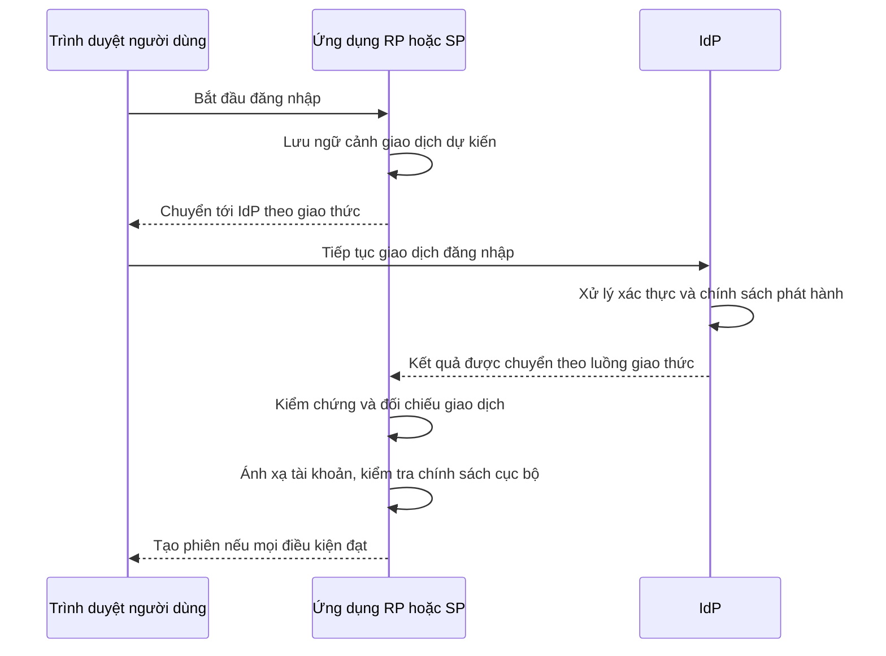

# Federation assertion — Thông điệp khẳng định trong liên kết danh tính

## 1. Assertion giải quyết vấn đề gì?

Trong một hệ thống liên kết danh tính, ứng dụng có thể cho người dùng đăng nhập dựa trên kết quả xác thực do một nhà cung cấp danh tính thực hiện. Ứng dụng cần một thông điệp có thể kiểm chứng để biết nhà cung cấp đó đã khẳng định điều gì về tài khoản đang đăng nhập.

**Federation assertion** là thông điệp khẳng định có thể kiểm chứng về một chủ thể hoặc tài khoản, được chuyển trong giao thức liên kết tới bên sử dụng kết quả. Trong bối cảnh đăng nhập, bên phát hành thường là **Identity Provider — IdP**, còn bên nhận là **Relying Party — RP**; trong SAML thường gọi bên cung cấp ứng dụng là **Service Provider — SP**. NIST mô tả assertion như thông điệp khẳng định có thể kiểm chứng mà RP sử dụng trong giao dịch federation. [NIST SP 800-63C, phần Introduction](https://pages.nist.gov/800-63-4/sp800-63c.html).

Ví dụ, nhân viên Lan mở cổng đào tạo của công ty. Cổng chuyển Lan tới IdP doanh nghiệp. Sau khi xử lý xác thực, IdP phát thông điệp dành cho cổng đào tạo. Cổng kiểm tra thông điệp, xác định tài khoản nội bộ tương ứng và tạo phiên theo chính sách của mình.

Điểm cốt lõi là cổng đào tạo dựa vào một quan hệ tin cậy với IdP, thay vì chỉ tin một tham số như `user=Lan` do trình duyệt gửi. Assertion giúp chuyển kết quả giữa hai miền quản trị, nhưng bên nhận vẫn phải kiểm tra thông điệp và quyết định có chấp nhận giao dịch đó hay không.

## 2. Ba câu hỏi cần tách biệt

Khi nhận một assertion, cần phân biệt ba câu hỏi:

| Câu hỏi | Ví dụ |
| --- | --- |
| Ai đã khẳng định? | IdP doanh nghiệp đã được cấu hình tin cậy |
| Khẳng định về ai và về điều gì? | Tài khoản có định danh xác định đã được xác thực, kèm một số thuộc tính |
| Ứng dụng cho phép làm gì? | Tài khoản được xem khóa học, nhưng chưa có quyền quản trị nội dung |

Chữ ký hợp lệ không tự trả lời câu hỏi thứ ba. Một người đăng nhập thành công vẫn có thể chưa được ghi danh khóa học hoặc bị hạn chế ở một tenant khác.

Tương tự, assertion có thuộc tính `department=finance` không tự tạo ra quyền duyệt thanh toán. Ứng dụng phải biết có tin nguồn phát thuộc tính đó không, hiểu giá trị trong phạm vi nào và ánh xạ nó theo chính sách nào.

Trong thực tế, cần thiết kế rõ phần nào IdP có thẩm quyền xác nhận và phần nào ứng dụng chịu trách nhiệm. Nếu không có ranh giới này, mọi claim do một đối tác gửi có thể vô tình trở thành quyền nội bộ.

## 3. Một assertion thường cần diễn đạt những gì?

Định dạng và trường cụ thể phụ thuộc giao thức. Có thể hiểu nội dung qua các nhóm khái niệm sau:

| Nhóm | Ý nghĩa |
| --- | --- |
| Issuer | Bên phát hành khẳng định |
| Subject | Chủ thể hoặc tài khoản mà khẳng định nói tới |
| Audience | Bên được phép sử dụng khẳng định |
| Thời gian | Thời điểm phát hành, giới hạn hiệu lực hoặc thông tin liên quan |
| Ngữ cảnh xác thực | Thông tin về sự kiện xác thực, khi giao thức và chính sách yêu cầu |
| Thuộc tính | Dữ liệu bổ sung như mã tổ chức hoặc thông tin hồ sơ đã được thỏa thuận |
| Liên kết giao dịch | Dữ liệu để đối chiếu với giao dịch đăng nhập theo profile đang dùng |
| Cơ chế bảo vệ | Bằng chứng về nguồn và tính toàn vẹn theo giao thức |

Đây là cách phân nhóm để học, không phải schema chung có thể gửi nguyên trạng tới mọi IdP. Không suy ra rằng mọi assertion đều có cùng tên trường, cùng loại subject hoặc cùng cơ chế chống phát lại.

Ví dụ mô hình khái niệm, không phải token hay thông điệp giao thức hợp lệ:

```text
Bên phát hành: IdP của công ty A
Chủ thể: một định danh tài khoản do IdP cấp
Bên nhận dự kiến: cổng đào tạo production của công ty A
Nội dung: thông tin xác thực và các thuộc tính đã thỏa thuận
Giới hạn: chỉ được xử lý trong cửa sổ và ngữ cảnh giao dịch cho phép
Bảo vệ: cơ chế kiểm chứng theo cấu hình federation đã được thiết lập
```

Một thiết kế an toàn phải giữ nguyên các giới hạn này trong quá trình xử lý. Không nên đọc subject từ một phần thông điệp, kiểm tra chữ ký ở phần khác rồi coi cả tài liệu là đáng tin.

## 4. Assertion trong SAML và OpenID Connect

### 4.1. SAML assertion

SAML định nghĩa assertion bằng XML, có thể chứa các statement về xác thực, thuộc tính hoặc quyết định phân quyền. Các cấu trúc như `Subject`, `Conditions`, `AudienceRestriction` và `SubjectConfirmation` diễn đạt chủ thể cùng điều kiện sử dụng. Trong dữ liệu subject confirmation, `Recipient` liên quan nơi nhận và `InResponseTo` liên quan yêu cầu trước đó; cách bắt buộc kiểm tra phụ thuộc profile. [OASIS SAML Core 2.0, mục 2](https://docs.oasis-open.org/security/saml/v2.0/saml-core-2.0-os.pdf).

Trong đăng nhập SAML, assertion thường được mang trong một response. Assertion và response không phải cùng một đối tượng. Cấu hình kiểm tra chữ ký và các trường ràng buộc phải theo profile, binding và thỏa thuận triển khai; không dùng quy tắc đơn giản “có một chữ ký ở đâu đó trong XML là đủ”.

Audience thường biểu diễn bên sử dụng khẳng định theo định danh giao thức; recipient liên quan điểm nhận khi được profile sử dụng. Hai khái niệm phục vụ hai kiểm tra khác nhau, không nên coi một URL khớp là đã thay thế mọi ràng buộc bên nhận.

### 4.2. ID Token trong OpenID Connect

Trong OpenID Connect, **ID Token** truyền thông tin về xác thực tới client/RP bằng JWT. Các claim thường gặp gồm `iss`, `sub`, `aud`, `exp`, `iat`; `nonce` phải được đối chiếu khi đã gửi trong yêu cầu. Quy tắc kiểm tra phụ thuộc luồng sử dụng. Cặp `iss` và `sub` là định danh ổn định của người dùng trong ngữ cảnh issuer; không thay bằng email để tự gộp tài khoản. [OpenID Connect Core, mục 2, 3.1.3.7 và 5.7](https://openid.net/specs/openid-connect-core-1_0.html#IDTokenValidation).

ID Token không phải access token dành cho API. Một ứng dụng không nên nhận một JWT bất kỳ rồi quyết định loại token chỉ vì nó có trường `sub`. Từng loại token cần đúng mục đích và đúng bộ quy tắc kiểm tra.

Authorization code cũng là một đối tượng khác: trong luồng dùng code, client đổi code tại token endpoint để nhận kết quả tương ứng. Không được lấy bản thân chuỗi code làm bằng chứng đã xác thực một danh tính.

### 4.3. Không ánh xạ máy móc giữa hai giao thức

Hai hệ thống có thể giải quyết nhu cầu đăng nhập tương tự nhưng có cấu trúc và quy tắc khác nhau. `InResponseTo` của SAML không phải tên khác của một trường JSON có thể tự thêm; `nonce` và trạng thái giao dịch OIDC cũng không biến thành cơ chế SAML chỉ bằng đổi tên.

Khi tích hợp, cần chọn giao thức, profile và thư viện tương ứng. Bảng khái niệm hữu ích để hiểu vai trò của dữ liệu, nhưng không thay thế đặc tả xử lý.

## 5. Một luồng đăng nhập ở mức khái niệm



Sơ đồ diễn đạt quan hệ logic. Kết quả có thể đi qua trình duyệt hoặc được lấy qua một bước trao đổi phía máy chủ tùy giao thức; mũi tên không quy định mọi assertion đều được POST trực tiếp từ IdP tới RP.

Người dùng có thể đã có phiên tại IdP nên không phải nhập lại mật khẩu trong mỗi giao dịch. Vì vậy, thời điểm một thông điệp mới được phát không tự chứng minh người dùng vừa thực hiện một lần xác thực mới hoặc vừa hoàn thành MFA.

Ví dụ, Lan đăng nhập IdP lúc 08:00 rồi mở cổng đào tạo lúc 10:00. Cổng có thể nhận thông điệp được phát lúc 10:00 dựa trên phiên đã tồn tại. Nếu một thao tác đặc biệt yêu cầu xác thực gần đây, cổng cần kiểm tra điều kiện đó theo giao thức và chính sách, thay vì chỉ nhìn thông điệp mới.

## 6. Kiểm chứng assertion trước khi tạo phiên

### 6.1. Thiết lập tin cậy trước khi tin dữ liệu nhận được

RP cần biết issuer nào được chấp nhận và cấu hình kiểm chứng nào thuộc issuer đó. NIST yêu cầu liên kết khóa kiểm chứng với định danh IdP, và bảo vệ việc lấy cấu hình hoặc khóa qua mạng. [NIST SP 800-63C, phần Discovery and Registration](https://pages.nist.gov/800-63-4/sp800-63c.html#discovery-and-registration).

Trong một hệ thống doanh nghiệp có tập đối tác được cấu hình trước, có thể suy ra yêu cầu thiết kế sau: không cho một thông điệp chưa được tin cậy tự chọn một IdP mới, một tenant mới hoặc nguồn khóa bất kỳ rồi đăng nhập như người nội bộ. Việc bổ sung quan hệ tin cậy phải đi qua quy trình được phép.

Một khóa có thể kiểm tra được chữ ký chỉ chứng minh quan hệ mật mã tương ứng. Ứng dụng còn phải biết khóa đó có thuộc bên được phép khẳng định cho giao dịch và phạm vi này không.

### 6.2. Kiểm tra bảo vệ mật mã và đúng loại thông điệp

Với JWT, bộ kiểm tra cần giới hạn thuật toán được phép, dùng khóa gắn đúng issuer, kiểm tra audience và phân biệt các loại JWT có mục đích khác nhau. Không để header của token tự mở rộng các thuật toán ứng dụng chấp nhận. [RFC 8725, mục 3](https://www.rfc-editor.org/rfc/rfc8725.html#section-3).

Ví dụ thiết kế: endpoint đăng nhập của cổng đào tạo không nên chia sẻ một hàm “accept any JWT” với API nhập liệu. Cả hai token có thể do cùng hệ thống phát hành nhưng phục vụ các bên nhận và mục đích khác nhau. Tách cấu hình kiểm tra giúp tránh việc một bằng chứng hợp lệ cho ngữ cảnh này bị dùng nhầm trong ngữ cảnh khác.

Với SAML, thư viện cần kiểm tra đúng phần dữ liệu được bảo vệ và phần được ứng dụng sử dụng; xử lý XML phải được cấu hình an toàn. Đây là một phần phòng ngừa lỗi như XML signature wrapping. Nên dùng thư viện giao thức được duy trì thay vì tự tìm một nút `Signature` rồi tự đọc các nút khác. [OWASP SAML Security, phần Validate Signatures](https://cheatsheetseries.owasp.org/cheatsheets/SAML_Security_Cheat_Sheet.html#validate-signatures).

### 6.3. Bên nhận, thời gian và giao dịch phải khớp

Một thông điệp thật vẫn có thể dành cho ứng dụng khác hoặc cho một lần đăng nhập khác. Vì vậy, ngoài nguồn phát, cần kiểm tra các điều kiện sử dụng mà giao thức quy định: bên nhận dự kiến, giới hạn thời gian, liên kết yêu cầu và chống phát lại.

Có thể dùng ba tình huống để hiểu mục đích các kiểm tra này:

- Nếu một assertion dành cho cổng đào tạo được đưa tới ứng dụng tài chính, ứng dụng tài chính không được coi “cùng IdP” là đủ để nhận.
- Nếu thông điệp nằm ngoài thời hạn cho phép, không nên nới cửa sổ chỉ để người dùng đăng nhập được; trước hết cần điều tra cấu hình thời gian và luồng xử lý.
- Nếu một callback không khớp giao dịch mà trình duyệt đang chờ, không nên tạo phiên chỉ vì subject trông hợp lệ.

Độ lệch đồng hồ có thể được xử lý trong một giới hạn được cấu hình theo chính sách, nhưng không nên trở thành ngoại lệ không giới hạn. Cũng không có một giá trị dung sai đúng cho mọi tích hợp.

Trong luồng có ngữ cảnh yêu cầu phía RP, ngữ cảnh đó cần được ràng buộc với trình duyệt hoặc phiên khởi tạo và được sử dụng theo quy tắc của luồng. Các luồng khởi tạo từ phía IdP có đặc tính khác, phải được hỗ trợ có chủ đích và có đánh giá rủi ro; không đơn giản bỏ kiểm tra tương quan khi gặp lỗi.

### 6.4. Xác minh kết quả và chính sách cục bộ

Trước khi tạo phiên, ứng dụng cần xác định giao thức báo thành công hay lỗi, tài khoản nội bộ nào tương ứng và tài khoản đó còn được phép đăng nhập không. Assertion từ nguồn tin cậy không buộc ứng dụng phải mở lại tài khoản đã bị khóa cục bộ theo chính sách hợp lệ.

Các claim về phương thức hoặc ngữ cảnh xác thực cũng phải được hiểu theo thỏa thuận. Ví dụ, nếu ứng dụng yêu cầu mức xác thực mạnh cho quản trị, việc một chuỗi có chữ `mfa` xuất hiện ở một thuộc tính tùy ý chưa đủ chứng minh yêu cầu đã đạt.

Không nên hiểu sai “đã xác thực” thành “đã kiểm chứng danh tính ngoài đời ở mức cao”. Độ tin cậy về hồ sơ danh tính, độ mạnh của xác thực và bảo vệ giao dịch liên kết là những vấn đề liên quan nhưng khác nhau.

## 7. Ánh xạ subject và thuộc tính thành tài khoản nội bộ

Giả sử công ty A và đối tác B cùng có một tài khoản tên `lan`. Nếu cổng chỉ dùng tên này làm khóa, hai danh tính có thể bị gộp nhầm. Ứng dụng cần định danh có ngữ cảnh issuer, đồng thời kiểm tra phạm vi tenant và quy tắc ánh xạ đã được thiết lập.

Trong SAML, ý nghĩa và độ ổn định của subject identifier phải được hiểu theo cấu hình định dạng và thỏa thuận với IdP. Không giả định mọi `NameID` đều là định danh lâu dài chỉ vì nó xuất hiện trong assertion.

Email hữu ích để liên hệ hoặc hiển thị, nhưng tự liên kết tài khoản chỉ vì email khớp có thể tạo đường chiếm tài khoản. Một quy trình liên kết danh tính cần bằng chứng và kiểm soát phù hợp đối với các tài khoản liên quan.

Việc ánh xạ group hoặc role cũng cần có phạm vi. Ví dụ:

```text
Nguồn: IdP đối tác B
Claim đã thỏa thuận: partner-training-participant
Ánh xạ cục bộ được phép: người học của tenant đối tác B

Không suy ra: quản trị viên toàn bộ cổng đào tạo
```

Tên `admin` từ một IdP đối tác không nên được ánh xạ tự động sang đặc quyền toàn hệ thống. Quyền cục bộ phải phản ánh thẩm quyền mà tổ chức đã trao cho nguồn phát và mục đích hợp tác cụ thể.

Tạo tài khoản khi đăng nhập lần đầu cũng cần chính sách riêng: quần thể nào được phép tạo, tenant nào được chọn, quyền mặc định nào được cấp và cách xử lý khi quan hệ hợp tác kết thúc. Assertion hợp lệ là đầu vào, không phải giấy phép tạo mọi loại tài khoản.

## 8. Chữ ký, mã hóa và việc nắm giữ assertion

**Chữ ký** hoặc cơ chế kiểm chứng nguồn và toàn vẹn theo giao thức không đồng nghĩa nội dung được giữ bí mật. Một thông điệp được ký có thể vẫn đọc được bởi nơi đang giữ nó. **Mã hóa** bảo vệ khả năng đọc nội dung cho bên có khóa giải mã, nhưng không cho phép bỏ các kiểm tra về bên phát, bên nhận và ngữ cảnh.

Một số assertion được sử dụng theo mô hình bearer: việc nắm giữ có thể cho phép trình bày assertion trong những điều kiện nhất định. Do đó, bảo vệ kênh truyền và tránh rò rỉ là cần thiết, nhưng thời hạn ngắn cũng không thay thế toàn bộ cơ chế chống phát lại. Một bản sao bị lộ có thể bị dùng ngay trong cửa sổ còn hợp lệ.

Những cơ chế ràng buộc với khóa hoặc bên trình bày phải được triển khai đúng profile khi được chọn. Không thể tự biến bearer assertion thành bằng chứng người giữ khóa chỉ bằng thêm một trường tùy ý vào payload.

Ví dụ vận hành: nhóm hỗ trợ yêu cầu người dùng gửi toàn bộ thông điệp đăng nhập để điều tra. Nếu thông điệp hoặc dữ liệu liên quan còn dùng được, kênh hỗ trợ có thể trở thành nơi lưu bằng chứng đăng nhập nhạy cảm. Nên thu thập mã lỗi, thời điểm, mã tương quan và dữ liệu đã che phù hợp, thay vì mặc định thu toàn bộ assertion.

## 9. Assertion khác phiên tại ứng dụng

Sau khi assertion được chấp nhận, RP có thể tạo phiên cục bộ. Từ đó cần quản lý riêng phiên, thời hạn, xác thực lại và các quyết định truy cập.

Ví dụ, assertion chỉ được nhận trong một cửa sổ ngắn nhưng phiên ứng dụng kéo dài lâu hơn. Không thể suy ra rằng lúc assertion hết hạn thì phiên cục bộ chắc chắn cũng kết thúc. Tương tự, khóa tài khoản tại IdP chưa chứng minh mọi phiên tại mọi RP đã bị đóng.

Vì vậy, thiết kế vòng đời truy cập cần trả lời: ứng dụng cập nhật tình trạng tài khoản bằng cách nào, khi nào kiểm tra lại, xử lý sự kiện thu hồi ra sao và thời gian quyền cũ có thể còn tác dụng là bao lâu. Những câu trả lời này thuộc thiết kế quản lý phiên và quyền, không chỉ định dạng assertion.

Claim về nhóm hoặc bộ phận cũng có thể cũ sau thời điểm phát hành. Không dùng một khẳng định từ lần đăng nhập trước làm nguồn quyền bất biến cho mọi thao tác nhạy cảm trong tương lai.

## 10. Giả mã về ranh giới xử lý

Đoạn sau chỉ minh họa trình tự tư duy cho một luồng do RP khởi tạo. Nó không phải bộ kiểm tra SAML hoặc OIDC hoàn chỉnh:

```text
context = lấy_ngữ_cảnh_đăng_nhập_đang_chờ(giao_dịch, trình_duyệt)
trust = lấy_cấu_hình_tin_cậy_được_phép(context)

verified = thư_viện_giao_thức.kiểm_chứng(
    thông_điệp_nhận_được,
    trust,
    context,
    thời_gian_hiện_tại
)

nếu kiểm_chứng_không_đạt:
    từ_chối_và_ghi_mã_lỗi_phù_hợp

account = ánh_xạ_subject_đã_kiểm_chứng_theo_issuer_và_tenant(verified)
kiểm_tra_trạng_thái_tài_khoản_và_chính_sách_đăng_nhập(account, verified)
hoàn_tất_giao_dịch_theo_quy_tắc_chống_phát_lại_của_luồng(context)
tạo_phiên_cục_bộ(account)
```

Điểm quan trọng là ứng dụng sử dụng kết quả **đã được thư viện kiểm chứng**, không lấy lại subject từ một bản payload chưa được kiểm tra. Việc hoàn tất giao dịch và chống xử lý lặp cần được phối hợp khi có nhiều máy chủ; cách thực hiện cụ thể phụ thuộc kiến trúc và giao thức.

Không tự suy ra từ giả mã rằng mọi loại assertion đều chỉ được dùng một lần theo cùng cách. Tính dùng một lần, lưu trạng thái và chống phát lại phải theo contract của luồng đang triển khai.

## 11. Những tình huống cần kiểm tra khi tích hợp

| Tình huống | Kết quả thiết kế cần đạt |
| --- | --- |
| Thông điệp từ issuer chưa được phép | Từ chối, không tự mở quan hệ tin cậy |
| Chữ ký không hợp lệ hoặc thuật toán ngoài cấu hình | Từ chối theo profile |
| Bằng chứng thật nhưng dành cho ứng dụng khác | Không tạo phiên ở ứng dụng hiện tại |
| Kết quả không khớp giao dịch đang chờ | Xử lý theo luồng được hỗ trợ, không bỏ kiểm tra để tiếp tục |
| Payload được giải mã hoặc decode nhưng chưa kiểm chứng | Chưa được dùng để xác định tài khoản |
| Subject chưa có ánh xạ hoặc tài khoản cục bộ bị khóa | Áp dụng chính sách cục bộ, không tự mở đặc quyền |
| Claim role từ đối tác có tên giống role nội bộ | Chỉ ánh xạ trong phạm vi được thỏa thuận |
| IdP thay khóa ký | Cập nhật qua nguồn tin cậy và chính sách chuyển đổi đã thiết kế |
| Quyền người dùng đổi sau lần đăng nhập | Dùng cơ chế cập nhật quyền và phiên phù hợp |

Một ca đăng nhập thành công chỉ chứng minh đường đi hợp lệ hoạt động trong tình huống đó. Các ca từ chối giúp kiểm tra ranh giới tin cậy: đúng bên phát, đúng bên nhận, đúng chủ thể, đúng giao dịch và đúng mục đích.

Federation assertion trở thành bằng chứng hữu ích khi RP kiểm chứng nó trong một quan hệ tin cậy có giới hạn, rồi áp dụng đúng chính sách tài khoản, phiên và phân quyền cục bộ. Chỉ đọc được nội dung hoặc thấy chữ ký hợp lệ là chưa đủ để kết luận người dùng được phép truy cập mọi chức năng.
