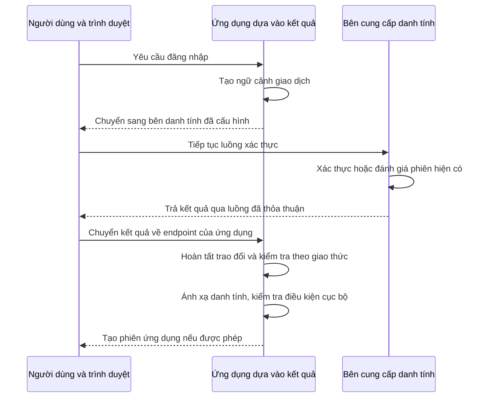

# Federation protocol

## 1. Giao thức giúp hai miền danh tính hiểu nhau

Một ứng dụng của đối tác muốn cho phép nhân viên công ty A đăng nhập bằng danh tính do công ty A quản lý. Ứng dụng không muốn lưu mật khẩu của nhân viên, còn công ty A cần kiểm soát cách xác thực và thông tin nào được chia sẻ.

Hai bên không thể chỉ thỏa thuận rằng “hãy gửi tên người dùng sang đây”. Bên nhận cần biết ai phát hành thông tin, thông tin dành cho ứng dụng nào, có bị sửa không, còn hiệu lực không và có thuộc đúng lượt đăng nhập đang diễn ra không.

**Federation protocol**, hay giao thức liên kết danh tính, là bộ quy tắc để các bên trao đổi và xử lý thông tin danh tính qua ranh giới tin cậy. Giao thức quy định vai trò, thông điệp, trình tự tương tác và điều kiện chấp nhận kết quả. Quan hệ tin cậy và chính sách của các bên quyết định nguồn nào được tin, tin trong phạm vi nào và kết quả đó được dùng vào việc gì.

Giao thức tạo ra cách giao tiếp thống nhất, nhưng không tự tạo ra một quan hệ tin cậy đúng. Hai hệ thống có thể cùng hỗ trợ một giao thức mà vẫn không tương tác được hoặc tương tác không an toàn nếu cấu hình endpoint, khóa, định danh, luồng hoặc chính sách không phù hợp.

## 2. Các vai trò trong một quan hệ federation

Một mô hình đăng nhập liên kết thường có những vai trò sau:

| Vai trò | Trách nhiệm trong mô hình |
|---|---|
| Chủ thể | Người dùng hoặc đối tượng được hệ thống nhận diện |
| Bên cung cấp danh tính | Xác thực chủ thể và phát hành thông tin theo quan hệ tin cậy |
| Bên dựa vào kết quả | Kiểm tra thông tin nhận được rồi quyết định có tạo ngữ cảnh đăng nhập tại ứng dụng hay không |
| Trình duyệt hoặc ứng dụng khách | Tham gia chuyển hướng hoặc truyền thông điệp trong luồng được sử dụng |
| Hệ thống tài nguyên | Thực thi yêu cầu truy cập vào dữ liệu hoặc chức năng, nếu kiến trúc có tách vai trò này |

Tên gọi cụ thể thay đổi theo giao thức. Trong SAML, người học thường gặp **Identity Provider**, viết tắt **IdP**, và **Service Provider**, viết tắt **SP**. Trong OpenID Connect, các tên tương ứng thường dùng là **OpenID Provider**, viết tắt **OP**, và **Relying Party**, viết tắt **RP**. Các vai trò có thể do cùng một sản phẩm đảm nhiệm nhưng không vì vậy mà có cùng trách nhiệm.

Ví dụ, một cổng danh tính có thể vừa phục vụ đăng nhập người dùng vừa phát hành token cho API. Việc cùng xuất phát từ một hệ thống không làm bằng chứng đăng nhập và credential gọi API trở thành một loại thông điệp.

Trình duyệt là thành phần tham gia vận chuyển, không phải cơ quan có thẩm quyền xác nhận một thông điệp đáng tin. Một giá trị xuất hiện ở callback vẫn cần được kiểm tra theo giao thức và cấu hình của bên nhận.

## 3. Một giao thức federation cần thống nhất những gì?

### 3.1. Định dạng và ý nghĩa thông tin

Các bên cần thống nhất cách biểu diễn thông tin như bên phát hành, chủ thể, bên nhận dự kiến, thời gian hiệu lực và các thuộc tính được chia sẻ. Một *claim* là thông tin được một bên phát biểu về chủ thể hoặc một sự kiện; một *assertion* là một dạng thông điệp khẳng định có cấu trúc theo giao thức.

Biết cách đọc JSON hoặc XML chỉ giúp xử lý cú pháp. Bên nhận còn phải hiểu thông tin đang nói về điều gì và điều kiện nào cho phép dựa vào thông tin đó.

### 3.2. Trình tự yêu cầu và phản hồi

Giao thức xác định bên nào khởi tạo, yêu cầu đi tới đâu, phản hồi trở về đâu và thông điệp nào được trao đổi trực tiếp giữa các máy chủ. Các luồng khác nhau có thể có yêu cầu bảo vệ khác nhau.

Không nên ghép bước của luồng này với quy tắc kiểm tra của luồng khác chỉ vì các thông điệp có tên gần giống nhau. Một ứng dụng cần xác định rõ giao thức, phiên bản, luồng và các phần mở rộng đang áp dụng.

### 3.3. Vận chuyển và profile

Một bộ tiêu chuẩn có thể tách định dạng thông điệp, cách vận chuyển và cách sử dụng chúng cho một mục tiêu. Trong cách tổ chức đó, **binding** mô tả cách ánh xạ thông điệp lên cơ chế truyền; **profile** kết hợp các thành phần và ràng buộc cho một trường hợp sử dụng cụ thể.

Vì vậy, tuyên bố “hỗ trợ SAML” chưa đủ mô tả khả năng đăng nhập tương thích. Hai bên còn cần thống nhất profile, binding và các yêu cầu cấu hình liên quan. Cũng không nên suy ra rằng mọi giao thức đều có cùng cách tổ chức profile và binding.

### 3.4. Điều kiện chấp nhận và xử lý lỗi

Một phản hồi có thể đúng cấu trúc nhưng không đáng tin, hết hạn, gửi nhầm bên nhận hoặc không thuộc một giao dịch được cho phép. Giao thức cần được triển khai cùng các quy tắc kiểm tra phù hợp; ứng dụng không được coi việc parse thành công là đăng nhập thành công.

Khi không đạt điều kiện, bên nhận phải dừng đường xử lý tạo danh tính đăng nhập tương ứng. Thông tin lỗi cho người dùng và nhật ký vận hành cần đủ để xử lý sự cố mà không làm lộ bí mật hay toàn bộ credential.

## 4. SAML, OpenID Connect và OAuth 2.0

### 4.1. SAML 2.0

SAML định nghĩa assertion mã hóa bằng XML về xác thực, thuộc tính và quyết định phân quyền, cùng các giao thức trao đổi thông tin đó. Trong đăng nhập liên kết, các bên áp dụng profile phù hợp để SP dựa vào kết quả từ IdP. Assertion không phải mật khẩu của người dùng. [Đặc tả SAML 2.0 Core của OASIS](https://docs.oasis-open.org/security/saml/v2.0/saml-core-2.0-os.pdf).

Khi học một luồng SAML, cần phân biệt yêu cầu xác thực, phản hồi chứa kết quả và assertion mà ứng dụng thực sự sử dụng. Kiểm tra một phần của phản hồi nhưng sử dụng một phần khác không được kiểm tra có thể phá vỡ ý nghĩa bảo vệ của toàn bộ luồng.

### 4.2. OpenID Connect

OpenID Connect, viết tắt OIDC, bổ sung lớp danh tính trên OAuth 2.0. **ID Token** truyền thông tin về việc xác thực người dùng cho RP. Nó có mục đích khác với access token dùng để truy cập tài nguyên. Các quy tắc kiểm tra phụ thuộc luồng OIDC được sử dụng. [OpenID Connect Core 1.0](https://openid.net/specs/openid-connect-core-1_0.html).

Trong một kiến trúc ứng dụng, việc nhận diện người dùng và việc gọi API có thể diễn ra trong cùng hành trình, nhưng vẫn phải tách mục đích xử lý của từng loại thông điệp. Không nên đưa bất kỳ chuỗi có dạng token nào vào một hàm chung rồi mặc định coi nó là bằng chứng đăng nhập.

### 4.3. OAuth 2.0 không tự trở thành giao thức đăng nhập

OAuth 2.0 là framework cho phép ứng dụng nhận quyền truy cập giới hạn tới dịch vụ HTTP, có thể thay mặt chủ tài nguyên hoặc cho chính ứng dụng. Chỉ riêng việc nhận access token không định nghĩa đầy đủ cách một ứng dụng xác thực danh tính người dùng để đăng nhập. [RFC 6749 — OAuth 2.0 Authorization Framework](https://www.rfc-editor.org/rfc/rfc6749).

Từ đó, khi một yêu cầu tích hợp nói “dùng OAuth để đăng nhập”, cần xác định lớp danh tính hoặc profile cụ thể, vai trò các bên và quy tắc chấp nhận kết quả. Không tự suy ra người sở hữu tài nguyên từ bất kỳ nội dung token nào mà ứng dụng đọc được.

| Khái niệm | Vai trò cần nhớ |
|---|---|
| SAML trong một profile đăng nhập phù hợp | Trao đổi thông tin để SP dựa vào kết quả của IdP |
| OpenID Connect | Lớp danh tính với ID Token và quy tắc xác thực tương ứng |
| OAuth 2.0 | Ủy quyền truy cập tài nguyên theo framework và profile áp dụng |
| JWT | Định dạng biểu diễn thông tin; bản thân tên định dạng không xác định một luồng đăng nhập |
| SSO | Trải nghiệm sử dụng một lần xác thực cho nhiều ứng dụng; không phải tên của một giao thức duy nhất |

## 5. Hình dung một luồng đăng nhập liên kết

Sơ đồ sau là mô hình khái niệm của một luồng qua trình duyệt. Nó không thay thế các bước và yêu cầu cụ thể của SAML hoặc OIDC:



Trong một luồng có mã trung gian, ứng dụng còn có thể cần trao đổi mã với máy chủ của bên phát hành trước khi có thông tin danh tính để kiểm tra. Không phải mọi nội dung đều được chuyển trực tiếp qua trình duyệt, và callback không phải lúc nào cũng mang ngay bằng chứng cuối cùng.

Nếu người dùng đã có phiên phù hợp tại bên cung cấp danh tính, bên đó có thể không yêu cầu nhập lại credential trong mọi lần chuyển hướng. Tuy nhiên, điều kiện xác thực của ứng dụng có thể yêu cầu một kết quả khác hoặc mới hơn. SSO không có nghĩa là ứng dụng phải chấp nhận mọi phiên hiện có.

## 6. Quan hệ tin cậy phải có trước quyết định chấp nhận

Ứng dụng cần cấu hình hoặc thiết lập quan hệ tin cậy qua cơ chế được kiểm soát. Những thông tin liên quan có thể gồm định danh bên phát hành, định danh ứng dụng, endpoint, khóa hoặc chứng thư, thuật toán được phép, địa chỉ callback và các quy tắc thuộc tính.

Không nên lấy toàn bộ cấu hình tin cậy từ một thông điệp chưa được xác minh. Ví dụ, nếu kẻ gửi tự chọn nơi tải khóa rồi ứng dụng dùng khóa đó để xác nhận chính thông điệp của kẻ gửi, kết quả “chữ ký hợp lệ” không tạo được sự tin cậy cần thiết.

Trong hệ thống nhiều tenant, việc chọn quan hệ tin cậy phải gắn với đúng tenant và ngữ cảnh giao dịch. Không được để một trường tự khai trong thông điệp mở quyền chọn bất kỳ nguồn danh tính nào rồi đăng nhập vào tenant khác.

Metadata hoặc cơ chế khám phá cấu hình giúp giảm việc nhập tay, nhưng dữ liệu nhận được vẫn cần gắn với nguồn đã được chấp nhận và quy trình cập nhật phù hợp. Tự động hóa tải cấu hình không đồng nghĩa tự động tin mọi endpoint trên Internet.

## 7. Kiểm tra kết quả: chữ ký chỉ là một phần

Các nhóm kiểm tra dưới đây là khung tư duy tổng quát. Tên trường, điều kiện bắt buộc và cách thực hiện phải lấy từ giao thức, profile và luồng cụ thể, không dùng bảng này như đặc tả triển khai hoàn chỉnh.

| Nhóm kiểm tra | Câu hỏi cần trả lời | Rủi ro nếu bỏ qua |
|---|---|---|
| Loại thông điệp và ngữ cảnh | Đây có phải loại kết quả mà endpoint đang chờ không? | Dùng nhầm credential hoặc phản hồi của luồng khác |
| Bên phát hành | Có đúng nguồn danh tính được chấp nhận cho giao dịch này không? | Tin thông tin từ một nguồn không có thẩm quyền |
| Bảo vệ thông điệp | Tính toàn vẹn và nguồn gốc có được xác minh bằng cơ chế phù hợp không? | Chấp nhận thông tin bị sửa hoặc bị giả mạo |
| Bên nhận và điểm tiếp nhận | Kết quả có được phát hành cho ứng dụng và đường tiếp nhận tương ứng không? | Dùng lại kết quả dành cho nơi khác |
| Thời gian và điều kiện | Kết quả còn hiệu lực và thỏa điều kiện sử dụng không? | Chấp nhận thông tin quá cũ hoặc ngoài phạm vi |
| Liên kết giao dịch | Kết quả có gắn đúng lượt tương tác cần được bảo vệ không? | Nhầm ngữ cảnh đăng nhập hoặc chấp nhận dữ liệu bị phát lại |
| Trạng thái xử lý | Kết quả thành công hay báo lỗi; có phần nào không được phép sử dụng không? | Tạo phiên từ một phản hồi không đạt yêu cầu |

Trong OIDC, `iss` xác định bên phát hành và `aud` phải phù hợp với client theo quy tắc kiểm tra ID Token. Với SAML, assertion có thể chứa điều kiện giới hạn audience cùng điều kiện thời gian. Không thể chỉ kiểm tra chữ ký rồi bỏ qua ngữ nghĩa của bên nhận và điều kiện sử dụng. [OIDC ID Token Validation](https://openid.net/specs/openid-connect-core-1_0.html#IDTokenValidation), [SAML Core — Conditions](https://docs.oasis-open.org/security/saml/v2.0/saml-core-2.0-os.pdf).

Trong luồng OAuth/OIDC có authorization code, bảo vệ chuyển hướng và trao đổi mã cũng là một phần của thiết kế. Cần áp dụng yêu cầu bảo mật phù hợp với loại client, gồm cơ chế như PKCE và kiểm tra redirect URI; không dùng một ví dụ luồng cũ làm tiêu chuẩn bảo mật đầy đủ. [RFC 9700 — OAuth 2.0 Security Best Current Practice](https://www.rfc-editor.org/rfc/rfc9700.html).

Khi triển khai, nên dùng thư viện giao thức được duy trì và cấu hình cơ chế kiểm tra của nó đúng ngữ cảnh. Tự giải mã token rồi đọc trường người dùng, hoặc tự parse XML rồi chọn một nút có tên giống assertion, không thay thế được bộ xử lý giao thức an toàn.

## 8. Từ danh tính liên kết sang tài khoản và quyền cục bộ

### 8.1. Ánh xạ danh tính

Bên nhận cần ánh xạ danh tính bên ngoài tới một chủ thể cục bộ mà không nhập nhầm hai người. Trong OIDC, cặp `iss` và `sub` là căn cứ định danh ổn định theo đặc tả; không dùng riêng email như một bảo đảm tương đương. [OIDC — Claim Stability and Uniqueness](https://openid.net/specs/openid-connect-core-1_0.html#ClaimStability).

Một mô hình ứng dụng minh họa là:

```text
Quan hệ tin cậy đã chọn
    + định danh chủ thể từ nguồn được chấp nhận
    + ngữ cảnh tenant của ứng dụng
    → chủ thể cục bộ
    → tài khoản, trạng thái và quyền cục bộ
```

Đây là mô hình ánh xạ, không phải công thức định danh dùng chung cho mọi giao thức. Với mỗi loại định danh, cần hiểu phạm vi duy nhất, khả năng thay đổi và điều kiện được phép liên kết với tài khoản đã tồn tại.

Liên kết tài khoản là thao tác có tác động an toàn. Không nên tự gộp hai tài khoản chỉ vì tên hiển thị giống nhau hoặc một địa chỉ email xuất hiện từ nguồn chưa đủ thẩm quyền.

### 8.2. Phân quyền sau đăng nhập

Federation cung cấp thông tin để nhận diện và xây dựng ngữ cảnh. Ứng dụng vẫn cần quyết định quyền trên tài nguyên của mình theo chính sách.

Ví dụ, một IdP đối tác được tin để nhận diện nhân viên của đối tác. Điều đó không có nghĩa đối tác được quyền tự cấp vai trò quản trị cho ứng dụng của bên nhận. Nếu thông điệp có thuộc tính `role=admin`, ứng dụng phải biết nguồn đó có được ủy quyền phát biểu thuộc tính ấy trong phạm vi tương ứng hay không và có chính sách ánh xạ nào được phép.

Tương tự, một tín hiệu về cách người dùng đã xác thực chỉ có ý nghĩa khi hai bên thống nhất cách hiểu và mức tin cậy. Không nên suy ra mọi giá trị mang tên “MFA” từ mọi nguồn đều đáp ứng yêu cầu cho hành động nhạy cảm của ứng dụng.

## 9. Những việc federation protocol không tự hoàn tất

### 9.1. Tạo và thu hồi tài khoản

Một hệ thống có thể tạo tài khoản cục bộ khi lần đầu nhận một đăng nhập hợp lệ. Đó là chính sách provisioning kết hợp với federation, không phải kết quả bắt buộc của mọi giao thức.

Ngược lại, khi tài khoản phía nguồn bị khóa, ứng dụng đích có thể vẫn còn tài khoản và phiên riêng. Cần quy trình vòng đời, thu hồi phiên, credential và quyền theo khả năng tích hợp thực tế. Không nên chờ người dùng đăng nhập lại mới phát hiện rằng quan hệ truy cập đã chấm dứt.

### 9.2. Đồng nhất mọi phiên đăng nhập

Phiên ở bên cung cấp danh tính và phiên ở ứng dụng là những trạng thái khác nhau. Hết hạn hoặc logout ở một nơi không mặc nhiên kết thúc mọi phiên ở nơi còn lại.

Nếu muốn phối hợp logout hoặc phản ứng với sự kiện bảo mật, các bên cần thống nhất và triển khai cơ chế tương ứng. Đăng nhập liên kết hoạt động thành công chưa chứng minh luồng logout và thu hồi đã được bao phủ.

### 9.3. Bảo mật toàn bộ dữ liệu đã chia sẻ

Bảo vệ tính toàn vẹn không đồng nghĩa mã hóa để giữ bí mật nội dung. Kết nối truyền, thông điệp, nhật ký và dữ liệu lưu trữ có những yêu cầu bảo vệ riêng.

Chỉ nên trao đổi các thuộc tính cần cho mục đích đã xác định. Việc ứng dụng có khả năng nhận nhiều thuộc tính không tạo ra nhu cầu nghiệp vụ để thu thập tất cả. Credential, token hoặc assertion đầy đủ không nên bị ghi tùy tiện vào log để xử lý lỗi.

## 10. Vận hành quan hệ federation

Các bên cần quản lý thay đổi của endpoint, khóa, chứng thư và chính sách. Một quan hệ đang hoạt động có thể bị gián đoạn khi khóa đổi mà bên nhận chưa cập nhật hoặc khi callback không còn khớp cấu hình.

Quy trình thay đổi cần kiểm tra khả năng tiếp nhận cấu hình mới, khoảng chuyển tiếp được cho phép, cách phát hiện lỗi và cách loại bỏ cấu hình cũ. Không nên sửa lỗi xác thực bằng cách tắt kiểm tra chữ ký, audience hoặc nguồn phát hành.

Một số tình huống để hiểu chất lượng tích hợp:

| Tình huống | Hành vi cần quan sát |
|---|---|
| Nguồn phát hành không thuộc quan hệ tin cậy | Kết quả bị từ chối trước khi tạo phiên |
| Kết quả dành cho ứng dụng khác | Không được dùng để đăng nhập vào ứng dụng hiện tại |
| Thông điệp hết hiệu lực | Bị xử lý theo điều kiện thời gian của luồng áp dụng |
| Callback bị dùng sai ngữ cảnh | Không bị gắn vào một lượt đăng nhập không tương ứng |
| Hai tenant có người dùng cùng email | Không tự gộp tài khoản hoặc cấp quyền chéo tenant |
| Khóa được thay theo quy trình | Hệ thống tiếp tục xác minh đúng nguồn qua cấu hình được kiểm soát |
| Tài khoản cục bộ bị đình chỉ | Đăng nhập từ nguồn hợp lệ không tự bỏ qua đình chỉ |
| Đối tác gửi một vai trò có tác động cao | Chỉ được sử dụng nếu chính sách tin cậy và ánh xạ cho phép |

Nhật ký nên ghi mã tương quan, quan hệ tin cậy, loại lỗi và kết quả xử lý phù hợp. Cần đủ thông tin để phân biệt lỗi vận chuyển, lỗi kiểm tra giao thức, lỗi ánh xạ và lỗi chính sách cục bộ mà không làm lộ toàn bộ thông điệp nhạy cảm.

## 11. Những điểm cần ghi nhớ

Federation protocol là cách các bên trao đổi và xử lý thông tin danh tính qua ranh giới tin cậy. Để hiểu một tích hợp, cần biết vai trò, loại thông điệp, luồng, cơ chế bảo vệ và điều kiện chấp nhận, thay vì chỉ nhận biết tên SAML, OIDC hay định dạng token.

Một kết quả được phát hành hợp lệ vẫn phải đúng nguồn, đúng bên nhận, đúng ngữ cảnh và thỏa điều kiện sử dụng. Sau đó, ứng dụng còn phải ánh xạ danh tính, kiểm tra trạng thái cục bộ và áp dụng chính sách quyền. Federation hỗ trợ đăng nhập liên kết; provisioning, quản lý phiên, thu hồi và identity governance tiếp tục quyết định vòng đời truy cập thực tế.
