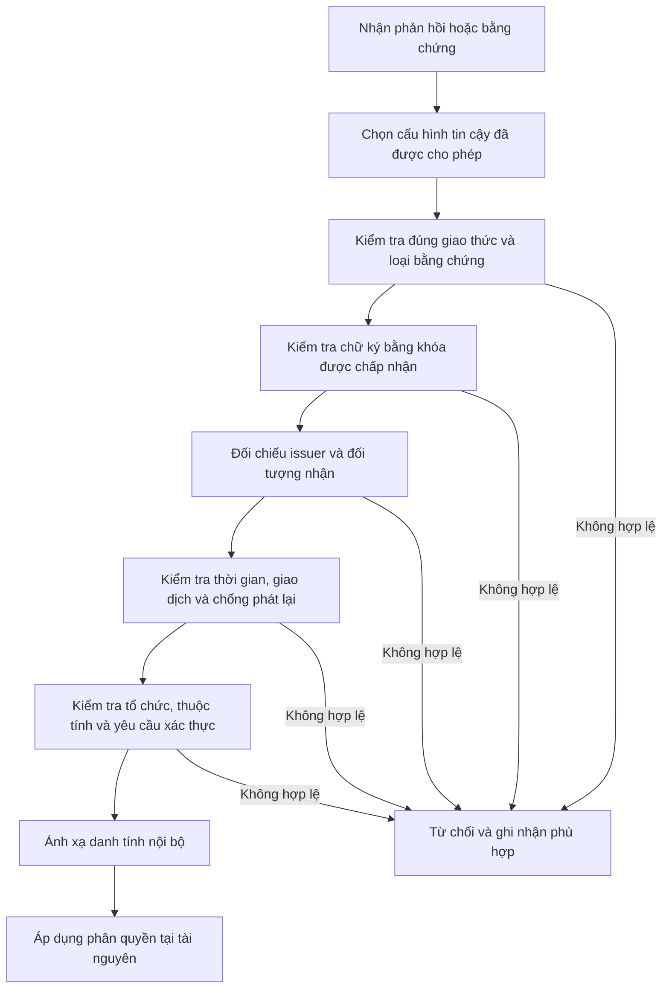

# Trust relationship

## 1. Quan hệ tin cậy trong federation là gì?

**Trust relationship** là quan hệ trong đó một bên chấp nhận một số thông tin hoặc bằng chứng do bên khác cung cấp, trong phạm vi và theo những điều kiện đã xác định. Trong federation, ứng dụng có thể dựa vào kết quả xác thực của Identity Provider — IdP để nhận biết người dùng mà không tự nhận mật khẩu của họ.

Ví dụ, ứng dụng của công ty A cho nhân viên đối tác B đăng nhập bằng IdP của B. A đang chấp nhận B xác thực một tập danh tính theo thỏa thuận. Điều đó không có nghĩa mọi người thuộc B được vào mọi tài nguyên của A, hay bất kỳ thuộc tính nào B gửi cũng trở thành quyền quản trị.

Một quan hệ tin cậy cần trả lời được:

- Tin bên nào, với định danh cụ thể nào?
- Tin bên đó làm hoặc xác nhận điều gì?
- Chấp nhận loại bằng chứng nào và kiểm tra bằng cách nào?
- Bằng chứng được dùng cho ứng dụng, tổ chức và tài nguyên nào?
- Những giới hạn về thời gian, xác thực và vòng đời là gì?
- Ai có quyền tạo, thay đổi và chấm dứt quan hệ?

Tin cậy ở đây là một quyết định được thực thi bằng cấu hình, kiểm tra giao thức và quản trị vận hành. Nó không chỉ là tuyên bố hai tổ chức “tin nhau”.

## 2. Tin cậy có chiều và có phạm vi

Giả sử ứng dụng RP của A chấp nhận danh tính từ IdP của B:

```text
Ứng dụng RP của A
    -- chấp nhận bằng chứng danh tính trong phạm vi đã cấu hình -->
IdP của B
```

Mũi tên trên mô tả bên đặt niềm tin vào bên phát hành, không phải chiều truyền thông điệp. Bằng chứng thực tế thường đi từ IdP đến bên tiếp nhận qua luồng giao thức.

Quan hệ đó không tự có nghĩa IdP của B cũng chấp nhận danh tính của A. Nếu cần liên kết theo chiều ngược lại, hai bên phải thiết lập những điều kiện tương ứng.

Phạm vi tin cậy có thể khác nhau:

| Phạm vi | Ví dụ | Giới hạn cần giữ |
|---|---|---|
| Xác thực | Chấp nhận B xác thực nhân viên của B | Không tự chứng minh họ có nhiệm vụ trong hệ thống của A |
| Thuộc tính | Chấp nhận mã nhân viên hoặc đơn vị từ nguồn đã thỏa thuận | Không tin mọi trường do người dùng tự sửa |
| Mức bảo đảm | Chấp nhận ngữ cảnh xác thực đáp ứng yêu cầu cụ thể | Không đồng nhất mọi lần đăng nhập hoặc mọi nhãn MFA |
| Đối tượng nhận | Chấp nhận bằng chứng dành cho ứng dụng đối tác | Không dùng lại cho ứng dụng quản trị khác |
| Tổ chức hoặc tenant | Cho phép danh tính thuộc tổ chức B đã được kết nối | Không cho mọi tenant dùng cùng nền tảng IdP |
| Thời gian và vòng đời | Chấp nhận khi quan hệ còn hiệu lực và bằng chứng còn hợp lệ | Không kéo dài vô hạn khi hợp đồng hoặc tài khoản đã kết thúc |

Một IdP có thể đáng tin để xác nhận tên người dùng nhưng không có thẩm quyền quyết định vai trò quản trị tại ứng dụng của bên nhận. Các thuộc tính cần được đánh giá theo nguồn và ý nghĩa, không chỉ theo việc chúng xuất hiện trong một thông điệp có chữ ký.

## 3. Ba lớp tạo nên một quan hệ tin cậy

### Lớp kỹ thuật

Lớp kỹ thuật định nghĩa cách nhận diện bên phát hành, phân phối khóa và kiểm tra bằng chứng. Nó bao gồm định danh issuer hoặc entity ID, endpoint, đăng ký ứng dụng, loại thông điệp, khóa tin cậy và các điều kiện giao thức.

Lớp này giúp ngăn những tình huống như thông điệp bị sửa, bằng chứng từ sai nguồn, token dành cho ứng dụng khác hoặc phản hồi không thuộc giao dịch hiện tại.

### Lớp chính sách

Lớp chính sách xác định thông tin nào được chấp nhận và sẽ được sử dụng như thế nào. Ví dụ:

- Chỉ cho một tập người dùng hoặc tổ chức được đăng nhập.
- Yêu cầu một mức xác thực phù hợp cho tài nguyên nhạy cảm.
- Chỉ nhận những thuộc tính cần thiết.
- Ánh xạ nhóm đối tác sang một vai trò nội bộ có phạm vi hẹp.
- Từ chối nếu không xác định được tổ chức hoặc quyền sử dụng hợp lệ.

### Lớp quản trị và vận hành

Lớp này xác định owner, phê duyệt thay đổi, xoay khóa, giám sát, xử lý sự cố và kết thúc liên kết. Chữ ký có thể vẫn đúng trong khi thỏa thuận nghiệp vụ đã hết hiệu lực hoặc mapping quyền đã bị thay đổi sai.

Một thiết kế chỉ có khóa ký nhưng không có owner và cách thu hồi là một quan hệ khó kiểm soát. Ngược lại, thỏa thuận nghiệp vụ đầy đủ nhưng ứng dụng không kiểm tra audience vẫn có thể tiếp nhận bằng chứng sai đối tượng.

## 4. Điểm bắt đầu tin cậy: issuer, metadata và khóa

### Không để bằng chứng tự quyết định ai đáng tin

Một token hoặc assertion có thể tự khai báo bên phát hành và thông tin khóa. Các trường đó là dữ liệu chưa đáng tin cho đến khi được đối chiếu và xác minh theo cấu hình phù hợp.

Ứng dụng cần bắt đầu từ một nguồn tin cậy đã được xác lập, chẳng hạn cấu hình issuer và nguồn metadata được quản lý. Không lấy một địa chỉ tải khóa bất kỳ từ thông điệp đầu vào, tải khóa tại đó rồi coi chữ ký kiểm tra thành công là đủ.

Nếu làm như vậy, bên gửi có thể đưa cả thông điệp lẫn khóa của chính họ và khiến việc “kiểm tra chữ ký” mất ý nghĩa về nguồn tin cậy.

### Metadata mô tả quan hệ, nhưng cũng cần được bảo vệ

Metadata có thể mô tả định danh bên phát hành, endpoint và khóa kiểm tra. Cơ chế lấy, xác minh và cập nhật metadata phải nằm trong thiết kế tin cậy.

Trong OIDC, cấu hình provider và JWKS có thể hỗ trợ tìm thông tin giao thức và khóa công khai. Trong SAML, metadata có thể mô tả IdP, SP, các endpoint và khóa liên quan. Cách phân phối và xác minh cụ thể phụ thuộc profile và triển khai.

Tên miền có HTTPS không tự đồng nghĩa mọi IdP tại tên miền đó được ứng dụng chấp nhận. HTTPS bảo vệ kết nối đến endpoint được xác minh theo cơ chế TLS; ứng dụng vẫn phải đối chiếu đúng issuer, tenant, metadata và chính sách của quan hệ.

Tương tự, chứng thư chứa khóa ký SAML cần được chấp nhận theo cơ chế tin cậy đã cấu hình. Không đánh đồng việc kiểm tra chứng thư TLS của một website với toàn bộ cách xác lập khóa ký cho thông điệp federation.

### Không chia sẻ khóa riêng để thể hiện sự tin cậy

Trong mô hình ký bất đối xứng, bên phát hành giữ khóa riêng và bên xác minh sử dụng khóa công khai tương ứng. Bên nhận không cần giữ khóa riêng ký danh tính của IdP.

Nếu ứng dụng có khóa riêng để ký yêu cầu hoặc có credential để xác thực client, chúng phục vụ trách nhiệm của ứng dụng đó. Không dùng chung credential giữa nhiều client chỉ để làm việc tích hợp thuận tiện hơn.

OIDC có cả client công khai và client có khả năng bảo vệ bí mật. Quan hệ tin cậy không có nghĩa mọi client đều phải giữ một secret. Cơ chế client authentication và các bảo vệ như PKCE phải phù hợp với loại client và luồng được triển khai.

## 5. Kiểm tra bằng chứng theo đúng ngữ cảnh

Có thể hình dung quá trình tiếp nhận bằng chứng như các cổng nối tiếp:



Đây là mô hình khái niệm, không phải thứ tự xử lý cố định cho mọi thư viện. Mỗi giao thức có chi tiết kiểm tra riêng. Điều cần giữ là không sử dụng thuộc tính để tạo phiên hoặc cấp quyền trước khi hoàn thành các kiểm tra bắt buộc.

| Điều kiện | Ý nghĩa | Ví dụ lỗi cần ngăn |
|---|---|---|
| Đúng loại bằng chứng | Bằng chứng được sử dụng đúng mục đích | Nhận ID token như access token cho một API |
| Đúng nguồn | Thông điệp thuộc issuer và khóa được chấp nhận | Tin một issuer khác chỉ vì dùng cùng nền tảng |
| Đúng đối tượng nhận | Bằng chứng dành cho ứng dụng hoặc tài nguyên này | Dùng token của ứng dụng A để vào ứng dụng B |
| Đúng thời gian | Điều kiện hiệu lực được đáp ứng | Chấp nhận bằng chứng hết hạn |
| Đúng giao dịch | Phản hồi gắn với luồng mà ứng dụng đang thực hiện | Tiếp nhận một kết quả đăng nhập ngoài ngữ cảnh |
| Chống phát lại phù hợp | Bằng chứng không được sử dụng ngoài cách giao thức cho phép | Tái sử dụng assertion trong một phiên đăng nhập khác |
| Đúng chính sách | Tổ chức, chủ thể và ngữ cảnh đáp ứng yêu cầu | Cho người ngoài phạm vi tenant vào dữ liệu nội bộ |

Trong OIDC, việc kiểm tra ID token bao gồm các yêu cầu của profile liên quan đến issuer, audience, chữ ký, thời gian và những ràng buộc khác. State, nonce, PKCE và client authentication bảo vệ những khía cạnh khác nhau của luồng; không coi một cơ chế là thay thế hoàn toàn cho các cơ chế còn lại.

Trong SAML, SP cần kiểm tra thông điệp và assertion được sử dụng, nguồn phát hành, điều kiện, audience, thông tin nhận và liên kết yêu cầu phù hợp với luồng. Không áp dụng máy móc logic kiểm tra JWT cho một assertion XML.

Nếu có hỗ trợ luồng do IdP khởi tạo, phải thiết kế theo profile và chính sách dành cho luồng đó. Không đơn giản bỏ mọi kiểm tra liên kết giao dịch chỉ để một thông điệp không khớp yêu cầu được chấp nhận.

Việc triển khai nên dựa trên thư viện giao thức phù hợp. Pseudocode sau chỉ mô tả ranh giới trách nhiệm:

```text
function establishApplicationSession(response, loginTransaction):
    trust = loadApprovedTrustFor(loginTransaction)

    require trust.isEnabled
    identityEvidence = validateUsingConfiguredProtocolProfile(
        response, loginTransaction, trust
    )

    require identityEvidence.organization in trust.allowedOrganizations
    require evidenceMeetsAuthenticationPolicy(identityEvidence, trust)

    internalIdentity = mapValidatedExternalIdentity(identityEvidence, trust)
    require localAccountMaySignIn(internalIdentity)

    return createLocalSession(internalIdentity, trust.configurationVersion)
```

Không được thay phần kiểm tra giao thức bằng một hàm chỉ giải mã payload. Phần phân quyền cho từng tài nguyên tiếp tục được thực hiện sau khi có phiên.

## 6. Tin danh tính không có nghĩa giao toàn quyền phân quyền

Giả sử IdP của đối tác B phát hành một thuộc tính nhóm có giá trị `admin`. Ứng dụng của A không nên tự ánh xạ chuỗi này thành quản trị toàn bộ hệ thống.

Một mapping có kiểm soát cần xét ít nhất bên phát hành, tổ chức, định danh nhóm ổn định nếu có, ý nghĩa nghiệp vụ và phạm vi tài nguyên đích.

Ví dụ một chính sách minh họa:

```yaml
trustId: partner-b-portal
configurationVersion: 3
enabled: true
identitySource:
  protocol: OIDC
  expectedIssuer: "https://identity.partner-b.example.org"
  clientId: "partner-portal-a"
allowedOrganizations:
  - partner-b
identityMapping:
  externalKey:
    - issuer
    - subject
authorization:
  defaultRole: partner-pending
  permittedRoleMappings:
    - externalGroup: project-a-readers
      localRole: project-a-reader
      resourceScope: project-a
```

Đây là cấu trúc học tập, không phải cấu hình đầy đủ hay schema của một sản phẩm. Nó không mô tả hết cách kiểm tra token, nguồn khóa, giao dịch đăng nhập hoặc xác minh tổ chức.

Ý nghĩa của ví dụ là phạm vi tin cậy được giới hạn: một issuer đã duyệt, một ứng dụng nhận và một mapping đọc trong dự án A. Role `partner-pending` được hiểu là chưa có quyền đọc tài nguyên cho đến khi đáp ứng điều kiện của ứng dụng; không mặc định mọi danh tính liên kết đều có quyền sử dụng.

Danh tính nội bộ cũng không nên được ghép chỉ bằng email. Với OIDC, cặp issuer và subject giúp đặt định danh trong đúng nguồn phát hành. Với giao thức khác, cần một hợp đồng định danh có phạm vi, tính ổn định và cách xử lý thay đổi rõ ràng.

Khi thay đổi nguồn danh tính, không tự coi cùng tên đăng nhập hoặc email là bằng chứng đủ để nối vào một tài khoản nội bộ đã có đặc quyền.

## 7. Broker và vấn đề tin cậy gián tiếp

Giả sử ứng dụng A tin broker B, còn B có thể tiếp nhận danh tính từ IdP C:

```text
Ứng dụng A
  -> tin bằng chứng do broker B phát hành
       -> broker B có quan hệ riêng với IdP C
```

A không tự động có một quan hệ tin cậy trực tiếp với C. A nhận bằng chứng từ B và cần hiểu B sẽ chấp nhận những nguồn nào, xử lý thuộc tính ra sao và bảo đảm điều kiện xác thực như thế nào.

Nếu B thêm một IdP mới mà không có giới hạn nguồn phù hợp, tập danh tính có thể tiếp cận A sẽ thay đổi dù cấu hình issuer tại A không đổi. Đây là một thay đổi ảnh hưởng đến ranh giới tin cậy, không chỉ là chi tiết vận hành của B.

Hợp đồng giữa A và B có thể cần quy định:

- Tập nguồn danh tính phía trước được cho phép.
- Cách phân biệt tổ chức và nguồn gốc thuộc tính.
- Cách xử lý mức bảo đảm xác thực giữa các nguồn.
- Tính ổn định của định danh mà B phát hành.
- Nghĩa vụ thông báo thay đổi và xử lý sự cố tại nguồn.

Không được tự nâng mức bảo đảm của một lần đăng nhập chỉ vì nó đi qua nhiều lớp federation. Một broker phát hành token mới cũng không tự chứng minh người dùng vừa xác thực mới hoặc hoàn thành MFA theo yêu cầu của ứng dụng.

## 8. Thiết lập và thay đổi một quan hệ tin cậy

Một quy trình onboarding có thể gồm:

1. **Xác nhận mục đích và owner:** xác định bên phát hành, bên nhận, tập danh tính và tài nguyên được mở.
2. **Thỏa thuận hợp đồng danh tính:** thống nhất định danh, thuộc tính, mức xác thực, trách nhiệm vòng đời và phạm vi chia sẻ.
3. **Xác minh cấu hình ban đầu:** lấy issuer, endpoint và metadata qua kênh được kiểm soát; đối chiếu với bên có thẩm quyền.
4. **Đăng ký các bên:** xác định client hoặc entity ID, redirect URI hoặc endpoint nhận phù hợp.
5. **Áp dụng mapping ít quyền nhất:** không thêm vai trò đặc quyền chỉ để kiểm tra kết nối.
6. **Kiểm thử thành công và từ chối:** bao gồm trường hợp đúng cùng các bằng chứng sai nguồn, sai đích và sai điều kiện.
7. **Phê duyệt và phát hành cấu hình:** lưu phiên bản, người thực hiện, người phê duyệt và bằng chứng kiểm thử.
8. **Theo dõi sau triển khai:** giám sát lỗi, thay đổi khóa, lệch thuộc tính và việc tạo tài khoản hoặc quyền ngoài dự kiến.

Thay đổi redirect URI, issuer, nguồn metadata hoặc mapping nhóm có thể làm thay đổi ranh giới tin cậy. Cần kiểm soát quyền quản trị, xác thực tăng cường phù hợp, lịch sử thay đổi và khả năng quay lại cấu hình trước khi có lỗi.

Rollback cấu hình kỹ thuật không tự đảo ngược mọi tài khoản hoặc quyền đã tạo trong thời gian cấu hình sai. Cần đối soát các tác động đã phát sinh và xử lý chúng theo chính sách.

### Xoay khóa và xử lý khóa bị lộ là hai tình huống khác nhau

Xoay khóa theo kế hoạch có thể cần khoảng chuyển tiếp để các bên nhận được khóa mới và xử lý bằng chứng còn hợp lệ theo chính sách. Khoảng chuyển tiếp cần được quản lý, không giữ mọi khóa cũ vô thời hạn.

Khi khóa ký bị lộ, không tiếp tục tin khóa chỉ vì nó có trong cache hoặc trong kế hoạch chuyển tiếp cũ. Quy trình ứng phó cần quyết định loại bỏ khóa, giới hạn quan hệ, xử lý bằng chứng và phiên liên quan, đồng thời phối hợp các bên chịu tác động.

Việc tự động cập nhật metadata giúp vận hành nhưng không thay thế quản trị nguồn tin cậy. Cần có cách phát hiện cập nhật lỗi, nguồn không truy cập được hoặc thay đổi không phù hợp, cùng chính sách sử dụng cache có giới hạn rõ.

## 9. Thu hồi tin cậy và xử lý vòng đời truy cập

Khi hợp tác kết thúc hoặc xảy ra sự cố, vô hiệu hóa quan hệ tin cậy thường nhằm ngăn ứng dụng tiếp nhận bằng chứng mới theo quan hệ đó. Tuy nhiên, nó không tự bảo đảm mọi truy cập đã chấm dứt.

Cần xem xét riêng:

| Đối tượng | Việc có thể cần thực hiện |
|---|---|
| Luồng đăng nhập mới | Vô hiệu hóa cấu hình tin cậy hoặc điều kiện chấp nhận tương ứng |
| Phiên ứng dụng đã có | Xác định và kết thúc theo cơ chế của ứng dụng |
| Token hoặc credential đã phát hành | Thu hồi hoặc áp dụng kiểm soát hiệu lực theo khả năng của hệ thống |
| Tài khoản cục bộ và quyền đã cấp | Deprovisioning, thu hồi quyền và đối soát |
| Job đồng bộ hoặc JIT provisioning | Ngăn việc tự tạo lại tài khoản hoặc quyền |
| Cache metadata, khóa và chính sách | Cập nhật theo quy trình thu hồi, tránh tiếp tục chấp nhận cấu hình cũ |
| Lịch sử và bằng chứng | Giữ dữ liệu cần thiết để kiểm toán và điều tra |

Một ứng dụng có thể tiếp tục cho phép phiên cục bộ sau khi issuer bị vô hiệu hóa nếu không có cơ chế liên kết và kết thúc phiên. Cần biết phiên nào được thiết lập từ quan hệ nào, để việc ứng phó có phạm vi chính xác.

Ngược lại, việc vô hiệu hóa toàn bộ một IdP dùng chung có thể ảnh hưởng nhiều tổ chức hoặc ứng dụng. Nếu vấn đề chỉ thuộc một tenant, nhóm hoặc khóa, cần đánh giá cách giới hạn phù hợp với kiến trúc và mức rủi ro. Không mặc định một biện pháp có phạm vi rộng là cần thiết trong mọi sự cố.

Khi nguồn metadata tạm thời không truy cập được, hệ thống không được tự bỏ kiểm tra chữ ký hay mở rộng danh sách issuer. Cách dùng dữ liệu đã cache phải tuân theo chính sách hiệu lực và khả năng xác minh hiện có.

## 10. Kiểm chứng ranh giới tin cậy bằng các tình huống cụ thể

Một lần đăng nhập thành công chỉ chứng minh đường đi thuận hoạt động. Cần kiểm tra cả những trường hợp hệ thống phải từ chối.

| Tình huống | Kết quả cần đạt |
|---|---|
| Bằng chứng đúng issuer, audience và giao dịch, đáp ứng chính sách | Tiếp tục ánh xạ và kiểm tra tài khoản, quyền nội bộ |
| Chữ ký hợp lệ nhưng audience thuộc ứng dụng khác | Từ chối sử dụng cho ứng dụng hiện tại |
| Bằng chứng từ issuer chưa được chấp thuận | Từ chối, không tự tải cấu hình để mở rộng tin cậy |
| Token hoặc assertion hết hạn | Từ chối theo điều kiện thời gian của profile |
| Phản hồi không đáp ứng liên kết giao dịch cần có | Từ chối theo luồng được hỗ trợ |
| Tenant khác dùng cùng nền tảng IdP | Từ chối nếu ngoài tập tổ chức được cho phép |
| Claim nhóm không có mapping được phê chuẩn | Không cấp quyền từ claim đó |
| Danh tính trùng email nhưng khác nguồn | Không tự ghép tài khoản |
| Quan hệ đã bị vô hiệu hóa | Không cho đăng nhập mới theo quan hệ đó |
| Khóa mới trong đợt xoay khóa hợp lệ | Chấp nhận khi đã được cập nhật và kiểm tra theo cấu hình tin cậy |

Ngoài ra, cần kiểm tra các thay đổi vòng đời: tài khoản bị chặn tại nguồn, người dùng rời tổ chức, mapping role thay đổi và quan hệ kết thúc. Kết quả phải phản ánh đúng giới hạn của phiên và token, không chỉ trạng thái đăng nhập mới.

Audit nên ghi mã quan hệ, phiên bản cấu hình, kết quả kiểm tra và mã giao dịch đủ để điều tra. Không ghi token nguyên vẹn, credential hoặc toàn bộ thuộc tính nhạy cảm vào log chỉ để thuận tiện gỡ lỗi.

## 11. Ví dụ: đối tác được đọc dữ liệu của một dự án

Công ty A mở cổng dự án cho nhân viên đối tác B. Mục tiêu là cho những người B được phân công đọc dữ liệu dự án P, không mở quyền quản trị cổng.

Thiết kế quan hệ gồm:

- A chấp nhận một issuer cụ thể của B cho ứng dụng cổng dự án.
- Chỉ tổ chức B và tập người dùng đủ điều kiện được tiếp nhận.
- Định danh liên kết có phạm vi nguồn rõ; không tự ghép theo email.
- Nhóm được thỏa thuận ánh xạ sang role đọc của dự án P.
- Quyền quản trị cổng do A quản lý riêng và không nhận trực tiếp từ claim nhóm tùy ý.
- Hai bên có đầu mối thay đổi khóa, thông báo sự cố và kết thúc hợp tác.

Khi B gửi một bằng chứng hợp lệ nhưng dành cho ứng dụng khác, A từ chối. Khi B gửi nhóm `global-admin` không có mapping được duyệt, A không tạo quyền quản trị.

Khi hợp tác kết thúc, A vô hiệu hóa liên kết cho đăng nhập mới, xử lý phiên và token liên quan theo kiến trúc, thu hồi quyền dự án và đối soát tài khoản. Việc xóa một dòng cấu hình issuer chưa đủ để chứng minh mọi truy cập của B đã chấm dứt.

## 12. Tự kiểm tra

1. Vì sao tin một IdP không đồng nghĩa tin mọi thuộc tính và mọi vai trò nó phát hành?
2. Vì sao không thể dùng khóa do một thông điệp chưa đáng tin tự chỉ định để xác lập nguồn tin cậy?
3. Chữ ký hợp lệ nhưng audience sai phải được xử lý như thế nào?
4. Nếu một broker thêm IdP phía trước, điều đó có thể ảnh hưởng ranh giới tin cậy của ứng dụng phía sau ra sao?
5. Vì sao vô hiệu hóa quan hệ federation chưa đủ để kết luận mọi phiên đã kết thúc?
6. Cần lưu những bằng chứng gì khi thay đổi mapping nhóm đối tác sang role nội bộ?
