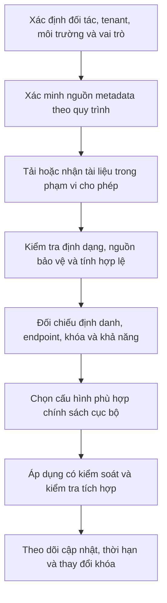

# Federation metadata: dữ liệu cấu hình cho liên kết danh tính

## 1. Federation metadata là gì?

**Federation metadata** là dữ liệu mô tả một bên tham gia liên kết danh tính và những thông tin kỹ thuật cần để tích hợp với bên đó: định danh, vai trò, endpoint, khóa công khai, khả năng giao thức và một số điều kiện liên quan.

Trong một tích hợp, ứng dụng cần biết kết quả xác thực đến từ ai, phải gửi người dùng đến đâu, nhận phản hồi tại đâu và kiểm tra bằng khóa nào. Metadata giúp truyền những thông tin này theo một cấu trúc có thể xử lý được, thay vì chỉ trao đổi thủ công từng giá trị.

Ví dụ, một ứng dụng doanh nghiệp tích hợp IdP của công ty An Phú. Khi IdP thay khóa ký hoặc thay endpoint theo kế hoạch, ứng dụng cần cập nhật cấu hình tương ứng. Nếu hai bên chỉ giữ một bản email cũ, việc đăng nhập có thể gián đoạn hoặc cấu hình tin cậy có thể không còn phù hợp.

Metadata giải quyết vấn đề **mô tả và phân phối cấu hình**, nhưng không tự chứng minh rằng bên được mô tả là một đối tác đáng tin. Việc chấp nhận nguồn metadata phải bắt đầu từ một quan hệ tin cậy được thiết lập bằng quy trình phù hợp.

Có thể tách ba lớp:

| Lớp | Vai trò |
| --- | --- |
| Metadata | Mô tả bên tham gia, endpoint, khóa và khả năng |
| Cấu hình tin cậy cục bộ | Quyết định nguồn nào được chấp nhận, kiểm tra ra sao và trong phạm vi nào |
| Thông điệp khi đăng nhập | Mang kết quả của một giao dịch xác thực cụ thể, cần được kiểm tra theo giao thức |

Tải và đọc được metadata không đồng nghĩa đã hoàn thành xác minh một lần đăng nhập.

## 2. Metadata không phải token, hồ sơ người dùng hay chính sách cấp quyền

Metadata thường mô tả **hệ thống hoặc thực thể giao thức**, không phải một nhân viên cụ thể.

| Dữ liệu | Ví dụ | Mục đích |
| --- | --- | --- |
| Metadata của IdP hoặc nhà cung cấp OIDC | Định danh bên phát hành, endpoint, địa chỉ lấy khóa | Thiết lập và duy trì tích hợp |
| Metadata của SP hoặc cấu hình đăng ký client | Định danh ứng dụng, điểm nhận phản hồi, phương thức được đăng ký | Xác định ứng dụng tham gia và các điều kiện liên quan |
| Assertion hoặc ID Token | Chủ thể, bên phát hành, bên nhận, thời gian hiệu lực | Cung cấp kết quả trong một giao dịch xác thực |
| Thuộc tính người dùng | Phòng ban, nhóm, tên hiển thị | Cung cấp dữ liệu danh tính theo phạm vi đã thống nhất |
| Chính sách phân quyền | Ai được thao tác gì trên tài nguyên nào | Quyết định quyền truy cập |

Metadata có thể mô tả khả năng hỗ trợ thuộc tính hoặc thuật toán, nhưng không tự cấp các quyền nghiệp vụ cho người dùng.

Tương tự, một danh sách thuật toán được nhà cung cấp công bố không bắt buộc ứng dụng phải chấp nhận toàn bộ. Cấu hình cục bộ cần lựa chọn những phương án đáp ứng chính sách của tích hợp.

Không trao đổi private key hoặc client secret như một phần của tài liệu metadata công khai. Khóa công khai và thông tin chứng thư dùng để kiểm tra có vai trò khác với bí mật dùng để ký, giải mã hoặc xác thực client.

## 3. Các câu hỏi metadata giúp trả lời

Một bộ dữ liệu tích hợp thường hỗ trợ trả lời:

- Bên này được định danh bằng giá trị nào?
- Bên này đóng vai trò IdP, SP, nhà cung cấp OIDC hay client?
- Endpoint nào dùng để bắt đầu xác thực, trao đổi kết quả hoặc nhận phản hồi?
- Giao thức và cách vận chuyển thông điệp nào được hỗ trợ?
- Khóa công khai nào được công bố cho mục đích ký hoặc mã hóa tương ứng?
- Có thông tin về thời hạn metadata, chính sách cache hoặc cơ chế cập nhật không?
- Ai quản lý nguồn dữ liệu và ai chịu trách nhiệm khi có thay đổi?

Tên trường, hình thức biểu diễn và mức độ bắt buộc khác nhau giữa SAML và OIDC. Không nên lấy schema của một giao thức rồi áp dụng nguyên cho giao thức còn lại.

Một nguyên tắc quan trọng là **định danh không đồng nghĩa với endpoint**. Một URI dùng làm định danh thực thể có thể không phải nơi cần gọi để đăng nhập hoặc tải cấu hình. Ứng dụng phải dùng trường đúng mục đích.

## 4. SAML metadata

SAML metadata thường được biểu diễn bằng XML. Nó có thể mô tả một thực thể hoặc một tập hợp nhiều thực thể, với các vai trò giao thức khác nhau.

### 4.1. Những thành phần thường gặp

| Thành phần | Ý nghĩa |
| --- | --- |
| EntityDescriptor | Mô tả một thực thể SAML |
| entityID | Định danh của thực thể |
| IDPSSODescriptor | Mô tả vai trò IdP phục vụ đăng nhập liên kết |
| SPSSODescriptor | Mô tả vai trò SP |
| SingleSignOnService | Endpoint và binding cho dịch vụ đăng nhập của IdP |
| AssertionConsumerService — ACS | Điểm SP nhận kết quả theo binding tương ứng |
| SingleLogoutService | Thông tin dịch vụ đăng xuất nếu được công bố |
| KeyDescriptor | Thông tin khóa công khai cho mục đích được mô tả |
| NameIDFormat | Các dạng định danh chủ thể được công bố hỗ trợ |
| validUntil, cacheDuration | Thông tin về tính hợp lệ hoặc thời gian cache theo ngữ nghĩa của SAML metadata |

**Binding** mô tả cách thông điệp giao thức được vận chuyển. Hai endpoint cùng phục vụ một vai trò nhưng dùng binding khác nhau không được coi là có thể thay thế tùy ý.

SP và IdP có metadata riêng. SP cần biết endpoint và khóa phù hợp của IdP; IdP cần biết định danh SP và những điểm nhận phản hồi được phép của SP. Việc import một phía không tự chứng minh phía còn lại đã có đủ cấu hình.

### 4.2. Ví dụ metadata IdP được rút gọn

Đoạn sau chỉ minh họa cấu trúc. Phần chứng thư là chỗ giữ chỗ, không phải metadata sẵn sàng triển khai:

```xml
<md:EntityDescriptor
    xmlns:md="urn:oasis:names:tc:SAML:2.0:metadata"
    xmlns:ds="http://www.w3.org/2000/09/xmldsig#"
    entityID="https://idp.anphu.example/saml">
    <md:IDPSSODescriptor
        protocolSupportEnumeration="urn:oasis:names:tc:SAML:2.0:protocol">
        <md:KeyDescriptor use="signing">
            <ds:KeyInfo>
                <ds:X509Data>
                    <ds:X509Certificate>PUBLIC_CERTIFICATE_PLACEHOLDER</ds:X509Certificate>
                </ds:X509Data>
            </ds:KeyInfo>
        </md:KeyDescriptor>
        <md:SingleSignOnService
            Binding="urn:oasis:names:tc:SAML:2.0:bindings:HTTP-Redirect"
            Location="https://idp.anphu.example/saml/sso"/>
    </md:IDPSSODescriptor>
</md:EntityDescriptor>
```

Trong ví dụ:

- `entityID` định danh IdP; không nên tự coi nó là endpoint xử lý mọi yêu cầu.
- `Location` là địa chỉ của dịch vụ đăng nhập được công bố.
- `Binding` xác định cách dùng endpoint đó trong giao thức.
- `KeyDescriptor` công bố thông tin khóa phục vụ mục đích ký trong ví dụ.

Một triển khai vẫn cần kiểm tra đầy đủ metadata, chính sách tin cậy và thông điệp giao thức thực tế. Parse XML thành công chỉ chứng minh tài liệu có thể đọc ở mức nào đó.

### 4.3. Chứng thư trong metadata và chứng thư TLS

Chứng thư hoặc khóa công khai dùng để kiểm tra chữ ký SAML có vai trò khác với chứng thư TLS của website.

TLS bảo vệ kết nối đến endpoint theo cơ chế của nó. Chữ ký thông điệp hoặc chữ ký metadata bảo vệ dữ liệu theo quan hệ tin cậy tương ứng. Không nên suy ra rằng có TLS hợp lệ là đủ để tin mọi assertion hoặc mọi khóa do endpoint cung cấp.

Cách đánh giá chứng thư ký trong SAML phụ thuộc mô hình tin cậy, profile và chính sách của triển khai. Không mặc định rằng mọi chứng thư trong metadata đều phải được xử lý như chứng thư TLS từ một CA công cộng, hoặc mọi sản phẩm đều áp dụng cùng quy tắc thời hạn chứng thư.

### 4.4. Metadata có chữ ký

Metadata có thể được ký bởi thực thể phát hành hoặc một đơn vị phân phối metadata được tin cậy. Khi đó bên nhận cần biết trước khóa hoặc chuỗi tin cậy dùng để xác minh chữ ký metadata.

Khóa ký metadata không nhất thiết là cùng khóa dùng để ký assertion. Hai nhiệm vụ cần được phân biệt trong cấu hình và quy trình vận hành.

Nếu tài liệu tự kèm một khóa rồi dùng chính khóa chưa được tin cậy đó để chứng minh “tài liệu đáng tin”, vòng kiểm tra chưa thiết lập được nguồn tin cậy ban đầu. Cần một điểm tin cậy có từ trước hoặc một quy trình xác minh ngoài tài liệu.

Với tập hợp nhiều thực thể, còn cần xác định đơn vị phát hành có thẩm quyền mô tả những thực thể nào và ứng dụng được phép sử dụng những thực thể nào. Không nên biến việc tin một nguồn tổng hợp thành chấp nhận mọi đối tác cho mọi tenant.

## 5. OIDC discovery và tài liệu cấu hình nhà cung cấp

Trong OpenID Connect, discovery có thể cung cấp tài liệu cấu hình JSON mô tả nhà cung cấp. Địa chỉ tài liệu được xác định theo quy tắc discovery tương ứng với issuer; không nên tự thay các quy tắc đó bằng nối chuỗi URL tùy ý.

Các field thường gặp gồm:

| Field | Ý nghĩa |
| --- | --- |
| issuer | Định danh nhà cung cấp; liên quan đến kiểm tra issuer trong thông điệp |
| authorization_endpoint | Endpoint bắt đầu yêu cầu xác thực/ủy quyền theo giao thức |
| token_endpoint | Endpoint trao đổi theo các grant/flow được hỗ trợ |
| jwks_uri | Địa chỉ công bố tập khóa JWK |
| response_types_supported | Các loại phản hồi được công bố hỗ trợ |
| subject_types_supported | Các kiểu định danh subject được hỗ trợ |
| id_token_signing_alg_values_supported | Các thuật toán ký ID Token được công bố hỗ trợ |
| token_endpoint_auth_methods_supported | Các phương thức xác thực client tại token endpoint được công bố |

Không phải mọi field đều có cùng điều kiện bắt buộc trong mọi profile. Tài liệu discovery cũng không thay thế các cấu hình riêng của client, chẳng hạn redirect URI đã được đăng ký hay bí mật xác thực client.

Ví dụ minh họa một tài liệu đã rút gọn:

```json
{
  "issuer": "https://login.anphu.example",
  "authorization_endpoint": "https://login.anphu.example/authorize",
  "token_endpoint": "https://login.anphu.example/token",
  "jwks_uri": "https://login.anphu.example/keys",
  "response_types_supported": ["code"],
  "subject_types_supported": ["public"],
  "id_token_signing_alg_values_supported": ["RS256"],
  "token_endpoint_auth_methods_supported": ["client_secret_basic"]
}
```

Đây là ví dụ dữ liệu, không phải khuyến nghị lựa chọn một thuật toán hoặc phương thức xác thực client cho mọi ứng dụng.

### 5.1. Issuer phải khớp với bên được cấu hình

Ứng dụng cần đối chiếu issuer nhận được với issuer mà mình dự kiến tích hợp theo quy tắc của giao thức. Không nên chấp nhận một bên khác chỉ vì chuỗi định danh có phần đầu giống nhau hoặc cùng tên miền gần giống.

Một issuer có thể bao gồm path và có ngữ nghĩa riêng trong hệ thống nhiều tenant. Chuẩn hóa tùy ý, bỏ path hoặc tự sửa dấu phân cách có thể làm sai ranh giới danh tính. Dùng thư viện và quy tắc so khớp của giao thức thay vì so khớp gần đúng.

### 5.2. Endpoint có thể nằm ở miền khác

Một nhà cung cấp có thể công bố endpoint hoặc địa chỉ khóa ở hostname khác với hostname trong issuer. Điều này không tự là sai; cần đánh giá theo cấu hình, nguồn discovery và chính sách tích hợp.

Ngược lại, cùng hostname cũng không tự chứng minh một URL là endpoint được phép. Quyết định phải dựa trên bộ cấu hình được chấp nhận, không chỉ một phép so sánh tên miền đơn giản.

## 6. JWKS là gì và có quan hệ gì với discovery?

**JSON Web Key Set — JWKS** là tập hợp các khóa được biểu diễn theo cấu trúc JWK. Tài liệu OIDC discovery có thể chỉ đến tập khóa này qua `jwks_uri`.

JWKS có thể công bố nhiều khóa, chẳng hạn trong giai đoạn chuyển khóa. Các trường thường gặp trong một JWK bao gồm loại khóa, định danh khóa và thông tin công khai cần cho thao tác mật mã tương ứng.

`kid` là định danh hỗ trợ lựa chọn khóa. Nó không tự là bằng chứng tin cậy, không cần được coi là duy nhất trên toàn bộ mọi issuer và không thay thế việc kiểm tra chữ ký.

Có thể hình dung:

```text
Issuer đã được ứng dụng chấp nhận
    -> tài liệu discovery được kiểm tra
    -> jwks_uri thuộc cấu hình được chấp nhận
    -> tập khóa công khai của issuer
    -> chọn khóa phù hợp theo quy tắc và chính sách
    -> kiểm tra thông điệp cùng các ràng buộc giao thức
```

Một token tự khai báo một `kid` hoặc một URL khóa không được quyền tự mở rộng tập bên phát hành đáng tin. Việc lấy khóa phải gắn với issuer và cấu hình tin cậy đã xác định.

JWKS cũng không thay thế các kiểm tra như audience, thời gian, loại token và liên kết giao dịch. Kiểm tra được chữ ký mới chỉ là một phần của việc chấp nhận thông điệp.

## 7. Tiếp nhận metadata mà không làm mất ranh giới tin cậy

Một quy trình tiếp nhận có thể được tổ chức như sau:



### 7.1. Xác định đúng bên và đúng môi trường

Trước khi import cần biết tài liệu thuộc:

- Đúng tổ chức hoặc đối tác.
- Đúng tenant, nếu nhà cung cấp có nhiều tenant.
- Đúng môi trường test hoặc production.
- Đúng vai trò IdP, SP hoặc nhà cung cấp OIDC.
- Đúng ứng dụng hoặc nhóm tích hợp trong phạm vi được cho phép.

Hai môi trường có tên gần giống nhau có thể có issuer, entityID, client hoặc khóa khác nhau. Copy metadata test sang production mà không kiểm tra có thể làm gián đoạn hoặc mở rộng sai phạm vi chấp nhận danh tính.

Tên file như `production-metadata.xml` không phải bằng chứng về môi trường. Cần đối chiếu nội dung với nguồn cấu hình đã được xác minh.

### 7.2. Xác minh nguồn phân phối

Metadata có thể được nhận qua file hoặc tải từ một URL đã xác định. Tùy giao thức và mô hình tin cậy, việc xác minh có thể dựa vào nguồn HTTPS được thiết lập đúng, chữ ký metadata với khóa tin cậy có trước hoặc quy trình trao đổi được quản lý.

Một checksum hỗ trợ biết hai bản tài liệu có giống nhau không. Nếu checksum và tài liệu cùng được lấy từ một nguồn chưa tin cậy, checksum không tự chứng minh nguồn phát hành.

Không lấy một URL bất kỳ từ đầu vào người dùng rồi cho máy chủ tải và import ngay. Ngoài vấn đề tin cậy, chức năng tải metadata còn phải kiểm soát truy cập mạng ra ngoài, chuyển hướng, đích nội bộ và giới hạn tài nguyên xử lý theo thiết kế của hệ thống.

### 7.3. Kiểm tra tài liệu trước khi áp dụng

Các nhóm kiểm tra cần cân nhắc gồm:

| Nhóm kiểm tra | Ví dụ |
| --- | --- |
| Định dạng | JSON/XML hợp lệ và đúng cấu trúc cần thiết |
| An toàn bộ phân tích | Giới hạn kích thước, cấu trúc; xử lý XML không cho đầu vào không tin cậy truy xuất tài nguyên ngoài ngoài thiết kế |
| Nguồn và bảo vệ | Kênh nhận đúng, chữ ký metadata được xác minh khi mô hình yêu cầu |
| Định danh | Issuer/entityID khớp bên và môi trường dự kiến |
| Endpoint | Đúng vai trò, binding, địa chỉ và chính sách mạng |
| Khóa | Đúng mục đích, kiểu khóa và điều kiện chính sách |
| Khả năng giao thức | Có phương án tương thích mà ứng dụng được phép sử dụng |
| Thời gian | Metadata còn hợp lệ theo cơ chế áp dụng |
| Phạm vi | Không tự thêm tenant, đối tác hoặc vai trò ngoài phạm vi tích hợp |

Không phải cứ field mới xuất hiện là phải bật tính năng tương ứng. Metadata công bố khả năng, trong khi ứng dụng quyết định những khả năng được sử dụng trong tích hợp cụ thể.

### 7.4. Giữ cấu hình cục bộ có chủ sở hữu

Cần xác định ai được sửa issuer, entityID, endpoint, khóa, cơ chế lấy metadata và điều kiện tự động áp dụng. Những thay đổi này có thể ảnh hưởng đến khả năng giả mạo danh tính hoặc làm gián đoạn đăng nhập.

Thông tin nhận qua metadata cũng không nên tự ghi đè mọi quy tắc cục bộ. Ví dụ, một danh sách capability rộng hơn không được âm thầm mở thuật toán mà chính sách ứng dụng chưa cho phép.

## 8. Metadata thay đổi theo thời gian

### 8.1. File import thủ công và URL cập nhật tự động

| Cách sử dụng | Điểm thuận lợi | Điều phải quản lý |
| --- | --- | --- |
| Import file tĩnh | Dễ lưu bản đã xem xét và kiểm soát thời điểm thay đổi | Dễ bị bỏ quên khi khóa hoặc endpoint đổi |
| Cập nhật từ URL | Có thể nhận thay đổi có kế hoạch mà không trao lại file mỗi lần | Phải quản lý nguồn, cache, kiểm tra và hành vi khi cập nhật lỗi |
| Kết hợp | Có thể lưu bản đã kiểm tra cùng cơ chế nhận cập nhật | Cần rõ bản nào đang áp dụng và cách xử lý khác biệt |

Tự động hóa không loại bỏ trách nhiệm quản trị. Cần quy định thay đổi nào có thể được áp dụng theo cơ chế đã được chấp thuận, thay đổi nào phải được xử lý riêng và bằng chứng nào được giữ lại.

Ví dụ, thêm khóa mới trong nguồn tin cậy theo kế hoạch có thể là một phần của cơ chế chuyển khóa tự động. Thay đổi issuer sang một tổ chức khác là một thay đổi quan hệ danh tính, không nên bị xem như một lần refresh thông thường.

### 8.2. Cache không phải thời hạn token

Một hệ thống có thể giữ các khoảng thời gian khác nhau:

- Thời hạn hợp lệ của metadata.
- Khoảng cache hoặc lịch refresh metadata.
- Khoảng cache tập khóa.
- Thời hạn hiệu lực của assertion hoặc token.
- Thời hạn phiên ứng dụng.

Các giá trị này không tự bằng nhau và không thay thế cho nhau.

Trong SAML metadata, `validUntil` và `cacheDuration` có vai trò khác nhau: thông tin về hiệu lực không đồng nhất với hướng dẫn thời gian cache. Cần áp dụng ngữ nghĩa tương ứng và cả ràng buộc của cấu trúc chứa, nếu có.

Không tự áp một field `validUntil` kiểu SAML vào OIDC discovery rồi cho rằng đó là một field chuẩn chung cho mọi nhà cung cấp. Với discovery và JWKS, cơ chế cache còn liên quan đến phản hồi HTTP, thư viện, cấu hình và chính sách của triển khai.

### 8.3. Khi không tải được bản mới

Nếu refresh tạm thời thất bại, hệ thống có thể có một bản đã kiểm tra trước đó. Việc tiếp tục sử dụng bản đó cần nằm trong giới hạn hợp lệ và chính sách đã xác định, không kéo dài vô hạn chỉ để tránh lỗi đăng nhập.

Cần phân biệt:

- Chưa có bản tin cậy nào để bắt đầu.
- Có bản đang còn hợp lệ nhưng refresh tạm thời lỗi.
- Bản đang có đã hết hiệu lực hoặc vượt giới hạn sử dụng.
- Nhận được bản mới nhưng bản đó không vượt qua kiểm tra.
- Có thông báo sự cố yêu cầu loại bỏ một khóa hoặc nguồn tin cậy.

Một bản mới lỗi không nên làm bản đang hợp lệ bị ghi đè bằng dữ liệu rỗng. Ngược lại, giữ bản cũ không phải cách xử lý phù hợp nếu khóa trong bản đó đã bị xác nhận lộ và phải ngừng tin cậy.

## 9. Chuyển khóa trong federation

**Key rollover** là quá trình thay khóa mà vẫn bảo đảm các bên sử dụng đúng khóa cần thiết trong giai đoạn chuyển đổi.

### 9.1. Chuyển khóa ký có kế hoạch

Giả sử IdP đang ký bằng khóa K1 và muốn chuyển sang K2. Một kế hoạch khái niệm có thể là:

1. Công bố khóa công khai K2 qua cơ chế metadata hoặc tập khóa được tin cậy.
2. Xác nhận các bên nhận có thể nhận biết và sử dụng K2.
3. Bắt đầu ký các thông điệp mới bằng K2 theo kế hoạch.
4. Duy trì khả năng kiểm tra các thông điệp hợp lệ còn dùng K1 trong khoảng chuyển đổi phù hợp.
5. Loại bỏ K1 khi các điều kiện về thông điệp cũ, cache và chính sách đã được đáp ứng.
6. Xác minh các node và bên nhận đã có trạng thái mong muốn.

Đây là nguyên tắc điều phối, không phải một lịch thời gian cố định cho mọi hệ thống. Khoảng chồng lấn phụ thuộc thời hạn thông điệp, tần suất cập nhật, độ trễ phân phối, chính sách khóa và khả năng của các bên.

Metadata có thể đồng thời công bố nhiều khóa. Bên nhận không nên tự chọn “khóa đầu tiên” cho mọi thông điệp nếu giao thức và dữ liệu khóa đòi hỏi cách chọn khác.

### 9.2. Không nhầm chuyển khóa thường kỳ với sự cố lộ khóa

Nếu K1 bị xâm phạm, việc tiếp tục chấp nhận K1 chỉ để duy trì tính liên tục có thể tiếp tục cho phép thông điệp giả được chấp nhận.

Xử lý sự cố cần xác định phạm vi ngừng tin cậy, cách cập nhật các bên nhận và tác động đến token hoặc phiên đã hình thành. Việc loại một khóa khỏi tài liệu nguồn không chứng minh mọi node đã ngừng dùng khóa cache.

Cũng không nên tự suy rằng xóa khóa kiểm tra sẽ kết thúc mọi phiên ứng dụng. Phiên có thể đã được tạo sau khi token được kiểm tra và có vòng đời độc lập.

### 9.3. Khóa ký và khóa mã hóa có chiều sử dụng khác nhau

Với chữ ký, bên phát hành giữ private key để ký; bên kiểm tra cần thông tin khóa công khai phù hợp.

Với thông điệp được mã hóa cho một bên nhận, bên gửi sử dụng thông tin khóa công khai của bên nhận; bên nhận cần giữ private key tương ứng để giải mã.

Vì vậy, thời điểm công bố khóa, thời điểm bắt đầu dùng khóa mới và thời gian giữ private key cũ có thể khác nhau giữa chuyển khóa ký và chuyển khóa mã hóa. Không áp nguyên một kế hoạch cho cả hai mục đích mà không kiểm tra luồng sử dụng.

## 10. Ví dụ xử lý thay đổi metadata của một đối tác

Ứng dụng quản lý dự án đang chấp nhận IdP An Phú trong tenant của An Phú. Bản metadata mới có ba thay đổi:

| Thay đổi | Câu hỏi cần xử lý |
| --- | --- |
| Thêm khóa ký K2, giữ K1 | Có đúng kế hoạch chuyển khóa và đúng nguồn cập nhật không? Các bên nhận đã cập nhật chưa? |
| Đổi endpoint đăng nhập | Đích mới có thuộc thay đổi được cho phép, đúng giao thức và chính sách mạng không? |
| Đổi issuer/entityID | Đây có phải thay đổi định danh có chủ ý không? Có ảnh hưởng liên kết tài khoản và ranh giới tenant không? |

Không nên coi ba thay đổi này có cùng tác động.

Thêm khóa theo cơ chế được quản lý khác với thay bên phát hành. Nếu ứng dụng dùng cặp issuer và subject để liên kết người dùng, đổi issuer có thể làm người dùng xuất hiện như một danh tính khác. Quy trình cần thiết kế việc chuyển liên kết phù hợp, không tự gộp lại bằng email.

Một hồ sơ thay đổi nên lưu:

```text
Đối tác và tenant: An Phú
Môi trường: production
Nguồn metadata: địa chỉ hoặc kênh đã được xác minh
Bản đang áp dụng: mã phiên bản hoặc dấu vết nội dung
Bản đề xuất: thời điểm nhận và kết quả kiểm tra
Khác biệt: định danh, endpoint, khóa, capability, thời hạn
Quyết định áp dụng: căn cứ và người/cơ chế có thẩm quyền
Kết quả: thời điểm áp dụng, node đã nhận và kiểm tra tích hợp
Vấn đề còn lại: lỗi, giới hạn quan sát và người phụ trách
```

Dấu vết nội dung như hash hỗ trợ so sánh và truy vết thay đổi. Nó không thay thế việc xác minh nguồn tài liệu hoặc chữ ký khi mô hình tin cậy yêu cầu.

Khả năng quay lại bản cấu hình trước có thể hữu ích khi thay đổi vận hành lỗi. Tuy nhiên, không quay lại một khóa hoặc nguồn đã bị ngừng tin cậy do sự cố chỉ vì bản cũ từng hoạt động.

## 11. Chẩn đoán các lỗi thường gặp

| Hiện tượng | Khả năng cần kiểm tra | Điều không nên làm |
| --- | --- | --- |
| Đăng nhập lỗi sau khi IdP đổi khóa | Cache khóa cũ, cập nhật chưa đến mọi node, lựa chọn khóa sai | Tắt kiểm tra chữ ký để cho đăng nhập qua |
| Một số node đăng nhập được, một số node lỗi | Trạng thái metadata/JWKS hoặc thời điểm refresh khác nhau | Kết luận token ngẫu nhiên đúng sai mà không đối chiếu node |
| Issuer không khớp | Sai tenant, môi trường, nguồn discovery hoặc cấu hình định danh | Bỏ qua issuer hoặc đổi sang phép so khớp gần đúng |
| Không tìm được khóa theo kid | Chuyển khóa, cache chưa cập nhật, thông điệp không thuộc nguồn được phép | Tải khóa từ bất kỳ URL nào thông điệp chỉ ra |
| Phản hồi về sai ứng dụng | Sai client, entityID, ACS hoặc đăng ký redirect URI | Mở mọi địa chỉ nhận để né lỗi |
| Metadata tải được nhưng xác minh nguồn thất bại | Sai chữ ký, khóa tin cậy, tài liệu bị thay đổi hoặc nguồn không đúng | Chấp nhận chỉ vì XML/JSON đọc được |
| Đăng nhập vẫn hoạt động sau khi xóa khóa nguồn | Cache còn giữ khóa hoặc phiên ứng dụng đã tồn tại | Suy rằng thao tác nguồn đã thu hồi mọi truy cập |
| Token đúng chữ ký nhưng bị từ chối | Audience, thời gian, giao dịch, loại token hoặc điều kiện khác không hợp lệ | Bỏ các kiểm tra còn lại vì chữ ký đã đúng |

Một `kid` chưa biết có thể xuất hiện do chuyển khóa hợp lệ nhưng cũng có thể đến từ đầu vào không hợp lệ. Cơ chế refresh cần có giới hạn và gắn với nguồn cấu hình đã chấp nhận, tránh để mỗi đầu vào lạ gây tải metadata không kiểm soát.

Nhật ký vận hành nên ghi được bên tích hợp, thời điểm refresh, phiên bản hoặc dấu vết nội dung, loại thay đổi và kết quả kiểm tra. Không cần ghi private key, client secret, assertion hoặc token đầy đủ để chẩn đoán đa số lỗi cấu hình.

## 12. Những điều cần giữ rõ trong mô hình

Federation metadata mô tả cấu hình của các bên tham gia; quan hệ tin cậy cục bộ quyết định phần mô tả nào được chấp nhận và sử dụng.

SAML metadata, OIDC discovery và JWKS liên quan với cùng bài toán tích hợp nhưng có schema và vai trò riêng. Discovery có thể chỉ đến JWKS; JWKS cung cấp khóa; thông điệp đăng nhập vẫn phải được kiểm tra đầy đủ theo giao thức.

Việc cập nhật metadata cần bảo đảm đúng nguồn, đúng định danh, đúng phạm vi và khả năng xử lý thay đổi theo thời gian. Một tích hợp hoạt động ổn định đòi hỏi quản lý cả bản đang áp dụng, lịch chuyển khóa, cache, lỗi cập nhật và các phiên hoặc token có vòng đời độc lập.
