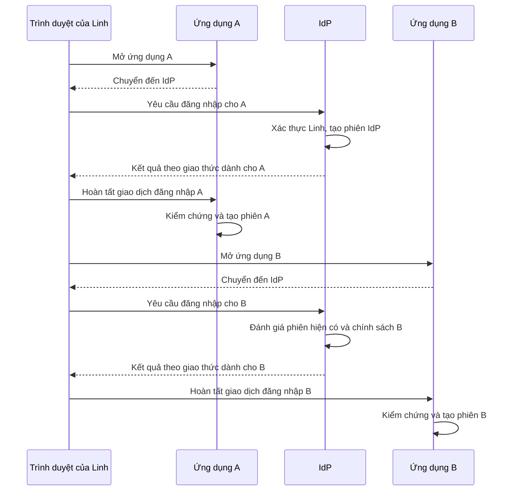

# Single Sign-On

## 1. Single Sign-On giải quyết vấn đề gì?

**Single Sign-On**, viết tắt **SSO**, là khả năng sử dụng một lần xác thực hoặc một ngữ cảnh đăng nhập còn hợp lệ để tiếp cận nhiều ứng dụng tham gia cơ chế đó, giảm việc người dùng phải xác thực riêng lẻ ở từng nơi.

Ví dụ, một nhân viên đăng nhập vào hệ thống danh tính công ty, sau đó mở cổng nhân sự, ứng dụng chi phí và cổng tài liệu. Nếu phiên và chính sách cho phép, các ứng dụng có thể thiết lập phiên của mình mà không yêu cầu nhân viên nhập lại mật khẩu ở mỗi ứng dụng.

SSO không có nghĩa người dùng chỉ xác thực đúng một lần trong cả đời tài khoản hoặc một ngày làm việc. Hệ thống vẫn có thể yêu cầu xác thực lại khi phiên hết hạn, rủi ro thay đổi, người dùng đổi thiết bị hoặc thực hiện một thao tác nhạy cảm.

Mục tiêu là giảm những lần đăng nhập lặp lại không cần thiết trong khi vẫn đáp ứng yêu cầu xác thực của từng dịch vụ. Một trải nghiệm có bước xác thực bổ sung cho thao tác chuyển tiền vẫn có thể là một thiết kế SSO đúng.

Trong bối cảnh federation, NIST mô tả việc người dùng nhận dịch vụ từ nhiều Relying Party mà không cần duy trì phương tiện xác thực riêng ở từng nơi; cơ chế này thường được gọi là SSO. Federation cũng có thể được áp dụng trong cùng một miền quản trị. [NIST SP 800-63C-4 — Introduction](https://pages.nist.gov/800-63-4/sp800-63c/introduction/).

## 2. Những khái niệm cần phân biệt

| Khái niệm | Ý nghĩa | Quan hệ với SSO |
|---|---|---|
| SSO | Trải nghiệm và cơ chế giảm xác thực riêng lẻ giữa các ứng dụng tham gia | Là kết quả mà người dùng và hệ thống muốn đạt |
| Federation | Quan hệ tin cậy và giao thức trao đổi thông tin xác thực giữa các bên | Là một cách phổ biến để triển khai SSO |
| Dùng chung mật khẩu | Người dùng nhập cùng một mật khẩu tại nhiều ứng dụng | Chưa phải SSO; từng ứng dụng vẫn có thể xác thực riêng |
| Đồng bộ mật khẩu | Sao chép hoặc phối hợp giá trị mật khẩu giữa các hệ thống | Không tự tạo phiên dùng chung hoặc luồng federation |
| Trình quản lý mật khẩu | Lưu và điền thông tin đăng nhập cho từng dịch vụ | Giảm thao tác nhập nhưng không tự biến các ứng dụng thành quan hệ federation |
| Provisioning | Tạo tài khoản, cập nhật thuộc tính và quan hệ quyền | Chuẩn bị và duy trì tài khoản, không thay thế luồng đăng nhập |
| Phân quyền | Quyết định người dùng được làm gì với tài nguyên nào | Vẫn cần thực hiện sau khi đã xác thực |

SSO có thể được triển khai bằng nhiều cơ chế, không chỉ federation qua web. Một môi trường nội bộ có thể sử dụng cơ chế xác thực tích hợp để giảm yêu cầu nhập lại thông tin. Trong bài này, trọng tâm là SSO dựa trên federation, với IdP và các ứng dụng phụ thuộc vào kết quả xác thực của IdP.

Cũng không nên hiểu rằng có federation thì mọi lần truy cập đều không xuất hiện màn hình đăng nhập. Một IdP có thể xác thực lại theo yêu cầu của ứng dụng hoặc chính sách ngay trong một giao dịch federation hợp lệ.

## 3. Các thành phần trong SSO dựa trên federation

**Identity Provider — IdP** quản lý hoặc sử dụng nguồn danh tính, xác thực người dùng và cung cấp bằng chứng xác thực theo giao thức. Trong OpenID Connect, phía này được gọi là **OpenID Provider — OP**.

**Relying Party — RP** là ứng dụng kiểm chứng kết quả từ IdP, liên kết với tài khoản nội bộ và thiết lập phiên ứng dụng. Trong SAML, phía cung cấp dịch vụ sử dụng assertion được gọi là **Service Provider — SP**.

**Trình duyệt hoặc user agent** chuyển người dùng giữa các điểm của luồng đăng nhập. Việc phản hồi đi qua trình duyệt không làm phản hồi tự trở thành đáng tin; ứng dụng vẫn phải kiểm chứng theo giao thức.

**Quan hệ tin cậy** xác định bên phát hành nào được chấp nhận, ứng dụng nào là bên nhận, địa chỉ phản hồi nào hợp lệ, khóa nào được sử dụng và những thuộc tính nào được trao đổi.

SSO không yêu cầu mọi ứng dụng có chung cơ sở dữ liệu phiên hoặc dùng cùng một cookie. Trong mô hình thông thường, IdP có phiên của mình và mỗi ứng dụng có phiên riêng. Sự phối hợp diễn ra qua giao thức, không phải bằng cách trao cookie ứng dụng A cho ứng dụng B.

## 4. Điều gì xảy ra khi mở hai ứng dụng?

Giả sử nhân viên Linh sử dụng cùng một trình duyệt và hai ứng dụng A, B đều tin IdP công ty. Ban đầu Linh chưa có phiên ở cả ba nơi.

### 4.1. Đăng nhập ứng dụng đầu tiên

1. Linh mở ứng dụng A. A chưa tìm thấy phiên nội bộ hợp lệ.
2. A khởi tạo giao dịch đăng nhập và chuyển trình duyệt đến IdP.
3. IdP xác thực Linh theo chính sách, có thể gồm MFA, rồi thiết lập phiên IdP.
4. IdP cung cấp kết quả cho A theo giao thức, gắn với bên nhận và giao dịch tương ứng.
5. A kiểm chứng kết quả, tìm tài khoản Linh, kiểm tra điều kiện truy cập và tạo phiên A.

### 4.2. Mở ứng dụng thứ hai

1. Linh mở B. B chưa có phiên nội bộ nên vẫn cần khởi tạo giao dịch đăng nhập riêng.
2. Trình duyệt được chuyển đến IdP.
3. IdP nhận ra phiên của Linh còn hợp lệ và đánh giá yêu cầu của B.
4. Nếu chính sách cho phép sử dụng ngữ cảnh hiện có, IdP không yêu cầu nhập lại mật khẩu mà phát kết quả dành cho B.
5. B kiểm chứng kết quả và tạo phiên B nếu Linh đủ điều kiện truy cập.



Sơ đồ mô tả ở mức khái niệm. Với OIDC Authorization Code Flow, phần trả qua trình duyệt là authorization code và các tham số liên quan, còn việc nhận token diễn ra qua token endpoint. Với SAML, cách đóng gói và vận chuyển thông điệp khác.

Điểm quan trọng là B có **giao dịch và bằng chứng riêng**. B không lấy nguyên token dành cho A để đăng nhập. Một IdP có thể phát nhiều kết quả cho nhiều ứng dụng từ một phiên xác thực còn hợp lệ, nhưng mỗi kết quả vẫn cần đúng bên nhận và đúng điều kiện.

## 5. Ba vòng đời không nên nhập làm một

### 5.1. Phiên tại IdP

Phiên IdP cho phép IdP nhận biết ngữ cảnh đăng nhập hiện có khi xử lý yêu cầu từ các ứng dụng. Phiên này có chính sách về thời gian, xác thực lại, thiết bị và rủi ro của phía IdP.

IdP có phiên hợp lệ không đồng nghĩa mọi yêu cầu mới đều được chấp nhận. Một ứng dụng có yêu cầu cao hơn hoặc người dùng chưa được cho phép vào ứng dụng vẫn có thể không nhận được kết quả như mong muốn.

### 5.2. Bằng chứng của giao dịch federation

Assertion hoặc ID Token có khoảng thời gian và điều kiện sử dụng để RP kiểm chứng giao dịch. Nó không phải một cookie phiên dùng chung cho mọi ứng dụng.

RP phải kiểm tra đúng bên phát hành, bên nhận, tính toàn vẹn, thời gian và các ràng buộc giao dịch của giao thức. Một bằng chứng còn hạn nhưng dành cho ứng dụng khác không có giá trị đăng nhập cho RP hiện tại.

### 5.3. Phiên tại từng ứng dụng

Sau khi chấp nhận kết quả, mỗi RP quản lý phiên nội bộ theo chính sách của mình. Phiên A có thể hết hạn trước phiên B; một ứng dụng cũng có thể chấm dứt phiên khi tài khoản nội bộ bị khóa hoặc có sự kiện rủi ro.

NIST phân biệt thời hạn assertion với thời hạn phiên tại IdP và RP; chúng không tự động đồng nhất. Vì vậy, không lấy một mốc hết hạn của token để suy ra mọi phiên liên quan đều đã kết thúc. [NIST SP 800-63C-4 — Federation and Assertions](https://pages.nist.gov/800-63-4/sp800-63c.html).

Nếu ứng dụng còn sử dụng access token và refresh token để gọi API, những đối tượng đó cũng có vòng đời và cơ chế thu hồi riêng. Đăng nhập giao diện thành công, còn phiên trình duyệt và được phép gọi một API là các trạng thái liên quan nhưng không tương đương.

## 6. SSO không cấp quyền vào mọi ứng dụng

Linh có thể có danh tính hợp lệ ở IdP nhưng chỉ được sử dụng A. Khi mở B, IdP hoặc B có thể từ chối vì chưa có assignment, tài khoản chưa được chuẩn bị hoặc không đáp ứng chính sách.

Ngay cả khi đăng nhập được vào B, Linh vẫn chỉ được thực hiện những hành động đã được cho phép. SSO không biến người dùng thông thường thành quản trị viên và không loại bỏ kiểm tra quyền đối với từng bản ghi dữ liệu.

Một thiết kế IAM cần tách các câu hỏi:

```text
Danh tính đã được xác thực phù hợp chưa?
    → Tài khoản có đủ điều kiện vào ứng dụng không?
    → Được làm gì trong phạm vi tài nguyên nào?
    → Quyền đó còn hiệu lực tại thời điểm sử dụng không?
```

Các nhóm hoặc vai trò nhận từ IdP có thể là đầu vào cho phân quyền, nhưng cần ánh xạ có kiểm soát. Không nhận một claim từ bất kỳ IdP đối tác nào rồi tự gán vai trò nội bộ cùng tên, đặc biệt với quyền quản trị.

Nếu tạo tài khoản khi đăng nhập lần đầu, ứng dụng vẫn cần chính sách gia nhập và quyền mặc định phù hợp. Cơ chế tạo tài khoản theo thời điểm đăng nhập không tự thay thế phê duyệt truy cập, quản lý nhà thầu hoặc kiểm soát vòng đời quyền.

## 7. Giao thức và cách triển khai

### 7.1. OpenID Connect

OIDC cung cấp một lớp nhận diện người dùng dựa trên OAuth 2.0. Trong mô hình SSO, ứng dụng đóng vai trò RP, còn OP cung cấp kết quả xác thực cho ứng dụng. Không nên gọi một luồng chỉ có access token là đăng nhập OIDC nếu chưa triển khai đúng phần nhận diện người dùng.

Một ứng dụng web có thể dùng Authorization Code Flow với PKCE, kiểm tra giao dịch và dùng thư viện OIDC phù hợp. Redirect URI, issuer, audience, khóa và cách lưu ngữ cảnh phải được cấu hình đúng. SSO là trải nghiệm người dùng; tính an toàn nằm trong các bước giao thức và cách quản lý phiên cụ thể.

RFC 9700 trình bày các thực hành bảo vệ luồng chuyển hướng OAuth, gồm chống CSRF, chống lạm dụng code và sử dụng PKCE theo loại client. Khi triển khai OIDC, cần áp dụng các yêu cầu liên quan cùng quy tắc của OIDC, thay vì tự xây luồng chỉ bằng việc đọc một JWT. [RFC 9700 — Protecting Redirect-Based Flows](https://www.rfc-editor.org/rfc/rfc9700.html#section-2.1).

### 7.2. SAML

SAML cũng thường được dùng cho đăng nhập liên kết giữa IdP và ứng dụng doanh nghiệp. RP ở mức vai trò federation tương ứng với phía SP trong giao thức. Việc xử lý thông điệp, chữ ký, điều kiện assertion và điểm nhận phản hồi phải theo profile được triển khai.

Một IdP có thể tích hợp với ứng dụng A qua OIDC và B qua SAML. Trải nghiệm SSO vẫn có thể diễn ra nhờ phiên IdP, dù mỗi ứng dụng dùng giao thức khác và có cấu hình tin cậy riêng.

Không nên chọn giao thức chỉ theo một nhãn “hiện đại” hoặc “cũ”. Cần xem khả năng của ứng dụng, loại client, thư viện, yêu cầu bảo mật, vận hành và năng lực phối hợp vòng đời.

### 7.3. Ứng dụng cũ và cổng truy cập

Một số ứng dụng chưa hỗ trợ federation trực tiếp có thể được đặt sau một cổng xác thực theo thiết kế phù hợp. Khi đó phải xác định cổng chứng minh danh tính với ứng dụng ra sao và có đường truy cập nào bỏ qua cổng hay không.

Nếu ứng dụng tin một HTTP header chứa tên người dùng, header phải được thiết lập và bảo vệ bởi đường tin cậy được kiểm soát; không được chấp nhận giá trị do người dùng bên ngoài tự gửi. Đưa thêm một cổng không tự sửa được mọi vấn đề phân quyền của ứng dụng phía sau.

## 8. Lợi ích và rủi ro tập trung

SSO có thể giảm số thông tin đăng nhập riêng lẻ mà người dùng phải quản lý, tạo điểm áp dụng chính sách xác thực nhất quán và hỗ trợ điều tra các sự kiện đăng nhập. Đội vận hành cũng có một đầu mối rõ hơn để quản lý phương thức xác thực và khôi phục tài khoản.

Những lợi ích này đi cùng sự tập trung rủi ro. Nếu tài khoản, phiên IdP hoặc quyền cấu hình federation bị xâm phạm, ảnh hưởng có thể lan đến nhiều ứng dụng mà chủ thể đó được phép tiếp cận.

Các biện pháp cần được chọn theo rủi ro, chẳng hạn:

- Bảo vệ IdP và tài khoản quản trị bằng phương thức xác thực phù hợp, ưu tiên khả năng chống lừa đảo cho các nhóm cần thiết.
- Giới hạn người được thay đổi ứng dụng, khóa, redirect URI, ánh xạ claim và chính sách.
- Tách quyền quản trị nhạy cảm khỏi vai trò làm việc thông thường khi chính sách yêu cầu.
- Kiểm tra điều kiện xác thực lại hoặc nâng mức xác thực đối với thao tác quan trọng.
- Giám sát đăng nhập bất thường, thay đổi cấu hình và dấu hiệu chiếm phiên.
- Kiểm thử phương án sự cố và cơ chế truy cập khẩn cấp đã được quản lý.

SSO không tự bảo vệ khỏi phishing hoặc đánh cắp cookie. MFA cũng cần được lựa chọn và triển khai phù hợp; không nên suy ra rằng mọi phương thức MFA đều có cùng khả năng chống lừa đảo.

Thời gian phiên nên phản ánh rủi ro và nhu cầu sử dụng. Kéo dài mọi phiên chỉ để người dùng không bao giờ gặp màn hình đăng nhập có thể làm tăng ảnh hưởng khi thiết bị hoặc phiên bị chiếm dụng.

## 9. Đăng xuất và thu hồi truy cập

### 9.1. Đăng xuất cục bộ

Đăng xuất khỏi A thường kết thúc phiên A theo cách ứng dụng triển khai. Nếu phiên IdP vẫn còn, khi Linh chọn đăng nhập lại, A có thể thực hiện một giao dịch mới qua IdP mà không yêu cầu nhập lại mật khẩu.

Vì vậy, việc quay lại ứng dụng rồi vào được ngay không tự chứng minh phiên A cũ chưa bị xóa. Cần phân biệt giữ nguyên phiên cũ với tạo phiên mới dựa trên phiên IdP vẫn hợp lệ.

### 9.2. Đăng xuất tại IdP và phối hợp nhiều ứng dụng

Đăng xuất tại IdP không mặc nhiên đóng mọi phiên đã tạo ở các RP. Việc phối hợp phụ thuộc giao thức, khả năng hỗ trợ, cấu hình và việc thông báo có được nhận và xử lý hay không.

OIDC có các cơ chế riêng như RP-Initiated Logout, Front-Channel Logout và Back-Channel Logout. RP-Initiated Logout cho phép RP yêu cầu OP đăng xuất người dùng, và có thể phối hợp với các cơ chế khác. Chỉ sử dụng OIDC để đăng nhập không có nghĩa các cơ chế đăng xuất đó đã được bật hoặc hỗ trợ đầy đủ. [OpenID Connect RP-Initiated Logout 1.0](https://openid.net/specs/openid-connect-rpinitiated-1_0.html).

Trên thiết bị dùng chung, giao diện nên giúp người dùng hiểu thao tác đang kết thúc phiên nào. Không thông báo “đã đăng xuất khỏi tất cả hệ thống” nếu ứng dụng chỉ xác nhận đã kết thúc phiên của chính nó.

### 9.3. Nhân viên nghỉ việc

Khóa danh tính ở IdP là một phần quan trọng của quy trình nghỉ việc, nhưng cần xử lý cả tài khoản ứng dụng, quyền, phiên, token và các đường đăng nhập thay thế nằm trong phạm vi.

Nếu ứng dụng vẫn có tài khoản cục bộ hoặc khóa API, ngăn đăng nhập SSO mới chưa chắc đã chấm dứt những đường đó. Quy trình deprovisioning cần xác định hành động và thời hạn cho từng hệ thống, sau đó đối soát hoặc xác minh kết quả.

Khi thuộc tính quyền được đưa vào phiên tại lúc đăng nhập, cần chính sách cập nhật khi quyền thay đổi giữa phiên. Không mặc định dữ liệu đọc từ lúc bắt đầu phiên sẽ luôn đúng cho đến khi người dùng tự đăng xuất.

## 10. Những điểm cần làm rõ khi triển khai

### 10.1. Phạm vi ứng dụng và danh tính

Kiểm kê ứng dụng, môi trường và nhóm người dùng trước khi triển khai. Cần biết ứng dụng nào hỗ trợ giao thức nào, ứng dụng nào còn mật khẩu cục bộ, ai sở hữu cấu hình và các tenant hoặc đối tác nào được chấp nhận.

Ánh xạ danh tính phải sử dụng định danh có ngữ cảnh đáng tin. Không tự gộp tài khoản từ hai IdP chỉ vì chúng có email giống nhau; email có thể thay đổi hoặc được cấp lại. Với người dùng đã có dữ liệu trước khi chuyển SSO, cần quy trình liên kết và xử lý xung đột rõ ràng.

### 10.2. Chính sách và khả năng kỹ thuật

Thống nhất yêu cầu xác thực, thời gian phiên, bước xác thực bổ sung, quyền mặc định và quy trình kết thúc truy cập. Ứng dụng cần biết cách diễn giải bằng chứng về xác thực; việc yêu cầu MFA nhưng không kiểm tra kết quả có đáp ứng hay không là khoảng trống cần xử lý.

Cần kiểm soát bí mật của client, cập nhật khóa và metadata, đồng bộ đồng hồ và bảo vệ điểm callback. Các môi trường thử nghiệm và production nên có cấu hình nhận diện rõ để tránh chấp nhận nhầm bằng chứng giữa môi trường.

### 10.3. Trình duyệt và mô hình phiên

SSO không bảo đảm cùng trải nghiệm giữa trình duyệt thường, cửa sổ riêng tư, hồ sơ trình duyệt khác hoặc thiết bị khác. Chúng có thể không có cùng cookie và ngữ cảnh đăng nhập.

Các giới hạn cookie giữa các site có thể ảnh hưởng cơ chế đăng nhập thầm lặng hoặc theo dõi phiên dựa trên iframe. Cần chọn luồng mà ứng dụng và trình duyệt hỗ trợ, xử lý trường hợp cần tương tác và chuyển hướng phù hợp. Không coi việc yêu cầu người dùng bỏ toàn bộ bảo vệ cookie là giải pháp mặc định.

### 10.4. Kiểm chứng theo tình huống sử dụng

Những tình huống cần xác minh gồm lần đăng nhập đầu, mở ứng dụng thứ hai, phiên IdP hết hạn, phiên ứng dụng hết hạn, yêu cầu xác thực bổ sung, tài khoản bị khóa, người dùng chưa có assignment và lỗi nhà cung cấp danh tính.

Cũng cần kiểm tra đăng xuất cục bộ, đăng xuất phối hợp, thu hồi khi nghỉ việc và việc ứng dụng từ chối bằng chứng sai issuer hoặc sai bên nhận. Thành công của một lần đăng nhập đúng chưa chứng minh các đường từ chối và kết thúc truy cập đã đúng.

## 11. Quan sát và xử lý lỗi thường gặp

| Hiện tượng | Những điểm nên kiểm tra |
|---|---|
| Mở mỗi ứng dụng đều phải nhập lại thông tin | Phiên IdP, chính sách xác thực lại, ngữ cảnh trình duyệt và việc các ứng dụng có dùng cùng IdP dự kiến không |
| Chuyển hướng qua lại liên tục | Callback, cookie phiên RP, cấu hình HTTPS hoặc proxy, lỗi xác minh và lỗi ánh xạ tài khoản |
| IdP xác thực thành công nhưng ứng dụng từ chối | Assignment, tài khoản nội bộ, trạng thái, issuer, audience và điều kiện chính sách |
| Đăng xuất A rồi vào lại ngay | A có tạo phiên mới qua phiên IdP còn hợp lệ hay phiên cũ chưa được kết thúc? |
| Khóa người dùng nhưng ứng dụng vẫn hoạt động | Phiên RP, token còn hiệu lực, đường đăng nhập cục bộ và khả năng phối hợp thu hồi |
| Lỗi sau khi thay khóa | Metadata, bộ nhớ đệm khóa, lịch luân chuyển và khả năng cập nhật cấu hình |

Log cần có định danh giao dịch, thời gian, ứng dụng, bên phát hành và mã nguyên nhân ở mức phù hợp. Không ghi toàn bộ token, cookie hoặc client secret vào log để tiện gỡ lỗi.

Chỉ số có ích gồm tỷ lệ hoàn tất đăng nhập theo ứng dụng, nguyên nhân thất bại, thời gian gián đoạn IdP, thời gian thu hồi và số ứng dụng còn đường truy cập ngoài phạm vi quản lý. Không tối ưu duy nhất cho số lần hiện MFA thấp nhất; một lần xác thực bổ sung có thể là hành vi đúng của chính sách.

Khi IdP gặp sự cố, phiên ứng dụng đã tồn tại có thể tiếp tục hoặc bị giới hạn theo thiết kế. Đăng nhập mới và thao tác cần xác thực lại có thể bị ảnh hưởng. Phương án khẩn cấp cần được chuẩn bị và kiểm thử, không tạo đường bỏ qua xác thực ngay trong lúc xử lý sự cố.

## 12. Tình huống tự kiểm tra

**Dùng cùng một mật khẩu cho năm ứng dụng có phải SSO không?**

Chưa. Nếu mỗi ứng dụng vẫn yêu cầu và xác thực thông tin riêng, đó có thể là dùng chung hoặc đồng bộ mật khẩu. SSO cần một cơ chế làm giảm việc xác thực riêng lẻ dựa trên ngữ cảnh đăng nhập được chấp nhận.

**Ứng dụng B yêu cầu MFA thêm trong khi A không hỏi lại. SSO có hỏng không?**

Không nhất thiết. B có thể có mức rủi ro hoặc yêu cầu xác thực cao hơn. Cần đối chiếu chính sách và bằng chứng, không dùng số lần xuất hiện màn hình xác thực làm tiêu chí duy nhất.

**Một token từ IdP dùng để vào được mọi ứng dụng tham gia SSO?**

Không. Mỗi ứng dụng phải nhận và kiểm chứng bằng chứng dành cho mình theo giao thức. SSO không có nghĩa bỏ ranh giới audience hoặc chuyển nguyên token của A sang B.

**Có SSO thì có thể bỏ quy trình tạo và thu hồi tài khoản ứng dụng không?**

Không. Tài khoản, assignment, quyền, dữ liệu và các đường truy cập khác vẫn cần được quản lý. SSO tập trung vào việc đăng nhập, không tự hoàn thành toàn bộ vòng đời danh tính.

**Đăng xuất một ứng dụng có chắc đã kết thúc tất cả phiên không?**

Không. Cần biết thao tác kết thúc phiên cục bộ, phiên IdP hay có cơ chế phối hợp các RP. Chỉ kết luận theo phạm vi đã thực hiện và xác minh.

Một thiết kế SSO tốt giảm xác thực lặp lại, đồng thời giữ rõ ranh giới tin cậy, trách nhiệm phân quyền và vòng đời phiên của từng hệ thống.
