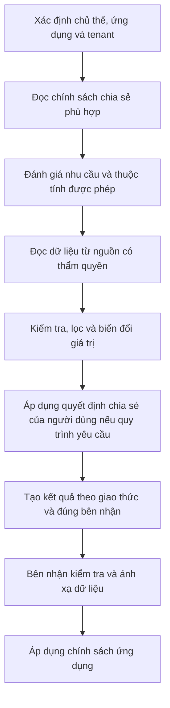

# Attribute release

## 1. Không phải mọi thuộc tính đều nên đi cùng mỗi lần đăng nhập

Một công ty cho nhân viên đăng nhập vào cổng học tập của đối tác bằng tài khoản doanh nghiệp. Hệ thống danh tính của công ty có nhiều thông tin: tên, email, mã nhân viên, phòng ban, quản lý, nhóm nội bộ và trạng thái hợp đồng. Cổng học tập có thể chỉ cần nhận diện người học và biết họ có đủ điều kiện dùng dịch vụ hay không.

Nếu gửi toàn bộ hồ sơ và tất cả nhóm nội bộ mỗi lần đăng nhập, công ty đã chia sẻ nhiều hơn nhu cầu của ứng dụng. Thông tin dư thừa có thể bị lưu trong cơ sở dữ liệu, log hoặc hệ thống phân tích của đối tác, dù không phục vụ chức năng học tập.

**Attribute release** là việc lựa chọn và cho phép cung cấp các thuộc tính danh tính cho một bên nhận trong một ngữ cảnh federation xác định. Chính sách release trả lời những câu hỏi: gửi thuộc tính gì, về chủ thể nào, cho ứng dụng nào, với mục đích nào, theo điều kiện nào và từ nguồn dữ liệu nào.

Đây là một phần của quan hệ tin cậy giữa bên cung cấp danh tính và bên nhận. Nó không chỉ là đổi tên trường JSON hoặc thêm một mục vào assertion. Việc một hệ thống đang giữ một thuộc tính không có nghĩa mọi ứng dụng liên kết đều được nhận thuộc tính đó.

## 2. Ba hoạt động cần phân biệt

### 2.1. Thu thập và quản lý thuộc tính ở nguồn

Tổ chức cần biết một thông tin được lấy từ đâu, ai có thể sửa, ý nghĩa là gì và được cập nhật khi nào. Ví dụ, tên hiển thị do người dùng tự sửa khác với trạng thái hợp đồng được hệ thống nhân sự quản lý.

Thông tin có sẵn trong thư mục chỉ thể hiện khả năng lấy dữ liệu. Nó chưa quyết định được dữ liệu có được chia sẻ ra ngoài hay có đủ tin cậy để dùng vào phân quyền không.

### 2.2. Cho phép chia sẻ thuộc tính

Bên cung cấp danh tính áp dụng chính sách cho đúng ứng dụng và tenant. Có thể chỉ gửi một tập thuộc tính, biến đổi giá trị hoặc từ chối một phần yêu cầu không phù hợp.

Một ứng dụng đối tác được tin để nhận diện nhân viên không mặc nhiên được nhận danh sách các nhóm quản trị của công ty. Cùng một người dùng có thể nhận được tập thuộc tính được chia sẻ khác nhau khi đăng nhập vào hai ứng dụng khác nhau.

### 2.3. Sử dụng thuộc tính ở bên nhận

Bên nhận kiểm tra thông điệp, ánh xạ đúng chủ thể rồi sử dụng dữ liệu theo chính sách của mình. Nhận được một thuộc tính không đồng nghĩa được phép dùng nó cho mọi mục đích hoặc tự biến nó thành quyền có tác động cao.

| Hoạt động | Câu hỏi chính | Ví dụ |
|---|---|---|
| Quản lý dữ liệu nguồn | Giá trị này đến từ đâu và có đúng không? | Trạng thái nhân viên được cập nhật từ nguồn có thẩm quyền |
| Attribute release | Ứng dụng này được nhận phần thông tin nào? | Chỉ gửi định danh người học và điều kiện sử dụng cổng học tập |
| Ánh xạ và phân quyền | Giá trị nhận được có ý nghĩa gì tại ứng dụng? | Cho phép chức năng học theo chính sách của cổng, không tự cấp quyền quản trị |

Ba hoạt động có thể nằm trong cùng một nền tảng nhưng vẫn cần trách nhiệm và kiểm soát riêng.

## 3. Xây dựng một hợp đồng thuộc tính

Trước khi tích hợp, hai bên cần thống nhất đủ thông tin để tránh việc “có cùng tên trường nhưng hiểu khác nhau”. Một hợp đồng thuộc tính có thể mô tả:

- Tên thuộc tính và tên được truyền qua giao thức.
- Ý nghĩa, kiểu dữ liệu, số lượng giá trị và phạm vi áp dụng.
- Nguồn có thẩm quyền, bên được sửa và độ mới cần thiết.
- Bên nhận được phép, tenant và mục đích sử dụng.
- Thuộc tính bắt buộc hay tùy chọn đối với chức năng cụ thể.
- Hành vi khi không có giá trị, bị từ chối chia sẻ hoặc dữ liệu không hợp lệ.
- Chính sách lưu, cập nhật, chia sẻ tiếp và loại bỏ dữ liệu tại bên nhận.

Ví dụ, `department` có thể là mã đơn vị hay tên hiển thị; `groups` có thể là toàn bộ membership hoặc chỉ là nhóm phục vụ ứng dụng đó. Một giá trị `active=true` có thể nói tài khoản nguồn chưa bị khóa, nhưng chưa chắc có nghĩa hợp đồng còn hiệu lực hoặc chủ thể được phép vào mọi tài nguyên.

Hợp đồng cần làm rõ các khác biệt này. Không nên để ứng dụng tự suy ra quyền từ một chuỗi có tên dễ hiểu nhưng ý nghĩa chưa được thỏa thuận.

## 4. Chia sẻ tối thiểu theo từng bên nhận

### 4.1. Dùng danh sách cho phép

Một cách kiểm soát dễ hiểu là duy trì danh sách thuộc tính được phép chia sẻ cho từng quan hệ tích hợp. Thuộc tính mới được thêm ở nguồn không tự xuất hiện ở mọi ứng dụng.

Danh sách cho phép nên gắn với định danh ứng dụng và tenant đã được xác minh, không chỉ với một tên hiển thị hoặc một tham số tùy ý do người gọi gửi lên. Yêu cầu rộng từ ứng dụng không tự mở rộng phạm vi được phép.

NIST SP 800-63C nhấn mạnh việc giới hạn dữ liệu trao đổi theo nhu cầu của hệ thống và thỏa thuận tin cậy. Khi áp dụng vào thiết kế, cần xác định cụ thể mục đích và tập thuộc tính cho từng bên nhận. [NIST SP 800-63C — Federation and Assertions](https://pages.nist.gov/800-63-4/sp800-63c.html).

### 4.2. Có thể gửi kết quả suy ra thay vì dữ liệu gốc

Nếu ứng dụng chỉ cần biết một người đủ điều kiện tham gia dịch vụ, nguồn có thể cung cấp một thuộc tính suy ra theo quy tắc đã thống nhất, thay vì gửi toàn bộ thông tin để ứng dụng tự tính.

Ví dụ, cổng học tập nhận `trainingEligible=true` thay vì ngày bắt đầu hợp đồng, loại hợp đồng và danh sách đơn vị nội bộ. Tên này là thuộc tính minh họa do hai bên tự định nghĩa, không phải claim chuẩn dùng chung cho mọi giao thức.

Thuộc tính suy ra vẫn cần nguồn, ý nghĩa và độ mới rõ ràng. Nó giảm lượng dữ liệu gốc được chia sẻ nhưng không tự trở thành một kết quả luôn đúng hoặc luôn được phép sử dụng.

### 4.3. Định danh ổn định cũng là dữ liệu được chia sẻ

Một ứng dụng có thể cần định danh ổn định để nhận ra cùng một người qua nhiều phiên. Không vì vậy mà phải nhận mã nhân viên nội bộ hoặc một mã toàn cục dùng chung cho mọi đối tác.

Có thể sử dụng cơ chế định danh theo phạm vi bên nhận nếu hệ thống và giao thức hỗ trợ, nhằm giảm khả năng đối chiếu cùng một người giữa các dịch vụ. Cách tạo và quản lý định danh phải theo cơ chế được thiết kế, không chỉ băm tùy tiện một giá trị dễ đoán.

Định danh có tính riêng theo phạm vi không tạo ra ẩn danh hoàn toàn. Nếu cùng lúc chia sẻ một email hoặc mã nội bộ giống nhau tới mọi dịch vụ, các bên vẫn có thể có tín hiệu để liên hệ dữ liệu của cùng chủ thể.

## 5. Minh họa chính sách cho cổng học tập

Giả sử cổng đối tác có mục đích đã thống nhất là nhận diện người học và cho phép sử dụng chương trình đào tạo dành cho nhân viên đủ điều kiện.

| Thông tin ở nguồn | Quyết định chia sẻ minh họa | Lý do |
|---|---|---|
| Định danh chủ thể | Gửi định danh liên kết phù hợp với bên nhận | Nhận diện tài khoản đúng qua các phiên |
| Tên hiển thị | Chỉ gửi nếu chức năng giao diện cần và chính sách cho phép | Hiển thị tên người học |
| Email công việc | Chỉ gửi khi có mục đích liên lạc được chấp nhận | Không mặc định cần cho mọi chức năng học |
| Mã nhân viên nội bộ | Không gửi trong hợp đồng ví dụ này | Không cần để cổng nhận diện người học |
| Thông tin lương | Không gửi | Không phục vụ mục đích đã xác định |
| Toàn bộ nhóm nội bộ | Không gửi | Dễ lộ cấu trúc và quyền không liên quan |
| Điều kiện tham gia đào tạo | Gửi kết quả suy ra có ý nghĩa rõ ràng | Đủ cho ứng dụng đánh giá điều kiện dịch vụ |

Một mô hình chính sách khái niệm có thể viết như sau:

```yaml
policyId: training-partner-release-example
recipient:
  client: training-partner-example
  tenant: tenant-A
purpose: Nhận diện người học và kiểm tra điều kiện dùng dịch vụ
businessAttributes:
  allow:
    - displayName
    - trainingEligible
  denyByDefault: true
groupRelease:
  mode: NONE
missingEligibility:
  action: DENY_PROTECTED_TRAINING_ACCESS
```

Đây là mô hình diễn giải chính sách, không phải schema cấu hình của một sản phẩm. Các trường định danh và bảo vệ bắt buộc của giao thức được xử lý riêng; ví dụ không có nghĩa assertion hay token thực tế chỉ gồm các trường nghiệp vụ liệt kê ở đây.

`denyByDefault` yêu cầu những thuộc tính nghiệp vụ ngoài danh sách không tự được gửi. Nó không thay thế việc xác minh người nhận, kiểm tra điều kiện nguồn hay bảo vệ thông điệp.

Nếu sau đó cổng muốn nhận thêm email để gửi thông báo, hai bên phải xem xét mục đích, phạm vi và chính sách rồi cập nhật hợp đồng có kiểm soát. Việc ứng dụng thêm một tham số yêu cầu email không tự thay thế quyết định đó.

## 6. Attribute release trong SAML và OIDC

### 6.1. SAML

SAML có `AttributeStatement` để biểu diễn các thuộc tính và giá trị trong assertion. Cấu trúc giao thức cho biết cách truyền dữ liệu; chính sách tích hợp quyết định tập thuộc tính thực sự được cung cấp cho một SP. [OASIS SAML 2.0 Core — AttributeStatement](https://docs.oasis-open.org/security/saml/v2.0/saml-core-2.0-os.pdf).

Việc đổi tên thuộc tính từ thư mục sang tên bên nhận mong đợi là ánh xạ. Nó không tự trả lời ứng dụng có được nhận dữ liệu hay không. Tương tự, khai báo nhu cầu thuộc tính trong cấu hình tích hợp không phải giấy phép để lấy mọi giá trị từ nguồn.

### 6.2. OpenID Connect

OIDC cho phép yêu cầu các nhóm claim bằng scope như `profile`, `email`. Yêu cầu không bảo đảm mọi claim đều được trả về. Thuộc tính có thể được cung cấp qua UserInfo tùy luồng và yêu cầu; không mặc định mọi claim hồ sơ nằm trong ID Token. [OIDC — Requesting Claims using Scope Values](https://openid.net/specs/openid-connect-core-1_0.html#ScopeClaims).

Khi dùng UserInfo, RP phải kiểm tra `sub` trong kết quả khớp chính xác với `sub` của ID Token trước khi sử dụng các giá trị đó. Đây là kiểm tra gắn dữ liệu với đúng chủ thể, không thay thế các kiểm tra giao thức khác. [OIDC — Successful UserInfo Response](https://openid.net/specs/openid-connect-core-1_0.html#UserInfoResponse).

Trong thiết kế ứng dụng, nên tách việc yêu cầu dữ liệu, nhận dữ liệu và sử dụng dữ liệu. Một scope được gửi đi không phải bằng chứng rằng ứng dụng đã nhận đủ thông tin, và một claim hiện diện không tự quyết định toàn bộ quyền cục bộ.

## 7. Quy trình ra quyết định chia sẻ

Sơ đồ sau mô tả trách nhiệm về dữ liệu ở mức khái niệm. Nó không thay thế trình tự thông điệp của một giao thức cụ thể:



Quy trình cần xử lý cả dữ liệu không có, chưa chắc chắn hoặc quá cũ. Không nên bỏ qua lỗi nguồn bằng cách gửi một giá trị có vẻ hợp lệ nhưng thực tế chỉ là mặc định do người tích hợp tự đặt.

Các quy tắc có thể được áp dụng vào thời điểm đăng nhập hoặc lúc ứng dụng gọi API thuộc tính theo cơ chế được cho phép. Mỗi đường cung cấp dữ liệu đều cần chính sách tương ứng; lọc assertion nhưng để một API trả toàn bộ hồ sơ vẫn có thể làm hỏng mục tiêu giới hạn chia sẻ.

## 8. Vai trò của thông báo và sự đồng ý

Người dùng cần có cách hiểu thông tin nào được chia sẻ với bên nào trong mô hình áp dụng. Tùy thỏa thuận và quy trình, quyết định release có thể do tổ chức quản lý hoặc có bước người dùng quyết định tại thời điểm sử dụng.

Một màn hình đồng ý không nên được hiểu là cho phép ứng dụng yêu cầu mọi dữ liệu. Chính sách nguồn, phạm vi đã thỏa thuận và quyền của bên nhận vẫn giới hạn điều có thể chia sẻ. Ngược lại, không có màn hình hỏi lại mỗi lần không có nghĩa dữ liệu đang được gửi mà không có chính sách nào.

Cần phân biệt thuộc tính bắt buộc cho chức năng với thuộc tính tùy chọn. Nếu người dùng từ chối tên hiển thị tùy chọn, ứng dụng có thể dùng giao diện chung. Nếu thiếu thuộc tính cần để kiểm tra quyền vào một khu vực bảo vệ, ứng dụng phải xử lý theo chính sách cho chức năng đó, không tự coi người dùng đã thỏa điều kiện.

Khi hệ thống ghi nhớ quyết định chia sẻ, thay đổi mục đích hoặc tập thuộc tính cần được xử lý theo quy trình tương ứng. Một quyết định cũ cho tập dữ liệu nhỏ không nên tự biến thành chấp nhận một tập dữ liệu lớn hơn.

## 9. Chất lượng dữ liệu và độ tin cậy của thuộc tính

### 9.1. Chữ ký hợp lệ không làm mọi giá trị thành dữ liệu có thẩm quyền

Một thông điệp được bảo vệ đúng có thể cho biết nó đến từ nguồn đã được chấp nhận và không bị sửa theo cơ chế kiểm tra. Điều đó chưa đủ để xác nhận mọi thuộc tính đều được kiểm chứng theo cùng một mức.

Ví dụ, nếu người dùng tự sửa trường hồ sơ mang tên `department`, ứng dụng không nên dùng trường đó làm căn cứ duy nhất để cấp quyền đọc dữ liệu của một bộ phận nhạy cảm. Cần biết nguồn nào quản lý thuộc tính, ai có thể sửa và nguồn được tin để phát biểu điều gì.

Đặc biệt, một thuộc tính từ đối tác mang giá trị `role=admin` không tự cấp quyền quản trị ở bên nhận. Việc ánh xạ phải có chính sách rõ ràng theo bên phát hành, tenant, ý nghĩa thuộc tính và phạm vi tài nguyên.

### 9.2. Thiếu, rỗng và sai không phải một trạng thái

Thuộc tính không được gửi có thể do không được yêu cầu, không được phép chia sẻ, nguồn không có dữ liệu hoặc lỗi xử lý. Nó không mặc nhiên tương đương giá trị `false` theo nghiệp vụ.

Ứng dụng cần phân biệt dữ liệu chưa biết với giá trị phủ định khi ra quyết định. Với một điều kiện bắt buộc, chưa đủ bằng chứng có thể dẫn tới từ chối thao tác hoặc yêu cầu bổ sung; không tự gán giá trị có lợi để người dùng đi tiếp.

Cũng cần thống nhất kiểu dữ liệu và số lượng giá trị. Chuỗi `"false"`, boolean `false`, danh sách rỗng và một trường bị bỏ qua không nên được xử lý bằng cùng một phép kiểm tra chuỗi tùy tiện.

### 9.3. Thuộc tính có thể thay đổi sau khi được gửi

Một giá trị đúng lúc đăng nhập có thể không còn đúng khi người dùng chuyển nhóm hoặc kết thúc hợp đồng. Bản sao ở ứng dụng không tự cập nhật chỉ vì nguồn đã thay đổi.

Cần xác định thời hạn cache, cơ chế đồng bộ hoặc đánh giá lại phù hợp với rủi ro. Với thuộc tính tham gia phân quyền, độ trễ cập nhật có thể trở thành độ trễ thu hồi. Không nên coi một giá trị lưu từ lần đăng nhập đầu là căn cứ vĩnh viễn.

## 10. Giới hạn chia sẻ phải bao phủ cả vòng đời dữ liệu

### 10.1. Bảo vệ truyền và giới hạn bên nhận

Thông điệp cần được bảo vệ và kiểm tra theo giao thức. Bên nhận phải xác minh nguồn, bên nhận dự kiến và ngữ cảnh trước khi dùng thuộc tính. Không dùng một phản hồi cho ứng dụng khác chỉ vì tên trường giống nhau.

Ký thông điệp và mã hóa nội dung giải quyết các mục tiêu khác nhau. Dữ liệu có chữ ký vẫn có thể bị người có quyền đọc thông điệp nhìn thấy. Cần xem xét các điểm dữ liệu đi qua, khả năng lộ qua trình duyệt, hệ thống trung gian và kênh truyền thực tế.

### 10.2. Kiểm soát sau khi bên nhận có dữ liệu

Không thể thu hồi một bản sao đã được gửi chỉ bằng cách bỏ thuộc tính khỏi các thông điệp sau. Bên nhận cần chính sách cập nhật, lưu giữ và loại bỏ dữ liệu phù hợp với mục đích đã thống nhất.

Một broker hoặc cổng liên kết có thể nhận dữ liệu từ nguồn rồi phát hành thông tin mới cho ứng dụng. Mỗi chặng cần biết bên nào phát biểu giá trị, đã biến đổi gì và bên nhận nào được phép dùng. Broker không nên tự mở rộng dữ liệu tới mọi ứng dụng phía sau chỉ vì đã nhận được nó ở phía trước.

### 10.3. Nhật ký cũng là nơi có thể chia sẻ quá mức

Không nên ghi toàn bộ assertion, ID Token, access token hoặc hồ sơ người dùng vào log để kiểm tra việc ánh xạ. Nhật ký có thể chỉ cần mã tương quan, ứng dụng nhận, phiên bản chính sách, tên thuộc tính được phép hoặc bị loại và mã lý do.

Ngay cả tên thuộc tính hoặc mã chủ thể cũng có thể nhạy cảm trong một số ngữ cảnh. Cần kiểm soát quyền xem log và chỉ giữ những thông tin cần thiết cho điều tra, vận hành và giải trình theo chính sách của hệ thống.

## 11. Những tình huống cần kiểm chứng trong tích hợp

| Tình huống | Hành vi mong muốn trong mô hình ví dụ |
|---|---|
| Cổng học tập yêu cầu thêm toàn bộ nhóm | Không tự gửi dữ liệu ngoài hợp đồng được cho phép |
| Một thuộc tính mới được thêm vào thư mục | Không tự xuất hiện ở mọi ứng dụng |
| Hai tenant dùng cùng tên ứng dụng | Chính sách được chọn bằng định danh và ngữ cảnh tenant đúng |
| Nguồn không trả được điều kiện tham gia | Không tự cho rằng chủ thể đủ điều kiện vào chức năng bảo vệ |
| Tên hiển thị tùy chọn bị từ chối | Chức năng không phụ thuộc tên xử lý theo chính sách đã định |
| Nhóm hoặc trạng thái công việc thay đổi | Bản sao và quyết định phụ thuộc được cập nhật theo cơ chế đã thiết kế |
| Đối tác gửi giá trị vai trò đặc quyền | Không được nâng quyền nếu thiếu ánh xạ và thẩm quyền nguồn phù hợp |
| Dữ liệu UserInfo thuộc chủ thể khác | Không được dùng để điền hồ sơ của phiên hiện tại |
| Một thuộc tính bị bỏ khỏi lần đăng nhập mới | Không mặc định dữ liệu cũ đã bị xóa ở mọi nơi |
| Bật chế độ xử lý lỗi | Không làm lộ toàn bộ credential hoặc hồ sơ vào log |

Các kiểm tra nên bao gồm kết quả không được gửi, không chỉ kiểm tra những trường gửi thành công. Một tích hợp hoạt động được về mặt đăng nhập vẫn có thể chia sẻ thừa dữ liệu nếu chỉ nhìn vào việc người dùng có vào ứng dụng hay không.

## 12. Những điểm cần ghi nhớ

Attribute release kiểm soát phần thông tin danh tính đi qua ranh giới tin cậy tới từng bên nhận. Thiết kế cần bắt đầu từ mục đích sử dụng, nguồn có thẩm quyền và tập dữ liệu tối thiểu, rồi mới ánh xạ thành trường theo giao thức.

Yêu cầu của ứng dụng, sự hiện diện của thuộc tính ở nguồn và một thông điệp có chữ ký hợp lệ là các yếu tố khác nhau. Bên cung cấp quyết định điều được chia sẻ; bên nhận kiểm tra đúng chủ thể, ngữ cảnh và chính sách sử dụng. Thuộc tính tham gia phân quyền còn cần được đánh giá về độ mới và vòng đời để quyền truy cập không tiếp tục dựa trên dữ liệu đã hết căn cứ.
