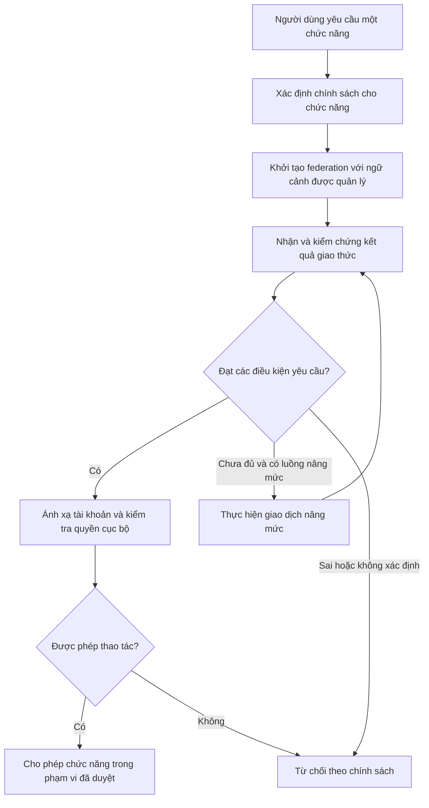

# Federation assurance — Mức bảo đảm của giao dịch liên kết danh tính

## 1. Vì sao đăng nhập qua IdP vẫn cần đánh giá mức bảo đảm?

Một doanh nghiệp đã bật MFA tại nhà cung cấp danh tính. Tuy nhiên, ứng dụng nhận kết quả đăng nhập lại không kiểm tra đúng bên nhận, chấp nhận callback không gắn với giao dịch đang chờ hoặc xử lý lại cùng một assertion nhiều lần. Khi đó, việc xác thực mạnh tại IdP không tự sửa các điểm yếu trên đoạn chuyển giao kết quả tới ứng dụng.

**Federation assurance** là sự bảo đảm đối với quá trình chuyển và sử dụng thông tin danh tính, xác thực giữa các bên trong một giao dịch liên kết. Câu hỏi trọng tâm là: ứng dụng có đủ cơ sở tin rằng phiên được tạo đúng cho chủ thể dự kiến, từ nguồn được phép và qua một giao dịch được bảo vệ hay không?

Trong bài này, **IdP — Identity Provider** là bên cung cấp khẳng định danh tính, còn **RP — Relying Party** là bên dựa vào kết quả đó để xử lý đăng nhập. **Assertion** là thông điệp khẳng định được kiểm chứng trong giao thức, chẳng hạn SAML assertion hoặc OIDC ID Token theo ngữ cảnh tương ứng.

Khi nói về các mức FAL, bài dùng **NIST SP 800-63C-4**, bản final công bố tháng 7/2025, làm khung tham chiếu. Cần ghi rõ phiên bản khi đánh giá vì không nên ghép yêu cầu từ các bản hướng dẫn khác nhau. [Trang công bố NIST SP 800-63C-4](https://csrc.nist.gov/pubs/sp/800/63/c/4/final).

Mục tiêu của bài là hiểu các chiều bảo đảm và cách đưa chúng vào thiết kế. Các ví dụ chính sách là minh họa, không phải tuyên bố một hệ thống cụ thể đã đạt mức FAL nào.

## 2. Tách IAL, AAL và FAL

Ba câu hỏi khác nhau cần được trả lời trong một hệ thống danh tính:

| Chiều bảo đảm | Câu hỏi trọng tâm | Ví dụ vấn đề |
| --- | --- | --- |
| Identity Assurance Level — IAL | Danh tính được thiết lập và kiểm chứng với mức tin cậy nào? | Một hồ sơ có thực sự gắn với người được khai báo không? |
| Authentication Assurance Level — AAL | Người đang xác thực chứng minh quyền kiểm soát authenticator như thế nào? | Kẻ khác có thể đăng nhập bằng credential bị lấy cắp không? |
| Federation Assurance Level — FAL | Giao dịch liên kết bảo vệ việc chuyển và chấp nhận khẳng định như thế nào? | Assertion có bị tráo, phát lại hoặc gắn vào sai phiên không? |

NIST phân biệt quá trình kiểm chứng danh tính, xác thực và federation trong mô hình danh tính số; chúng không phải ba tên gọi cho cùng một mức an toàn. [NIST SP 800-63-4, Digital Identity Model](https://pages.nist.gov/800-63-4/sp800-63/model/).

Ví dụ, một tài khoản có thể được xác thực bằng cơ chế mạnh nhưng được tạo từ hồ sơ chưa được kiểm chứng sâu. Ngược lại, hồ sơ đã được kiểm chứng kỹ không giúp một callback yếu chống được assertion bị đưa vào sai phiên.

Do đó, không suy ra `FAL2` từ việc “đã có hai yếu tố”, không suy ra `AAL3` từ nhãn `FAL3`, và không coi một claim về MFA là bằng chứng danh tính ngoài đời đã được kiểm chứng ở mức cao.

Ngoài ba chiều này, ứng dụng vẫn cần **authorization**: chủ thể đã đăng nhập được thực hiện hành động nào trên tài nguyên nào. Một giao dịch federation được bảo vệ tốt không tự cấp quyền quản trị, xuất dữ liệu hoặc duyệt thanh toán.

## 3. Federation assurance bảo vệ khỏi những sai lệch nào?

| Mối đe dọa | Tình huống minh họa | Vấn đề cần kiểm soát |
| --- | --- | --- |
| Giả mạo hoặc sửa assertion | Thay subject rồi gửi lại thông điệp | Nguồn phát và tính toàn vẹn |
| Dùng sai bên nhận | Đưa khẳng định của cổng đào tạo tới ứng dụng tài chính | Audience và ngữ cảnh ứng dụng |
| Replay | Gửi lại bằng chứng đã được xử lý | Chống chấp nhận lại theo quy tắc giao thức |
| Assertion injection | Gắn một assertion hợp lệ vào giao dịch hoặc phiên không tương ứng | Liên kết giao dịch, trình duyệt và kết quả |
| Nhầm quan hệ tin cậy | Dùng khóa hợp lệ nhưng thuộc issuer hoặc tenant không được phép | Ràng buộc issuer, khóa và phạm vi tin cậy |
| Nhầm chủ thể | Gộp hai tài khoản chỉ vì tên hoặc email giống nhau | Định danh và ánh xạ tài khoản |

Replay và injection có thể liên quan nhau nhưng không đồng nhất. Replay chú ý việc sử dụng lại bằng chứng; injection chú ý việc ép RP nhận bằng chứng hoặc tham chiếu assertion trong ngữ cảnh không đúng. Một assertion chưa từng được RP dùng vẫn có thể bị đưa vào sai phiên.

Ví dụ, kẻ tấn công có một assertion hợp lệ của chính họ nhưng làm cho trình duyệt của nạn nhân hoàn tất đăng nhập với danh tính của kẻ tấn công. Vấn đề không nhất thiết là sửa được chữ ký. Vấn đề có thể nằm ở việc hệ thống không gắn kết quả với giao dịch mà trình duyệt đang chờ.

Do đó, chỉ kiểm tra chữ ký và thời hạn chưa phải toàn bộ công việc. Cần đánh giá đường đi của thông điệp, trạng thái giao dịch và cách RP tạo phiên.

## 4. Các mức FAL theo NIST SP 800-63C-4

Các mức sau tăng dần và kế thừa yêu cầu mức thấp hơn, trừ quy định chặt hơn. Bảng chỉ nêu điểm phân biệt, không thay toàn bộ yêu cầu:

| Mức | Điểm chính |
| --- | --- |
| FAL1 | Assertion được ký, giới hạn audience và chống replay tại từng RP; chống injection được khuyến nghị. |
| FAL2 | Bắt buộc chống injection; giao dịch bắt đầu ở RP; một audience; thỏa thuận tin cậy thiết lập trước. |
| FAL3 | Thêm kiểm chứng authenticator của người dùng tại RP qua holder-of-key hoặc bound authenticator; thiết lập định danh các bên thủ công. |

FAL2 còn giới hạn thông tin cá nhân dạng rõ trong federated identifier; điều này không có nghĩa mọi thuộc tính cá nhân đều bị cấm trong assertion. Ở FAL3, thiết lập định danh thủ công không đồng nghĩa mọi lần phân phối hoặc xoay khóa đều phải làm thủ công. Đánh giá đạt mức phải kiểm tra đầy đủ điều kiện áp dụng. [NIST SP 800-63C-4, phần Federation Assurance Level](https://pages.nist.gov/800-63-4/sp800-63c/fal/).

### 4.1. FAL là thuộc tính của giao dịch được triển khai

Nhãn sản phẩm “hỗ trợ FAL cao” cho biết một khả năng, không chứng minh mọi tích hợp dùng sản phẩm đó đều đạt cùng mức. RP, IdP, cấu hình, luồng đăng nhập, cách quản lý khóa và hành vi thực tế đều có ảnh hưởng.

Ví dụ, cùng một IdP có thể phục vụ cổng tài liệu và hệ thống quản trị đặc quyền bằng các luồng có chính sách khác nhau. Cần đánh giá đúng luồng và mục đích đang xét, không lấy một cấu hình thử nghiệm làm bằng chứng cho mọi ứng dụng production.

### 4.2. Không rút gọn FAL thành một công tắc

Không nên mô tả FAL1 là “có chữ ký là đủ”, FAL2 là “bật mã hóa là đủ” hoặc FAL3 là “thêm một lần nhập OTP là đủ”. Mỗi cách rút gọn đều bỏ mất các điều kiện về giao dịch, tin cậy hoặc kiểm chứng tương ứng.

Mã hóa có vai trò bảo mật nội dung, nhưng cần đánh giá riêng với tính toàn vẹn, audience và chống injection. Một thông điệp không đọc được bởi người ngoài vẫn có thể bị ứng dụng dùng sai nếu ràng buộc giao dịch bị bỏ qua.

## 5. Hiểu đúng bước bảo vệ bổ sung tại FAL3

Theo NIST, holder-of-key chỉ ra authenticator để RP kiểm chứng sự kiểm soát của người dùng. Bound authenticator được liên kết với tài khoản tại RP và được RP quản lý. Các cơ chế này cần chống phishing; RP phải xử lý assertion và kiểm chứng authenticator, không tạo phiên nếu kiểm chứng bổ sung thất bại. [NIST SP 800-63C-4, mục 3.15–3.17](https://pages.nist.gov/800-63-4/sp800-63c/Federation/#holder-of-key-assertions).

Điểm cần hiểu là **RP có thêm một việc kiểm chứng**, thay vì chỉ đọc một chuỗi khai báo rằng người dùng đã có MFA ở nơi khác. Việc thêm claim tùy ý `fal=3` vào token không tạo ra bằng chứng kiểm soát authenticator.

Không nên coi cơ chế này là một hành động “ký xác nhận” chung chung. Phải biết authenticator nào gắn với tài khoản nào, RP xác minh điều gì, và quá trình liên kết ban đầu được bảo vệ ra sao.

Ví dụ tư duy: hệ thống kiểm tra rằng một người dùng kiểm soát một khóa, nhưng lại gắn khóa đó vào tài khoản chỉ dựa trên email do người dùng tự nhập. Kiểm chứng khóa có thể đúng, trong khi quan hệ giữa khóa và tài khoản đã bị thiết lập sai. Cần đánh giá cả quá trình liên kết, thay thế, mất và thu hồi authenticator.

Các biện pháp bổ sung không làm hệ thống miễn nhiễm mọi rủi ro. Thiết bị bị chiếm quyền, quy trình khôi phục yếu hoặc ánh xạ tài khoản sai vẫn cần được xử lý bằng các kiểm soát thích hợp.

## 6. Đưa yêu cầu assurance vào quan hệ tin cậy

Một thỏa thuận tin cậy có ích phải xác định bên nào có thẩm quyền khẳng định điều gì và RP chấp nhận điều đó trong phạm vi nào. Đây là cơ sở để diễn giải cấu hình và claim, thay vì tin mọi giá trị do nguồn ngoài gửi tới.

Các câu hỏi thiết kế nên được trả lời rõ:

- Những issuer, tenant, quần thể người dùng và ứng dụng nào nằm trong phạm vi?
- Profile giao thức và phiên bản yêu cầu nào được sử dụng?
- Cấu hình khóa được lấy từ đâu, ai phê duyệt thay đổi và xử lý xoay khóa thế nào?
- Cần mức kiểm chứng danh tính và xác thực nào cho từng chức năng?
- Thuộc tính hoặc giá trị ngữ cảnh xác thực có ý nghĩa gì và do ai xác nhận?
- Khi không đạt điều kiện, RP từ chối, yêu cầu nâng mức hay giới hạn chức năng ra sao?
- Ai xử lý sự cố, ngừng tin cậy và ảnh hưởng tới phiên đang tồn tại?

Ví dụ, RP không thể hiểu giá trị `strong` từ hai IdP là tương đương chỉ vì chuỗi giống nhau. Cần biết mỗi IdP dùng giá trị đó cho cơ chế nào và bằng chứng nào hỗ trợ cách diễn giải.

Với OIDC, các claim như `acr`, `amr` và `auth_time` có vai trò khác nhau; `iat` là thời điểm phát hành token, không phải thời điểm người dùng vừa xác thực. RP phải xử lý theo giao thức và chính sách đã thống nhất, không tự đổi một claim phương thức xác thực thành chứng nhận FAL. [OpenID Connect Core, mục 2 và 3.1.3.7](https://openid.net/specs/openid-connect-core-1_0.html#IDTokenValidation).

Một cấu hình chính sách minh họa có thể được lưu như sau:

```yaml
policyId: sensitive-customer-export
policyVersion: 6
referenceFramework: NIST-SP-800-63C-4
requiredFederationLevel: FAL2
acceptedFederationProfile: enterprise-rp-initiated-v3
acceptedIssuerConfiguration: company-a-idp-production
requiredAuthenticationProfile: recent-strong-authentication
unknownAssuranceResult: DENY_SENSITIVE_ACTION
```

Đây là dữ liệu chính sách nội bộ giả định, không phải claim chuẩn hoặc cấu hình có thể dùng trực tiếp cho một thư viện. Trường `requiredFederationLevel` mô tả yêu cầu; việc giao dịch thực sự đạt yêu cầu cần được chứng minh bằng thiết kế và thực thi tương ứng.

## 7. Xử lý assurance trong giao dịch thực tế



Trong thiết kế này, chính sách được chọn theo chức năng và bối cảnh đáng tin cậy, không theo tham số do trình duyệt tự khai rằng giao dịch đã đạt mức cao.

Sau khi nhận kết quả, RP cần dùng dữ liệu đã được thư viện kiểm chứng, liên kết đúng giao dịch và đánh giá các điều kiện assurance. Chỉ sau đó mới tới ánh xạ tài khoản và authorization cục bộ.

Nếu thiếu thông tin cần thiết, không nên tự gán một giá trị cao để người dùng tiếp tục. Thiếu, không xác định và không đạt là các trạng thái có thể cần cách xử lý khác nhau, nhưng không trạng thái nào tự trở thành “đã đạt”.

### Nâng mức phải xử lý đúng phần còn thiếu

Nếu yêu cầu thiếu xác thực gần đây, có thể cần tái xác thực theo luồng được hỗ trợ. Nếu luồng federation không bảo vệ injection như yêu cầu, thêm một lần nhập mật khẩu không tự sửa luồng callback đó.

Nếu yêu cầu cần bằng chứng kiểm soát authenticator tại RP, một thông điệp mới từ IdP chưa chắc thay thế được bước kiểm chứng tại RP. Vì vậy, trước khi gọi chung là “step-up”, cần xác định đang nâng chiều bảo đảm nào và kiểm tra kết quả nào.

## 8. Chọn yêu cầu theo rủi ro và mục đích

NIST mô tả lựa chọn mức bảo đảm dựa trên tác động và rủi ro của dịch vụ, đồng thời xem xét quyền riêng tư, khả năng sử dụng và việc đánh giá liên tục. Không nên gán một mức chỉ từ tên loại ứng dụng. [NIST SP 800-63-4, Digital Identity Risk Management](https://pages.nist.gov/800-63-4/sp800-63/dirm/).

Một cách phân tích thực tế là bắt đầu từ hậu quả nếu RP tạo phiên cho sai người. Cùng ứng dụng có thể có thao tác xem tài liệu và thao tác xuất dữ liệu nhạy cảm; hai thao tác không nhất thiết có cùng yêu cầu.

Ví dụ minh họa về cách đặt câu hỏi, không phải bảng ánh xạ FAL bắt buộc:

| Chức năng | Hậu quả cần đánh giá | Câu hỏi assurance |
| --- | --- | --- |
| Xem nội dung đào tạo thông thường | Truy cập sai tài khoản, lộ thông tin học tập | Nguồn danh tính và phiên có được gắn đúng không? |
| Xuất dữ liệu khách hàng | Rò rỉ dữ liệu trên phạm vi lớn | Giao dịch có đủ bảo vệ và xác thực còn phù hợp không? |
| Quản lý tài khoản đặc quyền | Mở rộng ảnh hưởng sang nhiều hệ thống | Có cần bảo vệ bổ sung tại RP, kiểm soát phiên và phê duyệt riêng không? |

Sau khi xác định yêu cầu, cần kiểm tra bên tích hợp có thực sự đáp ứng hay không. Nếu chưa đáp ứng, tổ chức phải sửa thiết kế, hạn chế chức năng hoặc xử lý ngoại lệ qua thẩm quyền phù hợp. Không nên âm thầm hạ yêu cầu chỉ vì IdP đối tác chưa hỗ trợ.

## 9. Đánh giá một chuỗi có broker hoặc proxy

Trong một kiến trúc có broker, RP có thể nhận assertion từ broker thay vì trực tiếp từ IdP gốc. Khi phân tích assurance, cần xem cả dữ liệu đầu vào, cách broker kiểm chứng và cách broker phát hành kết quả đầu ra.

Có thể dùng mô hình tư duy:

```text
IdP gốc
    → giao dịch và kiểm chứng ở chặng thứ nhất
Broker
    → biến đổi claim, định danh hoặc giao thức
    → giao dịch và kiểm chứng ở chặng thứ hai
RP cuối
```

Không nên coi một nhãn assurance ở đầu chuỗi tự động giữ nguyên ý nghĩa sau mọi biến đổi. Ví dụ, broker bỏ thông tin cần để đánh giá xác thực gần đây, hoặc ánh xạ subject từ nhiều đối tác vào cùng một tài khoản, sẽ làm RP cuối mất một phần căn cứ cần thiết.

Cũng không nên tính mức của toàn chuỗi bằng một phép toán đơn giản trên các con số FAL. Cần xác định giao dịch nào đang được đánh giá, các quan hệ tin cậy nào áp dụng và những điều kiện nào được thực thi ở mỗi ranh giới.

Một báo cáo có ích phải chỉ ra bằng chứng tại từng chặng, người sở hữu cấu hình và những giả định còn phụ thuộc broker. Điều này giúp việc điều tra cụ thể hơn một tuyên bố “toàn hệ thống SSO đạt mức cao”.

## 10. Bằng chứng để đánh giá đạt yêu cầu

Một nhãn mức bảo đảm cần được hỗ trợ bởi các bằng chứng phù hợp với phạm vi đánh giá:

| Loại bằng chứng | Ví dụ |
| --- | --- |
| Chính sách | Chức năng nào yêu cầu mức nào, theo phiên bản hướng dẫn nào? |
| Quan hệ tin cậy | Issuer, phạm vi, profile và nguồn cấu hình khóa được chấp thuận |
| Cấu hình thực thi | Quy tắc kiểm chứng, quản lý giao dịch và giới hạn luồng được phép |
| Kiểm tra hành vi | Chấp nhận ca hợp lệ, từ chối sai audience, replay và giao dịch không tương ứng |
| Vận hành | Xoay khóa, cảnh báo, xử lý lỗi và ngừng tin cậy |
| Truy vết | Chính sách và cấu hình nào đã quyết định kết quả của một giao dịch? |

Các ca kiểm tra cần chứng minh ranh giới, không chỉ chứng minh đăng nhập thành công. Chẳng hạn, nếu giao dịch cho chức năng nhạy cảm cần bắt đầu tại RP, thử gửi kết quả không có giao dịch hợp lệ phải dẫn tới cách xử lý đúng chính sách.

Một liên kết ngoài dẫn người dùng tới RP để RP tự bắt đầu quy trình đăng nhập khác với việc RP chấp nhận trực tiếp một assertion không được yêu cầu. Cần kiểm tra hành vi thực tế thay vì kết luận chỉ từ nơi người dùng bấm nút đầu tiên.

Nếu có bước kiểm chứng authenticator bổ sung, cần thử cả trường hợp đúng, sai, không có và không còn liên kết hợp lệ. Việc thấy giao diện yêu cầu xác thực chưa chứng minh phía máy chủ bắt buộc kết quả đó trước khi tạo phiên.

Không nên ghi toàn bộ assertion, token hoặc credential vào log chỉ để làm bằng chứng assurance. Có thể ghi mã tương quan, issuer đã kiểm chứng, phiên bản chính sách, loại kết quả và lý do từ chối theo thiết kế bảo vệ dữ liệu của hệ thống.

## 11. Assurance phải tiếp tục được duy trì sau triển khai

Một tích hợp đã được kiểm tra có thể thay đổi vì IdP đổi khóa, RP thay thư viện, thêm broker, mở một luồng đăng nhập mới hoặc sửa chính sách ánh xạ. Những thay đổi đó cần được đánh giá theo mức ảnh hưởng.

Ví dụ, nhóm vận hành thêm đường đăng nhập dự phòng để xử lý sự cố nhưng cho phép bỏ một kiểm tra bắt buộc. Đường chính vẫn đúng không làm đường dự phòng trở nên an toàn. Các đường vào cùng một chức năng nhạy cảm đều cần tuân theo chính sách tương ứng.

Sau khi federation hoàn tất, phiên cục bộ vẫn có vòng đời riêng. Assertion hết hạn không tự chứng minh phiên đã chấm dứt; thay đổi quyền cũng cần cơ chế cập nhật và thu hồi thích hợp. Không nên dùng nhãn FAL của lần đăng nhập ban đầu để bỏ qua việc bảo vệ session cookie hoặc kiểm tra quyền trên từng thao tác.

Các chỉ số hữu ích gồm giao dịch không xác định được assurance, lần nâng mức thất bại, lỗi kiểm chứng theo issuer, thay đổi cấu hình chưa được duyệt và đường truy cập chưa có bằng chứng đáp ứng chính sách. Cần biết phạm vi đo; một IdP không phát sinh lỗi chưa chứng minh các điều kiện đều đã được kiểm tra.

## 12. Tình huống tự kiểm tra

Một cổng quản trị yêu cầu giao dịch federation đáp ứng chính sách nhạy cảm của tổ chức. Nhà cung cấp nói rằng IdP đã bật MFA và token có claim `assurance=high`. RP kiểm tra chữ ký nhưng vẫn nhận kết quả đăng nhập không gắn với giao dịch đang chờ.

Chưa thể kết luận yêu cầu đã đạt. Cần hiểu claim có ý nghĩa gì theo quan hệ tin cậy, profile nào đang dùng, RP có bảo vệ injection và replay đúng không, và các điều kiện tại từng bên có bằng chứng thực thi hay chưa. Nếu chính sách yêu cầu kiểm chứng bổ sung tại RP, phải kiểm tra chính bước đó.

Giả sử những vấn đề giao dịch đã được sửa, tài khoản vẫn chưa tự có quyền thay đổi người quản trị khác. Authorization, phân tách nhiệm vụ và vòng đời quyền vẫn phải được áp dụng riêng.

Federation assurance đòi hỏi nhìn xuyên suốt từ quan hệ tin cậy tới phiên được tạo ở RP. Một mức bảo đảm có ý nghĩa khi nó gắn với **đúng phiên bản yêu cầu, đúng giao dịch, đúng kiểm soát đã thực thi và bằng chứng có thể kiểm tra**, thay vì chỉ một nhãn trên token hoặc tài liệu sản phẩm.
