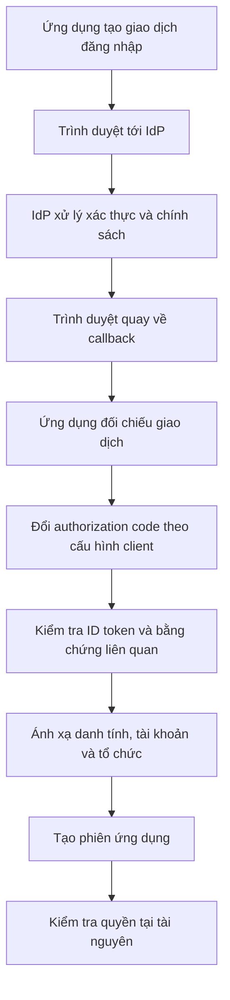

# Federation failure

## 1. Federation failure là gì?

**Federation failure** là tình huống luồng liên kết danh tính không hoàn thành như mong muốn hoặc không tạo được kết quả truy cập hợp lệ. Người dùng có thể không tới được Identity Provider — IdP, không xác thực được, không quay lại ứng dụng, bị từ chối bằng chứng danh tính hoặc đăng nhập xong nhưng vẫn không được sử dụng tài nguyên.

Trong một luồng federation, nhiều thành phần cùng tham gia: trình duyệt, ứng dụng đóng vai trò Relying Party — RP hoặc Service Provider — SP, IdP, nguồn tài khoản, mạng, khóa ký và dữ liệu quản lý vòng đời. Vì vậy, màn hình “đăng nhập thất bại” chưa đủ để kết luận IdP bị lỗi.

Cần phân biệt ba tình huống:

| Tình huống | Ví dụ | Ý nghĩa |
|---|---|---|
| Lỗi vận hành hoặc tích hợp | Endpoint không truy cập được, cấu hình sai, phiên giao dịch bị mất | Cần khôi phục đường đi hợp lệ |
| Từ chối đúng theo kiểm soát | Bằng chứng sai audience, hết hạn hoặc tài khoản ngoài phạm vi | Hệ thống đang bảo vệ ranh giới tin cậy |
| Xác thực thành công nhưng truy cập bị từ chối | Người dùng chưa có role hoặc đã bị vô hiệu hóa tại ứng dụng | Cần kiểm tra phân quyền và vòng đời tài khoản |

Mục tiêu xử lý không phải làm mọi lần đăng nhập đều thành công. Mục tiêu là khôi phục những trường hợp hợp lệ, đồng thời tiếp tục từ chối những trường hợp không hợp lệ.

## 2. Chia luồng thành các chặng có thể quan sát

Luồng sau minh họa đăng nhập OIDC theo Authorization Code Flow ở mức khái niệm:



SAML có thông điệp, binding và cách kiểm tra khác, nhưng vẫn cần nhận diện các chặng: khởi tạo, xác thực, truyền phản hồi, kiểm tra bằng chứng, ánh xạ và tạo phiên.

Khi xử lý lỗi, câu hỏi đầu tiên là **chặng hợp lệ cuối cùng đã hoàn thành là chặng nào?** Nếu không có sự kiện callback tại ứng dụng, chưa nên bắt đầu bằng việc sửa mapping role. Nếu callback đã tới nhưng không tìm thấy giao dịch đăng nhập, việc đổi khóa ký có thể không liên quan.

Nên có mã liên kết đủ để ghép sự kiện giữa các thành phần. Các bên có thể dùng mã khác nhau; cần giữ quan hệ đối chiếu phù hợp thay vì kỳ vọng một mã request duy nhất tự đi xuyên qua mọi giao thức.

## 3. Nhận diện phạm vi ảnh hưởng trước khi thay đổi cấu hình

Một lỗi tác động toàn bộ người dùng thường gợi ý vấn đề khác với lỗi chỉ xảy ra ở một tài khoản. Tuy nhiên, đó là dấu hiệu điều tra, không phải kết luận nguyên nhân.

Những câu hỏi hữu ích gồm:

- Tất cả ứng dụng hay chỉ một client hoặc SP bị ảnh hưởng?
- Mọi tổ chức hay chỉ một tenant hoặc một quan hệ tin cậy?
- Đăng nhập mới thất bại hay phiên đã có cũng không dùng được?
- Lỗi xảy ra trên mọi replica hay tập trung ở một node?
- Chỉ một loại trình duyệt, một đường mạng hoặc một phương thức xác thực?
- Lỗi bắt đầu sau thay đổi khóa, chứng thư, proxy, client, mapping hay chính sách?
- Người dùng mới thất bại nhưng người dùng cũ thành công, hay ngược lại?
- Lỗi ổn định hay xuất hiện theo tỷ lệ và thời điểm?

Ví dụ, chỉ một replica từ chối token sau xoay khóa có thể liên quan cache hoặc phiên bản cấu hình khác nhau. Chỉ người dùng mới không có hồ sơ nội bộ có thể liên quan provisioning. Chỉ lỗi sau một thời gian mở nhiều tab có thể liên quan vòng đời giao dịch, nhưng vẫn cần bằng chứng cụ thể.

Không dùng những nhận định ban đầu để mở rộng trust hoặc nới điều kiện xác thực. Trước mỗi thay đổi, ghi giả thuyết, bằng chứng sẽ kiểm tra và phạm vi cấu hình thực sự liên quan.

## 4. Các nhóm lỗi thường gặp

### 4.1. Không tới được IdP hoặc endpoint phía sau

Nguyên nhân có thể là DNS, TLS, routing, firewall, proxy, timeout hoặc dịch vụ IdP không sẵn sàng. Cần phân biệt đường từ trình duyệt tới IdP với đường từ backend ứng dụng tới token endpoint hoặc nguồn metadata.

Trình duyệt mở được trang đăng nhập không chứng minh backend ứng dụng có thể đổi code. Hai đường mạng có thể dùng proxy, DNS hoặc cấu hình trust TLS khác nhau.

Kiểm tra hostname, endpoint thực tế, lỗi kết nối và thời điểm phát sinh từ đúng thành phần. Không bỏ xác minh chứng thư TLS để “thử cho chạy” trên môi trường phục vụ người dùng.

### 4.2. Sai đăng ký client hoặc endpoint nhận

Một redirect URI không khớp đăng ký có thể khiến IdP từ chối yêu cầu hoặc phản hồi không tới đúng nơi. Với SAML, entity ID, endpoint nhận và binding không thống nhất cũng có thể làm phản hồi bị từ chối.

Các môi trường dev, test và production cần được tách rõ. Không dùng credential hoặc định danh ứng dụng của môi trường này rồi gửi kết quả về môi trường khác.

Reverse proxy có thể khiến ứng dụng tính sai URL công khai, chẳng hạn nhầm scheme, host hoặc đường dẫn. Cần cấu hình base URL và xử lý header chuyển tiếp từ proxy đáng tin cậy. Không tin header host hoặc forwarding do bất kỳ client nào tự gửi.

Không khắc phục bằng cách mở redirect URI thành một phạm vi tùy ý. Endpoint nhận là một phần của ranh giới tin cậy.

### 4.3. IdP từ chối xác thực hoặc chính sách không được đáp ứng

Tài khoản có thể bị khóa, hết hạn, chưa được phép dùng ứng dụng, không hoàn thành MFA hoặc không đáp ứng điều kiện đăng nhập. Người dùng hủy thao tác cũng không phải lỗi hạ tầng.

Cần xem kết quả và chính sách từ nguồn có thẩm quyền, đồng thời bảo vệ thông tin riêng tư. Không yêu cầu người dùng cung cấp mật khẩu hoặc mã MFA cho người hỗ trợ để “kiểm tra hộ”.

Nếu tài khoản đã nghỉ việc hoặc bị chặn vì sự cố, từ chối là kết quả cần giữ. Không bật lại tài khoản chỉ để làm luồng federation thành công.

### 4.4. Mất liên kết với giao dịch đăng nhập

Ứng dụng có thể không tìm được trạng thái đã tạo trước khi chuyển tới IdP. Nguyên nhân có thể gồm session store không dùng chung, cookie không được gửi, giao dịch hết hạn, thay đổi secret bảo vệ cookie hoặc nhiều tab làm ghi đè dữ liệu giao dịch.

Với một cụm nhiều replica, cần kiểm tra nơi lưu giao dịch và cách các node truy cập dữ liệu đó. Sticky session có thể ảnh hưởng biểu hiện lỗi nhưng không tự giải quyết mọi vấn đề đồng bộ hoặc mất node.

Cookie phải phù hợp với HTTPS, domain, path và cách phản hồi đi qua trình duyệt. Các response mode hoặc binding khác nhau có thể tạo yêu cầu cross-site khác nhau; cần đánh giá SameSite theo luồng thực tế. Không tắt toàn bộ kiểm soát cookie hoặc CSRF để bỏ qua lỗi liên kết.

State, nonce và những cơ chế liên quan có mục đích khác nhau. Khi điều kiện liên kết bắt buộc không đạt, ứng dụng phải từ chối; sau khi sửa nguyên nhân, nên bắt đầu một giao dịch mới.

### 4.5. Trao đổi authorization code thất bại

Trong OIDC Authorization Code Flow, ứng dụng cần đổi code theo đúng client, redirect URI và cơ chế bảo vệ của giao dịch. Credential của client, PKCE hoặc cấu hình endpoint không khớp có thể làm bước này thất bại.

Authorization code có vòng đời hạn chế và được dùng theo quy tắc của luồng. Một code bị dùng lại, quá hạn hoặc gắn với giao dịch khác không được sửa bằng cách lặp vô hạn cùng yêu cầu.

Nếu timeout xảy ra, cần hiểu trạng thái xử lý và hành vi giao thức. Không mặc định mọi thao tác đổi code đều có thể retry như một lệnh đọc dữ liệu. Có trường hợp phải khởi tạo đăng nhập mới thay vì tái sử dụng code cũ.

Không ghi code, code verifier hoặc client secret vào log để so sánh thủ công.

### 4.6. Chữ ký, issuer hoặc audience không hợp lệ

Bên tiếp nhận có thể không tìm được khóa đúng, dùng cấu hình issuer sai hoặc nhận bằng chứng dành cho ứng dụng khác. Một chữ ký kiểm tra thành công không thay thế các điều kiện còn lại.

Các câu hỏi cần tách riêng:

- Nguồn phát hành có nằm trong quan hệ tin cậy đã duyệt không?
- Khóa kiểm tra có thuộc nguồn đó và đang được chấp nhận không?
- Thuật toán và loại bằng chứng có phù hợp với profile cấu hình không?
- Audience và đích nhận có đúng với bên tiếp nhận hiện tại không?
- Có đang dùng nhầm ID token cho một API yêu cầu access token không?

Không tự tải khóa từ một URL bất kỳ trong thông điệp chưa được tin cậy. Khi không xác minh được bằng chứng, từ chối và điều tra nguyên nhân thay vì bỏ kiểm tra chữ ký.

### 4.7. Sai thời gian hoặc điều kiện hiệu lực

Đồng hồ lệch, độ trễ xử lý hoặc giao dịch mở quá lâu có thể khiến bằng chứng chưa có hiệu lực hoặc đã hết hạn theo điều kiện của nó.

Cần đối chiếu thời gian hệ thống và đồng bộ thời gian giữa các thành phần. Phân biệt thời điểm xảy ra sự kiện, phát hành bằng chứng, xác thực người dùng và nhận thông điệp.

Dung sai lệch đồng hồ, nếu được profile cho phép, cần có giới hạn và căn cứ. Không tăng dung sai lên rất lớn để che một hệ thống thời gian sai hoặc một luồng truyền quá chậm.

### 4.8. Ánh xạ danh tính, tổ chức hoặc quyền thất bại

Bằng chứng hợp lệ có thể không chứa thuộc tính bắt buộc, có subject thay đổi theo cấu hình mới hoặc không khớp tài khoản nội bộ. Claim nhóm cũng có thể thiếu do phạm vi chia sẻ hay giới hạn của cơ chế phát hành.

Nếu hệ thống không liên kết được danh tính, không tự ghép vào tài khoản đã có chỉ vì email giống nhau. Cần giữ đúng phạm vi issuer, subject và quy trình liên kết danh tính.

Sau xác thực, một người dùng có thể chưa được cấp tài khoản, có tài khoản bị chặn hoặc chưa có quyền trên tài nguyên. Phải xác định đây là lỗi provisioning, mapping hay quyết định phân quyền; không mặc định thêm role quản trị để kiểm tra.

## 5. Xoay khóa, cache và sự cố chỉ xảy ra trên một phần hệ thống

Một tình huống phổ biến là IdP đã bắt đầu ký bằng khóa mới nhưng một số bên nhận chưa có dữ liệu xác minh phù hợp.

Giả sử bốn replica của ứng dụng cùng phục vụ đăng nhập. Ba replica cập nhật khóa đúng, một replica vẫn dùng cache cũ và không tải được dữ liệu mới. Người dùng có thể thấy đăng nhập lúc được lúc không tùy node tiếp nhận.

Cần đối chiếu:

1. Thời điểm IdP thay đổi khóa ký.
2. Nguồn khóa được cấu hình tại từng replica.
3. Kết quả tải metadata hoặc JWKS và thời điểm cập nhật thành công.
4. Định danh khóa được dùng, phiên bản cấu hình và node xử lý.
5. Điều kiện chấp nhận khóa cũ, khóa mới và thời hạn của bằng chứng.

Trong OIDC, một `kid` chưa biết có thể là tín hiệu cần kiểm tra việc cập nhật tập khóa từ nguồn đã cấu hình. Nó không phải lý do tin một nguồn khóa do bên gửi tự chỉ định. Việc tải lại cũng cần được kiểm soát để tránh một chuỗi giá trị lạ gây bão yêu cầu tới IdP.

Cache hợp lệ có thể giúp xử lý bằng chứng ký bằng khóa đã biết khi nguồn khóa tạm thời không truy cập được, nếu chính sách hiệu lực cho phép. Cache không giúp xác minh một khóa chưa có và không được kéo dài tin cậy vô hạn.

Xoay khóa theo kế hoạch khác khóa bị lộ. Nếu khóa bị lộ, tiếp tục chấp nhận nó để giữ tỷ lệ đăng nhập thành công có thể duy trì khả năng giả mạo. Việc khôi phục phải tuân theo quyết định ứng phó sự cố và cập nhật cả khóa, cấu hình cùng phiên liên quan khi cần.

## 6. Thu thập bằng chứng mà không làm lộ bí mật

Thông tin chẩn đoán nên đủ để chỉ ra chặng và điều kiện thất bại, nhưng không biến hệ thống log thành nơi lưu credential.

Một bản ghi minh họa:

```yaml
eventType: FEDERATION_LOGIN_REJECTED
correlationId: login-correlation-482
occurredAt: "2026-11-26T03:20:00Z"
applicationId: partner-portal
trustId: partner-b
protocol: OIDC
phase: ID_TOKEN_VALIDATION
reasonCode: SIGNING_KEY_UNAVAILABLE
replicaId: portal-node-04
configurationVersion: 18
nextAction: INVESTIGATE_CONFIGURED_KEY_SOURCE
```

Đây là schema và mã lỗi nội bộ minh họa, không phải tên lỗi tiêu chuẩn bắt buộc. Mã lỗi cần phân biệt được không có khóa, chữ ký không đúng, issuer không khớp và những nguyên nhân khác, thay vì gộp mọi thứ thành “token invalid”.

Có thể cần ghi thêm thời gian xử lý, mã phản hồi đã được lược bỏ dữ liệu nhạy cảm hoặc định danh người dùng đã được bảo vệ phù hợp. Chỉ lấy các trường cần cho mục đích điều tra.

Không đưa vào log thông thường:

- Mật khẩu, mã MFA, client secret hoặc khóa riêng.
- Authorization code và PKCE code verifier.
- Token nguyên vẹn, session cookie hoặc assertion chứa dữ liệu nhạy cảm.
- Toàn bộ claim cá nhân chỉ để tìm một trường không khớp.

Một file HAR, ảnh màn hình hoặc bản ghi callback cũng có thể chứa credential và dữ liệu cá nhân. Nếu thực sự cần thu thập, phải kiểm soát truy cập, lược bỏ dữ liệu và quản lý thời hạn lưu giữ phù hợp. Không dán token thật lên công cụ giải mã công khai.

Màn hình người dùng nên cung cấp thông báo phù hợp và mã hỗ trợ, trong khi chi tiết kỹ thuật được giữ cho người có quyền. Không tiết lộ tùy ý trạng thái tài khoản hoặc thông tin tenant cho bên chưa được xác thực.

## 7. Quy trình điều tra có giả thuyết và phạm vi rõ

### Bước 1 — Xác định triệu chứng và thời điểm

Ghi lại ứng dụng, quan hệ tin cậy, loại người dùng, thời điểm và chặng thất bại. Phân biệt lỗi ổn định với lỗi gián đoạn, người dùng hủy với hệ thống timeout và từ chối đúng với cấu hình hỏng.

### Bước 2 — Đối chiếu một giao dịch

Theo mã liên kết từ ứng dụng đến IdP và các thành phần liên quan. Xác định chặng cuối có bằng chứng thành công; không chỉ dựa vào thông báo trên trình duyệt.

### Bước 3 — So sánh cấu hình thực tế

Kiểm tra đúng issuer, client hoặc entity ID, endpoint nhận, nguồn khóa, phiên bản mapping và secret tham chiếu. So sánh giữa các replica và môi trường mà không làm lộ giá trị bí mật.

Nếu lỗi bắt đầu sau triển khai, đối chiếu thay đổi cụ thể. Có thay đổi gần thời điểm lỗi là một giả thuyết đáng kiểm tra, chưa đủ chứng minh quan hệ nhân quả.

### Bước 4 — Kiểm tra giả thuyết bằng bằng chứng tối thiểu

Ví dụ, để kiểm tra cache khóa, xem kết quả tải khóa tại node lỗi. Để kiểm tra mất giao dịch, xem session store và cookie của đúng luồng. Không đồng thời thay nhiều biến vì sẽ khó biết nguyên nhân đã được xử lý hay chỉ bị che.

### Bước 5 — Khôi phục trong phạm vi được phép

Áp dụng thay đổi đã xác định, cập nhật cấu hình hoặc rollback khi phù hợp. Nếu rollback có thể khôi phục một trust, mapping hoặc credential đã bị thu hồi vì an toàn, phải đánh giá tác động đó; không coi rollback luôn là phương án vô hại.

### Bước 6 — Xác minh cả trường hợp thành công lẫn từ chối

Kiểm tra đăng nhập mới trên các node liên quan, ánh xạ đúng danh tính và quyền đúng phạm vi. Đồng thời xác nhận bằng chứng sai nguồn, sai đích hoặc hết hạn vẫn bị từ chối.

Nếu lỗi liên quan tenant hoặc nhóm, thử cả đối tượng được cho phép và đối tượng ngoài phạm vi. Thành công với một tài khoản quản trị không chứng minh luồng của người dùng bình thường đã khôi phục.

## 8. Khôi phục có kiểm soát và duy trì tính sẵn sàng

### Không mở quyền để che lỗi xác minh

Khi không xác minh được danh tính theo yêu cầu, hệ thống không được tự tạo phiên mới với danh tính chưa được chứng minh. Những cách “sửa” như bỏ chữ ký, nhận mọi issuer, tự gán role mặc định rộng hoặc tắt MFA cho toàn bộ người dùng làm thay đổi kiểm soát, không giải quyết nguyên nhân lỗi.

Một fallback sang IdP khác cũng cần quan hệ tin cậy và cách ánh xạ danh tính đã được thiết kế. Không tự chuyển nguồn rồi ghép tài khoản bằng email chỉ vì nguồn chính đang lỗi.

### Phiên đang có cần được xử lý theo nguyên nhân

Nếu chỉ token endpoint tạm thời không sẵn sàng, phiên ứng dụng hợp lệ đã tồn tại có thể tiếp tục theo chính sách và vòng đời riêng. Một thao tác cần xác thực tăng cường vẫn có thể không thực hiện được.

Nếu nguyên nhân là IdP bị xâm phạm, khóa ký bị lộ hoặc mapping cấp sai quyền, các phiên đã tạo cũng có thể thuộc phạm vi điều tra và thu hồi. Không áp dụng cùng một cách xử lý phiên cho mọi loại sự cố.

### Retry và giới hạn tải

Retry có giới hạn có thể phù hợp với một số lỗi kết nối tạm thời, nhưng phải tôn trọng tính chất thao tác. Không lặp vô hạn đăng nhập hoặc trao đổi một code cũ. Một lỗi xác minh ổn định không được khắc phục bằng việc thử lại với cùng bằng chứng.

Các cơ chế timeout, backoff và ngắt tạm lời gọi tới dịch vụ đang lỗi có thể giảm bão yêu cầu. Cần thiết kế để chúng báo lỗi rõ và không vô tình bỏ qua bước xác thực.

### Truy cập khẩn cấp

Nếu tổ chức có quy trình break-glass, cần có danh tính và credential được quản lý, phạm vi hẹp, giám sát và kiểm tra sau sử dụng. Đây là cơ chế được chuẩn bị trước, không phải đường đăng nhập tùy tiện được thêm trong lúc sự cố.

Khả năng phục hồi cũng cần xét tác động của việc tập trung nhiều ứng dụng vào cùng IdP, nguồn directory, DNS, nguồn metadata hoặc hạ tầng xác thực. Dự phòng chỉ hữu ích khi được kiểm tra với những phụ thuộc thực tế.

## 9. Tình huống xuyên suốt: lỗi sau xoay khóa

Ứng dụng cổng đối tác bắt đầu có lỗi đăng nhập sau một đợt xoay khóa đã được lên kế hoạch. Phiên cũ vẫn đọc dữ liệu được, nhưng một phần lần đăng nhập mới thất bại.

Quá trình điều tra:

1. IdP ghi nhận xác thực thành công; trình duyệt đã quay về callback.
2. Ứng dụng đổi code thành công nhưng một replica báo không có khóa phù hợp để kiểm tra ID token.
3. Các replica còn lại sử dụng cùng issuer và có tập khóa mới.
4. Node lỗi không truy cập được nguồn JWKS do cấu hình egress khác với các node khác.
5. Đội vận hành sửa đường truy cập đến đúng nguồn đã cấu hình và thực hiện cập nhật theo cơ chế được hỗ trợ.
6. Kiểm tra lại cho thấy node lỗi đã nhận khóa phù hợp và xác minh được đăng nhập mới.

Phạm vi sửa là kết nối và dữ liệu khóa tại node đó. Không cần mở issuer khác, bỏ audience hoặc thay mapping người dùng.

Sau khôi phục, cần xác nhận:

- Các replica đều dùng phiên bản cấu hình mong muốn.
- Đăng nhập mới thành công với đối tượng hợp lệ.
- Bằng chứng từ issuer khác hoặc dành cho ứng dụng khác vẫn bị từ chối.
- Những code hoặc giao dịch đã hết hạn không được tái sử dụng.
- Hệ thống có cảnh báo khi node không cập nhật được nguồn khóa.

Nếu khóa cũ đã bị lộ thay vì được xoay theo kế hoạch, hướng xử lý phải bổ sung ứng phó sự cố. Không khôi phục tin cậy đối với khóa bị lộ chỉ để làm luồng cũ hoạt động trở lại.

## 10. Giám sát và phòng ngừa lỗi lặp lại

Nên theo dõi lỗi theo chặng thay vì chỉ tổng số đăng nhập thất bại:

| Chặng hoặc nhóm tín hiệu | Giá trị vận hành |
|---|---|
| Khởi tạo và chuyển hướng | Phát hiện sai URL công khai, client hoặc tuyến tới IdP |
| Xác thực tại IdP | Phân biệt người dùng hủy, chính sách từ chối và lỗi dịch vụ |
| Callback và giao dịch | Phát hiện mất state, session hoặc cookie |
| Trao đổi code | Phát hiện lỗi endpoint, credential, PKCE hoặc vòng đời code |
| Xác minh bằng chứng | Phân biệt khóa, chữ ký, issuer, audience và thời gian |
| Mapping và provisioning | Phát hiện thiếu thuộc tính, sai tenant hoặc chưa có tài khoản |
| Tạo phiên và truy cập | Phát hiện lỗi phiên và các từ chối phân quyền riêng |

Tỷ lệ nên được phân tách theo ứng dụng, trust, node và khoảng thời gian phù hợp. Không coi mọi lần nhập sai mật khẩu hay không đủ quyền là outage của federation; đồng thời không bỏ qua sự tăng đột biến của các từ chối có thể phản ánh cấu hình sai hoặc hành vi tấn công.

Những biện pháp phòng ngừa có thể gồm:

- Quản lý cấu hình có phiên bản và kiểm soát thay đổi trust.
- Diễn tập xoay khóa, lỗi metadata và khôi phục kết nối.
- Kiểm tra đồng bộ thời gian và sự thống nhất giữa các replica.
- Tài khoản kiểm thử phù hợp để kiểm tra luồng mà không dùng danh tính cá nhân tùy tiện.
- Kiểm thử trường hợp sai issuer, audience, thời gian và giao dịch trên môi trường được phép.
- Runbook có owner, chặng kiểm tra, cách bảo vệ bằng chứng và điều kiện rollback.
- Đối soát những tài khoản hoặc quyền đã phát sinh nếu có lỗi mapping.

Các kiểm tra tổng hợp không nên tạo đặc quyền production chỉ để đo tình trạng đăng nhập. Cần chọn quyền tối thiểu và tránh biến tài khoản kiểm thử thành đường truy cập không được quản lý.

## 11. Tự kiểm tra

1. Vì sao “IdP ghi nhận thành công” chưa chứng minh ứng dụng đã đăng nhập thành công?
2. Một lỗi chỉ xảy ra trên một replica sau xoay khóa gợi ý những kiểm tra nào?
3. Vì sao không được bỏ kiểm tra state hoặc nonce chỉ để xử lý lỗi mất giao dịch?
4. Khi nào cần khởi tạo đăng nhập mới thay vì retry cùng authorization code?
5. Vì sao phiên đang có cần được xử lý khác nhau giữa outage mạng và sự cố lộ khóa ký?
6. Sau khi sửa lỗi đăng nhập, cần kiểm tra những trường hợp từ chối nào để xác nhận ranh giới tin cậy vẫn được giữ?
