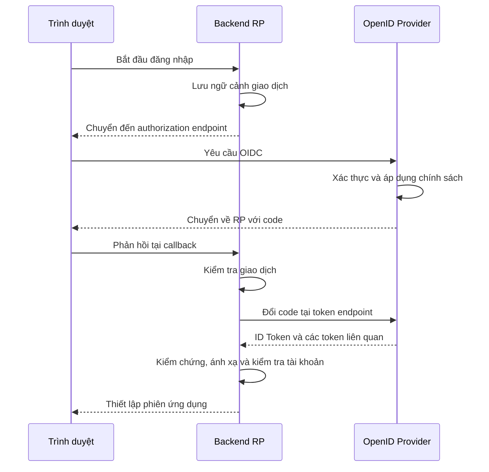

# OpenID Connect là gì

## 1. OIDC bổ sung khả năng nhận diện người dùng cho OAuth

**OpenID Connect**, viết tắt **OIDC**, là một giao thức nhận diện người dùng được xây dựng trên OAuth 2.0. OIDC cho phép ứng dụng kiểm chứng danh tính của người dùng dựa trên việc xác thực do một bên cung cấp danh tính thực hiện, đồng thời nhận những thông tin hồ sơ được cho phép.

Ví dụ, cổng quản lý dự án cho phép nhân viên chọn “Đăng nhập bằng tài khoản công ty”. Người dùng xác thực tại hệ thống danh tính công ty. Cổng dự án nhận kết quả theo OIDC, kiểm chứng kết quả đó rồi liên kết với tài khoản của người dùng trong ứng dụng.

Ứng dụng không cần nhận mật khẩu công ty trong luồng đăng nhập này. Tuy vậy, ứng dụng vẫn có trách nhiệm kiểm tra bằng chứng, quản lý phiên và quyết định quyền truy cập vào chức năng, dữ liệu của mình.

Điểm khác biệt quan trọng là OIDC chuẩn hóa cách ứng dụng nhận và xử lý kết quả xác thực. Nó không chỉ là một quy ước tự đặt như “gọi API hồ sơ rồi lấy email làm người đăng nhập”. OpenID Foundation mô tả OIDC là một lớp danh tính trên nền OAuth 2.0, cho phép client kiểm chứng người dùng dựa trên xác thực của Authorization Server. [OpenID Connect Core 1.0](https://openid.net/specs/openid-connect-core-1_0.html).

## 2. OAuth 2.0 và OIDC trả lời các câu hỏi khác nhau

OAuth 2.0 cung cấp khuôn khổ cấp quyền để client tiếp cận tài nguyên được bảo vệ. OIDC sử dụng nền tảng đó để bổ sung giao dịch xác thực người dùng với kết quả được xác định rõ.

| Khía cạnh | OAuth 2.0 | OpenID Connect |
|---|---|---|
| Trọng tâm | Client được truy cập tài nguyên nào theo quyền được cấp | Client nhận diện người dùng dựa trên xác thực của OP |
| Đối tượng kết quả nổi bật | Access token | ID Token, cùng các đối tượng OAuth liên quan tùy luồng |
| Bên sử dụng kết quả | Resource Server nhận access token | RP kiểm chứng ID Token |
| Ví dụ | Ứng dụng được đọc lịch theo phạm vi được cấp | Ứng dụng biết danh tính nào vừa đăng nhập |
| Phân quyền nghiệp vụ | Vẫn cần chính sách tại tài nguyên | Vẫn cần chính sách tại ứng dụng và tài nguyên |

Một luồng OAuth thuần túy không tự trở thành OIDC chỉ vì access token có dạng JWT hoặc chứa trường `sub`. Token đó có thể được phát cho một API, không phải làm bằng chứng đăng nhập cho client.

Ngược lại, OIDC không thay thế toàn bộ OAuth. Một ứng dụng có thể dùng OIDC để đăng nhập và dùng access token nhận được để gọi UserInfo hoặc API phù hợp với quyền được cấp. Cần phân biệt mục đích của từng đối tượng thay vì gọi chung tất cả là “token đăng nhập”.

## 3. Các bên tham gia

### 3.1. End-User

End-User là người đang được xác thực và muốn sử dụng ứng dụng. Họ có thể là nhân viên, khách hàng hoặc người dùng của đối tác, tùy mô hình quản lý danh tính.

Việc có tài khoản tại một nhà cung cấp danh tính không có nghĩa người đó được phép gia nhập mọi ứng dụng tin nhà cung cấp ấy. Phạm vi tổ chức, tenant và điều kiện tham gia vẫn cần được kiểm soát.

### 3.2. OpenID Provider — OP

OP là bên cung cấp chức năng OIDC, thực hiện hoặc dựa trên quá trình xác thực người dùng và phát ID Token. Trong ngữ cảnh federation tổng quát, OP đảm nhiệm vai trò nhà cung cấp danh tính — IdP.

OIDC không quy định mọi người dùng phải xác thực bằng cùng một phương thức. OP có thể sử dụng mật khẩu, phương thức không mật khẩu, MFA hoặc cơ chế được hỗ trợ khác theo chính sách. Vì vậy, chỉ biết “đã đăng nhập OIDC” chưa đủ để kết luận vừa có MFA hoặc mức bảo đảm cụ thể.

### 3.3. Relying Party — RP

RP là ứng dụng sử dụng OIDC để nhận diện người dùng. Trong giao thức, RP cũng là một OAuth client. Nó khởi tạo yêu cầu, xử lý phản hồi, kiểm chứng ID Token và quản lý tài khoản cùng phiên của ứng dụng.

Một ứng dụng web có backend, ứng dụng di động và SPA đều có thể tham gia OIDC, nhưng khả năng giữ bí mật, cách lưu trạng thái và mô hình bảo vệ token khác nhau. Không sao chép nguyên một thiết kế client sang mọi loại ứng dụng.

### 3.4. Resource Server

Resource Server là API nhận access token để quyết định có cho phép thao tác với tài nguyên hay không. Nó có thể cùng sản phẩm với RP hoặc là một dịch vụ khác.

Ví dụ, cổng dự án là RP khi đăng nhập người dùng; API công việc là Resource Server khi nhận access token để đọc nhiệm vụ. Hai vai trò phải dùng đúng bằng chứng và quy tắc kiểm tra của mình.

## 4. ID Token là gì?

**ID Token** là đối tượng mang các claim về sự kiện xác thực và danh tính người dùng, dành cho client nhận diện người đó. Trong OIDC, nó có dạng JWT và được bảo vệ theo cách đã xác định trong giao thức cùng cấu hình sử dụng.

Một payload minh họa của ID Token có thể là:

```json
{
  "iss": "https://login.company.example",
  "sub": "opaque-subject-4261",
  "aud": "project-portal-client",
  "iat": 1800000000,
  "exp": 1800000300,
  "nonce": "transaction-specific-example"
}
```

Đây chỉ là dữ liệu minh họa phần payload, không phải một token hoàn chỉnh có thể dùng để đăng nhập. Các mốc thời gian là giá trị ví dụ theo đơn vị giây từ Unix epoch; chuỗi nonce minh họa không phải mẫu giá trị ngẫu nhiên dùng trong thực tế.

Các trường trong ví dụ giúp diễn đạt những câu hỏi khác nhau:

- `iss`: bên nào phát kết quả?
- `sub`: chủ thể nào được bên phát hành nhận diện?
- `aud`: kết quả dành cho client nào?
- `iat`: token được phát khi nào?
- `exp`: đến khi nào token không còn được chấp nhận theo điều kiện hết hạn?
- `nonce`: kết quả có gắn với giá trị mà RP đã gửi cho giao dịch tương ứng không?

Các claim bổ sung có thể xuất hiện tùy yêu cầu và cấu hình. Không giả định mọi ID Token đều có email, tên, phòng ban hoặc vai trò. Một ID Token hợp lệ cũng không tự khẳng định người dùng là nhân viên đang hoạt động hoặc có quyền quản trị ứng dụng.

Đọc được JSON không đồng nghĩa kiểm chứng được token. Giải mã Base64url chỉ giúp xem nội dung; dữ liệu vẫn chưa đáng tin trước khi hoàn thành các kiểm tra giao thức và mật mã liên quan.

## 5. Phân biệt ba loại token

| Đối tượng | Dùng để làm gì? | Được đưa đến đâu? | Không nên nhầm với điều gì? |
|---|---|---|---|
| ID Token | Cung cấp kết quả nhận diện người dùng cho RP | Client đã được chỉ định trong ngữ cảnh OIDC | Không dùng như vé gọi mọi API |
| Access token | Cho phép truy cập tài nguyên theo quyền được cấp | Resource Server phù hợp, như UserInfo hoặc API nghiệp vụ | Không mặc định là bằng chứng đăng nhập của client |
| Refresh token | Xin access token mới theo điều kiện của Authorization Server | Token endpoint | Không gửi cho API nghiệp vụ để truy cập dữ liệu |

Không phải giao dịch nào cũng có refresh token. Việc phát hành và sử dụng nó phụ thuộc loại client, quyền được cấp và chính sách của nhà cung cấp.

Access token có thể là chuỗi opaque hoặc JWT tùy hệ thống. Client không nên dựa vào việc tự đọc payload access token như một hợp đồng danh tính nếu giao thức không quy định điều đó.

Ví dụ, ID Token có audience là `project-portal-client` phục vụ cổng dự án. API công việc không nên nhận nó thay cho access token dành cho API. Dù hai token được cùng một bên phát hành ký, chúng vẫn có mục đích và điều kiện sử dụng khác nhau.

Refresh token cũng không chứng minh người dùng vừa xác thực lại. Xin được token mới có thể chỉ dựa trên một quyền cấp trước đó; cần phân biệt thời điểm phát token với thời điểm người dùng thực sự xác thực.

## 6. Scope, claim và UserInfo

### 6.1. Scope `openid`

Trong yêu cầu OIDC, scope `openid` biểu thị rằng client đang yêu cầu hành vi của OpenID Connect. Một yêu cầu minh họa có thể dùng:

```text
scope=openid profile email
```

`profile` và `email` là các scope dùng để yêu cầu nhóm thông tin hồ sơ tương ứng. Chúng không phải vai trò ứng dụng: yêu cầu scope `email` không cấp quyền đọc hộp thư và scope `profile` không tạo quyền sửa hồ sơ nhân sự.

Ứng dụng chỉ nên yêu cầu những thông tin cần thiết. Một cổng chỉ cần nhận diện chủ thể không nhất thiết cần địa chỉ, số điện thoại hoặc ngày sinh.

### 6.2. Claim không phải dữ liệu luôn được trả đầy đủ

**Claim** là một thông tin mà bên phát hành đưa ra về chủ thể hoặc ngữ cảnh. Tên hiển thị và email là claim hồ sơ; issuer, subject và thời điểm là những phần phục vụ nhận diện hoặc xử lý giao thức.

Thông tin thực tế được trả phụ thuộc yêu cầu, dữ liệu có sẵn, chính sách và việc cho phép chia sẻ. Không thiết kế ứng dụng theo giả định rằng cứ gửi `profile email` là mọi trường mong muốn sẽ có mặt hoặc luôn được cập nhật ngay lập tức.

Nếu một thuộc tính là điều kiện bắt buộc để sử dụng ứng dụng, cần xác định nguồn có thẩm quyền và cách xử lý khi thiếu. Không tự điền giá trị có quyền cao hoặc gộp tài khoản để vượt qua dữ liệu thiếu.

### 6.3. UserInfo

UserInfo là endpoint được bảo vệ, cho phép client lấy những thông tin người dùng được cho phép bằng access token phù hợp. Nó không phải một API danh bạ cho phép tự chọn bất kỳ người nào theo email.

Khi dùng kết quả UserInfo cùng ID Token, client phải kiểm tra `sub` khớp với chủ thể trong ID Token trước khi sử dụng các thuộc tính đó. Yêu cầu scope cũng không bảo đảm mọi claim được yêu cầu sẽ được trả lại. [OpenID Connect Core — UserInfo Response](https://openid.net/specs/openid-connect-core-1_0.html#UserInfoResponse).

Ví dụ, không lấy email từ một phản hồi UserInfo của giao dịch khác rồi ghép vào danh tính vừa đăng nhập chỉ vì cả hai phản hồi đều có định dạng hợp lệ.

## 7. Một luồng đăng nhập với Authorization Code và PKCE

Xét ứng dụng web có backend. Một thiết kế có thể sử dụng Authorization Code Flow với PKCE để bảo vệ việc trao đổi code. Các bước chính gồm:

1. RP khởi tạo giao dịch, lưu ngữ cảnh và tạo các giá trị bảo vệ cần thiết.
2. Trình duyệt được chuyển tới authorization endpoint của OP với yêu cầu OIDC.
3. OP xác thực người dùng hoặc đánh giá phiên hiện có, đồng thời áp dụng chính sách và việc cho phép chia sẻ liên quan.
4. OP trả authorization code về redirect URI đã đăng ký, cùng các tham số phản hồi của giao dịch.
5. RP kiểm tra phản hồi thuộc giao dịch đang chờ và đúng nhà cung cấp.
6. Backend trao đổi code tại token endpoint, sử dụng PKCE và cơ chế xác thực client phù hợp nếu có.
7. RP kiểm chứng ID Token, lấy thêm UserInfo nếu cần, rồi ánh xạ danh tính.
8. Nếu tài khoản đủ điều kiện, RP tạo phiên ứng dụng và thực thi phân quyền khi sử dụng.



Một số tham số có thể thấy trong yêu cầu minh họa:

```text
response_type=code
client_id=project-portal-client
redirect_uri=https://portal.company.example/oidc/callback
scope=openid profile
state=<gia-tri-rang-buoc-giao-dich>
nonce=<gia-tri-rieng-cho-giao-dich>
code_challenge=<gia-tri-duoc-tinh-tu-verifier>
code_challenge_method=S256
```

Đây là danh sách tham số để đọc hiểu, chưa phải URL đã mã hóa hoặc mã triển khai. `state`, `nonce` và PKCE có vai trò liên quan nhưng không thay thế toàn bộ cho nhau; cách bảo vệ phải phù hợp mô hình client và được thư viện xử lý đúng.

RFC 9700 đưa ra hướng dẫn chống CSRF, lạm dụng authorization code và các vấn đề của luồng chuyển hướng. Public client phải sử dụng PKCE trong phạm vi được quy định; PKCE cũng được khuyến nghị cho confidential client. Việc client có bí mật ở backend không phải lý do bỏ các kiểm tra giao dịch. [RFC 9700 — Authorization Code Grant](https://www.rfc-editor.org/rfc/rfc9700.html#section-2.1.1).

## 8. Những gì RP cần kiểm chứng

RP không nên tự viết một parser JWT rồi gọi đó là đăng nhập OIDC. Cần thư viện hỗ trợ giao thức và cấu hình đúng issuer, client, khóa, thuật toán cùng các ràng buộc giao dịch.

Trong cấu hình ID Token có chữ ký thông thường, các điểm kiểm tra tiêu biểu là tính toàn vẹn, issuer mong đợi, audience chứa đúng `client_id`, thời gian hợp lệ và nonce tương ứng nếu đã gửi. Các claim hoặc yêu cầu về ngữ cảnh xác thực cần được xử lý theo profile và chính sách đang sử dụng. Đây là định hướng, không thay thế toàn bộ quy tắc chuẩn. [OpenID Connect Core — ID Token Validation](https://openid.net/specs/openid-connect-core-1_0.html#IDTokenValidation).

Ví dụ, một ID Token do đúng OP phát nhưng dành cho ứng dụng nhân sự không phải kết quả đăng nhập hợp lệ cho cổng dự án. Chữ ký đúng không loại bỏ yêu cầu kiểm tra bên nhận.

RP cũng cần bảo vệ nơi nhận phản hồi, giới hạn đường chuyển hướng sau đăng nhập và không dùng lại một giao dịch đã kết thúc để tạo phiên mới từ cùng phản hồi. Khi có nhiều OP, phải biết phản hồi thuộc OP nào đã được chọn cho giao dịch, thay vì tự chọn endpoint trao đổi từ dữ liệu chưa được tin cậy.

Nếu một kiểm tra bắt buộc thất bại, không tiếp tục tạo phiên bằng các claim đã đọc được. Người vận hành cần thấy nguyên nhân phù hợp để xử lý, nhưng token, cookie và client secret không nên bị ghi nguyên vẹn vào log.

## 9. Từ danh tính OIDC đến tài khoản ứng dụng

### 9.1. Dùng định danh trong đúng ngữ cảnh

Ứng dụng thường duy trì một liên kết giữa danh tính liên kết và tài khoản nội bộ:

```text
(issuer, subject) → localAccountId

(https://login.company.example, opaque-subject-4261)
    → account-60382
```

Không bỏ issuer rồi coi chuỗi subject là định danh toàn cầu. Các nhà cung cấp khác nhau có thể dùng cùng một chuỗi cho hai chủ thể khác nhau. Một số cách phát định danh còn có thể cung cấp giá trị khác nhau cho cùng người dùng giữa các client, nên không tự đồng nhất `sub` giữa mọi ứng dụng.

Email và tên hiển thị là dữ liệu hồ sơ có thể thay đổi. Chúng không nên là bằng chứng duy nhất để tự liên kết vào tài khoản cũ có quyền hoặc dữ liệu. Việc thêm phương thức đăng nhập mới cần quy trình chứng minh quyền kiểm soát hoặc quản trị có thẩm quyền.

### 9.2. Kiểm tra điều kiện gia nhập và phân quyền

Sau khi nhận diện được chủ thể, RP cần xem tài khoản nội bộ có hoạt động không, người dùng thuộc tổ chức được tiếp nhận không và đã có quyền vào ứng dụng chưa. Một tài khoản xác thực hợp lệ tại OP vẫn có thể bị ứng dụng từ chối.

Nếu tạo tài khoản lúc đăng nhập lần đầu, cần định nghĩa rõ điều kiện tạo và quyền mặc định. Không biến mọi người dùng của một OP công cộng hoặc mọi tenant của một nền tảng thành thành viên mặc nhiên của ứng dụng doanh nghiệp.

Các claim về nhóm hoặc vai trò chỉ là đầu vào khi được chấp nhận theo chính sách cụ thể. Không để một giá trị `admin` từ một nguồn chưa được cho phép tự động ánh xạ sang quyền quản trị nội bộ. API và chức năng vẫn phải kiểm tra quyền đối với tài nguyên trong từng yêu cầu.

## 10. Discovery, đăng ký client và khóa

Một OP có thể cung cấp metadata để client biết issuer, authorization endpoint, token endpoint, nguồn khóa và các khả năng được hỗ trợ. Discovery giúp giảm việc cấu hình riêng từng địa chỉ, nhưng không tự thay thế quyết định tin cậy của ứng dụng.

RP cần bắt đầu từ issuer hoặc cơ chế thiết lập tin cậy được cho phép. Không tự tải và tin cấu hình từ một URL tùy ý do người dùng hoặc token chưa kiểm chứng cung cấp.

Đăng ký client xác định ứng dụng, redirect URI và các cơ chế liên quan. `client_id` là định danh, không phải bí mật. Nếu dùng client secret hoặc khóa riêng cho xác thực client, phải giữ chúng ở nơi phù hợp; mã chạy trong trình duyệt không thể giữ một bí mật chung theo cách backend có thể làm.

Khóa công khai dùng xác minh không phải khóa riêng để ký. RP cần khả năng nhận cập nhật khi OP luân chuyển khóa, quản lý cache và xử lý lỗi. Không bỏ xác minh khi gặp `kid` chưa biết hoặc không lấy được khóa; cũng không tin mọi URL lấy khóa xuất hiện trong token.

Các môi trường thử nghiệm và production nên có cấu hình rõ để tránh chấp nhận nhầm kết quả. Với ứng dụng nhiều tenant, quyết định chấp nhận issuer hoặc tổ chức phải đi cùng quy tắc ánh xạ và phân quyền theo tenant.

## 11. OIDC, SSO và vòng đời phiên

OIDC có thể giúp triển khai SSO. Khi người dùng mở ứng dụng thứ hai, OP có thể sử dụng phiên còn hợp lệ để cung cấp kết quả dành cho ứng dụng đó mà không yêu cầu nhập lại thông tin. Ứng dụng thứ hai vẫn có giao dịch và bước kiểm chứng riêng.

OIDC không có nghĩa mọi ứng dụng chia sẻ một cookie hoặc mọi phiên cùng hết hạn. Phiên tại OP, phiên tại RP và thời hạn token cần được hiểu và quản lý riêng.

Nếu ứng dụng cần xác thực mới cho thao tác quan trọng, phải yêu cầu và đánh giá bằng chứng phù hợp về độ mới hoặc ngữ cảnh. Token mới được phát không tự chứng minh đã có một lần xác thực người dùng mới. Tương tự, không giả định có một scope MFA chung luôn mang cùng ý nghĩa ở mọi OP.

Đăng xuất khỏi ứng dụng cũng chưa tự kết thúc mọi phiên tại OP và các ứng dụng khác. Phối hợp đăng xuất cần khả năng giao thức, cấu hình và xử lý tương ứng; không chỉ xóa một cookie rồi tuyên bố đã đăng xuất toàn bộ.

Khi người dùng nghỉ việc hoặc mất quyền, ứng dụng còn cần xử lý tài khoản, assignment, phiên và các đường truy cập khác. OIDC phục vụ đăng nhập liên kết, không tự thay thế provisioning, deprovisioning, đối soát và kiểm toán quyền.

## 12. Những hiểu nhầm cần tránh

**OAuth có access token là đã biết chắc người đang đăng nhập?**

Không nên suy ra như vậy. Cần giao thức nhận diện và bằng chứng đúng mục đích. OIDC cung cấp phần đó bằng một hợp đồng xử lý rõ, không chỉ dựa vào hình dạng token.

**ID Token có thể gửi cho mọi API vì nó được ký?**

Không. Nó dành cho client trong ngữ cảnh xác thực. API cần loại token và điều kiện chấp nhận phù hợp với vai trò Resource Server.

**Gửi scope `email` có bảo đảm luôn nhận được email?**

Không. Thông tin thực tế còn phụ thuộc dữ liệu và chính sách chia sẻ. Ứng dụng phải xử lý thiếu thuộc tính có chủ đích và không dùng email làm căn cứ duy nhất cho liên kết tài khoản nhạy cảm.

**Người dùng xác thực thành công tại OP thì ứng dụng phải cho truy cập?**

Không. RP còn quyết định điều kiện gia nhập, trạng thái tài khoản và quyền. Xác thực và phân quyền là những bước khác nhau.

**Dùng thư viện JWT là đã hoàn thành tích hợp OIDC?**

Chưa. Cần xử lý yêu cầu và phản hồi giao thức, giao dịch, cấu hình tin cậy, kiểm chứng token, liên kết tài khoản và phiên. Thư viện JWT có thể là một thành phần, nhưng không đại diện cho toàn bộ luồng.

OIDC tạo một cách thống nhất để ứng dụng dựa vào kết quả xác thực của OP. Giá trị của nó được giữ khi ứng dụng phân biệt đúng các loại token, kiểm chứng đúng giao dịch và nối danh tính được xác thực với chính sách truy cập của mình.
