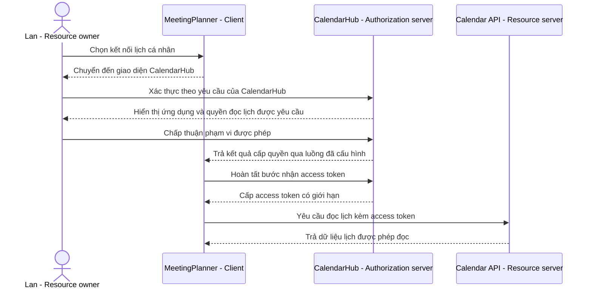

# Resource owner

Trong IAM, một ứng dụng có thể cần thay mặt người dùng đọc lịch, lấy tài liệu hoặc cập nhật hồ sơ. Việc người dùng có tài khoản chưa trả lời được câu hỏi ứng dụng nào được thực hiện việc gì. Khái niệm **resource owner** giúp xác định phía có thẩm quyền cho phép truy cập trong quan hệ ủy quyền đó.

Bài học thuộc chủ đề OAuth và OIDC overview, tập trung vào cách nhận diện resource owner, giới hạn quyền mà họ có thể ủy quyền và những nhầm lẫn dễ gây lỗi phân quyền.

## 1. Resource owner là ai?

Resource owner là thực thể có khả năng cấp quyền truy cập một tài nguyên được bảo vệ. Khi thực thể này là con người, OAuth gọi họ là end-user. Định nghĩa dựa trên thẩm quyền cấp quyền, không bắt buộc resource owner phải là người tạo dữ liệu hoặc người sở hữu máy chủ. [RFC 6749, mục 1.1](https://www.rfc-editor.org/rfc/rfc6749.html#section-1.1)

Ví dụ xuyên suốt bài học: Lan có lịch cá nhân trong CalendarHub. Cô muốn ứng dụng MeetingPlanner xem các khoảng thời gian bận để đề xuất giờ họp. Trong ví dụ này, chính sách CalendarHub cho phép Lan cấp quyền đọc lịch của mình cho một ứng dụng đã đăng ký.

Lan là resource owner trong lần ủy quyền ấy. MeetingPlanner là bên được Lan cho phép truy cập; ứng dụng không trở thành resource owner chỉ vì nó hiển thị lịch lên giao diện.

Câu hỏi hữu ích khi phân tích một hệ thống là: “Ai được phép cho ứng dụng này truy cập tài nguyên này, theo chính sách đang áp dụng?”

## 2. Đặt resource owner vào đúng quan hệ

Bốn vai trò OAuth gồm resource owner, client, authorization server và resource server. Chúng mô tả trách nhiệm; một sản phẩm có thể đảm nhiệm nhiều vai trò. [RFC 6749, mục 1.1](https://www.rfc-editor.org/rfc/rfc6749.html#section-1.1)

Trong hệ thống CalendarHub giả định, có thể ánh xạ như sau:

| Thành phần trong ví dụ | Vai trò | Việc thực hiện |
| --- | --- | --- |
| Lan | Resource owner | Cho phép MeetingPlanner đọc lịch cá nhân trong phạm vi chính sách cho phép |
| MeetingPlanner | Client | Yêu cầu quyền và gọi API để đề xuất giờ họp |
| Dịch vụ cấp quyền CalendarHub | Authorization server | Xử lý việc cấp quyền và phát hành token cho ứng dụng |
| CalendarHub Calendar API | Resource server | Tiếp nhận yêu cầu đọc lịch và áp dụng kiểm soát truy cập |

Trình duyệt Lan dùng để đăng nhập là công cụ tương tác. Trình duyệt không tự có quyền quyết định thay Lan. Tương tự, nhóm vận hành CalendarHub có thể quản lý hạ tầng nhưng quyền vận hành máy chủ không đồng nghĩa với một lần Lan đồng ý cho MeetingPlanner đọc lịch.

Việc tách vai trò giúp giải thích một sự cố cụ thể. Nếu MeetingPlanner đọc sai lịch, cần hỏi API đã áp dụng chính sách nào; không thể chỉ dựa vào việc Lan từng nhấn nút đồng ý.

## 3. Theo dõi một lần Lan cấp quyền

Sơ đồ dưới đây minh họa ở mức khái niệm, lược bỏ các tham số và cơ chế bảo vệ của giao thức. Đây không phải hướng dẫn tự triển khai OAuth.



Trong ví dụ này, cần phân biệt ba quyết định:

1. CalendarHub xác định người đang tương tác có phải Lan hay không.
2. CalendarHub xác định Lan có được phép cấp quyền đọc lịch được chọn cho MeetingPlanner hay không.
3. Calendar API xác định yêu cầu cụ thể của MeetingPlanner có được phép thực hiện hay không.

Ba quyết định có thể liên quan nhưng không thay thế cho nhau. Nếu Lan xác thực thành công mà tài khoản đã bị cấm kết nối ứng dụng ngoài, yêu cầu kết nối vẫn bị từ chối. Nếu Lan đã cấp quyền đọc lịch mà ứng dụng yêu cầu xóa cuộc hẹn, API vẫn phải từ chối thao tác xóa theo chính sách của ví dụ.

Các tên như `calendar.read` trong bài là tên quyền minh họa do hệ thống giả định định nghĩa, không phải scope chuẩn dùng chung cho mọi nhà cung cấp.

## 4. Resource owner không đồng nghĩa với chủ sở hữu nghiệp vụ

Từ “owner” dễ khiến người đọc tưởng rằng cứ có dữ liệu gắn với mình thì có toàn quyền chia sẻ dữ liệu đó. Trong thiết kế IAM, cần tách các quan hệ nghiệp vụ trước khi quyết định ai được ủy quyền.

Giả sử công ty có lịch phòng họp. Lan là người tạo cuộc hẹn, Minh là người quản lý phòng và công ty là tổ chức quản lý tài nguyên. Chỉ nhìn một cột `created_by=lan` chưa đủ để kết luận Lan được cho ứng dụng bên ngoài đọc toàn bộ lịch phòng.

Một chính sách nghiệp vụ giả định có thể quy định:

- Nhân viên được đọc lịch phòng để tìm chỗ trống.
- Người quản lý phòng được sửa cấu hình phòng.
- Chỉ quản trị viên được phê duyệt tích hợp bên ngoài cho lịch dùng chung.

Với chính sách ấy, quyền đọc của Lan không bao gồm quyền cho phép MeetingPlanner lấy dữ liệu phòng. Minh có quyền quản lý phòng nhưng cũng chưa chắc có quyền phê duyệt tích hợp. Người phê duyệt và người thực hiện thao tác thay mặt tổ chức cần được xác định rõ trong mô hình.

Không nên gán máy móc nhãn resource owner cho bất kỳ tài khoản có vai trò `ADMIN`. Một tài khoản quản trị có thể cấu hình chính sách hoặc chấp thuận tích hợp cho tổ chức mà không đại diện cho sự đồng ý cá nhân của mọi nhân viên.

Để làm rõ tình huống, hãy viết thành câu có đủ chủ thể và phạm vi: “Theo chính sách của công ty, quản trị viên tích hợp được phê duyệt MeetingPlanner đọc thông tin bận/rảnh của lịch phòng, nhưng không được cấp quyền đọc nội dung lịch riêng của nhân viên.”

## 5. Sự đồng ý không tạo ra quyền vượt chính sách

Màn hình consent, tức màn hình xin sự đồng ý cấp quyền, là nơi thể hiện một quyết định trong quy trình. Một nút “Cho phép” không tự sinh ra quyền mà người nhấn vốn không được cấp.

Trong ví dụ MeetingPlanner, giả sử:

```text
Ứng dụng yêu cầu:                 calendar.read, calendar.write
Lan có thể ủy quyền:              calendar.read
Chính sách tổ chức cho ứng dụng:  calendar.read
Kết quả được chấp thuận:          calendar.read
```

Đây là minh họa tư duy giới hạn quyền, không phải công thức chuẩn áp dụng cho mọi authorization server. Hệ thống có thể từ chối toàn bộ yêu cầu thay vì tự thu hẹp; hành vi phải được xác định rõ.

Đặc biệt, `calendar.read` không nhất thiết diễn đạt “đọc mọi lịch trong hệ thống”. Calendar API vẫn cần biết lịch nào đang được yêu cầu và chính sách nào áp dụng cho lịch đó.

Ví dụ, Lan cho phép đọc lịch cá nhân `cal-lan`. Nếu MeetingPlanner đổi mã tài nguyên trong đường dẫn thành `cal-minh`, quyền đọc một loại dữ liệu không đủ để chứng minh ứng dụng được đọc lịch của Minh.

Một mô hình kiểm tra ở mức ý tưởng:

```text
cho_phep_doc_lich =
    token_da_duoc_xac_minh
    AND ngu_canh_ung_dung_phu_hop
    AND quyen_doc_lich_duoc_cap
    AND chinh_sach_tai_nguyen_cho_phep_lich_dang_yeu_cau
```

Mô hình này không thay thế thuật toán xác minh token. Mục đích là chỉ ra rằng nhận diện resource owner và kiểm tra quyền trên tài nguyên cụ thể là hai phần có liên hệ, không phải một phép so sánh đơn giản với `owner_id`.

Chính sách của ví dụ cũng có thể cho Lan đọc một lịch được chia sẻ với mình nhưng không cho Lan tiếp tục ủy quyền lịch đó cho ứng dụng khác. Quyền truy cập và quyền ủy quyền cần được mô hình hóa riêng.

## 6. Resource owner trong OAuth và End-User trong OIDC

OIDC bổ sung lớp xác thực trên OAuth 2.0; client có thể nhận thông tin xác thực về End-User thông qua ID Token. Trong thuật ngữ OIDC, End-User là người tham gia là con người. [OpenID Connect Core 1.0, phần Introduction và Terminology](https://openid.net/specs/openid-connect-core-1_0.html#Introduction)

Khi Lan dùng MeetingPlanner với OIDC, cùng một người có thể xuất hiện trong hai câu hỏi khác nhau:

| Câu hỏi | Cách nhìn trong ví dụ |
| --- | --- |
| Ai đang đăng nhập vào MeetingPlanner? | Lan là End-User trong quá trình xác thực |
| Ai có thẩm quyền cho phép đọc lịch cá nhân của Lan? | Lan là resource owner trong quan hệ ủy quyền đã mô tả |
| MeetingPlanner được làm gì với lịch? | Phụ thuộc quyền được cấp và chính sách Calendar API |

Việc hai vai trò cùng do Lan đảm nhiệm không làm hai câu hỏi trở thành một. Đăng nhập thành công vào MeetingPlanner chưa đủ để cho ứng dụng quyền ghi vào lịch.

ID Token dùng trong ngữ cảnh xác thực của client; không nên tự thay nó vào vị trí access token gọi Calendar API. OIDC không biến mọi thông tin về danh tính thành quyền truy cập tài nguyên. [OpenID Connect Core 1.0, mục 2](https://openid.net/specs/openid-connect-core-1_0.html#IDToken)

Một lỗi thiết kế trong ví dụ là lấy chuỗi `lan@example.test` do trình duyệt gửi lên rồi coi đó là bằng chứng người dùng đã cho phép đọc lịch. Chuỗi địa chỉ email không thay thế kết quả xác thực được kiểm chứng hoặc quyết định cấp quyền.

## 7. Không phải lần gọi API nào cũng có resource owner đang tương tác

Trong các hệ thống tích hợp, có tác vụ chạy theo lịch mà không có người bấm nút tại thời điểm thực hiện. Không nên tạo một người dùng giả chỉ để giải thích mọi lần gọi API theo mô hình đăng nhập của Lan.

Với client credentials, client có thể truy cập thay mặt chính nó hoặc dựa trên quyền đã được sắp xếp trước; luồng này không phải một người dùng tương tác cấp quyền tại chỗ. [RFC 6749, mục 4.4](https://www.rfc-editor.org/rfc/rfc6749.html#section-4.4)

Ví dụ tự động hóa giả định: một dịch vụ nội bộ tổng hợp số lượt đặt phòng từ dữ liệu thống kê đã được công ty cho phép. Dịch vụ cần danh tính workload và chính sách phù hợp cho chính tác vụ đó. Không thể kết luận dịch vụ được đọc lịch riêng của Lan chỉ vì nó chạy trong mạng công ty.

Tương tự, không nên diễn giải một access token bất kỳ thành “Lan đã đồng ý” nếu chưa biết luồng cấp quyền và ngữ cảnh của token. Khi kiểm toán, cần xác định tác vụ đang chạy theo quyền của ứng dụng hay theo quan hệ ủy quyền gắn với người dùng.

### Tránh nhầm với Resource Owner Password Credentials

Resource owner là tên một vai trò. Resource Owner Password Credentials là tên một grant cũ; hai khái niệm không đồng nghĩa.

RFC 9700 quy định không được sử dụng grant này vì nó đưa thông tin xác thực của người dùng cho client và không phù hợp với nhiều phương thức xác thực hiện đại. [RFC 9700, mục 2.4](https://www.rfc-editor.org/rfc/rfc9700.html#section-2.4)

Vì vậy, học về resource owner không có nghĩa là thiết kế form trong MeetingPlanner để thu mật khẩu CalendarHub của Lan.

## 8. Khi Lan thu hồi quyền thì điều gì thay đổi?

Giả sử sau một tháng, Lan ngừng dùng MeetingPlanner và chọn ngắt kết nối trong CalendarHub. Để mô tả đúng kết quả, cần phân biệt:

| Trạng thái | Câu hỏi cần trả lời |
| --- | --- |
| Phiên đăng nhập MeetingPlanner | Lan còn đăng nhập vào ứng dụng không? |
| Sự cho phép tích hợp | MeetingPlanner còn được phép kết nối lịch của Lan không? |
| Token đã phát hành | Token nào còn được chấp nhận và đến khi nào? |
| Dữ liệu MeetingPlanner đã lấy | Ứng dụng đã lưu dữ liệu gì, theo chính sách nào? |

Đăng xuất ứng dụng và thu hồi quyền tích hợp là các thao tác khác nhau. Không nên mô tả nút đăng xuất là “chặn toàn bộ quyền truy cập” nếu hệ thống chưa thực hiện cơ chế tương ứng.

OAuth có cơ chế thu hồi token; cách vô hiệu hóa token liên quan và thời điểm các thành phần nhận biết việc thu hồi phụ thuộc chính sách, kiến trúc triển khai. Với token được kiểm tra cục bộ, không thể mặc định rằng một thay đổi tại authorization server lập tức được mọi API biết đến. [RFC 7009, mục 2.1 và 3](https://www.rfc-editor.org/rfc/rfc7009.html#section-2.1)

Trong CalendarHub giả định, đội phát triển cần xác định rõ hành vi của thao tác ngắt kết nối: ngừng cấp token mới, xử lý token còn hiệu lực và thông báo cho người dùng khi quyền truy cập thực tế chấm dứt. Một cam kết cụ thể, đo được sẽ hữu ích hơn thông báo mơ hồ “đã xóa mọi quyền”.

Thu hồi quyền truy cập tương lai cũng không tự xóa những cuộc hẹn mà MeetingPlanner đã sao chép trước đó. Vòng đời dữ liệu đã thu thập cần chính sách riêng, bên cạnh vòng đời quyền truy cập.

## 9. Ghi nhận ai cho phép và ai thực hiện

Để điều tra một sự kiện “MeetingPlanner đọc lịch”, nhật ký của ví dụ nên phân biệt danh tính người dùng với ứng dụng thực hiện. Nếu chỉ ghi `actor=Lan`, người điều tra khó biết Lan tự xem lịch trên CalendarHub hay một tích hợp chạy nền đã truy cập.

Một bản ghi nghiệp vụ minh họa:

```json
{
  "event": "calendar.read",
  "clientId": "meeting-planner",
  "delegatingUserId": "user-lan",
  "resourceId": "cal-lan",
  "tenantId": "company-a",
  "decision": "ALLOW",
  "authorizationReference": "grant-example-42"
}
```

Đây là schema nhật ký do ví dụ tự định nghĩa, không phải bộ claim token chuẩn. Các giá trị cần lấy từ ngữ cảnh đã được máy chủ xác minh; ứng dụng không được tự gửi `delegatingUserId` tùy ý để biến mình thành Lan. `authorizationReference` là mã tham chiếu nội bộ, không phải token hoặc bí mật.

Nếu quản trị viên đã phê duyệt tích hợp cấp tổ chức, mô hình nhật ký cần phân biệt người phê duyệt với người dùng hoặc tài nguyên chịu ảnh hưởng. Không sửa danh tính người phê duyệt thành Lan chỉ để bản ghi trông giống một lần consent cá nhân.

## 10. Tự kiểm tra cách hiểu

**Tình huống 1:** Lan được đọc một lịch phòng nhưng công ty cấm nhân viên cấp quyền tích hợp bên ngoài. Lan có thể cho MeetingPlanner đọc lịch đó không?

Không, theo chính sách giả định này. Khả năng tự đọc lịch không kéo theo khả năng cho ứng dụng khác truy cập.

**Tình huống 2:** MeetingPlanner có token cho phép đọc lịch của Lan. Ứng dụng thay mã lịch thành lịch riêng của Minh. Vì sao API vẫn phải kiểm tra?

Quyền thao tác phải được áp dụng với đúng tài nguyên trong yêu cầu. Một quyền đọc không chứng minh mọi lịch đều nằm trong phạm vi được chấp thuận.

**Tình huống 3:** Lan đăng nhập MeetingPlanner bằng OIDC. Có thể kết luận ứng dụng được xóa lịch không?

Không. Kết quả xác thực danh tính không tự tạo ra quyền xóa tài nguyên.

**Tình huống 4:** Lan ngắt kết nối MeetingPlanner. Có thể tuyên bố mọi bản sao dữ liệu đã biến mất không?

Không. Thu hồi quyền và xử lý dữ liệu đã sao chép là hai việc khác nhau; hệ thống phải có cơ chế và chính sách tương ứng.

Khi nhận diện resource owner, hãy luôn gắn vai trò với một tài nguyên, một ứng dụng và một chính sách cụ thể. Cách diễn đạt “Lan cho phép MeetingPlanner đọc lịch cá nhân trong phạm vi đã chấp thuận” rõ nghĩa và kiểm chứng được hơn câu “ứng dụng có quyền của Lan”.
