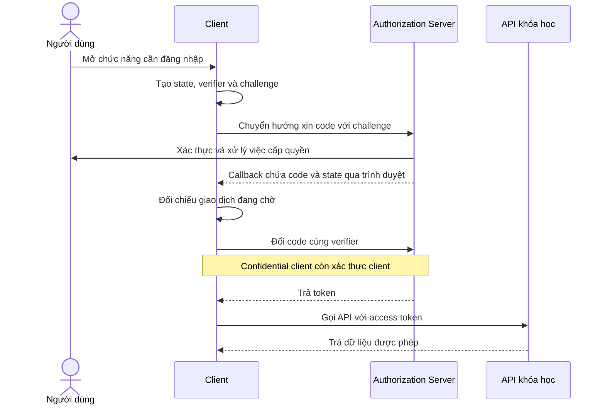

# Client trong OAuth và OpenID Connect

## 1. Client là ứng dụng đang xin quyền

Trong OAuth, **client** là ứng dụng lấy access token để gọi một tài nguyên được bảo vệ. Ứng dụng có thể hành động theo sự ủy quyền của người dùng hoặc, trong luồng phù hợp, bằng danh tính của chính nó. Client không đồng nghĩa với người dùng, trình duyệt hay API đích. Đây là một **vai trò giao thức**. [RFC 6749, mục 1.1](https://www.rfc-editor.org/rfc/rfc6749.html#section-1.1).

Xét tình huống một nhân viên mở cổng đào tạo để xem khóa học:

| Thành phần trong tình huống | Vai trò |
|---|---|
| Nhân viên | Người sử dụng ứng dụng; resource owner trong ví dụ ủy quyền này |
| Cổng đào tạo | Client xin token và gọi API khóa học |
| Dịch vụ IAM doanh nghiệp | Authorization server; đồng thời là OpenID Provider nếu cung cấp OIDC |
| API khóa học | Resource server bảo vệ dữ liệu |
| Trình duyệt | Môi trường tương tác; có thể chỉ vận chuyển chuyển hướng, hoặc chạy chính client nếu ứng dụng là SPA |

Một backend cũng có thể giữ nhiều vai trò. Khi nhận lời gọi có token, nó đóng vai resource server; khi xin token để gọi dịch vụ khác, nó đóng vai client. Cần xác định vai trò **ở từng tương tác**, thay vì gắn một nhãn duy nhất cho cả hệ thống.

## 2. Public client và confidential client

Cách phân loại dựa trên khả năng bảo vệ thông tin xác thực của client trong môi trường triển khai:

| Loại | Đặc điểm | Ví dụ thông thường |
|---|---|---|
| **Public client** | Không giữ được credential dùng để xác thực client một cách bí mật, đáng tin cậy | SPA chạy trực tiếp trong trình duyệt |
| **Confidential client** | Có thể bảo vệ credential hoặc dùng một cơ chế xác thực client an toàn khác | Backend chạy trong hạ tầng kiểm soát được |

`client_id` chỉ định danh ứng dụng trong authorization server, không phải bí mật và không tự chứng minh bên gửi là ứng dụng thật. Có thêm trường `client_secret` trong cấu hình cũng không tự biến ứng dụng thành confidential client. [RFC 6749, mục 2.1–2.2](https://www.rfc-editor.org/rfc/rfc6749.html#section-2.1).

Ứng dụng native phát hành cho người dùng thường phải được xử lý như public client: secret chung nhúng trong gói cài đặt có thể bị trích xuất. Khi thực hiện đăng nhập, native app dùng trình duyệt ngoài hoặc cơ chế trình duyệt hệ thống phù hợp, thay vì tự thu mật khẩu trong giao diện nhúng do app kiểm soát. [RFC 8252, mục 4 và 8.5](https://www.rfc-editor.org/rfc/rfc8252.html#section-4).

### Ví dụ quyết định theo nơi xử lý token

Nhóm phát triển có hai phương án cho cổng đào tạo:

- **SPA trực tiếp:** JavaScript nhận kết quả OAuth và giữ token để gọi API. Ranh giới client nằm trong trình duyệt; không thể cất secret trong bundle rồi coi secret đó là bí mật.
- **Backend for Frontend (BFF):** backend xử lý callback, giữ credential và token; trình duyệt dùng phiên với backend. Phần backend có thể được vận hành như confidential client nếu kiểm soát được credential.

Đây là hai lựa chọn kiến trúc minh họa. BFF vẫn cần bảo vệ cookie, phiên và các yêu cầu từ trình duyệt; chuyển token về server không giải quyết thay mọi vấn đề của ứng dụng web.

## 3. Đăng ký client tạo ra một hợp đồng cấu hình

Authorization server cần biết ứng dụng nào đang tham gia, nhận phản hồi ở đâu và được sử dụng cơ chế nào. Metadata thường gồm tên ứng dụng, `redirect_uris`, `grant_types`, `response_types`, phạm vi yêu cầu và `token_endpoint_auth_method`. Tùy hệ thống, quản trị viên tạo đăng ký trước hoặc dùng Dynamic Client Registration. [RFC 7591, mục 2](https://www.rfc-editor.org/rfc/rfc7591.html#section-2).

Ví dụ metadata của một public client sau khi đăng ký; đây là dữ liệu minh họa, không phải file cấu hình dành cho một sản phẩm cụ thể:

```json
{
  "client_id": "training-spa-prod",
  "client_name": "Training Portal SPA",
  "redirect_uris": [
    "https://learn.example.com/oauth/callback"
  ],
  "grant_types": ["authorization_code"],
  "response_types": ["code"],
  "token_endpoint_auth_method": "none",
  "scope": "openid profile courses.read"
}
```

`none` mô tả việc client không xác thực bằng credential tại token endpoint; nó không có nghĩa mọi yêu cầu token đều được chấp nhận. `scope` đăng ký cũng không phải bằng chứng đã được cấp quyền cho mọi người dùng.

Trong ví dụ này, nhóm vận hành nên lập các đăng ký riêng cho `training-spa-dev`, `training-spa-prod` và `training-admin-prod`. Mỗi đăng ký có chủ sở hữu và mục đích rõ ràng. Nhờ vậy, một thay đổi thử nghiệm ở môi trường phát triển không vô tình mở thêm callback cho cổng quản trị sản xuất.

Redirect URI cần được kiểm tra theo quy tắc khớp chính xác; ngoại lệ chuẩn cho cổng của loopback redirect ở native app không phải quyền dùng wildcard tùy ý. Callback của client cũng không được trở thành nơi chuyển hướng tiếp đến bất kỳ URL nào do đầu vào cung cấp. [RFC 9700, mục 2.1](https://www.rfc-editor.org/rfc/rfc9700.html#section-2.1).

## 4. Client làm gì trong Authorization Code với PKCE?

PKCE gắn lần đổi authorization code với một giá trị `code_verifier` do client tạo cho giao dịch đó. Client gửi giá trị dẫn xuất `code_challenge` khi xin code, rồi gửi verifier khi đổi code. Với phương thức `S256`:

```text
code_challenge = BASE64URL_NO_PADDING(SHA256(ASCII(code_verifier)))
```

Verifier phải được sinh ngẫu nhiên bằng nguồn mật mã, giữ riêng cho giao dịch và không nhúng cố định trong mã nguồn. Authorization server đối chiếu hai bước để ngăn kẻ chỉ lấy được code đem đổi token. [RFC 7636, mục 4](https://www.rfc-editor.org/rfc/rfc7636.html#section-4).



Public client phải dùng PKCE; confidential client cũng được khuyến nghị dùng. Trong thiết kế minh họa, luôn dùng `S256` cùng `state` ngẫu nhiên gắn với giao dịch và kiểm tra khi callback về. PKCE không thay thế việc xác thực client, còn xác thực client không thay thế PKCE. [RFC 9700, mục 2.1.1](https://www.rfc-editor.org/rfc/rfc9700.html#section-2.1.1).

Ví dụ: Minh mở hai tab đăng nhập vào cổng đào tạo. Client cần lưu hai giao dịch riêng, không đặt một verifier toàn cục rồi để tab sau ghi đè tab trước. Khi callback trở lại, client lấy đúng giao dịch, kiểm tra phản hồi, hoàn tất một lần và loại bỏ trạng thái tạm. Đây là cách áp dụng ràng buộc giao dịch vào tình huống nhiều tab, không phải lý do tái sử dụng một giá trị PKCE.

## 5. Phân biệt xác thực client, xác thực người dùng và cấp quyền

Ba câu hỏi sau cần được giải quyết riêng:

| Câu hỏi | Ví dụ trong cổng đào tạo |
|---|---|
| Ứng dụng nào đang đổi token? | Backend cổng đào tạo chứng minh danh tính client bằng credential đã đăng ký |
| Người đang đăng nhập là ai? | IAM xác thực Minh bằng mật khẩu và MFA |
| Yêu cầu này được làm gì? | API quyết định Minh có được đọc khóa học của phòng ban đó hay không |

Với `private_key_jwt`, client ký một JWT assertion bằng khóa riêng, dùng assertion để xác thực tại token endpoint. Assertion có audience, thời hạn và các điều kiện kiểm tra tương ứng; nó không phải ID token của người dùng, cũng không phải access token đem gọi API. Khóa riêng phải được bảo vệ, còn phía xác minh dùng khóa công khai đã được tin cậy. [RFC 7523, mục 2.2 và 3.2](https://www.rfc-editor.org/rfc/rfc7523.html#section-2.2).

Trong triển khai hỗ trợ phù hợp, các phương thức bất đối xứng như `private_key_jwt` hoặc mutual TLS được khuyến nghị cho xác thực client. [RFC 9700, mục 2.5](https://www.rfc-editor.org/rfc/rfc9700.html#section-2.5).

Tình huống cần tránh: backend xác thực client thành công rồi suy ra mọi nhân viên dùng backend đều có quyền quản trị. Credential đó chỉ chứng minh phía ứng dụng theo cơ chế đã thiết lập. Chính sách cho từng người dùng và từng tài nguyên vẫn phải được xét riêng.

## 6. Khi dùng OIDC, client còn là Relying Party

Trong OpenID Connect, client được gọi là **Relying Party (RP)**: ứng dụng dựa vào kết quả xác thực của OpenID Provider. Yêu cầu OIDC có scope `openid`; ID token cung cấp kết quả xác thực cho client. Access token dùng để truy cập tài nguyên theo giao thức của tài nguyên đó. Không dùng ID token thay access token gọi API. [OpenID Connect Core, mục 1 và 2](https://openid.net/specs/openid-connect-core-1_0.html#Introduction).

Khi xử lý ID token, client cần kiểm tra issuer tin cậy, audience có `client_id` của mình, hạn sử dụng và các điều kiện mật mã theo cấu hình an toàn. Nếu đã gửi `nonce`, phải đối chiếu claim tương ứng. Chỉ giải mã Base64 để đọc payload là chưa xác minh token. Nên dùng thư viện OIDC đã triển khai đầy đủ quy tắc xác minh. [OpenID Connect Core, mục 3.1.3.7](https://openid.net/specs/openid-connect-core-1_0.html#IDTokenValidation).

Ví dụ: một ID token có `aud=training-spa-prod` không thể mặc nhiên được cổng quản trị coi là kết quả đăng nhập dành cho `training-admin-prod`. Cùng một nhân viên và cùng một IAM không làm mất ranh giới giữa hai ứng dụng.

## 7. Client phải xử lý token như dữ liệu có quyền hạn

Với bearer access token, bên nắm được token có thể sử dụng nó trong phạm vi token cho phép. Token cần được bảo vệ khi lưu và truyền; dùng TLS, gửi qua header `Authorization: Bearer ...` khi API hỗ trợ, và tránh để token lọt vào URL hoặc log. Refresh token không phải token để gửi đến API nghiệp vụ. [RFC 6750, mục 2 và 5](https://www.rfc-editor.org/rfc/rfc6750.html#section-2).

Ví dụ yêu cầu của client tới API:

```http
GET /courses/enrolled HTTP/1.1
Host: api.example.com
Authorization: Bearer <access-token>
```

Trong cổng đào tạo, lựa chọn lưu token cần đi cùng kiến trúc. Nếu backend giữ token, việc ghi log toàn bộ phản hồi token vẫn làm mất tác dụng của ranh giới bảo vệ. Nếu JavaScript giữ token, mã độc chạy trong cùng ngữ cảnh có thể gây hậu quả nghiêm trọng. Không nên chọn nơi lưu chỉ vì thuận tiện cho một lệnh đọc giá trị.

Client cũng không nên yêu cầu quyền quá rộng cho chức năng nhỏ. Ví dụ màn hình xem khóa học chỉ cần quyền đọc; việc thêm quyền sửa nội dung để phòng khả năng dùng sau khiến một sự cố ở màn hình này có thể ảnh hưởng lớn hơn.

## 8. Quản lý client trong vòng đời IAM

Đối với một tổ chức, client là một đối tượng cần quản trị lâu dài. Có thể áp dụng bản ghi quản lý sau cho cổng đào tạo:

| Thuộc tính quản lý | Ví dụ |
|---|---|
| Chủ sở hữu | Nhóm Learning Platform |
| Mục đích | Đăng nhập học viên và đọc khóa học |
| Môi trường | Production |
| Callback được duyệt | `https://learn.example.com/oauth/callback` |
| Quyền cần thiết | Danh sách phục vụ chức năng đang có |
| Credential nếu có | Nơi quản lý, người chịu trách nhiệm và lịch thay thế |
| Khi ngừng sử dụng | Thu hồi quyền liên quan, xử lý credential và xóa đăng ký theo quy trình |

Ví dụ sự cố: đội phát triển đổi tên miền cổng học nhưng quên gỡ callback cũ. Bản ghi có chủ sở hữu và lịch rà soát giúp phát hiện cấu hình không còn phục vụ chức năng nào. Khi xử lý sự cố secret bị lộ, cần xem cả credential, token và phiên liên quan theo khả năng của hệ thống; chỉ thay một chuỗi cấu hình chưa đủ để kết luận mọi quyền truy cập cũ đã hết hiệu lực.

## 9. Tự kiểm tra bằng một tình huống

Nhóm dự án muốn dùng chung `client_id` của SPA học viên cho backend quản trị, đặt secret vào JavaScript và dùng ID token để gọi API điểm thi. Cần chỉ ra ba vấn đề riêng:

1. Hai thành phần có mục đích và ranh giới triển khai khác nhau cần được đánh giá đăng ký riêng; dùng chung làm việc giới hạn quyền và truy vết khó hơn.
2. Secret trong JavaScript không tạo được khả năng giữ credential bí mật cho SPA.
3. ID token dành cho client không thay thế access token mà API điểm thi yêu cầu.

Một thiết kế rõ ràng phải trả lời được: client nào xin token, thành phần nào giữ token, người dùng nào được xác thực, token dành cho đâu và API căn cứ vào chính sách nào để cho phép thao tác. Đó là nền tảng để nối OAuth/OIDC với nguyên tắc ít quyền nhất trong IAM.
