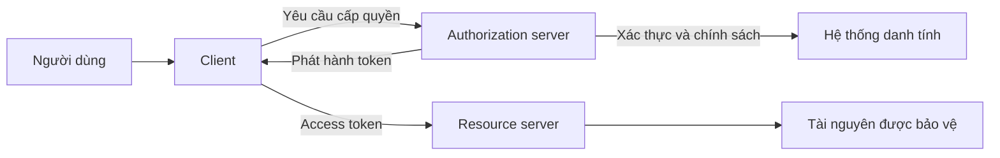

# Authorization server

## 1. Authorization server là gì?

**Authorization server (AS)** là thành phần trong OAuth chịu trách nhiệm xử lý yêu cầu cấp quyền và phát hành token cho client sau khi các điều kiện của luồng cấp quyền được đáp ứng. Client dùng access token để gọi tài nguyên được bảo vệ tại resource server.

Trong một hệ thống IAM, authorization server trả lời câu hỏi: **Ứng dụng nào được nhận token, dựa trên căn cứ cấp quyền nào, để truy cập tài nguyên nào và trong phạm vi nào?**

Ví dụ, một ứng dụng quản lý chi tiêu muốn đọc hóa đơn của người dùng từ API kế toán. Người dùng đăng nhập thông qua hệ thống danh tính, hệ thống kiểm tra chính sách cấp quyền, sau đó authorization server phát hành access token cho ứng dụng. API kế toán tiếp nhận token và tự quyết định yêu cầu cụ thể có được thực hiện hay không.

Authorization server không nhất thiết chứa dữ liệu hóa đơn, không nhất thiết lưu mật khẩu người dùng, và không thực hiện thay toàn bộ kiểm tra quyền nghiệp vụ của API. Nó có thể sử dụng một identity provider, directory hoặc dịch vụ chính sách riêng để hoàn thành nhiệm vụ của mình.

## 2. Vị trí trong mô hình OAuth

OAuth phân biệt bốn vai trò chính:

| Vai trò | Trách nhiệm | Ví dụ |
|---|---|---|
| Resource owner | Chủ thể có quyền cấp quyền truy cập tài nguyên | Người dùng sở hữu dữ liệu hóa đơn |
| Client | Ứng dụng yêu cầu token và sử dụng token để truy cập tài nguyên | Ứng dụng quản lý chi tiêu |
| Authorization server | Xử lý yêu cầu cấp quyền và phát hành token | Dịch vụ OAuth của nền tảng IAM |
| Resource server | Tiếp nhận token và bảo vệ tài nguyên | API kế toán |

Trong luồng có người dùng, trình duyệt thường tham gia chuyển hướng giữa client và authorization server. Trình duyệt là phương tiện truyền thông điệp của luồng; nó không thay thế bất kỳ vai trò OAuth nào trong bảng.



Một sản phẩm có thể triển khai nhiều vai trò trong cùng một hệ thống. Tuy nhiên, khi thiết kế hoặc phân tích sự cố, vẫn cần phân biệt trách nhiệm phát hành token với trách nhiệm chấp nhận token và kiểm soát truy cập dữ liệu.

## 3. Những trách nhiệm cốt lõi

### 3.1. Nhận diện và kiểm soát client

Authorization server quản lý thông tin đăng ký của client, chẳng hạn:

- `client_id` để nhận diện ứng dụng.
- Các redirect URI đã đăng ký.
- Những grant type và response type được phép sử dụng.
- Phương thức xác thực client, nếu loại client có khả năng giữ thông tin bí mật.
- Phạm vi quyền và tài nguyên mà client được phép yêu cầu.

`client_id` là định danh, không phải bí mật và không tự chứng minh danh tính của một client. Một ứng dụng biết `client_id` của ứng dụng khác không vì thế được coi là ứng dụng đó.

**Confidential client**, như backend chạy trên máy chủ được quản lý, có thể sử dụng client secret, khóa riêng hoặc cơ chế xác thực phù hợp. **Public client**, như ứng dụng chạy hoàn toàn trong trình duyệt hoặc ứng dụng di động được phân phối cho người dùng, không thể dựa vào một secret nhúng trong mã nguồn để chứng minh danh tính một cách đáng tin cậy.

PKCE giúp ràng buộc việc đổi authorization code với bên đã tạo yêu cầu cấp quyền. PKCE không biến public client thành confidential client và không thay thế xác thực client khi xác thực đó được yêu cầu.

### 3.2. Phối hợp xác thực người dùng khi luồng yêu cầu

Trong luồng có người dùng, authorization server phải có căn cứ thích hợp để biết người dùng nào đang cấp quyền. Nó có thể:

- Hiển thị quy trình đăng nhập do chính hệ thống quản lý.
- Sử dụng phiên đăng nhập sẵn có.
- Chuyển việc xác thực tới một identity provider liên kết.
- Yêu cầu MFA hoặc xác thực bổ sung theo chính sách.

Không phải mọi yêu cầu token đều có người dùng tương tác. Với client credentials, client nhận token dựa trên danh tính và quyền của chính ứng dụng; không có bước người dùng đăng nhập hay đồng ý trên trình duyệt.

### 3.3. Đánh giá yêu cầu cấp quyền

Xác thực thành công chưa đủ để phát hành mọi quyền mà client yêu cầu. Authorization server còn đánh giá các giới hạn của client, quyền của chủ thể, tài nguyên đích, chính sách tổ chức và sự chấp thuận phù hợp với luồng.

Ví dụ, client yêu cầu `invoices.read invoices.write`, nhưng chính sách chỉ cho phép đọc. Hệ thống có thể từ chối yêu cầu hoặc cấp phạm vi hẹp hơn theo hành vi đã được quy định. Client cần xử lý phạm vi thực sự được cấp thay vì mặc định mọi scope yêu cầu đều đã được chấp thuận.

Màn hình consent chỉ là một cách thu nhận quyết định cấp quyền. Nó không bắt buộc xuất hiện ở mọi lần cấp token: một số quyền có thể đã được người dùng chấp thuận trước, hoặc được quản trị viên quyết định theo chính sách tổ chức.

### 3.4. Phát hành và quản lý token

Authorization server xác định định dạng, nội dung, thời hạn và điều kiện sử dụng token. Các loại thường gặp gồm:

| Loại | Mục đích | Bên thường tiếp nhận |
|---|---|---|
| Authorization code | Đại diện tạm thời cho kết quả cấp quyền, dùng để đổi token | Token endpoint của authorization server |
| Access token | Cho phép client yêu cầu truy cập tài nguyên được bảo vệ | Resource server |
| Refresh token | Cho phép client yêu cầu access token mới khi đủ điều kiện | Token endpoint của authorization server |
| ID token | Truyền thông tin về sự kiện xác thực và người dùng trong OIDC | Client đóng vai trò relying party |

Authorization code không phải access token. ID token cũng không phải token dùng thay access token để gọi API. Không phải mọi phản hồi token đều có refresh token hoặc ID token.

Access token có thể là JWT hoặc một chuỗi opaque. OAuth không yêu cầu mọi access token đều phải là JWT; client cũng không nên phụ thuộc vào việc tự giải mã access token nếu hợp đồng tích hợp không quy định việc đó.

## 4. Các endpoint thường gặp

Tên đường dẫn cụ thể tùy triển khai; không nên suy ra URL bằng cách ghép chuỗi từ tên sản phẩm.

| Endpoint hoặc tài liệu | Chức năng | Lưu ý |
|---|---|---|
| Authorization endpoint | Nhận yêu cầu cấp quyền thông qua user agent trong các luồng tương ứng | Có thể sử dụng đăng nhập, phiên và consent |
| Token endpoint | Nhận grant hoặc refresh token để xử lý yêu cầu phát hành token | Kiểm tra grant, ràng buộc client và xác thực client khi áp dụng |
| Metadata/discovery document | Công bố issuer, endpoint và khả năng hỗ trợ | Cần lấy từ nguồn cấu hình tin cậy |
| JWKS endpoint | Công bố tập khóa công khai dùng cho các mục đích xác minh đã được khai báo | Không chứa khóa riêng và không tự chứng minh nguồn token đáng tin cậy |
| Introspection endpoint | Cho phép bên được cấp quyền kiểm tra trạng thái và metadata của token | Chỉ dùng khi triển khai có hỗ trợ và cho phép |
| Revocation endpoint | Tiếp nhận yêu cầu thu hồi token theo cơ chế hỗ trợ | Không đồng nghĩa mọi API lập tức biết mọi JWT đã bị thu hồi |

Không được giả định hệ thống hỗ trợ introspection, revocation hay mọi loại token chỉ vì nó cung cấp authorization endpoint và token endpoint. Client và resource server cần dựa trên metadata và cấu hình tích hợp thực tế.

Nếu resource server xác minh JWT bằng khóa công khai, việc tải được một khóa không đủ để tin cậy token. Resource server vẫn phải biết issuer nào được chấp nhận, token dành cho tài nguyên nào và thuật toán nào được phép sử dụng.

## 5. Ví dụ: Authorization Code với PKCE

Giả sử có ba thành phần:

- Client: `https://expense.example`.
- Authorization server: `https://identity.example`.
- Resource server: API hóa đơn tại `https://api.example`.

Các tên miền, định danh và giá trị bên dưới chỉ dùng minh họa.

### 5.1. Client tạo giao dịch cấp quyền

Client tạo một `code_verifier` ngẫu nhiên có độ khó đoán phù hợp, giữ nó gắn với giao dịch đang thực hiện, rồi tính `code_challenge` theo phương thức S256:

```text
code_challenge = BASE64URL(SHA256(ASCII(code_verifier)))
```

Giá trị base64url ở đây bỏ phần padding `=`. Client đồng thời tạo giá trị `state` khó đoán để liên kết phản hồi với giao dịch ban đầu. Trong triển khai OIDC có sử dụng `nonce`, client cũng phải tạo, lưu và kiểm tra nó theo yêu cầu của luồng.

Ví dụ yêu cầu cấp quyền OAuth:

```http
GET /authorize?response_type=code&client_id=expense-web&redirect_uri=https%3A%2F%2Fexpense.example%2Fcallback&scope=invoices.read&state=STATE_VALUE&code_challenge=CHALLENGE_VALUE&code_challenge_method=S256 HTTP/1.1
Host: identity.example
```

`STATE_VALUE` và `CHALLENGE_VALUE` là ký hiệu thay thế, không phải giá trị để tái sử dụng trong ứng dụng thật.

### 5.2. Authorization server kiểm tra yêu cầu

Trước khi cấp code, authorization server kiểm tra ít nhất các điều kiện thích hợp với cấu hình và luồng:

1. Client có tồn tại và được phép sử dụng luồng này hay không.
2. Redirect URI có khớp đăng ký theo quy tắc áp dụng hay không.
3. Các scope và tài nguyên được yêu cầu có hợp lệ hay không.
4. Yêu cầu PKCE có đúng chính sách hay không.
5. Người dùng đã được xác thực ở mức cần thiết hay chưa.
6. Căn cứ cấp quyền và các chính sách liên quan có cho phép cấp quyền hay không.

Với web client thông thường, việc so khớp redirect URI cần chặt chẽ theo URI đã đăng ký. Dùng wildcard hoặc chỉ kiểm tra một phần tên miền có thể tạo cơ hội chuyển code tới địa chỉ do kẻ tấn công kiểm soát. Một số loại client có quy tắc redirect riêng, chẳng hạn loopback redirect của ứng dụng native; cần xử lý theo hồ sơ áp dụng thay vì tự mở rộng ngoại lệ.

Nếu redirect URI không hợp lệ, authorization server không nên chuyển hướng lỗi tới chính địa chỉ không đáng tin đó.

### 5.3. Authorization server trả code

Sau khi cấp quyền thành công, authorization server chuyển trình duyệt về callback đã được kiểm tra:

```http
HTTP/1.1 302 Found
Location: https://expense.example/callback?code=CODE_VALUE&state=STATE_VALUE
```

Client kiểm tra `state` theo giao dịch đã lưu trước khi tiếp tục. Code cần có thời hạn ngắn, chỉ sử dụng một lần và được ràng buộc với client cùng các thông tin liên quan của giao dịch.

### 5.4. Client đổi code lấy token

Client gửi code tới token endpoint qua kết nối TLS, kèm `code_verifier` tương ứng. Ví dụ dưới đây minh họa public client; confidential client còn phải xác thực bằng phương thức đã đăng ký.

```http
POST /token HTTP/1.1
Host: identity.example
Content-Type: application/x-www-form-urlencoded

grant_type=authorization_code&client_id=expense-web&code=CODE_VALUE&redirect_uri=https%3A%2F%2Fexpense.example%2Fcallback&code_verifier=VERIFIER_VALUE
```

Authorization server kiểm tra code còn hiệu lực, chưa sử dụng, đúng client và redirect URI theo yêu cầu của luồng. Nó tính lại challenge từ verifier để đối chiếu với challenge gắn với code. Có được code nhưng không có verifier đúng sẽ không đủ để đổi token trong giao dịch PKCE hợp lệ.

Một phản hồi minh họa:

```json
{
  "access_token": "ACCESS_TOKEN_VALUE",
  "token_type": "Bearer",
  "expires_in": 600,
  "scope": "invoices.read"
}
```

Thời hạn 600 giây chỉ là ví dụ, không phải yêu cầu chung. Quyết định cấp refresh token phụ thuộc client, grant, chính sách và các biện pháp bảo vệ được áp dụng.

### 5.5. Resource server kiểm tra token và quyền

Client gửi access token tới API:

```http
GET /invoices/INV-2026-001 HTTP/1.1
Host: api.example
Authorization: Bearer ACCESS_TOKEN_VALUE
```

API cần xác minh token theo loại token và hợp đồng tin cậy với authorization server. Với JWT access token, các kiểm tra thường gồm chữ ký, thuật toán cho phép, issuer, audience, thời hạn và các claim liên quan. Với opaque token, API có thể sử dụng introspection hoặc cơ chế xác minh đã được thiết kế.

Sau đó, API còn kiểm tra quyền trên đối tượng cụ thể: scope `invoices.read` không tự chứng minh người dùng được đọc mọi hóa đơn. API phải bảo đảm hóa đơn thuộc tenant phù hợp và chủ thể có quyền truy cập hóa đơn đó.

## 6. Quan hệ với OIDC và identity provider

OAuth tập trung vào cấp quyền truy cập; bản thân một access token OAuth không phải hợp đồng đăng nhập chung cho client.

**OpenID Connect (OIDC)** bổ sung lớp danh tính trên OAuth. Khi authorization server hỗ trợ và thực hiện OIDC, nó đóng vai trò **OpenID Provider (OP)**. Trong yêu cầu OIDC, client sử dụng scope `openid` cùng các tham số thích hợp, và có thể nhận ID token theo luồng.

| Khái niệm | Trọng tâm |
|---|---|
| Authorization server | Xử lý cấp quyền và phát hành token OAuth |
| OpenID Provider | Cung cấp chức năng OIDC, bao gồm ID token và các hành vi tương ứng |
| Identity provider | Khái niệm rộng về hệ thống cung cấp hoặc xác nhận danh tính |
| Directory/identity store | Lưu trữ tài khoản, nhóm và thuộc tính danh tính |

Một authorization server có thể dùng directory nội bộ, ủy thác đăng nhập tới một identity provider bên ngoài, hoặc tích hợp cả hai. Không nên xem directory và authorization server là cùng một thành phần chỉ vì chúng nằm trong cùng sản phẩm IAM.

Trong OIDC, client phải xác minh ID token theo hồ sơ áp dụng, bao gồm issuer, audience, chữ ký, thời hạn và `nonce` khi có yêu cầu tương ứng. Không dùng email hiển thị làm định danh duy nhất mặc định; cặp issuer và subject giúp phân biệt danh tính trong ngữ cảnh nhà cung cấp.

## 7. Ranh giới tin cậy quan trọng

### 7.1. Client chỉ tin authorization server đã được cấu hình

Không lấy issuer, token endpoint hoặc JWKS URL từ dữ liệu tùy ý do người dùng đưa vào rồi gửi secret, code hoặc token tới đó. Với ứng dụng hỗ trợ nhiều issuer, cần liên kết rõ mỗi giao dịch với issuer dự kiến để tránh nhầm lẫn giữa các nhà phát hành.

Metadata hỗ trợ khám phá cấu hình, nhưng nguồn metadata vẫn phải được thiết lập và kiểm tra theo mô hình tin cậy của ứng dụng.

### 7.2. Resource server chỉ chấp nhận token dành cho mình

Một token hợp lệ về chữ ký có thể được phát hành cho API khác. Vì vậy, chữ ký đúng không thay thế kiểm tra audience, issuer và mục đích sử dụng token.

Tương tự, một token có scope phù hợp ở tenant A không tự cấp quyền truy cập dữ liệu tenant B. Việc ràng buộc tenant và đối tượng phải hiện diện trong thiết kế kiểm soát truy cập của API.

### 7.3. Authorization server là thành phần có độ tin cậy cao

Kẻ tấn công kiểm soát khả năng phát hành token hoặc khóa ký có thể tạo ra bằng chứng truy cập mà các API tin cậy. Vì vậy, cần bảo vệ cả luồng phát hành token lẫn các chức năng quản trị:

- Áp dụng ít quyền nhất cho quản trị viên và danh tính vận hành.
- Bảo vệ khóa riêng và secret bằng cơ chế quản lý khóa, secret phù hợp.
- Giới hạn khả năng thay đổi redirect URI, phương thức xác thực và quyền của client.
- Kiểm toán việc cấp quyền quản trị, đăng ký client và thay đổi cấu hình tin cậy.
- Tách quyền vận hành thông thường khỏi quyền có thể làm thay đổi khả năng phát hành token.

## 8. Vòng đời token và ảnh hưởng tới quyền truy cập

### 8.1. Refresh token không phải quyền truy cập vĩnh viễn

Refresh token là thông tin nhạy cảm để yêu cầu token mới. Authorization server cần ràng buộc nó với client và ngữ cảnh cấp quyền, áp dụng chính sách thời hạn, thu hồi và bảo vệ trước việc đánh cắp.

Các biện pháp có thể gồm rotation, phát hiện tái sử dụng hoặc ràng buộc với bên gửi khi hệ thống hỗ trợ. Khi rotation được áp dụng, một refresh token mới thay thế token cũ theo chính sách; việc sử dụng lại token cũ có thể là tín hiệu rò rỉ. Thiết kế còn phải xử lý yêu cầu đồng thời và retry để tránh kết luận sai về một giao dịch hợp lệ.

Khi đổi refresh token lấy access token, authorization server không nên tự mở rộng phạm vi vượt quá quyền đã được cấp. Các thay đổi về trạng thái tài khoản và chính sách cần được xét theo thiết kế vòng đời quyền của hệ thống.

### 8.2. Thu hồi không luôn có hiệu lực tức thì ở mọi API

Nếu API chỉ xác minh JWT cục bộ và không hỏi trạng thái tại authorization server, một JWT đã phát hành có thể còn được chấp nhận tới khi hết hạn, dù phiên hoặc refresh token đã bị thu hồi.

Muốn phản ứng nhanh hơn, hệ thống cần cơ chế bổ sung phù hợp, chẳng hạn access token sống ngắn, kiểm tra trạng thái online, cập nhật trạng thái thu hồi hoặc kiểm tra chính sách tại thời điểm gọi API. Mỗi lựa chọn có đánh đổi về độ trễ, khả dụng và mức độ cập nhật quyền.

### 8.3. Đăng xuất và thu hồi token là các thao tác khác nhau

Trong một lần sử dụng ứng dụng có thể đồng thời tồn tại:

- Phiên của ứng dụng client.
- Phiên đăng nhập tại authorization server hoặc identity provider.
- Access token và refresh token đã phát hành.

Đóng phiên của ứng dụng không tự xóa phiên SSO; kết thúc phiên SSO cũng không bảo đảm mọi access token lập tức vô hiệu. Yêu cầu đăng xuất cần nêu rõ trạng thái nào phải kết thúc và các bên nào phải được thông báo.

## 9. Các lỗi thiết kế thường gặp

| Lỗi | Hệ quả | Hướng xử lý |
|---|---|---|
| Coi `client_id` là bằng chứng xác thực | Client giả mạo có thể được tin nhầm | Áp dụng phương thức xác thực phù hợp cho confidential client; bảo vệ luồng public client đúng cách |
| Nhúng client secret vào ứng dụng phân phối công khai | Secret có thể bị trích xuất | Không dựa vào secret nhúng; sử dụng luồng phù hợp với public client |
| Cho phép redirect URI quá rộng | Code hoặc phản hồi có thể tới địa chỉ của kẻ tấn công | Đăng ký và kiểm tra redirect URI theo quy tắc chặt chẽ |
| Dùng ID token để gọi API | Nhầm đối tượng tiếp nhận và mục đích token | Dùng access token dành cho resource server tương ứng |
| Chỉ kiểm tra chữ ký JWT | Chấp nhận token sai issuer, audience hoặc mục đích | Kiểm tra đầy đủ theo hồ sơ token và hợp đồng tin cậy |
| Đồng nhất scope với mọi quyền nghiệp vụ | Rò rỉ dữ liệu giữa người dùng hoặc tenant | Kết hợp scope với kiểm tra quyền trên đối tượng cụ thể |
| Giả định thu hồi refresh token làm mọi JWT mất hiệu lực ngay | Tài khoản bị chặn vẫn có thể dùng access token còn hạn | Thiết kế rõ độ trễ thu hồi và cơ chế kiểm tra tại API |
| Ghi code, token hoặc secret vào log | Biến hệ thống quan sát thành nguồn lộ thông tin xác thực | Che dữ liệu nhạy cảm và dùng định danh tương quan không chứa credential |

## 10. Vận hành authorization server trong IAM

Authorization server ảnh hưởng trực tiếp tới khả năng đăng nhập và cấp token. Tuy nhiên, tác động của sự cố phụ thuộc cách resource server xác minh token:

- Nếu API xác minh JWT cục bộ bằng khóa công khai đã lưu, nó có thể tiếp tục xử lý các token còn hợp lệ trong một số tình huống authorization server tạm thời không khả dụng.
- Nếu API phụ thuộc introspection online cho mỗi yêu cầu, sự cố authorization server có thể ảnh hưởng trực tiếp tới việc gọi API.
- Dù access token hiện có còn dùng được, các thao tác đăng nhập mới, đổi code và refresh token vẫn có thể bị gián đoạn.

Cần theo dõi tỷ lệ thành công và độ trễ của authorization endpoint, token endpoint và các endpoint bổ sung thực sự được sử dụng. Các sự kiện đáng chú ý gồm lỗi xác thực client, code hết hạn hoặc bị dùng lại, lỗi PKCE, refresh token bị tái sử dụng và thay đổi cấu hình client.

Khi xoay khóa ký, phải phối hợp với cơ chế công bố khóa và cache của bên xác minh. Việc loại bỏ khóa công khai cũ quá sớm có thể làm token còn hợp lệ bị từ chối; tiếp tục tin cậy khóa bị lộ quá lâu lại làm kéo dài rủi ro. Rotation định kỳ và ứng phó lộ khóa là hai tình huống cần chính sách khác nhau.

Nhật ký kiểm toán nên thể hiện được chủ thể, client, loại grant, tài nguyên hoặc phạm vi liên quan, kết quả và lý do chính sách ở mức phù hợp. Không cần ghi nguyên token hay secret để truy vết một giao dịch.

## 11. Tình huống tổng hợp

Một nhân viên dùng ứng dụng chi tiêu để đọc hóa đơn của công ty:

1. Client khởi tạo Authorization Code với PKCE và chuyển người dùng tới authorization server.
2. Authorization server phối hợp xác thực người dùng, kiểm tra yêu cầu MFA nếu chính sách cần và xác định quyền cấp cho client.
3. Client nhận code, kiểm tra giao dịch và đổi code lấy access token tại token endpoint.
4. Access token được phát hành cho API hóa đơn với scope đọc thích hợp.
5. API xác minh token, kiểm tra tenant và quyền trên hóa đơn được yêu cầu trước khi trả dữ liệu.
6. Khi nhân viên nghỉ việc, hệ thống IAM vô hiệu hóa danh tính và thu hồi các quyền hoặc credential liên quan; hiệu lực đối với token đã phát hành phụ thuộc cơ chế thu hồi và xác minh đã thiết kế.

Qua tình huống này, authorization server là nơi phát hành bằng chứng truy cập theo một quan hệ tin cậy có kiểm soát. Hệ thống IAM chỉ hoàn chỉnh khi client bảo vệ đúng giao dịch và token, còn resource server xác minh đúng token và thực thi quyền trên tài nguyên cụ thể.
