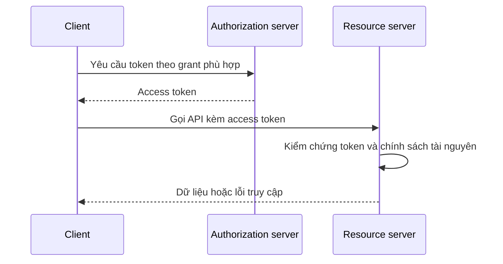
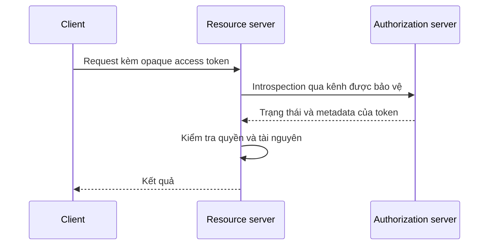

# Resource server

Trong OAuth, **resource server** là hệ thống cung cấp tài nguyên được bảo vệ và tiếp nhận access token để quyết định có cho phép một yêu cầu truy cập hay không. Trong thực tế, đó thường là một API như API hồ sơ người dùng, API đơn hàng hoặc API tài liệu.

Ví dụ, một ứng dụng quản lý công việc được người dùng cho phép đọc tài liệu. Ứng dụng gọi API tài liệu kèm access token. API tài liệu là resource server: nó phải kiểm tra token dành cho mình, còn hợp lệ và có quyền phù hợp trước khi trả dữ liệu. Việc ứng dụng đã đăng nhập thành công không thay thế các kiểm tra tại API.

Bài học này tập trung vào ranh giới trách nhiệm của resource server trong IAM: nhận diện quyền truy cập từ token, kiểm chứng bằng chứng được trình bày và áp dụng chính sách trên tài nguyên cụ thể.

## 1. Resource server nằm ở đâu trong hệ thống?

Một hệ thống OAuth thường có các vai trò sau:

| Vai trò | Trách nhiệm chính | Ví dụ |
| --- | --- | --- |
| Resource owner | Chủ thể có quyền cho phép truy cập tài nguyên trong ngữ cảnh phù hợp | Người dùng cho ứng dụng đọc lịch cá nhân |
| Client | Yêu cầu quyền và dùng access token để gọi tài nguyên | Ứng dụng web quản lý lịch |
| Authorization server | Xác thực client khi cần, xử lý cấp quyền và phát hành token | Dịch vụ IAM cấp token |
| Resource server | Tiếp nhận yêu cầu API, kiểm chứng token và thực thi quyền trên tài nguyên | API lịch |

Các vai trò là sự phân chia trách nhiệm về giao thức, không bắt buộc tương ứng với bốn máy chủ riêng. Một sản phẩm IAM có thể triển khai nhiều vai trò trong cùng hệ thống, nhưng trách nhiệm cấp token và trách nhiệm bảo vệ tài nguyên vẫn cần được phân biệt.



Đây là sơ đồ rút gọn. Các bước người dùng đăng nhập, đồng ý cấp quyền, đổi authorization code hoặc xác thực client phụ thuộc flow và không được mô tả đầy đủ ở đây.

Resource server thông thường không nhận mật khẩu của người dùng để kiểm tra lại mỗi lần gọi API. Nó dựa vào cơ chế tin cậy đã thiết lập với authorization server và cơ chế kiểm chứng access token.

## 2. Resource server bảo vệ điều gì?

Tài nguyên không chỉ là một bản ghi cơ sở dữ liệu. Nó có thể là:

- Hồ sơ, tài liệu, ảnh hoặc dữ liệu cá nhân.
- Hành động tạo đơn, duyệt chi, thay đổi quyền hoặc xóa tài khoản.
- Một tập dữ liệu trả về qua tìm kiếm, báo cáo hoặc export.
- Một năng lực hệ thống như chạy tác vụ nền hoặc quản lý cấu hình.

API phải bảo vệ cả thao tác lẫn dữ liệu chịu tác động. Một token có quyền đọc hóa đơn không có nghĩa là được đọc hóa đơn của mọi khách hàng.

Giả sử API có hai endpoint:

```http
GET /api/invoices/inv-204
POST /api/invoices/inv-204/approve
```

Hai endpoint có thể cùng truy cập một hóa đơn nhưng đòi hỏi quyền khác nhau:

| Yêu cầu | Điều kiện minh họa |
| --- | --- |
| Đọc hóa đơn | Token dành cho Invoice API, có scope đọc, chủ thể được đọc hóa đơn này |
| Duyệt hóa đơn | Token dành cho Invoice API, có scope duyệt, chủ thể có vai trò phù hợp và đáp ứng chính sách phê duyệt |

Nếu chỉ kiểm tra “token hợp lệ” tại cả hai endpoint, hệ thống chưa hoàn thành việc phân quyền.

## 3. Access token là đầu vào, không phải quyết định cuối cùng

Client thường trình bearer access token qua header:

```http
GET /api/invoices/inv-204 HTTP/1.1
Host: invoices.example.test
Authorization: Bearer <access-token>
```

Với bearer token, bên có token có thể sử dụng quyền mà token đại diện, nếu không có cơ chế ràng buộc bổ sung. Vì vậy, token cần được bảo vệ khi truyền, khi lưu và khi xuất hiện trong hệ thống quan sát.

Resource server cần phân biệt ba câu hỏi:

1. **Token này có được chấp nhận không?** Kiểm tra nguồn phát hành, tính toàn vẹn hoặc kết quả introspection, thời hạn và đối tượng nhận.
2. **Token này cho phép loại hành động nào?** Đọc scope, quyền hoặc thông tin ủy quyền theo hợp đồng với authorization server.
3. **Yêu cầu này có được phép trên tài nguyên này không?** Áp dụng kiểm tra tenant, chủ sở hữu, vai trò và các điều kiện nghiệp vụ.

Một token có chữ ký hợp lệ vẫn có thể dành cho API khác. Một token dành đúng API vẫn có thể thiếu scope. Một token có scope phù hợp vẫn có thể bị từ chối khi truy cập tài nguyên ngoài tenant của chủ thể.

### Chủ thể không phải lúc nào cũng là người dùng

Trong luồng có người dùng, access token có thể đại diện cho quyền được ủy quyền liên quan đến người dùng. Trong luồng như client credentials, token thường gắn với client hoặc workload và không đại diện cho một người dùng đang đăng nhập.

Resource server cần hiểu mô hình danh tính do issuer công bố. Không nên mặc định rằng mọi giá trị `sub` là mã tài khoản người dùng, hoặc rằng có client ID thì đã biết người dùng nào thực hiện hành động.

## 4. Access token có thể là JWT hoặc opaque token

OAuth không bắt buộc mọi access token đều là JWT. Resource server cần biết cách kiểm chứng token theo cấu hình tin cậy của hệ thống.

| Đặc điểm | JWT access token | Opaque access token |
| --- | --- | --- |
| Cách nhìn từ resource server | Có cấu trúc và claim có thể được đọc | Chuỗi không được tự suy diễn nội dung |
| Cách kiểm chứng thường gặp | Xác minh chữ ký và các claim theo profile đã chọn | Gọi introspection hoặc cơ chế kiểm chứng do issuer cung cấp |
| Phụ thuộc mạng trên từng request | Có thể kiểm chứng cục bộ khi đã có khóa và cấu hình | Thường cần tra cứu, có thể cache theo chính sách |
| Thu hồi trước hạn | Không tự được phát hiện chỉ bằng kiểm tra chữ ký và thời gian | Có thể được phản ánh qua trạng thái tra cứu, tùy hệ thống và cache |
| Điều cần tránh | Chỉ decode payload rồi tin claim | Suy luận token hợp lệ vì chuỗi có đúng độ dài hoặc hình thức |

Đây là các cách triển khai thường gặp, không phải giới hạn tuyệt đối. Một JWT cũng có thể được introspect; một hệ thống dùng opaque token có thể cung cấp cơ chế tra cứu nội bộ khác. API phải tuân theo hợp đồng token của issuer.

## 5. Kiểm chứng JWT access token

JWT thường có thể được giải mã phần header và payload mà không cần khóa bí mật. **Đọc được claim không chứng minh token đáng tin.**

Giả sử payload của một token minh họa là:

```json
{
  "iss": "https://identity.example.test",
  "sub": "user-184",
  "aud": "invoice-api",
  "exp": 1900000000,
  "scope": "invoice:read",
  "tenant_id": "tenant-a"
}
```

`tenant_id` ở đây là claim riêng của hệ thống minh họa, không phải claim bắt buộc chung của OAuth. Tên claim, cấu trúc scope và ý nghĩa của subject cần được thống nhất giữa issuer và API.

Một quá trình kiểm chứng thường bao gồm các bước sau.

### 5.1. Kiểm tra chữ ký bằng cơ chế tin cậy đã cấu hình

Resource server cần:

- Chỉ chấp nhận issuer được cấu hình.
- Chỉ chấp nhận thuật toán được cho phép theo hợp đồng token.
- Chọn khóa xác minh từ nguồn khóa tin cậy của issuer.
- Từ chối token không vượt qua kiểm tra chữ ký.

Không lấy thuật toán hoặc địa chỉ tải khóa do token tự khai báo làm nguồn tin cậy duy nhất. Đặc biệt, không tải khóa từ một URL tùy ý trong token rồi dùng khóa đó để kết luận token hợp lệ.

Nếu dùng tập khóa công khai và `kid`, giá trị `kid` chỉ giúp chọn khóa trong tập khóa tin cậy. Nó không tự chứng minh khóa hoặc issuer là hợp lệ.

### 5.2. Kiểm tra issuer

Claim `iss` phải khớp issuer được API chấp nhận theo cấu hình.

Một hệ thống có môi trường thử nghiệm và môi trường sản xuất cần tránh để API sản xuất chấp nhận token từ issuer thử nghiệm chỉ vì cả hai cùng dùng một dạng JWT.

Trong hệ thống chấp nhận nhiều issuer, cấu hình phải xác định rõ issuer nào được phép, khóa nào thuộc issuer đó và cách ánh xạ danh tính tương ứng. Không dùng một danh sách khóa chung để bỏ qua ranh giới issuer.

### 5.3. Kiểm tra audience

Claim `aud` xác định đối tượng mà token hướng đến. Resource server phải xác nhận token được phát hành cho API của mình theo quy ước audience đã thống nhất.

Ví dụ:

```text
Token A: aud = invoice-api
Token B: aud = profile-api
```

Invoice API không được chấp nhận Token B chỉ vì chữ ký đúng và token chưa hết hạn.

Client ID và audience của API là hai khái niệm khác nhau. Một client được phép gọi API không làm cho mọi token phát hành cho client đó trở thành token hợp lệ tại API.

Một số token có nhiều audience; API cần dùng cơ chế kiểm chứng hỗ trợ đúng cấu trúc đó và chính sách phát hành đã chọn, thay vì tự so sánh chuỗi theo cách tùy tiện.

### 5.4. Kiểm tra thời gian và các yêu cầu của profile

Resource server phải kiểm tra hết hạn và các điều kiện thời gian liên quan theo profile token, chẳng hạn:

- `exp`: thời điểm hết hạn.
- `nbf`: thời điểm token bắt đầu được chấp nhận, nếu có.
- Các claim bắt buộc khác và quy tắc nhận diện loại token theo profile đã cấu hình.

Có thể cho phép sai lệch đồng hồ nhỏ theo chính sách vận hành. Không nới sai lệch đến mức token hết hạn từ lâu vẫn được chấp nhận.

Chữ ký không thay thế kiểm tra thời gian. Claim chưa được kiểm chứng cũng không được dùng để tạo danh tính hoặc cấp quyền cho request.

### 5.5. Tạo ngữ cảnh bảo mật sau khi kiểm chứng

Chỉ sau khi token vượt qua các kiểm tra, middleware mới tạo ngữ cảnh như:

```text
issuer
subject
client identity, nếu có và được định nghĩa rõ
scopes hoặc permissions đã được ánh xạ
tenant context đã được kiểm chứng
token expiry
```

Ngữ cảnh này giúp lớp nghiệp vụ kiểm tra quyền. Nó không nên mang toàn bộ token đi qua mọi tầng hoặc tự biến mọi claim thành quyền quản trị.

## 6. Kiểm chứng opaque token bằng introspection

Với opaque token, API thường không có dữ liệu tự chứa để kiểm chứng cục bộ. Resource server có thể gọi token introspection endpoint do authorization server cung cấp.



Một phản hồi minh họa:

```json
{
  "active": true,
  "sub": "user-184",
  "client_id": "expense-web",
  "scope": "invoice:read",
  "aud": "invoice-api",
  "exp": 1900000000
}
```

Resource server cần thực hiện các nguyên tắc sau:

1. Dùng đúng introspection endpoint đã được cấu hình tin cậy.
2. Bảo vệ kết nối và xác thực resource server theo cơ chế endpoint yêu cầu.
3. Chỉ tiếp tục xử lý token khi phản hồi cho biết token đang active.
4. Kiểm tra token áp dụng cho API và yêu cầu hiện tại theo metadata và hợp đồng của issuer.
5. Kiểm tra quyền trên tài nguyên sau bước kiểm chứng token.

`active: true` không tự có nghĩa là “được gọi mọi endpoint”. Các metadata được trả về phụ thuộc authorization server và quyền của bên gọi introspection. Nếu thiếu thông tin cần thiết để bảo đảm một điều kiện truy cập, API không được tự giả định điều kiện đó đã đạt.

### Timeout và cache introspection

Nếu introspection timeout hoặc gặp lỗi, resource server không được tự coi token là hợp lệ. Yêu cầu phải không được cấp quyền khi API không đủ bằng chứng để chấp nhận token; mã lỗi bên ngoài cần phản ánh loại lỗi phù hợp, chẳng hạn lỗi dịch vụ phụ thuộc, thay vì luôn khẳng định token chắc chắn sai.

Cache kết quả introspection giúp giảm độ trễ nhưng tạo ra đánh đổi: thay đổi trạng thái hoặc thu hồi token có thể chưa được API nhận biết cho đến khi cache hết hạn.

Thời gian cache phải phù hợp thời hạn token, yêu cầu thu hồi và độ nhạy của API. Không lưu một phản hồi active vô thời hạn, và không tiếp tục dùng kết quả đã hết hiệu lực chỉ để duy trì khả dụng.

## 7. Phân quyền sau khi token đã hợp lệ

Một thiết kế rõ ràng thường đặt kiểm tra token ở lớp bảo mật chung và kiểm tra tài nguyên gần lớp nghiệp vụ.

Ví dụ Invoice API có chính sách:

```text
GET /invoices/{invoiceId}

Cho phép khi đồng thời:
- Token hợp lệ và dành cho invoice-api.
- Có scope invoice:read.
- Chủ thể thuộc đúng tenant của hóa đơn.
- Chủ thể là chủ sở hữu hoặc có quyền đọc hóa đơn của người khác.
```

Pseudocode sau minh họa thứ tự trách nhiệm, không phải một đoạn triển khai có thể sao chép chạy trực tiếp:

```text
handleGetInvoice(request):
    principal = verifyAccessToken(request.authorizationHeader)
    requireScope(principal, "invoice:read")

    invoice = findInvoiceWithinAuthorizedTenant(
        principal.tenantId,
        request.invoiceId
    )

    if invoice does not exist:
        return notFoundAccordingToApiPolicy()

    requireInvoiceReadPermission(principal, invoice)
    return mapToAllowedInvoiceFields(principal, invoice)
```

Một số điểm cần chú ý:

- Tenant dùng để giới hạn truy vấn phải bắt nguồn từ ngữ cảnh đã được kiểm chứng và chính sách của hệ thống.
- Nếu request có tenant ID trong URL hoặc header, API phải xác minh chủ thể được phép làm việc với tenant đó.
- Không dùng tenant header do client gửi để ghi đè tenant trong ngữ cảnh bảo mật.
- ID tài nguyên khó đoán không thay thế kiểm tra quyền sở hữu hoặc quyền truy cập.
- Quyền đọc bản ghi không nhất thiết bao gồm quyền đọc mọi trường dữ liệu.
- Với thao tác ghi, cần kiểm tra quyền đối với hành động và trạng thái tài nguyên trước khi thay đổi dữ liệu.

Ví dụ, nhân viên A có scope `invoice:read` nhưng sửa ID trong URL để lấy hóa đơn của nhân viên B. Nếu API chỉ kiểm tra scope thì vẫn có thể bị truy cập trái phép ở cấp đối tượng. Kiểm tra scope và kiểm tra quyền trên hóa đơn là hai điều kiện bổ sung cho nhau.

## 8. Resource server và OpenID Connect

OpenID Connect bổ sung lớp nhận diện người dùng trên nền OAuth. Trong kiến trúc này, một client có thể nhận cả ID token và access token, nhưng hai loại token có mục đích khác nhau.

| Loại token | Mục đích liên quan đến API |
| --- | --- |
| Access token | Được client trình để truy cập resource server theo quyền đã cấp |
| ID token | Cung cấp cho OIDC client thông tin về sự kiện xác thực và người dùng theo OIDC |

API không nên dùng ID token thay cho access token. ID token thường có audience là OIDC client, không phải API tài nguyên. Nếu API chấp nhận bất kỳ JWT nào được issuer ký mà không phân biệt mục đích và audience, nó có thể chấp nhận sai loại token.

Một người dùng đăng nhập thành công tại client chưa chắc được phép duyệt hóa đơn. Sự kiện xác thực trả lời một câu hỏi khác với quyền thực hiện nghiệp vụ tại resource server.

Tương tự, việc access token có claim về người dùng không tự biến API thành một OIDC client. Resource server vẫn cần thực hiện vai trò bảo vệ tài nguyên theo hợp đồng access token.

## 9. Trả lỗi đúng ý nghĩa

Với API sử dụng bearer token, các trường hợp thường gặp là:

| Trường hợp | Hướng phản hồi |
| --- | --- |
| Không có thông tin xác thực tại tài nguyên yêu cầu token | Thường trả 401 và challenge phù hợp |
| Token hết hạn, sai chữ ký, sai issuer hoặc sai audience | Thường trả 401 với lỗi token không hợp lệ |
| Token hợp lệ nhưng thiếu scope cần thiết | Thường trả 403 với lỗi thiếu scope |
| Token hợp lệ nhưng chính sách đối tượng từ chối | Thường trả 403 hoặc 404 theo chính sách hạn chế lộ tài nguyên |
| Cơ chế kiểm chứng token gặp sự cố phụ thuộc | Không cấp quyền; trả lỗi dịch vụ phù hợp theo thiết kế API |

Ví dụ token không hợp lệ:

```http
HTTP/1.1 401 Unauthorized
WWW-Authenticate: Bearer realm="invoice-api", error="invalid_token"
```

Ví dụ thiếu scope:

```http
HTTP/1.1 403 Forbidden
WWW-Authenticate: Bearer realm="invoice-api", error="insufficient_scope", scope="invoice:read"
```

Khi request hoàn toàn thiếu thông tin xác thực, challenge không cần công bố lỗi token chi tiết. Không trả token nguyên văn, khóa, thông tin xác minh nội bộ hoặc dữ liệu nhạy cảm trong thông báo lỗi.

Resource server không có trách nhiệm đổi refresh token để tự sửa mọi request bị từ chối. Thông thường, client làm việc với authorization server để lấy hoặc làm mới access token theo flow được phép, rồi gửi yêu cầu mới khi phù hợp.

## 10. Những ranh giới dễ triển khai sai

### Chỉ kiểm tra tại API gateway

Gateway có thể xác minh token và từ chối sớm request sai. Tuy nhiên, nếu API phía sau vẫn truy cập được trực tiếp hoặc tin một header danh tính có thể bị giả mạo, kiểm tra ở gateway có thể bị vượt qua.

Một thiết kế cần xác định rõ:

- Đường truy cập nào tới API được phép.
- Thành phần nào xác minh token.
- Danh tính được truyền giữa các thành phần bằng cách nào.
- API tin thành phần trung gian dựa trên bằng chứng nào.
- Thành phần nào thực thi quyền trên tài nguyên nghiệp vụ.

Nếu gateway truyền danh tính xuống API, cần có kênh tin cậy, kiểm soát truy cập và cơ chế chống client tự chèn header đó. Chỉ “đã đi qua gateway” không đủ nếu hạ tầng chưa thực thi được điều kiện này.

### Chuyển token sang API khác một cách tự động

Giả sử Invoice API gọi tiếp Storage API. Access token có audience là `invoice-api` không mặc nhiên phù hợp tại Storage API.

Việc gọi tiếp cần dùng token được phép dành cho API đích và mô hình quyền phù hợp. Tùy kiến trúc, đó có thể là token của workload hoặc cơ chế ủy quyền/token exchange được triển khai rõ ràng. Không mở rộng audience kiểm chứng chỉ để một luồng chuyển tiếp token hiện tại chạy được.

### Tin claim do client tự khai báo

Client có thể gửi các trường như `role=admin`, `userId` hoặc `tenantId`. Các trường này chỉ là dữ liệu request cho đến khi hệ thống kiểm tra chúng với danh tính và chính sách đáng tin.

Ngay cả claim trong token đã kiểm chứng cũng cần có ý nghĩa được định nghĩa rõ. Một claim vai trò từ issuer bên ngoài không được tự động ánh xạ thành quyền quản trị nội bộ nếu chưa có chính sách ánh xạ được phê duyệt.

### Xem logout là đã thu hồi mọi quyền tại API

Đăng xuất ở client không bảo đảm một access token đã phát hành lập tức mất hiệu lực tại resource server.

Với JWT được xác minh cục bộ, API có thể tiếp tục chấp nhận token đến hết thời hạn nếu không có cơ chế kiểm tra trạng thái bổ sung. Thời hạn token, thu hồi, sự kiện bảo mật và chính sách kiểm tra lại cần được thiết kế cùng yêu cầu nghiệp vụ.

## 11. Vận hành resource server

Để kiểm soát IAM lâu dài, API cần hỗ trợ quan sát và thay đổi cấu hình an toàn:

- **Luân chuyển khóa:** cache khóa theo chính sách, hỗ trợ giai đoạn chuyển tiếp của issuer và kiểm soát việc tải lại khóa khi gặp `kid` mới.
- **Đồng bộ thời gian:** tránh để đồng hồ sai làm token hợp lệ bị từ chối hoặc token hết hạn được chấp nhận.
- **Giới hạn xử lý token:** giới hạn kích thước header và chi phí phân tích để giảm nguy cơ lạm dụng.
- **Bảo vệ bí mật:** không ghi access token, refresh token hoặc header Authorization nguyên văn vào log.
- **Kiểm toán:** ghi quyết định cho phép hoặc từ chối cùng định danh chủ thể phù hợp, loại hành động, tài nguyên và correlation ID; bảo vệ dữ liệu cá nhân trong log.
- **Theo dõi lỗi:** phân biệt lỗi token với lỗi scope, lỗi chính sách tài nguyên và sự cố introspection để chẩn đoán đúng nguyên nhân.
- **Quản lý thay đổi quyền:** xác định quyền nào nằm trong token và quyền nào cần kiểm tra từ nguồn hiện tại khi nghiệp vụ yêu cầu thu hồi nhanh.

JWT ký số thông thường không mã hóa payload. Vì vậy, không đưa mật khẩu hoặc dữ liệu bí mật vào claim chỉ vì token được ký.

## 12. Tình huống hoàn chỉnh

Một hệ thống chi phí có client `expense-web`, authorization server và Invoice API.

Người dùng An được cấp access token:

```text
issuer: https://identity.example.test
audience: invoice-api
subject: user-an
scope: invoice:read
tenant: company-a
```

Các yêu cầu sau có kết quả khác nhau:

| Yêu cầu | Quyết định minh họa | Lý do |
| --- | --- | --- |
| Đọc hóa đơn của An trong company-a | Cho phép nếu chính sách dữ liệu cho phép | Token và quyền đối tượng phù hợp |
| Duyệt hóa đơn | Từ chối | Token không có scope duyệt; còn cần quyền nghiệp vụ tương ứng |
| Đọc hóa đơn thuộc company-b | Từ chối hoặc không công bố tồn tại | Vượt ranh giới tenant |
| Gọi Profile API bằng token trên | Profile API từ chối | Audience không dành cho Profile API |
| Dùng token sau thời điểm hết hạn | Từ chối | Token không còn hợp lệ về thời gian |
| Dùng ID token đăng nhập thay access token | Từ chối theo chính sách kiểm chứng access token | Sai mục đích hoặc audience của token |

Tình huống này cho thấy trách nhiệm cốt lõi của resource server: thiết lập được chuỗi tin cậy từ token tới danh tính hoặc quyền được ủy quyền, rồi đối chiếu quyền đó với hành động và tài nguyên thực tế. Một API chỉ hoàn thành vai trò này khi cả kiểm chứng token lẫn phân quyền nghiệp vụ đều được thực thi tại ranh giới truy cập phù hợp.
