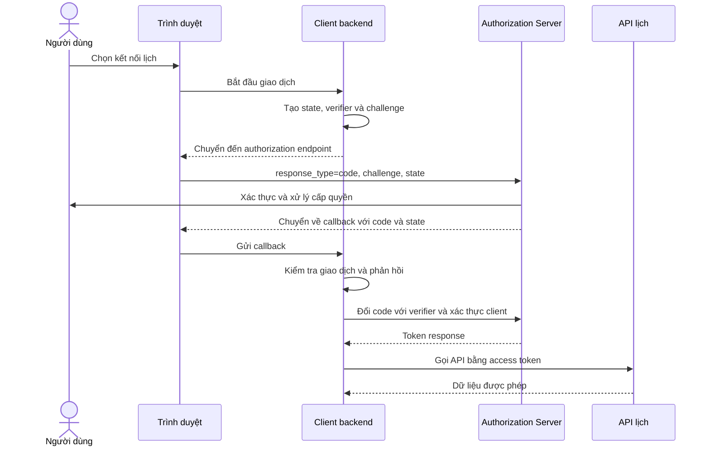

# Authorization code

## 1. Authorization code là gì?

**Authorization code** là mã tạm thời do Authorization Server cấp cho client sau một giao dịch cấp quyền hợp lệ. Client mang mã này đến token endpoint để đổi lấy token, thay vì dùng mã để gọi API.

Ví dụ, một ứng dụng lập kế hoạch muốn đọc lịch công ty của người dùng. Người dùng được chuyển đến hệ thống cấp quyền của công ty để xác thực và cho phép truy cập theo chính sách. Sau đó, ứng dụng nhận một mã ngắn hạn tại địa chỉ callback đã đăng ký và thực hiện bước đổi mã.

Authorization code không phải mật khẩu người dùng, cũng không phải access token. Ứng dụng không được suy ra rằng “có chuỗi code trên URL” đồng nghĩa một phiên đăng nhập đáng tin đã hình thành.

Trong Authorization Code Grant của OAuth 2.0, mã được ràng buộc với client và redirect URI, có thời hạn ngắn và chỉ được sử dụng một lần. Đặc tính này giúp giới hạn giá trị của mã nếu bị lộ, nhưng không loại bỏ nhu cầu bảo vệ toàn bộ giao dịch. [RFC 6749, mục 4.1.2](https://www.rfc-editor.org/rfc/rfc6749.html#section-4.1.2).

## 2. Các bên tham gia và mục tiêu cấp quyền

Trong ví dụ đọc lịch, có bốn vai trò chính:

| Vai trò | Thành phần minh họa | Trách nhiệm |
|---|---|---|
| Resource Owner | Người sở hữu lịch | Tham gia quyết định cho phép ứng dụng truy cập theo chính sách |
| Client | Ứng dụng lập kế hoạch | Khởi tạo giao dịch, nhận code, đổi code và sử dụng token đúng mục đích |
| Authorization Server — AS | Hệ thống cấp quyền của công ty | Xử lý xác thực, quyết định cấp quyền, phát code và token |
| Resource Server — RS | API lịch | Kiểm tra access token và quyền đối với tài nguyên được yêu cầu |

Trình duyệt chuyên chở các chuyển hướng giữa client và AS. Nó không trở thành Authorization Server chỉ vì đi qua màn hình xác thực.

AS và API có thể thuộc cùng một hệ thống triển khai, nhưng hai trách nhiệm vẫn khác nhau. AS quyết định phát bằng chứng cấp quyền; API quyết định có chấp nhận bằng chứng ấy cho một yêu cầu cụ thể hay không.

Mục tiêu OAuth trong ví dụ là cho ứng dụng đọc lịch theo quyền được cấp. Nếu ứng dụng còn muốn dùng nhà cung cấp danh tính để đăng nhập người dùng, cần xử lý lớp OpenID Connect tương ứng, được trình bày ở phần sau.

## 3. Phân biệt code và các loại token

| Đối tượng | Nơi sử dụng chính | Ý nghĩa | Có dùng trực tiếp để gọi API nghiệp vụ không? |
|---|---|---|---|
| Authorization code | Token endpoint của AS | Đầu vào ngắn hạn cho bước đổi token trong một giao dịch | Không |
| Access token | Resource Server phù hợp | Bằng chứng truy cập tài nguyên theo điều kiện của token và chính sách API | Có, nếu API chấp nhận token đó |
| Refresh token | Token endpoint của AS | Xin access token tiếp theo theo quyền và chính sách cho phép | Không |
| ID Token trong OIDC | Client/Relying Party được chỉ định | Kết quả xác thực và các claim danh tính | Không thay cho access token của API |

Không xác định vai trò của một giá trị chỉ bằng việc nó có dấu chấm, giải mã được hay trông giống JWT. Client nên coi code là giá trị không cần giải mã; không đọc cấu trúc bên trong để tự kết luận user, scope hoặc quyền quản trị.

Một client được cấp access token cũng không mặc nhiên nhận refresh token. Việc phát refresh token phụ thuộc loại client, yêu cầu và chính sách AS.

## 4. Luồng Authorization Code với PKCE

**PKCE**, viết đầy đủ là Proof Key for Code Exchange, bổ sung một giá trị bí mật riêng cho từng giao dịch đổi mã. Sơ đồ dưới đây dùng client có backend để dễ thấy ranh giới giữa chuyển hướng trình duyệt và lời gọi token endpoint.



Trong mô hình này, code đi qua trình duyệt; token được trả cho backend qua kết nối trực tiếp đến AS. Access token không cần xuất hiện trong URL callback hoặc được chuyển xuống JavaScript.

Không nên diễn giải “đổi token trực tiếp” thành “mọi loại client đều bắt buộc có backend”. Ứng dụng native và SPA có mô hình client khác; chúng vẫn có thể dùng Authorization Code với PKCE khi nền tảng và AS hỗ trợ đúng cách.

AS có thể sử dụng phiên xác thực đã tồn tại hoặc chính sách cấp quyền đã thiết lập. Vì vậy, mỗi giao dịch thành công không nhất thiết hiển thị lại màn hình mật khẩu hoặc hộp thoại đồng ý.

## 5. Chuẩn bị giao dịch trước khi chuyển hướng

Client phải biết trước mình đang giao tiếp với AS nào, dùng client registration nào và nhận phản hồi ở redirect URI nào. Các giá trị này đến từ cấu hình tin cậy, không lấy tùy ý từ dữ liệu callback.

Với mỗi lượt kết nối, client tạo một bản ghi giao dịch có thời hạn. Một thiết kế backend có thể giữ:

```text
Giao dịch kết nối lịch:
  state: giá trị ngẫu nhiên riêng cho giao dịch
  browserBinding: liên kết với trình duyệt đã khởi tạo
  codeVerifier: bí mật PKCE của giao dịch
  expectedAuthorizationServer: AS đã chọn
  redirectUri: callback đã đăng ký
  requestedScopes: calendar.read
  safeReturnPath: đường dẫn nội bộ sau khi hoàn tất
  expiresAt: thời điểm hết hạn giao dịch
  consumed: false
```

Đây là mô hình dữ liệu minh họa, không phải schema bắt buộc của giao thức. Điều quan trọng là client tìm được đúng ngữ cảnh và ngăn việc ghép phản hồi của một giao dịch vào giao dịch khác.

Nếu người dùng mở hai tab cùng lúc, mỗi tab cần được liên kết với giao dịch tương ứng. Một biến toàn cục chỉ giữ “verifier mới nhất” có thể khiến phản hồi của tab đầu dùng nhầm verifier của tab sau.

Không đặt client secret, verifier hoặc thông tin cá nhân nhạy cảm vào `state`. Với mô hình lưu phía server, `state` có thể là khóa tra cứu khó đoán; server vẫn phải kiểm tra liên kết với trình duyệt và thời hạn, không chỉ kiểm tra bản ghi có tồn tại.

Đường dẫn quay lại sau khi hoàn tất cũng cần được kiểm soát. Không cho phép một tham số URL biến callback thành nơi chuyển hướng tới bất kỳ website nào.

## 6. Yêu cầu tại authorization endpoint

Một yêu cầu OAuth minh họa:

```http
GET /authorize?response_type=code&client_id=calendar-web&redirect_uri=https%3A%2F%2Fplanner.example%2Foauth%2Fcallback&scope=calendar.read&state=STATE_OF_THIS_TRANSACTION&code_challenge=CHALLENGE_OF_THIS_TRANSACTION&code_challenge_method=S256 HTTP/1.1
Host: login.company.example
```

Các chuỗi viết hoa là vị trí thay thế để giải thích luồng, không phải giá trị thực dùng trong triển khai. `calendar.read` là scope giả định do API và AS của ví dụ định nghĩa.

Những tham số cần hiểu:

- `response_type=code`: client yêu cầu phản hồi có authorization code.
- `client_id`: định danh ứng dụng đã đăng ký; bản thân nó không phải bí mật.
- `redirect_uri`: địa chỉ nhận phản hồi của giao dịch.
- `scope`: phạm vi client đề nghị, không phải cam kết chắc chắn sẽ được cấp đầy đủ.
- `state`: giá trị phục vụ liên kết giao dịch và cơ chế chống CSRF đã thiết kế.
- `code_challenge`: giá trị được suy ra từ verifier.
- `code_challenge_method=S256`: cách tạo challenge dùng SHA-256.

Không gửi client secret hoặc `code_verifier` trong yêu cầu chuyển hướng này. Người dùng và các thành phần trên đường đi của trình duyệt có thể nhìn thấy URL.

Trong ví dụ, redirect URI đầy đủ đã được đăng ký và được gửi nguyên giá trị ở cả hai chặng liên quan. Không tự thay host, thêm dấu gạch cuối, đổi scheme hay thay đường dẫn khi đổi code.

## 7. Nhận callback và kiểm tra giao dịch

Một phản hồi thành công minh họa:

```http
HTTP/1.1 302 Found
Location: https://planner.example/oauth/callback?code=CODE_RECEIVED&state=STATE_OF_THIS_TRANSACTION
```

Callback không phải lệnh “tạo phiên ngay”. Trong thiết kế của ví dụ, backend lần lượt:

1. Tìm đúng giao dịch chưa hết hạn, có liên kết với trình duyệt đã khởi tạo.
2. Kiểm tra `state` trả về khớp chính xác với giá trị đã lưu.
3. Xử lý trường hợp AS trả lỗi hoặc người dùng từ chối.
4. Xác định phản hồi thuộc AS đã chọn, áp dụng biện pháp chống nhầm AS khi hỗ trợ nhiều bên phát hành.
5. Chỉ gửi code đến token endpoint tin cậy của AS tương ứng.
6. Kiểm soát việc xử lý giao dịch để callback lặp hoặc chạy đồng thời không tạo nhiều kết quả.

Không lấy một URL token endpoint do callback cung cấp rồi gửi code và thông tin xác thực client đến đó. Trình duyệt đưa được dữ liệu đến callback không có nghĩa nguồn dữ liệu ấy đáng tin.

`state` chỉ hữu ích khi nó khó đoán, riêng cho giao dịch và được ràng buộc đúng ngữ cảnh trình duyệt. So sánh hai chuỗi cố định như `state=login` không tạo ra cơ chế bảo vệ có ý nghĩa.

Callback có thể chứa mã lỗi như `access_denied`. Client cần kết thúc hoặc hủy giao dịch phù hợp, không bỏ qua lỗi rồi tiếp tục như đã được cấp quyền.

## 8. Đổi code tại token endpoint

Backend của ví dụ là confidential client, có khả năng giữ thông tin xác thực client phía server. Một yêu cầu đổi mã dạng khung:

```http
POST /token HTTP/1.1
Host: login.company.example
Authorization: Basic CLIENT_AUTH_VALUE
Content-Type: application/x-www-form-urlencoded

grant_type=authorization_code&code=CODE_RECEIVED&redirect_uri=https%3A%2F%2Fplanner.example%2Foauth%2Fcallback&code_verifier=VERIFIER_OF_THIS_TRANSACTION
```

`CLIENT_AUTH_VALUE` là chỗ thay thế cho thông tin xác thực theo phương thức đã đăng ký, không phải chuỗi hợp lệ để gửi nguyên văn. Trong triển khai dùng HTTP Basic, thư viện cần xử lý đúng định dạng và encoding thông tin client. Một registration có thể dùng phương thức khác; không tự gắn nhiều phương thức xác thực client vào cùng yêu cầu.

Public client không được giả vờ giữ bí mật bằng cách nhúng client secret trong JavaScript hoặc binary ứng dụng. Với public client không xác thực tại token endpoint, yêu cầu đổi mã chứa `client_id` theo giao thức, cùng code, redirect URI liên quan và verifier.

Token endpoint kiểm tra các điều kiện như:

- Code có hợp lệ và chưa hết hạn không?
- Code có đã được dùng chưa?
- Client đổi mã có đúng client được cấp mã không?
- Redirect URI có khớp yêu cầu ban đầu khi cần kiểm tra không?
- Verifier có khớp challenge đã gắn với code không?
- Xác thực client có hợp lệ nếu registration yêu cầu không?

AS cần bảo đảm một code không được đổi thành công hai lần, kể cả khi hai yêu cầu đến gần như đồng thời hoặc được xử lý ở hai node khác nhau.

Một token response minh họa:

```json
{
  "access_token": "ACCESS_TOKEN_VALUE",
  "token_type": "Bearer",
  "expires_in": 600,
  "scope": "calendar.read"
}
```

Thời hạn 600 giây chỉ phục vụ ví dụ; nó không phải thời hạn bắt buộc cho mọi token. Response này không có refresh token và không có ID Token.

Client cần xử lý kết quả theo quyền thực tế được cấp. Không dùng danh sách scope đã yêu cầu ban đầu làm bằng chứng rằng toàn bộ quyền đó đã được chấp thuận.

## 9. PKCE bảo vệ bước đổi mã như thế nào?

Mỗi giao dịch có một `code_verifier` ngẫu nhiên mật mã. Với phương thức S256:

```text
code_challenge = BASE64URL_NO_PADDING(
    SHA256(ASCII(code_verifier))
)
```

Client gửi challenge ở chặng authorization và gửi verifier ở chặng token. AS giữ liên kết giữa code và challenge, sau đó tính lại để kiểm tra. Verifier có độ dài 43–128 ký tự thuộc tập ký tự được quy định; dùng thư viện bảo mật phù hợp để sinh và mã hóa. [RFC 7636, mục 4](https://www.rfc-editor.org/rfc/rfc7636.html#section-4).

Hình dung một giao dịch có verifier V và challenge H(V). Nếu kẻ tấn công chỉ lấy được code, họ vẫn thiếu V để hoàn thành bước đổi mã được bảo vệ đúng. Gửi một verifier khác phải bị từ chối.

PKCE không mã hóa code và không thay thế TLS. Nó cũng không chứng minh public client có một client secret bí mật. Nếu mã độc lấy được cả code lẫn verifier trong cùng môi trường thực thi, bảo vệ mà PKCE cung cấp cho tình huống chặn code riêng lẻ không còn đủ.

Theo OAuth Security BCP, public client phải dùng PKCE và confidential client được khuyến nghị dùng PKCE. Thiết kế dùng S256 cần được thực thi ở AS; không âm thầm bỏ kiểm tra verifier khi gặp lỗi tương thích. [RFC 9700, mục 2.1.1](https://www.rfc-editor.org/rfc/rfc9700.html#section-2.1.1).

### State, PKCE và nonce khác nhau ở đâu?

| Thành phần | Câu hỏi cần giải quyết |
|---|---|
| `state` trong thiết kế ví dụ | Callback này có thuộc giao dịch đã khởi tạo trong ngữ cảnh trình duyệt này không? |
| PKCE | Bên đổi code có nắm verifier khớp challenge của giao dịch không? |
| `nonce` trong OIDC | ID Token có gắn với giá trị mà client đã gửi cho giao dịch xác thực tương ứng không? |

Các thành phần có phạm vi bảo vệ giao nhau trong một số thiết kế. BCP cho phép dựa vào PKCE để chống CSRF khi đã bảo đảm các điều kiện liên quan; OIDC cũng có cơ chế dùng nonce. Vì vậy, không nên dạy một quy tắc tuyệt đối rằng mọi tích hợp luôn có đúng cùng một bộ tham số. Ví dụ trong bài chủ động giữ `state` riêng và PKCE, đồng thời yêu cầu ràng buộc giao dịch đúng cách. [RFC 9700, mục 2.1](https://www.rfc-editor.org/rfc/rfc9700.html#section-2.1).

## 10. Authorization Code trong OIDC

OIDC có Authorization Code Flow, sử dụng nền OAuth để cung cấp kết quả xác thực cho client. Yêu cầu OIDC có scope `openid`; client có thể gửi thêm `nonce` theo thiết kế. Sau khi đổi code thành công, token response của luồng OIDC chứa ID Token bên cạnh access token. [OpenID Connect Core, mục 3.1](https://openid.net/specs/openid-connect-core-1_0.html#CodeFlowAuth).

Client phải kiểm chứng ID Token theo giao thức, gồm bên phát hành, đối tượng nhận, điều kiện thời gian, bảo vệ mật mã và nonce khi đã gửi. Chỉ sau đó mới dùng danh tính để liên kết tài khoản nội bộ và tạo phiên phù hợp. Code trên callback không thay thế bước này. [OpenID Connect Core, mục 3.1.3.7](https://openid.net/specs/openid-connect-core-1_0.html#IDTokenValidation).

Trong mô hình IAM doanh nghiệp, có thể hình dung chuỗi xử lý:

```text
Nhận code
  → kiểm tra giao dịch
  → đổi code
  → kiểm chứng kết quả OIDC
  → liên kết danh tính với tài khoản nội bộ
  → kiểm tra tài khoản và quyền
  → tạo phiên ứng dụng
```

Quyền đọc lịch và quyền quản trị ứng dụng là hai quyết định khác nhau. Một lần xác thực thành công tại nhà cung cấp danh tính không tự cấp mọi quyền nghiệp vụ cho tài khoản trong ứng dụng.

## 11. Thiết kế theo loại client

| Loại client | Nơi đổi code điển hình | Điều cần giữ rõ |
|---|---|---|
| Web có backend hoặc BFF | Backend | Backend giữ credential và token; trình duyệt có thể chỉ giữ cookie phiên |
| SPA chạy trực tiếp trên trình duyệt | Mã ứng dụng trong trình duyệt nếu kiến trúc cho phép | Public client; PKCE, bảo vệ khỏi XSS và cách lưu token là các vấn đề riêng |
| Ứng dụng native | Thành phần của ứng dụng native | Public client thông thường; cần cơ chế chuyển về ứng dụng đúng với nền tảng và registration |

Có thêm code exchange không tự làm nơi lưu token trở nên an toàn. Nếu SPA lưu token trong một vị trí mà mã độc cùng origin đọc được, PKCE không xóa bỏ rủi ro ấy.

Với backend giữ token, cookie phiên cũng cần được bảo vệ. Client nên tạo hoặc luân chuyển định danh phiên sau khi xác thực thành công, đặt các thuộc tính cookie phù hợp và có cơ chế chống CSRF cho thao tác nghiệp vụ. `state` của luồng OAuth không tự bảo vệ mọi POST trong ứng dụng.

Không chia sẻ một verifier cố định cho mọi người dùng, mọi tab hoặc mọi lần khởi động ứng dụng. Bí mật theo giao dịch và bí mật dài hạn của client có vòng đời khác nhau.

## 12. Rò rỉ code, xử lý lỗi và vận hành

### 12.1. Code ngắn hạn vẫn cần được giữ kín

URL callback có thể đi vào access log, lịch sử trình duyệt, hệ thống phân tích hoặc công cụ quan sát. Một trang callback tải tài nguyên bên thứ ba còn có thể làm lộ thông tin qua các đường ngoài dự kiến.

Callback nên xử lý phản hồi sớm và đưa người dùng đến URL sạch sau khi kết thúc giao dịch. Khi cấu hình logging, cần loại bỏ hoặc che code, verifier, token và client secret; chỉ giữ correlation ID cùng thông tin lỗi cần thiết.

Đừng dùng tính chất “mã chỉ dùng một lần” làm lý do cho phép ghi code nguyên vẹn vào mọi log. Kẻ tấn công có thể đọc mã trước client hợp lệ.

### 12.2. Lỗi không xác định duy nhất một nguyên nhân

| Biểu hiện | Khả năng cần kiểm tra | Cách xử lý ở client |
|---|---|---|
| `access_denied` ở callback | Người dùng hoặc chính sách từ chối | Kết thúc giao dịch và hiển thị kết quả phù hợp |
| `invalid_grant` khi đổi mã | Code hết hạn, đã dùng, sai liên kết hoặc verifier không khớp | Tra cứu correlation ID, kiểm tra cấu hình và bắt đầu giao dịch mới khi cần |
| `invalid_client` | Phương thức xác thực hoặc credential client sai | Kiểm tra registration, môi trường và cấu hình bí mật |
| State không khớp hoặc không có giao dịch | Callback không tương ứng, giao dịch hết hạn hoặc mất liên kết trình duyệt | Từ chối phản hồi; không bỏ kiểm tra để tiếp tục |
| Token request bị timeout | Không biết chắc AS đã đổi code thành công hay chưa | Tránh retry vô hạn cùng code; xử lý theo thư viện và bắt đầu lại an toàn nếu cần |

Không thể kết luận “người dùng nhập sai mật khẩu” chỉ từ `invalid_grant` trong bước đổi authorization code. Đây là bước xử lý code, không phải bước client gửi mật khẩu người dùng.

Retry một code đã bị tiêu thụ không phải cách xin lại access token. Nếu có refresh token hợp lệ thì dùng grant tương ứng; nếu không, cần khởi tạo giao dịch cấp quyền mới theo điều kiện ứng dụng.

### 12.3. Ràng buộc môi trường và tenant

Client ID, redirect URI, AS và token endpoint của thử nghiệm phải được phân biệt rõ với production. Một tích hợp có nhiều tenant cũng cần giữ đúng tenant trong ngữ cảnh giao dịch và trong quyết định chấp nhận kết quả.

Không chọn tenant hoặc AS chỉ dựa vào email mà người dùng gửi lên callback. Cần dùng cấu hình được phép và bằng chứng giao thức đã kiểm chứng.

### 12.4. Code không quản lý toàn bộ vòng đời truy cập

Sau khi code đã được đổi, access token, refresh token và phiên ứng dụng có vòng đời riêng. Xóa code hoặc xóa `state` không tự thu hồi access token đã phát.

Khi nhân viên mất quyền hoặc rời tổ chức, hệ thống IAM vẫn cần xử lý tài khoản, quyền, token và phiên theo chính sách. Authorization Code giúp hoàn thành một giao dịch cấp quyền; nó không thay thế deprovisioning hoặc kiểm toán.

## 13. Tự kiểm tra qua một tình huống

Ứng dụng lập kế hoạch khởi tạo hai giao dịch:

```text
Tab A: state_A, verifier_A, challenge_A
Tab B: state_B, verifier_B, challenge_B
```

AS trả `code_A` về cùng `state_A`. Client tìm được giao dịch A nhưng lại gửi `verifier_B` do dùng một biến “verifier hiện tại” chung.

Kết quả mong đợi là token endpoint từ chối yêu cầu đổi mã vì verifier không khớp challenge của code A. Cách sửa nằm ở việc lưu và lấy đúng ngữ cảnh giao dịch; không phải bỏ PKCE hay thử tất cả verifier đang có.

Nếu một kẻ tấn công gửi `code_A` kèm một state không thuộc trình duyệt hiện tại, client cũng phải từ chối theo kiểm tra giao dịch đã thiết kế, trước khi coi phản hồi là thành công.

Một tích hợp hoàn chỉnh cần giữ được ba mối liên hệ: phản hồi với đúng giao dịch, code với đúng client và verifier, rồi token với đúng mục đích sử dụng. Chỉ nhận được code ở callback mới hoàn thành một phần của chuỗi đó.
