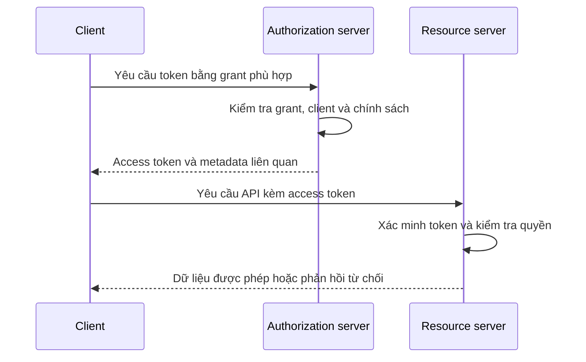

# Access token

## 1. Access token là gì?

**Access token** là thông tin xác thực do authorization server phát hành, được client sử dụng khi yêu cầu truy cập tài nguyên được bảo vệ tại resource server. Token thể hiện một sự cấp quyền với những giới hạn nhất định, chẳng hạn tài nguyên đích, phạm vi thao tác và thời hạn hiệu lực.

Ví dụ, ứng dụng quản lý chi tiêu nhận một access token để đọc hóa đơn từ API kế toán. Ứng dụng gửi token trong yêu cầu đến API; API xác minh token rồi kiểm tra người gọi có được đọc hóa đơn cụ thể hay không.

Trong hệ thống IAM, access token giúp tách hai hoạt động:

- **Cấp token:** authorization server đánh giá client, căn cứ cấp quyền và chính sách trước khi phát hành token.
- **Sử dụng token:** resource server xác minh token và thực thi kiểm soát truy cập khi nhận yêu cầu.

Access token không phải mật khẩu của người dùng. Nó cũng không mặc nhiên là một hồ sơ đầy đủ về danh tính, một phiên đăng nhập của trình duyệt hay bằng chứng rằng người giữ token được thao tác trên mọi dữ liệu của hệ thống.

## 2. Access token đi qua những thành phần nào?

| Thành phần | Vai trò đối với access token |
|---|---|
| Authorization server | Phát hành token sau khi các điều kiện cấp quyền được đáp ứng |
| Client | Nhận, bảo vệ và gửi token tới tài nguyên được phép truy cập |
| Resource server | Xác minh token và quyết định có xử lý yêu cầu hay không |
| Resource owner | Trong luồng có người dùng, chủ thể có quyền cấp quyền truy cập tài nguyên |

Luồng sử dụng đơn giản:



Sơ đồ lược bỏ những bước riêng của từng grant. Ví dụ, Authorization Code có thêm tương tác với người dùng và bước đổi code, còn client credentials dựa trên danh tính của ứng dụng mà không có người dùng đăng nhập.

## 3. Token đại diện cho quyền của ai?

Không nên mặc định mọi access token đều đại diện cho một con người.

### 3.1. Token trong luồng có người dùng

Một client có thể nhận token dựa trên quyền được người dùng hoặc chính sách tổ chức cấp cho client. Khi xử lý token, API có thể cần biết cả chủ thể người dùng lẫn ứng dụng đang hành động.

Ví dụ, người dùng Lan cho ứng dụng chi tiêu đọc hóa đơn. Việc Lan có quyền sửa hóa đơn không có nghĩa ứng dụng được sửa nếu token chỉ được cấp phạm vi đọc.

### 3.2. Token cho ứng dụng hoặc workload

Một dịch vụ đồng bộ có thể dùng client credentials để lấy token đọc danh mục sản phẩm. Trong trường hợp này, token thể hiện quyền của ứng dụng hoặc danh tính workload; không nên tự gán nó cho một người dùng tưởng tượng.

Cách biểu diễn chủ thể, client và các thuộc tính phụ thuộc hồ sơ token của hệ thống. Không được suy ra loại chủ thể chỉ từ tên một trường tùy chỉnh hoặc từ việc token có cấu trúc JWT.

### 3.3. Quyền hiệu lực là giao của nhiều giới hạn

Một cách hình dung hữu ích là:

```text
Quyền hiệu lực của yêu cầu
    bị giới hạn bởi quyền đã cấp trong token
    và tài nguyên đích của token
    và chính sách hiện hành của API
    và quyền trên đối tượng cụ thể
    và ngữ cảnh người dùng, client hoặc workload liên quan.
```

Đây là mô hình suy luận, không phải một phép tính mà mọi sản phẩm IAM đều triển khai giống nhau.

## 4. Phân biệt access token với các thông tin khác

| Thông tin | Mục đích chính | Bên tiếp nhận trong luồng tương ứng |
|---|---|---|
| Authorization code | Giá trị tạm thời để client đổi lấy token | Token endpoint |
| Access token | Yêu cầu truy cập tài nguyên được bảo vệ | Resource server |
| Refresh token | Yêu cầu cấp access token mới khi đủ điều kiện | Token endpoint |
| ID token | Truyền thông tin xác thực người dùng theo OIDC | Client đóng vai trò relying party |
| Session cookie | Liên kết trình duyệt với phiên của một ứng dụng hoặc dịch vụ | Hệ thống quản lý phiên đó |

Một ID token có chữ ký hợp lệ không vì thế trở thành access token cho API. Audience của ID token thường gắn với client nhận kết quả đăng nhập, còn access token phải phù hợp với tài nguyên được gọi.

Tương tự, refresh token không được gửi tới API nghiệp vụ thay access token. Mỗi loại thông tin có mục đích, đối tượng tiếp nhận và cách bảo vệ riêng.

## 5. Định dạng: opaque token và JWT

### 5.1. Opaque access token

Opaque token là một giá trị mà bên sử dụng không dựa vào việc đọc cấu trúc bên trong để hiểu quyền. Ví dụ minh họa:

```text
ACCESS_TOKEN_OPAQUE_VALUE
```

Chuỗi trên chỉ là ký hiệu thay thế, không phải mẫu để tạo token thật. Token thật cần được phát hành bằng cơ chế có độ khó đoán và tính an toàn phù hợp.

Resource server có thể xác minh opaque token thông qua introspection hoặc cơ chế tra cứu được hệ thống thiết kế. Một phản hồi introspection có thể chứa trạng thái `active` và các thông tin như scope, client, chủ thể hoặc thời hạn tùy triển khai.

Resource server không chỉ kiểm tra `active: true` rồi bỏ qua mọi điều kiện còn lại. Nó vẫn phải bảo đảm token phù hợp với tài nguyên đang phục vụ và quyền yêu cầu. Endpoint introspection cũng cần được bảo vệ; không phải bên nào biết token cũng được đọc metadata của token.

### 5.2. JWT access token

JWT có thể mang các claim để resource server xác minh theo hồ sơ đã thống nhất. Một JWT có chữ ký thường có ba phần được phân cách bằng dấu chấm:

```text
BASE64URL_HEADER.BASE64URL_PAYLOAD.BASE64URL_SIGNATURE
```

Không phải mọi JWT đều là access token, và không phải mọi access token đều là JWT.

Ví dụ payload minh họa cho một hồ sơ JWT access token:

```json
{
  "iss": "https://identity.example",
  "sub": "user-1842",
  "aud": "https://api.example/invoices",
  "client_id": "expense-web",
  "scope": "invoices.read",
  "iat": 1800000000,
  "exp": 1800000600,
  "jti": "token-example-001",
  "tenant_id": "tenant-a"
}
```

Các giá trị trên là dữ liệu ví dụ. Tên claim bắt buộc, kiểu dữ liệu và ý nghĩa chính xác phải theo hồ sơ token mà authorization server và resource server áp dụng; không coi payload này là schema chung cho mọi access token. `tenant_id` là claim tùy chỉnh trong ví dụ.

| Claim | Ý nghĩa thường gặp | Điều cần tránh |
|---|---|---|
| `iss` | Nhà phát hành token | Tin mọi issuer xuất hiện trong payload |
| `sub` | Chủ thể của token trong ngữ cảnh issuer | Mặc định luôn là người dùng hoặc luôn là email |
| `aud` | Đối tượng tiếp nhận token | Chấp nhận token dành cho một API khác |
| `scope` | Các phạm vi quyền đã cấp theo hồ sơ sử dụng | Đồng nhất scope với mọi quyền trên mọi đối tượng |
| `exp` | Thời điểm hết hạn | Chỉ kiểm tra chữ ký rồi bỏ qua thời hạn |
| `iat` | Thời điểm phát hành | Tự suy ra thời hạn chỉ từ thời điểm phát hành |
| `jti` | Định danh token theo hồ sơ sử dụng | Cho rằng có `jti` thì tự động ngăn được replay |

Giải mã base64url chỉ giúp đọc dữ liệu, không xác minh chữ ký. Ngoài ra, một JWT chỉ được ký không tự che giấu payload. Không đưa mật khẩu, secret hoặc thông tin nhạy cảm không cần thiết vào payload với giả định người nhận không thể đọc được.

### 5.3. Định dạng không quyết định toàn bộ mô hình vận hành

| Khía cạnh | Opaque token | JWT access token có chữ ký |
|---|---|---|
| Bên gọi có cần hiểu nội dung? | Thường không | Client cũng thường không cần phụ thuộc payload |
| Xác minh tại API | Có thể qua introspection hoặc tra cứu | Có thể xác minh cục bộ bằng khóa tin cậy |
| Thay đổi trạng thái sau phát hành | Phụ thuộc cơ chế tra cứu và cache | Phụ thuộc thời hạn và cơ chế cập nhật trạng thái bổ sung |
| Độ lộ thông tin cho bên giữ token | Phụ thuộc giá trị và khả năng tra cứu | Payload có thể đọc được nếu token chỉ được ký |
| Phụ thuộc hệ thống cấp token lúc gọi API | Phụ thuộc thiết kế xác minh | Có thể giảm nhờ xác minh cục bộ và cache khóa |

Một hệ thống vẫn có thể introspect JWT hoặc cache kết quả introspection của opaque token. Vì vậy, không nên kết luận về thu hồi hay khả dụng chỉ dựa trên định dạng.

## 6. Bearer token và token ràng buộc với bên gửi

### 6.1. Bearer token

Với bearer token, bên sở hữu token có thể dùng nó theo các điều kiện mà resource server chấp nhận, mà không phải chứng minh đang giữ một khóa riêng tương ứng với token.

Điều đó làm token bị đánh cắp trở thành một credential có thể bị phát lại. TLS bảo vệ việc truyền trên kết nối, nhưng không ngăn mọi tình huống token bị lộ từ log, trình duyệt, bộ nhớ ứng dụng hoặc hệ thống quan sát.

### 6.2. Sender-constrained token

Một số triển khai ràng buộc token với một khóa hoặc chứng chỉ của bên gửi, chẳng hạn thông qua DPoP hoặc mTLS. Resource server phải xác minh cả token lẫn bằng chứng tương ứng theo cơ chế áp dụng.

Ràng buộc này có thể hạn chế việc sử dụng token bị đánh cắp đơn lẻ. Tuy nhiên, nó không tự giải quyết việc client bị chiếm quyền hoặc khóa của client cũng bị lộ. Không áp dụng quy tắc gửi và kiểm tra của bearer token một cách máy móc cho mọi loại token.

## 7. Gửi access token đến API

Với bearer token, cách gửi thông dụng là header `Authorization`:

```http
GET /invoices/INV-001 HTTP/1.1
Host: api.example
Authorization: Bearer ACCESS_TOKEN_VALUE
Accept: application/json
```

`ACCESS_TOKEN_VALUE` chỉ là placeholder. Yêu cầu thực tế cần được truyền qua kết nối được bảo vệ phù hợp, thông thường là HTTPS với xác minh chứng chỉ đúng cách.

Không đặt access token vào URL như một cách tích hợp mặc định. URL có thể xuất hiện trong lịch sử trình duyệt, log máy chủ, proxy, công cụ phân tích và các hệ thống trung gian khác.

Client phải gửi token tới đúng tài nguyên đã được cấu hình. Khi theo redirect hoặc gọi một URL do dữ liệu bên ngoài cung cấp, không tự động chuyển tiếp header mang token tới một host khác.

## 8. Resource server cần xác minh những gì?

Xác minh token và kiểm tra quyền nghiệp vụ là hai lớp liên quan nhưng khác nhau.

### 8.1. Xác minh token theo hợp đồng tin cậy

Đối với JWT access token, resource server thường cần:

1. Chấp nhận đúng loại token và hồ sơ đã cấu hình.
2. Kiểm tra thuật toán theo danh sách cho phép thay vì tin thuật toán do token tự đề xuất.
3. Xác minh chữ ký bằng khóa lấy từ nguồn tin cậy của issuer.
4. Kiểm tra `iss` thuộc nhà phát hành được chấp nhận.
5. Kiểm tra `aud` có chứa đối tượng tiếp nhận mà API mong đợi theo hồ sơ áp dụng.
6. Kiểm tra `exp`, `nbf` khi có và các ràng buộc thời gian khác được yêu cầu, với sai lệch đồng hồ được giới hạn rõ ràng.
7. Kiểm tra các claim bắt buộc, trạng thái hoặc ràng buộc bên gửi nếu cơ chế sử dụng yêu cầu.

Không tải khóa từ một URL tùy ý chỉ vì token chứa URL đó. `kid` chỉ là gợi ý chọn khóa trong ngữ cảnh đã được tin cậy, không phải căn cứ để tin một issuer hoặc nguồn khóa mới.

Với opaque token, resource server thực hiện cơ chế xác minh tương ứng, kiểm tra trạng thái và các thuộc tính cần thiết từ kết quả đáng tin cậy. Nếu có cache, thời hạn cache ảnh hưởng tới độ cập nhật của trạng thái token.

### 8.2. Kiểm tra quyền trên yêu cầu thực tế

Sau khi token được chấp nhận, API vẫn cần xét:

- Scope có cho phép loại thao tác đang được yêu cầu không?
- Chủ thể có quyền đối với bản ghi cụ thể không?
- Dữ liệu có thuộc đúng tenant không?
- Chính sách RBAC, ABAC hoặc chính sách nghiệp vụ có cho phép không?
- Ngữ cảnh hiện tại có đáp ứng điều kiện bổ sung không?

Ví dụ, token của Lan có scope `invoices.read` và thuộc `tenant-a`. Yêu cầu đọc hóa đơn của `tenant-b` phải bị từ chối nếu Lan không có quyền phù hợp, dù token đúng chữ ký và còn hạn.

Mã giả thể hiện thứ tự xử lý:

```text
token = extractAuthorizationCredential(request)
context = verifyTokenUsingConfiguredTrust(token)

requireScope(context, "invoices.read")
invoice = loadInvoice(request.invoiceId)
requireAllowedTenant(context, invoice)
requireBusinessPermission(context, "read", invoice)

return allowedInvoiceFields(invoice)
```

Đây là mã giả về trách nhiệm, không phải bộ xác minh token hoàn chỉnh. Ứng dụng nên sử dụng thành phần xác minh phù hợp với nền tảng và hồ sơ token thay vì tự viết trình kiểm tra JWT chỉ bằng thao tác tách chuỗi.

### 8.3. Phân biệt lỗi token và thiếu quyền

Một phản hồi bearer token không hợp lệ có thể có dạng:

```http
HTTP/1.1 401 Unauthorized
WWW-Authenticate: Bearer error="invalid_token"
```

Nếu token được chấp nhận nhưng thiếu scope cần thiết, một phản hồi theo cơ chế bearer có thể là:

```http
HTTP/1.1 403 Forbidden
WWW-Authenticate: Bearer error="insufficient_scope", scope="invoices.read"
```

Chi tiết trả về còn phụ thuộc hồ sơ giao thức và chính sách của API. Không đưa token, secret hoặc thông tin nội bộ nhạy cảm vào thông báo lỗi. Client cũng không nên coi mọi lỗi `403` là dấu hiệu cần refresh token; lỗi có thể xuất phát từ quyền nghiệp vụ hoặc tenant không phù hợp.

## 9. Thời hạn và vòng đời access token

### 9.1. Nhận token

Một phản hồi token minh họa:

```json
{
  "access_token": "ACCESS_TOKEN_VALUE",
  "token_type": "Bearer",
  "expires_in": 600,
  "scope": "invoices.read"
}
```

`expires_in` thể hiện thời gian sống theo giây tính từ khi phản hồi được tạo. Con số 600 chỉ là ví dụ; không có một thời hạn phù hợp cho mọi API hoặc mọi mức rủi ro.

Client cần quan tâm tới scope thực sự được cấp và kiểu token. Không mặc định phản hồi luôn có refresh token hay token luôn có cùng định dạng giữa các môi trường.

### 9.2. Sử dụng và hết hạn

Thời hạn ngắn có thể thu hẹp khoảng thời gian sử dụng token bị đánh cắp, nhưng cũng làm tăng nhu cầu cấp token mới và phụ thuộc vận hành. Thời hạn dài giảm số lần cấp mới nhưng có thể kéo dài ảnh hưởng của credential bị lộ hoặc quyền đã thay đổi.

Client có thể chủ động xin token mới trước khi hết hạn với khoảng đệm hợp lý. Tuy nhiên, quyết định chấp nhận token vẫn thuộc resource server; đồng hồ và cache của client không thay thế việc kiểm tra tại API.

### 9.3. Cấp token mới

Nếu có refresh token và chính sách cho phép, client dùng nó tại token endpoint để yêu cầu access token mới. Nếu không có refresh token, ứng dụng thực hiện lại luồng phù hợp; workload có thể yêu cầu token mới bằng credential của chính nó.

Không kéo dài thời hạn bằng cách sửa claim `exp` ở client. Thao tác đó phá vỡ tính toàn vẹn của token và không tạo ra một token hợp lệ.

Khi nhiều yêu cầu đồng thời phát hiện token hết hạn, client cần phối hợp việc cấp mới để tránh tạo nhiều lần refresh cạnh tranh, đặc biệt khi hệ thống sử dụng refresh token rotation.

### 9.4. Thu hồi và thay đổi quyền

Token đã phát hành không nhất thiết phản ánh tức thì mọi thay đổi sau đó. Chẳng hạn, claim về vai trò trong JWT có thể vẫn mang giá trị tại thời điểm phát hành dù người dùng vừa bị rút vai trò.

Nếu API chỉ xác minh JWT cục bộ, token có thể tiếp tục được chấp nhận đến khi hết hạn, trừ khi có cơ chế bổ sung kiểm tra trạng thái hoặc chính sách. Introspection online cũng có độ trễ cập nhật nếu resource server sử dụng cache.

Vì vậy, khi thiết kế vòng đời quyền cần xác định rõ:

- Sự kiện nào phải ngăn cấp token mới.
- Sự kiện nào phải vô hiệu hóa token đã phát hành.
- Hệ thống chấp nhận độ trễ thu hồi bao lâu.
- API nào cần kiểm tra chính sách hoặc trạng thái cập nhật hơn.

Đăng xuất khỏi một ứng dụng, kết thúc phiên SSO và thu hồi access token là các hành động khác nhau. Không dùng một hành động làm bằng chứng mặc định rằng tất cả các hành động còn lại đã xảy ra.

## 10. Bảo vệ token tại client và hạ tầng

### 10.1. Không để token trở thành dữ liệu quan sát thông thường

Access token cần được xử lý như credential. Những nơi có thể làm lộ token gồm log HTTP, trace phân tán, công cụ báo lỗi, ảnh chụp màn hình và lịch sử lệnh.

Cần che header hoặc trường chứa token tại các tầng liên quan, bao gồm client, gateway, proxy và backend. Chỉ che ở một tầng không bảo đảm các tầng khác không lưu lại giá trị gốc.

Để truy vết, có thể dùng định danh tương quan của giao dịch hoặc định danh token được thiết kế phù hợp. Không cần ghi toàn bộ token để biết một yêu cầu đã bị từ chối vì hết hạn.

### 10.2. Chọn cách lưu phù hợp với loại ứng dụng

Ứng dụng backend cần giới hạn nơi lưu, quyền truy cập và thời gian giữ token. Ứng dụng native cần sử dụng cơ chế bảo vệ credential phù hợp với nền tảng thay vì ghi token vào file công khai.

Trong trình duyệt, lưu token ở nơi JavaScript đọc được làm tăng nguy cơ bị trích xuất khi có XSS. Lưu trong bộ nhớ cũng không ngăn mã độc đang chạy trong ứng dụng sử dụng token hoặc thực hiện thao tác nhân danh người dùng.

Một kiến trúc backend-for-frontend có thể giữ access token ở phía máy chủ và dùng session cookie cho trình duyệt. Cookie `HttpOnly` hạn chế JavaScript đọc trực tiếp giá trị cookie, nhưng không tự ngăn mã XSS thực hiện yêu cầu trong phiên. Cookie còn cần cấu hình như `Secure`, `SameSite` và biện pháp chống CSRF thích hợp với luồng ứng dụng.

Không có một lựa chọn lưu trữ duy nhất loại bỏ mọi rủi ro. Cách lưu phải đi cùng mô hình đe dọa, cách quản lý phiên và biện pháp phòng chống XSS, CSRF của ứng dụng.

### 10.3. Giới hạn quyền và nơi sử dụng

Chỉ yêu cầu scope cần thiết cho công việc hiện tại. Không xin quyền ghi chỉ vì có thể cần trong tương lai, và không dùng một token có quyền rộng cho mọi dịch vụ.

Khi dịch vụ A gọi dịch vụ B, không tự động chuyển tiếp token nhận từ bên ngoài nếu token không được cấp cho B hoặc mô hình ủy quyền không cho phép. Hệ thống có thể cần credential riêng của workload hoặc cơ chế ủy quyền/token exchange đã được thiết kế rõ ràng.

## 11. Các hiểu lầm và lỗi thường gặp

| Hiểu lầm hoặc lỗi | Vấn đề | Cách xử lý đúng |
|---|---|---|
| Token đọc được là token đã được xác minh | Decode không kiểm tra chữ ký hay nguồn phát hành | Xác minh theo hợp đồng tin cậy trước khi dùng claim |
| JWT đúng chữ ký thì dùng được ở mọi API | Token có thể dành cho audience khác | Kiểm tra audience và issuer được cấu hình |
| Có scope đọc thì đọc được mọi bản ghi | Thiếu kiểm tra đối tượng và tenant | Thực thi quyền nghiệp vụ sau khi kiểm tra token |
| Access token luôn đại diện cho người dùng | Bỏ qua danh tính ứng dụng hoặc workload | Xác định chủ thể theo grant và hồ sơ token |
| Access token là ID token | Nhầm mục đích và đối tượng tiếp nhận | Tách xử lý đăng nhập OIDC khỏi truy cập API |
| Có `jti` thì không thể replay | Định danh không tự tạo cơ chế chống phát lại | Áp dụng biện pháp phù hợp nếu cần ngăn replay |
| Thu hồi refresh token làm access token mất hiệu lực ngay | Bỏ qua token đã phát hành và cache | Thiết kế và kiểm tra riêng cơ chế thu hồi access token |
| Refresh khi gặp bất kỳ lỗi quyền nào | Tạo vòng lặp yêu cầu token mà không sửa nguyên nhân | Phân biệt token hết hạn với thiếu scope hoặc quyền nghiệp vụ |
| Lưu token trong JWT payload khác là đã mã hóa | Thêm lớp biểu diễn không tạo tính bí mật | Dùng cơ chế bảo vệ dữ liệu thực sự phù hợp |

## 12. Tình huống IAM: nhân viên bị thu hồi quyền đọc hóa đơn

Lan được cấp access token sống 10 phút, có scope `invoices.read`, để sử dụng ứng dụng chi tiêu. Hai phút sau, quản trị viên thu hồi quyền đọc hóa đơn của Lan.

Nếu API chỉ kiểm tra chữ ký, issuer, audience và thời hạn của token, token cũ có thể vẫn qua được lớp xác minh token trong tám phút còn lại. Điều đó không có nghĩa API bắt buộc phải cho đọc: nếu API kiểm tra quyền hiện hành tại bước nghiệp vụ, nó có thể từ chối yêu cầu ngay theo trạng thái mới.

Nếu quyền được quyết định hoàn toàn từ claim tại thời điểm phát hành, hệ thống phải chấp nhận hoặc xử lý khoảng trễ này bằng thiết kế thu hồi thích hợp. Việc ngăn refresh token cấp thêm access token mới chỉ giải quyết một phần vòng đời.

Để đánh giá thiết kế, cần hỏi: token cũ còn được chấp nhận ở đâu, API kiểm tra quyền ở thời điểm nào, cache tồn tại bao lâu và sự kiện thu hồi được truyền tới các thành phần nào? Những câu trả lời này quyết định hiệu lực thực tế của quy trình thu hồi quyền trong IAM.

Access token phát huy tác dụng khi quyền được giới hạn rõ lúc phát hành, credential được bảo vệ trong lúc sử dụng và resource server thực thi đầy đủ chính sách trên từng yêu cầu.
