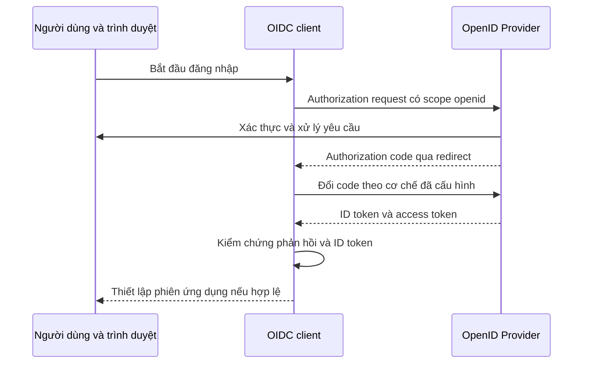

# ID token

**ID token** là token do OpenID Provider phát hành cho một OpenID Connect client để cung cấp thông tin về sự kiện xác thực của người dùng. Client dùng token này, sau khi kiểm chứng, để biết người dùng nào đã được xác thực bởi nhà cung cấp danh tính mà mình tin cậy và kết quả đó có dành cho chính client hay không.

Ví dụ, một cổng quản lý chi phí cho phép đăng nhập qua hệ thống danh tính của công ty. Sau quy trình OpenID Connect, cổng nhận ID token và dùng danh tính đã được kiểm chứng để thiết lập phiên đăng nhập của ứng dụng. Khi ứng dụng gọi API hóa đơn, nó dùng access token dành cho API; ID token không thay thế quyền truy cập API đó.

Trong IAM, hiểu đúng ID token giúp tách ba vấn đề: bằng chứng về sự kiện xác thực, phiên đăng nhập tại ứng dụng và quyền thực hiện thao tác trên tài nguyên.

## 1. ID token xuất hiện trong OpenID Connect như thế nào?

OpenID Connect, thường viết là OIDC, xây dựng lớp nhận diện người dùng trên nền OAuth. Khi client gửi yêu cầu OIDC, scope có giá trị `openid` giúp xác định yêu cầu đang sử dụng OpenID Connect.

Các vai trò liên quan:

| Vai trò | Trách nhiệm |
| --- | --- |
| End-user | Người dùng được xác thực |
| OpenID Provider, hay OP | Xác thực người dùng và phát hành ID token |
| Relying Party, hay RP | OIDC client tiếp nhận và kiểm chứng ID token |
| Resource server | API nhận access token và bảo vệ tài nguyên |

Một sản phẩm có thể thực hiện nhiều vai trò, nhưng trách nhiệm của từng vai trò vẫn khác nhau. Backend của một ứng dụng web có thể là RP khi xử lý đăng nhập, đồng thời gọi một API khác với tư cách OAuth client.

Luồng Authorization Code có thể được mô tả rút gọn:



Sơ đồ bỏ qua chi tiết như PKCE, xác thực client và xử lý lỗi để làm rõ vị trí của ID token. Việc dùng OIDC không có nghĩa ứng dụng được bỏ qua những biện pháp bảo vệ tương ứng với flow và loại client.

## 2. ID token khác access token và refresh token

Ba token có thể xuất hiện trong một phiên đăng nhập nhưng trả lời những câu hỏi khác nhau.

| Token | Mục đích chính | Thành phần tiếp nhận điển hình |
| --- | --- | --- |
| ID token | Chuyển thông tin về sự kiện xác thực và subject cho client | OIDC client đã được xác định là audience |
| Access token | Đại diện cho quyền truy cập tài nguyên trong phạm vi được cấp | Resource server phù hợp |
| Refresh token | Cho phép client yêu cầu token mới theo chính sách của authorization server | Token endpoint |

ID token không phải “access token có thêm tên người dùng”. Cả hai có thể cùng ở định dạng JWT, cùng được một issuer ký và chứa một số claim tương tự, nhưng mục đích và audience khác nhau.

Ví dụ:

```text
ID token:
  audience = expense-web

Access token:
  audience = invoice-api
```

Cổng `expense-web` kiểm chứng ID token để xử lý đăng nhập. Invoice API phải kiểm chứng access token dành cho nó để xử lý yêu cầu nghiệp vụ.

Nếu Invoice API chấp nhận ID token chỉ vì chữ ký hợp lệ, ranh giới giữa đăng nhập client và cấp quyền truy cập API đã bị phá vỡ. Tên file, tên biến hoặc cách client gọi token không thay thế việc kiểm chứng loại token và hợp đồng sử dụng.

## 3. Cấu trúc của ID token

ID token được biểu diễn dưới dạng JWT. Trường hợp thường gặp là JWT được ký, có ba phần:

```text
base64url(header).base64url(payload).signature
```

Header mô tả thông tin xử lý token; payload chứa các claim; chữ ký cho phép kiểm tra tính toàn vẹn và nguồn phát hành theo cơ chế tin cậy đã cấu hình.

Một số triển khai còn mã hóa ID token theo cấu hình đã thỏa thuận. Khi đó, quá trình xử lý bao gồm giải mã và kiểm chứng theo profile tương ứng. Không nên mặc định mọi ID token đều có thể được xử lý bằng cùng một thủ tục tách ba phần.

Payload minh họa:

```json
{
  "iss": "https://identity.example.test",
  "sub": "subject-184",
  "aud": "expense-web",
  "exp": 1900000600,
  "iat": 1900000000,
  "auth_time": 1899999950,
  "nonce": "request-specific-random-value"
}
```

Đây là ví dụ nội dung claim, không phải token thật và không phải một bằng chứng đã được xác minh. Các giá trị thời gian là số giây tính từ Unix epoch.

JWT được ký thông thường không mã hóa payload. Người có token thường có thể đọc nội dung của nó. Vì vậy, không đặt mật khẩu hoặc bí mật ứng dụng trong claim, và cần giới hạn dữ liệu cá nhân được đưa vào token.

## 4. Các claim nền tảng

### 4.1. `iss`: ai phát hành token?

`iss`, viết tắt của issuer, xác định nhà cung cấp phát hành ID token.

Client phải đối chiếu issuer với cấu hình tin cậy của mình. Một token từ môi trường thử nghiệm không trở thành token đăng nhập hợp lệ cho môi trường sản xuất chỉ vì tên claim giống nhau hoặc chữ ký có thể được kiểm tra bằng một khóa nào đó.

Không tự sửa issuer bằng cách bỏ đường dẫn, đổi scheme hoặc chuẩn hóa chuỗi theo suy đoán. Giá trị issuer cần được đối chiếu đúng theo hợp đồng OIDC.

Trong hệ thống có nhiều nhà cung cấp danh tính, việc chọn cấu hình xác minh phải gắn với nhà cung cấp được phép cho giao dịch đăng nhập. Không để một issuer tùy ý trong token tự quyết định nơi ứng dụng tải cấu hình hoặc khóa.

### 4.2. `sub`: người dùng nào trong phạm vi issuer?

`sub`, viết tắt của subject, là định danh chủ thể tại issuer.

Để ánh xạ tài khoản liên kết, ứng dụng thường sử dụng cặp:

```text
(issuer, subject)
```

Hai issuer khác nhau có thể phát hành cùng chuỗi `sub` cho hai người khác nhau. Chỉ lưu `sub` mà bỏ issuer có thể làm nhầm danh tính.

Một số hệ thống sử dụng pairwise subject để giảm khả năng liên kết người dùng giữa các client. Vì vậy, cùng một người dùng có thể nhận các giá trị `sub` khác nhau ở các client hoặc nhóm client theo cấu hình của provider. Không dùng việc so sánh subject giữa hai ứng dụng để tự kết luận tài khoản phải giống nhau.

Không thay subject bằng email chỉ vì email dễ đọc. Email có thể thay đổi, có thể được tái cấp và không phải khóa định danh liên kết bất biến.

### 4.3. `aud`: token dành cho client nào?

`aud`, viết tắt của audience, phải bao gồm client ID của RP đang tiếp nhận token.

Ví dụ, client `expense-web` không được chấp nhận ID token có audience chỉ là `hr-portal`. Chữ ký đúng không làm thay đổi đối tượng mà token hướng tới.

Audience có thể là một giá trị hoặc một tập giá trị theo cấu trúc JWT. Client cần dùng thư viện kiểm chứng hiểu đúng cấu trúc này và kiểm tra các audience bổ sung theo chính sách tin cậy, thay vì tìm chuỗi client ID ở bất kỳ vị trí nào trong payload.

### 4.4. `exp`: bằng chứng còn được chấp nhận đến khi nào?

`exp` xác định thời điểm hết hạn của ID token.

Client không được chấp nhận một ID token đã hết hạn để hoàn tất đăng nhập. Một khoảng sai lệch đồng hồ nhỏ có thể được cấu hình theo chính sách, nhưng không được biến thành cơ chế chấp nhận token cũ trong thời gian dài.

Hết hạn ID token không mặc nhiên làm mọi phiên ứng dụng đã tạo trước đó kết thúc. Phiên của ứng dụng có chính sách riêng và sẽ được phân tích ở phần sau.

### 4.5. `iat`: token được phát hành lúc nào?

`iat` là thời điểm phát hành token.

Nó không đồng nghĩa với thời điểm người dùng vừa nhập lại mật khẩu hoặc vừa thực hiện MFA. Provider có thể phát hành ID token mới dựa trên phiên SSO đã tồn tại.

Client có thể kiểm tra `iat` và tuổi token theo chính sách đã chọn. Khi cần đánh giá độ mới của sự kiện xác thực, phải sử dụng thông tin phù hợp như `auth_time` thay vì suy luận từ `iat`.

## 5. Các claim gắn với giao dịch và ngữ cảnh xác thực

### `nonce`: liên kết token với yêu cầu đăng nhập

Client có thể gửi một giá trị `nonce` gắn với giao dịch đăng nhập. Khi nonce đã được gửi trong authentication request, client phải kiểm tra claim nonce trong ID token theo yêu cầu của OIDC và flow sử dụng.

Ví dụ:

```text
Giao dịch đăng nhập T1:
  nonce đã lưu = N1

ID token nhận được:
  nonce = N2

Nếu N1 khác N2:
  không hoàn tất đăng nhập bằng token này
```

Nonce phải được sinh với độ ngẫu nhiên phù hợp, gắn với đúng giao dịch và quản lý vòng đời an toàn. Không dùng một nonce cố định cho mọi người dùng hoặc chấp nhận bất kỳ nonce nào chỉ vì claim này có mặt.

Không phải mọi flow có quy tắc bắt buộc gửi nonce giống nhau. Client cần thực hiện đúng flow và profile đang dùng; khi đã gửi nonce, việc đối chiếu giá trị không phải bước tùy chọn.

### `auth_time`: lần xác thực liên quan diễn ra khi nào?

`auth_time` mô tả thời điểm xác thực người dùng liên quan đến kết quả đăng nhập.

Khi client dùng `max_age` để yêu cầu giới hạn tuổi của lần xác thực, ID token phải cung cấp `auth_time` theo OIDC để client kiểm tra điều kiện đó.

Ví dụ, ứng dụng yêu cầu xác thực không quá 5 phút trước khi người dùng thực hiện một thao tác nhạy cảm. Một ID token vừa được phát hành không đủ chứng minh điều kiện này nếu người dùng thực ra xác thực từ nhiều giờ trước.

Yêu cầu giao thức và bước kiểm tra kết quả cần đi cùng nhau. Gửi yêu cầu xác thực mới nhưng không xác minh điều kiện trong kết quả có thể làm mất ý nghĩa của chính sách.

### `acr` và `amr`: mức và cách xác thực

Một ID token có thể chứa:

- `acr`: lớp ngữ cảnh xác thực đạt được.
- `amr`: các phương thức xác thực được phản ánh trong kết quả.

Ý nghĩa cụ thể và cách ánh xạ sang mức bảo đảm nội bộ cần được thỏa thuận với issuer. Không tự suy ra “đã đạt MFA đủ mạnh cho mọi nghiệp vụ” từ một chuỗi claim không được định nghĩa trong chính sách.

Việc ứng dụng yêu cầu một giá trị ACR cũng không tự chứng minh giá trị đó đã được đáp ứng. RP phải kiểm tra kết quả và thực thi chính sách xử lý khi mức xác thực không đạt.

### `azp`: bên được cấp quyền

`azp`, khi xuất hiện, xác định authorized party liên quan đến token.

Trong tình huống nhiều audience hoặc profile có yêu cầu liên quan, client cần kiểm tra `azp` theo quy tắc của profile và đối chiếu với client ID phù hợp. Không dùng `azp` để bỏ qua việc kiểm tra `aud`.

### `at_hash` và `c_hash`

Một số phản hồi OIDC sử dụng hash claim để ràng buộc ID token với access token hoặc authorization code. Việc có mặt và cách kiểm tra các claim này phụ thuộc flow, response type và profile.

Không nên viết một bộ kiểm chứng chung chỉ đọc các claim dễ hiểu rồi bỏ qua những ràng buộc mà flow đang dùng yêu cầu. Thư viện OIDC cần biết ngữ cảnh phản hồi, không chỉ nhận một chuỗi JWT để decode.

## 6. Kiểm chứng ID token theo một chuỗi tin cậy

Quy trình thực tế nên sử dụng thư viện OIDC được cấu hình đúng. Pseudocode sau mô tả các trách nhiệm, không phải một triển khai mật mã có thể đưa trực tiếp vào sản phẩm:

```text
completeLogin(callback, pendingTransaction):
    verifyCallbackBelongsToTransaction(callback, pendingTransaction)
    tokenResponse = redeemCodeAccordingToConfiguredFlow(
        callback.code,
        pendingTransaction
    )

    claims = validateIdToken(
        tokenResponse.idToken,
        trustedIssuer = pendingTransaction.expectedIssuer,
        expectedAudience = configuredClientId,
        allowedAlgorithms = configuredAlgorithms,
        trustedKeySource = configuredIssuerKeys
    )

    verifyTimeClaimsAndRequiredClaims(claims)
    verifyNonceIfSent(claims, pendingTransaction)
    verifyAuthenticationFreshnessIfRequired(claims, pendingTransaction)
    verifyFlowSpecificBindings(claims, tokenResponse, callback)

    localUser = resolveFederatedIdentity(claims.issuer, claims.subject)
    enforceLocalAccountPolicy(localUser)
    establishApplicationSession(localUser, claims)
    consumePendingTransaction(pendingTransaction)
```

Các kiểm tra quan trọng gồm:

1. Xác nhận phản hồi thuộc đúng giao dịch đăng nhập và xử lý các biện pháp bảo vệ flow.
2. Xử lý định dạng, chữ ký và mã hóa, nếu có, theo cấu hình đã tin cậy.
3. Kiểm tra issuer, audience, thời hạn và các claim bắt buộc.
4. Kiểm tra nonce, yêu cầu về độ mới xác thực, authorized party và ràng buộc riêng của flow khi áp dụng.
5. Chỉ sau đó ánh xạ danh tính và thiết lập phiên ứng dụng.

Không tạo phiên từ payload được decode trước rồi mới xác minh chữ ký ở bước sau. Nếu kiểm chứng thất bại, dữ liệu trong token chưa có giá trị làm bằng chứng danh tính.

### Khóa xác minh đến từ đâu?

Client thường sử dụng cấu hình issuer và tập khóa công khai của provider. Những nguồn này phải được xác định qua cấu hình tin cậy hoặc quy trình discovery được kiểm soát.

Giá trị `kid` trong header giúp chọn khóa từ tập khóa phù hợp; nó không tự chứng minh khóa đáng tin. Không tải khóa từ một URL tùy ý do token cung cấp và xem đó là cơ sở xác thực.

Thuật toán được chấp nhận cũng phải được cấu hình theo hợp đồng với provider. Không chấp nhận thuật toán bất kỳ chỉ vì header yêu cầu, và không tắt kiểm tra chữ ký để xử lý lỗi luân chuyển khóa.

## 7. `state`, `nonce` và PKCE bảo vệ các phần khác nhau

Ba cơ chế này thường xuất hiện cùng quá trình đăng nhập và dễ bị xem là một.

| Cơ chế | Vai trò liên quan |
| --- | --- |
| `state` | Liên kết authorization response với giao dịch mà client đã khởi tạo; thường được dùng trong bảo vệ trước CSRF |
| `nonce` | Liên kết ID token với authentication request và hỗ trợ chống sử dụng lại token ngoài giao dịch |
| PKCE | Ràng buộc việc đổi authorization code với bên giữ code verifier của giao dịch |

Chúng không phải ba tên gọi cho cùng một giá trị. Client cần thực hiện các yêu cầu của flow, thư viện và profile đang sử dụng.

Ví dụ, một callback có `state` đúng không có nghĩa client được bỏ kiểm tra audience của ID token. Một ID token có nonce đúng không có nghĩa authorization code đã được đổi theo PKCE đúng cách.

Giá trị của các cơ chế phụ thuộc cách lưu và đối chiếu giao dịch. Nếu ứng dụng không gắn chúng với đúng phiên khởi tạo hoặc chấp nhận dùng lại không kiểm soát, việc chỉ thêm tham số vào URL không tạo ra bảo vệ đầy đủ.

## 8. Từ danh tính liên kết đến tài khoản nội bộ

Một ID token hợp lệ cung cấp bằng chứng danh tính theo issuer đã tin cậy. Ứng dụng vẫn cần quyết định danh tính đó có được truy cập hệ thống nội bộ hay không.

Ví dụ, sau khi kiểm chứng:

```text
issuer = https://identity.example.test
subject = subject-184

Ánh xạ nội bộ:
  federated identity -> local account employee-572
```

Ứng dụng có thể cần kiểm tra:

- Tài khoản nội bộ còn hoạt động hay đã bị khóa.
- Danh tính có thuộc tổ chức hoặc tenant được phép.
- Có được tạo tài khoản tự động hay phải chờ cấp phát.
- Các vai trò và quyền nội bộ nào đang có hiệu lực.
- Chính sách nào áp dụng cho loại người dùng hoặc client này.

Đây là phần kết nối OIDC với vòng đời tài khoản, RBAC, ABAC và nguyên tắc ít quyền nhất trong IAM.

### Không tự gộp tài khoản bằng email

Giả sử hai provider trả về cùng một email. Điều đó chưa đủ để tự động gộp hai danh tính liên kết vào một tài khoản nội bộ.

Ngay cả khi có `email_verified=true`, ý nghĩa vẫn thuộc hợp đồng của provider. Claim này không chứng minh email là định danh bất biến hoặc cho phép bỏ qua quy trình account linking an toàn.

Một quy trình liên kết tài khoản cần có chính sách rõ ràng và bằng chứng quyền kiểm soát phù hợp. Nếu không, một provider ít tin cậy hơn có thể trở thành đường truy cập vào tài khoản vốn được bảo vệ bởi provider khác.

### Claim vai trò không tự động là quyền quản trị

Nếu ID token chứa claim về nhóm hoặc vai trò, ứng dụng phải biết issuer có thẩm quyền cung cấp những giá trị đó cho phạm vi nào và cách ánh xạ ra sao.

Ví dụ, nhóm có tên `admin` ở một tổ chức bên ngoài không mặc nhiên tương đương với quản trị viên toàn hệ thống. Phân quyền vẫn cần giới hạn theo ứng dụng, tenant và chính sách nội bộ.

## 9. ID token, phiên ứng dụng và phiên SSO

Sau khi kiểm chứng ID token, một ứng dụng web có thể tạo phiên riêng và gửi session cookie được bảo vệ cho trình duyệt.

```text
Phiên tại OpenID Provider
          |
          | hỗ trợ quá trình OIDC
          v
ID token được phát hành và kiểm chứng
          |
          | thiết lập danh tính tại ứng dụng
          v
Phiên ứng dụng và chính sách truy cập nội bộ
```

Ba thành phần này có vòng đời liên quan nhưng không đồng nhất.

| Sự kiện | Điều không được tự suy ra |
| --- | --- |
| ID token hết hạn | Mọi session cookie đã tạo từ trước đều tự mất hiệu lực |
| Người dùng đăng xuất khỏi ứng dụng | Phiên SSO tại provider và phiên ở mọi ứng dụng khác đều đã kết thúc |
| Provider phát hành ID token mới | Người dùng vừa thực hiện lại xác thực tương tác |
| Một ID token từng hợp lệ | Tài khoản nội bộ hiện vẫn hoạt động và quyền hiện tại chưa thay đổi |

Ứng dụng cần xác định riêng idle timeout, absolute timeout, yêu cầu xác thực lại và hành vi đăng xuất. Nếu tích hợp cơ chế logout của OIDC, cũng cần xử lý theo khả năng provider và cấu hình triển khai, thay vì giả định chỉ xóa token ở trình duyệt là đã đăng xuất toàn hệ thống.

Token là một ảnh chụp thông tin tại thời điểm phát hành. Khi cần biết trạng thái tài khoản hoặc quyền hiện tại, ứng dụng phải áp dụng cơ chế kiểm tra cập nhật phù hợp với mức rủi ro.

## 10. Dữ liệu hồ sơ trong ID token và UserInfo

ID token có thể chứa tên, email hoặc các claim hồ sơ khác tùy scope, cấu hình provider và chính sách chia sẻ dữ liệu. Không có bảo đảm rằng mọi thông tin hồ sơ ứng dụng mong muốn đều xuất hiện trong ID token.

OIDC còn có UserInfo endpoint. Client dùng access token phù hợp để truy cập endpoint này khi flow và quyền được cấp cho phép.

Nếu client kết hợp thông tin UserInfo với ID token, cần kiểm tra subject trong phản hồi UserInfo khớp subject trong ID token trước khi sử dụng chung dữ liệu. Không ghép hai bộ hồ sơ chỉ vì chúng có cùng email hoặc tên hiển thị.

Ứng dụng cũng nên giới hạn claim được yêu cầu và lưu lại. Một chức năng chỉ cần nhận diện tài khoản không nhất thiết cần số điện thoại, ngày sinh hoặc toàn bộ nhóm của người dùng.

## 11. Những lỗi thường gặp

| Cách làm | Hệ quả | Cách xử lý phù hợp |
| --- | --- | --- |
| Decode JWT rồi tin ngay payload | Dữ liệu do bên ngoài cung cấp được dùng như danh tính đã xác minh | Kiểm chứng token và giao dịch trước khi tạo phiên |
| Bỏ kiểm tra `aud` | Chấp nhận ID token dành cho client khác | Đối chiếu audience với client ID của RP |
| Dùng ID token làm bearer token cho API nghiệp vụ | Nhầm bằng chứng đăng nhập với quyền truy cập API | Dùng access token dành cho resource server |
| Dùng email làm khóa liên kết duy nhất | Có thể gộp nhầm hoặc chiếm liên kết tài khoản | Ánh xạ bằng issuer và subject, có quy trình linking riêng |
| Xem `iat` là thời điểm vừa MFA | Đánh giá sai độ mới và mức xác thực | Kiểm tra `auth_time`, `acr`, `amr` theo chính sách |
| Chấp nhận nonce bất kỳ | Mất liên kết với giao dịch đăng nhập | Đối chiếu nonce với giá trị đã lưu khi đã gửi nonce |
| Chỉ kiểm tra chữ ký | Vẫn có thể nhận token hết hạn hoặc sai issuer, audience | Thực hiện đầy đủ kiểm chứng của OIDC và flow |
| Ghi toàn bộ ID token vào log | Làm lộ claim cá nhân và dữ liệu xác thực | Log kết quả xác minh cùng định danh tối thiểu cần thiết |

Client không nên tự thực hiện mật mã hoặc chắp ghép một bộ kiểm chứng từ vài thao tác decode. Dù dùng thư viện, cấu hình issuer, client ID, thuật toán, khóa và cơ chế lưu giao dịch vẫn phải đúng.

## 12. Tình huống áp dụng

Cổng chi phí có client ID là `expense-web` và chỉ tin issuer `https://identity.example.test`.

Người dùng khởi tạo giao dịch đăng nhập với nonce `N1`. Cổng nhận ID token có issuer phù hợp, subject `subject-184`, audience `expense-web`, thời hạn còn hiệu lực và nonce `N1`.

Sau khi hoàn tất mọi kiểm chứng tương ứng với flow, cổng ánh xạ `(issuer, subject)` vào tài khoản nhân viên, kiểm tra tài khoản còn hoạt động và tạo phiên ứng dụng.

Các biến thể cần được xử lý khác nhau:

| Biến thể | Xử lý |
| --- | --- |
| Audience chỉ là `hr-portal` | Từ chối dùng token để đăng nhập vào expense-web |
| Nonce trong token là `N2` | Từ chối vì không khớp giao dịch đã gửi nonce N1 |
| Token còn chữ ký hợp lệ nhưng đã hết hạn | Từ chối chấp nhận token cho lần đăng nhập này |
| Token hợp lệ nhưng tài khoản nội bộ đã bị khóa | Không cấp phiên truy cập theo chính sách tài khoản |
| Người dùng gửi ID token để gọi Invoice API | API yêu cầu access token phù hợp và kiểm tra quyền riêng |
| Token có email trùng tài khoản của issuer khác | Không tự gộp tài khoản; áp dụng quy trình liên kết đã định nghĩa |

ID token giúp ứng dụng dựa vào một nhà cung cấp danh tính để xác lập kết quả đăng nhập. Giá trị của nó đến từ việc kiểm chứng đúng issuer, subject, audience, thời gian và giao dịch; quyền nghiệp vụ và vòng đời phiên vẫn phải được ứng dụng quản lý theo chính sách IAM của mình.
