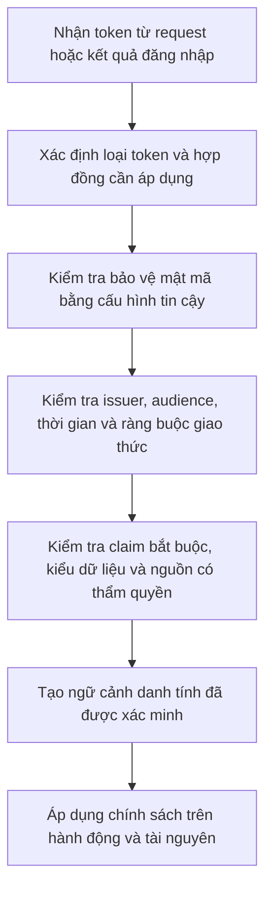

# Claim

## 1. Claim là một phát biểu cần được đặt trong ngữ cảnh tin cậy

Trong IAM, **claim** là một phát biểu về một chủ thể hoặc một ngữ cảnh bảo mật. Claim thường được biểu diễn bằng cặp **tên và giá trị**, chẳng hạn:

```json
{
  "sub": "user-7c42",
  "name": "Nguyễn Lan",
  "email_verified": true
}
```

Trong ví dụ, `sub`, `name`, `email_verified` là tên claim; các chuỗi và giá trị boolean tương ứng là giá trị claim. Cả tập hợp các phát biểu được gọi là **claim set**.

Ý nghĩa của một claim không chỉ nằm ở tên và giá trị. Bên sử dụng còn phải biết **ai phát hành, phát biểu dành cho ai, khi nào nó có hiệu lực và có thể dùng nó cho quyết định nào**.

Ví dụ, một request do trình duyệt gửi lên có trường `"role": "admin"` không chứng minh người gửi là quản trị viên. Một token có chữ ký hợp lệ cũng chỉ giúp xác nhận nguồn phát hành và tính toàn vẹn theo cơ chế được kiểm tra; ứng dụng vẫn phải đánh giá nguồn đó có thẩm quyền đưa ra phát biểu đang được sử dụng hay không.

Claim là khái niệm về thông tin được khẳng định. JWT là một cách biểu diễn và bảo vệ claim set; không phải mọi claim trong hệ thống danh tính đều bắt buộc nằm trong JWT. Xem [RFC 7519 — JSON Web Token](https://www.rfc-editor.org/rfc/rfc7519.html).

## 2. Đọc một claim set qua ví dụ

Giả sử cổng học tập dùng OIDC để đăng nhập. Một payload ID token đã được giải mã có thể có dạng sau:

```json
{
  "iss": "https://identity.example.com",
  "sub": "user-7c42",
  "aud": "learning-web",
  "iat": 1767225600,
  "exp": 1767225900,
  "auth_time": 1767225480,
  "nonce": "example-transaction-nonce",
  "name": "Nguyễn Lan",
  "email": "lan@example.com",
  "email_verified": true,
  "amr": ["pwd", "otp"]
}
```

Đây là dữ liệu minh họa, không phải token sử dụng được: nó không chứa đầy đủ cấu trúc bảo vệ mật mã và các mốc thời gian là giá trị cố định để giải thích bài học. Việc đọc được JSON chưa xác nhận bất cứ thông tin nào bên trong là đáng tin.

Có thể đặt các câu hỏi sau khi đọc ví dụ:

| Nhóm thông tin | Claim trong ví dụ | Câu hỏi cần trả lời |
| --- | --- | --- |
| Nguồn phát hành | `iss` | Hệ thống nào đang đưa ra phát biểu? |
| Chủ thể | `sub` | Phát biểu này liên quan đến danh tính nào trong hệ thống phát hành? |
| Bên nhận | `aud` | Token có được phát hành cho ứng dụng đang xử lý nó không? |
| Thời gian token | `iat`, `exp` | Token được phát hành lúc nào và còn trong thời gian được chấp nhận không? |
| Giao dịch đăng nhập | `nonce` | Kết quả có tương ứng với lần đăng nhập mà ứng dụng đã bắt đầu không? |
| Hồ sơ | `name`, `email`, `email_verified` | Có thể dùng thông tin nào để hiển thị hoặc phục vụ một quy trình liên quan? |
| Bối cảnh xác thực | `auth_time`, `amr` | Người dùng đã xác thực lúc nào và bằng những phương thức nào? |

Trong ví dụ này, `exp - iat = 300` giây, tức khoảng thời gian từ lúc phát hành đến hết hạn là năm phút. `auth_time` sớm hơn `iat`, minh họa rằng thời điểm phát hành token không nhất thiết là thời điểm người dùng vừa xác thực lại.

Một cách dùng đúng cho giao diện là hiển thị tên Lan sau khi quá trình đăng nhập được xác minh. Một cách dùng sai là nhìn thấy `email_verified: true` rồi tự cấp quyền sửa học phí. Hai quyết định đó cần những loại bằng chứng khác nhau.

## 3. Tên chuẩn và claim riêng của hệ thống

### 3.1. Một số claim JWT thường gặp

| Claim | Ý nghĩa cơ bản |
| --- | --- |
| `iss` | Nguồn phát hành token |
| `sub` | Chủ thể của token |
| `aud` | Một hoặc nhiều bên nhận dự kiến |
| `exp` | Mốc hết hạn; token không được tiếp tục chấp nhận từ mốc này, xét dung sai đồng hồ được cấu hình |
| `nbf` | Mốc sớm nhất token bắt đầu được chấp nhận |
| `iat` | Thời điểm phát hành |
| `jti` | Định danh của JWT |

Các mốc `exp`, `nbf`, `iat` dùng NumericDate, tính theo giây từ Unix epoch. Khi làm việc với Java, phải chú ý khác biệt giữa số giây và số mili giây; không đưa giá trị giây trực tiếp vào một API mong đợi mili giây.

RFC JWT cơ sở không yêu cầu mọi token phải có tất cả các claim trên. Giao thức hoặc profile sử dụng JWT quy định thêm các claim bắt buộc và quy tắc kiểm tra tương ứng. Xem [RFC 7519, mục 4 — JWT Claims](https://www.rfc-editor.org/rfc/rfc7519.html#section-4).

Ví dụ, không thể suy ra rằng ID token được phép thiếu `sub` chỉ vì claim đó là tùy chọn trong JWT cơ sở. Hợp đồng của loại token cụ thể mới là căn cứ để xác định hợp lệ.

### 3.2. Claim nghiệp vụ phải có hợp đồng rõ ràng

Giả sử cổng học tập cần biết đơn vị công tác của giảng viên. Nhóm thiết kế có thể thống nhất claim riêng như:

```json
{
  "https://claims.example.com/department": "training"
}
```

Tên có namespace giúp giảm nguy cơ hai bên dùng cùng một tên nhưng hiểu khác nhau. Namespace dạng URL là tên định danh, không phải chỉ dẫn bắt buộc ứng dụng phải gọi HTTP đến URL đó.

Tên claim JWT có thể thuộc nhóm đã đăng ký, tên công khai chống trùng lặp hoặc tên riêng do các bên thỏa thuận. Từ **private** trong “private claim name” nói về cách thỏa thuận tên, không hứa rằng giá trị được mã hóa hay giữ bí mật.

Với claim đơn vị công tác của ví dụ, cần thống nhất tối thiểu:

- Nguồn nào có quyền xác định đơn vị: hồ sơ nhân sự, quản trị viên hay người dùng tự khai?
- Giá trị là một chuỗi hay một danh sách? `training` có cùng nghĩa giữa các tổ chức không?
- Claim được phát hành cho ứng dụng nào và dùng vào việc gì?
- Khi chuyển đơn vị, dữ liệu cũ được cập nhật hoặc hết hiệu lực như thế nào?

Đặt tên rõ ràng là bước đầu. Quản trị nguồn dữ liệu và ý nghĩa của claim mới giúp ứng dụng sử dụng nó nhất quán.

## 4. Claim xuất hiện ở đâu trong OAuth và OIDC?

| Nơi chứa hoặc cung cấp thông tin | Mục đích | Bên sử dụng chính |
| --- | --- | --- |
| OIDC ID token | Truyền thông tin về kết quả xác thực người dùng | OIDC client, còn gọi là relying party |
| OIDC UserInfo response | Cung cấp các claim về người dùng theo quyền truy cập được cho phép | OIDC client |
| OAuth access token có định dạng JWT | Mang thông tin mà API cần để xác minh và thực thi quyền theo profile | Resource server |
| Metadata liên quan access token không tự mô tả | Cung cấp thông tin cần thiết qua cơ chế mà hệ thống đã thống nhất, chẳng hạn introspection | Resource server |

**Không dùng ID token thay access token để gọi API.** Một ID token hợp lệ cho `learning-web` không mặc nhiên là bằng chứng cấp quyền hợp lệ cho `course-api`.

OAuth không bắt buộc access token phải là JWT. Nếu access token không tự mô tả, client không được cố giải mã nó như JWT rồi suy luận quyền. Ngay cả khi access token là JWT, client nên xử lý nó theo hợp đồng được công bố thay vì phụ thuộc tùy tiện vào payload nội bộ. [RFC 9068 — JWT Profile for OAuth 2.0 Access Tokens](https://www.rfc-editor.org/rfc/rfc9068.html) định nghĩa một profile cụ thể, không biến mọi access token OAuth thành JWT.

Với OIDC, các scope như `profile` và `email` là cách yêu cầu các nhóm thông tin người dùng. Việc yêu cầu không bảo đảm mọi claim đều có sẵn hoặc đều nằm trong ID token; ứng dụng phải xử lý dữ liệu thực tế được trả về. Khi sử dụng UserInfo, phải kiểm tra `sub` tương ứng với chủ thể trong ID token đã được xác minh. Xem [OpenID Connect Core — Claims](https://openid.net/specs/openid-connect-core-1_0.html#Claims).

## 5. Từ claim nhận được đến claim có thể sử dụng

Một quy trình khái niệm khi xử lý JWT ở backend gồm các lớp kiểm tra sau:



Nếu một điều kiện bắt buộc không đạt, luồng xử lý phải từ chối kết quả đó thay vì đi tiếp với giả định thuận lợi. Sơ đồ là cách tổ chức trách nhiệm, không phải một thuật toán xác minh mật mã để tự viết lại.

Các nguyên tắc cần giữ khi lựa chọn thư viện và cấu hình:

- Chỉ chấp nhận thuật toán và khóa phù hợp với cấu hình tin cậy, không để dữ liệu do bên gửi cung cấp tự quyết định toàn bộ chính sách xác minh.
- Đối chiếu issuer và audience theo hợp đồng. Chữ ký đúng nhưng token dành cho ứng dụng khác vẫn không đáp ứng điều kiện sử dụng.
- Kiểm tra các ràng buộc thời gian; dung sai đồng hồ phải nhỏ và có chủ đích, không phải cách bỏ qua token hết hạn.
- Tách quy tắc xử lý các loại token để tránh nhầm ID token với access token.
- Chỉ đưa các claim đã được kiểm tra vào ngữ cảnh phục vụ quyết định bảo mật.

Các hướng dẫn này phù hợp với [RFC 8725 — JSON Web Token Best Current Practices](https://www.rfc-editor.org/rfc/rfc8725.html#section-3).

Trong OIDC, cần áp dụng đầy đủ quy tắc của luồng đang dùng. Chẳng hạn, nếu đã gửi `nonce` khi bắt đầu đăng nhập thì phải kiểm tra giá trị tương ứng trong kết quả; với các trường hợp nhiều audience, còn có những kiểm tra liên quan được profile quy định. Không coi danh sách trên là thay thế cho bộ kiểm tra giao thức của thư viện.

### Chữ ký không chứng minh mọi dữ liệu đều đúng nghiệp vụ

Giả sử người dùng được tự sửa trường hồ sơ “chức danh”. Issuer đưa giá trị đó vào token và ký token đúng cách. Điều này không biến trường tự khai thành bằng chứng đủ để cấp đặc quyền quản trị.

Trong thiết kế cổng học tập, nhóm triển khai nên phân biệt:

| Claim của ví dụ | Nguồn dữ liệu | Cách dùng phù hợp |
| --- | --- | --- |
| Tên hiển thị | Hồ sơ người dùng được phép sửa | Hiển thị trên giao diện, đồng thời xử lý an toàn khi render |
| Đơn vị được đồng bộ từ hệ thống nhân sự | Nguồn quản lý tổ chức có thẩm quyền | Một đầu vào cho chính sách đã thống nhất |
| Vai trò quản trị khóa học | Quy trình cấp quyền có kiểm soát | Đánh giá quyền theo vai trò và phạm vi khóa học |

Hệ thống ký token cũng cần giới hạn việc ứng dụng khách tự yêu cầu hoặc tự chèn giá trị vào các claim có ảnh hưởng đến đặc quyền.

## 6. Claim, scope, role và attribute liên quan thế nào?

| Khái niệm | Vai trò | Ví dụ trong cổng học tập |
| --- | --- | --- |
| Claim | Phát biểu được truyền đến bên sử dụng | `"department": "training"` theo hợp đồng riêng |
| Attribute | Thuộc tính của chủ thể, tài nguyên hoặc môi trường | Đơn vị công tác trong hồ sơ nhân sự |
| Scope | Phạm vi truy cập ứng dụng yêu cầu hoặc được cấp | `courses.read` |
| Role | Vai trò được ánh xạ đến các quyền theo chính sách | `course-editor` |

Một attribute có thể được đưa vào token dưới dạng claim. Thông tin scope và role cũng có thể được biểu diễn bằng claim trong một profile access token. Vì vậy, các khái niệm này có liên hệ nhưng không đồng nghĩa.

Ví dụ, một access token JWT của hệ thống minh họa có thể mang đoạn thông tin:

```json
{
  "aud": "course-api",
  "scope": "courses.read courses.update",
  "roles": ["course-editor"],
  "https://claims.example.com/tenant_id": "tenant-a"
}
```

Đoạn này chỉ trích một phần payload để minh họa dữ liệu nghiệp vụ, không phải một token hoàn chỉnh hoặc claim set tối thiểu theo RFC 9068. Tên scope, tên role và claim tenant thuộc hợp đồng của ví dụ.

RFC 9068 đề cập các claim `roles`, `groups`, `entitlements`, nhưng không định nghĩa một bộ tên vai trò áp dụng chung cho mọi hệ thống. Giá trị `course-editor` chỉ có ý nghĩa khi issuer và API đã thống nhất nó đại diện cho quyền nào. Xem [RFC 9068, mục 2.2.3.1](https://www.rfc-editor.org/rfc/rfc9068.html#section-2.2.3.1).

Trong thiết kế này, Course API có thể yêu cầu đồng thời scope cập nhật, vai trò phù hợp và khóa học thuộc đúng tenant. Việc có role không tự bỏ qua những giới hạn còn lại.

## 7. Dùng claim để liên kết danh tính một cách ổn định

Trong OIDC, ứng dụng dùng cặp **`iss` và `sub`** làm căn cứ định danh ổn định cho người dùng từ issuer tương ứng. Không dùng tên hiển thị hoặc email như một khóa ổn định được bảo đảm bởi OIDC. Ngoài ra, pairwise subject có thể khiến cùng một người nhận các giá trị `sub` khác nhau ở những nhóm client khác nhau. Xem [OpenID Connect Core, mục 5.7 — Claim Stability and Uniqueness](https://openid.net/specs/openid-connect-core-1_0.html#ClaimStability).

Ví dụ:

```text
Issuer A: sub = user-101
Issuer B: sub = user-101
```

Hai chuỗi `sub` giống nhau không chứng minh đây là cùng một người. Ứng dụng cần giữ ngữ cảnh nguồn phát hành thay vì gộp hai tài khoản theo chuỗi ID trùng nhau.

Tương tự, khi Lan đổi email, các khóa học và lịch sử học không nên tự biến mất chỉ vì trường email đã đổi. Với hệ thống minh họa, hồ sơ nội bộ có thể dùng một ID riêng và liên kết đến cặp issuer/subject đã được xác minh.

`email_verified: true` nói về việc issuer đã xác minh sự kiểm soát địa chỉ tại thời điểm thực hiện xác minh, theo cơ chế của issuer. Nó không tự chứng minh quyền quản trị, tư cách nhân viên hiện tại hay quyền sở hữu một tài khoản khác cùng email. Không tự động liên kết tài khoản nhạy cảm chỉ bằng phép so sánh email; cần một quy trình liên kết có bằng chứng phù hợp.

## 8. Claim về xác thực và claim về đặc quyền

Một số claim mô tả **cách hoặc thời điểm xác thực**, thay vì quyền thao tác dữ liệu:

- `auth_time`: thời điểm xảy ra việc xác thực người dùng, khác với thời điểm token được phát hành.
- `amr`: các phương thức đã dùng trong xác thực, theo ngữ nghĩa được các bên hiểu thống nhất.
- `acr`: lớp ngữ cảnh xác thực, cần đối chiếu với chính sách và định nghĩa của hệ thống phát hành.

Ví dụ, RFC 8176 định nghĩa giá trị `pwd` cho mật khẩu và `otp` cho mật khẩu dùng một lần trong `amr`. Xem [RFC 8176 — Authentication Method Reference Values](https://www.rfc-editor.org/rfc/rfc8176.html).

Ứng dụng không nên chỉ thấy một chuỗi có vẻ liên quan MFA rồi tự suy ra người dùng có quyền quản trị. Ngay cả khi bối cảnh xác thực đáp ứng yêu cầu, quyền trên hành động vẫn phải được kiểm tra riêng.

Giả sử xuất báo cáo kết quả học tập cần quyền quản lý lớp và xác thực đủ mới. Nhóm thiết kế có thể đặt hai điều kiện độc lập:

```text
1. Người thực hiện có quyền xuất báo cáo cho lớp đang được yêu cầu.
2. Bối cảnh và độ mới của xác thực đáp ứng chính sách cho hành động đó.
```

Nếu điều kiện thứ nhất thiếu, yêu cầu xác thực lại không tự cấp thêm quyền. Nếu điều kiện thứ hai thiếu, có quyền quản lý lớp cũng chưa đủ để hoàn tất hành động theo chính sách này.

## 9. Claim có thể đúng lúc cấp nhưng đã cũ khi sử dụng

Token chứa dữ liệu được phát hành ở một thời điểm. Tùy kiến trúc, nó không tự cập nhật khi hồ sơ hoặc quyền trong hệ thống nguồn thay đổi.

Xét một tình huống giả định với JWT access token mà API chỉ xác minh cục bộ:

| Thời điểm | Sự kiện |
| --- | --- |
| 09:00 | Cấp token cho Lan, role `course-editor`, hết hạn lúc 09:10 |
| 09:03 | Quản trị viên gỡ role biên tập khóa học của Lan |
| 09:04 | Lan gửi lại token đã nhận lúc 09:00 |

Nếu API chỉ kiểm tra chữ ký, thời hạn và role bên trong token, nó có thể vẫn nhìn thấy role cũ. Việc gỡ role trong cơ sở dữ liệu không sửa được payload của token đã phát hành.

Nhóm thiết kế phải quyết định mức độ chấp nhận độ trễ này. Những lựa chọn có thể xem xét gồm thời hạn token ngắn, kiểm tra trạng thái/quyền hiện tại cho thao tác nhạy cảm, hoặc cơ chế thu hồi được hệ thống hỗ trợ. Mỗi lựa chọn ảnh hưởng hiệu năng, khả năng hoạt động khi dịch vụ danh tính gián đoạn và độ nhanh của việc thu hồi quyền.

`jti` có thể giúp định danh token để xây dựng cơ chế theo dõi. Chỉ thêm `jti` vào payload không tự tạo ra danh sách thu hồi hoặc khả năng chống phát lại; cần có nơi lưu trạng thái và logic thực thi tương ứng.

Đối với danh tính workload, vấn đề tương tự xảy ra khi quyền dịch vụ bị giảm hoặc credential bị nghi lộ. Cần xem xét vòng đời cả credential lẫn các token còn tồn tại, thay vì chỉ thay một trường trong hồ sơ ứng dụng.

## 10. Kiểu dữ liệu và dữ liệu thiếu là một phần của hợp đồng

Hai giá trị dưới đây không tương đương trong JSON:

```json
{"email_verified": true}
```

```json
{"email_verified": "true"}
```

Trường thứ nhất là boolean; trường thứ hai là chuỗi. Tương tự, `"roles": ["course-editor"]` khác `"roles": "course-editor"`. Không ép kiểu tùy tiện chỉ để làm cho quyết định cấp quyền đi tiếp.

Với một claim có ảnh hưởng đến quyền, hợp đồng nên xác định:

| Thuộc tính hợp đồng | Ví dụ quyết định cho Course API |
| --- | --- |
| Tên và kiểu dữ liệu | Claim tenant là chuỗi, role là tập giá trị theo schema đã thống nhất |
| Tính bắt buộc | Thao tác quản trị theo tenant yêu cầu có tenant hợp lệ |
| Nguồn có thẩm quyền | Chỉ dùng claim từ issuer đã được chấp nhận cho tenant đó |
| Ngữ nghĩa | `course-editor` cho phép biên tập trong phạm vi cụ thể, không phải toàn hệ thống |
| Khi thiếu hoặc sai kiểu | Từ chối quyết định đặc quyền tương ứng, không mặc định thành quản trị viên |
| Khi thay đổi schema | Triển khai có kiểm soát giữa bên phát hành và các bên sử dụng |

Thiếu claim, claim có giá trị `null` và claim có danh sách rỗng có thể biểu thị những trạng thái khác nhau. Cách xử lý phải được định nghĩa; không coi cả ba là một lời cho phép ngầm.

Nếu chỉ thiếu tên hiển thị, giao diện có thể dùng một nhãn thay thế phù hợp. Nếu thiếu thông tin bắt buộc để xác định tenant, API không nên lấy tenant từ một tham số do người gọi tùy chọn rồi coi nó là tương đương bằng chứng đã xác minh.

## 11. Giảm dữ liệu nhạy cảm trong claim

JWT được ký không mặc nhiên được mã hóa. Với dạng JWS thông dụng, người giữ token thường đọc được payload. Tên claim dài, namespace riêng hay Base64url không tạo ra bảo mật nội dung.

Vì vậy, trong hệ thống học tập minh họa:

- Course API không cần nhận ngày sinh hoặc địa chỉ nhà chỉ để kiểm tra quyền cập nhật khóa học.
- Không đưa mật khẩu, khóa API hay credential của workload vào claim.
- Không ghi toàn bộ token vào log hỗ trợ. Chỉ ghi thông tin kiểm toán cần thiết theo chính sách, chẳng hạn hành động, kết quả và định danh đã được xử lý phù hợp.
- Claim hồ sơ hiển thị trên trang web vẫn cần được render an toàn. Nguồn có chữ ký không có nghĩa mọi chuỗi bên trong đều an toàn để chèn trực tiếp thành HTML.

Giảm claim còn giúp tránh việc một token dùng cho quá nhiều mục đích. Một API càng nhận nhiều dữ liệu không cần thiết thì ảnh hưởng khi token hoặc log bị lộ càng khó kiểm soát.

## 12. Vận dụng: ba quyết định với cùng một người dùng

Giả sử Lan đã đăng nhập và cần sử dụng ba tính năng của cổng học tập:

| Tính năng | Bằng chứng cần xem xét trong thiết kế ví dụ | Điều không được suy diễn |
| --- | --- | --- |
| Hiển thị lời chào | Kết quả đăng nhập đã xác minh và claim tên nếu có | Có tên hiển thị không có nghĩa có quyền quản trị |
| Cập nhật nội dung khóa học | Access token hợp lệ cho Course API, quyền cập nhật, role/phạm vi và quan hệ với khóa học | ID token cho web không thay thế quyền truy cập API |
| Xuất báo cáo nhạy cảm | Quyền trên lớp học cùng yêu cầu bối cảnh, độ mới xác thực và trạng thái hiện tại theo chính sách | `email_verified` không thay thế quyền và yêu cầu xác thực |

Một quy tắc cho thao tác cập nhật khóa học có thể được mô tả như sau:

```text
Chấp nhận khi:
  access token đã được xác minh theo profile của Course API
  VÀ phạm vi truy cập cho phép cập nhật khóa học
  VÀ chủ thể có quyền trên khóa học đang yêu cầu
  VÀ tenant của tài nguyên phù hợp với phạm vi đã được cho phép
  VÀ các ràng buộc chính sách hiện tại đều đạt
```

Đây là chính sách minh họa của ứng dụng, không phải thuật toán chuẩn do JWT hoặc OAuth tự cung cấp. Claim là dữ liệu đầu vào cho quyết định. Để quyết định đúng, ứng dụng phải kết hợp ngữ nghĩa của claim, nguồn có thẩm quyền, mục đích sử dụng, thời điểm và tài nguyên cụ thể.
