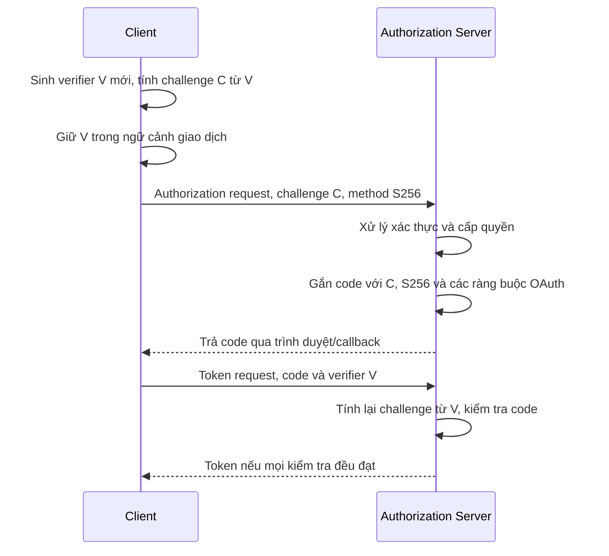

# PKCE

## 1. PKCE giải quyết vấn đề nào?

**PKCE** là viết tắt của **Proof Key for Code Exchange**, thường được đọc là “pixy”. Cơ chế này bổ sung bằng chứng vào bước đổi authorization code lấy token trong OAuth: client phải đưa ra một bí mật được tạo riêng cho giao dịch, thay vì chỉ trình code đã nhận.

Hãy xét ứng dụng quản lý công việc muốn truy cập lịch của nhân viên. Người dùng xác thực và cấp quyền tại hệ thống danh tính công ty. Authorization Server — AS — chuyển trình duyệt về ứng dụng cùng một authorization code. Nếu một ứng dụng độc hại chặn được code, nó có thể tìm cách đổi mã trước ứng dụng hợp lệ.

Với PKCE được thực thi đúng, chỉ có code vẫn chưa đủ. Bên đổi mã cần có **code verifier** phù hợp với **code challenge** đã gắn với giao dịch. Đây là ràng buộc đối với bước code exchange, không phải một phương thức xác thực người dùng như mật khẩu hay MFA.

Trong IAM, PKCE giúp bảo vệ đường từ một giao dịch cấp quyền đến việc phát token. Quyết định người dùng có quyền đọc lịch, có được gia nhập ứng dụng hoặc có quyền quản trị vẫn thuộc các chính sách khác.

## 2. Hai giá trị và một phương thức biến đổi

| Thành phần | Do ai tạo? | Được gửi ở đâu? | Cách xử lý |
|---|---|---|---|
| `code_verifier` | Client, riêng cho từng giao dịch | Token endpoint, khi đổi code | Giữ kín trong thời gian giao dịch |
| `code_challenge` | Client, suy ra từ verifier | Authorization endpoint | AS liên kết với authorization code |
| `code_challenge_method` | Client chọn theo khả năng và chính sách | Authorization endpoint | Xác định cách AS kiểm chứng verifier |

Trong phương thức **S256**:

```text
V = code_verifier
C = BASE64URL_NO_PADDING(SHA256(ASCII(V)))

Authorization request: gửi C và phương thức S256
Token request: gửi V

AS kiểm tra:
BASE64URL_NO_PADDING(SHA256(ASCII(V))) có bằng C đã lưu không?
```

Theo định dạng PKCE, verifier dài 43–128 ký tự trong tập `A-Z a-z 0-9 - . _ ~`. Nó phải có tính ngẫu nhiên mật mã; một cách tạo phù hợp là sinh 32 byte ngẫu nhiên rồi mã hóa Base64url không padding. Challenge S256 được tính trên byte ASCII của chuỗi verifier. [RFC 7636, mục 4.1–4.2](https://www.rfc-editor.org/rfc/rfc7636.html#section-4.1).

Độ dài hợp lệ chưa chứng minh tính khó đoán. Chuỗi gồm 43 chữ `a`, timestamp kéo dài hoặc một định danh người dùng được lặp lại vẫn là lựa chọn yếu.

Challenge không cần được giữ bí mật như verifier. Tuy nhiên, điều đó không có nghĩa có thể bỏ qua tính toàn vẹn của yêu cầu hoặc đưa tùy ý thông tin giao dịch lên log.

## 3. Luồng hoạt động



Mũi tên authorization và callback trong sơ đồ đi qua cơ chế chuyển hướng của trình duyệt hoặc nền tảng. Token request là lời gọi của client đến token endpoint. Với ứng dụng web có backend, backend có thể thực hiện lời gọi ấy và giữ token phía server.

AS cần giữ liên kết giữa code, challenge và phương thức đã nhận. Cách lưu có thể khác nhau giữa các sản phẩm, nhưng AS không được dùng challenge của giao dịch B để kiểm chứng code của giao dịch A.

Khi verifier khớp, AS vẫn phải kiểm tra những điều kiện OAuth còn lại. PKCE đạt không tự làm code hết hạn, redirect URI sai hoặc xác thực client thất bại trở thành hợp lệ.

## 4. Ví dụ giao thức với public client

Ví dụ này dùng public client có `client_id=work-planner`. Các chuỗi viết hoa là vị trí thay thế, không phải giá trị ngẫu nhiên hợp lệ để dùng nguyên văn. Scope `calendar.read` là scope giả định của hệ thống minh họa.

### Bước 1: Gửi challenge ở authorization request

```http
GET /authorize?response_type=code&client_id=work-planner&redirect_uri=https%3A%2F%2Fplanner.example%2Fcallback&scope=calendar.read&state=STATE_OF_THIS_TRANSACTION&code_challenge=CHALLENGE_OF_THIS_TRANSACTION&code_challenge_method=S256 HTTP/1.1
Host: login.company.example
```

Client giữ `VERIFIER_OF_THIS_TRANSACTION` trong ngữ cảnh tương ứng. Nó không gửi verifier trong URL trên.

`state` được dùng trong thiết kế ví dụ để liên kết callback với giao dịch đã khởi tạo và ngữ cảnh trình duyệt. Nó có vai trò khác với phép kiểm tra verifier tại AS.

### Bước 2: Nhận code tại callback

```http
HTTP/1.1 302 Found
Location: https://planner.example/callback?code=CODE_RECEIVED&state=STATE_OF_THIS_TRANSACTION
```

Client kiểm tra giao dịch, `state`, thời hạn và AS được kỳ vọng theo thiết kế trước khi xử lý tiếp. Không coi mọi dữ liệu đến callback là một phản hồi hợp lệ.

### Bước 3: Đổi code bằng verifier của chính giao dịch

```http
POST /token HTTP/1.1
Host: login.company.example
Content-Type: application/x-www-form-urlencoded

grant_type=authorization_code&client_id=work-planner&code=CODE_RECEIVED&redirect_uri=https%3A%2F%2Fplanner.example%2Fcallback&code_verifier=VERIFIER_OF_THIS_TRANSACTION
```

Yêu cầu dùng HTTPS. AS tính lại challenge từ verifier rồi so sánh với challenge gắn với code.

Public client không có client secret bí mật để chứng minh danh tính theo cách một backend có thể làm. Confidential client vẫn thực hiện xác thực client bằng phương thức đã đăng ký, bên cạnh PKCE; verifier không thay thế client credential.

## 5. S256 cần đúng đến từng bước mã hóa

Công thức S256 có ba thao tác liên tiếp:

1. Lấy byte ASCII của chuỗi verifier.
2. Tính SHA-256, nhận 32 byte kết quả.
3. Mã hóa trực tiếp 32 byte đó bằng Base64url và bỏ padding `=`.

Không chuyển digest sang chuỗi hex rồi mới Base64. Đó là một phép tính khác.

```text
Đúng:
verifier → ASCII bytes → SHA-256 bytes → Base64url không padding

Sai:
verifier → SHA-256 bytes → chuỗi hex → Base64

Sai:
verifier → Base64url

Sai:
verifier → SHA-256 → Base64 thường có ký tự +, / và padding
```

Cặp giá trị kiểm tra công khai trong tài liệu PKCE:

```text
verifier:
dBjftJeZ4CVP-mB92K27uhbUJU1p1r_wW1gFWFOEjXk

challenge S256:
E9Melhoa2OwvFrEMTJguCHaoeK1t8URWbuGJSstw-cM
```

Cặp này chỉ dùng đối chiếu cách tính; không dùng lại cho giao dịch thật. [RFC 7636, Phụ lục B](https://www.rfc-editor.org/rfc/rfc7636.html#appendix-B).

Các lỗi như thêm ký tự xuống dòng, đổi chữ hoa thành chữ thường, encode Base64 hai lần hoặc trim một dữ liệu đã bị hỏng đều có thể làm kết quả không khớp. Với verifier được sinh đúng ngay từ đầu, không cần một bước “chuẩn hóa” tùy tiện trước khi gửi.

## 6. Ví dụ tạo verifier và challenge bằng Java

Đoạn mã sau minh họa riêng phần tạo dữ liệu PKCE bằng thư viện chuẩn Java. Nó không phải một OAuth/OIDC client hoàn chỉnh.

```java
import java.nio.charset.StandardCharsets;
import java.security.MessageDigest;
import java.security.NoSuchAlgorithmException;
import java.security.SecureRandom;
import java.util.Base64;

public final class Pkce {
    private static final SecureRandom RANDOM = new SecureRandom();
    private static final Base64.Encoder BASE64URL =
            Base64.getUrlEncoder().withoutPadding();

    private Pkce() {
    }

    public static String newVerifier() {
        byte[] randomBytes = new byte[32];
        RANDOM.nextBytes(randomBytes);
        return BASE64URL.encodeToString(randomBytes);
    }

    public static String s256(String verifier)
            throws NoSuchAlgorithmException {
        if (verifier == null
                || !verifier.matches("[A-Za-z0-9._~-]{43,128}")) {
            throw new IllegalArgumentException("Invalid PKCE verifier");
        }

        byte[] digest = MessageDigest.getInstance("SHA-256")
                .digest(verifier.getBytes(StandardCharsets.US_ASCII));

        return BASE64URL.encodeToString(digest);
    }
}
```

Mỗi lần gọi `newVerifier()` tạo dữ liệu cho một giao dịch mới. Việc dùng lại đối tượng `SecureRandom` không đồng nghĩa dùng lại verifier: mỗi lần sinh lấy đầu ra ngẫu nhiên mới.

Client cần lưu verifier trước khi rời ứng dụng đến AS. Sau callback, nó lấy lại chính verifier đã lưu, không gọi `newVerifier()` để tạo một giá trị thay thế.

Một chuỗi vượt qua kiểm tra định dạng trong `s256()` vẫn có thể có entropy thấp. Kiểm tra định dạng không thay thế việc sinh bằng nguồn ngẫu nhiên mật mã.

Trong ứng dụng thực tế, thư viện OAuth/OIDC thường sở hữu cả quá trình tạo, lưu và lấy lại verifier. Cần hiểu thư viện đã xử lý phần nào trước khi bổ sung mã riêng, tránh hai thành phần cùng sinh ra hai verifier cho một giao dịch.

## 7. Quản lý verifier theo từng giao dịch

Verifier là bí mật ngắn hạn của giao dịch. Một bản ghi phía client có thể liên kết:

```text
transactionId
  ↔ ngữ cảnh trình duyệt hoặc ứng dụng đã khởi tạo
  ↔ state
  ↔ verifier
  ↔ AS được kỳ vọng
  ↔ client registration
  ↔ redirect URI
  ↔ thời hạn và trạng thái xử lý
```

Đây là mô hình để diễn giải quan hệ, không phải schema bắt buộc.

Nếu hai tab cùng khởi tạo luồng, chúng cần hai bộ dữ liệu riêng:

```text
Tab A: state_A, verifier_A, challenge_A
Tab B: state_B, verifier_B, challenge_B
```

Một biến toàn cục mang tên `currentVerifier` có thể bị tab B ghi đè trước khi callback của tab A quay về. Token request dùng code A cùng verifier B sẽ thất bại dù cả hai giá trị đều được sinh đúng.

Với backend, có thể lưu ngữ cảnh trong kho giao dịch phía server và liên kết với trình duyệt bằng cơ chế phiên phù hợp. Khi chạy nhiều node, callback phải truy cập được bản ghi tương ứng; không nên giả định yêu cầu sẽ luôn quay lại node đã tạo verifier.

Với client trong trình duyệt hoặc native, cách lưu phải phù hợp với cơ chế chuyển hướng và mô hình đe dọa. Lưu trong bộ nhớ có thể mất khi điều hướng toàn trang; lưu bền hơn lại tạo thêm bề mặt tiếp cận. Không có lựa chọn lưu trữ nào tự chống mọi trường hợp XSS hoặc mã độc trong thiết bị.

Các nguyên tắc thực hành:

- Tạo verifier mới cho mỗi giao dịch, kể cả khi thử đăng nhập lại.
- Giữ nguyên verifier trong suốt giao dịch tương ứng.
- Không đưa verifier vào `state` dạng đọc được, URL authorization, URL callback hoặc log.
- Giới hạn thời gian tồn tại của bản ghi giao dịch.
- Kiểm soát callback lặp và việc đổi cùng code đồng thời.
- Dọn dữ liệu khi giao dịch hoàn tất, bị hủy hoặc hết hạn theo chính sách.

Không xóa verifier ngay khi vừa chuyển sang AS, vì client còn cần nó tại token endpoint. Ngược lại, cũng không giữ verifier vô thời hạn để “phòng khi cần retry”.

## 8. State, nonce và client authentication

PKCE thường xuất hiện cùng nhiều cơ chế khác. Cần xác định mỗi cơ chế đang ràng buộc điều gì.

| Cơ chế | Quan hệ được kiểm tra | Không nên suy ra |
|---|---|---|
| PKCE | Code exchange với verifier của giao dịch | Người dùng đã dùng MFA hoặc có quyền quản trị |
| `state` | Phản hồi với giao dịch và ngữ cảnh trình duyệt đã khởi tạo, khi thiết kế đúng | AS đã kiểm tra verifier |
| `nonce` trong OIDC | ID Token với giá trị của yêu cầu xác thực tương ứng, khi được gửi và kiểm chứng | Access token đã được API chấp nhận |
| Xác thực client | Client với credential hoặc khóa theo registration | Code thuộc đúng giao dịch chỉ vì client secret đúng |
| TLS | Kênh truyền với các thuộc tính bảo mật tương ứng | Các tham số giao thức bên trong đã được kiểm tra đúng |

PKCE không biến một public client thành confidential client. Verifier là bí mật được tạo cho giao dịch, không phải client secret dài hạn được cấp cho một ứng dụng đã đăng ký.

OAuth Security BCP yêu cầu public client dùng PKCE và khuyến nghị confidential client dùng PKCE. Hướng dẫn này áp dụng cả ứng dụng web, không chỉ ứng dụng native. [RFC 9700, mục 2.1.1](https://www.rfc-editor.org/rfc/rfc9700.html#section-2.1.1).

Về CSRF, BCP cho phép client dựa vào PKCE khi đã bảo đảm AS hỗ trợ cơ chế này và thực hiện các ràng buộc cần thiết. Vì vậy, câu “PKCE không bao giờ liên quan đến CSRF” là quá tuyệt đối. Cũng không được suy ra rằng chỉ cần thêm challenge vào URL là có thể bỏ mọi kiểm tra giao dịch. [RFC 9700, mục 2.1](https://www.rfc-editor.org/rfc/rfc9700.html#section-2.1).

Trong ví dụ của bài, client giữ `state` riêng để quản lý và kiểm tra phản hồi, đồng thời dùng PKCE tại bước đổi mã. Với OIDC, nếu đã gửi nonce thì client còn kiểm chứng nonce trong ID Token theo hợp đồng giao thức.

## 9. Thực thi tại AS và chống downgrade

### 9.1. Có tham số không đồng nghĩa có bảo vệ

Một triển khai có thể gửi `code_challenge` nhưng AS không lưu hoặc token endpoint bỏ qua verifier. Nhìn thấy tham số trong công cụ mạng chưa chứng minh PKCE được thực thi.

Ở mức khái niệm, các trường hợp cần được phân biệt:

| Authorization request của giao dịch | Token request | Kết quả về PKCE |
|---|---|---|
| Có challenge S256 hợp lệ | Có verifier khớp | Đạt bước PKCE; tiếp tục kiểm tra OAuth khác |
| Có challenge | Thiếu verifier | Từ chối |
| Có challenge | Verifier không khớp | Từ chối |
| Thiếu challenge trong khi chính sách yêu cầu PKCE | Chưa đến bước đổi mã | Từ chối yêu cầu theo chính sách/giao thức |
| Không có challenge gắn với code | Có verifier | Từ chối để chống downgrade |
| Có phương thức không được hỗ trợ | Bất kỳ | Không tự đổi sang phương thức yếu hơn |

AS phải gắn cả sự hiện diện của challenge và phương thức với code. Bỏ qua verifier khi code không có challenge là một dạng hành vi có thể tạo lỗ hổng downgrade. [RFC 9700, mục 4.8.2](https://www.rfc-editor.org/rfc/rfc9700.html#section-4.8.2).

### 9.2. Vì sao không tự fallback sang plain?

Phương thức `plain` dùng chính verifier làm challenge. Khi yêu cầu authorization bị quan sát, sự tách biệt giữa giá trị gửi trước và bí mật giữ lại không còn như S256.

Với một thiết kế dùng S256, lỗi do cấu hình, thư viện hoặc AS không được xử lý bằng cách tự thử lại với `plain` hoặc bỏ PKCE. Cần sửa tương thích dựa trên khả năng được xác minh và chính sách đã chọn.

Một AS quảng bá hỗ trợ PKCE trong metadata vẫn cần được cấu hình đúng cho registration. Client cần xác định khả năng qua nguồn tin cậy, không thử ngẫu nhiên và chấp nhận bất kỳ phản hồi nào “đăng nhập được”.

### 9.3. Code vẫn cần ngắn hạn và dùng một lần

PKCE không thay thế các ràng buộc cơ bản của authorization code. AS vẫn kiểm tra code hết hạn, client được cấp, redirect URI và trạng thái đã tiêu thụ. Đổi code phải ngăn được việc phát token thành công lặp lại từ cùng một code. [RFC 6749, mục 4.1](https://www.rfc-editor.org/rfc/rfc6749.html#section-4.1).

Gửi lại cùng code với một verifier khác không tạo thành giao dịch mới. Một lượt cấp quyền mới cần có ngữ cảnh và verifier mới.

## 10. Giới hạn bảo vệ

### Chỉ lộ code và lộ cả code lẫn verifier là hai tình huống khác nhau

Giả sử challenge đã được gắn đúng tại AS:

```text
Kẻ tấn công có code, không có verifier:
  → PKCE ngăn việc đổi mã nếu các kiểm tra khác cũng được thực thi.

Kẻ tấn công có code và đúng verifier:
  → không thể trông chờ phép kiểm tra PKCE phân biệt họ
    với bên đang nắm cùng dữ liệu đó.
```

Vì vậy, bảo vệ verifier trong client vẫn quan trọng. XSS, extension độc hại hoặc mã độc cùng môi trường có thể vượt ra ngoài mô hình “chỉ chặn được code”.

### PKCE không ràng buộc mọi lần gọi API

Sau khi đổi mã, access token được sử dụng theo loại token và chính sách API. PKCE không tự biến một bearer access token thành token bắt buộc chứng minh sở hữu khóa ở mỗi yêu cầu.

Nếu access token bị đánh cắp, cần các biện pháp bảo vệ token tương ứng. Không gửi verifier kèm mỗi lời gọi API như một cơ chế bảo vệ tự chế.

### PKCE không thay thế kiểm tra OIDC

Trong đăng nhập OIDC, client vẫn kiểm chứng ID Token, bên phát hành, audience, thời gian và các điều kiện liên quan. Một verifier đúng không chứng minh tài khoản được phép vào tenant của doanh nghiệp.

### PKCE không thay thế quản lý quyền và phiên

API vẫn kiểm tra scope, tài nguyên, quyền của chủ thể và điều kiện nghiệp vụ. Ứng dụng vẫn quản lý phiên, đăng xuất và vòng đời tài khoản. Nhân viên bị thu hồi quyền không tiếp tục được phép chỉ vì đã có một giao dịch PKCE thành công trước đó.

## 11. Chẩn đoán các lỗi thường gặp

| Biểu hiện | Khả năng cần kiểm tra | Hướng xử lý |
|---|---|---|
| Đổi code báo `invalid_grant` | Verifier sai, code hết hạn/đã dùng, sai liên kết OAuth khác | Dùng correlation ID để kiểm tra đúng giao dịch, không kết luận ngay là lỗi PKCE |
| Luồng chỉ lỗi khi mở nhiều tab | Verifier bị ghi đè hoặc lấy nhầm giao dịch | Lưu từng giao dịch độc lập và kiểm tra liên kết callback |
| Client luôn tạo challenge khác AS tính | Hash chuỗi hex, dùng Base64 thường, thêm xuống dòng hoặc đổi verifier | Đối chiếu byte đầu vào và công thức S256 |
| Local hoạt động, nhiều node lại thất bại | Bản ghi verifier chỉ nằm trên một node | Thiết kế kho giao dịch và cơ chế truy cập nhất quán |
| Gửi challenge nhưng thiếu verifier vẫn nhận token | AS không thực thi PKCE cho code được kiểm tra | Kiểm tra cấu hình AS và registration, không coi tích hợp đã đạt |
| Lỗi sau khi đổi client secret | Xác thực confidential client sai | Kiểm tra phương thức và credential; không bỏ PKCE để né lỗi |

Một token request thất bại không nên được sửa bằng cách thử mọi verifier còn lưu. Client phải biết giao dịch nào đang được hoàn tất.

Khi token request bị timeout, client có thể chưa biết AS đã phát token hay chưa. Retry vô hạn cùng code có thể gặp mã đã tiêu thụ. Cần xử lý theo thư viện và trạng thái giao dịch; khi không thể khôi phục an toàn, bắt đầu lại luồng thay vì tạo ngoại lệ bỏ kiểm tra.

Log nên ghi correlation ID, client registration, AS và loại lỗi ở mức phù hợp. Không ghi nguyên code, verifier, token hoặc client secret để hỗ trợ chẩn đoán. Một thông báo lỗi cũng không nên phản chiếu những giá trị đó ra màn hình hoặc URL.

## 12. Tình huống vận dụng

**Tình huống 1: dùng cùng verifier cho mọi nhân viên.**

Các mã được tạo ở những lần cấp quyền khác nhau lại dùng chung một bằng chứng. Khi verifier bị lộ, rủi ro lan sang các giao dịch khác cùng sử dụng nó. Cần tạo verifier mới cho mỗi giao dịch và giới hạn vòng đời.

**Tình huống 2: backend có client secret nên bỏ PKCE.**

Client secret xác thực client theo registration, nhưng không cung cấp cùng ràng buộc theo từng giao dịch như verifier/challenge. Thiết kế confidential client vẫn nên dùng PKCE theo BCP, đồng thời giữ cơ chế xác thực client đã chọn.

**Tình huống 3: token endpoint nhận verifier dù code không có challenge.**

Một server an toàn không bỏ qua verifier rồi phát token trong trường hợp này. Nó cần từ chối để ngăn downgrade; nếu chính sách bắt buộc PKCE thì yêu cầu thiếu challenge đã phải bị chặn từ chặng authorization.

**Tình huống 4: tab A nhận callback nhưng client mất verifier A.**

Không thể sinh verifier mới rồi mong nó khớp challenge cũ. Client cần hủy hoặc hết hạn giao dịch theo thiết kế và khởi tạo lại một luồng mới.

**Tình huống 5: ứng dụng nhận token hợp lệ rồi cho mọi người vào màn hình quản trị.**

PKCE không đưa ra quyết định đó. Ứng dụng phải nhận diện chủ thể theo đúng giao thức, kiểm tra điều kiện gia nhập và quyền quản trị; API tiếp tục kiểm tra quyền trên từng tài nguyên.

Giá trị của PKCE nằm ở việc giữ một bí mật riêng cho giao dịch và buộc bước đổi mã chứng minh được bí mật ấy. Cơ chế chỉ phát huy khi client lưu đúng verifier, AS kiểm chứng đúng challenge và các kiểm tra OAuth/OIDC còn lại được thực hiện đầy đủ.
