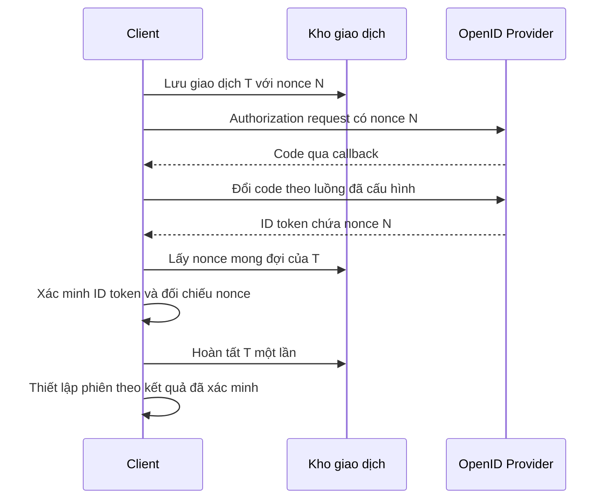

# Nonce

## 1. Nonce là gì trong OIDC?

Trong OpenID Connect (OIDC), **nonce** là một giá trị do client tạo cho một giao dịch xác thực, gửi trong yêu cầu tới OpenID Provider (OP), rồi đối chiếu với claim `nonce` trong ID token được trả về. Giá trị này giúp gắn ID token với đúng yêu cầu xác thực mà client đã khởi tạo và giảm nguy cơ sử dụng lại hoặc thay thế ID token giữa các giao dịch.

Client đóng vai trò relying party: ứng dụng dựa vào kết quả xác thực từ OP để tạo phiên đăng nhập hoặc thực hiện hành động phù hợp.

Ví dụ, một cổng quản trị doanh nghiệp chuyển người dùng tới hệ thống IAM để đăng nhập. Trước khi chuyển hướng, cổng tạo nonce ngẫu nhiên và lưu nó cùng giao dịch đăng nhập. Khi nhận ID token, cổng kiểm tra token có chứa đúng nonce đã lưu hay không. Một ID token được phát hành cho một giao dịch khác không được chấp nhận chỉ vì chữ ký của nó hợp lệ.

Nonce không phải mật khẩu, client secret hay thông tin chứng minh người dùng đã vượt qua MFA. Nó là dữ liệu liên kết giao dịch, được sử dụng cùng các kiểm tra bảo mật khác của OIDC.

## 2. Vấn đề mà nonce giải quyết

Một ID token có thể có chữ ký hợp lệ, còn hạn và đúng audience, nhưng vẫn không phải token thuộc giao dịch đăng nhập mà ứng dụng đang xử lý.

Nếu client chỉ kiểm tra nguồn phát hành và chữ ký, nó chưa chứng minh được quan hệ giữa token và yêu cầu xác thực cụ thể. Nonce bổ sung quan hệ đó:

```text
Giao dịch đăng nhập T
    → nonce do client tạo: N
    → authorization request gửi nonce=N
    → ID token hợp lệ chứa nonce=N
    → client đối chiếu với nonce đã lưu của T
```

Điểm quyết định là **nonce mong đợi phải lấy từ trạng thái giao dịch mà client tin cậy**, không phải lấy tùy ý từ chính token hoặc từ một tham số callback rồi coi đó là căn cứ xác minh.

Nếu client nhận một ID token có `nonce=N2` nhưng giao dịch hiện tại đã lưu `N1`, nó phải từ chối kết quả xác thực đó. Việc token chứa cùng email hoặc cùng `sub` mong đợi không thay thế kiểm tra nonce.

## 3. Ai tạo, truyền và kiểm tra nonce?

| Thành phần | Trách nhiệm |
|---|---|
| Client/relying party | Tạo nonce, lưu cùng giao dịch, gửi trong yêu cầu OIDC và kiểm tra khi xác minh ID token |
| OpenID Provider | Xử lý nonce theo giao thức và đưa giá trị tương ứng vào ID token khi yêu cầu có nonce |
| Trình duyệt/user agent | Chuyển tải yêu cầu và phản hồi theo luồng; không tự trở thành nguồn xác định nonce mong đợi |
| Resource server | Xác minh access token theo cơ chế truy cập API; không dùng nonce OIDC để thay cho kiểm soát truy cập |

Nonce thường đi qua trình duyệt và có thể xuất hiện trong ID token. Vì vậy, nó không được thiết kế để đóng vai trò bí mật dài hạn. Tuy nhiên, biết một nonce không đồng nghĩa được quyền thay đổi nonce mong đợi mà client đã lưu cho giao dịch.

## 4. Nonce, state và PKCE khác nhau thế nào?

Ba cơ chế đều gắn với một giao dịch, nhưng bảo vệ các quan hệ khác nhau:

| Cơ chế | Giá trị client giữ | Giá trị được gửi hoặc nhận | Quan hệ chính được kiểm tra |
|---|---|---|---|
| `state` | Giá trị tương quan hoặc trạng thái giao dịch được bảo vệ | Gửi trong authorization request, nhận lại trong authorization response | Phản hồi cấp quyền có thuộc giao dịch đã khởi tạo hay không |
| `nonce` | Nonce mong đợi của giao dịch xác thực | Gửi trong yêu cầu OIDC, nhận trong ID token | ID token có gắn với yêu cầu xác thực tương ứng hay không |
| PKCE | `code_verifier` | Gửi `code_challenge` ở authorization request và verifier khi đổi code | Bên đổi code có giữ verifier gắn với yêu cầu cấp quyền hay không |

`state` thường được dùng để tương quan phản hồi và bảo vệ chống CSRF trong luồng chuyển hướng. PKCE bảo vệ việc đổi authorization code. Nonce bảo vệ sự liên kết giữa yêu cầu OIDC và ID token.

Không nên thay một cơ chế bằng cơ chế khác chỉ vì chúng đều là chuỗi ngẫu nhiên. Một thiết kế cần đáp ứng đầy đủ yêu cầu của luồng và thư viện OIDC đang sử dụng.

Đặc biệt, nonce không làm code bị đánh cắp trở nên không sử dụng được theo cách PKCE thực hiện. Ngược lại, có PKCE không cho phép bỏ qua việc kiểm tra claim `nonce` khi authorization request đã gửi nonce.

## 5. Luồng Authorization Code với nonce

Ví dụ sau sử dụng Authorization Code kết hợp PKCE. Các miền và giá trị chỉ có tính minh họa.

### 5.1. Client khởi tạo giao dịch

Client tạo một bản ghi giao dịch có thể chứa:

```text
transaction_id: một định danh nội bộ
expected_issuer: https://identity.example
client_id: admin-portal
state: STATE_VALUE
expected_nonce: NONCE_VALUE
code_verifier: VERIFIER_VALUE
created_at: thời điểm tạo
expires_at: thời điểm giao dịch hết hạn
status: PENDING
```

Đây là mô hình minh họa, không phải schema bắt buộc của OIDC. Trạng thái có thể được lưu phía máy chủ hoặc bằng cơ chế khác có bảo vệ thích hợp; phải liên kết nó với đúng trình duyệt hoặc phiên đang thực hiện giao dịch.

`state`, nonce và verifier có vai trò riêng. Client nên tạo và quản lý từng giá trị theo cơ chế được thư viện hoặc hồ sơ bảo mật của ứng dụng quy định, thay vì tái sử dụng một giá trị cố định cho mọi mục đích.

### 5.2. Client gửi yêu cầu OIDC

```http
GET /authorize?response_type=code&client_id=admin-portal&redirect_uri=https%3A%2F%2Fportal.example%2Fcallback&scope=openid%20profile&state=STATE_VALUE&nonce=NONCE_VALUE&code_challenge=CHALLENGE_VALUE&code_challenge_method=S256 HTTP/1.1
Host: identity.example
```

Scope `openid` cho biết yêu cầu sử dụng OIDC. Tham số `nonce` chứa giá trị của giao dịch hiện tại. `CHALLENGE_VALUE` được tính từ verifier theo phương thức PKCE đã chọn.

Các placeholder trong ví dụ không phải giá trị để sao chép vào hệ thống thật.

### 5.3. OP xử lý xác thực và trả code

Sau khi xử lý xác thực, chính sách và các điều kiện của luồng, OP chuyển trình duyệt về callback:

```http
HTTP/1.1 302 Found
Location: https://portal.example/callback?code=CODE_VALUE&state=STATE_VALUE
```

Trong luồng code này, client không chờ một tham số `nonce` riêng ở callback để thay cho kiểm tra ID token. Client kiểm tra phản hồi và trạng thái giao dịch, sau đó đổi code tại token endpoint với PKCE và xác thực client nếu áp dụng.

### 5.4. Client nhận và xác minh ID token

Token endpoint trả về các token theo luồng. Payload của ID token có thể có dạng minh họa:

```json
{
  "iss": "https://identity.example",
  "sub": "user-1842",
  "aud": "admin-portal",
  "iat": 1800000000,
  "exp": 1800000600,
  "nonce": "NONCE_VALUE"
}
```

Payload được hiển thị để giải thích claim, không phải một ID token có thể sử dụng. Tự decode payload không chứng minh chữ ký hoặc tính hợp lệ của token.

Client xác minh ID token theo luồng và hồ sơ OIDC, bao gồm các kiểm tra cần thiết về chữ ký, thuật toán, issuer, audience, thời hạn và các claim liên quan. Nó đồng thời yêu cầu claim `nonce` có mặt và bằng chính xác nonce đã gửi trong giao dịch này.

Chỉ khi toàn bộ kiểm tra cần thiết thành công, client mới sử dụng kết quả xác thực để tạo hoặc cập nhật phiên ứng dụng. Giao dịch được đánh dấu đã xử lý theo cơ chế chống xử lý lặp của ứng dụng.



## 6. Khi nào nonce được yêu cầu?

Nonce là tham số của OIDC, không phải tham số bắt buộc chung cho mọi grant OAuth.

| Trường hợp | Cách hiểu |
|---|---|
| OAuth thuần để lấy access token | Không tự áp đặt quy tắc nonce của OIDC nếu luồng không sử dụng OIDC |
| OIDC Authorization Code Flow | OIDC Core không bắt buộc tham số nonce trong mọi yêu cầu code; khi đã gửi thì phải xác minh nonce trong ID token |
| OIDC Implicit hoặc Hybrid Flow | Các luồng này có yêu cầu nonce trong authorization request theo OIDC Core |
| Hồ sơ bảo mật hoặc thư viện có quy định chặt hơn | Tuân thủ yêu cầu tương ứng, kể cả khi luồng code cơ bản cho phép lựa chọn |

Bảng giải thích vai trò của nonce trong các luồng, không phải hướng dẫn chọn Implicit hoặc Hybrid thay cho một luồng code được bảo vệ phù hợp.

Với hệ thống đang sử dụng thư viện OIDC, cần hiểu thư viện có tự tạo, lưu và kiểm tra nonce hay không. Không thêm một lớp kiểm tra thủ công lấy giá trị từ nguồn không tin cậy hoặc vô hiệu hóa cơ chế của thư viện chỉ để callback chạy thành công.

## 7. Tạo nonce đúng cách

### 7.1. Ngẫu nhiên, khó đoán và riêng cho giao dịch

Nonce cần được tạo bằng bộ sinh số ngẫu nhiên phù hợp cho mục đích mật mã. Không dùng timestamp, bộ đếm tăng dần, tên đăng nhập hoặc ID phiên cố định làm nonce.

Ví dụ Java tạo 32 byte ngẫu nhiên rồi mã hóa base64url không có padding:

```java
import java.security.SecureRandom;
import java.util.Base64;

public final class OidcNonceGenerator {
    private static final SecureRandom RANDOM = new SecureRandom();

    private OidcNonceGenerator() {
    }

    public static String createNonce() {
        byte[] bytes = new byte[32];
        RANDOM.nextBytes(bytes);
        return Base64.getUrlEncoder()
                .withoutPadding()
                .encodeToString(bytes);
    }
}
```

32 byte là lựa chọn minh họa có không gian giá trị lớn, không phải độ dài duy nhất mà OIDC cho phép. Chương trình trên chỉ tạo giá trị; nó chưa thực hiện lưu giao dịch, tạo authorization request hoặc xác minh ID token.

### 7.2. Không tái sử dụng giữa các lần đăng nhập

Mỗi giao dịch xác thực mới cần có nonce mới. Nếu người dùng mở hai tab đăng nhập, hai giao dịch cần được phân biệt; không dùng một biến nonce toàn cục để tab thứ hai ghi đè trạng thái của tab thứ nhất.

Nếu một giao dịch bị hủy hoặc hết hạn và ứng dụng khởi tạo lại từ đầu, nó tạo bộ giá trị giao dịch mới. Không giữ một nonce cố định cho toàn bộ vòng đời người dùng.

### 7.3. Không suy diễn tính duy nhất từ định dạng

Một chuỗi trông giống UUID hoặc có độ dài lớn chưa chứng minh nó khó đoán. Điều quan trọng là cách sinh, số lượng khả năng và việc quản lý vòng đời. Tránh tự xây cơ chế bằng phép băm timestamp hoặc nối thông tin tài khoản rồi gọi kết quả đó là ngẫu nhiên.

## 8. Lưu và quản lý nonce theo giao dịch

### 8.1. Gắn với đúng phiên và issuer

Bản ghi giao dịch cần giúp client xác định nonce nào thuộc callback hiện tại. Với ứng dụng có nhiều OP, giao dịch còn cần gắn với issuer dự kiến và cấu hình client tương ứng.

Không dùng một nonce hợp lệ của issuer A để chấp nhận ID token từ issuer B. Kiểm tra nonce không thay thế kiểm tra issuer, và ngược lại.

### 8.2. Đặt thời hạn và giới hạn số giao dịch chờ

Giao dịch đăng nhập nên có thời hạn hữu hạn. Nonce của giao dịch hết hạn không tiếp tục là giá trị mong đợi cho một callback mới.

Client cũng cần giới hạn và dọn các giao dịch bỏ dở. Việc này vừa giúp vận hành ổn định vừa tránh duy trì quá nhiều trạng thái có thể được sử dụng lại ngoài thời điểm dự kiến.

### 8.3. Hoàn tất giao dịch một lần

Sau khi kết quả xác thực được chấp nhận, client đánh dấu giao dịch đã hoàn tất hoặc loại bỏ trạng thái có thể sử dụng lại. Việc nhận callback trùng không được tự tạo ra một sự kiện xác thực mới không kiểm soát.

Trong triển khai có nhiều instance, thao tác hoàn tất cần phối hợp trên trạng thái dùng chung hoặc cơ chế tương đương. Hai request đồng thời không nên cùng sử dụng một giao dịch `PENDING` để tạo hai kết quả được coi là độc lập.

Nonce trong ID token tự nó không tạo ra cơ chế tiêu thụ một lần. Đây còn là trách nhiệm quản lý giao dịch của client, phối hợp với các bảo vệ khác như code dùng một lần.

## 9. Kiểm tra nonce: thứ tự và nguồn dữ liệu

Mã giả cho callback của một giao dịch code mới:

```text
transaction = findPendingTransactionBoundToThisBrowser(response.state)
requireTransactionNotExpired(transaction)
requireExpectedAuthorizationResponse(transaction, response)

tokens = exchangeCodeUsingConfiguredIssuerAndPkce(transaction, response.code)
claims = validateIdTokenUsingOidcRules(tokens.idToken, transaction)

requireNonceClaimPresent(claims)
requireExactMatch(claims.nonce, transaction.expectedNonce)

completeTransactionAndEstablishSessionOnce(transaction, claims)
```

Mã giả giả định client đã gửi nonce. Nó không mô tả toàn bộ yêu cầu của OIDC và không thay thế thư viện giao thức.

Các nguyên tắc quan trọng:

- Giá trị mong đợi phải đến từ trạng thái client đã bảo vệ và liên kết với giao dịch.
- Claim nonce phải được kiểm tra trong một ID token đã được xác minh theo các quy tắc cần thiết.
- Thiếu claim khi yêu cầu đã gửi nonce là lỗi xác minh, không phải trường hợp cho phép bỏ qua.
- So sánh giá trị chính xác; không tự đổi chữ hoa/thường hoặc chuẩn hóa chuỗi làm thay đổi ý nghĩa.
- Giao dịch không tồn tại, đã hết hạn hoặc đã hoàn tất phải được xử lý như trạng thái không hợp lệ theo thiết kế.
- Không tạo phiên đăng nhập trước rồi mới kiểm tra nonce ở một tác vụ chạy sau.

Nếu kiểm tra thất bại, client không chấp nhận kết quả đăng nhập. Thông báo bên ngoài có thể hướng dẫn bắt đầu lại, còn nhật ký nội bộ lưu mã lỗi và định danh tương quan phù hợp để điều tra.

## 10. Ví dụ thay thế ID token giữa hai giao dịch

Giả sử ứng dụng có hai giao dịch độc lập:

| Giao dịch | Nonce mong đợi | ID token thuộc giao dịch |
|---|---|---|
| T1 của người dùng đang đăng nhập | `N1` | Claim nonce phải là `N1` |
| T2 của một lần xác thực khác | `N2` | Claim nonce phải là `N2` |

Một ID token từ T2 có thể được OP ký hợp lệ và vẫn còn hạn. Nếu token đó bị đưa vào quá trình xử lý T1, kiểm tra nonce phải phát hiện `N2` khác `N1` và từ chối.

Ví dụ này minh họa kiểm tra ở lớp ID token. Trong một luồng hoàn chỉnh, `state`, PKCE và các kiểm tra giao thức khác cũng có thể ngăn việc thay thế xảy ra ở những bước trước. Không nên bỏ các lớp đó với lý do nonce đã phát hiện được ví dụ này.

Nếu ứng dụng đặt cùng một nonce cho mọi giao dịch hoặc lấy nonce mong đợi từ token nhận được, việc so sánh không còn chứng minh quan hệ với T1. Đây là lỗi thiết kế ngay cả khi mã nguồn có một câu lệnh mang tên `validateNonce`.

## 11. Nonce không bảo vệ những gì?

### 11.1. Không xác minh chữ ký hoặc nguồn phát hành

Kẻ tấn công có thể tạo một payload chứa đúng nonce nếu client không kiểm tra tính xác thực của ID token. Vì vậy, nonce đúng nhưng token giả vẫn phải bị từ chối.

### 11.2. Không thay thế xác thực người dùng hoặc MFA

Nonce chứng minh sự liên kết giao dịch trong phạm vi cơ chế sử dụng; nó không nói phương thức xác thực có đủ mạnh cho một hành động nhạy cảm hay không. Những yêu cầu về mức xác thực hoặc thời điểm xác thực cần được xử lý bằng chính sách và các thông tin OIDC phù hợp.

### 11.3. Không thu hồi hoặc bảo vệ access token bị đánh cắp

OIDC nonce gắn với ID token trong giao dịch xác thực. Nó không tự làm access token trở thành token dùng một lần, không tự ngăn bearer token bị phát lại tới API và không thay thế kiểm tra audience, scope hay quyền trên đối tượng.

### 11.4. Không khắc phục client bị chiếm quyền

Nếu mã độc kiểm soát toàn bộ client hoặc đọc và sửa trạng thái giao dịch, nonce không tự phục hồi ranh giới tin cậy đã mất. Client vẫn cần bảo vệ trước XSS, quản lý cookie và phiên đúng cách, bảo vệ secret nếu có, cùng các biện pháp phù hợp với kiến trúc.

### 11.5. Không phải quy tắc dùng giống nhau cho mọi phản hồi token

Refresh token không khởi tạo lại cùng một authorization request tương tác. ID token được phát hành trong quá trình refresh có quy tắc riêng theo OIDC và hồ sơ triển khai. Không tự tạo một nonce mới ở client rồi yêu cầu token endpoint phản chiếu nó như trong lần đăng nhập mới.

Phần xử lý refresh cần được triển khai theo đúng hợp đồng của luồng, thay vì tái sử dụng nguyên thuật toán callback và giao dịch nonce của một lần xác thực mới.

## 12. Lỗi thường gặp và cách chẩn đoán

| Hiện tượng hoặc lỗi | Nguyên nhân có thể gặp | Hướng xử lý |
|---|---|---|
| ID token thiếu nonce dù request có nonce | Tham số bị mất, OP không xử lý đúng hoặc đọc nhầm token | Kiểm tra cấu hình và đường đi tham số; giữ nguyên việc từ chối kết quả không hợp lệ |
| Mismatch khi mở nhiều tab | Dùng một ô lưu nonce chung, giao dịch sau ghi đè giao dịch trước | Lưu riêng từng giao dịch và liên kết đúng callback |
| Mismatch sau khi qua load balancer | Trạng thái giao dịch chỉ nằm ở instance khác hoặc không nhất quán | Thiết kế lưu trạng thái và định tuyến phù hợp |
| Đăng nhập vẫn thành công khi xóa claim nonce | Client không kiểm tra claim khi đã gửi nonce | Bật hoặc sửa phần xác minh OIDC trước khi tạo phiên |
| Mọi lần đăng nhập có cùng nonce | Hardcode hoặc tái sử dụng giá trị theo người dùng | Tạo nonce mới bằng CSPRNG cho từng giao dịch |
| Mã so sánh luôn thành công | Lấy cả hai vế từ dữ liệu phản hồi | Lấy expected nonce từ giao dịch đã lưu |
| Callback cũ được chấp nhận nhiều lần | Không hết hạn hoặc không hoàn tất trạng thái giao dịch đúng cách | Quản lý trạng thái và xử lý đồng thời để hoàn tất một lần |
| Sửa lỗi bằng cách tắt kiểm tra nonce | Che triệu chứng thay vì sửa tương quan giao dịch | Điều tra luồng lưu/đọc trạng thái, giữ các kiểm tra cần thiết |

Nhật ký nên ghi loại lỗi như `NONCE_MISSING`, `NONCE_MISMATCH`, `TRANSACTION_EXPIRED` hoặc `TRANSACTION_ALREADY_COMPLETED` cùng định danh tương quan. Tránh ghi nguyên authorization code, ID token, access token hoặc toàn bộ trạng thái chứa verifier và credential.

## 13. Áp dụng trong cổng quản trị IAM

Một cổng quản trị có thể sử dụng OIDC để đăng nhập, sau đó kiểm tra RBAC hoặc ABAC để quyết định ai được quản lý tài khoản và quyền truy cập.

Nonce bảo vệ sự liên kết giữa yêu cầu đăng nhập của cổng và ID token nhận từ OP. Sau khi kết quả xác thực được chấp nhận, cổng vẫn cần xác định đúng chủ thể bằng thông tin đã xác minh, quản lý phiên, kiểm tra quyền quản trị và yêu cầu xác thực bổ sung khi chính sách cần.

Ví dụ, một ID token đúng nonce xác nhận kết quả thuộc giao dịch đang xử lý; nó không tự cấp quyền xóa tài khoản hoặc cấp đặc quyền. Những hành động đó phải đi qua chính sách ủy quyền riêng và được kiểm toán.

Một triển khai nonce đúng bao gồm cả việc tạo giá trị khó đoán, truyền đúng trong yêu cầu OIDC, đối chiếu trong ID token hợp lệ và quản lý giao dịch tới khi hoàn tất. Chỉ thêm tham số `nonce` vào URL chưa đủ để có cơ chế bảo vệ hoàn chỉnh.
