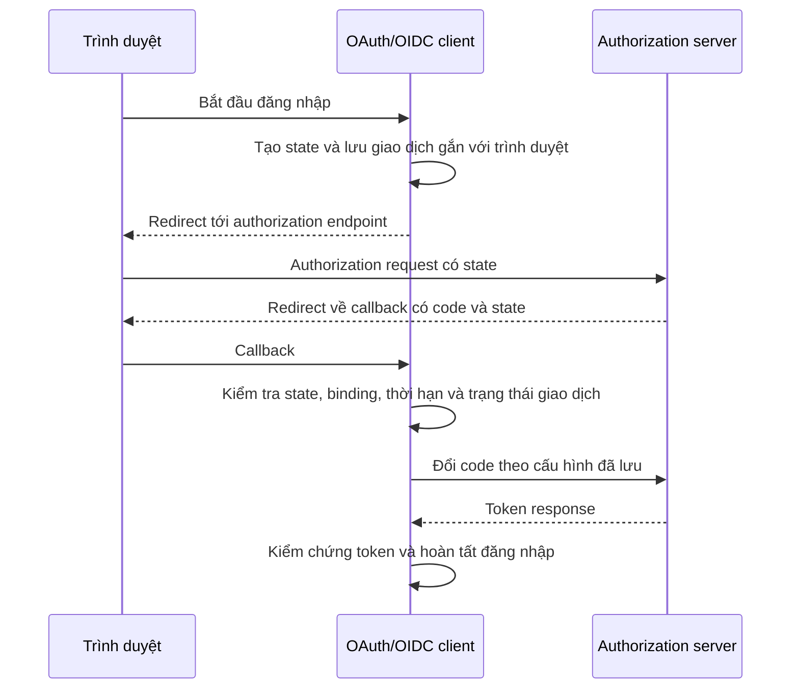

# State parameter

Trong OAuth và OpenID Connect, **state** là tham số do client tạo khi bắt đầu một yêu cầu authorization và dùng để liên kết phản hồi quay về với đúng giao dịch đã khởi tạo.

Có thể hình dung state là mã tra cứu cho một lần đăng nhập đang chờ xử lý. Client gửi mã này trong authorization request; authorization server trả lại giá trị tương ứng trong authorization response theo giao thức; client đối chiếu nó với giao dịch đang chờ trước khi tiếp tục.

State không phải access token, không xác định người dùng và không cấp quyền truy cập API. Khi được tạo, lưu và kiểm tra đúng cách, nó giúp client nhận ra một callback có thuộc yêu cầu hợp lệ của chính phiên hoặc ngữ cảnh khởi tạo hay không, qua đó bảo vệ trước các kiểu giả mạo phản hồi và login CSRF.

## 1. Vì sao client cần liên kết request với callback?

Trong luồng Authorization Code, người dùng rời ứng dụng để đi tới authorization server, rồi trình duyệt quay về redirect URI của client.

```text
Ứng dụng -> authorization server -> callback của ứng dụng
```

Callback là một endpoint mà bên ngoài có thể gửi request tới. Việc endpoint nhận được một tham số có tên `code` không chứng minh rằng ứng dụng đã khởi tạo giao dịch tương ứng trong trình duyệt đó.

Client cần trả lời các câu hỏi:

- Yêu cầu đăng nhập này có thực sự đang chờ xử lý không?
- Nó có thuộc ngữ cảnh trình duyệt hoặc client instance đang nhận callback không?
- Nó được bắt đầu với provider, redirect URI và cấu hình nào?
- Nó đã được xử lý, hết hạn hoặc bị hủy chưa?

State giúp tìm và kiểm tra giao dịch phù hợp. Những thông tin như provider, PKCE verifier và đích điều hướng sau đăng nhập có thể được giữ trong giao dịch đó, thay vì lấy lại từ các tham số tùy ý của callback.

## 2. State đi qua luồng OAuth như thế nào?

Một authorization request minh họa:

```http
GET /authorize?
    response_type=code&
    client_id=expense-web&
    redirect_uri=https%3A%2F%2Fexpense.example.test%2Foauth%2Fcallback&
    scope=openid%20profile&
    state=<random-state>&
    nonce=<request-nonce>&
    code_challenge=<pkce-challenge>&
    code_challenge_method=S256
Host: identity.example.test
```

Các dòng trên được xuống dòng để dễ đọc; URL thực tế phải được xây dựng và mã hóa tham số đúng cách.

Sau khi xử lý, authorization server có thể chuyển trình duyệt về:

```http
GET /oauth/callback?code=<authorization-code>&state=<random-state>
Host: expense.example.test
```

Client không được coi callback là hợp lệ chỉ vì có state. Nó phải kiểm tra giá trị đó đối với dữ liệu đã lưu trước khi chuyển người dùng đi.



Authorization server trả lại state để client đối chiếu. Nó không thay client kiểm tra state có đúng với phiên trình duyệt đang nhận callback hay không.

## 3. State bảo vệ trước login CSRF như thế nào?

Login CSRF có thể khiến nạn nhân đăng nhập vào ứng dụng bằng tài khoản của kẻ tấn công.

Một tình huống rút gọn:

1. Kẻ tấn công bắt đầu một giao dịch đăng nhập tại ứng dụng bằng tài khoản của mình.
2. Kẻ tấn công có một authorization response tương ứng và tìm cách làm trình duyệt nạn nhân gửi nó tới callback.
3. Nếu ứng dụng nhận code bất kỳ rồi tạo phiên mà không kiểm tra liên kết giao dịch, nạn nhân có thể được đặt vào tài khoản của kẻ tấn công.
4. Nạn nhân tiếp tục nhập thông tin, tải tài liệu hoặc thực hiện thao tác mà tưởng đang ở tài khoản của mình.

Khả năng khai thác còn phụ thuộc flow và các cơ chế bảo vệ khác. Điểm cần hiểu là một authorization code có thể hợp lệ với authorization server nhưng không thuộc giao dịch đăng nhập mà client phải chấp nhận trong ngữ cảnh trình duyệt hiện tại.

State chống lại việc tráo phản hồi này khi đồng thời có các điều kiện:

- Giá trị state không thể bị đoán thực tế.
- State được tạo cho đúng một giao dịch.
- Giao dịch được gắn với ngữ cảnh khởi tạo mà callback phải chứng minh.
- Client kiểm tra liên kết đó trước khi đổi code hoặc thiết lập danh tính.
- Giao dịch chỉ được tiếp nhận một lần trong thời hạn cho phép.

Chỉ lưu tất cả state trong một danh sách toàn hệ thống rồi chấp nhận bất kỳ state nào tồn tại là chưa đủ. State từ giao dịch của kẻ tấn công cũng nằm trong danh sách đó. Cần kiểm tra nó có thuộc ngữ cảnh khởi tạo phù hợp hay không.

## 4. Tạo state bằng nguồn ngẫu nhiên mật mã

Một cách triển khai phổ biến là tạo một chuỗi ngẫu nhiên đủ mạnh bằng bộ sinh số ngẫu nhiên dùng cho mục đích mật mã, rồi sử dụng chuỗi đó như một mã tra cứu không mang ý nghĩa nghiệp vụ.

Ví dụ Java sau chỉ minh họa việc sinh state:

```java
import java.security.SecureRandom;
import java.util.Base64;

final class OAuthStateGenerator {
    private static final SecureRandom RANDOM = new SecureRandom();

    static String newState() {
        byte[] bytes = new byte[32];
        RANDOM.nextBytes(bytes);
        return Base64.getUrlEncoder()
                .withoutPadding()
                .encodeToString(bytes);
    }
}
```

Ví dụ sử dụng 32 byte ngẫu nhiên, tương đương 256 bit trước khi mã hóa. Base64url không padding cho ra một chuỗi thuận tiện khi dùng trong URL. Đây là lựa chọn triển khai minh họa, không phải độ dài bắt buộc duy nhất của tham số state.

Không nên dùng:

| Cách tạo | Vấn đề |
| --- | --- |
| Timestamp đơn thuần | Dễ dự đoán |
| Số thứ tự tăng dần | Có thể liệt kê hoặc đoán |
| User ID hoặc email | Không có tính ngẫu nhiên và có thể làm lộ dữ liệu |
| Một giá trị cố định cho toàn ứng dụng | Không phân biệt giao dịch và không tạo bảo vệ cần thiết |
| Session ID được đưa nguyên vào URL | Có thể làm lộ định danh phiên có giá trị bảo mật |

Mỗi giao dịch cần state mới. Không dùng lại một state cho nhiều lần đăng nhập chỉ vì các lần đó do cùng một người dùng khởi tạo.

## 5. Lưu giao dịch và gắn với đúng ngữ cảnh

Đối với ứng dụng web có backend, một thiết kế thường gặp là lưu giao dịch chờ xử lý ở server, gắn nó với một ngữ cảnh trước đăng nhập được bảo vệ bằng cookie.

Dữ liệu minh họa:

```text
PendingLoginTransaction:
    stateDigest
    browserContextBinding
    providerId
    expectedIssuer
    redirectUri
    pkceVerifier
    oidcNonce
    approvedReturnRoute
    createdAt
    expiresAt
    status = PENDING
```

Không phải mọi trường đều bắt buộc trong mọi flow. Chúng minh họa những thông tin thường cần để tiếp tục đúng giao dịch OAuth/OIDC.

Trong mô hình này:

- State gửi qua authorization request là mã ngẫu nhiên.
- Server có thể lưu digest của state thay cho giá trị nguyên văn.
- Browser context được gắn với giao dịch bằng cơ chế mà callback có thể kiểm tra đáng tin.
- PKCE verifier và thông tin nhạy cảm của giao dịch được giữ ở nơi phù hợp với kiến trúc.
- Provider và redirect URI dùng khi đổi code lấy từ giao dịch đã lưu, không lấy theo dữ liệu không tin cậy trong callback.

Việc lưu digest giúp giảm lộ giá trị state trực tiếp khi dữ liệu lưu trữ bị quan sát, nhưng không thay thế kiểm tra browser binding hoặc các kiểm soát truy cập kho giao dịch.

### Binding không chỉ là so sánh chuỗi state

Giả sử server có hai giao dịch:

```text
T1: state=S1, browser=A
T2: state=S2, browser=B
```

Nếu callback xuất hiện ở browser A với state S2, việc S2 tồn tại không đủ. Giao dịch T2 được khởi tạo trong ngữ cảnh B, nên không được tiếp nhận như giao dịch của A.

Không dùng IP hoặc User-Agent làm bằng chứng duy nhất cho binding. Nhiều người có thể chung IP, IP có thể thay đổi và User-Agent có thể bị giả mạo. Chúng có thể phục vụ quan sát, nhưng không thay thế cơ chế liên kết giao dịch đáng tin.

### Ứng dụng không có backend truyền thống

SPA và ứng dụng native vẫn cần lưu và đối chiếu giao dịch trong đúng ngữ cảnh client instance theo kiến trúc của mình. Cơ chế lưu trữ, xử lý redirect và bảo vệ dữ liệu sẽ khác ứng dụng web có backend.

Một thư viện OAuth/OIDC phù hợp thường đảm nhiệm phần quản lý giao dịch. Không nên sao chép mô hình cookie của ứng dụng web vào mobile mà bỏ qua cách hệ điều hành phân phối redirect cho ứng dụng.

## 6. Kiểm tra callback theo thứ tự rõ ràng

Pseudocode dưới đây minh họa một callback có giao dịch lưu ở server:

```text
handleCallback(request):
    response = parseAuthorizationResponseStrictly(request)

    requireExactlyOneState(response)
    requireExpectedResponseShape(response)

    transaction = findTransactionByStateDigest(response.state)
    requireTransactionExists(transaction)
    requireNotExpired(transaction)
    requireSameBrowserContext(request, transaction)
    requireExpectedProviderContext(response, transaction)

    claimTransactionAtomically(transaction, PENDING, PROCESSING)

    if response contains authorization error:
        finishTransactionAsFailed(transaction)
        showControlledLoginFailure()
        return

    tokens = exchangeCode(
        response.code,
        provider = transaction.providerId,
        redirectUri = transaction.redirectUri,
        pkceVerifier = transaction.pkceVerifier
    )

    validateTokenResponseForConfiguredFlow(tokens, transaction)
    establishSessionAccordingToLocalAccountPolicy(tokens)
    finishTransactionAsCompleted(transaction)
    redirectToApprovedRoute(transaction.approvedReturnRoute)
```

Đoạn mã là mô tả trách nhiệm, không phải code hoàn chỉnh. Một triển khai thực tế còn phải xử lý lưu trữ, thời gian, lỗi mạng và quy tắc của flow.

Các điểm cần bảo đảm:

1. **Phân tích tham số nhất quán:** không để proxy, framework và logic ứng dụng diễn giải callback theo các cách khác nhau.
2. **Thiếu state thì từ chối giao dịch:** khi flow được cấu hình sử dụng state, không tự bỏ qua kiểm tra để “cứu” callback.
3. **So sánh đúng giá trị:** sau khi parser giải mã tham số theo giao thức, đối chiếu đúng giá trị state; không đổi hoa thường hoặc trim tùy tiện.
4. **Kiểm tra binding và thời hạn:** state đúng chuỗi nhưng sai ngữ cảnh hoặc hết hạn vẫn bị từ chối.
5. **Tiếp nhận một lần bằng thao tác nguyên tử:** hai callback đồng thời không được cùng vượt qua bước nhận giao dịch.
6. **Chỉ đổi code sau các kiểm tra tương ứng:** không gọi token endpoint trước rồi mới kiểm tra giao dịch thuộc ai.

Nên xử lý rõ trường hợp lặp nhiều tham số `state` hoặc phản hồi đồng thời chứa dữ liệu thành công và lỗi không phù hợp. Không chọn một giá trị tùy ý từ một callback mơ hồ.

### Vì sao cần thao tác nguyên tử?

Cách xử lý sau có điều kiện tranh chấp:

```text
Nếu giao dịch chưa dùng:
    đổi code
    đánh dấu đã dùng
```

Hai request đến gần nhau có thể cùng nhìn thấy trạng thái chưa dùng. Dù authorization code thường chỉ được đổi một lần, client vẫn không nên dựa vào token endpoint để sửa mọi lỗi xử lý lặp ở phía mình.

Một cơ chế compare-and-set hoặc thao tác tương đương chuyển `PENDING` sang `PROCESSING` giúp chỉ một callback tiếp nhận giao dịch. Sau đó, hệ thống ghi nhận hoàn tất hoặc thất bại theo kết quả xử lý.

Nếu xảy ra lỗi mạng khi đổi code, không tự mở lại giao dịch cho mọi callback cũ. Cần có chính sách phục hồi rõ ràng; bắt đầu một giao dịch đăng nhập mới là cách xử lý phù hợp trong nhiều ứng dụng.

## 7. State phải được kiểm tra cả khi người dùng từ chối

Authorization response không chỉ có trường hợp thành công.

Ví dụ người dùng từ chối quyền:

```http
GET /oauth/callback?error=access_denied&state=<random-state>
Host: expense.example.test
```

Khi request ban đầu có state, client cần đối chiếu state trong phản hồi lỗi tương ứng trước khi cập nhật giao dịch hoặc hiển thị kết quả gắn với lần đăng nhập đó.

Nếu bỏ qua việc kiểm tra ở nhánh lỗi, một bên ngoài có thể gửi callback lỗi để làm thay đổi giao dịch hoặc gây nhầm lẫn cho người dùng.

Ứng dụng nên:

- Xác nhận lỗi thuộc đúng giao dịch đang chờ.
- Kết thúc hoặc hủy giao dịch theo chính sách.
- Hiển thị thông báo do ứng dụng kiểm soát.
- Không dùng nguyên văn một giá trị lỗi hoặc mô tả bên ngoài làm HTML hay URL điều hướng.
- Không tự tạo phiên, đổi code hoặc tiếp tục sang bước thành công.

Một callback lỗi không có giao dịch tương ứng chỉ là phản hồi không được chấp nhận; không nên dùng nó để xóa tùy tiện mọi giao dịch đăng nhập của trình duyệt.

## 8. State, nonce và PKCE khác nhau ra sao?

| Cơ chế | Giá trị được liên kết | Vị trí kiểm tra chính |
| --- | --- | --- |
| State | Authorization response với giao dịch client đã khởi tạo | Client xử lý callback |
| OIDC nonce | ID token với authentication request tương ứng | Client kiểm chứng ID token |
| PKCE | Authorization code với code verifier của giao dịch | Authorization server khi client đổi code |

Ví dụ, một ứng dụng có thể lưu ba giá trị riêng trong cùng giao dịch:

```text
state = mã liên kết callback
nonce = mã liên kết ID token
code_verifier = bí mật dùng khi đổi code
```

Không nên dùng chung một chuỗi cho cả ba chỉ để giảm số trường lưu trữ. Vai trò, cách truyền và vòng đời của chúng khác nhau.

Khi đã gửi nonce, client phải kiểm tra nonce trong ID token theo flow OIDC. Khi dùng PKCE, client phải giữ verifier của đúng giao dịch và dùng cơ chế challenge phù hợp.

Một số thiết kế có thể sử dụng bảo đảm từ PKCE hoặc nonce như một phần cơ chế bảo vệ CSRF theo profile và điều kiện triển khai cụ thể. Điều đó không cho phép tự xóa bước kiểm tra state khỏi một ứng dụng đang dựa vào state để liên kết callback. Cần hiểu cơ chế nào đang cung cấp từng bảo đảm, thay vì thấy “đã có PKCE” rồi bỏ qua quản lý giao dịch.

State cũng không kiểm chứng chữ ký ID token, không kiểm tra audience của access token và không thay thế phân quyền tại API.

## 9. Lưu đích điều hướng sau đăng nhập một cách an toàn

Ứng dụng thường muốn đưa người dùng trở lại trang đang mở sau khi đăng nhập.

Một cách dễ sai:

```text
state = https://somewhere.example/path
```

Nếu callback dùng trực tiếp giá trị này để redirect mà không kiểm soát, hệ thống có thể trở thành open redirect. Nếu state chỉ là URL dễ đoán, nó cũng không cung cấp tính ngẫu nhiên cần thiết cho liên kết giao dịch.

Thiết kế thường dễ kiểm soát hơn:

```text
state gửi đi:
    <random-value>

giao dịch lưu ở server:
    approvedReturnRoute = /invoices/pending
```

Đích điều hướng cần được kiểm tra ngay khi nhận đầu vào và kiểm tra theo chính sách trước khi sử dụng. Có thể giới hạn vào mã route hoặc các đường dẫn nội bộ nằm trong danh sách được cho phép.

Không nên chỉ kiểm tra rằng chuỗi bắt đầu bằng một ký tự slash. Cách diễn giải URL, đường dẫn dạng network-path và các bước giải mã có thể tạo ra kết quả ngoài dự kiến. Sử dụng bộ phân tích URL và chính sách đích cho phép rõ ràng.

State không nên mang mật khẩu, access token, refresh token hoặc dữ liệu cá nhân không cần thiết. Nó đi qua URL hoặc thông điệp trình duyệt và có thể xuất hiện ở nơi quan sát, lịch sử hoặc log nếu hạ tầng không kiểm soát tốt.

## 10. State tự chứa có chữ ký có giải quyết hết vấn đề không?

Một số hệ thống đưa dữ liệu giao dịch vào state và bảo vệ nó bằng chữ ký hoặc MAC.

Cách này có thể phát hiện việc sửa dữ liệu, nhưng cần phân biệt các bảo đảm:

| Thuộc tính | Chữ ký hoặc MAC tự nó có bảo đảm không? |
| --- | --- |
| Dữ liệu không bị sửa mà không bị phát hiện | Có, nếu thuật toán và quản lý khóa đúng |
| Payload không bị đọc | Không; cần cơ chế mã hóa phù hợp nếu yêu cầu bí mật |
| State chỉ dùng một lần | Không tự bảo đảm |
| State thuộc đúng trình duyệt khởi tạo | Không tự bảo đảm nếu thiếu cơ chế binding |
| State còn trong thời hạn cho phép | Cần có dữ liệu thời gian và bước kiểm tra |
| URL điều hướng bên trong là an toàn | Cần có chính sách kiểm tra riêng |

Ngay cả một state có chữ ký hợp lệ cũng có thể bị chuyển sang trình duyệt khác hoặc gửi lại nếu hệ thống không kiểm soát binding và replay.

Nếu cần tiếp nhận đúng một lần, thiết kế thường vẫn cần dữ liệu phía server hoặc một cơ chế tương đương để ghi nhận giao dịch đã được sử dụng. Vì vậy, “stateless” không đồng nghĩa với việc có thể bỏ toàn bộ quản lý vòng đời giao dịch.

Đối với bài toán nền tảng, state ngẫu nhiên tra cứu giao dịch được lưu có kiểm soát thường dễ lý giải và kiểm tra hơn một định dạng token tự thiết kế.

## 11. Vòng đời, nhiều tab và vận hành

### Thời hạn ngắn và giới hạn số giao dịch

Giao dịch đăng nhập nên có thời hạn phù hợp với trải nghiệm xác thực. Không giữ state chờ vô thời hạn.

Ứng dụng cũng nên giới hạn số giao dịch chờ trong một ngữ cảnh và dọn dữ liệu hết hạn. Nếu không, endpoint bắt đầu đăng nhập có thể tạo ra lượng lớn dữ liệu không còn cần thiết.

Thời hạn cần tính đến những bước hợp lệ như MFA hoặc thao tác của người dùng. Nếu state hết hạn, ứng dụng nên giải thích rõ và bắt đầu giao dịch mới theo chính sách.

### Nhiều tab và nhiều lần đăng nhập

Chỉ lưu một biến `currentState` có thể khiến lần đăng nhập ở tab sau ghi đè giao dịch ở tab trước.

Một thiết kế hỗ trợ nhiều giao dịch cần lưu chúng theo state, mỗi giao dịch có binding, thời hạn và trạng thái riêng. Khi một callback hoàn tất, nó chỉ tiêu thụ giao dịch tương ứng.

Không xử lý state mismatch bằng cách chấp nhận callback theo “lần đăng nhập gần nhất”. Cách đó loại bỏ chính sự liên kết mà state được tạo ra để kiểm tra.

### Cookie và kiểu callback

Với ứng dụng web, cookie dùng cho ngữ cảnh trước đăng nhập cần được bảo vệ phù hợp, chẳng hạn bằng HTTPS, thuộc tính Secure, HttpOnly khi thích hợp và phạm vi cookie hạn chế.

Chính sách SameSite phải tương thích với kiểu callback. Một điều hướng GET cấp cao nhất và một callback cross-site bằng POST có hành vi gửi cookie khác nhau. Nếu cookie cần cho binding không được gửi, phải xử lý cấu hình và flow có chủ đích; không được sửa bằng cách bỏ kiểm tra state hoặc browser binding.

### Nhiều instance ứng dụng

Khi request bắt đầu đăng nhập được xử lý ở instance A và callback tới instance B, cả hai cần truy cập được dữ liệu giao dịch theo kiến trúc đã chọn.

Có thể dùng kho dữ liệu dùng chung hoặc một cơ chế phân phối phù hợp. Thao tác tiếp nhận một lần cũng phải giữ tính nguyên tử ở phạm vi các instance có thể xử lý callback.

### Log và chẩn đoán

Log nên cho biết kết quả như:

```text
oauth_callback_rejected
reason = expired_transaction
provider = corporate-idp
correlation_id = <internal-id>
```

Không ghi nguyên authorization code, token, session cookie hoặc toàn bộ callback URL. Cũng cần hạn chế ghi state nguyên văn và bảo vệ các log có khả năng liên kết giao dịch người dùng.

Khi gặp mismatch, có thể kiểm tra nguyên nhân như hết hạn, nhiều tab, cookie không được gửi hoặc dữ liệu giao dịch không được chia sẻ giữa instance. Việc chẩn đoán cần giữ nguyên kiểm soát bảo mật đang áp dụng.

## 12. Tình huống thực tế

Cổng chi phí khởi tạo một giao dịch:

```text
state: S1, được tạo ngẫu nhiên
browser context: B1
provider: corporate-idp
return route: /invoices/pending
status: PENDING
```

Các callback sau phải có cách xử lý khác nhau:

| Callback hoặc trạng thái | Kết quả |
| --- | --- |
| State S1, ngữ cảnh B1, chưa hết hạn, chưa dùng | Tiếp nhận giao dịch, sau đó mới thực hiện các bước còn lại của flow |
| Thiếu state trong flow yêu cầu đối chiếu state | Từ chối callback |
| State khác S1 và không có giao dịch phù hợp | Từ chối callback |
| State S1 nhưng ngữ cảnh trình duyệt không phù hợp | Từ chối dù state tồn tại |
| State S1 nhưng giao dịch hết hạn | Không tiếp tục giao dịch cũ |
| Hai callback đồng thời với S1 | Chỉ một request được tiếp nhận giao dịch |
| Lỗi access_denied với S1 hợp lệ | Kết thúc giao dịch theo nhánh lỗi, không tạo phiên |
| State hợp lệ nhưng ID token sai audience | Từ chối ở bước kiểm chứng ID token |
| State hợp lệ nhưng tài khoản nội bộ đã bị khóa | Không cấp phiên truy cập theo chính sách tài khoản |

State thực hiện tốt một nhiệm vụ cụ thể: giúp client xác nhận callback thuộc đúng giao dịch đang chờ trong ngữ cảnh khởi tạo phù hợp. Nó cần đi cùng kiểm chứng token, cơ chế bảo vệ flow và chính sách tài khoản để quá trình đăng nhập liên kết an toàn với hệ thống IAM.
