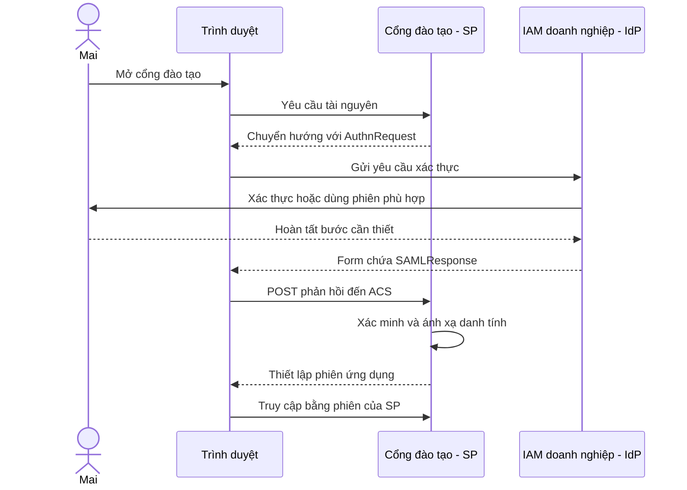

# SAML là gì?

## 1. SAML giải quyết việc chia sẻ kết quả xác thực

**SAML — Security Assertion Markup Language** — là một chuẩn của OASIS để trao đổi thông tin bảo mật giữa các hệ thống. SAML 2.0 dùng các thông điệp và assertion biểu diễn bằng XML. Một ứng dụng có thể dựa vào kết quả xác thực do một nhà cung cấp danh tính tin cậy phát hành, thay vì tự hỏi lại mật khẩu của người dùng. [OASIS, SAML 2.0 Technical Overview](https://docs.oasis-open.org/security/saml/Post2.0/sstc-saml-tech-overview-2.0.html).

Ví dụ một nhân viên cần sử dụng cổng đào tạo, hệ thống nhân sự và dịch vụ quản lý công việc. Nếu ba ứng dụng tự xác thực riêng, tổ chức phải quản lý nhiều điểm đăng nhập và nhiều cấu hình bảo vệ tài khoản. Với một mô hình liên kết danh tính, các ứng dụng có thể tin cậy dịch vụ IAM của tổ chức để nhận kết quả xác thực.

Một cách sử dụng SAML là **Web Browser Single Sign-On**, thường gọi là SAML SSO. Khi điều kiện phiên và chính sách cho phép, người đã đăng nhập ở nhà cung cấp danh tính có thể vào ứng dụng liên kết mà không nhập lại thông tin xác thực. SSO không có nghĩa mọi lần truy cập đều bỏ qua MFA hoặc yêu cầu xác thực lại.

## 2. Ba bên trong ví dụ SAML SSO

| Bên tham gia | Vai trò | Ví dụ |
|---|---|---|
| **Principal** | Chủ thể được xác thực | Nhân viên Mai |
| **Identity Provider — IdP** | Xác thực chủ thể và phát hành thông tin xác thực cho bên liên kết | Dịch vụ IAM doanh nghiệp |
| **Service Provider — SP** | Ứng dụng sử dụng kết quả đó để thiết lập ngữ cảnh truy cập | Cổng đào tạo |

Trình duyệt vận chuyển một số thông điệp giữa IdP và SP, nhưng không trở thành nguồn tin cậy chỉ vì nó gửi dữ liệu đến SP. Các vai trò và quan hệ tin cậy này là nền tảng của mô hình SAML SSO. [OASIS, SAML 2.0 Technical Overview, mục 3](https://docs.oasis-open.org/security/saml/Post2.0/sstc-saml-tech-overview-2.0.html).

Trong ví dụ, Mai nhập thông tin xác thực tại IdP. Cổng đào tạo nhận một kết quả liên kết danh tính để xử lý, không nhận mật khẩu của Mai qua assertion. IdP có thể dùng mật khẩu, passkey hoặc phương thức khác theo chính sách của tổ chức; việc chọn phương thức xác thực không được quyết định chỉ bởi tên “SAML”.

## 3. Assertion là lời khẳng định có cấu trúc

Assertion chứa thông tin về chủ thể cùng những phát biểu của bên phát hành. SAML định nghĩa các nhóm phát biểu như:

| Thành phần | Thông tin biểu đạt |
|---|---|
| `AuthnStatement` | Sự kiện xác thực chủ thể và ngữ cảnh liên quan |
| `AttributeStatement` | Các thuộc tính của chủ thể |
| `AuthzDecisionStatement` | Quyết định về việc truy cập một tài nguyên theo mô hình tương ứng |

Không phải assertion nào cũng phải có đủ cả ba loại phát biểu. Trong SSO, ứng dụng thường quan tâm kết quả xác thực và các thuộc tính cần thiết để nhận diện người dùng. [OASIS SAML Core, mục 2.7](https://docs.oasis-open.org/security/saml/v2.0/saml-core-2.0-os.pdf).

Các tên như `Issuer`, `Subject`, `NameID` và `Conditions` giúp biểu đạt bên phát hành, chủ thể, định danh và điều kiện sử dụng. `NameID` không mặc định là địa chỉ email. [OASIS SAML Core, mục 2.2–2.5](https://docs.oasis-open.org/security/saml/v2.0/saml-core-2.0-os.pdf).

Ví dụ dưới đây chỉ phác thảo ý nghĩa, không phải XML hay assertion có thể dùng để đăng nhập:

```text
Response
  Trả lời yêu cầu: _request_81
  Trạng thái: thành công
  Assertion
    Bên phát hành: IAM doanh nghiệp
    Chủ thể: employee-1042
    Sự kiện: chủ thể đã được xác thực
    Thuộc tính: department=Engineering
    Đối tượng sử dụng: cổng đào tạo
    Điều kiện: cửa sổ thời gian cho phép
```

Một trường trạng thái “thành công” không đủ để SP đăng nhập cho người dùng. SP còn phải xác minh tính xác thực của thông điệp và các ràng buộc tương ứng. Nếu không, một JSON hoặc XML tự khai “tôi là quản trị viên” cũng có thể bị nhầm thành kết quả của IAM.

## 4. Một luồng SSO bắt đầu từ SP

Xét cấu hình minh họa dùng HTTP Redirect cho yêu cầu và HTTP POST cho phản hồi:



`AuthnRequest` là yêu cầu xác thực. Phản hồi được nhận tại **Assertion Consumer Service — ACS** của SP. Sau khi xử lý hợp lệ, SP thiết lập ngữ cảnh hoặc phiên ứng dụng của mình. Đây là một luồng của Web Browser SSO Profile, không phải cách vận chuyển duy nhất của mọi triển khai SAML. [OASIS SAML Profiles, mục 4.1](https://docs.oasis-open.org/security/saml/v2.0/saml-profiles-2.0-os.pdf).

### Protocol, binding và profile khác nhau thế nào?

- **Protocol** định nghĩa các loại thông điệp và cách tương tác, chẳng hạn yêu cầu xác thực và phản hồi.
- **Binding** quy định cách đặt thông điệp lên cơ chế truyền tải, chẳng hạn HTTP Redirect hoặc HTTP POST.
- **Profile** kết hợp các thành phần đó và bổ sung quy tắc cho một tình huống cụ thể, chẳng hạn đăng nhập web.

Với HTTP POST Binding, XML được mã hóa Base64 trong trường form; phản hồi dùng tên `SAMLResponse`. **Base64 là biểu diễn dữ liệu, không phải mã hóa bảo mật.** [OASIS SAML Bindings, mục 3.5](https://docs.oasis-open.org/security/saml/v2.0/saml-bindings-2.0-os.pdf).

Ví dụ chẩn đoán: ACS của cổng đào tạo nhận được một form có trường `SAMLResponse`. Điều này chỉ cho biết một dữ liệu đã đến endpoint. Nó chưa chứng minh form được IdP tin cậy tạo ra hoặc dữ liệu được phép sử dụng cho cổng đào tạo.

## 5. Metadata thiết lập thông tin liên kết

Trước khi người dùng đăng nhập, IdP và SP cần thống nhất định danh, endpoint và thông tin khóa liên quan. **SAML metadata** cung cấp định dạng mô tả các thông tin này. `entityID` định danh thực thể SAML; ACS là endpoint tiếp nhận phản hồi của SP. Hai giá trị phục vụ mục đích khác nhau dù đều có thể trông giống URL. Metadata cũng cần được lấy và chấp nhận qua một cơ chế tin cậy. [OASIS SAML Metadata, mục 2 và 4](https://docs.oasis-open.org/security/saml/v2.0/saml-metadata-2.0-os.pdf).

Ví dụ thông tin hai nhóm vận hành cần đối chiếu:

| Thông tin minh họa | Giá trị hoặc quyết định |
|---|---|
| IdP entityID | `https://iam.example.com/saml/idp` |
| SP entityID | `https://learning.example.com/saml/sp` |
| ACS của SP | `https://learning.example.com/saml/acs` |
| Định danh nhân viên | Hai bên thống nhất một giá trị và định dạng phù hợp |
| Thuộc tính cần gửi | Chỉ những dữ liệu cổng đào tạo sử dụng |
| Khóa xác minh chữ ký | Được cấu hình hoặc cập nhật qua nguồn metadata tin cậy |

Một chứng thư đính kèm thông điệp không tự tạo ra quan hệ tin cậy. Ví dụ kẻ gửi có thể tạo cặp khóa riêng rồi ký dữ liệu do chính họ dựng. Nếu SP chỉ kiểm tra “có một chữ ký hợp lệ với chứng thư trong XML”, SP chưa chứng minh được người ký là IdP đã được duyệt.

Về vận hành, nhóm IAM và nhóm ứng dụng cần có người chịu trách nhiệm cho việc thay endpoint và thay khóa. Khi cổng học đổi tên miền, việc cập nhật ACS cần được phối hợp với cấu hình IdP; không giải quyết bằng cách cho phép mọi URL tiếp nhận phản hồi.

## 6. SP phải xác minh những gì?

Trong luồng SP khởi tạo ở trên, các kiểm tra có quan hệ trực tiếp với nhau:

| Nhóm kiểm tra | Câu hỏi SP cần trả lời |
|---|---|
| Nguồn phát hành | Có đúng IdP tin cậy của liên kết này không? |
| Chữ ký và tính toàn vẹn | Nội dung được sử dụng có được xác thực đúng theo profile và cấu hình không? |
| Audience | Assertion có dành cho SP này không? |
| Nơi nhận | Recipient và Destination có phù hợp endpoint tiếp nhận theo quy tắc tương ứng không? |
| Thời gian | Các giới hạn hiệu lực và sai lệch đồng hồ cho phép có được đáp ứng không? |
| Liên kết giao dịch | Phản hồi có khớp yêu cầu đang chờ qua `InResponseTo` không? |
| Chống phát lại | Assertion này đã được sử dụng trước đó chưa? |

Các quy tắc xử lý bearer assertion và phản hồi SSO được quy định trong SAML Profiles. Chỉ kiểm tra chữ ký rồi bỏ qua audience, thời gian hoặc giao dịch là chưa đủ. [OASIS SAML Profiles, mục 4.1.4](https://docs.oasis-open.org/security/saml/v2.0/saml-profiles-2.0-os.pdf).

Kiểm tra XML Signature còn cần bảo đảm ứng dụng **dùng đúng phần tử đã được xác minh**. Nếu thư viện xác minh một assertion nhưng mã ứng dụng đọc danh tính từ một assertion khác, chữ ký hợp lệ vẫn không bảo vệ phần dữ liệu bị sử dụng sai. Đây là một dạng nguy cơ XML Signature Wrapping. Nên dùng thư viện SAML có cơ chế phân tích và xác minh đầy đủ, thay vì tự ghép XPath với một phép kiểm tra chữ ký riêng lẻ. [W3C, XML Signature Best Practices, mục 3.1.5](https://www.w3.org/TR/xmldsig-bestpractices/).

Chữ ký bảo vệ tính xác thực và toàn vẹn; mã hóa bảo vệ tính bí mật theo phạm vi được mã hóa. Mã hóa không tự ngăn phát lại một thông điệp đã bị lấy được. Việc bảo vệ đường truyền, dữ liệu assertion và các điều kiện chấp nhận phải được thiết kế cùng nhau. [OASIS SAML Security and Privacy Considerations](https://docs.oasis-open.org/security/saml/v2.0/saml-sec-consider-2.0-os.pdf).

Ví dụ: assertion dành cho cổng nhân sự không được cổng đào tạo chấp nhận chỉ vì cùng do IAM doanh nghiệp ký. Hai ứng dụng là hai bên nhận khác nhau. Tương tự, một bản phản hồi đã dùng không nên tạo được nhiều phiên mới chỉ bằng cách gửi lại form cũ.

## 7. Đăng nhập liên kết chưa hoàn tất phân quyền và vòng đời tài khoản

Sau khi nhận diện Mai, cổng đào tạo vẫn phải quyết định Mai được học khóa nào, xem dữ liệu của phòng ban nào và có được quản trị nội dung không. Trong thiết kế ví dụ, thuộc tính `department=Engineering` có thể là đầu vào của chính sách; nó không tự đồng nghĩa với role quản trị.

Một quy trình xử lý phù hợp có thể được mô tả như sau:

```text
Kết quả SAML đã xác minh
  -> nhận diện đúng nhân viên trong đúng liên kết
  -> tìm tài khoản ứng dụng theo quy tắc đã thống nhất
  -> kiểm tra tài khoản còn được phép sử dụng
  -> áp dụng chính sách quyền của ứng dụng
  -> tạo phiên ứng dụng
```

Nếu dùng địa chỉ email để liên kết tài khoản, nhóm triển khai phải xét trường hợp đổi email, tái sử dụng địa chỉ và dữ liệu trùng giữa các tổ chức. Không tự gộp hai tài khoản chỉ vì chuỗi email giống nhau mà chưa có quy tắc tin cậy cho liên kết đó.

Cũng cần phân biệt ba trạng thái trong ví dụ:

| Trạng thái | Ý nghĩa |
|---|---|
| Assertion còn trong cửa sổ chấp nhận | Kết quả liên kết có thể được xử lý theo điều kiện tương ứng |
| Phiên của cổng đào tạo còn hoạt động | Người dùng có thể tiếp tục tương tác theo chính sách phiên của SP |
| Tài khoản nhân viên còn được phép truy cập | Quyết định về vòng đời và quyền hiện tại của tài khoản |

Ba trạng thái này không phải một đồng hồ duy nhất. Khi Mai nghỉ việc, tổ chức cần có quy trình xử lý tài khoản, quyền và phiên đang tồn tại. Không coi việc triển khai đăng nhập SAML là đã tự giải quyết đầy đủ cấp phát hoặc thu hồi tài khoản ở mọi ứng dụng.

## 8. Những hiểu nhầm cần tránh

| Hiểu nhầm | Cách hiểu phù hợp |
|---|---|
| Có SAML thì mặc nhiên có MFA | MFA phụ thuộc chính sách và ngữ cảnh xác thực được yêu cầu, xác minh |
| Có chữ ký thì assertion dùng ở đâu cũng được | Còn phải đáp ứng đối tượng nhận, thời gian và các ràng buộc của profile |
| Base64 khiến assertion không thể đọc | Base64 chỉ là biểu diễn; dữ liệu vẫn cần được bảo vệ |
| SSO đồng nghĩa chia sẻ mật khẩu cho mọi ứng dụng | SP sử dụng kết quả liên kết thay vì nhận mật khẩu từ assertion |
| Đăng nhập được thì có mọi quyền | Ứng dụng vẫn thực thi chính sách phân quyền |
| Đăng xuất một ứng dụng là chắc chắn kết thúc mọi phiên | Phải xét cơ chế logout và trạng thái phiên của từng bên |

Tự kiểm tra với tình huống: Mai đã đăng nhập IAM, mở cổng đào tạo và nhận lỗi audience. Việc nhập lại mật khẩu không sửa được lỗi cấu hình bên nhận. Cần kiểm tra quan hệ IdP–SP, định danh SP và audience mà assertion được phát hành cho.

Khi đọc một tích hợp SAML, hãy xác định ai phát hành kết quả, ai sử dụng, thông điệp đi qua đâu và SP dựa vào điều kiện nào để tin cậy. Từ đó mới có thể nối đăng nhập liên kết với quản lý phiên, vòng đời danh tính và nguyên tắc ít quyền nhất trong IAM.
