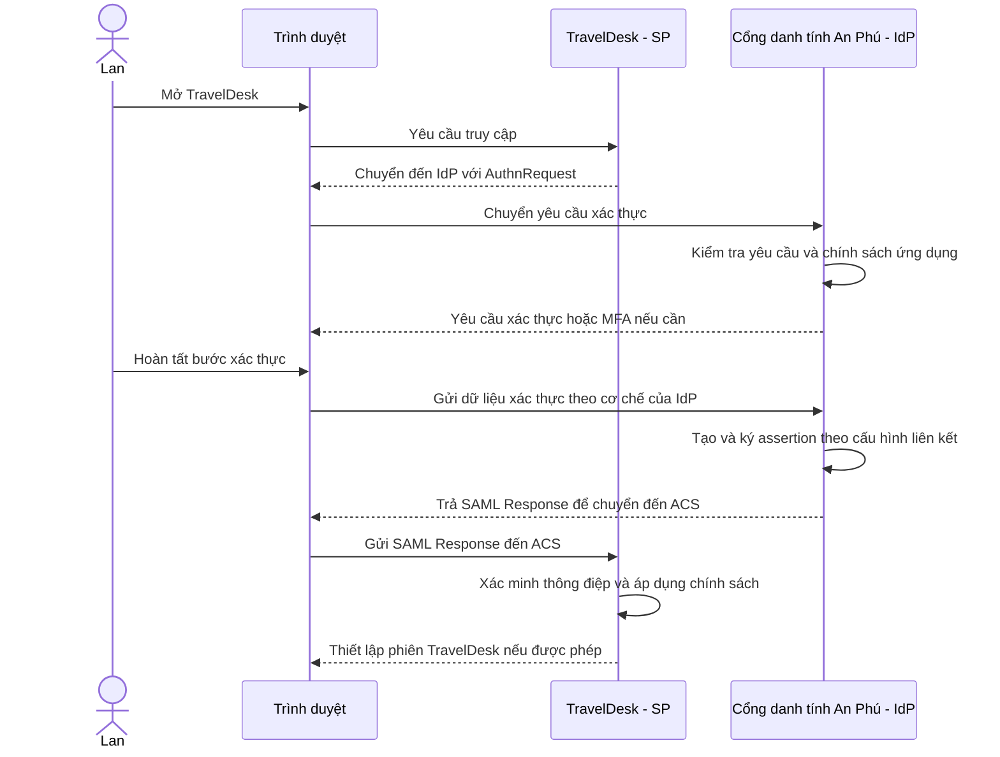

# SAML identity provider

SAML identity provider, thường viết tắt là **IdP**, là bên quản lý thông tin danh tính và cung cấp kết quả xác thực cho các dịch vụ khác trong một quan hệ liên kết danh tính. Thay vì mỗi ứng dụng tự xác thực người dùng bằng mật khẩu riêng, ứng dụng có thể dựa vào thông tin mà IdP đáng tin cậy cung cấp. [OASIS SAML 2.0 Glossary, thuật ngữ Identity Provider](https://docs.oasis-open.org/security/saml/v2.0/saml-glossary-2.0-os.pdf)

Bài học tập trung vào vai trò IdP trong SAML 2.0 Web Browser SSO: IdP xác thực người dùng, áp dụng chính sách và phát hành assertion cho đúng ứng dụng. Đây là một cách sử dụng SAML phổ biến trong IAM doanh nghiệp, không phải toàn bộ khả năng của tiêu chuẩn SAML.

## 1. Nhận diện IdP trong một hệ thống

Giả sử công ty An Phú dùng một cổng danh tính nội bộ và ứng dụng quản lý công tác TravelDesk:

| Thành phần | Vai trò trong ví dụ | Trách nhiệm |
| --- | --- | --- |
| Cổng danh tính An Phú | Identity provider | Xác thực nhân viên và cung cấp kết quả cho TravelDesk |
| TravelDesk | Service provider, viết tắt SP | Tiếp nhận kết quả, thiết lập phiên ứng dụng và kiểm tra quyền nghiệp vụ |
| Lan | Người dùng | Thực hiện quy trình đăng nhập theo chính sách của công ty |
| Trình duyệt của Lan | Công cụ tương tác | Chuyển người dùng và thông điệp giữa các bên |
| Kho tài khoản nhân viên | Nguồn dữ liệu danh tính | Cung cấp tài khoản, trạng thái hoặc thuộc tính mà IdP được phép sử dụng |

Trong kiến trúc giả định này, kho tài khoản và IdP là hai thành phần có thể tách biệt. Kho dữ liệu LDAP chứa tài khoản chưa tự trở thành SAML IdP; cần thành phần thực hiện giao thức và chính sách liên kết.

TravelDesk không cần nhận mật khẩu công ty của Lan trong luồng SSO này. Nó cần xác minh thông điệp SAML của IdP đã được thiết lập tin cậy.

Một sản phẩm IAM có thể đồng thời hỗ trợ SAML, OIDC và các giao thức khác. Việc cùng một sản phẩm cung cấp nhiều vai trò không khiến thông điệp SAML trở thành ID Token hay access token của OAuth.

## 2. IdP thực hiện những việc gì?

Trong TravelDesk giả định, đội IAM giao cho IdP các trách nhiệm sau:

1. Nhận biết ứng dụng đang yêu cầu đăng nhập và xác định cấu hình liên kết của nó.
2. Xác thực Lan theo chính sách: có thể dùng mật khẩu, phương thức không mật khẩu, MFA hoặc phiên đã có nếu được phép.
3. Kiểm tra Lan có được sử dụng TravelDesk hay không.
4. Chọn định danh và thuộc tính được phép gửi riêng cho TravelDesk.
5. Phát hành assertion với đích nhận, thời gian và nội dung phù hợp.
6. Bảo vệ khóa ký, ghi nhận sự kiện và trả lỗi khi không đáp ứng được yêu cầu.

Danh sách này là cách phân chia trách nhiệm cho ví dụ, không có nghĩa SAML bắt buộc một phương thức đăng nhập cụ thể. Cách IdP xác thực và mức độ đảm bảo danh tính phải được thiết kế theo nhu cầu của hệ thống.

Ví dụ, Lan có tài khoản công ty nhưng chưa được gán sử dụng TravelDesk. IdP có thể từ chối việc đăng nhập vào ứng dụng này dù Lan đã xác thực thành công. Điều đó tách việc “đúng người” khỏi việc “được phép dùng ứng dụng”.

IdP cũng không nhất thiết xác thực lại từ đầu mỗi lần chuyển ứng dụng. Một phiên IdP còn phù hợp có thể giúp trải nghiệm SSO thuận tiện hơn; ứng dụng nhạy cảm vẫn cần quy định khi nào phải yêu cầu xác thực mới hoặc mức đảm bảo cao hơn.

## 3. Theo dõi luồng SP khởi tạo đăng nhập

Trong luồng SP-initiated SSO, Lan bắt đầu từ TravelDesk. SP tạo yêu cầu xác thực, IdP xử lý rồi gửi kết quả về dịch vụ tiếp nhận assertion của SP, thường gọi là ACS, viết tắt của Assertion Consumer Service. [OASIS SAML 2.0 Profiles, mục 4.1](https://docs.oasis-open.org/security/saml/v2.0/saml-profiles-2.0-os.pdf)



Sơ đồ lược bỏ chi tiết encoding, binding và các tham số. Nó cho thấy trong lựa chọn chuyển qua trình duyệt, dữ liệu đi qua thiết bị của người dùng trước khi đến SP. SP không được coi nội dung là đáng tin chỉ vì request có trường mang tên `SAMLResponse`.

IdP phải kiểm tra ACS trong yêu cầu thuộc đúng SP; không gửi kết quả đến một URL tùy ý do người gửi request chọn. Quy tắc này vẫn cần áp dụng dù yêu cầu có chữ ký hay không. [OASIS SAML 2.0 Profiles, mục 4.1.4.1](https://docs.oasis-open.org/security/saml/v2.0/saml-profiles-2.0-os.pdf)

Trong ví dụ, nếu một request yêu cầu gửi kết quả của TravelDesk sang `https://other.example.test/collect`, IdP phải xử lý theo cấu hình tin cậy, thay vì cho rằng đăng nhập thành công là đủ để chấp nhận đích trả về.

## 4. Assertion truyền đạt điều gì?

SAML assertion là dữ liệu XML có thể chứa các phát biểu về xác thực, thuộc tính hoặc quyết định cấp quyền. Trong Web Browser SSO, cần chú ý thông tin về người được xác thực và sự kiện xác thực; thuộc tính bổ sung tùy thỏa thuận liên kết. [OASIS SAML 2.0 Core, phần 2](https://docs.oasis-open.org/security/saml/v2.0/saml-core-2.0-os.pdf)

Với TravelDesk, có thể diễn giải một kết quả giả định bằng bản tóm tắt sau:

```text
Bên phát hành:       IdP của An Phú
Chủ thể:            person-7f2a
Ứng dụng nhận:      TravelDesk
Thời điểm xác thực: 09:00
Thông tin bổ sung:  đơn vị Công tác, nhóm Travel-Users
Giới hạn sử dụng:   đúng ứng dụng, đúng đích nhận, trong khoảng thời gian cho phép
```

Đây là cách mô tả nội dung, không phải assertion XML hợp lệ và không thể dùng để đăng nhập. Trong triển khai thật, thư viện SAML phải kiểm tra cấu trúc, chữ ký và quy tắc giao thức trước khi ứng dụng sử dụng dữ liệu.

Các thành phần như `Issuer`, `Subject`, `AuthnStatement`, `AttributeStatement` và `Conditions` giúp biểu diễn những ý nghĩa khác nhau. Không nên gộp tất cả thành một chuỗi “user đã đăng nhập”. [OASIS SAML 2.0 Core, phần 2](https://docs.oasis-open.org/security/saml/v2.0/saml-core-2.0-os.pdf)

Ví dụ, thông tin “Lan thuộc nhóm Travel-Users” là một thuộc tính được IdP cung cấp. TravelDesk vẫn cần chính sách để quyết định nhóm ấy được tạo đề nghị công tác, duyệt đề nghị hay chỉ xem lịch sử.

## 5. Metadata là một phần của thiết lập tin cậy

Metadata SAML mô tả thông tin như định danh thực thể, vai trò, endpoint, binding và khóa hoặc chứng thư. Với IdP hỗ trợ SSO, metadata có thành phần `IDPSSODescriptor`; SP có cấu hình mô tả vai trò tương ứng. [OASIS SAML 2.0 Metadata](https://docs.oasis-open.org/security/saml/v2.0/saml-metadata-2.0-os.pdf)

Một bộ giá trị minh họa cho quan hệ An Phú–TravelDesk:

| Thông tin | Giá trị giả định | Ý nghĩa |
| --- | --- | --- |
| IdP entityID | `https://idp.anphu.example.test/saml` | Định danh IdP trong liên kết |
| IdP SSO endpoint | `https://idp.anphu.example.test/sso` | Địa chỉ tiếp nhận yêu cầu đăng nhập theo binding đã chọn |
| SP entityID | `https://traveldesk.example.test/saml` | Định danh TravelDesk trong liên kết |
| SP ACS | `https://traveldesk.example.test/saml/acs` | Địa chỉ SP tiếp nhận kết quả |
| Khóa xác minh chữ ký IdP | Khóa công khai đã được chấp thuận | Dùng xác minh nội dung IdP ký |

`entityID` là định danh, không bắt buộc là một trang web có thể mở. Hai URL trông gần giống nhau không đồng nghĩa cùng chức năng. IdP SSO endpoint, SP entityID và ACS không nên được điền thay thế cho nhau.

Trong ví dụ, TravelDesk phải tin cậy đúng IdP của An Phú. Một IdP khác có cùng tên hiển thị “An Phú Login” chưa đủ để được chấp nhận. Quản trị viên cần kiểm chứng cấu hình nhận từ kênh đã xác thực, không lấy một tệp metadata bất kỳ do người đang đăng nhập gửi lên.

Metadata cũng không phải giấy phép tự động cho mọi người dùng của IdP vào mọi tenant. TravelDesk vẫn cần ràng buộc IdP với đúng tổ chức và chính sách tài khoản.

## 6. Chữ ký, mã hóa và khóa tin cậy

Chữ ký giúp bên nhận kiểm tra tính toàn vẹn và nguồn phát hành theo khóa đã tin cậy. Mã hóa bảo vệ nội dung trước bên không có khóa giải mã; hai chức năng khác nhau. Cần phân biệt chứng thư ký SAML với chứng thư TLS của website IdP. [OWASP SAML Security Cheat Sheet](https://cheatsheetseries.owasp.org/cheatsheets/SAML_Security_Cheat_Sheet.html)

Trong ví dụ:

- IdP giữ khóa riêng để ký.
- TravelDesk có khóa công khai phù hợp để xác minh.
- Nếu triển khai mã hóa assertion cho TravelDesk, IdP cần khóa mã hóa của SP và SP giữ khóa riêng giải mã tương ứng.

TravelDesk không cần và không nên được cấp khóa riêng dùng để ký của IdP. Nếu cùng một khóa ký phục vụ nhiều SP mà bị lộ, hậu quả có thể ảnh hưởng nhiều quan hệ liên kết.

Một chữ ký hợp lệ về mặt toán học với khóa do người gửi tự chọn chưa chứng minh đó là IdP công ty. SP phải dùng nguồn khóa tin cậy đã cấu hình và chỉ sử dụng đúng nội dung được bảo vệ. Dùng thư viện SAML phù hợp giúp xử lý các vấn đề XML, bao gồm nguy cơ đọc nhầm phần dữ liệu ngoài nội dung đã xác minh. [OWASP SAML Security Cheat Sheet, Validate Signatures](https://cheatsheetseries.owasp.org/cheatsheets/SAML_Security_Cheat_Sheet.html#validate-signatures)

Về vận hành, đổi khóa ký cần phối hợp với các SP. Ví dụ, đội IAM có thể công bố khóa mới qua quy trình metadata được kiểm soát, xác nhận TravelDesk đã nhận khóa, chuyển sang ký bằng khóa mới rồi loại bỏ khóa cũ theo kế hoạch. Thời điểm và khoảng chuyển tiếp phụ thuộc khả năng của các bên; không tự đặt một quy tắc chung cho mọi sản phẩm.

## 7. IdP không thay SP kiểm tra mọi thứ

IdP có trách nhiệm phát hành kết quả đúng chính sách; SP có trách nhiệm xác minh và sử dụng kết quả đúng mục đích. Không thể đánh giá toàn bộ đăng nhập chỉ bằng câu “IdP đã xác thực Lan thành công”.

Với TravelDesk, những câu hỏi cần được giải quyết gồm:

| Câu hỏi | Ví dụ về lỗi cần tránh |
| --- | --- |
| Kết quả do đúng IdP đã tin cậy phát hành chưa? | Chấp nhận một thông điệp từ IdP không thuộc tenant của An Phú |
| Nội dung được sử dụng có được bảo vệ đúng cách chưa? | Kiểm tra chữ ký ở một phần rồi đọc danh tính ở phần khác |
| Kết quả dành cho TravelDesk chưa? | Dùng kết quả được tạo cho ứng dụng nhân sự để đăng nhập TravelDesk |
| Kết quả được gửi đến đúng ACS chưa? | Chấp nhận kết quả dành cho endpoint khác |
| Thời gian và quan hệ với yêu cầu đăng nhập có phù hợp chưa? | Nhận lại kết quả cũ hoặc gắn nhầm giao dịch |
| Assertion đã bị dùng trước đó chưa? | Cho phép phát lại một bearer assertion để tạo thêm phiên |

Trong Web Browser SSO, các kiểm tra liên quan audience, recipient, thời gian, đối chiếu yêu cầu và chống replay thuộc quy tắc của profile. Cách đối chiếu yêu cầu có khác biệt khi hỗ trợ phản hồi không được SP khởi tạo. [OASIS SAML 2.0 Profiles, mục 4.1.4–4.1.5](https://docs.oasis-open.org/security/saml/v2.0/saml-profiles-2.0-os.pdf)

Bảng trên là cách đọc trách nhiệm trong ví dụ, không phải một thuật toán đủ để tự viết bộ xác minh XML. Cấu hình và thư viện phải tuân thủ profile, binding cũng như thỏa thuận đã chọn.

## 8. Định danh và thuộc tính cần contract rõ ràng

Giả sử TravelDesk cần liên kết Lan với một tài khoản nội bộ. Lựa chọn “cứ dùng email” có vẻ thuận tiện nhưng cần xem xét email có thay đổi, bị tái cấp hoặc khác nhau giữa các tổ chức hay không.

Một contract giả định của An Phú có thể quy định:

```text
Định danh liên kết: mã ổn định được cấp riêng cho TravelDesk
Thuộc tính hiển thị: displayName
Thuộc tính liên hệ: email
Nhóm được gửi: chỉ các nhóm liên quan đến TravelDesk
Nguồn quản lý: hệ thống danh tính nhân viên
```

Đây là quyết định thiết kế của ví dụ. Kiểu `NameID`, format và các qualifier phải thống nhất giữa IdP và SP; không nên mặc định mọi `NameID` đều ổn định hoặc có ý nghĩa như email.

Trong môi trường nhiều tenant, một định danh cục bộ giống nhau có thể xuất hiện ở các IdP khác nhau. TravelDesk cần xét ngữ cảnh liên kết và tổ chức, thay vì dùng riêng chuỗi `person-7f2a` làm khóa toàn hệ thống.

Về thuộc tính, gửi toàn bộ nhóm nhân viên cho mọi ứng dụng làm tăng lượng dữ liệu bị chia sẻ. Trong ví dụ, TravelDesk chỉ cần biết Lan có được dùng ứng dụng và thuộc nhóm xử lý công tác nào. Nó không cần nhận nhóm quản trị lương hoặc những thuộc tính cá nhân không phục vụ chức năng này.

Nếu tên nhóm thay đổi từ `Travel-Users` thành `Business-Travel-Users`, đội IAM và đội ứng dụng phải hiểu tác động mapping. Không được xử lý một nhóm lạ bằng cách mặc định cấp quyền cao nhất để “tránh lỗi đăng nhập”.

## 9. MFA và mức đảm bảo xác thực

Đưa ứng dụng về IdP chung giúp công ty có một nơi áp dụng chính sách xác thực. Tuy vậy, “đăng nhập qua IdP” không tự có nghĩa là “vừa hoàn thành MFA”.

Trong ví dụ, Lan có thể đã xác thực từ buổi sáng bằng một phương thức được phép cho ứng dụng thông thường. Đến buổi chiều, TravelDesk yêu cầu duyệt khoản chi lớn. Đội thiết kế cần xác định có yêu cầu xác thực mới hay mức đảm bảo khác không.

Thông tin về sự kiện và ngữ cảnh xác thực có thể được truyền trong SAML, nhưng ý nghĩa mà SP chấp nhận phải thống nhất với IdP. Không suy ra mức đảm bảo chỉ từ tên nhà cung cấp hoặc từ việc assertion có chữ ký. [OASIS SAML 2.0 Core, mục 2.7.2](https://docs.oasis-open.org/security/saml/v2.0/saml-core-2.0-os.pdf)

Cũng không nên gắn nhãn MFA chỉ vì tài khoản đã đăng ký hai phương thức. Điều cần biết là chính sách nào đã áp dụng và bằng chứng nào phù hợp với yêu cầu của giao dịch.

Trong TravelDesk giả định, quyền duyệt chi phí vẫn do chính sách nghiệp vụ quyết định. Xác thực mạnh hơn giúp tăng độ tin cậy về người thực hiện, không tự biến một nhân viên thành người có quyền duyệt.

## 10. IdP-initiated SSO và vòng đời phiên

Một cấu hình khác là Lan bắt đầu từ cổng ứng dụng của IdP rồi chọn biểu tượng TravelDesk. Đây thường được gọi là IdP-initiated SSO. SP cần chủ động quyết định có hỗ trợ và bảo vệ luồng ấy hay không; không nên bỏ kiểm tra một cách tự động khi thiếu yêu cầu ban đầu.

So với luồng SP khởi tạo, TravelDesk không có cùng giao dịch đăng nhập do chính nó tạo để đối chiếu. Vì vậy, mở hỗ trợ luồng này là một quyết định cấu hình cần đánh giá riêng, không phải cách sửa nhanh lỗi `InResponseTo`. [OWASP SAML Security Cheat Sheet, Unsolicited Response Considerations](https://cheatsheetseries.owasp.org/cheatsheets/SAML_Security_Cheat_Sheet.html#unsolicited-response-ie-idp-initiated-sso-considerations-for-service-providers)

Sau khi đăng nhập thành công, phiên TravelDesk và phiên IdP vẫn có vòng đời riêng. Việc assertion hết khoảng chấp nhận không tự xóa một phiên ứng dụng đã được tạo hợp lệ; SP phải quản lý giới hạn phiên theo chính sách và các ràng buộc áp dụng.

Tương tự, khóa tài khoản Lan tại IdP có thể chặn việc cấp kết quả đăng nhập mới nhưng chưa đủ để kết luận phiên TravelDesk đang tồn tại đã kết thúc ngay. Khi offboarding, công ty cần phối hợp trạng thái tài khoản, cấp phát ứng dụng, quyền và phiên.

SAML SSO cũng không tự đồng bộ đầy đủ việc tạo hoặc xóa tài khoản ứng dụng. TravelDesk có thể dùng tài khoản đã được cấp phát trước hoặc cơ chế tạo tài khoản khi đăng nhập theo chính sách riêng. Quản lý vòng đời tài khoản phải có quy trình xác định.

Nếu triển khai Single Logout, các bên cần hỗ trợ và cấu hình tương thích. Không nên cam kết “đăng xuất ở một nơi là đăng xuất mọi ứng dụng” khi chưa biết các hệ thống tham gia xử lý thế nào.

## 11. Vận hành IdP như một thành phần có ảnh hưởng rộng

Trong An Phú, một thay đổi IdP có thể tác động đồng thời nhiều ứng dụng. Vì vậy, đội vận hành cần kiểm soát quyền quản trị liên kết, quyền sửa mapping và quyền sử dụng khóa ký.

Ví dụ, việc đổi mapping `employeeType` thành quyền quản trị TravelDesk không chỉ là sửa một nhãn hiển thị. Nó có thể thay đổi người được cấp quyền. Cần theo dõi ai sửa, sửa giá trị gì và những ứng dụng nào chịu ảnh hưởng.

Một bản ghi vận hành có thể chứa mã giao dịch, IdP và SP liên quan, định danh nội bộ phù hợp, kết quả xác thực cùng lý do từ chối. Không nên ghi nguyên assertion và dữ liệu xác thực vào log thông thường chỉ để dễ gỡ lỗi.

Khả năng sẵn sàng cũng cần được hiểu đúng. Khi IdP gặp sự cố, đăng nhập mới có thể bị ảnh hưởng, trong khi một số phiên SP hiện có vẫn hoạt động theo chính sách của chúng. Kế hoạch phục hồi phải dựa trên hành vi đã thiết kế, thay vì giả định toàn bộ ứng dụng luôn có cùng trạng thái.

## 12. Tự kiểm tra cách hiểu

**Tình huống 1:** Lan xác thực thành công tại IdP nhưng chưa được gán dùng TravelDesk. Có bắt buộc cho phép đăng nhập TravelDesk không?

Không. Xác thực người dùng và chính sách cho sử dụng ứng dụng là các quyết định riêng.

**Tình huống 2:** Thông điệp có chữ ký đúng với một chứng thư nằm ngay trong thông điệp. Đã đủ để TravelDesk tin cậy chưa?

Chưa. SP phải xác minh theo nguồn khóa tin cậy đã được thiết lập cho đúng IdP, không tự tin một khóa chỉ vì người gửi kèm theo.

**Tình huống 3:** IdP gửi thuộc tính `department=Finance`. TravelDesk có nên tự cấp quyền duyệt mọi khoản chi không?

Không. Ý nghĩa thuộc tính và mapping quyền cần chính sách nghiệp vụ rõ ràng.

**Tình huống 4:** Khóa tài khoản ở IdP có đảm bảo mọi phiên ứng dụng kết thúc ngay không?

Không thể kết luận như vậy. Cần cơ chế quản lý vòng đời phiên và quyền ở các ứng dụng liên quan.

Khi phân tích một SAML IdP, hãy làm rõ nó xác thực ai, dựa trên chính sách nào, cung cấp thông tin gì, cho SP nào và bằng quan hệ tin cậy nào. Những câu hỏi ấy giúp kết nối SSO với việc quản lý danh tính và quyền truy cập trong toàn hệ thống.
