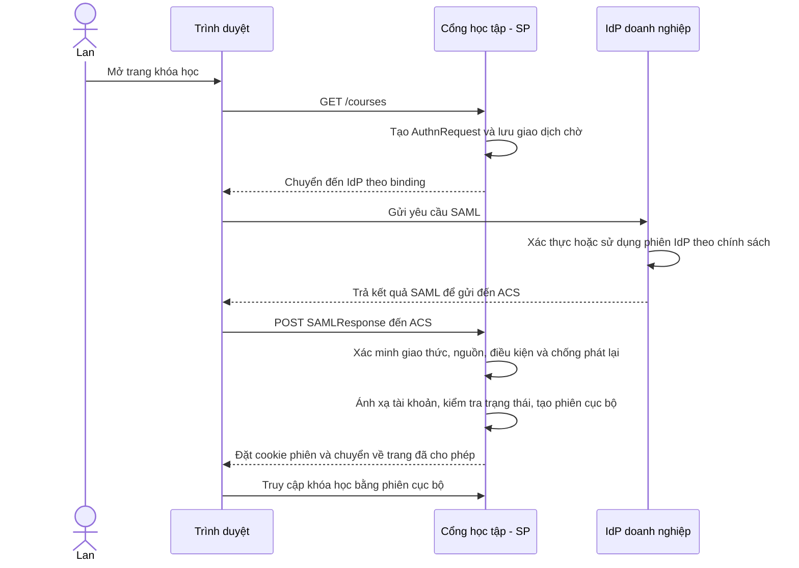

# SAML service provider

## 1. Service provider là ứng dụng dựa vào kết quả xác thực từ IdP

Trong SAML, **service provider**, viết tắt **SP**, là bên cung cấp dịch vụ cho người dùng và dựa vào thông tin từ một identity provider, viết tắt **IdP**, để thiết lập ngữ cảnh danh tính phù hợp. Với Web Browser SSO, SP thường là ứng dụng mà người dùng muốn truy cập: cổng học tập, hệ thống nhân sự hoặc công cụ quản lý công việc.

Giả sử nhân viên Lan muốn vào cổng học tập của công ty:

- **SP:** cổng học tập tại `https://learning.example.com`.
- **IdP:** hệ thống danh tính doanh nghiệp tại `https://identity.example.com`.
- **Người dùng:** Lan, tương tác thông qua trình duyệt.

Cổng học tập chuyển Lan đến IdP để thực hiện hoặc kiểm tra việc xác thực. IdP gửi kết quả SAML về cổng học tập qua luồng đã thống nhất. SP phải kiểm tra kết quả đó trước khi tạo phiên đăng nhập cho Lan.

SP là bên **dựa vào và kiểm chứng phát biểu từ IdP**, không phải bên mặc nhiên tin mọi XML gửi đến. Vai trò này trong Web Browser SSO được mô tả tại [OASIS SAML 2.0 Profiles, mục 4.1](https://docs.oasis-open.org/security/saml/v2.0/saml-profiles-2.0-os.pdf).

Trong mô hình minh họa, SP không cần thu mật khẩu doanh nghiệp của Lan. Tuy nhiên, SP vẫn chịu trách nhiệm về việc tài khoản nội bộ có được truy cập cổng học tập hay không, được thực hiện những thao tác nào và phiên cục bộ tồn tại bao lâu.

## 2. Phân chia trách nhiệm giữa IdP và SP

| Trách nhiệm | IdP | SP trong ví dụ cổng học tập |
| --- | --- | --- |
| Quản lý quá trình xác thực doanh nghiệp | Xác thực Lan, áp dụng MFA và chính sách xác thực | Yêu cầu bối cảnh xác thực phù hợp nếu luồng hỗ trợ và kiểm tra kết quả |
| Phát hành kết quả SAML | Tạo response/assertion theo quan hệ tin cậy | Tiếp nhận và xác minh kết quả |
| Bảo vệ khóa | Bảo vệ khóa ký của IdP | Tin đúng khóa của IdP; bảo vệ khóa riêng của SP nếu có ký hoặc giải mã |
| Nhận diện người dùng trong ứng dụng | Cung cấp định danh và thuộc tính đã thỏa thuận | Ánh xạ đến tài khoản nội bộ theo quy tắc an toàn |
| Phân quyền nghiệp vụ | Có thể cung cấp nhóm hoặc thuộc tính liên quan | Quyết định ai được quản lý khóa học, xem báo cáo, sửa nội dung |
| Quản lý phiên ứng dụng | Có phiên riêng tại IdP | Tạo, duy trì và kết thúc phiên cục bộ của cổng học tập |

Ví dụ, IdP xác nhận Lan đã xác thực không có nghĩa Lan được quản trị mọi khóa học. SP còn phải xét quyền được cấp, trạng thái tài khoản và phạm vi tài nguyên.

Một nhà cung cấp SaaS có thể đóng vai trò SP đối với IdP của khách hàng. Ngược lại, một hệ thống có thể vừa là SP trong quan hệ này vừa là IdP hoặc broker trong quan hệ khác. Tên vai trò gắn với từng quan hệ giao thức, không phải nhãn cố định cho toàn bộ sản phẩm.

## 3. Các thông tin định danh và endpoint của SP

### 3.1. Entity ID không đồng nghĩa địa chỉ nhận response

**Entity ID** là định danh của một thực thể SAML. Với cổng học tập, nhóm thiết kế có thể chọn:

```text
SP entityID: https://learning.example.com/saml/metadata
ACS URL:     https://learning.example.com/saml/acs
IdP entityID: https://identity.example.com/saml
IdP SSO URL:  https://identity.example.com/saml/sso
```

Các URL ở đây chỉ là ví dụ. Entity ID có thể có hình thức giống URL, nhưng chức năng của nó là định danh; nó không mặc nhiên là một endpoint mà trình duyệt phải truy cập.

**Assertion Consumer Service**, viết tắt **ACS**, là endpoint ở SP tiếp nhận kết quả đăng nhập SAML theo binding được hỗ trợ. Trong ví dụ, browser có thể gửi `SAMLResponse` đến `/saml/acs` bằng HTTP POST. Việc endpoint nhận được request chưa chứng minh request đó hợp lệ.

Sự phân biệt này giúp giải thích một lỗi cấu hình thường gặp: assertion dành cho đúng Entity ID vẫn có thể bị gửi đến sai ACS URL, hoặc response đến đúng ACS nhưng audience lại dành cho một SP khác.

### 3.2. Metadata mô tả quan hệ tích hợp

Metadata SAML có thể mô tả định danh, các endpoint, binding và khóa công khai dùng cho những chức năng liên quan. Phía SP sử dụng cấu trúc vai trò `SPSSODescriptor`; endpoint nhận kết quả được công bố bằng `AssertionConsumerService`. Những yêu cầu như `AuthnRequestsSigned` và `WantAssertionsSigned` cũng là phần có thể khai báo trong metadata. Xem [OASIS SAML 2.0 Metadata](https://docs.oasis-open.org/security/saml/v2.0/saml-metadata-2.0-os.pdf).

Ví dụ về hợp đồng tích hợp của cổng học tập:

| Thông tin | Giá trị hoặc quyết định minh họa |
| --- | --- |
| SP entityID | Định danh riêng của cổng học tập ở môi trường production |
| ACS URL và binding | Endpoint HTTPS và HTTP POST đã đăng ký với IdP |
| IdP được chấp nhận | Định danh IdP của đúng doanh nghiệp |
| Khóa kiểm tra chữ ký IdP | Lấy từ metadata hoặc cấu hình đã được xác thực nguồn và phê duyệt |
| Chữ ký request của SP | Bật và cấu hình khóa theo yêu cầu của quan hệ tích hợp |
| Mã hóa assertion | Chỉ áp dụng khi hai bên đã thống nhất và SP có khả năng giải mã |
| Thuộc tính nhận diện người dùng | Định danh ổn định, có ngữ nghĩa rõ ràng giữa hai bên |
| Thuộc tính nhóm/quyền | Chỉ nhận và ánh xạ các giá trị thuộc hợp đồng được phép |

Không tải một metadata URL do người gọi tùy ý cung cấp rồi tin các khóa bên trong. Metadata là dữ liệu thiết lập niềm tin, nên việc đưa nó vào cấu hình phải có quy trình xác thực nguồn và kiểm soát thay đổi.

### 3.3. Phân biệt khóa của IdP và khóa của SP

| Hoạt động | Bên giữ khóa riêng tương ứng | Bên dùng khóa công khai |
| --- | --- | --- |
| IdP ký kết quả SAML | IdP | SP kiểm tra chữ ký |
| SP ký request khi quan hệ tích hợp yêu cầu | SP | IdP kiểm tra chữ ký |
| IdP mã hóa assertion cho SP khi đã cấu hình | SP giữ khóa riêng giải mã | IdP dùng khóa công khai của SP để mã hóa |

Không yêu cầu IdP gửi khóa riêng để SP “xác minh”. Chữ ký và mã hóa giải quyết các mục tiêu khác nhau: xác thực nguồn/tính toàn vẹn và bảo mật nội dung. Cấu hình giải mã thành công không thay thế việc xác minh nguồn phát hành.

## 4. SP tham gia luồng SSO như thế nào?

Một luồng phổ biến bắt đầu tại ứng dụng, gọi là **SP-initiated SSO**:



Trong ví dụ, SP lưu một giao dịch đang chờ, có thể gồm ID request, IdP dự kiến, thời hạn, liên hệ với trình duyệt và đích quay lại được cho phép. Thiết kế cụ thể phụ thuộc thư viện, nhưng phải bảo vệ được quan hệ giữa yêu cầu bắt đầu và kết quả nhận về.

`AuthnRequest` thể hiện yêu cầu xác thực của SP. `Response` là thông điệp kết quả; bên trong có thể chứa assertion. Assertion mang phát biểu về chủ thể, xác thực hoặc thuộc tính, cùng các ràng buộc sử dụng. Cấu trúc và ngữ nghĩa của các thành phần này được định nghĩa tại [OASIS SAML 2.0 Core](https://docs.oasis-open.org/security/saml/v2.0/saml-core-2.0-os.pdf).

Trình duyệt chuyển thông điệp giữa các bên nhưng không phải nguồn có thẩm quyền tự khai danh tính. Người dùng có thể kiểm soát dữ liệu gửi từ browser; SP phải dựa vào các phép kiểm tra giao thức và mật mã, không dựa vào việc biểu mẫu có tên trường `SAMLResponse`.

## 5. ACS phải kiểm tra gì trước khi tạo phiên?

Đây là danh sách các lớp kiểm tra cần hiểu khi triển khai SP. Nó không thay thế toàn bộ quy tắc của profile, binding và thư viện SAML được sử dụng.

| Lớp kiểm tra | Điều cần xác nhận | Ví dụ bị từ chối trong hệ thống minh họa |
| --- | --- | --- |
| Cấu trúc và trạng thái | Thông điệp hợp lệ theo giao thức; kết quả thành công trước khi xử lý đăng nhập | Response lỗi nhưng ứng dụng vẫn cố lấy NameID |
| Nguồn phát hành | Issuer là IdP được chấp nhận cho quan hệ này | Assertion từ IdP của doanh nghiệp khác |
| Bảo vệ mật mã | Chữ ký đúng với khóa tin cậy và đáp ứng yêu cầu của profile/binding/cấu hình | Có phần tử Signature nhưng khóa không thuộc IdP được tin cậy |
| Bên nhận và đích | Audience, Recipient và Destination được kiểm tra theo ngữ nghĩa áp dụng | Assertion dành cho cổng nhân sự được gửi sang cổng học tập |
| Thời gian | Các điều kiện thời gian và giới hạn subject confirmation còn hợp lệ | Kết quả đã quá thời hạn được chấp nhận |
| Tương quan giao dịch | Với luồng có request, `InResponseTo` khớp giao dịch đang chờ và đúng ngữ cảnh | Response cho request đã hết hạn hoặc không được SP tạo |
| Chống phát lại | Assertion đã dùng không được tiếp tục dùng để đăng nhập lại | Cùng assertion gửi lần hai đến một node SP khác |
| Dữ liệu ứng dụng | Định danh, thuộc tính bắt buộc và trạng thái tài khoản đáp ứng chính sách | Tài khoản cục bộ đã bị vô hiệu hóa |

Các quy tắc cho Web Browser SSO, bao gồm Recipient, thời hạn bearer subject confirmation, tương quan request và chống phát lại, nằm trong [OASIS SAML 2.0 Profiles, mục 4.1.4](https://docs.oasis-open.org/security/saml/v2.0/saml-profiles-2.0-os.pdf).

### Chữ ký phải bảo vệ đúng dữ liệu được sử dụng

Một lỗi nghiêm trọng là kiểm tra chữ ký trên một phần XML nhưng lại lấy danh tính từ một phần khác chưa được bảo vệ. Kiểu nhầm lẫn này liên quan đến XML Signature Wrapping.

SP phải sử dụng kết quả đã được thư viện xác minh đúng cách, thay vì tự tìm một phần tử `NameID` bất kỳ bằng truy vấn XML rộng. Cần dùng parser được gia cố, giới hạn xử lý XML và tránh external entity không được phép. Xem [OWASP SAML Security Cheat Sheet](https://cheatsheetseries.owasp.org/cheatsheets/SAML_Security_Cheat_Sheet.html).

Yêu cầu chữ ký trên response và/hoặc assertion phụ thuộc profile, binding và cấu hình được thỏa thuận. Không tự hạ yêu cầu chữ ký để khắc phục một lỗi tích hợp. Trong ví dụ, nếu hợp đồng của SP yêu cầu assertion được ký, một assertion không đáp ứng yêu cầu đó phải bị từ chối dù response có chứa những thông tin nhìn có vẻ hợp lý.

### Thời hạn ngắn chưa đủ để chống phát lại

Giả sử assertion hợp lệ trong vài phút. Nếu ai đó lấy được thông điệp và gửi lại ngay trong khoảng này, việc chỉ kiểm tra thời gian không phát hiện được nó đã được sử dụng.

Trong mô hình cổng học tập có nhiều node, cơ chế ghi nhận assertion đã dùng phải có tác dụng trên cả cụm và thực hiện việc nhận diện lần dùng đầu tiên một cách phù hợp. Nếu mỗi node chỉ nhớ trong bộ nhớ riêng, kẻ gửi lại có thể thử sang node khác. Đây là yêu cầu thiết kế vận hành của hệ thống minh họa, không chỉ là một lựa chọn parser XML.

## 6. Ánh xạ kết quả xác thực sang tài khoản và quyền

Sau khi xác minh giao thức thành công, SP cần chuyển từ danh tính liên kết sang danh tính mà ứng dụng sử dụng.

Một thiết kế minh họa có thể tổ chức quan hệ:

```text
IdP đã được xác minh + định danh subject đã thỏa thuận
                         |
                         v
               Liên kết danh tính nội bộ
                         |
                         v
             Tài khoản trong cổng học tập
                         |
                         v
          Quyền theo khóa học, lớp và tổ chức
```

### 6.1. Không giả định mọi NameID đều ổn định

NameID có nhiều format và ngữ nghĩa khác nhau; format transient không thích hợp để mặc định coi là khóa tài khoản bền vững. Hai bên phải thống nhất định danh nào phù hợp cho việc liên kết tài khoản lâu dài.

Không lấy một chuỗi NameID bỏ qua issuer rồi gộp tài khoản giữa các doanh nghiệp. Cũng không tự động gộp tài khoản đặc quyền chỉ vì assertion có email trùng một email đang tồn tại. Ngữ nghĩa NameID được quy định trong [OASIS SAML 2.0 Core, mục 2.2 và mục 8.3](https://docs.oasis-open.org/security/saml/v2.0/saml-core-2.0-os.pdf).

Trong ví dụ, nhóm IAM có thể phê duyệt liên kết giữa một định danh nhân viên ổn định từ IdP doanh nghiệp và ID nội bộ của cổng học tập. Việc đổi email hiển thị sẽ không tự tạo thêm tài khoản hoặc chuyển quyền cho người khác.

### 6.2. JIT provisioning cần chính sách riêng

**Just-in-time provisioning**, gọi tắt là JIT, là lựa chọn tạo tài khoản nội bộ khi người dùng đăng nhập lần đầu. SAML SSO không bắt buộc ứng dụng phải bật JIT hoặc tự cấp quyền cao cho tài khoản mới.

Ví dụ, cổng học tập có thể chọn một trong hai chính sách:

| Chính sách | Hành vi ở lần đăng nhập đầu |
| --- | --- |
| Cấp tài khoản trước | Chỉ đăng nhập khi đã có liên kết/tài khoản được quản trị cấp trước |
| JIT có kiểm soát | Tạo tài khoản tối thiểu khi đến từ IdP và tổ chức được phép, đủ thuộc tính bắt buộc |

Cả hai cách vẫn cần kiểm soát trạng thái vô hiệu hóa. Không tự kích hoạt lại một tài khoản đã bị khóa chỉ vì IdP vừa phát hành assertion hợp lệ.

### 6.3. Thuộc tính nhóm không tự trở thành quyền quản trị

Giả sử IdP gửi thuộc tính nhóm có giá trị `training-authors`. SP có thể ánh xạ nhóm này đến quyền biên tập trong phạm vi đã thống nhất. Điều đó không có nghĩa mọi giá trị nhóm do mọi IdP gửi đều được tự đổi thành role cùng tên.

Một chính sách minh họa:

```text
Nếu:
  kết quả SAML đã được xác minh từ IdP doanh nghiệp A
  VÀ tài khoản cục bộ còn hoạt động
  VÀ nhóm training-authors thuộc hợp đồng được phê duyệt
Thì:
  ánh xạ đến quyền biên tập khóa học trong doanh nghiệp A

Khi cập nhật một khóa học:
  vẫn kiểm tra khóa học thuộc đúng phạm vi được cấp
```

Phép kiểm tra cuối kết nối SSO với RBAC hoặc ABAC của ứng dụng. Xác thực liên kết cung cấp danh tính; ứng dụng vẫn cần kiểm soát thao tác trên đối tượng cụ thể.

## 7. Phiên IdP, assertion và phiên SP có vòng đời khác nhau

| Thành phần | Vai trò | Ví dụ |
| --- | --- | --- |
| Phiên tại IdP | Giúp IdP nhận biết người dùng đã xác thực | Lan vào thêm một ứng dụng có thể không cần nhập lại mật khẩu nếu chính sách cho phép |
| SAML assertion | Mang phát biểu và điều kiện dùng trong giao dịch SAML | SP tiếp nhận và kiểm tra khi xử lý kết quả đăng nhập |
| Phiên cục bộ tại SP | Duy trì trạng thái đăng nhập của ứng dụng | Cookie phiên cho cổng học tập sau khi SSO thành công |

Trong luồng minh họa, sau khi đã tạo phiên cục bộ, cổng học tập không cần gửi lại cùng assertion trên mọi request xem khóa học. Browser dùng cơ chế phiên ứng dụng đã được thiết lập.

Thời hạn dùng assertion để chấp nhận đăng nhập không tự động là thời hạn duy nhất của phiên cục bộ. SP phải đặt idle timeout, absolute timeout và các ràng buộc khác phù hợp, đồng thời xử lý các giới hạn phiên mà thông điệp/profile áp dụng. Nếu có `SessionNotOnOrAfter`, không được mặc nhiên bỏ qua ngữ nghĩa của giới hạn đó.

Khi tạo phiên, SP cần đổi định danh phiên theo cơ chế của ứng dụng để tránh giữ lại một phiên trước xác thực không phù hợp. Cookie cần các thuộc tính bảo vệ thích hợp. Đặc biệt, SAML HTTP POST có thể là một request từ site khác; cấu hình cookie, SameSite và tương quan giao dịch phải được thiết kế theo luồng thực tế, không sửa bằng cách tắt toàn bộ bảo vệ CSRF của ứng dụng.

### Đăng xuất tại SP không mặc nhiên đăng xuất mọi nơi

Lan bấm đăng xuất cổng học tập có thể chỉ kết thúc phiên của SP. Nếu phiên IdP vẫn còn, lần truy cập sau có thể lại SSO thành công theo chính sách.

Single Logout, viết tắt SLO, là cơ chế riêng cần các bên hỗ trợ và cấu hình. Không coi việc có SSO là bằng chứng đã có SLO hoàn chỉnh, hoặc coi SLO là cơ chế tự động thu hồi mọi quyền và credential trong toàn hệ thống.

Đối với nghỉ việc hoặc mất quyền đặc biệt, cần cơ chế quản lý vòng đời tài khoản và quyền phù hợp, bao gồm xử lý các phiên cục bộ còn tồn tại. Không chỉ chờ lần đăng nhập SAML tiếp theo để phát hiện trạng thái đã thay đổi.

## 8. SP-initiated, IdP-initiated và RelayState

### 8.1. Luồng bắt đầu tại IdP là một chính sách hỗ trợ riêng

Trong **IdP-initiated SSO**, Lan bấm biểu tượng cổng học tập tại dashboard của IdP. SP có thể nhận kết quả mà không có AuthnRequest do nó khởi tạo trước đó, còn gọi là unsolicited response.

Không áp dụng phép đối chiếu một request chưa từng tồn tại như thể đây là SP-initiated SSO. Ngược lại, cũng không tắt kiểm tra tương quan của toàn bộ hệ thống chỉ để cho phép luồng này. SP phải quyết định rõ có hỗ trợ unsolicited response hay không và áp dụng đúng các ràng buộc tương ứng. Xem [OASIS SAML 2.0 Profiles, mục 4.1.5](https://docs.oasis-open.org/security/saml/v2.0/saml-profiles-2.0-os.pdf).

Với cổng học tập chỉ có nhu cầu bắt đầu đăng nhập từ ứng dụng, nhóm thiết kế có thể chỉ bật SP-initiated SSO. Nếu doanh nghiệp yêu cầu đăng nhập từ dashboard IdP, cần đánh giá và triển khai luồng bổ sung có chủ đích, đặc biệt các rủi ro liên quan việc thiếu giao dịch bắt đầu ở SP.

### 8.2. RelayState không phải bằng chứng danh tính

RelayState hỗ trợ mang trạng thái đi kèm một trao đổi SAML. Trong ví dụ, SP có thể dùng một giá trị ngẫu nhiên tham chiếu đến đích quay lại đã lưu phía server:

```text
RelayState: giá trị tham chiếu không đoán được
    -> giao dịch đăng nhập đang chờ
    -> đích quay lại: /courses/iam-fundamentals
```

SP không nên chuyển hướng đến bất kỳ URL ngoài nào chỉ vì người gọi đưa nó vào RelayState. Cần bảo vệ tính toàn vẹn, ràng buộc với ngữ cảnh giao dịch khi áp dụng và giới hạn đích được phép. RelayState không thay thế chữ ký, kiểm tra assertion hoặc tương quan `InResponseTo`.

## 9. Vận hành SP trong một hệ thống IAM

Một tích hợp SAML cần tiếp tục hoạt động an toàn sau ngày cấu hình đầu tiên. Với cổng học tập, có thể phân công các trách nhiệm vận hành sau:

| Công việc | Mục tiêu |
| --- | --- |
| Quản lý thay đổi metadata và khóa | Đổi khóa IdP/SP theo quy trình, kiểm tra trước và tránh tự tin một khóa chưa được phê duyệt |
| Đồng bộ thời gian | Giữ các kiểm tra thời hạn đáng tin cậy; không tăng dung sai vô hạn để che lỗi đồng hồ |
| Theo dõi nhiều node | Giao dịch chờ, phiên và chống phát lại hoạt động đúng khi request đi qua các node khác nhau |
| Kiểm tra địa chỉ công khai | Entity ID, ACS và URL sau reverse proxy khớp cấu hình production |
| Quản lý vòng đời quyền | Khi tài khoản bị vô hiệu hóa hoặc giảm quyền, các phiên/quyền ứng dụng phản ánh chính sách cần thiết |
| Kiểm toán | Ghi nhận kết quả, IdP, định danh nội bộ, lý do từ chối và mã tương quan phù hợp |

Không ghi nguyên SAMLResponse hoặc assertion vào log thông thường: chúng có thể chứa thông tin cá nhân và dữ liệu có giá trị trong giao dịch xác thực. Khi cần chẩn đoán, sử dụng quy trình kiểm soát truy cập, che dữ liệu và thời gian lưu phù hợp.

Một số triệu chứng giúp định hướng kiểm tra:

| Triệu chứng | Điểm nên kiểm tra trước |
| --- | --- |
| IdP báo ứng dụng không tồn tại | Entity ID, đăng ký SP và đúng môi trường |
| Response đến ACS nhưng bị từ chối bên nhận | ACS URL, Destination, Recipient, audience và địa chỉ công khai sau proxy |
| Bắt đầu lỗi sau lần thay khóa | Khóa tin cậy hiện tại, metadata và kế hoạch chuyển tiếp khóa |
| Lỗi ngẫu nhiên giữa các node | Nơi lưu giao dịch, cơ chế phiên, replay cache và đồng hồ |
| Đăng nhập được nhưng không quản lý khóa học | Ánh xạ thuộc tính, trạng thái tài khoản và quyền trên khóa học cụ thể |

Không khắc phục các lỗi trên bằng cách bỏ xác minh chữ ký, bỏ kiểm tra audience hoặc mặc định cấp quyền quản trị cho mọi tài khoản SSO.

## 10. Áp dụng vào cổng học tập

Giả sử Lan thuộc nhóm biên tập của doanh nghiệp A và muốn sửa khóa học của doanh nghiệp B. IdP A xác thực Lan thành công; kết quả SAML được SP kiểm tra hợp lệ và phiên cục bộ của Lan được tạo.

SP vẫn phải từ chối thao tác sửa nếu quyền của Lan chỉ giới hạn trong doanh nghiệp A. Đăng nhập thành công chứng minh một phần của ngữ cảnh danh tính, không mở rộng phạm vi quyền trên tài nguyên.

Một thiết kế hoàn chỉnh cho tình huống này phải trả lời được:

1. SP tin IdP nào và tin những phát biểu nào từ IdP đó?
2. ACS kiểm chứng kết quả và ràng buộc nó với đúng giao dịch như thế nào?
3. Subject được liên kết đến tài khoản nội bộ nào, với trạng thái hiện tại ra sao?
4. Thuộc tính nhận được được ánh xạ thành quyền trong phạm vi nào?
5. Phiên cục bộ và quyền sẽ thay đổi thế nào khi Lan chuyển đơn vị hoặc bị thu hồi quyền?

Đó là trách nhiệm cốt lõi của SP trong IAM: tiếp nhận kết quả liên kết danh tính một cách có kiểm chứng, rồi quản lý việc sử dụng danh tính đó trong chính dịch vụ mà SP cung cấp.
