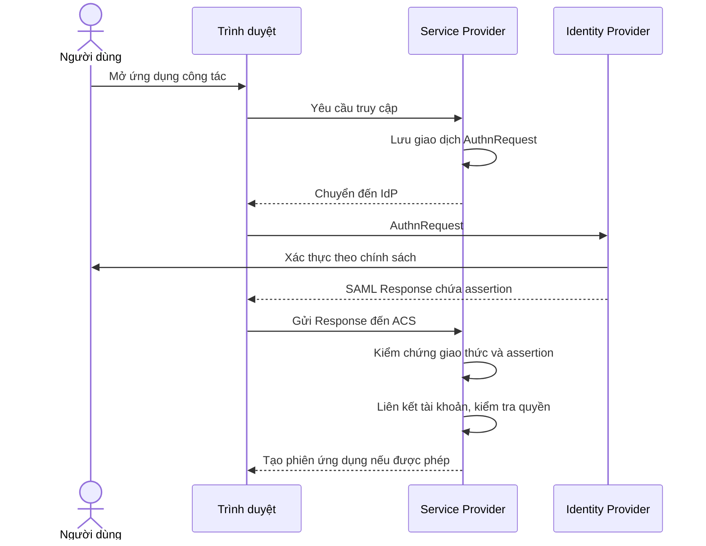

# SAML assertion

## 1. Assertion là lời khẳng định về một chủ thể

**SAML assertion** là một cấu trúc XML chứa các lời khẳng định của bên phát hành về một chủ thể. Nội dung có thể liên quan đến việc xác thực, thuộc tính của chủ thể hoặc một quyết định cấp quyền. SAML 2.0 chuẩn hóa cấu trúc và ý nghĩa của các thông tin này. [OASIS SAML Core 2.0](https://docs.oasis-open.org/security/saml/v2.0/saml-core-2.0-os.pdf).

Trong đăng nhập liên kết doanh nghiệp, **Identity Provider — IdP** thường phát assertion và **Service Provider — SP** sử dụng nó. Ví dụ, IdP công ty xác thực nhân viên rồi gửi assertion cho ứng dụng quản lý công tác. SP kiểm chứng kết quả, liên kết với tài khoản nội bộ và quyết định có cho phép truy cập hay không.

Một assertion không tự đáng tin chỉ vì đọc được XML hoặc vì có tên người dùng bên trong. SP phải xác định đúng bên phát hành, kiểm tra bảo vệ mật mã, đối tượng nhận, thời gian, giao dịch và các điều kiện của profile đang dùng.

Bài này tập trung vào assertion trong **SAML 2.0 Web Browser SSO**. Những profile SAML khác có thể đặt yêu cầu xử lý khác; không nên biến một ví dụ đăng nhập trình duyệt thành quy tắc cho mọi cách dùng SAML.

## 2. Assertion khác Response và phiên ứng dụng

Trong một luồng SP khởi tạo đăng nhập, có thể hình dung:



**Assertion Consumer Service — ACS** là endpoint SP tiếp nhận và xử lý phản hồi theo cấu hình.

Ba đối tượng sau có trách nhiệm khác nhau:

| Đối tượng | Vai trò |
|---|---|
| `samlp:Response` | Thông điệp giao thức trả lời, có trạng thái và thông tin liên quan đến phản hồi |
| `saml:Assertion` | Lời khẳng định về chủ thể, kèm điều kiện và các statement |
| Phiên ứng dụng tại SP | Trạng thái truy cập do ứng dụng duy trì sau khi chấp nhận kết quả và kiểm tra chính sách |

Response có thể chứa nhiều assertion, hoặc assertion được mã hóa theo cấu hình. Không chọn tùy ý assertion đầu tiên tìm được rồi đọc thuộc tính.

Một Response báo thành công chưa đủ để tạo phiên. Tương tự, assertion còn trong thời hạn không có nghĩa người dùng được phép thực hiện mọi hành động tại SP.

## 3. Bản đồ cấu trúc assertion

```text
Assertion
├── ID, Version, IssueInstant
├── Issuer
├── Signature nếu có theo cấu trúc/chính sách sử dụng
├── Subject
│   ├── NameID hoặc dạng định danh được hỗ trợ
│   └── SubjectConfirmation
│       └── SubjectConfirmationData
├── Conditions
│   ├── NotBefore, NotOnOrAfter
│   └── AudienceRestriction
└── Các statement
    ├── AuthnStatement
    ├── AttributeStatement
    └── AuthzDecisionStatement nếu dùng
```

Đây là bản đồ khái niệm, không phải toàn bộ XML schema. Schema tổng quát cho phép một số phần là tùy chọn, trong khi profile cụ thể có thể yêu cầu chúng. Vì vậy, “XML hợp lệ theo schema” và “assertion hợp lệ cho luồng đăng nhập này” là hai phép kiểm tra khác nhau.

### ID, Version và IssueInstant

- `ID` định danh assertion, hỗ trợ tham chiếu chữ ký và phát hiện sử dụng lại.
- `Version="2.0"` thể hiện phiên bản assertion.
- `IssueInstant` là thời điểm phát assertion.

`IssueInstant` không đồng nghĩa thời điểm người dùng vừa nhập mật khẩu. IdP có thể phát assertion mới dựa trên một phiên xác thực đã có.

### Issuer

`Issuer` xác định bên đưa ra lời khẳng định. Trong ví dụ, đó là entity ID của IdP công ty.

Entity ID là định danh của thực thể SAML. Nếu có dạng URL, nó không tự trở thành một chỉ thị để SP tải khóa hoặc metadata từ URL ấy.

SP cần có quan hệ tin cậy đã thiết lập với IdP được phép. Không chấp nhận một assertion từ IdP tùy ý chỉ vì bên phát hành sở hữu một khóa ký của riêng họ.

## 4. Ví dụ XML để đọc cấu trúc

Ví dụ dưới đây mô tả một nhân viên được nhận diện tại IdP và một SP quản lý công tác. ID, thời điểm và giá trị thuộc tính đều là dữ liệu minh họa.

**Phần chữ ký và thông điệp Response bao ngoài được lược bỏ để dễ đọc. Đây không phải bằng chứng đăng nhập hoàn chỉnh và không được chấp nhận trực tiếp trong production.**

```xml
<saml:Assertion
    xmlns:saml="urn:oasis:names:tc:SAML:2.0:assertion"
    ID="_assertion_demo_01"
    Version="2.0"
    IssueInstant="2026-11-26T02:30:00Z">

    <saml:Issuer>urn:company:idp</saml:Issuer>

    <!-- Chu ky so hop le duoc luoc bo trong vi du. -->

    <saml:Subject>
        <saml:NameID
            Format="urn:oasis:names:tc:SAML:2.0:nameid-format:persistent">employee-opaque-4821</saml:NameID>

        <saml:SubjectConfirmation
            Method="urn:oasis:names:tc:SAML:2.0:cm:bearer">
            <saml:SubjectConfirmationData
                InResponseTo="_request_demo_01"
                Recipient="https://travel.company.example/saml/acs"
                NotOnOrAfter="2026-11-26T02:35:00Z"/>
        </saml:SubjectConfirmation>
    </saml:Subject>

    <saml:Conditions
        NotBefore="2026-11-26T02:29:30Z"
        NotOnOrAfter="2026-11-26T02:35:00Z">
        <saml:AudienceRestriction>
            <saml:Audience>urn:company:travel-sp</saml:Audience>
        </saml:AudienceRestriction>
    </saml:Conditions>

    <saml:AuthnStatement
        AuthnInstant="2026-11-26T02:29:00Z"
        SessionIndex="_idp_session_demo"
        SessionNotOnOrAfter="2026-11-26T03:00:00Z">
        <saml:AuthnContext>
            <saml:AuthnContextClassRef>urn:oasis:names:tc:SAML:2.0:ac:classes:PasswordProtectedTransport</saml:AuthnContextClassRef>
        </saml:AuthnContext>
    </saml:AuthnStatement>

    <saml:AttributeStatement>
        <saml:Attribute Name="department">
            <saml:AttributeValue>engineering</saml:AttributeValue>
        </saml:Attribute>
        <saml:Attribute Name="travelRole">
            <saml:AttributeValue>traveler</saml:AttributeValue>
        </saml:Attribute>
    </saml:AttributeStatement>
</saml:Assertion>
```

Khi cấu hình thực tế, các giá trị định danh phải được phát và xử lý nguyên vẹn theo hợp đồng; không thêm khoảng trắng, đổi chữ hoa/thường hoặc chuẩn hóa tùy tiện theo cách trình bày XML.

Ví dụ diễn đạt các ý khác nhau: IdP nào phát, chủ thể nào được nói đến, SP nào được dùng, ACS nào nhận, yêu cầu nào được trả lời, thời gian nào chấp nhận và những thuộc tính nào được công bố. Mỗi ý cần phép kiểm tra tương ứng.

## 5. Subject và NameID: assertion nói về ai?

`Subject` mô tả chủ thể của các statement. Trong ví dụ, `NameID` mang giá trị định danh nhân viên trong ngữ cảnh liên kết giữa IdP và SP.

Một số định dạng NameID thường gặp:

| Định dạng | Cách hiểu cần giữ |
|---|---|
| Persistent | Định danh được dùng ổn định trong phạm vi liên kết đã thỏa thuận |
| Transient | Định danh tạm thời, không tự phù hợp làm khóa tài khoản lâu dài |
| Email address | Giá trị theo định dạng email; vẫn cần quy tắc về độ tin cậy và vòng đời |
| Unspecified | Không thể suy ra ngữ nghĩa cụ thể chỉ từ nhãn định dạng |

Không coi chuỗi `employee-opaque-4821` là một định danh toàn cầu. Một IdP khác có thể dùng cùng chuỗi cho một người khác.

Khóa liên kết tài khoản cần bao gồm ngữ cảnh bên phát hành và định danh theo cấu hình, chẳng hạn:

```text
IdP được tin cậy
  + định dạng và phạm vi NameID liên quan
  + giá trị NameID đã kiểm chứng
  → tài khoản nội bộ của SP
```

Các qualifier nếu được sử dụng cũng thuộc ngữ cảnh phải xử lý, không tùy ý bỏ đi.

Email, tên hiển thị hoặc phòng ban là dữ liệu có thể thay đổi. Tự gộp tài khoản chỉ vì hai assertion có cùng email có thể nối nhầm một danh tính ngoài tổ chức vào tài khoản đã có quyền.

Việc thêm hoặc đổi liên kết danh tính cần quy trình chứng minh quyền kiểm soát hoặc phê duyệt có thẩm quyền. Một assertion hợp lệ chưa thay thế quy trình account linking.

## 6. SubjectConfirmation: vì sao SP chấp nhận bên trình assertion?

`SubjectConfirmation` mô tả cơ chế xác nhận chủ thể trong ngữ cảnh sử dụng. Ví dụ dùng phương thức **bearer**, phổ biến trong Web Browser SSO.

Bearer không yêu cầu bên trình assertion chứng minh sở hữu một khóa riêng gắn với chủ thể như cơ chế holder-of-key. Điều này làm việc bảo vệ assertion, kiểm tra ngữ cảnh và ngăn replay trở nên quan trọng.

Các giá trị trong `SubjectConfirmationData` của ví dụ:

| Giá trị | Ý nghĩa trong giao dịch |
|---|---|
| `Recipient` | ACS được chỉ định để tiếp nhận |
| `InResponseTo` | ID AuthnRequest mà phản hồi đang đáp lại |
| `NotOnOrAfter` | Giới hạn thời gian cho việc trình xác nhận bearer này |

SP phải đối chiếu Recipient với ACS đúng của mình, không chỉ kiểm tra nó thuộc một tên miền quen thuộc. Với luồng SP khởi tạo, InResponseTo cần gắn với yêu cầu đang chờ trong đúng ngữ cảnh đăng nhập.

Không suy diễn rằng bất cứ SubjectConfirmation nào có chữ `bearer` cũng đủ. Phải có dữ liệu bắt buộc và đáp ứng điều kiện của profile được hỗ trợ.

Trong luồng IdP khởi tạo không có AuthnRequest tương ứng, quy tắc InResponseTo khác. Việc chấp nhận kiểu phản hồi đó phải được cấu hình và đánh giá riêng; không bật nó chỉ để bỏ qua lỗi “không tìm thấy request”. [OASIS SAML Profiles, mục 4.1.4–4.1.5](https://docs.oasis-open.org/security/saml/v2.0/saml-profiles-2.0-os.pdf).

## 7. Conditions: được dùng ở đâu và khi nào?

### 7.1. Khoảng thời gian

Với hai thuộc tính trong `Conditions`, mô hình không tính sai lệch đồng hồ là:

```text
NotBefore <= thời điểm kiểm tra < NotOnOrAfter
```

`NotOnOrAfter` là cận kết thúc không bao gồm chính thời điểm đó. Không hiểu nó là “vẫn được chấp nhận đúng tại giây hết hạn”.

Một assertion có thể có nhiều mốc thời gian phục vụ những mục đích khác nhau:

| Vị trí | Câu hỏi được trả lời |
|---|---|
| `Assertion.IssueInstant` | Assertion được phát lúc nào? |
| `AuthnStatement.AuthnInstant` | Sự kiện xác thực được IdP khẳng định xảy ra lúc nào? |
| `Conditions.NotBefore/NotOnOrAfter` | Assertion được sử dụng trong cửa sổ điều kiện nào? |
| `SubjectConfirmationData.NotOnOrAfter` | Xác nhận bearer được trình đến khi nào? |
| `AuthnStatement.SessionNotOnOrAfter` | Phiên được statement đề cập phải được coi là kết thúc khi nào? |

Các giá trị không thay thế nhau. SP cần kiểm tra tất cả giới hạn có liên quan; còn hạn ở `Conditions` không cứu được một SubjectConfirmation đã hết hạn.

Clock skew là dung sai được cấu hình có giới hạn để xử lý sai lệch đồng hồ giữa các hệ thống. Nó không phải thời gian gia hạn tùy ý. Khi lỗi xuất phát từ đồng hồ, cần sửa đồng bộ thời gian thay vì nới cửa sổ chấp nhận vô hạn.

Assertion mới phát có thể mô tả một sự kiện xác thực cũ. Nếu thao tác nhạy cảm đòi hỏi xác thực mới, SP phải yêu cầu và đánh giá điều kiện phù hợp, không chỉ nhìn IssueInstant.

### 7.2. AudienceRestriction

Trong ví dụ, `Audience=urn:company:travel-sp` nhắm đến thực thể SP quản lý công tác. SP nhân sự có thể tin cùng IdP nhưng vẫn không phải bên được dùng assertion này.

Audience là định danh bên dựa vào assertion; Recipient là endpoint nhận xác nhận bearer. Chúng có thể là những chuỗi hoàn toàn khác nhau và không được dùng thay cho nhau.

Nếu một assertion có nhiều AudienceRestriction, SP phải thỏa mọi nhóm điều kiện. Bên trong một nhóm, các Audience là các lựa chọn:

```text
Nhóm 1: SP thuộc A hoặc B
Nhóm 2: SP thuộc B hoặc C

Kết quả: phải thỏa Nhóm 1 và Nhóm 2
```

Không gom tất cả Audience thành một danh sách OR duy nhất. Quy tắc kết hợp này được mô tả trong SAML Core. [OASIS SAML Core, mục 2.5.1.4](https://docs.oasis-open.org/security/saml/v2.0/saml-core-2.0-os.pdf).

Nếu một điều kiện bắt buộc không được hiểu hoặc không thể đánh giá hợp lệ, SP không được âm thầm bỏ qua rồi chấp nhận.

## 8. Các statement nói điều gì?

### AuthnStatement

`AuthnStatement` mô tả việc xác thực chủ thể, gồm thời điểm và ngữ cảnh tương ứng. `SessionIndex`, khi được dùng, giúp tham chiếu phiên giữa chủ thể và bên xác thực, chẳng hạn phục vụ các xử lý logout được hỗ trợ.

Trong ví dụ, AuthnContextClassRef mang giá trị PasswordProtectedTransport. Không được đổi cách hiểu thành “người dùng đã qua MFA”. SP cần có thỏa thuận rõ về ngữ nghĩa ngữ cảnh xác thực và cách IdP thực thi.

Một statement xác thực hợp lệ cũng không khẳng định tài khoản nội bộ tại SP đang hoạt động. Trạng thái tài khoản và điều kiện gia nhập vẫn phải được kiểm tra.

### AttributeStatement

`AttributeStatement` truyền thuộc tính. Ví dụ có phòng ban và vai trò liên quan đến công tác.

SP cần quy định rõ:

- Tên và định dạng thuộc tính nào được chấp nhận.
- Nguồn IdP hoặc tenant nào có quyền khẳng định thuộc tính đó.
- Kiểu dữ liệu và cách xử lý nhiều giá trị.
- Cách ánh xạ giá trị sang quyền nội bộ.
- Cách xử lý thiếu, không hợp lệ hoặc không biết giá trị.

Không suy ra quyền từ tên hiển thị thân thiện, không lấy một thuộc tính bất kỳ tên `role` làm quyền quản trị, và không dùng “admin” làm mặc định khi thuộc tính thiếu.

Một ánh xạ minh họa có thể là:

```text
IdP công ty được phê duyệt
  + travelRole = traveler
  + tài khoản thuộc tenant được phép
  → nhóm quyền nộp đề nghị công tác

travelRole không biết hoặc không có
  → không tự cấp thêm quyền
```

Đây là chính sách ứng dụng minh họa, không phải quy tắc mặc định của SAML.

### AuthzDecisionStatement

SAML còn có dạng statement mô tả quyết định cấp quyền đối với tài nguyên và hành động. Tuy nhiên, một luồng SSO thông thường không mặc nhiên chứa quyết định cho mọi API nghiệp vụ.

SP phải biết mình đang hỗ trợ và tin cậy loại statement nào. Dùng SAML để đăng nhập không chuyển toàn bộ trách nhiệm phân quyền của ứng dụng sang IdP.

## 9. Chữ ký, mã hóa và quan hệ tin cậy

### 9.1. Chữ ký phải gắn với dữ liệu được sử dụng

XML Signature giúp kiểm tra tính toàn vẹn và xác định bên ký thông qua khóa được tin cậy. Chữ ký không tự làm dữ liệu bí mật.

Cấu hình minh họa trong bài yêu cầu assertion được ký bằng khóa IdP đã được SP tin cậy; chữ ký Response nếu có cũng phải được kiểm tra. Tích hợp thực tế phải thực thi đúng yêu cầu của profile, binding và chính sách đã chọn, không hạ yêu cầu chỉ vì một phản hồi báo thành công.

SP cần dùng đúng đối tượng đã được xác minh để lấy Subject và Attribute. Một lỗi nguy hiểm là kiểm tra chữ ký của phần tử A nhưng sau đó lấy dữ liệu từ một phần tử B chưa được bảo vệ. Đây là vấn đề cốt lõi trong các dạng **XML Signature Wrapping**.

Không tự viết một quy trình “tìm mọi thẻ Assertion, kiểm tra thấy một chữ ký hợp lệ, rồi lấy thẻ đầu tiên”. Nên dùng thư viện SAML có xử lý cấu trúc, ID, tham chiếu chữ ký và kết quả kiểm chứng rõ ràng. [OWASP SAML Security Cheat Sheet](https://cheatsheetseries.owasp.org/cheatsheets/SAML_Security_Cheat_Sheet.html#validate-signatures).

### 9.2. Không để thông điệp tự quyết định khóa tin cậy

Certificate hoặc thông tin khóa trong `KeyInfo` không tự thiết lập quan hệ tin cậy. SP cần kiểm tra theo cấu hình IdP và metadata được tiếp nhận qua quy trình tin cậy.

Một kẻ tấn công có thể tự tạo khóa và tự ký dữ liệu của họ. Chữ ký khớp với khóa do chính thông điệp đưa vào chưa chứng minh đó là IdP công ty.

Vận hành cần quản lý vòng đời khóa ký, cập nhật metadata và luân chuyển khóa theo kế hoạch. Không xử lý sự cố luân chuyển bằng cách chấp nhận mọi certificate hoặc tắt xác minh.

### 9.3. Ba lớp bảo vệ có mục đích khác nhau

| Cơ chế | Vai trò | Điều không tự cung cấp |
|---|---|---|
| Base64 trong cách truyền thông điệp | Biểu diễn dữ liệu theo binding | Bí mật hoặc tính toàn vẹn |
| Chữ ký số | Bảo vệ tính toàn vẹn và xác thực bên ký theo quan hệ tin cậy | Che nội dung khỏi người đọc |
| Mã hóa assertion | Bảo vệ tính bí mật cho bên có khóa giải mã phù hợp | Quyền tin mọi nội dung sau khi giải mã |
| TLS | Bảo vệ kênh truyền giữa các đầu nối liên quan | Thay thế mọi kiểm tra giao thức và assertion |

Giải mã được một assertion không đồng nghĩa có thể bỏ kiểm tra issuer, chữ ký theo chính sách, audience, thời gian hoặc replay.

## 10. Quy trình tiếp nhận an toàn tại SP

Các bước dưới đây là mô hình trách nhiệm để hiểu luồng xử lý, không phải mã thay thế cho thư viện SAML.

1. **Xác định ngữ cảnh tin cậy.** Biết SP, tenant, IdP, ACS và giao dịch nào được kỳ vọng.
2. **Tiếp nhận và parse an toàn.** Giới hạn kích thước và tài nguyên; cấu hình XML parser tránh DTD/external entity nguy hiểm; dùng schema tin cậy theo cơ chế thư viện.
3. **Kiểm tra cấu trúc và bảo vệ mật mã.** Xác minh đúng phần tử, chữ ký, khóa và thuật toán được chính sách chấp nhận; xử lý mã hóa theo cấu hình.
4. **Kiểm tra thông điệp giao thức.** Kiểm tra trạng thái, bên phát hành, đích nhận, liên kết yêu cầu và binding theo profile.
5. **Kiểm tra assertion.** Kiểm tra SubjectConfirmation, Recipient, thời gian, audience, statement và các điều kiện liên quan.
6. **Ngăn replay và hoàn tất giao dịch một lần.** Chỉ nhận assertion/giao dịch chưa được sử dụng theo quy tắc áp dụng.
7. **Liên kết tài khoản và đánh giá quyền.** Chỉ dùng dữ liệu đã được kiểm chứng để tìm tài khoản và thực hiện chính sách gia nhập.
8. **Tạo phiên ứng dụng.** Áp dụng giới hạn phiên và ghi sự kiện cần thiết.

Mọi bước bắt buộc phải đạt trước khi tạo ngữ cảnh đăng nhập có quyền. Không tạo phiên tạm với role lấy từ XML rồi đợi kiểm tra chữ ký ở một tác vụ sau.

### Replay cần trạng thái phía SP

Một assertion có chữ ký đúng vẫn có thể bị gửi lại. SP cần lưu dấu ID đã sử dụng trong phạm vi tin cậy phù hợp, chẳng hạn theo cặp issuer/assertion ID, cho tới khi cửa sổ chấp nhận đã kết thúc, có tính dung sai được cấu hình.

Trong hệ thống nhiều node, cơ chế đánh dấu phải ngăn được hai node đồng thời chấp nhận cùng một assertion. Chỉ lưu ID trong bộ nhớ riêng của từng node có thể để lọt việc sử dụng lại qua node khác.

Quy tắc xử lý Web Browser SSO yêu cầu kiểm tra xác nhận bearer và có quy tắc chống replay khi dùng POST. [OASIS SAML Profiles, mục 4.1.4.3–4.1.4.5](https://docs.oasis-open.org/security/saml/v2.0/saml-profiles-2.0-os.pdf).

### RelayState cần được xử lý riêng

RelayState có thể giúp giữ ngữ cảnh điều hướng theo binding và thỏa thuận giữa các bên. Nó không phải bằng chứng danh tính và không tự được bảo vệ chỉ vì assertion có chữ ký.

Nếu dùng RelayState để xác định trang quay lại, SP cần kiểm tra đích theo chính sách, chẳng hạn chỉ cho phép đường dẫn nội bộ đã định nghĩa. Không để nó trở thành open redirect hoặc tự chọn một tenant có quyền cao hơn.

## 11. Assertion hết hạn và phiên ứng dụng

Cửa sổ dùng assertion để thiết lập ngữ cảnh không giống thời gian sống của cookie phiên ứng dụng. Assertion hết hạn không tự phát một sự kiện đăng xuất đến mọi SP đã nhận nó.

Tuy nhiên, SP không được bỏ qua giới hạn phiên có liên quan. Nếu AuthnStatement có SessionNotOnOrAfter, quy tắc profile và chính sách phiên phải xử lý giới hạn đó; không tự kéo dài ngữ cảnh đã thiết lập chỉ vì cookie nội bộ còn hạn.

Một hệ thống cần phối hợp các việc khác nhau:

- Hạn chế thời gian và việc dùng lại assertion.
- Quản lý phiên SP và phiên IdP.
- Thực hiện logout liên kết nếu cấu hình và giao thức hỗ trợ.
- Thu hồi quyền, khóa tài khoản và xử lý nhân viên nghỉ việc.
- Kiểm toán việc đăng nhập, ánh xạ danh tính và thay đổi quyền.

Một lần đăng nhập SAML thành công không thay thế provisioning hoặc deprovisioning. Nếu ứng dụng không tiếp nhận thay đổi vòng đời tài khoản, người dùng có thể còn một đường truy cập dù thông tin tại IdP đã thay đổi.

## 12. Dữ liệu cá nhân và quan sát vận hành

Assertion có thể chứa định danh, email, nhóm và thuộc tính tổ chức. Trong bearer SSO, bản thân assertion cũng có giá trị bảo mật trong cửa sổ sử dụng.

Không gửi assertion thật đến công cụ giải mã trực tuyến không được phê duyệt. Base64 có thể được đọc lại; không dùng việc “trông như chuỗi khó đọc” để coi dữ liệu đã được bảo mật.

IdP nên chỉ phát thuộc tính cần thiết cho SP và mục đích đã thỏa thuận. SP chỉ lưu những gì cần cho liên kết tài khoản, chính sách và kiểm toán, với thời hạn lưu phù hợp. Chữ ký không giải quyết việc chia sẻ quá mức dữ liệu. [OASIS SAML Security and Privacy Considerations](https://docs.oasis-open.org/security/saml/v2.0/saml-sec-consider-2.0-os.pdf).

Log nên ghi mã giao dịch, IdP đã cấu hình, SP/tenant và loại lỗi cần thiết. Tránh ghi toàn bộ SAMLResponse, assertion, cookie hoặc mọi thuộc tính của nhân viên.

## 13. Những tình huống cần phân biệt

| Tình huống | Cách đánh giá |
|---|---|
| Chữ ký hợp lệ, audience thuộc ứng dụng nhân sự | SP công tác không được dùng assertion chỉ vì cùng tin IdP |
| Conditions còn hạn, SubjectConfirmation đã hết hạn | Xác nhận không đáp ứng cửa sổ chấp nhận |
| Assertion đã được dùng thành công | Không tạo thêm phiên từ việc phát lại cùng bằng chứng |
| Hai IdP có cùng chuỗi NameID | Phải giữ ngữ cảnh issuer và phạm vi định danh khi liên kết |
| Thuộc tính có giá trị `admin` từ nguồn không được phép ánh xạ | Không tự cấp quyền quản trị |
| Response không có request tương ứng | Xử lý theo chính sách luồng được hỗ trợ; không bỏ qua kiểm tra SP-initiated |
| Assertion giải mã được nhưng bên phát hành không được tin | Không sử dụng nội dung để tạo phiên |

Trong ví dụ công tác, assertion được chấp nhận có thể giúp SP liên kết nhân viên với tài khoản của mình và cấp phiên cho chức năng được phép. Khi người đó mở một đề nghị công tác của đồng nghiệp, ứng dụng vẫn phải kiểm tra quyền trên đối tượng cụ thể.

Giữ rõ chuỗi tin cậy giúp tránh nhầm lẫn: IdP đưa ra lời khẳng định; SP kiểm chứng lời khẳng định trong đúng ngữ cảnh; ứng dụng quyết định quyền và duy trì phiên theo chính sách.
