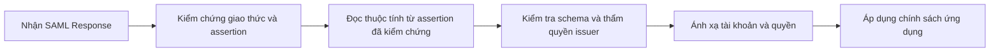

# Attribute statement

Trong SAML, **AttributeStatement** là phần của assertion chứa các thuộc tính mà bên phát hành tuyên bố về chủ thể. Những thuộc tính này có thể mô tả mã nhân viên, phòng ban, nhóm, tenant hoặc dữ liệu khác mà Identity Provider được phép cung cấp cho Service Provider.

Ví dụ, sau khi một nhân viên đăng nhập SSO vào cổng chi phí, Identity Provider gửi assertion có các thuộc tính:

```text
employee-id = EMP-572
department = Finance
groups = FinanceReaders, InvoiceApprovers
```

Service Provider có thể sử dụng chúng để ánh xạ tài khoản và đánh giá quyền. Tuy nhiên, một thuộc tính có tên “admin” không tự tạo ra quyền quản trị: ứng dụng phải kiểm chứng assertion, biết issuer có thẩm quyền đối với thuộc tính nào và áp dụng chính sách ánh xạ phù hợp.

Trong IAM, AttributeStatement là điểm kết nối giữa danh tính liên kết với hồ sơ, RBAC, ABAC và vòng đời quyền tại ứng dụng.

## 1. AttributeStatement nằm ở đâu?

SAML assertion có thể chứa nhiều loại statement. Mỗi loại diễn đạt một điều khác nhau về chủ thể của assertion.

| Thành phần | Nội dung chính | Ví dụ |
| --- | --- | --- |
| Subject | Chủ thể mà assertion đề cập và thông tin xác nhận chủ thể liên quan | Một NameID theo thỏa thuận giữa IdP và SP |
| AuthnStatement | Sự kiện xác thực và ngữ cảnh liên quan | Thời điểm xác thực, phương thức hoặc lớp ngữ cảnh xác thực |
| AttributeStatement | Các thuộc tính về chủ thể | Mã nhân viên, phòng ban, nhóm |
| AuthzDecisionStatement | Tuyên bố về quyết định ủy quyền đối với tài nguyên và hành động | Một quyết định Permit hoặc Deny theo mô hình tương ứng |

Trong mô hình SSO thường gặp:

- **Identity Provider, IdP:** xác thực người dùng và phát hành assertion.
- **Service Provider, SP:** kiểm chứng phản hồi SAML, nhận diện chủ thể và áp dụng chính sách ứng dụng.

Cấu trúc khái quát:

```text
SAML Response
└── Assertion
    ├── Issuer
    ├── Subject
    ├── Conditions
    ├── AuthnStatement
    └── AttributeStatement
        ├── Attribute: employee-id
        ├── Attribute: department
        └── Attribute: groups
```

Sơ đồ chỉ minh họa quan hệ chứa, không thay thế thứ tự phần tử hoặc yêu cầu schema của SAML.

Không phải mọi assertion đều phải có tất cả các thành phần trong sơ đồ. Việc một ứng dụng yêu cầu thuộc tính cụ thể là một phần của hợp đồng tích hợp, không có nghĩa SAML mặc định bắt buộc mọi IdP gửi thuộc tính đó.

## 2. Một AttributeStatement trông như thế nào?

Đoạn XML dưới đây là một fragment minh họa, không phải SAML Response hoặc assertion hoàn chỉnh đã được ký:

```xml
<saml:AttributeStatement
    xmlns:saml="urn:oasis:names:tc:SAML:2.0:assertion"
    xmlns:xs="http://www.w3.org/2001/XMLSchema"
    xmlns:xsi="http://www.w3.org/2001/XMLSchema-instance">

    <saml:Attribute
        Name="urn:example:iam:employee-id"
        NameFormat="urn:oasis:names:tc:SAML:2.0:attrname-format:uri"
        FriendlyName="Employee ID">
        <saml:AttributeValue xsi:type="xs:string">EMP-572</saml:AttributeValue>
    </saml:Attribute>

    <saml:Attribute
        Name="urn:example:iam:department"
        NameFormat="urn:oasis:names:tc:SAML:2.0:attrname-format:uri"
        FriendlyName="Department">
        <saml:AttributeValue xsi:type="xs:string">Finance</saml:AttributeValue>
    </saml:Attribute>

    <saml:Attribute
        Name="urn:example:iam:groups"
        NameFormat="urn:oasis:names:tc:SAML:2.0:attrname-format:uri"
        FriendlyName="Groups">
        <saml:AttributeValue xsi:type="xs:string">FinanceReaders</saml:AttributeValue>
        <saml:AttributeValue xsi:type="xs:string">InvoiceApprovers</saml:AttributeValue>
    </saml:Attribute>

</saml:AttributeStatement>
```

Các tên bắt đầu bằng `urn:example:iam:` là quy ước của ví dụ. SAML không mặc định quy định rằng mọi IdP phải có thuộc tính `groups`, `department` hoặc một thuộc tính vai trò mang ý nghĩa giống nhau.

Một AttributeStatement có thể chứa các phần tử Attribute và, khi áp dụng cơ chế tương ứng, EncryptedAttribute. Assertion cũng có thể có nhiều AttributeStatement. SP cần xử lý đúng cấu trúc được profile và hợp đồng tích hợp cho phép, thay vì mặc định chỉ có một statement ở một vị trí cố định.

## 3. Name, NameFormat và FriendlyName

### Name là tên thuộc tính theo hợp đồng

`Name` dùng để nhận diện thuộc tính. SP phải biết thuộc tính nào đang được yêu cầu và ý nghĩa của nó đối với issuer cụ thể.

Ví dụ:

```text
urn:example:iam:employee-id
urn:example:iam:department
urn:example:iam:groups
```

Một URI làm tên thuộc tính không nhất thiết là địa chỉ để tải dữ liệu. SP không nên tự truy cập mạng chỉ vì tên thuộc tính có dạng URL.

Không ánh xạ theo việc tên “có vẻ giống” một thuộc tính đã biết. Hai thuộc tính `department` và `Department` không nên được tự động coi là một nếu hợp đồng không quy định điều đó.

### NameFormat mô tả cách diễn giải tên

`NameFormat` cho biết định dạng của tên thuộc tính. Những định dạng thường gặp gồm URI, basic và unspecified.

SP cần đối chiếu Name và cách diễn giải NameFormat theo thỏa thuận với IdP. Không nên chỉ lấy chuỗi cuối sau dấu slash của một URI để coi nó là tên chuẩn.

Ví dụ, hai issuer có thể dùng những tên khác nhau cho mã nhân viên:

```text
IdP A: urn:example:iam:employee-id
IdP B: employeeNumber
```

Ứng dụng có thể ánh xạ cả hai vào trường nội bộ `employeeId`, nhưng ánh xạ phải được cấu hình riêng cho từng liên kết, không dựa vào suy đoán khi xử lý assertion.

### FriendlyName là nhãn dễ đọc

`FriendlyName` hỗ trợ người đọc hoặc công cụ quản trị. Nó không nên được dùng làm định danh đáng tin cậy duy nhất của thuộc tính.

Ví dụ, nhãn “Role” có thể xuất hiện ở nhiều thuộc tính với các ý nghĩa khác nhau. Việc SP thấy FriendlyName bằng “Role” không chứng minh giá trị là vai trò của ứng dụng mình.

## 4. AttributeValue và thuộc tính nhiều giá trị

Một Attribute có thể mang nhiều AttributeValue.

Trong ví dụ nhóm:

```xml
<saml:Attribute
    xmlns:saml="urn:oasis:names:tc:SAML:2.0:assertion"
    Name="urn:example:iam:groups">
    <saml:AttributeValue>FinanceReaders</saml:AttributeValue>
    <saml:AttributeValue>InvoiceApprovers</saml:AttributeValue>
</saml:Attribute>
```

SP có thể diễn giải thành:

```text
groups = ["FinanceReaders", "InvoiceApprovers"]
```

Điều này khác một giá trị duy nhất chứa dấu phẩy:

```text
groups = ["FinanceReaders,InvoiceApprovers"]
```

SAML không tự biến mọi chuỗi có dấu phẩy thành danh sách. Nếu IdP và SP chọn truyền danh sách trong một chuỗi, quy tắc phân tách và escaping cần được định nghĩa rõ. Truyền nhiều AttributeValue giúp thể hiện trực tiếp tính đa trị khi hai bên hỗ trợ.

### Kiểu dữ liệu cần được thống nhất

AttributeValue có thể có kiểu hoặc cấu trúc phức tạp hơn chuỗi đơn giản. SP nên giới hạn những dạng dữ liệu nó thực sự hỗ trợ và kiểm tra kiểu theo hợp đồng.

Ví dụ:

| Thuộc tính | Dạng mong đợi | Xử lý minh họa |
| --- | --- | --- |
| employee-id | Một chuỗi không rỗng | Đối chiếu theo quy tắc mã nhân viên |
| groups | Tập giá trị chuỗi | Ánh xạ từng giá trị được cho phép |
| tenant-id | Một mã tenant | Đối chiếu với tenant mà liên kết IdP được phép đại diện |
| employment-active | Giá trị boolean theo schema đã thống nhất | Phân tích kiểu rõ ràng, không dựa vào chuỗi “có nội dung” |

Chuỗi `"false"` không được trở thành true chỉ vì nó không rỗng. Mã `"00123"` cũng không nên bị tự động chuyển thành số 123 nếu các số 0 đầu có ý nghĩa.

### Thiếu, rỗng và trùng lặp là các tình huống khác nhau

SP cần phân biệt:

- Không có thuộc tính.
- Có thuộc tính nhưng không có giá trị sử dụng được.
- Có nhiều giá trị trong khi ứng dụng chỉ cho phép một.
- Có nhiều Attribute trùng tên.
- Giá trị không đúng kiểu hoặc nằm ngoài tập được cho phép.

Nếu thuộc tính bắt buộc cho quyết định truy cập bị thiếu hoặc không hợp lệ, không tự cấp giá trị mặc định có quyền cao. Nếu một thuộc tính chỉ phục vụ hiển thị, việc thiếu nó không nhất thiết phải làm thất bại toàn bộ đăng nhập.

Quy tắc gộp các Attribute trùng tên cần được xác định rõ. Cách “giá trị cuối ghi đè giá trị trước” có thể che giấu dữ liệu mâu thuẫn và tạo khác biệt giữa các tầng xử lý.

## 5. Kiểm chứng assertion trước khi tin thuộc tính

AttributeStatement không có giá trị làm bằng chứng chỉ vì XML có thể được phân tích hoặc chứa đúng tên thuộc tính.

SP cần hoàn thành kiểm chứng SAML theo profile đang triển khai, bao gồm các kiểm tra liên quan như:

1. Issuer thuộc liên kết danh tính được cho phép.
2. Chữ ký được kiểm chứng bằng khóa tin cậy theo metadata hoặc cấu hình đã được quản lý.
3. Dữ liệu được dùng thực sự nằm trong phạm vi được chữ ký hợp lệ bảo vệ.
4. Audience, đích nhận và SubjectConfirmation phù hợp với SP và flow.
5. Điều kiện thời gian còn hiệu lực.
6. Phản hồi khớp giao dịch đang chờ khi flow yêu cầu.
7. Cơ chế chống replay và các điều kiện khác của profile đã được đáp ứng.

Đây là các nhóm trách nhiệm kiểm chứng, không phải một thuật toán SAML hoàn chỉnh để tự triển khai.



### Phải dùng đúng phần tử đã được kiểm chứng

XML có cấu trúc cây và có thể chứa nhiều phần tử cùng tên. Một lỗi nguy hiểm là kiểm chứng chữ ký trên một assertion nhưng lại dùng một truy vấn XML quá rộng để lấy AttributeStatement từ phần tử khác.

Ví dụ, không nên có hai bước không liên kết:

```text
1. Tìm một chữ ký hợp lệ đâu đó trong document.
2. Lấy phần tử Attribute có tên role đầu tiên trong toàn document.
```

Thư viện xử lý phải trả về dữ liệu thuộc đúng assertion được chấp nhận. Đây là nguyên tắc quan trọng để tránh việc dữ liệu không được bảo vệ bị sử dụng như dữ liệu đã xác minh, bao gồm các vấn đề thuộc nhóm XML signature wrapping.

Không lấy chứng thư hoặc khóa nhúng trong thông điệp làm nguồn tin cậy duy nhất. Thông tin khóa chỉ có ý nghĩa khi được liên kết với issuer và chính sách tin cậy đã cấu hình.

## 6. Chữ ký và mã hóa bảo vệ những điều khác nhau

| Cơ chế | Điều cần đạt | Điều không tự suy ra |
| --- | --- | --- |
| Chữ ký | Kiểm tra tính toàn vẹn và bên phát hành theo cơ chế tin cậy | Nội dung thuộc tính được giữ bí mật |
| Mã hóa | Giới hạn khả năng đọc dữ liệu cho bên giữ khóa phù hợp | Bên tạo dữ liệu chắc chắn là issuer được tin cậy |
| HTTPS | Bảo vệ kết nối truyền tải giữa các đầu mút tương ứng | Mọi assertion bên trong đều đúng audience, còn hạn và không bị replay |

Một AttributeStatement đã được ký có thể vẫn đọc được bởi bên nhìn thấy assertion nếu không có mã hóa phù hợp. Ngược lại, SP giải mã được dữ liệu không có nghĩa là có thể bỏ qua kiểm chứng issuer và chữ ký theo profile.

SAML hỗ trợ những cách bảo vệ như mã hóa assertion hoặc mã hóa thuộc tính riêng lẻ. Hai bên cần thỏa thuận khả năng hỗ trợ và chính sách khóa; không tự bỏ kiểm chứng bắt buộc khi gặp EncryptedAttribute.

Không đưa mật khẩu, khóa API hoặc bí mật không cần thiết vào AttributeStatement chỉ vì hệ thống có HTTPS. Assertion thường đi qua trình duyệt trong luồng Web SSO và cần được giảm thiểu dữ liệu ở cấp nội dung.

## 7. Ánh xạ thuộc tính sang hồ sơ nội bộ

Sau khi kiểm chứng, SP có thể ánh xạ thuộc tính sang mô hình dữ liệu của ứng dụng:

```text
Thuộc tính IdP                         Trường nội bộ
urn:example:iam:employee-id         -> employeeId
urn:example:iam:department          -> department
urn:example:iam:groups              -> externalGroups
```

Cấu hình ánh xạ cần gắn với liên kết IdP cụ thể.

Ví dụ:

```text
Federation: company-a-idp

employee-id:
    required: true
    expected: exactly one string

department:
    required: false
    expected: at most one string

groups:
    required: false
    expected: set of strings
```

Đây là mô tả chính sách minh họa, không phải định dạng cấu hình bắt buộc của một thư viện SAML.

### Định danh liên kết khác thuộc tính hiển thị

Một tài khoản nội bộ cần được liên kết với định danh liên kết theo quy ước đã thống nhất với IdP. Thông thường, việc này bao gồm issuer và subject identifier phù hợp, cùng format hoặc qualifier khi chúng có ý nghĩa trong profile.

Không mặc định email hoặc tên hiển thị là khóa tài khoản bất biến. Email có thể thay đổi hoặc được tái cấp; tên hiển thị có thể trùng nhau.

Thuộc tính mã nhân viên chỉ phù hợp làm khóa liên kết nếu có quản trị vòng đời đủ rõ: ai có thẩm quyền cấp mã, mã có được tái sử dụng không và tính duy nhất được bảo đảm trong phạm vi nào.

Với NameID dạng transient, không nên tự coi giá trị nhận được là định danh lâu dài xuyên nhiều phiên. SP cần dùng mô hình liên kết phù hợp với định dạng NameID và hợp đồng IdP.

### Cập nhật hồ sơ không đồng nghĩa cập nhật mọi quyền

Ứng dụng có thể cho phép IdP làm nguồn chuẩn cho tên hoặc phòng ban nhưng vẫn giữ vai trò nghiệp vụ ở cơ sở dữ liệu nội bộ.

Vì vậy, cần xác định riêng:

- Trường nào do IdP quản lý.
- Trường nào do ứng dụng quản lý.
- Khi dữ liệu thiếu hoặc thay đổi thì cập nhật ra sao.
- Có được tự tạo tài khoản hay phải chờ cấp phát.
- Trường nào được dùng cho quyết định bảo mật.

Không nên để một lần đăng nhập ghi đè mọi thông tin tài khoản chỉ vì assertion chứa nhiều thuộc tính.

## 8. Ánh xạ nhóm sang RBAC

AttributeStatement thường mang nhóm hoặc entitlement để SP ánh xạ sang vai trò nội bộ.

Ví dụ:

| Nhóm từ IdP company-a | Vai trò tại cổng chi phí | Phạm vi |
| --- | --- | --- |
| FinanceReaders | INVOICE_READER | company-a |
| InvoiceApprovers | INVOICE_APPROVER | company-a |
| PayrollViewers | Không có ánh xạ tại ứng dụng này | Không cấp quyền |
| admin | Không có ánh xạ mặc định | Không cấp quyền |

Chính sách nên sử dụng ánh xạ được cho phép rõ ràng, chẳng hạn:

```text
(company-a-idp, company-a, InvoiceApprovers)
    -> INVOICE_APPROVER trong company-a
```

Không nên dùng quy tắc:

```text
Bất kỳ issuer nào gửi group=admin
    -> quản trị viên toàn hệ thống
```

Chữ ký chỉ xác nhận issuer đã phát hành dữ liệu theo cơ chế tin cậy. Nó không tự chứng minh issuer có quyền cấp mọi loại vai trò trong ứng dụng.

### Thẩm quyền của IdP phải có giới hạn

Một IdP của khách hàng có thể có thẩm quyền xác nhận nhóm người dùng trong tenant của khách hàng đó. Nó không nên được phép tự gán một thuộc tính để chuyển người dùng sang tenant khác.

Tenant nhận assertion cần được ràng buộc với liên kết đã cấu hình, không chỉ lấy từ một giá trị `tenant-id` mà issuer tự chọn. Nếu thuộc tính tenant được sử dụng, SP phải kiểm tra nó phù hợp với phạm vi liên kết.

Quyền đặc biệt như quản trị toàn hệ thống cần có chính sách riêng. Nguyên tắc ít quyền nhất đòi hỏi dữ liệu bên ngoài chỉ có thể tạo những quyền trong phạm vi đã được ủy thác.

## 9. Sử dụng thuộc tính trong ABAC

ABAC sử dụng thuộc tính của chủ thể, tài nguyên, hành động và môi trường để đánh giá quyền.

Một chính sách minh họa:

```text
Cho phép xem báo cáo tài chính khi:
- Tài khoản đang hoạt động.
- Department đáng tin cậy của chủ thể là Finance.
- Tenant của chủ thể phù hợp tenant báo cáo.
- Chủ thể có quyền đọc loại báo cáo này.
```

Thuộc tính phòng ban từ AttributeStatement chỉ là một đầu vào. SP vẫn phải kiểm tra tài nguyên thực tế và các điều kiện khác.

Một assertion có `department=Finance` không có nghĩa chủ thể được đọc mọi báo cáo của mọi tổ chức. Cũng không nên chuyển một chuỗi phòng ban thành quyền phê duyệt thanh toán nếu chính sách chưa quy định.

### Phân biệt thuộc tính hồ sơ và ngữ cảnh xác thực

Thuộc tính `department` mô tả hồ sơ tổ chức. Nó không chứng minh người dùng vừa thực hiện MFA.

Thông tin về sự kiện và ngữ cảnh xác thực thường được xem xét qua AuthnStatement và chính sách tương ứng. Nếu hệ thống sử dụng một thuộc tính riêng để biểu diễn mức bảo đảm, ý nghĩa và thẩm quyền của thuộc tính đó phải được thỏa thuận rõ; không tự tin vào một chuỗi có tên `mfa=true`.

## 10. Vòng đời thuộc tính và vòng đời quyền

AttributeStatement phản ánh dữ liệu tại thời điểm assertion được phát hành. Nó không phải một kết nối cập nhật liên tục tới hệ thống nhân sự hoặc quản lý quyền.

Ví dụ:

```text
08:00: Người dùng đăng nhập, assertion có nhóm InvoiceApprovers.
08:30: Người dùng được gỡ khỏi nhóm tại nguồn quản lý.
09:00: Phiên ứng dụng cũ vẫn đang tồn tại.
```

SP cần biết việc thay đổi lúc 08:30 được phản ánh vào quyền của phiên cũ theo cơ chế nào. Nếu quyền đã được chụp vào session và không kiểm tra lại, người dùng có thể còn quyền trong một khoảng thời gian.

Một số biện pháp có thể được kết hợp theo yêu cầu:

- Giới hạn thời gian phiên hoặc thời gian hiệu lực của dữ liệu quyền.
- Đánh giá lại quyền tại nguồn nội bộ cho thao tác nhạy cảm.
- Sử dụng quy trình cấp phát và thu hồi tài khoản, chẳng hạn tích hợp provisioning thích hợp.
- Xử lý sự kiện thay đổi tài khoản hoặc quyền nếu hệ thống hỗ trợ.
- Yêu cầu xác thực hoặc đánh giá chính sách lại khi cần.

SSO không thay thế toàn bộ quản lý vòng đời quyền. Việc gỡ nhóm tại IdP và việc thu hồi quyền đang có tại SP phải được thiết kế như một chuỗi có thể kiểm chứng.

### Thiếu thuộc tính không luôn có nghĩa là đã thu hồi

Giả sử assertion lần sau không có thuộc tính groups. Điều đó có thể do chính sách phát hành thay đổi, cấu hình sai hoặc không có nhóm được phép phát hành.

SP cần định nghĩa rõ ý nghĩa của sự vắng mặt:

- Nếu groups là nguồn chuẩn và bắt buộc cho một quyền, thiếu dữ liệu không được duy trì hoặc cấp quyền đó một cách vô điều kiện.
- Nếu quyền nội bộ do quản trị viên ứng dụng quản lý, việc thiếu groups không tự cho phép xóa toàn bộ quyền nội bộ.
- Nếu dữ liệu mâu thuẫn với hợp đồng, hệ thống cần từ chối hoặc xử lý theo chính sách lỗi rõ ràng.

Không dùng một cơ chế đồng bộ chung để trộn quyền do IdP sở hữu và quyền do ứng dụng sở hữu mà không phân biệt nguồn.

## 11. Luồng xử lý minh họa tại SP

Pseudocode sau mô tả cách tách kiểm chứng, ánh xạ và quyết định truy cập:

```text
completeSamlLogin(response, pendingLogin):
    assertion = samlLibrary.validateResponse(
        response,
        trustedFederation = pendingLogin.federation,
        expectedRecipient = configuredAcs,
        expectedRequest = pendingLogin.requestId
    )

    identity = resolveTrustedSubject(assertion)
    attributes = readAttributesFromValidatedAssertion(assertion)

    checkedAttributes = validateAttributeContract(
        attributes,
        federation = pendingLogin.federation
    )

    localAccount = resolveAccount(identity, checkedAttributes)
    requireAccountAllowedToLogin(localAccount)

    externalRoles = mapAllowedExternalGroups(
        checkedAttributes.groups,
        federation = pendingLogin.federation,
        tenant = pendingLogin.tenant
    )

    session = createApplicationSession(
        localAccount,
        externalRoles,
        configuredSessionPolicy
    )

    return session
```

Đây không phải triển khai kiểm chứng SAML đầy đủ. Ý chính là dữ liệu chỉ chuyển sang bước ánh xạ sau khi assertion đã được chấp nhận và thuộc tính đã đáp ứng hợp đồng.

Khi người dùng gọi một chức năng nghiệp vụ, ứng dụng vẫn cần kiểm tra hành động và tài nguyên:

```text
approveInvoice(session, invoice):
    requireCurrentPermission(session, "INVOICE_APPROVE")
    requireSameAuthorizedTenant(session, invoice)
    requireApprovalPolicySatisfied(session.account, invoice)
    performApproval()
```

Có vai trò từ SSO không tự bỏ qua điều kiện nghiệp vụ như hạn mức phê duyệt, xung đột nhiệm vụ hoặc trạng thái hóa đơn.

## 12. Lỗi thường gặp và cách nhận diện

| Lỗi | Hệ quả |
| --- | --- |
| Đọc AttributeStatement trước khi kiểm chứng assertion rồi tạo session | Dữ liệu chưa đáng tin trở thành danh tính hoặc quyền |
| Lấy thuộc tính từ toàn bộ XML thay vì đúng assertion đã chấp nhận | Có thể sử dụng dữ liệu ngoài phạm vi được chữ ký bảo vệ |
| Ánh xạ theo FriendlyName | Nhầm thuộc tính có nhãn giống nhau |
| Coi mọi nhóm ngoài hệ thống là role nội bộ | Vượt quyền và mất giới hạn thẩm quyền issuer |
| Dùng email để tự gộp tài khoản giữa nhiều IdP | Có thể liên kết nhầm danh tính |
| Gộp nhiều giá trị bằng dấu phẩy rồi phân tách tùy tiện | Sai dữ liệu và mất ý nghĩa nhóm |
| Cấp role mặc định cao khi thiếu thuộc tính | Biến lỗi tích hợp thành đường nâng quyền |
| Giữ nguyên quyền từ assertion cũ vô thời hạn | Thu hồi quyền không có hiệu lực trong thời gian mong muốn |
| Ghi toàn bộ assertion vào log | Làm lộ dữ liệu cá nhân và thông tin liên kết |

Việc chẩn đoán nên sử dụng mã lỗi và correlation ID, chẳng hạn `ATTRIBUTE_REQUIRED_MISSING` hoặc `ATTRIBUTE_CARDINALITY_INVALID`, thay vì ghi nguyên assertion hoặc toàn bộ giá trị thuộc tính vào log.

Tên thuộc tính, số lượng giá trị và kết quả kiểm tra có thể đủ cho nhiều tình huống hỗ trợ. Khi thực sự cần xem dữ liệu nhạy cảm, phải sử dụng quy trình và phạm vi truy cập phù hợp.

## 13. Tình huống hoàn chỉnh

Một cổng chi phí tích hợp với IdP của company-a. Sau khi assertion được kiểm chứng, SP nhận:

```text
employee-id = EMP-572
department = Finance
groups = [FinanceReaders, InvoiceApprovers]
```

Liên kết IdP này chỉ có thẩm quyền với company-a. Cổng ánh xạ người dùng tới tài khoản nội bộ đã được cấp phát và cấp các vai trò tương ứng trong tenant đó.

Các biến thể sau có kết quả khác nhau:

| Tình huống | Xử lý phù hợp |
| --- | --- |
| Nhóm InvoiceApprovers hợp lệ từ đúng liên kết | Ánh xạ role duyệt trong company-a theo chính sách |
| Cùng nhóm nhưng assertion từ IdP không được phép cho tenant | Không dùng nó để cấp quyền tại company-a |
| Thuộc tính tenant-id khai báo company-b | Từ chối giá trị vượt thẩm quyền liên kết |
| Thiếu employee-id bắt buộc cho hợp đồng liên kết | Không tự chọn người dùng bằng tên hiển thị để tiếp tục |
| Attribute groups có dữ liệu sai cấu trúc | Không suy diễn thành role mặc định |
| Assertion hợp lệ nhưng tài khoản nội bộ đã bị khóa | Không tạo phiên truy cập theo chính sách tài khoản |
| Người dùng có role duyệt nhưng hóa đơn ngoài tenant | Từ chối ở bước kiểm tra tài nguyên |

AttributeStatement vận chuyển các tuyên bố về chủ thể giữa IdP và SP. Để biến những tuyên bố đó thành dữ liệu và quyền đáng tin, ứng dụng phải giữ nguyên chuỗi kiểm soát: kiểm chứng assertion, xác định thẩm quyền issuer, kiểm tra hợp đồng thuộc tính, ánh xạ có giới hạn và đánh giá quyền trên tài nguyên thực tế.
