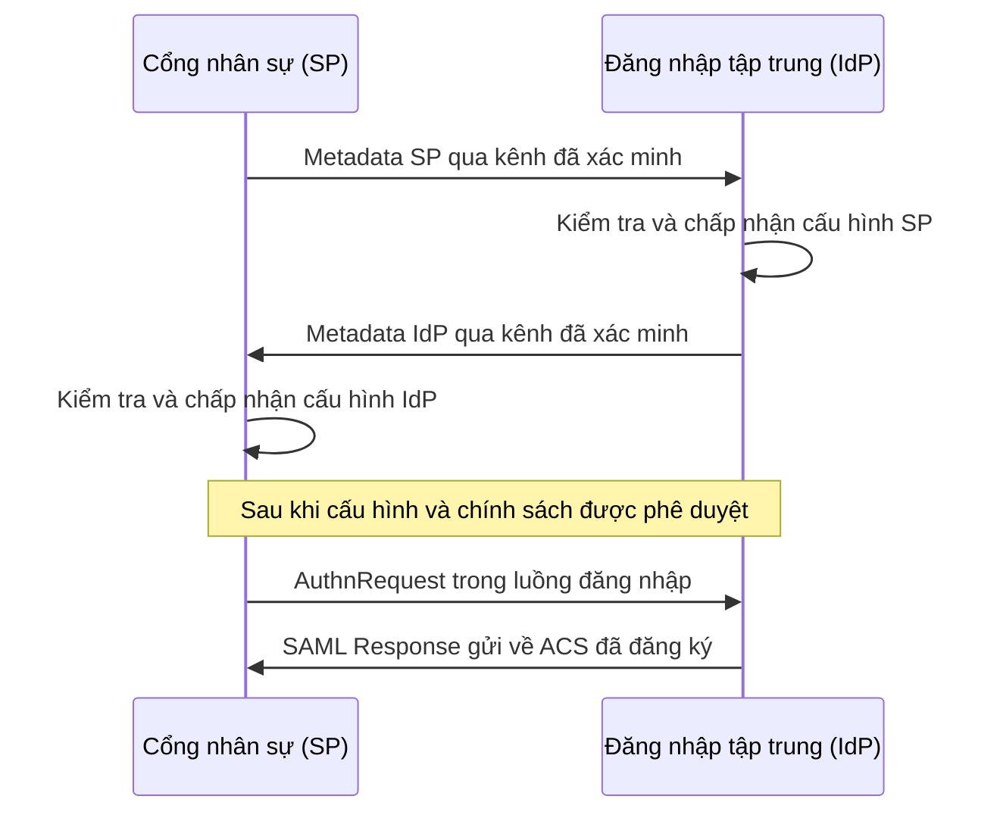

# Metadata exchange

Trong một kết nối SAML, hai hệ thống cần thống nhất cấu hình trước khi người dùng đăng nhập: bên nào phát hành thông điệp, gửi đến đâu, dùng binding nào và kiểm tra chữ ký bằng khóa nào. **Metadata exchange** là việc trao đổi, xác minh và cập nhật thông tin cấu hình đó giữa các bên tham gia federation.

Ví dụ, công ty kết nối cổng nhân sự với hệ thống đăng nhập tập trung. Cổng nhân sự là **Service Provider (SP)**; hệ thống đăng nhập là **Identity Provider (IdP)**. Nếu chỉ trao đổi một URL đăng nhập qua tin nhắn, nhóm vận hành vẫn phải nhập thủ công nhiều thông số và dễ nhầm môi trường. Metadata gom những thông tin liên quan vào tài liệu XML có cấu trúc để phần mềm xử lý nhất quán.

Trong nền tảng IAM, quản lý metadata là một phần của vòng đời quan hệ tin cậy: mở kết nối với đối tác, thay đổi endpoint, luân chuyển khóa và chấm dứt kết nối. Việc nhập metadata thành công chưa có nghĩa người dùng đã được cấp quyền sử dụng mọi chức năng của ứng dụng.

## 1. Metadata mô tả điều gì?

Các thành phần thường gặp gồm:

| Thành phần | Ý nghĩa |
|---|---|
| `EntityDescriptor` và `entityID` | Mô tả một thực thể SAML cùng định danh của nó |
| `IDPSSODescriptor` / `SPSSODescriptor` | Khai báo vai trò IdP hoặc SP |
| `SingleSignOnService` | Endpoint nhận yêu cầu đăng nhập tại IdP |
| `AssertionConsumerService` (ACS) | Endpoint tiếp nhận phản hồi xác thực tại SP |
| `Binding`, `Location`, `index` | Cách truyền, địa chỉ và chỉ số endpoint tương ứng |
| `KeyDescriptor` | Công bố khóa phục vụ ký hoặc mã hóa |
| `NameIDFormat`, `RequestedAttribute` | Mô tả định dạng định danh và thuộc tính được yêu cầu |

Một tài liệu có thể mô tả một thực thể hoặc tập hợp nhiều thực thể trong `EntitiesDescriptor`. Các cấu trúc này được định nghĩa trong [OASIS SAML 2.0 Metadata](https://docs.oasis-open.org/security/saml/v2.0/saml-metadata-2.0-os.pdf).

`entityID` có thể trông giống một URL nhưng chức năng chính là định danh. Không suy ra rằng truy cập URL đó sẽ tải được metadata; địa chỉ phân phối metadata phải được cấu hình hoặc xác định theo cơ chế đã thỏa thuận.

Metadata không phải assertion của một người dùng. Nó không chứa kết quả xác thực của phiên đăng nhập hiện tại, mật khẩu hay private key. Trong phần khóa công khai, chứng thư X.509 là một cách biểu diễn public key; private key vẫn nằm ở hệ thống sở hữu khóa.

## 2. Hai chiều trao đổi giữa IdP và SP

Với ví dụ cổng nhân sự, nhóm SP cung cấp metadata của cổng cho nhóm IdP; nhóm IdP cung cấp metadata của hệ thống đăng nhập cho nhóm SP.



Đây là trình tự minh họa cho một tích hợp song phương. Việc tải file có thể do quản trị viên thực hiện hoặc do dịch vụ quản lý metadata tự động thực hiện; không bắt buộc hai ứng dụng trực tiếp gọi nhau để trao đổi file.

Trong cấu hình của cổng nhân sự, nhóm vận hành ghi rõ đối tác là IdP production của công ty. Trong cấu hình tại IdP, họ đăng ký đúng SP production và ACS của nó. Metadata của môi trường thử nghiệm được xử lý trong quan hệ riêng. Tên hiển thị giống nhau giữa hai môi trường không phải bằng chứng chúng là cùng một đối tác.

## 3. Đọc một ví dụ metadata SP

Ví dụ tự tạo dưới đây minh họa cấu trúc của một SP có một ACS dùng HTTP-POST:

```xml
<?xml version="1.0" encoding="UTF-8"?>
<md:EntityDescriptor
    xmlns:md="urn:oasis:names:tc:SAML:2.0:metadata"
    entityID="https://hr.example.com/saml/sp"
    cacheDuration="PT6H">
  <md:SPSSODescriptor
      protocolSupportEnumeration="urn:oasis:names:tc:SAML:2.0:protocol"
      AuthnRequestsSigned="false"
      WantAssertionsSigned="true">
    <md:NameIDFormat>
      urn:oasis:names:tc:SAML:2.0:nameid-format:persistent
    </md:NameIDFormat>
    <md:AssertionConsumerService
        Binding="urn:oasis:names:tc:SAML:2.0:bindings:HTTP-POST"
        Location="https://hr.example.com/saml/acs"
        index="0"
        isDefault="true"/>
  </md:SPSSODescriptor>
</md:EntityDescriptor>
```

Khi đọc ví dụ, hãy nối từng trường với quyết định cấu hình cụ thể:

- Nhóm vận hành đối chiếu `entityID` với hồ sơ kết nối cổng nhân sự.
- Họ đăng ký `Location` của ACS tại IdP, thay vì dùng trang chủ của cổng.
- Họ kiểm tra sản phẩm hai bên hỗ trợ binding HTTP-POST ở bước gửi phản hồi.
- Họ thống nhất cách dùng NameID persistent và cách ánh xạ nó với tài khoản nội bộ.

Ví dụ chủ ý dùng yêu cầu xác thực không ký và không công bố khóa SP. Nếu IdP yêu cầu AuthnRequest có chữ ký, SP phải có khóa ký, công bố public key tương ứng và cấu hình ký phù hợp. Không chỉ đổi `AuthnRequestsSigned` thành `true` rồi coi việc triển khai đã hoàn tất.

XML trên chưa có chữ ký metadata, khóa mã hóa hay thời điểm hết hiệu lực tuyệt đối; đây là ví dụ đọc cấu trúc, không phải cấu hình production hoàn chỉnh. `WantAssertionsSigned` cũng không thay thế việc SP thực sự kiểm tra chữ ký và áp dụng chính sách xác thực khi xử lý thông điệp.

## 4. Chọn cách phân phối metadata

Một tổ chức có thể áp dụng nhiều cách phân phối tùy số lượng đối tác và khả năng tự động hóa:

| Cách triển khai | Ví dụ sử dụng | Công việc vận hành cần thiết |
|---|---|---|
| Trao đổi file thủ công | Cổng nhân sự kết nối với một IdP nội bộ | Lưu phiên bản đã phê duyệt, ghi người nhập và thông báo trước mỗi thay đổi |
| Tải từ URL cấu hình sẵn | SP định kỳ cập nhật metadata của IdP | Giới hạn nguồn tải, theo dõi lần tải thành công và kiểm tra bản mới trước khi kích hoạt |
| Nhận từ đơn vị quản lý federation | Nhiều trường đại học chia sẻ tài nguyên | Quản lý trust anchor của đơn vị phân phối và chính sách chọn đối tác từ tập metadata |

Đây là các phương án thiết kế vận hành, không phải ba chế độ bắt buộc của mọi sản phẩm SAML. Một sản phẩm chỉ hỗ trợ tải file thủ công sẽ cần quy trình cập nhật khác với sản phẩm tự refresh từ URL.

Trong ví dụ cổng nhân sự, cách thủ công có thể đủ lúc bắt đầu. Khi công ty thêm nhiều ứng dụng, nhóm IAM có thể chuyển sang cập nhật tự động để giảm thao tác lặp lại. Trước khi chuyển, họ cần thử cả tình huống nguồn tải không sẵn sàng và bản cập nhật bị từ chối, thay vì chỉ thử lần tải thành công đầu tiên.

## 5. Thiết lập trust trước khi nhập

Một file XML hợp lệ về cú pháp chưa đủ để trở thành cấu hình tin cậy. Nhóm IAM cần xác định ai được phép cung cấp metadata cho quan hệ đang cấu hình và bằng cách nào chứng minh điều đó.

Với cổng nhân sự, hồ sơ phê duyệt có thể ghi:

```text
Đối tác: IdP production của công ty
entityID kỳ vọng: https://login.example.com/saml/idp
Nguồn nhận: URL do nhóm IAM quản lý
Người sở hữu nghiệp vụ: Nhóm nhân sự
Người duyệt thay đổi kỹ thuật: Nhóm IAM
Môi trường: production
```

Các mục trên là ví dụ hồ sơ quản trị, không phải schema XML SAML. Mục đích là giúp người thực hiện kiểm tra bản nhận được với một kỳ vọng đã phê duyệt, thay vì tự chấp nhận mọi thông tin xuất hiện trong file.

Nếu dùng metadata có chữ ký, khóa xác minh nhà phát hành phải được thiết lập từ nguồn tin cậy độc lập. Không lấy một khóa bất kỳ ngay trong tài liệu chưa được tin cậy rồi dùng việc chữ ký khớp khóa đó để kết luận danh tính nhà phát hành. Việc chấp nhận metadata là bước thiết lập trust riêng, được phân biệt với xử lý khóa sau khi chấp nhận trong [OASIS Metadata Interoperability Profile, mục 2.3](https://docs.oasis-open.org/security/saml/Post2.0/sstc-metadata-iop.html).

Trong thiết kế vận hành, cần phân biệt ba vai trò có thể dùng các khóa khác nhau:

- Khóa ký **metadata** bảo vệ tài liệu cấu hình được phân phối.
- Khóa ký **thông điệp SAML** giúp kiểm tra thông điệp từ thực thể đối tác.
- Chứng thư **HTTPS** bảo vệ kết nối tới dịch vụ web.

Vì vậy, thay chứng thư HTTPS ở reverse proxy không tự động là thay khóa ký assertion. Ngược lại, nhận metadata mới có khóa ký assertion cũng không có nghĩa chứng thư HTTPS của máy chủ đã thay đổi.

## 6. Một quy trình tiếp nhận có kiểm soát

Quy trình dưới đây là gợi ý triển khai cho đội vận hành cổng nhân sự:

1. **Chốt đối tác và môi trường.** Ghi nhận entityID kỳ vọng, vai trò IdP/SP, nguồn phân phối và người có quyền duyệt.
2. **Nhận tài liệu vào vùng chờ.** Chưa thay ngay cấu hình đang phục vụ người dùng. Giới hạn dung lượng, timeout và số lần chuyển hướng nếu tải qua mạng.
3. **Xử lý XML bằng thư viện phù hợp.** Tắt DTD và external entity resolution; không tự viết bộ kiểm tra XML Signature. Chỉ cho phép các nguồn tải đã được quản trị phê duyệt để tránh biến chức năng nhập metadata thành nơi gọi tùy ý vào mạng nội bộ.
4. **Kiểm tra trust và tính phù hợp.** Xác minh nhà phát hành theo cơ chế đã chọn; đối chiếu thực thể, vai trò, endpoint, thời hạn và chính sách thuật toán. Với tập metadata, chỉ cho phép các đối tác nằm trong phạm vi kết nối đã duyệt.
5. **Xem phần thay đổi.** Nêu rõ khóa được thêm/xóa, ACS hoặc SSO endpoint được đổi và ảnh hưởng dự kiến. Thay đổi không khớp kế hoạch phải được làm rõ trước khi kích hoạt.
6. **Kích hoạt và quan sát.** Cập nhật cấu hình theo cơ chế nhất quán của sản phẩm, ghi dấu phiên bản và thử luồng đăng nhập. Giữ bản cấu hình trước để phục hồi khi nó vẫn còn hợp lệ và không bị thu hồi vì sự cố.

Những bước kiểm soát tải mạng và parser là biện pháp thiết kế hệ thống tiếp nhận. Chúng cần được cấu hình trong sản phẩm hoặc dịch vụ quản lý metadata, không thể được bảo đảm chỉ bằng việc tài liệu XML có các trường mong muốn.

Một phép thử hữu ích là đưa metadata của IdP thử nghiệm vào vùng chờ production. Hệ thống phải phát hiện sự không khớp với hồ sơ kết nối hoặc yêu cầu xử lý thay đổi thích hợp; không tự tạo thêm quan hệ tin cậy chỉ vì tài liệu phân tích được.

## 7. Phân biệt cache và hiệu lực

`cacheDuration` hướng dẫn thời gian trước khi thử làm mới bản lưu; `validUntil` đặt thời điểm metadata hết hiệu lực. Hết thời gian cache không đồng nghĩa luôn hết hiệu lực. Theo Errata E94, bản hết hiệu lực không được sử dụng; bản chỉ cũ theo cache có thể được dùng tùy triển khai nếu vẫn hợp lệ. Với cấu trúc lồng nhau, giới hạn ngắn hơn của phần tử cha/con có thể thu hẹp hiệu lực. Xem [OASIS SAML Errata 05, E76 và E94](https://docs.oasis-open.org/security/saml/v2.0/errata05/os/saml-v2.0-errata05-os.html).

Xét tình huống vận hành tự tạo:

```text
09:00: SP nhận metadata hợp lệ.
10:00: Đến lịch refresh; máy chủ phân phối tạm mất kết nối.
10:05: Nhóm vận hành nhận cảnh báo refresh thất bại.
12:00: Bản đang giữ đạt thời điểm validUntil của nó.
```

Từ 10:00, quyết định có tiếp tục dùng bản đang giữ phụ thuộc hiệu lực còn lại và chính sách đã cấu hình. Đến 12:00, đội vận hành không được tự kéo dài thời hạn của file cũ để vượt qua sự cố.

Trong thiết kế cho cổng nhân sự, có thể theo dõi riêng thời gian từ lần tải thành công và thời gian còn lại đến hạn. Hai chỉ số trả lời hai câu hỏi khác nhau: việc đồng bộ có đang hỏng không, và còn bao lâu để khôi phục trước khi cấu hình không thể tiếp tục được dùng. Lịch refresh nên có khoảng dự phòng cho thử lại và xử lý sự cố; con số cụ thể do yêu cầu sẵn sàng và rủi ro của tổ chức quyết định.

## 8. Đổi khóa mà không gây gián đoạn không cần thiết

Luân chuyển khóa cần tính đến việc các SP không nhận metadata mới cùng lúc. Trong Metadata Interoperability Profile, nhà phát hành có thể công bố trước khóa ký sẽ dùng trong tương lai; khóa cũ được gỡ sau khoảng chuyển tiếp phù hợp. Khóa bị lộ phải được loại bỏ, không xử lý như đổi khóa định kỳ. Xem [OASIS Metadata Interoperability Profile, mục 2.5](https://docs.oasis-open.org/security/saml/Post2.0/sstc-metadata-iop.html).

Giả sử IdP của công ty đang ký bằng khóa A và muốn chuyển sang B. Kế hoạch triển khai tự tạo có thể gồm:

1. Tạo B trong nơi lưu khóa được quản lý; giữ private key tại IdP.
2. Công bố metadata có cả A và B với mục đích sử dụng phù hợp.
3. Xác nhận từng SP đã nhận cấu hình có B, bao gồm các SP cập nhật thủ công và mọi node của cụm.
4. Chuyển IdP sang ký bằng B và thử đăng nhập tại các ứng dụng tiêu biểu.
5. Sau khi đáp ứng điều kiện chuyển tiếp đã thống nhất, phát hành bản loại A và xác nhận cập nhật.

Đây là kế hoạch cho **khóa ký**. Khi đổi khóa mã hóa của SP, còn phải kiểm tra SP giải mã được thông điệp gửi tới khóa cũ và khóa mới trong giai đoạn chuyển tiếp. Không giả định thứ tự `KeyDescriptor` trong XML khiến mọi sản phẩm chọn khóa mới theo cùng cách.

Nếu A bị lộ, đội ứng phó phải phối hợp loại bỏ trust vào A trên các bên sử dụng và xử lý phạm vi ảnh hưởng. Không giữ A chỉ để tránh lỗi đăng nhập. Việc đổi khóa ký metadata cũng cần kế hoạch riêng vì đây là thay đổi nguồn tin cậy dùng để xác minh các lần cập nhật tiếp theo.

## 9. Metadata không thay thế các chính sách IAM khác

Trong ví dụ cổng nhân sự, nhập metadata IdP chỉ là một phần của tích hợp. Nhóm ứng dụng vẫn cần quyết định tài khoản nào được vào cổng, thuộc tính nào được ánh xạ và quyền nào được cấp.

Ví dụ, việc metadata yêu cầu thuộc tính phòng ban không có nghĩa IdP sẽ luôn cung cấp nó hoặc giá trị đó đương nhiên đủ để cấp quyền duyệt lương. Hai bên phải thống nhất hợp đồng thuộc tính; ứng dụng phải áp dụng quy tắc phân quyền đã phê duyệt và xử lý giá trị thiếu hoặc không hợp lệ.

Tương tự, metadata mới không tự đăng xuất mọi phiên ứng dụng đang tồn tại. Khi chấm dứt kết nối với đối tác, kế hoạch vận hành cần xét cả cấu hình federation, việc phát hành đăng nhập mới, tài khoản liên quan và phiên hiện hành theo chính sách của hệ thống.

## 10. Nhận diện sự cố từ bằng chứng cấu hình

| Hiện tượng ở cổng nhân sự | Hướng điều tra ban đầu |
|---|---|
| Đăng nhập hỏng sau khi IdP đổi khóa | Đối chiếu phiên bản metadata và tập khóa thực tế trên từng node SP |
| Phản hồi được gửi về địa chỉ cũ | Kiểm tra ACS đã đăng ký tại IdP và việc bản SP mới đã được nhập hay chưa |
| Chỉ một số lượt đăng nhập thất bại | So sánh cấu hình giữa các node thay vì chỉ kiểm tra một máy |
| Refresh liên tục thất bại nhưng đăng nhập còn hoạt động | Kiểm tra nguồn tải, bản đang giữ, hạn hiệu lực và chính sách dùng cache |
| Metadata tải được nhưng không được kích hoạt | Kiểm tra lỗi xác minh nguồn, chữ ký, entityID, thời hạn và khác biệt ngoài kế hoạch |

Các dòng trên là giả thuyết điều tra, không phải kết luận nguyên nhân. Một báo cáo sự cố hữu ích nên ghi môi trường, entityID, thời điểm, phiên bản cấu hình và thông báo lỗi đã được lọc dữ liệu nhạy cảm. Tránh đưa assertion chứa thông tin cá nhân hoặc vật liệu khóa bí mật vào log hỗ trợ thông thường.

Một quan hệ federation được vận hành tốt cần trả lời được: bản metadata nào đang được dùng, ai đã chấp nhận nó, vì sao nguồn đó được tin cậy, khi nào phải cập nhật và cách thu hồi quan hệ khi không còn được phép. Đó là phần quản lý vòng đời khiến metadata exchange trở thành công việc IAM liên tục, thay vì một lần tải lên XML rồi bỏ quên.
