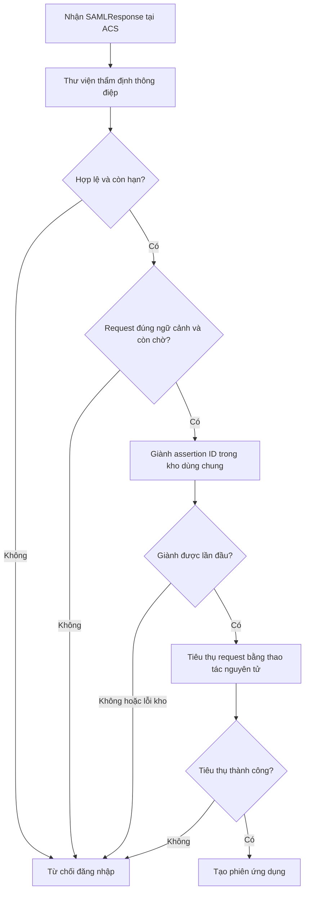

# Replay protection

## 1. Vì sao một assertion hợp lệ vẫn có thể bị lạm dụng?

Replay là việc gửi lại một thông điệp đã xuất hiện trước đó để hệ thống xử lý thêm lần nữa. Trong SAML SSO, đối tượng cần bảo vệ thường là assertion mà Identity Provider (IdP) gửi cho Service Provider (SP) qua trình duyệt.

Ví dụ, nhân viên đăng nhập cổng quản trị bằng SSO. IdP cấp assertion `_assertion_demo_72`; SP chấp nhận và tạo phiên. Nếu ai đó lấy được thông điệp này rồi gửi lại tới Assertion Consumer Service (ACS) trong thời gian còn hiệu lực, SP cần nhận ra rằng assertion đã được dùng. Kiểm tra chữ ký thành công lần thứ hai không chứng minh đây là một lần đăng nhập mới.

Chữ ký, mã hóa và TLS bảo vệ những khía cạnh khác nhau của thông điệp. Chúng không tự tạo ra bộ nhớ “assertion này đã được sử dụng”. Việc chống replay cần gắn kiểm tra thông điệp với trạng thái xử lý tại SP. Phân tích mối đe dọa nền tảng được trình bày trong [OASIS SAML Security and Privacy Considerations, mục 6.4.5](https://docs.oasis-open.org/security/saml/v2.0/saml-sec-consider-2.0-os.pdf).

Mục tiêu của bài này là thiết kế đường tiếp nhận SAML sao cho cùng một assertion không tạo thêm phiên đăng nhập khi bị gửi lại, kể cả qua node khác hoặc hai request đến gần như đồng thời.

## 2. Những dữ liệu cần phân biệt

| Dữ liệu | Vai trò khi tiếp nhận |
| --- | --- |
| `Assertion/@ID` | Nhận diện assertion đã dùng |
| `Response/@ID` | Nhận diện thông điệp bao ngoài |
| `InResponseTo` | Đối chiếu `AuthnRequest` |
| `Recipient` | Giới hạn ACS nhận assertion |
| `Audience` | Giới hạn SP sử dụng assertion |
| `NotOnOrAfter` | Giới hạn thời gian chấp nhận |

Với Web Browser SSO dùng HTTP POST, profile yêu cầu SP lưu các assertion ID đã dùng trong khoảng assertion còn được chấp nhận theo `SubjectConfirmationData/@NotOnOrAfter`. Với luồng có `AuthnRequest`, `InResponseTo` trong bearer subject confirmation phải khớp request gốc; luồng unsolicited có quy tắc riêng. Xem [OASIS SAML Profiles, mục 4.1.4.3–4.1.5](https://docs.oasis-open.org/security/saml/v2.0/saml-profiles-2.0-os.pdf).

Trong thiết kế bên dưới, assertion ID là dữ liệu chính của replay cache. Có thể theo dõi thêm response ID, nhưng không dùng nó thay thế assertion ID: một cách đóng gói khác của cùng assertion không nên tạo ra một lượt sử dụng mới.

`SessionIndex` phục vụ liên kết phiên IdP, không phải mã dùng một lần cho từng assertion. Tương tự, dùng email hoặc `NameID` làm khóa replay sẽ chặn nhầm những lần đăng nhập hợp lệ khác của cùng người dùng.

## 3. Mô hình bảo vệ theo nhiều lớp

Một cấu hình thực tế có thể kết hợp ba lớp:

1. Thẩm định thông điệp: xác định đúng IdP, nội dung được bảo vệ, SP đích và thời gian được chấp nhận.
2. Đối chiếu giao dịch đăng nhập: tìm request đã phát hành, còn chờ và thuộc ngữ cảnh trình duyệt tương ứng.
3. Ghi nhận dùng một lần: giành quyền sử dụng assertion bằng một thao tác nguyên tử trước khi tạo phiên.

Replay cache không sửa được lỗi chọn sai phần tử XML sau khi kiểm tra chữ ký. Vì vậy, luồng xác thực phải dùng chính assertion mà thư viện đã thẩm định, thay vì tìm lại một phần tử cùng tên bằng truy vấn XML tùy ý. Hướng dẫn về xác thực chữ ký và xử lý XML nằm trong [OWASP SAML Security Cheat Sheet](https://cheatsheetseries.owasp.org/cheatsheets/SAML_Security_Cheat_Sheet.html).

Sơ đồ sau là một thiết kế minh họa cho SP-initiated SSO:



Các bước kiểm tra thuần đọc có thể diễn ra trước. Quyết định “được dùng lần đầu” và “request còn chờ” phải được thực thi bằng thao tác có tính cạnh tranh an toàn, không chỉ bằng kết quả đọc trước đó.

## 4. Ví dụ về vòng đời của một giao dịch

Giả sử SP tạo request `_request_demo_41` lúc `09:00:00Z`. SP lưu ở phía server:

```text
requestId: _request_demo_41
expectedIdp: https://idp.example.test
spEntityId: https://portal.example.test/saml/metadata
acs: https://portal.example.test/saml/acs
browserBinding: <tham chiếu ngữ cảnh đăng nhập>
requestExpiresAt: 09:05:00Z
state: PENDING
```

Đây là mô hình dữ liệu minh họa, không phải schema SAML. Request ID thực tế cần được tạo bằng nguồn ngẫu nhiên phù hợp; không dùng dãy số dễ đoán như trong ví dụ.

IdP trả về assertion `_assertion_demo_72` lúc `09:00:20Z`. Thư viện xác thực cung cấp cho ứng dụng các dữ liệu đã được thẩm định:

```text
issuer: https://idp.example.test
assertionId: _assertion_demo_72
inResponseTo: _request_demo_41
recipient: https://portal.example.test/saml/acs
audience: https://portal.example.test/saml/metadata
subjectConfirmationNotOnOrAfter: 09:03:00Z
conditionsNotOnOrAfter: 09:04:00Z
```

Ứng dụng tra đúng giao dịch đăng nhập, thực hiện kiểm tra và đánh dấu assertion đã dùng. Nếu cùng thông điệp tới lần nữa lúc `09:00:21Z`, việc assertion vẫn còn hạn không làm nó trở thành một lần dùng mới.

Ba tình huống có kết quả khác nhau:

| Lần gửi | Trạng thái tại SP | Kết quả mong muốn |
| --- | --- | --- |
| Lần đầu, đúng request | Request còn chờ, assertion chưa dùng | Có thể tạo phiên |
| Gửi lại nguyên thông điệp | Assertion đã dùng | Từ chối |
| Assertion mới cho request đã tiêu thụ | Request không còn chờ | Từ chối giao dịch đó |

Người dùng muốn đăng nhập lại sẽ bắt đầu giao dịch mới. Không khôi phục trạng thái chờ của request cũ để phục vụ retry.

## 5. Thiết kế khóa và kho replay

### 5.1. Phạm vi khóa

Một quy ước khóa có thể là:

```text
saml-replay:v1:<security-domain>:<digest>
digest = SHA-256(lengthPrefixed(trustedIssuer, assertionId))
```

`trustedIssuer` ở đây là định danh IdP đã được xác thực theo cấu hình tin cậy. Không ghi replay cache dựa trên issuer và ID lấy trực tiếp từ XML chưa thẩm định.

`security-domain` xác định tập node cần cùng nhìn thấy trạng thái dùng một lần. Nếu ba replica phục vụ cùng một SP, cả ba phải sử dụng cùng miền khóa. Không thêm hostname của từng replica vào khóa vì cách đó biến một assertion thành ba lượt sử dụng độc lập.

Việc đưa issuer vào khóa tách biệt không gian ID giữa các IdP. Băm tuple giúp khóa có kích thước ổn định; vẫn cần mã hóa tuple không nhập nhằng, chẳng hạn dùng độ dài từng thành phần. Băm khóa không thay thế việc kiểm tra issuer hoặc chữ ký.

### 5.2. Thao tác nguyên tử

Mẫu sau có lỗi cạnh tranh:

```text
nếu chưa thấy key:
    ghi key
    tạo phiên
```

Hai node có thể cùng đọc “chưa thấy” trước khi một node kịp ghi. Kết quả là cả hai tạo phiên.

Thay vào đó, kho cần một thao tác tương đương:

```text
tryClaim(key, expiresAt):
    chỉ ghi nếu key chưa tồn tại
    ghi giá trị và hạn lưu trong cùng thao tác
    trả CLAIMED hoặc ALREADY_USED
```

Ví dụ Redis hỗ trợ `SET key value NX PX <ttlMilliseconds>`: `NX` yêu cầu khóa chưa tồn tại, còn `PX` đặt thời hạn tính bằng mili giây ngay trong lệnh. Xem [Redis SET](https://redis.io/docs/latest/commands/set/).

```text
SET saml-replay:v1:portal:<digest> used NX PX <ttlMilliseconds>
```

Ứng dụng phải phân biệt ba kết quả:

| Kết quả của kho | Xử lý đăng nhập |
| --- | --- |
| Ghi thành công | Tiếp tục giao dịch |
| Khóa đã tồn tại | Từ chối replay |
| Timeout hoặc lỗi kết nối | Không tạo phiên; trả lỗi có thể thử lại bằng giao dịch mới |

Không diễn giải timeout thành “khóa chưa có”. Server có thể đã ghi khóa trước khi client mất kết nối. Trong tình trạng không biết chắc, bảo toàn nguyên tắc dùng một lần có thể khiến một lượt đăng nhập hợp lệ phải bắt đầu lại.

### 5.3. Phạm vi bảo đảm của hạ tầng

Một lệnh nguyên tử trên node lưu trữ không tự giải quyết mất dữ liệu khi failover, eviction hoặc phân vùng mạng. Thiết kế cần trả lời: sau khi SP đã tạo phiên, liệu một node lưu trữ khác có thể quên khóa vừa ghi hay không?

Nếu câu trả lời là có, đường chống replay có thể mở lại. Tùy yêu cầu hệ thống, lựa chọn kho có ràng buộc duy nhất bền vững, chế độ vận hành có bảo đảm phù hợp, hoặc dừng tiếp nhận đăng nhập trong giai đoạn mất tính nhất quán.

Sticky session không phải biện pháp thay thế: request có thể tới replica khác sau restart hoặc khi cấu hình cân bằng tải thay đổi.

## 6. Thời gian lưu phải phủ hết thời gian có thể chấp nhận

`NotOnOrAfter` là cận trên loại trừ của khoảng thời gian. `Conditions` và `SubjectConfirmationData` cần được xem trong đúng ngữ cảnh; không đánh đồng hạn nhận assertion với tuổi thọ phiên ứng dụng. Các ngữ nghĩa thời gian được định nghĩa trong [OASIS SAML Core, mục 2.4.1.2 và 2.5.1.2](https://docs.oasis-open.org/security/saml/v2.0/saml-core-2.0-os.pdf).

Đối với một chính sách tiếp nhận đã xác định, có thể tính:

```text
acceptanceEnd =
    thời điểm cuối mà bộ kiểm tra còn có thể chấp nhận assertion

retainUntil =
    acceptanceEnd + biên an toàn cho sai lệch giữa các node và kho lưu trữ

ttl =
    retainUntil - thời gian hiện tại
```

`acceptanceEnd` phải phản ánh đúng các giới hạn được thực thi: hạn bearer confirmation, hạn Conditions nếu có, giới hạn tuổi assertion nếu SP áp dụng và clock skew được cho phép. Không cộng clock skew hai lần ở bộ kiểm tra nhưng chỉ một lần ở replay cache.

Ví dụ do bài học đặt ra:

```text
Hạn bearer confirmation:       09:03:00Z
Hạn Conditions:                09:04:00Z
Clock skew được cấu hình:      30 giây
Cận chấp nhận theo policy này: 09:03:30Z
Biên lưu bổ sung:              10 giây
Giữ replay key ít nhất tới:    09:03:40Z
```

Các con số trên chỉ minh họa phép tính. Trong hệ thống thật, cần tính đến node SP có đồng hồ chậm và đồng hồ của kho lưu trữ. Nếu không có giới hạn chấp nhận hữu hạn, hãy từ chối theo policy thay vì chọn đại một TTL rồi cho phép assertion tồn tại lâu hơn khóa bảo vệ nó.

Một assertion có nhiều bearer confirmation tạo thêm yêu cầu thiết kế: khóa ID phải tồn tại tới khi không còn đường confirmation nào mà bộ kiểm tra có thể chấp nhận. Không chỉ tính TTL theo confirmation có hạn ngắn nhất rồi để một confirmation khác kéo dài cửa sổ sử dụng.

TTL quá ngắn gây lỗi bảo mật; TTL dài hơn cần thiết làm tăng dung lượng. Có thể ước lượng quy mô:

```text
Số khóa đang lưu ≈ số assertion được chấp nhận mỗi giây × thời gian lưu trung bình
```

Nếu SP nhận 200 assertion/giây và lưu trung bình 240 giây, dung lượng ổn định vào khoảng 48.000 khóa, chưa tính dự phòng và overhead. Dùng số liệu này để hoạch định tài nguyên thay vì bật cơ chế tự đẩy khóa đang còn hiệu lực ra khỏi cache.

## 7. Mã giả cho đường tiếp nhận tại SP

Đoạn dưới diễn tả thứ tự và hợp đồng xử lý; không phải API của một thư viện SAML cụ thể.

```text
function acceptSso(httpRequest):
    validated = samlLibrary.validate(httpRequest)

    # validated chỉ chứa dữ liệu từ thông điệp đã thẩm định.
    transaction = requests.findAndValidateBinding(
        validated.inResponseTo,
        currentBrowserContext
    )

    acceptanceEnd = policy.computeAcceptanceEnd(validated)
    if not policy.isCurrentlyAcceptable(validated, now):
        reject("INVALID_TIME")

    result = replayStore.tryClaim(
        keyFor(validated.trustedIssuer, validated.assertionId),
        retentionDeadline(acceptanceEnd)
    )

    if result == ALREADY_USED:
        reject("ASSERTION_ALREADY_USED")

    if result != CLAIMED:
        reject("REPLAY_STORE_UNAVAILABLE")

    # Kiểm tra điều kiện và đổi trạng thái là một thao tác nguyên tử:
    # đúng browser binding, chưa hết hạn, state vẫn là PENDING.
    consumed = requests.consumePendingAtomically(
        transaction.id,
        currentBrowserContext,
        now
    )

    if not consumed:
        reject("REQUEST_NOT_PENDING")

    # Chỉ bây giờ mới tạo ngữ cảnh xác thực và cookie phiên.
    return sessions.createFor(validated.subject)
```

Kho request và replay cache có thể là hai hệ thống khác nhau. Với thứ tự trên, nếu giành assertion thành công nhưng tiêu thụ request hoặc tạo phiên thất bại, khóa replay vẫn được giữ. Người dùng bắt đầu một giao dịch mới; không xóa khóa để tái sử dụng assertion.

Cách này ưu tiên không chấp nhận hai lần hơn là cố bảo đảm mỗi lượt đăng nhập đều thành công. Nếu cần kết hợp thao tác trong một transaction bền vững, phải thiết kế rõ ranh giới commit và việc phát hành phiên. Hai thao tác riêng biệt không trở thành transaction chỉ vì được đặt cạnh nhau trong cùng method.

Kiểm tra thời gian ở bước cuối cũng cần đủ gần quyết định tiêu thụ. Không cho phép một request xếp hàng quá lâu sử dụng kết quả kiểm tra thời gian từ nhiều phút trước.

## 8. OneTimeUse, IdP-initiated SSO và giới hạn bảo vệ

### 8.1. OneTimeUse không tự triển khai cơ chế dùng một lần

`<OneTimeUse/>` là một condition bên trong assertion, không phải thuộc tính của Response. Nó biểu đạt hạn chế tái sử dụng; SP vẫn cần cơ chế thực thi và theo dõi assertion đã sử dụng. Xem [OASIS SAML Core, mục 2.5.1.5](https://docs.oasis-open.org/security/saml/v2.0/saml-core-2.0-os.pdf).

Không triển khai kiểu “chỉ bật replay cache khi thấy OneTimeUse”. Cơ chế chống replay của luồng bearer HTTP POST vẫn cần hoạt động với các assertion được tiếp nhận theo profile đó.

### 8.2. Luồng do IdP khởi tạo cần một nhánh policy riêng

IdP-initiated SSO không bắt đầu từ request do SP phát hành, nên không thể áp dụng nguyên xi bước tra request trong mã giả. Nếu hỗ trợ, SP cần nhận diện luồng đó bằng cấu hình rõ ràng, kiểm tra thông điệp theo profile tương ứng và vẫn thực thi replay cache.

Không chuyển một response sai `InResponseTo` thành luồng IdP-initiated để cho qua. Đó là đường bỏ qua điều kiện giao dịch đăng nhập.

[OWASP SAML Security Cheat Sheet](https://cheatsheetseries.owasp.org/cheatsheets/SAML_Security_Cheat_Sheet.html) nêu rủi ro login CSRF của unsolicited response. Replay cache chỉ biết assertion đã xuất hiện ở SP hay chưa; nó không chứng minh người dùng ở trình duyệt hiện tại đã chủ động khởi tạo lần đăng nhập đó.

### 8.3. Đánh cắp trước lần dùng đầu tiên

Nếu kẻ tấn công lấy được bearer assertion trước khi SP ghi nhận lần đầu, replay cache có thể cho kẻ đó giành lượt sử dụng đầu tiên. Vì vậy, cần đồng thời bảo vệ đường truyền, dữ liệu trong trình duyệt, log và ngữ cảnh giao dịch.

Một assertion ID mới do IdP cấp là một assertion khác, dù subject giống nhau. Kiểm soát phát hành tại IdP, bảo vệ phiên IdP và bảo vệ phiên ứng dụng là các lớp bổ sung, không nên được nhầm với phát hiện cùng một assertion bị gửi lại.

## 9. Vận hành và các tình huống cần kiểm chứng

Ghi sự kiện đủ để điều tra, nhưng tránh lưu toàn bộ `SAMLResponse`, assertion XML, cookie hoặc nội dung thuộc tính danh tính. Một bản ghi tối thiểu có thể chứa loại sự kiện, định danh IdP, SP, mã tương quan nội bộ và dấu vân tay assertion ID.

Các tín hiệu hữu ích gồm số replay bị từ chối, lỗi kho lưu trữ, thời gian đáp ứng của thao tác claim, mức sử dụng dung lượng và độ lệch đồng hồ. Không gắn nhãn mọi lần gửi trùng là tấn công: trình duyệt gửi lại form cũng tạo replay, và vẫn cần bị xử lý đúng.

Bảng sau là các tình huống thiết kế cần kiểm chứng khi triển khai, không phải bằng chứng đã chạy kiểm thử một sản phẩm cụ thể:

| Tình huống | Kết quả cần có |
| --- | --- |
| Assertion hợp lệ tới lần đầu | Tạo tối đa một phiên cho giao dịch |
| Gửi lại assertion khi vẫn còn hạn | Từ chối vì đã dùng |
| Hai request đồng thời tới hai replica | Chỉ một thao tác claim thành công |
| Cùng assertion trong một thông điệp bao khác | Vẫn nhận ra assertion đã dùng |
| Assertion mới gắn request đã tiêu thụ | Từ chối vì request không còn chờ |
| Request thuộc ngữ cảnh trình duyệt khác | Từ chối trước khi tạo phiên |
| Assertion hết hạn hoặc sai đích | Từ chối dù replay cache chưa có khóa |
| Kho replay timeout | Không tạo phiên từ kết quả không chắc chắn |
| Node SP restart | Trạng thái dùng một lần vẫn được bảo vệ |
| Failover hoặc eviction làm mất khóa còn hạn | Phát hiện giới hạn bảo đảm và áp dụng policy đã thiết kế |
| Thời điểm nằm trong clock skew cho phép | Khóa chưa bị dọn trước cửa sổ chấp nhận |
| Tạo phiên thất bại sau claim | Giữ khóa; bắt đầu giao dịch đăng nhập mới |

Một thiết kế đạt mục tiêu khi việc gửi lại assertion không tạo thêm quyền truy cập, trạng thái dùng một lần được chia sẻ đúng phạm vi và sự cố hạ tầng không bị diễn giải thành cho phép đăng nhập.
