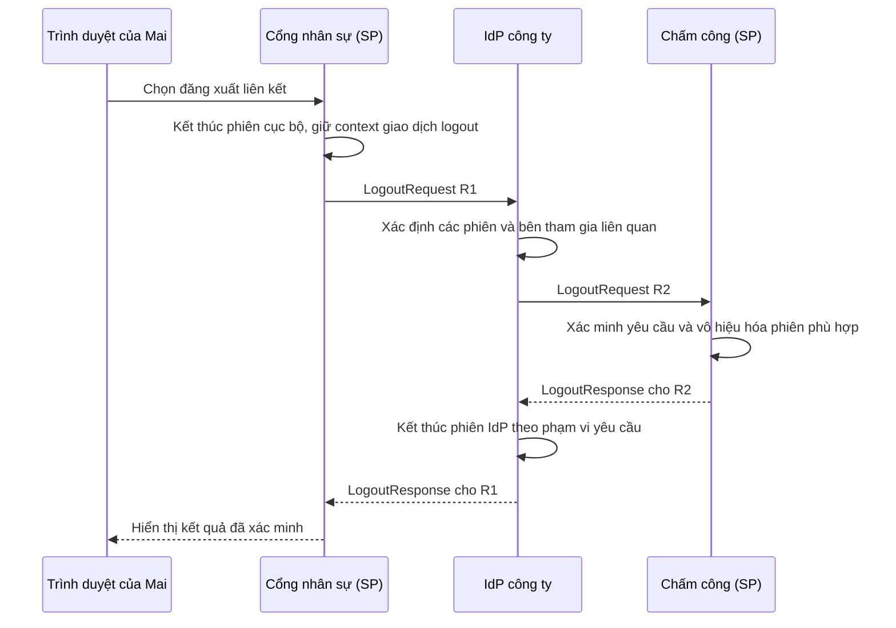

# Single Logout

**Single Logout (SLO)** trong SAML là cơ chế phối hợp kết thúc các phiên thuộc cùng một quan hệ đăng nhập liên kết. Khi người dùng đăng xuất tại một ứng dụng hoặc tại Identity Provider (IdP), các bên tham gia trao đổi thông điệp để kết thúc những phiên liên quan, thay vì mỗi ứng dụng tiếp tục giữ một phiên độc lập mà người dùng không biết.

Ví dụ, Mai đăng nhập qua IdP của công ty rồi mở cổng nhân sự và ứng dụng chấm công. Trên trình duyệt đang có phiên IdP và phiên riêng tại từng ứng dụng. Nếu cổng nhân sự chỉ xóa phiên của chính nó, Mai vẫn có thể sử dụng ứng dụng chấm công. Khi mở lại cổng nhân sự, phiên IdP còn hiệu lực cũng có thể giúp Mai đăng nhập lại mà không nhập mật khẩu.

Trong nền tảng IAM, SLO giúp quản lý việc kết thúc phiên giữa các hệ thống. Tuy nhiên, phạm vi của nó là các phiên tham gia luồng liên kết có thể được xác định và xử lý; không mặc nhiên bao gồm mọi thiết bị, mọi ứng dụng hay mọi loại thông tin xác thực của người dùng.

## 1. Xác định người dùng đang đăng xuất khỏi đâu

Trước khi thiết kế nút “Đăng xuất”, cần làm rõ kết quả mà ứng dụng cam kết:

| Thao tác | Kết quả cần hiểu đúng |
|---|---|
| Đăng xuất cục bộ tại một SP | Kết thúc phiên của ứng dụng đó theo phạm vi đã chọn |
| Kết thúc phiên tại IdP | Kết thúc phiên do IdP quản lý; phiên SP đã tạo cần được xử lý riêng hoặc thông qua SLO |
| SAML Single Logout | Phối hợp kết thúc các phiên liên quan tại những bên tham gia federation |
| “Đăng xuất mọi thiết bị” | Chức năng quản trị phiên rộng hơn, phải được hệ thống hỗ trợ và xác định phạm vi rõ ràng |
| Vô hiệu hóa tài khoản | Chặn việc sử dụng tài khoản theo chính sách; không nên giả định mọi phiên đang tồn tại đã bị thu hồi ngay |

Trong ví dụ của Mai, sản phẩm có thể cung cấp hai lựa chọn: đăng xuất khỏi cổng nhân sự hoặc đăng xuất khỏi các ứng dụng liên kết trong phiên hiện tại. Nhãn và thông báo phải phản ánh hành vi thực tế của triển khai.

Việc xóa cookie trên trình duyệt cũng cần đi cùng vô hiệu hóa trạng thái phiên thích hợp ở máy chủ. Nếu bản ghi phiên vẫn được chấp nhận, chỉ làm biến mất cookie hiện tại chưa đủ để bảo đảm một bản sao của định danh phiên không tiếp tục được sử dụng.

## 2. Những thành phần tham gia giao thức

Trong trường hợp thông thường, IdP đóng vai trò **session authority**, còn các Service Provider (SP) là **session participant**. SLO dùng `LogoutRequest` và `LogoutResponse`; IdP phối hợp gửi yêu cầu đến các bên liên quan. Luồng có thể bắt đầu tại SP hoặc IdP. Endpoint tương ứng được mô tả bằng `SingleLogoutService`, với binding mà hai bên hỗ trợ. Các quy tắc của profile nằm trong [OASIS SAML Profiles, mục 4.4](https://docs.oasis-open.org/security/saml/v2.0/saml-profiles-2.0-os.pdf).

Các giá trị sau giúp triển khai xác định đúng thông điệp và phiên:

- **Issuer:** thực thể phát thông điệp, cần được đối chiếu với đối tác đã tin cậy.
- **NameID và ngữ cảnh của nó:** định danh chủ thể giữa các bên; giá trị, định dạng và các qualifier liên quan cần được xử lý đúng.
- **SessionIndex:** liên kết yêu cầu với phiên xác thực SAML tương ứng.
- **ID và InResponseTo:** giúp liên hệ phản hồi với yêu cầu đang chờ.
- **IssueInstant, NotOnOrAfter khi có:** cung cấp thông tin thời gian để xử lý theo giao thức và chính sách.

SP không nên tìm người cần đăng xuất chỉ bằng email do trình duyệt gửi lên. Khi tạo phiên sau đăng nhập SAML thành công, SP cần giữ đủ thông tin liên kết với đối tác và phiên xác thực đã được xác minh.

Một mô hình dữ liệu minh họa cho cổng nhân sự có thể là:

```text
Đối tác IdP + NameID kèm ngữ cảnh + SessionIndex
    -> tập định danh phiên cục bộ tương ứng
```

Đây là mô hình thiết kế, không phải định dạng lưu trữ do SAML bắt buộc. Nó thể hiện rằng SessionIndex không phải cookie của ứng dụng, và không nên được xử lý như một định danh toàn cục độc lập với Issuer và chủ thể.

## 3. Luồng bắt đầu tại SP

Giả sử Mai chọn đăng xuất liên kết từ cổng nhân sự. Sơ đồ dưới đây minh họa trường hợp cả cổng nhân sự và ứng dụng chấm công đều hỗ trợ SLO:



Mũi tên giữa các hệ thống biểu diễn trao đổi giao thức. Tùy binding, thông điệp có thể đi qua trình duyệt hoặc qua kết nối máy chủ; sơ đồ không quy định mọi mũi tên là lời gọi HTTP trực tiếp.

R1 và R2 là hai yêu cầu khác nhau. IdP dùng thông tin phiên tương ứng tại ứng dụng chấm công khi phát R2; không chuyển nguyên định danh dành cho cổng nhân sự sang mọi SP. Điều này đặc biệt cần chú ý khi các SP nhận NameID khác nhau cho cùng một người.

Việc giữ context giao dịch logout cũng khác với giữ phiên ứng dụng còn hoạt động. Cổng nhân sự có thể vô hiệu hóa phiên sử dụng nghiệp vụ nhưng vẫn lưu ID yêu cầu, đối tác kỳ vọng và thời hạn chờ phản hồi để hoàn tất giao thức.

Nếu SLO bắt đầu từ giao diện IdP, IdP xác định phạm vi cần kết thúc và khởi tạo trao đổi với các SP liên quan. Khi không có SP gửi yêu cầu ban đầu, không có bước trả phản hồi cuối cùng cho một SP khởi tạo như trong sơ đồ trên.

## 4. SessionIndex quyết định phạm vi phiên

Một người có thể có nhiều phiên tại cùng ứng dụng, chẳng hạn một phiên trên laptop và một phiên trên điện thoại. Thiết kế cần phân biệt việc kết thúc một phiên xác thực liên kết với việc kết thúc mọi phiên của tài khoản.

Theo profile SLO và phần làm rõ E38, khi SP là bên yêu cầu với vai trò session participant, yêu cầu phải có ít nhất một `SessionIndex`. Session authority có thể bỏ các phần tử này khi yêu cầu kết thúc mọi phiên áp dụng của chủ thể. Xem [OASIS SAML Errata 05, E38](https://docs.oasis-open.org/security/saml/v2.0/errata05/os/saml-v2.0-errata05-os.html).

Vì vậy, không nên suy luận từ việc `SessionIndex` là phần tử tùy chọn trong schema rằng SP có thể tùy ý bỏ nó trong mọi luồng. Schema mô tả cấu trúc chung; profile bổ sung các yêu cầu cho ngữ cảnh sử dụng.

Đối với ví dụ của Mai, nhóm triển khai phải trả lời được:

1. Phiên nào của cổng nhân sự được liên kết với SessionIndex nhận khi đăng nhập?
2. Nếu nhiều phiên cục bộ cùng liên kết với context đó, yêu cầu được áp dụng đến những phiên nào?
3. Một yêu cầu từ IdP không có SessionIndex được xử lý trong phạm vi chủ thể và đối tác nào?
4. Phiên trên thiết bị khác có thực sự nằm trong phạm vi vừa xác định không?

Không thay định danh SAML bằng ID tài khoản nội bộ rồi xóa mọi phiên của tài khoản mà bỏ qua các giới hạn trên. Đồng thời, cũng không chỉ xóa phiên gắn với cookie đang có nếu yêu cầu hợp lệ nhắm đến nhiều phiên đã được liên kết.

## 5. Ví dụ đọc LogoutRequest

XML tự tạo dưới đây minh họa một yêu cầu từ cổng nhân sự gửi đến IdP:

```xml
<samlp:LogoutRequest
    xmlns:samlp="urn:oasis:names:tc:SAML:2.0:protocol"
    xmlns:saml="urn:oasis:names:tc:SAML:2.0:assertion"
    ID="_logout_hr_example_001"
    Version="2.0"
    IssueInstant="2026-11-26T08:00:00Z"
    Destination="https://login.example.com/saml/slo"
    NotOnOrAfter="2026-11-26T08:02:00Z"
    Reason="urn:oasis:names:tc:SAML:2.0:logout:user">
  <saml:Issuer>https://hr.example.com/saml/sp</saml:Issuer>
  <saml:NameID
      Format="urn:oasis:names:tc:SAML:2.0:nameid-format:persistent"
      NameQualifier="https://login.example.com/saml/idp"
      SPNameQualifier="https://hr.example.com/saml/sp">mai-opaque-7f2</saml:NameID>
  <samlp:SessionIndex>session-hr-example-42</samlp:SessionIndex>
</samlp:LogoutRequest>
```

Địa chỉ, định danh và mốc thời gian trên chỉ là dữ liệu minh họa. Hệ thống thật phải tạo ID mới cho giao dịch và dùng thời gian hiện tại theo chính sách phù hợp; không tái sử dụng nguyên thông điệp mẫu.

Ví dụ chưa thể hiện chữ ký hay cách đóng gói binding. Với HTTP-Redirect, chữ ký của binding liên quan đến các tham số truy vấn theo quy tắc của binding; với HTTP-POST, không thể coi việc Base64 XML là bảo vệ tính toàn vẹn. Triển khai cần thư viện SAML xử lý đúng cơ chế ký và xác minh, không tự ghép chuỗi rồi kiểm tra theo một quy tắc dùng chung cho mọi binding.

Trường `Reason` mô tả lý do, không tự chứng minh người gửi có quyền đăng xuất một phiên. Thông điệp vẫn phải được xác thực và đối chiếu với quan hệ phiên phù hợp.

## 6. Front-channel và back-channel

Hai cách truyền phổ biến có đặc điểm vận hành khác nhau:

| Cách truyền | Ví dụ | Đặc điểm cần tính đến |
|---|---|---|
| Front-channel | HTTP-Redirect hoặc HTTP-POST qua trình duyệt | Phụ thuộc việc trình duyệt tiếp tục luồng; có thể bị gián đoạn khi đóng tab hoặc lỗi điều hướng |
| Back-channel | SOAP giữa các máy chủ | Cần kết nối mạng và cơ chế xác thực giữa các bên; bên nhận phải tìm phiên mà không dựa vào cookie trình duyệt hiện tại |

Các lựa chọn binding cho SLO được trình bày trong [OASIS SAML Technical Overview, mục 5.3](https://docs.oasis-open.org/security/saml/Post2.0/sstc-saml-tech-overview-2.0.html). Không phải mọi sản phẩm hay mọi kết nối đã hoạt động với SSO đều hỗ trợ cùng một cách SLO.

Trong triển khai cổng nhân sự, endpoint nhận đăng nhập và endpoint nhận logout cần được phân biệt. Cấu hình ACS đúng không tự tạo ra cấu hình `SingleLogoutService` đúng. Nhóm tích hợp phải đối chiếu binding, địa chỉ nhận yêu cầu, địa chỉ nhận phản hồi nếu khác nhau và khả năng của từng bên.

Back-channel có thể vô hiệu hóa trạng thái phiên phía máy chủ dù cookie cũ còn trong trình duyệt. Khi trình duyệt gửi cookie đó ở lần truy cập tiếp theo, ứng dụng phải từ chối phiên đã bị vô hiệu hóa. Nếu cụm ứng dụng dùng nhiều node, mọi node phải nhìn thấy kết quả kết thúc phiên qua cơ chế lưu trữ hoặc đồng bộ thích hợp.

Với front-channel, cần thử trên các trình duyệt và cấu hình cookie được hỗ trợ thực tế. Không giả định tất cả chuỗi chuyển hướng, form POST hoặc cách nhúng nội dung đều có hành vi giống nhau. Tương tự, không hứa rằng back-channel luôn thay thế được một SP chỉ hỗ trợ front-channel.

## 7. Xác minh thông điệp trước khi tác động đến phiên

SLO thay đổi trạng thái truy cập nên phải được xử lý bằng thư viện giao thức và chính sách tin cậy phù hợp. Với POST hoặc Redirect trong profile này, thông điệp phải được ký; các binding khác phải cung cấp cơ chế xác thực và bảo vệ toàn vẹn tương ứng. Yêu cầu này được nêu trong [OASIS SAML Profiles, mục 4.4.3–4.4.4](https://docs.oasis-open.org/security/saml/v2.0/saml-profiles-2.0-os.pdf).

Đội phát triển cổng nhân sự nên kiểm tra các nhóm điều kiện sau trong cấu hình và cách tích hợp thư viện:

1. **Đúng đối tác:** Issuer thuộc kết nối đã tin cậy; khóa xác minh đến từ cấu hình hoặc metadata đã được chấp nhận, không phải khóa tùy ý trong thông điệp.
2. **Đúng thông điệp và đích:** parser nhận đúng loại thông điệp; Destination khi có và endpoint xử lý được đối chiếu theo quy tắc giao thức.
3. **Đúng phạm vi phiên:** NameID, qualifier và SessionIndex được liên kết với phiên xác thực tương ứng của đối tác đó.
4. **Đúng giao dịch:** LogoutResponse được liên hệ với yêu cầu đang chờ bằng InResponseTo và đối tác kỳ vọng; không lấy phản hồi bất kỳ để đánh dấu giao dịch khác thành công.
5. **Đúng thời gian:** áp dụng điều kiện thời gian của thông điệp, độ lệch đồng hồ cho phép và giới hạn chờ của triển khai.
6. **Chống phát lại và xử lý lặp an toàn:** quản lý ID đã xử lý; yêu cầu lặp không được tạo thêm tác động ngoài phạm vi hoặc làm sống lại phiên.

RelayState chỉ nên mang trạng thái điều hướng được kiểm soát hoặc một tham chiếu khó đoán đến trạng thái lưu phía máy chủ. Không chuyển hướng đến URL tùy ý do người gửi đưa vào. Giao diện nội bộ để người dùng bắt đầu logout cũng cần cơ chế chống yêu cầu giả mạo phù hợp; không tắt toàn bộ bảo vệ CSRF của ứng dụng chỉ để một endpoint SAML hoạt động.

Các kiểm soát parser XML như tắt DTD và external entity resolution vẫn cần thiết. Việc đọc được XML và tìm thấy chuỗi “LogoutRequest” không phải là xác minh giao thức.

## 8. Thành công cục bộ và PartialLogout

SLO đi qua nhiều hệ thống nên có thể chỉ hoàn tất một phần. Trong SAML Core, trạng thái cấp cao `Success` từ session authority phản ánh việc kết thúc phiên tại chính authority; khi không nhận được xác nhận từ mọi bên liên quan, phản hồi có trạng thái cấp hai `PartialLogout`. Vì thế phải đọc cả cấu trúc trạng thái. Xem [OASIS SAML Core, mục 3.7.3.2](https://docs.oasis-open.org/security/saml/v2.0/saml-core-2.0-os.pdf).

Phần trạng thái tự tạo sau minh họa trường hợp đó:

```xml
<samlp:Status xmlns:samlp="urn:oasis:names:tc:SAML:2.0:protocol">
  <samlp:StatusCode Value="urn:oasis:names:tc:SAML:2.0:status:Success">
    <samlp:StatusCode Value="urn:oasis:names:tc:SAML:2.0:status:PartialLogout"/>
  </samlp:StatusCode>
</samlp:Status>
```

Đây chỉ là đoạn của LogoutResponse, không phải phản hồi hoàn chỉnh có thể gửi độc lập.

Giả sử IdP kết thúc được phiên của Mai và cổng nhân sự đã kết thúc phiên của mình, nhưng ứng dụng chấm công bị mất kết nối. Giao diện có thể thông báo: “Bạn đã đăng xuất khỏi cổng nhân sự. Chưa xác nhận được việc đăng xuất khỏi một số ứng dụng liên kết.” Không nên hiển thị “Đã đăng xuất an toàn khỏi tất cả ứng dụng” khi bằng chứng không cho phép kết luận đó.

Timeout còn có thể tạo ra kết quả chưa xác định: SP đã xử lý yêu cầu nhưng phản hồi không đến nơi. Nhật ký vận hành cần phân biệt chưa gửi được, đã gửi nhưng chưa nhận xác nhận và đã nhận phản hồi lỗi. Việc thiết kế thử lại phải tuân thủ giao thức và khả năng xử lý lặp, không gửi lại vô hạn hoặc khôi phục phiên để che lỗi.

## 9. Quản lý trạng thái và các tình huống cạnh tranh

Ứng dụng thực tế có nhiều tab, nhiều request đồng thời và có thể chạy trên nhiều node. Một thiết kế cho cổng nhân sự cần xét cả trạng thái nghiệp vụ lẫn trạng thái của giao dịch SLO.

Ví dụ, sau khi Mai bấm logout, một request đọc bảng lương từ tab cũ vẫn có thể đang bay trên mạng. Vô hiệu hóa phiên phải có hiệu lực trên các request tiếp theo theo cơ chế kiểm tra phiên của ứng dụng; giao diện đổi sang trang “Đã đăng xuất” không tự hủy được mọi tác vụ đã được máy chủ chấp nhận trước đó.

Một tình huống khác là thông điệp đăng nhập và thông điệp logout đến lệch thứ tự. SAML Core có quy tắc áp dụng logout cho assertion phù hợp đến sau khi yêu cầu logout vẫn còn hiệu lực. Thư viện và cách lưu trạng thái phải xử lý được trường hợp này. Không đơn giản coi “hiện chưa tìm thấy phiên” là lý do bỏ mọi thông tin của yêu cầu hợp lệ. Xem [OASIS SAML Core, mục 3.7.3.1](https://docs.oasis-open.org/security/saml/v2.0/saml-core-2.0-os.pdf).

Trong thiết kế lưu trữ, có thể cần dấu vết kết thúc phiên có thời hạn phù hợp, tập ID đã xử lý và context yêu cầu đang chờ. Các bản ghi này phải được giới hạn vòng đời và bảo vệ như dữ liệu liên quan đến phiên. Chúng không được biến thành lệnh chặn mọi lần xác thực hợp lệ trong tương lai của Mai chỉ vì cùng một tài khoản.

Khi SLO hết thời gian chờ hoặc chỉ hoàn tất một phần, phiên cục bộ đã kết thúc không được tự bật lại. Người dùng muốn vào lại phải đi qua quá trình tạo phiên mới theo chính sách xác thực của hệ thống.

## 10. Kiểm chứng hành vi khi tích hợp

Các tình huống sau là gợi ý kiểm chứng cho ví dụ công ty, không phải bằng chứng rằng một sản phẩm cụ thể đã hỗ trợ tất cả tính năng:

| Tình huống | Điều cần quan sát |
|---|---|
| Bắt đầu logout tại cổng nhân sự | Phiên cục bộ bị vô hiệu hóa và giao dịch SLO có context để đối chiếu phản hồi |
| Bắt đầu logout tại IdP | Các SP liên quan xử lý được yêu cầu từ IdP mà không cần người dùng mở sẵn tab tại mỗi SP |
| Một SP không phản hồi | Kết quả phản ánh việc chưa hoàn tất; phiên đã kết thúc vẫn giữ trạng thái kết thúc |
| NameID hoặc SessionIndex không thuộc context của đối tác | Không tác động nhầm phiên của người khác hay môi trường khác |
| Chữ ký sai hoặc Issuer không tin cậy | Thông điệp không được dùng để thay đổi trạng thái phiên |
| LogoutResponse có InResponseTo không khớp | Không đánh dấu yêu cầu khác thành công |
| Gửi lại một thông điệp đã xử lý | Không sinh tác động ngoài phạm vi hoặc làm phiên hoạt động trở lại |
| Truy cập từ node khác sau logout | Node đó từ chối định danh phiên đã bị vô hiệu hóa |
| Hai thiết bị có hai phiên riêng | Phạm vi kết thúc phù hợp với yêu cầu và chính sách, không dựa vào phỏng đoán |
| Assertion phù hợp đến sau yêu cầu logout | Không tái lập phiên trái với quy tắc xử lý logout còn hiệu lực |

Nhật ký hỗ trợ điều tra nên có mã giao dịch nội bộ, đối tác, thời điểm, kết quả xác minh và trạng thái của từng chặng cần thiết. Không ghi toàn bộ assertion, cookie phiên hoặc định danh cá nhân vào log thông thường. Nếu cần liên hệ các sự kiện, dùng tham chiếu nội bộ hoặc giá trị đã được bảo vệ phù hợp với chính sách dữ liệu.

## 11. Đặt SLO trong vòng đời truy cập

Khi Mai chủ động kết thúc công việc, SLO là công cụ phù hợp để phối hợp đóng các phiên liên kết đang được quản lý. Khi xử lý mất thiết bị, nghỉ việc hoặc nghi ngờ tài khoản bị chiếm, đội IAM còn phải xét thu hồi phiên trên các thiết bị khác, vô hiệu hóa tài khoản, thay đổi thông tin xác thực và quyền truy cập theo phạm vi sự cố.

Một API token hoặc phiên của ứng dụng không tham gia quan hệ SAML không tự biến mất vì giao dịch SLO thành công. Những loại truy cập đó cần cơ chế thu hồi riêng hoặc thời hạn đã được thiết kế. Tương tự, SLO không xóa tài khoản, gỡ vai trò RBAC hay thu hồi mọi đặc quyền lâu dài của người dùng.

Hợp đồng vận hành giữa IdP và SP cần ghi rõ bên nào hỗ trợ SLO, binding nào được dùng, cách ánh xạ phiên, giới hạn thời gian chờ và cách thông báo kết quả chưa hoàn tất. Khi các điều này được kiểm chứng, nút đăng xuất mới thể hiện một hành vi có thể giải thích và kiểm toán được trong hệ thống IAM.
