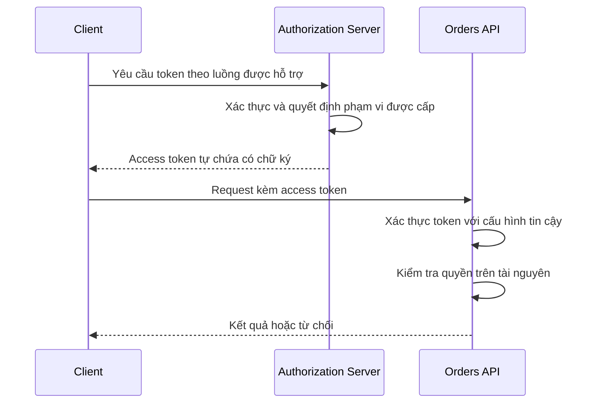

# Self-contained token

## 1. Token tự chứa là gì?

Self-contained token, hay token tự chứa, mang trực tiếp những thông tin mà bên nhận cần để diễn giải và kiểm tra token. Những thông tin này thường gồm bên phát hành, chủ thể, bên nhận dự kiến, thời hạn và phạm vi truy cập.

Trong IAM, một API có thể tiếp nhận token tự chứa, xác thực bằng khóa đã tin cậy và đọc các claim mà không phải tra cứu một bản ghi token tại máy chủ phát hành cho mỗi request. JWT có chữ ký là một cách triển khai phổ biến.

“Tự chứa” mô tả cách đóng gói thông tin. Nó không có nghĩa API tự động tin bất kỳ dữ liệu nào client gửi, cũng không có nghĩa toàn bộ hệ thống không cần trạng thái. Khóa tin cậy, cấu hình issuer, chính sách phân quyền và dữ liệu nghiệp vụ vẫn tồn tại bên ngoài token.

Ví dụ, dịch vụ đơn hàng nhận một token ghi rằng người dùng `user-204` được gọi chức năng `orders.read` tại `orders-api`. Dịch vụ có thể xác thực token tại chỗ, nhưng vẫn phải kiểm tra người dùng có được đọc đơn hàng cụ thể đang yêu cầu hay không.

## 2. Phân biệt token tự chứa với token tham chiếu

Một token tham chiếu có thể chỉ là một chuỗi ngẫu nhiên. Thông tin về nó nằm trong kho phía server; bên sử dụng phải lấy ngữ cảnh qua cơ chế mà hệ thống cung cấp. Với token tự chứa, ngữ cảnh cần thiết cho việc kiểm tra token nằm ngay trong thông điệp đã được bảo vệ.

| Khía cạnh | Token tự chứa | Token tham chiếu |
| --- | --- | --- |
| Thông tin đi cùng token | Có các claim có thể diễn giải theo profile | Chủ yếu là định danh để tra cứu |
| Kiểm tra tại API | Có thể thực hiện cục bộ với khóa và policy tin cậy | Cần cơ chế lấy trạng thái hoặc ngữ cảnh liên quan |
| Cập nhật quyền sau khi cấp | Claim cũ vẫn nằm trong token đã cấp | Có thể phản ánh qua dữ liệu server khi tra cứu |
| Dữ liệu trên đường truyền | Có thể lớn hơn do mang nhiều claim | Có thể gọn hơn |
| Thành phần cần vận hành | Khóa, cấu hình xác thực, quản lý vòng đời | Kho trạng thái hoặc dịch vụ kiểm tra token |

Bảng này mô tả mô hình, không khẳng định một định dạng luôn nhanh hơn hoặc an toàn hơn. Cache, chữ ký, tải hệ thống và yêu cầu thu hồi ảnh hưởng đáng kể đến kết quả thực tế.

“Opaque” còn phụ thuộc góc nhìn: client có thể được yêu cầu coi access token là một chuỗi không cần hiểu, dù resource server biết cách xác thực cấu trúc bên trong. Không thiết kế giao diện client dựa trên việc tự đọc một access token mà hợp đồng giao thức không dành cho client diễn giải.

Introspection cũng không bị giới hạn ở token tham chiếu. [RFC 7662, mục 1](https://www.rfc-editor.org/rfc/rfc7662.html#section-1) cho phép truy vấn trạng thái và thông tin liên quan ngay cả khi token đã mang dữ liệu có cấu trúc. Vì vậy, token tự chứa vẫn có thể được triển khai cùng một lớp kiểm tra trạng thái online.

## 3. JWT có chữ ký: một ví dụ về token tự chứa

JWT biểu diễn một tập claim bằng JSON, với cơ chế bảo vệ dựa trên JWS hoặc JWE. JWT có chữ ký không mặc nhiên được mã hóa; Base64url chỉ là cách biểu diễn dữ liệu. Xem [RFC 7519, mục 3](https://www.rfc-editor.org/rfc/rfc7519.html#section-3).

Một JWT dùng JWS Compact Serialization thường có ba phần:

```text
base64url(protectedHeader).base64url(payload).base64url(signature)
```

Ví dụ header:

```json
{
  "typ": "at+jwt",
  "alg": "RS256",
  "kid": "orders-signing-key-a"
}
```

Ví dụ payload do bài học xây dựng:

```json
{
  "iss": "https://identity.example.test",
  "sub": "user-204",
  "aud": "orders-api",
  "client_id": "customer-portal",
  "iat": 1900000000,
  "exp": 1900000300,
  "jti": "demo-token-7c91",
  "scope": "orders.read",
  "tenant_id": "tenant-18"
}
```

Đây là dữ liệu minh họa, chưa có chữ ký thực và không phải token có thể dùng để đăng nhập. `jti` sản xuất cần được tạo theo cơ chế bảo đảm tính duy nhất phù hợp; giá trị dễ đọc phía trên chỉ phục vụ giải thích.

| Thành phần trong ví dụ | Ý nghĩa |
| --- | --- |
| `iss` | Bên phát hành |
| `sub` | Chủ thể |
| `aud` | API nhận token |
| `client_id` | Client được cấp token |
| `iat` | Thời điểm phát hành |
| `exp` | Thời điểm hết hạn |
| `jti` | Định danh token |
| `scope` | Phạm vi truy cập |
| `tenant_id` | Claim riêng của ứng dụng |

JWT tổng quát không bắt buộc mọi claim đã đăng ký đều xuất hiện. Profile ứng dụng quyết định trường nào bắt buộc. Ví dụ dùng định hướng access token của [RFC 9068, mục 2](https://www.rfc-editor.org/rfc/rfc9068.html#section-2), với kiểu `at+jwt`, chữ ký và các claim bắt buộc theo profile. `tenant_id` là phần hợp đồng riêng, không phải field bắt buộc của profile này.

### Đọc được payload không có nghĩa sửa được token

Bất kỳ bên nào cầm JWT không mã hóa đều có thể đọc nội dung header và payload. Nếu client đổi `scope` thành `orders.admin`, dữ liệu đầu vào của chữ ký thay đổi. Token sửa như vậy phải bị từ chối khi xác thực đúng.

Ngược lại, nếu ứng dụng chỉ giải mã Base64url rồi lấy quyền từ payload, kẻ gửi có thể tự viết JSON theo ý mình. Sai sót nằm ở việc dùng dữ liệu chưa được xác thực để quyết định quyền.

Không đưa mật khẩu, private key hoặc bí mật hệ thống vào token. Mã hóa token có thể phục vụ yêu cầu bảo mật nội dung, nhưng vẫn cần xác định nguồn phát hành và quy tắc tiếp nhận theo profile tương ứng.

## 4. Luồng phát hành và sử dụng



Dịch vụ phát hành là nơi đưa claim vào token. Client không được tự chọn một claim đặc quyền rồi yêu cầu hệ thống ký mà không qua quyết định cấp quyền.

API sở hữu một hợp đồng tiếp nhận rõ ràng. Ví dụ trong bài học:

```text
Issuer được tin cậy:
  https://identity.example.test

Audience của API:
  orders-api

Loại token:
  JWT access token theo profile đã thống nhất

Thuật toán được cấu hình:
  RS256

Nguồn khóa:
  Bộ khóa gắn với issuer đã được quản trị

Chính sách thời gian:
  exp bắt buộc; tuổi thọ tối đa do hệ thống quy định
```

Đây là cấu hình minh họa cho một deployment. Không suy ra rằng mọi hệ thống buộc phải dùng duy nhất thuật toán trong ví dụ.

Khi dùng chữ ký bất đối xứng, máy chủ phát hành giữ private key; API kiểm tra bằng public key. Điều này giúp tách quyền phát hành token khỏi quyền xác thực token. Nếu dùng MAC với shared secret, bên giữ secret để kiểm tra cũng có khả năng tạo MAC; cần cân nhắc ranh giới tin cậy đó khi chia sẻ khóa cho nhiều dịch vụ.

## 5. Xác thực token trước khi tin claim

Một policy tiếp nhận cần ràng buộc thuật toán được phép, khóa thuộc issuer tin cậy, kiểu token, audience và thời gian. Không cho header do người gửi cung cấp tự quyết định toàn bộ chính sách xác thực. Các nguyên tắc này được nêu trong [RFC 8725, mục 3](https://www.rfc-editor.org/rfc/rfc8725.html#section-3).

Với access token trong ví dụ, các câu hỏi cần trả lời là:

1. Token có đúng định dạng và profile API chấp nhận không?
2. Chữ ký có hợp lệ với khóa được tin cậy cho issuer đó không?
3. Issuer có khớp cấu hình và audience có bao gồm `orders-api` không?
4. Token còn nằm trong thời gian được phép sử dụng không?
5. Các claim bắt buộc có kiểu dữ liệu và giá trị hợp lệ không?

`exp`, `nbf` và `iat` có vai trò khác nhau: hạn hết hiệu lực, mốc bắt đầu được chấp nhận và thời điểm phát hành. NumericDate dùng đơn vị giây, không phải mili giây. Xem [RFC 7519, mục 2 và 4.1](https://www.rfc-editor.org/rfc/rfc7519.html#section-4.1).

Trong policy của bài học, nếu xuất hiện `nbf` thì kiểm tra nó; nếu muốn giới hạn tuổi token dựa vào `iat` thì phải quy định thêm giới hạn đó. Không tự hiểu `iat` là một hạn sử dụng khác của `exp`.

Ví dụ mã giả:

```text
function authenticateAccessToken(rawToken):
    verified = jwtLibrary.verify(
        rawToken,
        trustedIssuerConfiguration,
        allowedAlgorithms,
        expectedAccessTokenProfile
    )

    claims = validateRequiredClaims(
        verified,
        expectedIssuer,
        expectedAudience,
        clock,
        allowedClockSkew,
        maximumTokenLifetime
    )

    return AuthenticatedPrincipal(
        issuer = claims.issuer,
        subject = claims.subject,
        clientId = claims.clientId,
        scopes = parseScopeAccordingToContract(claims.scope),
        tenantId = claims.tenantId
    )
```

Đây là hợp đồng xử lý minh họa, không phải API của một thư viện Java cụ thể. Hàm `verify` phải thật sự kiểm tra mật mã; việc đặt tên “verified” cho một đối tượng đã decode không làm nó đáng tin.

Không dùng ID token để thay access token chỉ vì cả hai đều có thể mang định dạng JWT. Kiểu token và audience phải phù hợp với vai trò của endpoint đang nhận; [RFC 9068, mục 4–5](https://www.rfc-editor.org/rfc/rfc9068.html#section-4) trình bày việc xác thực access token và ngăn nhầm lẫn giữa các loại token.

## 6. Token hợp lệ và quyền trên tài nguyên là hai quyết định khác nhau

Giả sử token của `user-204` vượt qua toàn bộ bước xác thực và có scope `orders.read`. Người dùng gọi:

```http
GET /orders/order-900
Authorization: Bearer <access-token>
```

Đơn hàng có dữ liệu phía server:

```json
{
  "id": "order-900",
  "tenant_id": "tenant-18",
  "owner_subject": "user-305"
}
```

Scope cho biết token có thể tham gia chức năng đọc đơn hàng theo policy. Nó không tự nói rằng `user-204` được đọc mọi đơn hàng.

Một policy minh họa có thể yêu cầu đồng thời:

```text
Token đã được xác thực
AND scope chứa orders.read
AND tenant của token khớp tenant tài nguyên
AND subject là chủ đơn hàng hoặc có quyền nhân viên hỗ trợ hiện hành
```

Nếu chỉ có scope mà không thỏa quan hệ sở hữu hoặc quyền hỗ trợ, API từ chối. Việc thêm một claim `tenant_id` cũng không thay thế kiểm tra tenant của tài nguyên thật.

Trong hệ thống nhiều issuer, danh tính nên được xử lý trong phạm vi issuer phù hợp. Hai token cùng ghi `sub=user-204` nhưng do hai issuer độc lập phát hành không tự động chỉ cùng một người.

Tương tự, nếu đưa role vào token, cần thống nhất cách ánh xạ role sang quyền. Một tên như `admin` không có ý nghĩa toàn cục nếu các dịch vụ hiểu khác nhau hoặc bỏ qua ranh giới tenant.

## 7. Claim là ảnh chụp tại thời điểm phát hành

Đặc tính quan trọng nhất khi vận hành token tự chứa là dữ liệu đã ký không tự cập nhật sau khi được cấp.

Xét ví dụ có token sống 5 phút:

| Thời điểm | Sự kiện | Nội dung token đã cấp |
| --- | --- | --- |
| 10:00 | Cấp token với `orders.approve` | Có quyền phê duyệt |
| 10:01 | Quản trị viên thu hồi quyền | Token vẫn mang claim cũ |
| 10:02 | Client gọi API bằng token đó | Chữ ký và thời gian có thể vẫn hợp lệ |
| 10:05 | Token tới hạn hết hiệu lực | Bị từ chối theo kiểm tra thời gian |

Nếu API chỉ xác thực token cục bộ, nó không tự biết thay đổi lúc 10:01. Trong mô hình đơn giản này, độ trễ phản ánh việc thu hồi có thể gần bằng thời gian còn lại của token, cộng dung sai thời gian được cấu hình.

Điều này tác động trực tiếp đến nghiệp vụ. Với chức năng xem thông tin ít nhạy cảm, một khoảng trễ đã được chấp thuận có thể phù hợp. Với thay đổi quyền quản trị hoặc giao dịch quan trọng, hệ thống có thể cần kiểm tra trạng thái hiện hành bổ sung.

Thời hạn ngắn thu hẹp cửa sổ này, nhưng làm tăng nhu cầu cấp token mới. Nó không biến thông tin quyền thành dữ liệu cập nhật tức thời.

## 8. Thu hồi và kiểm tra trạng thái bổ sung

Cơ chế thu hồi cần truyền được thay đổi tới nơi ra quyết định truy cập. Gửi yêu cầu tới revocation endpoint không tự sửa payload của mọi JWT đã được phát hành. [RFC 7009, mục 3](https://www.rfc-editor.org/rfc/rfc7009.html#section-3) thảo luận sự khác biệt triển khai với token tự chứa và cơ chế để resource server biết trạng thái thu hồi.

Một số thiết kế có thể cân nhắc:

| Thiết kế | Cách giảm tác động của token cũ | Chi phí và giới hạn cần hiểu |
| --- | --- | --- |
| Access token ngắn hạn | Giảm thời gian chấp nhận thông tin cũ | Chưa thu hồi tức thời trước khi hết hạn |
| Denylist theo token ID | API từ chối token có tên trong danh sách | Cần lưu trữ, phân phối và kiểm tra trạng thái |
| Phiên bản quyền hoặc phiên | So sánh version trong token với version hiện hành | Cần nguồn version đáng tin và chính sách cache |
| Introspection | Hỏi dịch vụ có thẩm quyền về trạng thái token | Có độ trễ, phụ thuộc dịch vụ và bài toán cache |
| Kiểm tra quyền nghiệp vụ hiện hành | Áp dụng policy mới ngay trên tài nguyên | Bổ sung truy vấn hoặc đánh giá policy |

Đây là các lựa chọn thiết kế, có thể kết hợp. Không xem chúng là các claim chuẩn bắt buộc của JWT.

Ví dụ, claim riêng `authz_version=12` chỉ hữu ích nếu API đối chiếu với phiên bản hiện hành. Nếu API chỉ đọc số 12 trong token rồi không so sánh, nó vẫn không biết quyền đã đổi.

Với denylist, cần định danh token đủ rõ trong miền issuer và lưu mục từ chối ít nhất tới khi token không còn có thể được chấp nhận. Nếu cache bỏ qua một sự kiện thu hồi, cam kết thu hồi nhanh không còn đúng.

Với introspection, kết quả `active` và metadata đến từ endpoint được bảo vệ. Cache kết quả giúp giảm tải nhưng tạo khoảng trễ nhận biết thay đổi; thời gian cache phải phù hợp với cam kết thu hồi và hạn token. Cơ chế được định nghĩa trong [RFC 7662](https://www.rfc-editor.org/rfc/rfc7662.html).

Xóa token ở client hoặc đăng xuất giao diện không làm bản sao bị đánh cắp biến mất. Vòng đời access token, refresh token và phiên đăng nhập cần được thiết kế cùng nhau. Chặn cấp token mới cũng không mặc nhiên chặn token cũ đang còn được API chấp nhận.

## 9. Quản lý khóa và dữ liệu trên token

### 9.1. Khóa kiểm tra phải được gắn với nguồn tin cậy

`kid` giúp chọn khóa; nó không chứng minh khóa đó đáng tin. API cần lấy khóa trong tập được cấu hình cho issuer đã quản trị. Không tải khóa từ một URL tùy ý xuất hiện trong token. [RFC 8725, mục 3.10](https://www.rfc-editor.org/rfc/rfc8725.html#section-3.10) cảnh báo rủi ro khi dùng dữ liệu header không tin cậy để tra cứu hoặc tải khóa.

Một kế hoạch rotation minh họa:

1. Công bố public key mới qua kênh đã tin cậy.
2. Bắt đầu ký token mới bằng private key tương ứng.
3. Giữ khả năng xác thực token cũ trong khoảng cần thiết nếu khóa cũ vẫn an toàn.
4. Dọn khóa cũ sau khi token liên quan không còn được chấp nhận.

Trường hợp khóa bị lộ cần quy trình ứng phó khác. Loại bỏ khóa có thể ảnh hưởng đồng thời nhiều người dùng và dịch vụ; không dùng nó như cơ chế thu hồi từng token thông thường.

API có thể cache public key để tránh gọi mạng ở mọi request. Tuy nhiên, cần quy định cách refresh, xử lý `kid` không biết, giới hạn tần suất tải khóa và hành vi khi nguồn khóa lỗi. Không bỏ qua xác thực chữ ký để duy trì truy cập khi tải khóa thất bại.

### 9.2. Ít claim giúp giảm phạm vi lộ dữ liệu

Nếu mỗi request gửi kèm toàn bộ hồ sơ người dùng và hàng nghìn group, token sẽ lớn, khó quản lý schema và dễ làm lộ dữ liệu ở nhiều tầng hạ tầng.

Một hợp đồng gọn cho API đơn hàng có thể chỉ cần định danh chủ thể, audience, phạm vi cần thiết, thời gian và tenant. Thông tin như địa chỉ nhà, số giấy tờ hoặc dữ liệu của ứng dụng khác không nên xuất hiện chỉ vì hệ thống đã có sẵn chúng.

Khi thay đổi schema claim riêng, cần có kế hoạch tương thích giữa bên phát hành và các API. Đổi từ chuỗi scope sang một mảng mà không cập nhật bên nhận có thể gây lỗi hoặc phân quyền sai.

## 10. Self-contained không có nghĩa chống đánh cắp hoặc dùng một lần

Bearer token cho phép bên sở hữu token sử dụng nó mà không phải chứng minh có một khóa mật mã riêng. Vì vậy, token có chữ ký vẫn cần được bảo vệ khi lưu trữ và truyền đi. Đây là đặc tính của bearer token trong [RFC 6750, mục 1](https://www.rfc-editor.org/rfc/rfc6750.html#section-1).

Trong thiết kế ứng dụng:

- Truyền token qua kênh bảo mật và cơ chế header phù hợp.
- Che token trong log, trace, báo lỗi và công cụ quan sát.
- Hạn chế đưa token vào URL vì URL dễ xuất hiện trong lịch sử và log.
- Đánh giá cách lưu token ở client theo mô hình đe dọa của ứng dụng.

Có `jti` không đồng nghĩa token được dùng đúng một lần. Access token thường phục vụ nhiều request hợp lệ trong thời gian được cấp. Nếu cần chống replay theo từng thông điệp hoặc ràng buộc người gửi, cần một cơ chế riêng phù hợp với giao thức; không chỉ kiểm tra rằng trường `jti` tồn tại.

Cũng không nên áp dụng tùy tiện quy tắc “đánh dấu access token đã dùng sau request đầu tiên”, vì điều đó phá vỡ cách sử dụng access token nhiều lần mà client và API có thể đã thống nhất.

## 11. Chọn mô hình theo yêu cầu IAM

Token tự chứa phù hợp khi nhiều API cần xác thực thông tin đã phát hành với ít phụ thuộc online trong đường request. Giá trị này đi cùng trách nhiệm quản lý khóa, phạm vi claim và độ trễ phản ánh thay đổi quyền.

Nếu yêu cầu trọng tâm là kiểm soát trạng thái truy cập tại thời điểm hiện tại, token tham chiếu với kiểm tra server, hoặc mô hình tự chứa kết hợp trạng thái, có thể phù hợp hơn.

Ba câu hỏi giúp xác định lựa chọn:

1. Khi khóa tài khoản hoặc thu hồi quyền, API phải phản ánh trong bao lâu?
2. API được phép phụ thuộc vào dịch vụ kiểm tra trạng thái tới mức nào?
3. Những dữ liệu nào thật sự cần đi cùng mọi request?

Ví dụ, API tra cứu danh mục có thể chấp nhận token ngắn hạn và xác thực cục bộ. Endpoint thay đổi quyền đặc quyền có thể dùng cùng bước xác thực token nhưng thêm đánh giá quyền hiện hành. Hai endpoint không bắt buộc phải có cùng mức phụ thuộc vào dữ liệu trong token.

Các tình huống sau nên được kiểm chứng khi triển khai; đây là mục tiêu thiết kế, không phải kết quả chạy kiểm thử của bài học:

| Tình huống | Kết quả cần đạt |
| --- | --- |
| Payload bị sửa sau khi ký | Từ chối token |
| Token đúng chữ ký nhưng dành cho API khác | Từ chối theo audience |
| Token từ issuer không được tin cậy | Từ chối |
| Token hết hạn hoặc chưa tới mốc được dùng | Xử lý theo policy thời gian |
| Token hợp lệ nhưng thiếu quyền trên đối tượng | Từ chối truy cập tài nguyên |
| Quyền đã bị thu hồi nhưng token còn hạn | Phản ánh đúng cơ chế và cam kết thu hồi đã chọn |
| Khóa mới được đưa vào sử dụng | Xác thực theo kế hoạch rotation |
| Token xuất hiện trong log | Phát hiện và xử lý như nguy cơ lộ thông tin xác thực |

Token tự chứa giúp đưa một tập phát biểu có thể kiểm chứng tới bên nhận. Quyết định cho phép truy cập vẫn thuộc về API, dựa trên token đã xác thực, hợp đồng claim và chính sách IAM của hệ thống.
