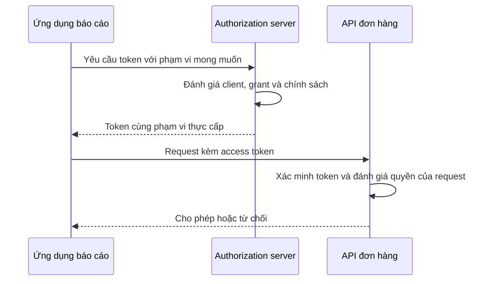

# Token scope

**Token scope** là phạm vi truy cập được gắn với một access token. Trong OAuth 2.0, scope thường được biểu diễn bằng các tên quyền mà authorization server và API đã thống nhất, chẳng hạn `orders.read` hoặc `orders.create`. Scope giúp giới hạn những thao tác mà token có thể được dùng để yêu cầu, thay vì cấp cho client toàn bộ khả năng của người dùng hoặc tài khoản dịch vụ.

Ví dụ, một ứng dụng báo cáo cần đọc đơn hàng để lập biểu đồ doanh thu. Ứng dụng đó không cần tạo đơn, hoàn tiền hay sửa thông tin khách hàng. Cấp một token chỉ có `orders.read` giúp giới hạn phạm vi sử dụng ngay cả khi người dùng đăng nhập ứng dụng có nhiều quyền hơn.

Trong IAM, scope là một công cụ thực hiện nguyên tắc ít quyền nhất ở lớp token. Quyết định cho phép một yêu cầu cụ thể vẫn cần kết hợp tính hợp lệ của token, API nhận token, đối tượng dữ liệu và chính sách nghiệp vụ.

## 1. Phân biệt scope với các thông tin liên quan

Các trường trong token cùng tham gia quyết định truy cập nhưng trả lời những câu hỏi khác nhau:

| Khái niệm | Câu hỏi chính | Ví dụ minh họa |
|---|---|---|
| Subject | Token đại diện cho chủ thể nào? | Người dùng `user-42` hoặc một workload |
| Client | Ứng dụng nào được cấp token? | `reporting-app` |
| Audience | Token dành cho bên nhận nào? | API quản lý đơn hàng |
| Scope | Token có phạm vi thao tác nào? | `orders.read` |
| Role | Chủ thể có vai trò nào theo mô hình của hệ thống? | Nhân viên bán hàng |
| Chính sách trên đối tượng | Chủ thể có được thao tác trên bản ghi đang yêu cầu không? | Chỉ đọc đơn của tenant được phép |

Scope và audience cần được kiểm tra riêng. Một token có tên scope `orders.read` nhưng dành cho một API khác không vì trùng tên scope mà dùng được tại API đơn hàng. Sự phân biệt giữa loại truy cập và nơi sử dụng được làm rõ trong [RFC 8707, Resource Indicators](https://www.rfc-editor.org/rfc/rfc8707.html).

Role cũng không tự chuyển thành scope. Nếu tổ chức quy định vai trò quản lý được yêu cầu một số scope rộng hơn, đó là chính sách của tổ chức. API không nên tự suy đoán rằng token có role `admin` được bỏ qua mọi kiểm tra scope hoặc mọi giới hạn tenant.

## 2. Scope yêu cầu và scope thực cấp

Client đề nghị phạm vi cần dùng, còn authorization server quyết định phạm vi được cấp theo chính sách và sự cho phép phù hợp. Client không thể tự cấp quyền chỉ bằng cách thêm một tên scope vào yêu cầu.

Theo OAuth 2.0, các tên scope phân biệt chữ hoa/thường và được phân tách bằng dấu cách; thứ tự không mang ý nghĩa. Authorization server có thể cấp phạm vi khác với yêu cầu và phải thông báo scope thực cấp khi có khác biệt. Nếu client bỏ tham số scope, máy chủ dùng mặc định đã xác định hoặc trả lỗi phạm vi không hợp lệ. Xem [RFC 6749, mục 3.3](https://www.rfc-editor.org/rfc/rfc6749.html#section-3.3).

Xét tình huống tự tạo của ứng dụng báo cáo:

```text
Client đề nghị:       orders.read orders.create
Client được cấu hình: chỉ đọc dữ liệu phục vụ báo cáo
Token thực cấp:      orders.read
```

Ứng dụng phải căn cứ phạm vi thực cấp để hoạt động. Nó không được giữ danh sách đã đề nghị rồi coi đó là quyền hiện có. API cũng không tin tham số `scope` do client gửi thêm bên cạnh access token trong một request nghiệp vụ.



Sơ đồ chỉ mô tả trách nhiệm liên quan đến scope, không thay thế luồng OAuth hoàn chỉnh hay các bước xác thực client của grant đang sử dụng.

Trong giao diện của ứng dụng, nút tạo đơn có thể được ẩn nếu không có `orders.create`. Đây là cách cải thiện trải nghiệm. API vẫn phải tự kiểm tra quyền vì client có thể bị chỉnh sửa hoặc bị gọi trực tiếp mà không qua giao diện.

## 3. Diễn giải tên scope chính xác

Các tên sau là ví dụ do hệ thống đơn hàng tự định nghĩa:

```text
orders.read
orders.create
orders.cancel
refunds.approve
```

Dấu chấm trong tên không tự tạo quan hệ cha/con. `orders.create` không mặc nhiên bao gồm `orders.read`; `orders.*` không tự trở thành wildcard. Nếu sản phẩm hỗ trợ scope tổng hợp hoặc wildcard, ý nghĩa đó phải được định nghĩa và thực thi rõ ràng.

Khi API kiểm tra scope, nó phải so sánh theo từng giá trị hoàn chỉnh sau khi phân tích đúng định dạng. Không dùng phép tìm chuỗi con:

```text
Scope thực tế: orders.readonly
Scope cần có:  orders.read

Kiểm tra chuỗi con có thể cho kết quả sai.
Kiểm tra phần tử chính xác phải kết luận thiếu orders.read.
```

Tương tự, không tự chuyển mọi tên sang chữ thường nếu hợp đồng sử dụng tên phân biệt hoa/thường. Không tách chuỗi scope theo dấu phẩy khi định dạng được thỏa thuận là danh sách phân tách bằng dấu cách.

Với endpoint có nhiều điều kiện, cần mô tả rõ phép kết hợp. Ví dụ, thiết kế của API có thể yêu cầu đồng thời `orders.read` và `reports.export` để xuất báo cáo chi tiết. Một endpoint khác có thể chấp nhận một trong hai scope theo chính sách. Không để lập trình viên tùy ý hiểu danh sách nhiều scope là AND hoặc OR.

## 4. Scope có thể được mang hoặc tra cứu như thế nào?

OAuth không bắt buộc mọi access token phải là JWT. Có hệ thống dùng JWT để API xác minh thông tin tại chỗ, có hệ thống dùng token opaque và tra cứu trạng thái hoặc thông tin cấp quyền qua cơ chế đã cấu hình.

Đoạn JSON tự tạo sau chỉ minh họa một phần claims của JWT access token:

```json
{
  "iss": "https://identity.example.com",
  "sub": "user-42",
  "aud": "https://orders-api.example.com",
  "client_id": "reporting-app",
  "scope": "orders.read reports.export",
  "tenant_id": "tenant-7"
}
```

Đây không phải token hoàn chỉnh có thể sử dụng: chưa có header, chữ ký và các claims thời gian cần thiết theo profile triển khai. `tenant_id` là claim riêng của ví dụ, không phải field OAuth mặc định. Trong JWT access token theo RFC 9068, `scope` có ngữ nghĩa gắn với các tài nguyên của `aud`; API còn phải áp dụng quy tắc xác minh token của profile. Xem [RFC 9068, mục 2.2.3 và 4](https://www.rfc-editor.org/rfc/rfc9068.html).

Một số nhà cung cấp dùng tên claim hoặc kiểu dữ liệu khác. API chỉ nên hỗ trợ cách biểu diễn đã được cấu hình cho từng issuer đáng tin cậy, sau đó chuẩn hóa thành tập quyền nội bộ. Không quét mọi field có tên gần giống `scope`, `roles` hay `permissions` rồi cộng tất cả thành quyền truy cập.

Với token opaque, API không thể tự Base64-decode để tìm scope. Nếu dùng OAuth Token Introspection, phản hồi có thể cung cấp `active`, `scope` và thông tin liên quan. API phải xác thực việc gọi endpoint introspection và áp dụng hợp đồng của nó; `active: true` không tự chứng minh mọi thao tác đều được phép. Xem [RFC 7662, mục 2](https://www.rfc-editor.org/rfc/rfc7662.html#section-2).

Ứng dụng client cũng không nên dựa vào cấu trúc nội bộ của access token khi hợp đồng coi nó là opaque. Thông tin client được sử dụng và thông tin API dùng để kiểm tra quyền có thể đến từ các bề mặt giao thức khác nhau.

## 5. API kiểm tra scope ở đâu trong quyết định truy cập?

Xét yêu cầu đọc đơn hàng `order-900` tại tenant 7. Một quá trình kiểm tra có thể gồm:

1. **Xác minh token:** token hợp lệ theo loại và profile được chấp nhận, đến từ issuer đã tin cậy, còn hiệu lực và dành cho API này.
2. **Lấy phạm vi đã được xác minh:** đọc scope từ claims hoặc kết quả tra cứu tin cậy, không từ dữ liệu tùy ý của request.
3. **Đối chiếu thao tác:** yêu cầu đọc đơn cần `orders.read` theo hợp đồng endpoint.
4. **Đối chiếu dữ liệu:** xác định tenant, chủ sở hữu, quan hệ với đơn hàng và các hạn chế nghiệp vụ.
5. **Cho phép hoặc từ chối:** chỉ thực thi thao tác khi mọi điều kiện bắt buộc đều đạt.

Mã giả sau minh họa riêng phần đánh giá nghiệp vụ sau bước xác minh token:

```text
authorizeReadOrder(verifiedToken, order):
    require exactScopeMember(verifiedToken.scopes, "orders.read")
    require tenantPolicy.permits(verifiedToken.principal, order.tenant)
    require orderPolicy.permitsRead(verifiedToken.principal, order)
    return ALLOW
```

`verifiedToken` ở đây là ngữ cảnh do thành phần xác minh đáng tin cậy tạo ra, không phải JSON nhận trực tiếp từ client. `principal` cần được xác định theo quan hệ issuer và subject phù hợp; không dùng một giá trị `sub` rời rạc như danh tính toàn cục của mọi issuer.

Giả sử token có `orders.read`, nhưng Mai chỉ được truy cập tenant 7 còn `order-900` thuộc tenant 8. Kết quả vẫn là từ chối. Scope đọc đơn chỉ vượt qua điều kiện loại thao tác, không tự cấp quyền đọc tất cả các đơn trên hệ thống.

Một lỗi tương tự là chỉ kiểm tra scope ở API gateway rồi để dịch vụ phía sau tin các header quyền do bất kỳ bên nào gửi. Nếu chuyển tiếp ngữ cảnh đã xác minh giữa các thành phần, thiết kế phải bảo vệ đường truyền và nguồn tạo ngữ cảnh để không cho client giả mạo nó.

## 6. Thiết kế scope theo nguyên tắc ít quyền nhất

Một bộ scope hữu ích cần đủ rõ để giới hạn rủi ro nhưng vẫn có thể quản trị. Với hệ thống đơn hàng, nhóm thiết kế có thể dùng hợp đồng minh họa sau:

| Nhu cầu | Scope ví dụ | Giới hạn còn phải kiểm tra tại API |
|---|---|---|
| Xem chi tiết đơn | `orders.read` | Tenant và quan hệ với đơn hàng |
| Tạo đơn mới | `orders.create` | Kênh bán, tenant và dữ liệu đầu vào |
| Hủy đơn | `orders.cancel` | Trạng thái đơn và thời hạn được hủy |
| Phê duyệt hoàn tiền | `refunds.approve` | Hạn mức, vai trò phê duyệt và nguyên tắc tách nhiệm vụ |

Tất cả các tên và điều kiện trong bảng là ví dụ thiết kế, không phải bộ scope tiêu chuẩn cho thương mại điện tử.

Nếu mọi chức năng đều dùng chung một scope `full_access`, việc cấp token cho ứng dụng báo cáo sẽ khó giới hạn. Ngược lại, tạo một tên scope riêng cho mỗi đơn hàng thường làm quản trị trở nên phức tạp; quan hệ với từng bản ghi có thể phù hợp hơn với chính sách ở API hoặc hệ thống phân quyền chuyên biệt.

Tách quyền nhạy cảm giúp nhóm IAM xem xét và cấp quyền rõ ràng hơn. Client chỉ đọc dữ liệu không cần scope phê duyệt hoàn tiền. Mặc định khi client không yêu cầu scope cũng không nên vô tình trở thành toàn quyền; giá trị mặc định cần được tài liệu hóa và phù hợp với mức truy cập được phép.

Khi đổi ý nghĩa của scope đang sử dụng, cần đánh giá các client đã được cấp quyền. Nếu `orders.read` ban đầu chỉ đọc thông tin giao hàng nhưng sau này cho đọc thêm dữ liệu tài chính nhạy cảm, đổi triển khai mà giữ nguyên tên có thể mở rộng quyền ngoài kỳ vọng của bên đã phê duyệt. Cần quản lý thay đổi, tách scope hoặc điều chỉnh quy trình cấp quyền phù hợp.

## 7. Scope của người dùng và scope của workload

Scope không chỉ xuất hiện trong token liên quan đến người dùng tương tác. Một dịch vụ chạy định kỳ cũng có thể nhận access token với các phạm vi được cấp cho chính client hoặc workload đó.

Trong ví dụ, ứng dụng báo cáo có hai chế độ:

- Người dùng mở báo cáo: việc cấp quyền và quyết định truy cập xét ngữ cảnh ủy quyền phù hợp với người dùng.
- Job tổng hợp ban đêm: workload được cấp một tập quyền phục vụ nhiệm vụ tự động theo cấu hình riêng.

API phải phân biệt ngữ cảnh hai trường hợp theo hợp đồng token và issuer. Không tự suy ra `sub` luôn là ID nhân viên, cũng không giả định token của workload được dùng để vượt qua các giới hạn tenant hoặc đặc quyền nhạy cảm.

Một scope tên `reports.export` có thể được dùng trong cả hai trường hợp, nhưng phạm vi dữ liệu và điều kiện chính sách vẫn có thể khác. Đội IAM nên biết client nào có quyền đó, ai sở hữu client, quyền được duyệt cho nhiệm vụ gì và khi nào cần xem xét lại.

Quyền yêu cầu scope của client, sự cho phép của người dùng khi áp dụng và quyền truy cập dữ liệu tại API là những điều kiện liên quan nhưng không đồng nhất. Một màn hình đồng ý cấp quyền không thay thế mọi kiểm tra nghiệp vụ của hệ thống.

## 8. Scope thay đổi theo vòng đời token

Đối với JWT access token đã phát hành, sửa vai trò trong cơ sở dữ liệu không làm nội dung token tự thay đổi. Tương tự, xóa một scope khỏi cấu hình cấp mới không chứng minh mọi token cũ đã mất khả năng sử dụng.

Ví dụ, lúc 09:00 ứng dụng báo cáo nhận token có `orders.read`. Lúc 09:10 tổ chức gỡ quyền đọc khỏi client. Nếu API chỉ xác minh một JWT còn hạn và không có cơ chế kiểm tra trạng thái bổ sung, cần xét chính xác token đã cấp còn được chấp nhận đến khi nào. Muốn thay đổi có hiệu lực sớm hơn phải có thiết kế thu hồi hoặc đánh giá lại phù hợp; không thể chỉ sửa claim trong giao diện quản trị rồi mặc định API biết ngay.

Thời hạn token ngắn, tra cứu trạng thái, cache và cơ chế thu hồi tạo ra các đánh đổi về độ trễ thay đổi quyền và khả năng sẵn sàng. Đó là quyết định kiến trúc cần được ghi rõ. Không nhất thiết mọi API đều gọi authorization server ở từng request, nhưng phải hiểu giới hạn của lựa chọn đang dùng.

Nếu dùng refresh token, yêu cầu refresh không được thêm scope chưa được cấp trong phạm vi gốc; xin thêm quyền cần quy trình cấp quyền tương ứng. Việc yêu cầu token với phạm vi hẹp hơn, khi được hỗ trợ và cho phép, cũng không tự thu hồi các access token rộng hơn đã phát hành. Quy tắc giới hạn scope của refresh request nằm trong [RFC 6749, mục 6](https://www.rfc-editor.org/rfc/rfc6749.html#section-6).

Trong xử lý sự cố, đội vận hành cần phân biệt ngừng cấp token mới, thu hồi refresh token và làm mất hiệu lực access token đã có. Ba thao tác này không luôn có cùng hiệu ứng hoặc cùng thời điểm.

## 9. Phản hồi khi thiếu scope

Với Bearer token, cần phân biệt token không hợp lệ với token hợp lệ nhưng không đủ phạm vi. RFC 6750 khuyến nghị HTTP 401 cho `invalid_token` và HTTP 403 cho `insufficient_scope`; phản hồi có thể chỉ ra scope cần thiết. Xem [RFC 6750, mục 3.1](https://www.rfc-editor.org/rfc/rfc6750.html#section-3.1).

Ví dụ phản hồi tự tạo khi client có token chỉ đọc nhưng gọi chức năng tạo đơn:

```http
HTTP/1.1 403 Forbidden
WWW-Authenticate: Bearer error="insufficient_scope", scope="orders.create"
Content-Length: 0
```

Lỗi scope không được giải quyết bằng cách client tự chỉnh payload JWT hoặc tự gửi thêm header quyền. Client cần xin phạm vi phù hợp qua authorization server nếu được phép, hoặc không cung cấp chức năng đó.

Nếu token đủ scope nhưng không được phép đọc một bản ghi, việc từ chối là do chính sách trên tài nguyên, không nhất thiết là thiếu scope. Thiết kế phản hồi cũng cần tránh tiết lộ không cần thiết sự tồn tại của dữ liệu người gọi không được xem.

Một ID token dùng cho đăng nhập cũng không trở thành access token chỉ vì có các claims trông giống quyền. API cần chấp nhận đúng loại token, đúng audience và quy tắc xác minh của hợp đồng đang dùng; decode được token không đủ để tin nội dung của nó.

## 10. Các tình huống cần kiểm chứng

Với API đơn hàng minh họa, những tình huống sau giúp đánh giá việc thực thi hợp đồng scope:

| Tình huống | Kết quả cần quan sát |
|---|---|
| Token hợp lệ có `orders.read`, đúng dữ liệu được phép | Đọc đơn thành công khi các điều kiện khác đều đạt |
| Token chỉ có `orders.read` gọi thao tác tạo đơn | Bị từ chối vì thiếu phạm vi thao tác |
| Scope là `orders.readonly` | Không vượt qua kiểm tra chính xác `orders.read` |
| Token đúng scope nhưng sai audience | Bị từ chối ở bước xác minh token |
| Client yêu cầu hai scope nhưng chỉ được cấp một | Chức năng và API căn cứ scope thực cấp |
| Token có scope nhưng dữ liệu thuộc tenant không được phép | Bị từ chối theo chính sách dữ liệu |
| Client sửa JWT để thêm scope | Token không qua xác minh tính toàn vẹn |
| Thiếu claim scope theo hợp đồng endpoint | Không tự suy ra toàn quyền từ việc token đã xác thực |
| Client gửi tham số scope tùy ý trong request nghiệp vụ | Không bổ sung quyền cho access token |
| Quyền đã bị gỡ nhưng token cũ còn tồn tại | Hiệu ứng khớp cơ chế thu hồi, cache và thời hạn đã thiết kế |

Nhật ký nên ghi mã giao dịch, issuer hoặc client phù hợp, thao tác và lý do từ chối đủ cho điều tra. Không ghi access token hoặc refresh token nguyên vẹn vào log. Nếu cần đối chiếu, dùng tham chiếu được thiết kế cho kiểm toán và kiểm soát quyền truy cập log.

Một hợp đồng scope có thể vận hành được cần xác định ai định nghĩa tên quyền, client nào được xin quyền, token thực sự được cấp gì và API nào chịu trách nhiệm thực thi. Khi nối được các điểm đó với chính sách dữ liệu và vòng đời token, scope mới tạo ra giới hạn truy cập có thể kiểm chứng trong hệ thống IAM.
