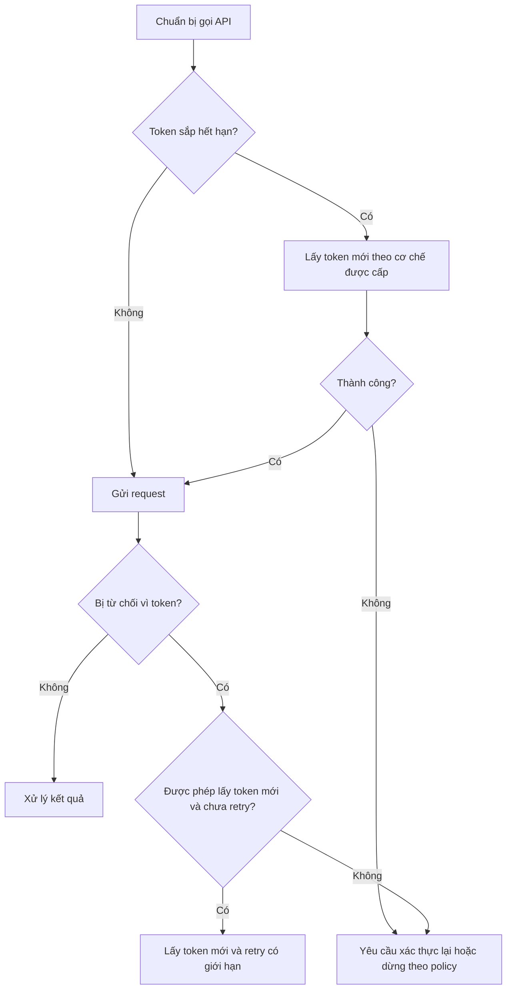

# Token expiration

## 1. Hết hạn token có nghĩa gì?

Token expiration là giới hạn thời gian mà bên nhận còn được phép chấp nhận token. Sau giới hạn đó, token không còn là căn cứ hợp lệ để tiếp tục xác thực một request mới theo chính sách tiếp nhận.

Ví dụ, một access token được cấp cho API đơn hàng với thời gian sống 5 phút. Người cầm token có thể gửi nhiều request trong khoảng được phép. Khi hết hạn, việc chữ ký vẫn kiểm tra thành công không khiến token tiếp tục hợp lệ.

Hết hạn không có nghĩa chuỗi token tự biến mất khỏi bộ nhớ, log hoặc thiết bị. Nó cũng không phải bằng chứng tài khoản đã bị khóa, phiên SSO đã kết thúc hay mọi quyền của người dùng đã thay đổi. Bên nhận phải thực thi kiểm tra thời gian thì giới hạn mới có tác dụng.

Trong IAM, thời hạn giúp giới hạn khoảng sử dụng của thông tin xác thực bị lộ và khoảng tồn tại của các claim cũ. Nó là một phần của quản lý vòng đời quyền truy cập, đi cùng cơ chế cấp lại, thu hồi, quản lý phiên và kiểm tra quyền hiện hành.

## 2. Các mốc thời gian thường gặp

Với JWT, các claim liên quan gồm:

| Claim | Vai trò |
| --- | --- |
| `exp` | Mốc hết hiệu lực |
| `nbf` | Mốc bắt đầu được chấp nhận |
| `iat` | Mốc phát hành |

`exp` là cận trên loại trừ: nếu không áp dụng dung sai, khi `now >= exp` thì token đã hết hạn. NumericDate biểu diễn thời gian tính bằng giây từ Unix epoch; không truyền nhầm giá trị mili giây. Ngữ nghĩa được định nghĩa trong [RFC 7519, mục 2 và 4.1.4–4.1.6](https://www.rfc-editor.org/rfc/rfc7519.html#section-4.1.4).

Ví dụ payload minh họa:

```json
{
  "iss": "https://identity.example.test",
  "sub": "user-204",
  "aud": "orders-api",
  "iat": 1900000000,
  "nbf": 1900000000,
  "exp": 1900000300
}
```

Các số trên được chọn để dễ tính, không biểu diễn thời điểm hiện tại. Theo hợp đồng trong ví dụ, thời gian từ lúc cấp tới lúc hết hạn là:

```text
1900000300 - 1900000000 = 300 giây = 5 phút
```

Đây chỉ là phần dữ liệu claim, chưa phải token đã ký. Bên nhận không được tin payload chỉ vì đọc được JSON.

### Những trường hợp dễ hiểu sai

`iat` không tự động là thời điểm bắt đầu chấp nhận; vai trò đó thuộc `nbf` nếu có. Muốn từ chối token có thời điểm phát hành quá xa trong tương lai hoặc tuổi quá lớn, ứng dụng cần một policy riêng.

JWT tổng quát không bắt buộc mọi claim thời gian đều xuất hiện. Profile ứng dụng có thể bắt buộc chặt hơn. Chẳng hạn, JWT access token theo [RFC 9068, mục 2 và 4](https://www.rfc-editor.org/rfc/rfc9068.html#section-4) bắt buộc `exp` và yêu cầu resource server kiểm tra thời hạn. Nếu hợp đồng API yêu cầu trường này, thiếu `exp` phải bị từ chối, không được biến thành token vô thời hạn.

## 3. Kiểm tra đúng tại mốc hết hạn

Giả sử token có `exp = 1900000300` và policy không cho phép clock skew:

| Thời gian server | Kết quả kiểm tra riêng về hết hạn |
| --- | --- |
| `1900000299` | Chưa hết hạn |
| `1900000300` | Đã hết hạn |
| `1900000301` | Đã hết hạn |

Kết quả “chưa hết hạn” chỉ có nghĩa vượt qua một điều kiện. Token vẫn có thể bị từ chối vì chữ ký sai, issuer không tin cậy, audience không phù hợp, bị thu hồi hoặc thiếu quyền đối với tài nguyên.

Một lỗi phổ biến là kiểm tra:

```text
if now > exp:
    reject
```

Điều kiện này bỏ sót trường hợp bằng nhau. Với policy không dung sai, cách diễn tả đúng là:

```text
if now >= exp:
    reject
```

Không thay kiểm tra thời gian bằng việc “token đã xác thực thành công lần trước”. Mỗi lần tiếp nhận cần bảo đảm token vẫn đáp ứng điều kiện thời gian tại điểm kiểm tra của request đó.

## 4. Clock skew và khoảng thời gian chấp nhận thực tế

Đồng hồ ở máy chủ cấp token và các API có thể lệch nhau. Một dung sai nhỏ giúp tránh từ chối nhầm trong giới hạn đã được vận hành kiểm soát. RFC 7519 cho phép leeway cho tình huống này; giá trị cụ thể là lựa chọn triển khai.

Một policy minh họa có thể diễn đạt:

```text
Điều kiện chưa hết hạn:
    now < exp + allowedSkew

Điều kiện chưa dùng quá sớm, nếu có nbf:
    now + allowedSkew >= nbf
```

Đây là cách định nghĩa biên của policy trong bài, không khẳng định mọi thư viện có cùng cách so sánh tới từng đơn vị thời gian. Khi cấu hình thật, phải hiểu quy ước và độ chính xác của thư viện đang dùng.

Ví dụ:

```text
exp:          12:05:00Z
allowedSkew:  30 giây
cận cuối:     12:05:30Z
```

Theo policy trên, request tại `12:05:29Z` còn có thể vượt qua kiểm tra hết hạn; tại `12:05:30Z` thì không. Dung sai làm rộng cửa sổ chấp nhận thực tế, vì vậy không chọn một giá trị lớn chỉ để che lỗi đồng hồ.

Các biện pháp vận hành cần đi cùng nhau:

- Đồng bộ đồng hồ ở bên cấp token và các node xác thực.
- Theo dõi sai lệch và thay đổi bất thường của thời gian hệ thống.
- Dùng cấu hình dung sai nhất quán trong cùng miền dịch vụ.
- Tránh cộng thêm dung sai ở nhiều tầng mà không biết tầng trước đã áp dụng.

Thời điểm dạng epoch không phụ thuộc việc giao diện hiển thị múi giờ nào. Chuyển một timestamp sang giờ Việt Nam để hiển thị không làm thay đổi mốc hết hạn thật.

Đồng hồ chạy lùi có thể khiến một node chấp nhận token lâu hơn dự kiến; chạy nhanh có thể từ chối sớm. Dung sai không thay thế việc phát hiện các sự cố này.

## 5. exp và expires_in phục vụ hai góc nhìn khác nhau

Trong OAuth, phản hồi cấp token có thể cung cấp `expires_in`, là thời gian sống tính bằng giây kể từ khi phản hồi được tạo. Định nghĩa nằm trong [RFC 6749, mục 5.1](https://www.rfc-editor.org/rfc/rfc6749.html#section-5.1).

Ví dụ do bài học đặt ra:

```json
{
  "access_token": "<token>",
  "token_type": "Bearer",
  "expires_in": 300
}
```

`exp` trong JWT là một mốc tuyệt đối; `expires_in` là một khoảng thời gian. Client có thể dùng khoảng này để lên kế hoạch lấy token mới mà không cần tự diễn giải cấu trúc access token.

Không coi thời điểm nhận phản hồi cộng `expires_in` là hạn server chính xác. Độ trễ mạng và thời gian xử lý đã tiêu tốn một phần thời gian sống.

Một phương án lập lịch thận trọng cho client là:

```text
refreshDeadline =
    monotonicTimeAtTokenRequestStart
    + expires_in
    - safetyMargin
```

Ví dụ request lấy token bắt đầu tại mốc đơn điệu 100 giây, `expires_in=300`, biên an toàn là 20 giây. Client đặt kế hoạch kiểm tra hoặc refresh gần mốc 380 giây. Nếu phản hồi quá chậm và mốc này đã qua, client không nên giả định còn nguyên 300 giây để sử dụng.

Công thức là lựa chọn thiết kế của bài học. Cần điều chỉnh theo độ trễ, trạng thái ứng dụng, giới hạn số request và hợp đồng của bên cấp token.

Đồng hồ đơn điệu hữu ích khi đo khoảng thời gian cục bộ. Nó không thay thế đồng hồ UTC khi API so sánh `exp`. Trình duyệt hoặc ứng dụng có thể bị tạm dừng, nên khi hoạt động lại cần kiểm tra lại deadline thay vì chỉ tin một timer đã đặt.

Biên an toàn phía client làm client lấy token mới sớm hơn; clock skew phía server có thể làm server chấp nhận muộn hơn. Hai giá trị có mục đích khác nhau. Client không nên cố sử dụng hết “phần gia hạn” của server.

## 6. Thực thi kiểm tra thời gian ở phía server

Client có thể hiển thị đồng hồ đếm ngược, ẩn nút hoặc tự refresh, nhưng resource server mới là nơi bảo vệ tài nguyên. Thay đổi đồng hồ client hay sửa một biến JavaScript không được làm thay đổi quyết định của API.

Một đường xử lý minh họa:

```text
Nhận access token
    -> Xác định profile và cấu hình tin cậy
    -> Kiểm tra bảo vệ mật mã
    -> Kiểm tra issuer, audience và claim bắt buộc
    -> Kiểm tra thời gian với clock và policy đã cấu hình
    -> Kiểm tra trạng thái bổ sung nếu hệ thống yêu cầu
    -> Quyết định quyền trên tài nguyên
```

Các bước có thể được thư viện gom lại, nhưng ứng dụng phải biết điều kiện nào đã được thực thi. Không tự viết bộ xác thực JWT chỉ để thêm một câu lệnh so sánh `exp`.

Ví dụ dưới chỉ minh họa phần so sánh thời hạn sau khi token và các claim đã được xác thực, chuyển đổi an toàn:

```java
import java.time.Clock;
import java.time.Duration;
import java.time.Instant;
import java.util.Objects;

public final class ExpirationPolicy {

    public static boolean hasExpired(
            Instant expiresAt,
            Clock clock,
            Duration allowedSkew) {

        Objects.requireNonNull(expiresAt, "expiresAt");
        Objects.requireNonNull(clock, "clock");
        Objects.requireNonNull(allowedSkew, "allowedSkew");

        if (allowedSkew.isNegative()) {
            throw new IllegalArgumentException("Negative clock skew");
        }

        Instant acceptanceEnd = expiresAt.plus(allowedSkew);
        Instant now = clock.instant();

        return !now.isBefore(acceptanceEnd);
    }
}
```

Cách truyền `Clock` giúp điều khiển thời gian trong các tình huống kiểm tra mà không cần đợi thật. Java cung cấp `Clock.fixed` cho mục đích này; xem [tài liệu Java Clock](https://docs.oracle.com/en/java/javase/21/docs/api/java.base/java/time/Clock.html).

Ví dụ chuẩn bị dữ liệu:

```java
Clock atDeadline = Clock.fixed(
        Instant.parse("2030-01-01T12:05:00Z"),
        java.time.ZoneOffset.UTC);

boolean expired = ExpirationPolicy.hasExpired(
        Instant.parse("2030-01-01T12:05:00Z"),
        atDeadline,
        Duration.ZERO);

// expired là true theo policy của ví dụ.
```

Đoạn mã không kiểm tra chữ ký, issuer, audience, `nbf`, thu hồi hay quyền nghiệp vụ. Lớp chuyển đổi claim phải từ chối kiểu dữ liệu không hợp lệ và timestamp ngoài miền hỗ trợ. Lỗi chuyển đổi hoặc tràn khi tính deadline phải dẫn tới từ chối token, không được xử lý thành “chưa hết hạn”.

Nếu dùng thư viện JWT đã có validator thời gian, ưu tiên cấu hình validator đó để tránh hai bộ kiểm tra với hai cách hiểu biên khác nhau.

## 7. Khi hết hạn: lấy token mới có kiểm soát

Với Bearer token, lỗi `invalid_token` có thể bao gồm hết hạn, bị thu hồi hoặc không hợp lệ vì nguyên nhân khác. RFC 6750 sử dụng phản hồi 401 cho trường hợp này; xem [RFC 6750, mục 3.1](https://www.rfc-editor.org/rfc/rfc6750.html#section-3.1).

Ví dụ phản hồi:

```http
HTTP/1.1 401 Unauthorized
WWW-Authenticate: Bearer error="invalid_token"
```

Không suy ra mọi 401 đều chỉ cần refresh. Token sai audience, cấu hình issuer sai hoặc thông điệp bị sửa không phải vấn đề được giải quyết bằng cách lặp refresh vô hạn.

Một luồng client minh họa:



Nếu nhiều request cùng phát hiện token sắp hết hạn, client có thể phối hợp để chỉ có một lượt refresh đang chạy. Những request còn lại chờ kết quả thay vì tạo một đợt gọi dồn dập.

Với refresh token rotation, việc nhiều luồng dùng đồng thời cùng refresh token còn có thể tạo xung đột và bị xem là tái sử dụng token cũ. RFC 9700 mô tả bảo vệ refresh token, rotation và thời hạn khi không hoạt động trong [mục 4.14](https://www.rfc-editor.org/rfc/rfc9700.html#section-4.14).

Retry request thay đổi dữ liệu cần xét tính idempotent. Nếu client không biết request trước đã được thực hiện hay chưa, gửi lại sau khi lấy token mới có thể lặp nghiệp vụ. Dùng cơ chế idempotency hoặc xác minh trạng thái theo hợp đồng endpoint, không chỉ dựa vào việc đã có token mới.

Không phải client nào cũng được cấp refresh token. Nếu không có cơ chế cấp lại phù hợp, client cần bắt đầu một luồng được hỗ trợ, thay vì tự gia hạn `exp`.

## 8. Thời hạn access token, refresh token và phiên không đồng nhất

Một hệ thống có thể đồng thời tồn tại nhiều vòng đời:

| Thành phần | Câu hỏi về thời hạn |
| --- | --- |
| Access token | API còn chấp nhận token này tới khi nào? |
| Refresh token | Client còn được yêu cầu cấp access token mới không? |
| Phiên ứng dụng | Người dùng còn phiên làm việc tại ứng dụng không? |
| Phiên SSO | IdP còn nhận diện phiên đăng nhập không? |
| Bằng chứng xác thực mạnh | Thao tác hiện tại có cần xác thực lại gần đây không? |

Access token hết hạn không bắt buộc người dùng nhập mật khẩu ngay nếu hệ thống có cơ chế cấp lại còn hợp lệ. Ngược lại, việc phiên giao diện vẫn mở không cho phép API chấp nhận access token đã hết hạn.

Refresh token không nên được hiểu là quyền gia hạn vô điều kiện. Bên cấp token vẫn cần thực thi policy về client, grant, quyền hiện hành, thu hồi và vòng đời tương ứng. Khi cần, nó từ chối cấp token mới và yêu cầu xác thực lại.

Gia hạn kiểu trượt cũng cần giới hạn rõ ràng. Nếu mỗi lần refresh lại bắt đầu một khoảng sống mới mà không có hạn tuyệt đối hoặc điều kiện kết thúc, một phiên có thể tồn tại lâu hơn dự kiến của người quản trị.

Các quy tắc phiên cụ thể là thiết kế ứng dụng; không phải cứ thêm `exp` vào access token là đã có đầy đủ cơ chế quản lý phiên.

## 9. Hết hạn và thu hồi giải quyết hai thời điểm khác nhau

Expiration kết thúc hiệu lực theo một lịch đã xác định. Revocation làm mất hiệu lực sớm hơn khi có sự kiện như lộ token, khóa tài khoản hoặc thay đổi quyền.

Giả sử cấp token lúc 09:00, hết hạn lúc 09:05 và khóa tài khoản lúc 09:01. Nếu API chỉ kiểm tra chữ ký và thời gian cục bộ, token có thể tiếp tục được chấp nhận tới cận thời gian theo policy. API cần nguồn trạng thái khác nếu yêu cầu khóa phải có hiệu lực sớm hơn.

Không tuyên bố “token chỉ sống 5 phút nên khóa tài khoản có hiệu lực ngay”. Hai cam kết đó khác nhau.

Có thể kết hợp thời hạn ngắn với introspection, danh sách thu hồi hoặc kiểm tra phiên bản quyền hiện hành. Mỗi cách có bài toán truyền trạng thái và cache riêng.

Nếu dùng denylist, mục thu hồi cần được giữ tới khi token không còn có thể được chấp nhận ở bất kỳ node nào trong phạm vi bảo vệ. Dọn đúng `exp` nhưng một số node còn cho phép dung sai có thể tạo khoảng hở.

Với cache kết quả introspection, không để kết quả “active” tồn tại quá hạn token và cần cân nhắc độ trễ thu hồi. [RFC 7662, mục 4](https://www.rfc-editor.org/rfc/rfc7662.html#section-4) trình bày đánh đổi khi cache và giới hạn theo `exp`.

Một quy tắc cache thận trọng trong ví dụ là:

```text
cacheTTL = min(configuredCacheTTL, exp - now)
```

Nếu phần thời gian còn lại không dương, không tạo một cache “active” mới bằng TTL mặc định. Cache chữ ký đã hợp lệ cũng không được làm bước kiểm tra thời hạn biến mất.

## 10. Chọn tuổi thọ theo rủi ro và cách sử dụng

Không có một con số phút phù hợp cho mọi loại token. Thời hạn cần phản ánh tài nguyên, khả năng lộ token, yêu cầu thu hồi, khả năng cấp lại và độ ổn định vận hành.

Một số câu hỏi trước khi chọn policy:

1. Nếu token bị sao chép, hệ thống chấp nhận rủi ro sử dụng thêm trong bao lâu?
2. Quyền hoặc trạng thái tài khoản thay đổi cần tới API nhanh đến mức nào?
3. Client có thể lấy token mới an toàn và đáng tin cậy không?
4. Khi dịch vụ cấp token lỗi, cần hành vi nào đối với token đã hết hạn?
5. Các node có kiểm tra thời gian và dùng dung sai nhất quán không?

Tuổi thọ dài giảm tần suất cấp token mới nhưng kéo dài cửa sổ lạm dụng của token cũ. Tuổi thọ ngắn giảm cửa sổ đó nhưng làm tăng nhu cầu cấp lại và có thể gây nhiều lỗi hơn nếu client không phối hợp đúng.

Khi máy chủ cấp token tạm lỗi, không tự bật chế độ bỏ qua `exp`. Nếu cần một cơ chế hoạt động khi gián đoạn, phải thiết kế riêng với giới hạn và quyền phù hợp, thay vì âm thầm kéo dài mọi token.

Với tác vụ nền dài, đừng giải quyết bằng access token người dùng sống vô hạn. Cần quyết định rõ tác vụ được ủy quyền lúc nào, worker dùng danh tính nào và tại thời điểm thực thi có cần kiểm tra lại quyền không.

Tương tự, kiểm tra token ở lúc bắt đầu một kết nối lâu dài không tự áp dụng thời hạn cho mọi thông điệp về sau. Kết nối, hàng đợi hoặc tác vụ nhiều bước cần policy riêng về tái xác thực và thời điểm ra quyết định. Token hết hạn cũng không mặc nhiên hủy một nghiệp vụ đã được tiếp nhận trước đó.

## 11. Những lỗi cần tránh và tình huống cần kiểm chứng

| Lỗi | Hậu quả |
| --- | --- |
| Dùng mili giây cho `exp` theo giây | Hiểu sai rất lớn thời gian sống |
| So sánh chỉ với `now > exp` | Bỏ sót biên bằng nhau khi không có dung sai |
| Thiếu `exp` thì tự cho vô thời hạn | Mở rộng quyền ngoài hợp đồng |
| Chỉ kiểm tra ở giao diện client | API vẫn có thể bị gọi trực tiếp |
| Mỗi request lại đặt hạn bằng `now + TTL` | Vô tình biến hạn cố định thành gia hạn trượt |
| Cache trạng thái hợp lệ quá lâu | Chấp nhận token sau cận đã thiết kế |
| Refresh cho mọi 401 và retry vô hạn | Che lỗi cấu hình, tạo tải và vòng lặp |
| Xem logout là đã xóa mọi bản sao token | Bỏ sót token còn nằm ở bên khác |
| Tăng skew để che đồng hồ lỗi | Kéo dài cửa sổ chấp nhận ngoài dự kiến |

Các tình huống sau là mục tiêu kiểm chứng khi triển khai, không phải kết quả đã chạy trên một sản phẩm:

- Trước, đúng và sau mốc `exp`, với dung sai bằng 0.
- Trước, đúng và sau cận `exp + allowedSkew` của policy đã chọn.
- Token thiếu claim bắt buộc, sai kiểu hoặc timestamp ngoài miền hỗ trợ.
- Hai node có độ lệch đồng hồ trong và ngoài mức cho phép.
- Ứng dụng client bị tạm dừng rồi hoạt động lại sau khi token đã hết hạn.
- Nhiều request đồng thời cùng yêu cầu refresh.
- Token bị thu hồi trước `exp` trong khi API đang cache trạng thái.
- Dịch vụ cấp token lỗi khi client cần token mới.
- Request thay đổi dữ liệu phải retry mà chưa rõ kết quả lần trước.

Token expiration chỉ bảo vệ đúng như thiết kế khi bên cấp, client, resource server và các lớp cache cùng tuân theo một hợp đồng thời gian rõ ràng. Thời hạn cần được thực thi tại nơi bảo vệ tài nguyên và kết hợp với vòng đời quyền truy cập của hệ thống.
