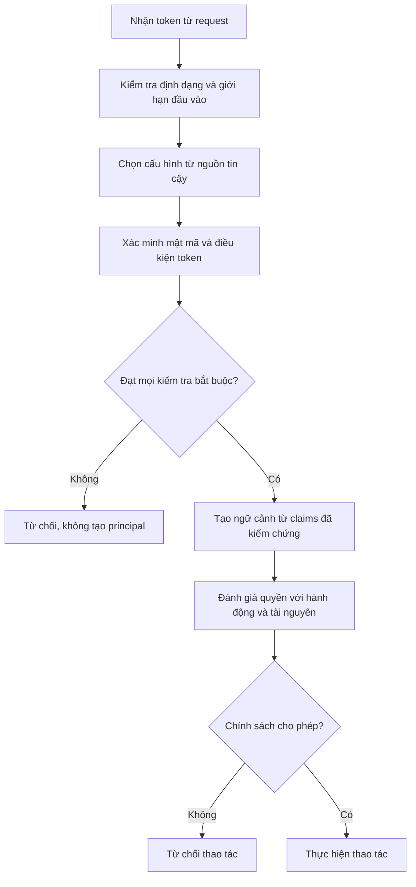

# Không tin claim chưa kiểm chứng

Một **claim** là thông tin được một bên khẳng định về chủ thể hoặc ngữ cảnh của token, chẳng hạn người dùng là ai, token dành cho API nào hoặc người gọi có phạm vi quyền gì. Khi claim đi vào ứng dụng từ một request, ứng dụng chưa thể coi khẳng định đó là sự thật chỉ vì đọc được nó.

Nguyên tắc quan trọng của IAM là: **chỉ sử dụng claim cho xác thực và phân quyền sau khi token đã được kiểm chứng theo đúng nguồn tin cậy, loại token và ngữ cảnh sử dụng**. Ngay cả sau bước đó, ứng dụng vẫn phải đánh giá chính sách để quyết định thao tác cụ thể có được phép hay không.

Ví dụ, API thanh toán nhận được một token có trường `role` mang giá trị `ADMIN`. Câu hỏi đầu tiên không phải là “ADMIN được làm gì?”, mà là “ai đã phát hành thông tin này, token có bị thay đổi không và nó có thực sự dành cho API thanh toán không?”. Bỏ qua các câu hỏi đó có thể biến dữ liệu do người gọi tự cung cấp thành đặc quyền quản trị.

## 1. Đọc được dữ liệu chưa tạo ra sự tin cậy

Với một JWT được ký theo dạng JWS compact thường gặp, công cụ có thể giải mã Base64url phần header và payload để hiển thị JSON. Việc đó không yêu cầu biết khóa ký và không chứng minh chữ ký hợp lệ.

Ba việc sau có mục đích khác nhau:

| Việc thực hiện | Điều thu được | Chưa đủ để kết luận |
|---|---|---|
| Decode hoặc parse token | Đọc cấu trúc và giá trị dữ liệu | Dữ liệu do bên đáng tin cậy phát hành |
| Kiểm chứng token theo hợp đồng | Xác minh các điều kiện để chấp nhận token trong ngữ cảnh đã cấu hình | Người gọi được phép thực hiện mọi thao tác |
| Đánh giá quyền truy cập | Quyết định đối với hành động và tài nguyên cụ thể | Quyền đó đúng cho mọi tài nguyên hoặc mọi thời điểm khác |

Một trang web giải mã JWT có thể hiển thị payload rất đẹp nhưng không biết API của tổ chức phải chấp nhận issuer nào, audience nào hay quyền nào. Không đưa token production vào công cụ công khai chỉ để xem claim; token có thể là thông tin xác thực và chứa dữ liệu cá nhân.

Chữ ký cũng không tự mã hóa payload. Với token chỉ được ký mà không mã hóa, việc người cầm token đọc được claims là bình thường. Bảo vệ tính toàn vẹn và bảo vệ bí mật dữ liệu là hai yêu cầu cần được thiết kế riêng.

## 2. Ví dụ claim giả mạo trong API thanh toán

Giả sử API nhận một payload có hình dạng sau:

```json
{
  "iss": "https://identity.example.com",
  "sub": "user-42",
  "aud": "https://payments-api.example.com",
  "role": "ADMIN",
  "tenant_id": "tenant-7"
}
```

Đây là dữ liệu minh họa, chưa phải một token hoàn chỉnh. Người gọi có thể tự viết JSON chứa mọi giá trị trên. Hình dạng đúng và tên issuer quen thuộc không chứng minh người gọi có quan hệ với issuer đó.

Nếu API chỉ decode, lấy `role` rồi mở chức năng hoàn tiền, nó đã bỏ qua ranh giới tin cậy. Một người không có khóa phát hành vẫn có thể tạo dữ liệu trông như tài khoản quản trị; chính API là bên làm cho dữ liệu đó có hiệu lực.

Nếu payload của một token đã ký bị thay đổi, cơ chế xác minh tính toàn vẹn phải phát hiện và từ chối nó. Tuy nhiên, ứng dụng còn phải kiểm tra đúng nguồn phát hành và mục đích token: một token có chữ ký hợp lệ của hệ thống thử nghiệm vẫn không được mặc nhiên dùng tại API production.

Trong ví dụ này, `role` và `tenant_id` là claims riêng của hợp đồng ứng dụng. Không có quy tắc JWT chung nào khiến mọi field tên `role` trở thành vai trò nội bộ hoặc khiến giá trị `ADMIN` ở mọi issuer có cùng đặc quyền.

## 3. Xây dựng ngữ cảnh kiểm chứng trước khi xử lý request

API cần biết những điều kiện chấp nhận từ cấu hình hoặc nguồn quản trị đã được tin cậy. Không để token tự đặt ra toàn bộ tiêu chí mà nó phải vượt qua.

Với API thanh toán, một hợp đồng triển khai có thể xác định:

```text
Issuer được chấp nhận: identity production của tổ chức
Audience kỳ vọng: API thanh toán production
Loại token: access token theo profile đã thỏa thuận
Thuật toán và loại khóa: tập được cấu hình cho issuer đó
Nguồn khóa: nguồn được quản lý và gắn với issuer
Claims bắt buộc: theo profile và chính sách của API
Quy tắc quyền: scope, tenant và chính sách của thao tác thanh toán
```

Đây là ví dụ cấu hình quản trị, không phải một schema tiêu chuẩn. Nó cần được thiết lập trước khi request không tin cậy được đánh giá.

Thực hành kiểm chứng JWT phải ràng buộc thuật toán, khóa, issuer, audience và loại token phù hợp; đồng thời chống việc dùng token của ngữ cảnh này thay cho ngữ cảnh khác. Các nguyên tắc nền tảng được trình bày trong [RFC 8725, mục 3](https://www.rfc-editor.org/rfc/rfc8725.html#section-3).

Trong hệ thống nhiều issuer, đôi khi bộ xác minh cần đọc trước `iss` hoặc `kid` để chọn cấu hình. Dữ liệu đọc trước đó chỉ là gợi ý tra cứu trong tập cấu hình được cho phép. Nó chưa được dùng để tạo principal, chọn tenant được cấp quyền hoặc bật chức năng nghiệp vụ.

Ví dụ, giá trị `iss` không có trong danh sách đối tác không được biến thành URL mà API tự truy cập để đăng ký một nhà phát hành mới. Tương tự, `kid` không phải đường dẫn file hay câu lệnh truy vấn do người gọi được quyền điều khiển.

## 4. Một luồng xử lý có ranh giới rõ ràng



Luồng minh họa có thể được thư viện hoặc middleware triển khai bằng một lời gọi cấp cao. Không cần tự viết từng phép kiểm tra mật mã. Điều cần bảo đảm là kết quả không hoàn chỉnh không được đưa đến phần xử lý nghiệp vụ.

Một cách thể hiện bằng mã giả:

```text
handleRequest(request):
    rawToken = readBearerToken(request)
    verifiedToken = tokenVerifier.verify(rawToken, trustedApiPolicy)
    accessContext = accessMapper.fromVerifiedToken(verifiedToken)
    resource = loadRequestedResource(request)
    authorization.requireAllowed(accessContext, request.action, resource)
    return executeAction(resource)
```

Nếu `verify` thất bại, luồng kết thúc theo cơ chế xử lý lỗi. Không bắt ngoại lệ rồi tiếp tục bằng `decode(rawToken)`. Cũng không để mapper nhận một JSON tùy ý với tên biến `verifiedToken` mà không có bảo đảm nó đã đi qua bộ xác minh.

Một thiết kế kiểu dữ liệu có thể tách `RawToken`, `UnverifiedClaims` và `VerifiedAccessToken`. Đây là biện pháp thiết kế phần mềm để giảm dùng nhầm dữ liệu, không phải cơ chế mật mã thay thế cho việc kiểm chứng token.

## 5. Những điều kiện cần được kiểm chứng

Tập kiểm tra phụ thuộc vào loại token và profile. Những nhóm điều kiện thường gặp gồm:

| Nhóm kiểm tra | Ý nghĩa đối với API thanh toán |
|---|---|
| Tính toàn vẹn và xác thực nguồn | Chữ ký hoặc cơ chế bảo vệ phù hợp được xác minh bằng khóa tin cậy |
| Issuer | Token đến từ nhà phát hành được API chấp nhận |
| Audience | Token có bên nhận phù hợp với API đang xử lý |
| Loại token | Không dùng nhầm ID token, access token hay token cho một nghiệp vụ khác |
| Thời gian | Token còn trong khoảng được sử dụng theo các điều kiện áp dụng |
| Cấu trúc claims | Field bắt buộc có mặt và có kiểu, giá trị phù hợp |
| Ánh xạ danh tính | Subject được xử lý trong ngữ cảnh issuer tương ứng |
| Trạng thái bổ sung | Thu hồi hoặc ràng buộc sử dụng khác được kiểm tra nếu hợp đồng yêu cầu |

Trong JWT, `exp`, `nbf` và `iat` có chức năng khác nhau. `exp` giới hạn thời điểm chấp nhận; `nbf` xác định thời điểm bắt đầu được dùng; `iat` mô tả thời điểm phát hành và không tự thay thế hạn dùng. Claims thời gian này sử dụng NumericDate, với đơn vị giây, không phải timestamp mili giây thông thường. Xem [RFC 7519, mục 2 và 4.1](https://www.rfc-editor.org/rfc/rfc7519.html#section-4.1).

Không có nghĩa mọi claim đăng ký trong RFC 7519 đều bắt buộc trong mọi JWT. Profile ứng dụng xác định trường nào cần có. Ví dụ, API dùng JWT access token theo RFC 9068 phải áp dụng yêu cầu của profile đó, gồm kiểm tra kiểu token, issuer, audience, chữ ký và hạn dùng. Xem [RFC 9068, mục 4](https://www.rfc-editor.org/rfc/rfc9068.html#section-4).

Với ví dụ API thanh toán, nếu hợp đồng bắt buộc có tenant nhưng claim bị thiếu hoặc sai kiểu, ứng dụng phải xử lý như dữ liệu không đáp ứng hợp đồng. Không thay tenant thiếu bằng tenant mặc định có quyền rộng; không thay role thiếu bằng role quản trị để giữ chức năng hoạt động.

Độ lệch đồng hồ cho phép cũng cần được cấu hình có giới hạn. Không tăng khoảng chấp nhận đến mức một token hết hạn lâu vẫn được dùng chỉ để giảm thông báo lỗi.

## 6. Khóa xác minh không được do token tự quyết định

Giả sử token khai báo một URL trông như nguồn khóa công khai. Nếu API tải khóa từ mọi URL do token đưa vào rồi xác minh bằng khóa đó, người gửi có thể cung cấp cả nội dung và khóa khiến phép xác minh khớp. Kết quả khớp như vậy không thiết lập được trust với issuer production mà API thực sự muốn tin.

Thiết kế cần gắn issuer với cấu hình khóa đã được chấp nhận. Header `kid` giúp chọn khóa trong ngữ cảnh đó, không chứng minh bản thân khóa đáng tin cậy. Tự động đi theo `jku` hoặc `x5u` tùy ý còn có thể làm máy chủ truy cập địa chỉ không mong muốn; cảnh báo này nằm trong [RFC 8725, mục 3.10](https://www.rfc-editor.org/rfc/rfc8725.html#section-3.10).

Trong vận hành API thanh toán, quy trình đổi khóa nên được thử trước. Khi gặp `kid` mới, bộ xác minh có thể làm mới tập khóa từ nguồn đã cấu hình theo cơ chế được giới hạn. Không chuyển sang chấp nhận token không kiểm tra chữ ký vì chưa tìm thấy khóa.

Thuật toán cũng cần phù hợp với loại khóa và chính sách đã chọn. Trong một kết nối yêu cầu access token có chữ ký, API không được chấp nhận `alg: none` theo ý người gửi. Không dùng public key của cơ chế bất đối xứng như một shared secret cho cơ chế MAC chỉ vì header yêu cầu như vậy.

Nếu dùng shared secret cho một cơ chế được phép, secret phải được quản lý đúng ranh giới. Không đặt nó trong mã JavaScript công khai để mọi trình duyệt đều có thể xác minh; bên có shared secret cũng có khả năng tạo giá trị xác thực tương ứng.

## 7. Claim đã kiểm chứng vẫn cần đúng thẩm quyền và ngữ nghĩa

Chữ ký hợp lệ cho biết dữ liệu được bảo vệ bởi khóa phù hợp. Nó không tự chứng minh mọi thuộc tính trong đó là căn cứ cấp quyền đúng với nghiệp vụ của API.

Giả sử tổ chức cho người dùng tự chỉnh hồ sơ, trong đó có một field tên `job_title`. Authorization server đưa field đó vào token có chữ ký hợp lệ. Nếu API thấy `job_title = Finance Director` rồi cấp quyền phê duyệt hoàn tiền, API đã nhầm thuộc tính tự khai với quyết định phân quyền đã được phê duyệt.

Ví dụ này chỉ ra hai câu hỏi khác nhau:

- Claim có thuộc token đã được kiểm chứng không?
- Nguồn quản trị của claim có được phép quyết định quyền đang xét không?

Với các quyền nhạy cảm, hợp đồng cần chỉ rõ claims nào đến từ dữ liệu do quản trị viên hoặc hệ thống phân quyền kiểm soát. Đội IAM cần biết ai được sửa nguồn dữ liệu, quy trình phê duyệt và tác động đến token được phát hành.

Ngay cả với role có nguồn hợp lệ, API thanh toán vẫn phải xét tenant, phạm vi dữ liệu, trạng thái giao dịch và hạn mức. Token có role nhân viên tài chính tại tenant 7 không tự cho phép duyệt khoản hoàn tiền của tenant 8.

Một hợp đồng ánh xạ cũng cần xác định quan hệ issuer–subject. Hai issuer có thể phát `sub = user-42` cho hai người khác nhau. Không hợp nhất danh tính hoặc đặc quyền chỉ bằng việc so sánh chuỗi subject giống nhau.

## 8. Không chuyển trust sai qua frontend hoặc gateway

Frontend có thể đọc thông tin token phục vụ giao diện theo thiết kế của ứng dụng, nhưng người dùng kiểm soát môi trường chạy client. Việc frontend ẩn hoặc hiện nút quản trị không thay thế quyết định ở API.

Trong ví dụ, màn hình có thể hiện nút “Hoàn tiền” theo context phiên đã nhận. Khi request hoàn tiền đến API, API vẫn kiểm chứng thông tin xác thực và áp dụng chính sách. Không nhận field `isAdmin: true` trong body rồi coi đó là bằng chứng người gọi đã được frontend kiểm tra.

Với gateway, một thành phần tin cậy có thể xác minh token và chuyển tiếp ngữ cảnh danh tính. Dịch vụ phía sau chỉ được tin ngữ cảnh đó khi kiến trúc bảo đảm nguồn gửi, tính toàn vẹn và việc loại bỏ dữ liệu giả mạo từ bên ngoài. Header tên `X-User-Role` không tự đáng tin chỉ vì gateway cũng dùng cùng tên.

Hãy xét tình huống client gọi trực tiếp dịch vụ phía sau và tự gửi header quyền. Nếu dịch vụ chấp nhận được đường gọi đó như một request nội bộ, việc xác minh đúng ở gateway không còn bảo vệ luồng này. Ranh giới mạng và cách xác thực giữa các thành phần phải khớp với mô hình trust đã thiết kế.

## 9. Token opaque và thông tin từ introspection

Không phải access token nào cũng có claims cho API tự đọc. Với token opaque, API dùng cơ chế xác minh hoặc tra cứu đã thỏa thuận; không tự chuyển một chuỗi bất kỳ thành JSON rồi đoán quyền.

OAuth Token Introspection cho phép resource server truy vấn trạng thái và thông tin token tại authorization server. Phản hồi có trường `active` và có thể có scope cùng các thuộc tính liên quan. Endpoint, kênh truyền và quyền gọi phải được bảo vệ; đây là một trao đổi có trust, không phải JSON do client cung cấp. Xem [RFC 7662, mục 2](https://www.rfc-editor.org/rfc/rfc7662.html#section-2).

Nếu client gửi thêm một object trông giống phản hồi introspection với `active: true`, object đó không có giá trị tương đương kết quả API nhận từ endpoint tin cậy. Việc kiểm tra phải liên hệ với đúng token của request hiện tại, không dùng lại nhầm kết quả của token khác.

Cache kết quả tra cứu cũng tạo ra độ trễ khi trạng thái thay đổi. Thời gian cache, thời hạn token và nhu cầu thu hồi phải được thiết kế cùng nhau. Khi dịch vụ tra cứu không khả dụng, không thay kết quả lỗi bằng bộ quyền mặc định để tiếp tục thao tác nhạy cảm.

## 10. Kiểm chứng không có nghĩa là quyền luôn còn mới

Một token có chữ ký đúng và còn hạn có thể chứa role được cấp trước khi người dùng chuyển bộ phận. Nếu API chỉ kiểm chứng token tại chỗ, nó không tự biết quyền trong hệ thống nguồn vừa bị thay đổi.

Ví dụ, lúc 09:00 Mai nhận token cho phép yêu cầu hoàn tiền; lúc 09:05 quyền đó bị gỡ. Hệ thống cần xác định access token đã cấp sẽ còn được chấp nhận trong bao lâu và thao tác có cần đánh giá trạng thái hiện tại thêm hay không. Đó là vấn đề vòng đời quyền, không phải lỗi mà phép kiểm tra chữ ký tự giải quyết được.

Tương tự, việc cầm một bearer token hợp lệ không luôn chứng minh người đang gửi là chủ thể ban đầu. Bảo vệ token khỏi bị đánh cắp, giới hạn quyền, thời hạn và các cơ chế ràng buộc khi được áp dụng vẫn cần được xem xét trong thiết kế IAM.

Khi cần thay đổi quyền có hiệu lực nhanh, đội thiết kế phải chọn cơ chế thu hồi, tra cứu hoặc đánh giá chính sách phù hợp và hiểu độ trễ của nó. Không coi `jti` có mặt là bằng chứng token chưa bị phát lại hoặc đã được kiểm tra thu hồi; field định danh chỉ hữu ích khi có cơ chế sử dụng nó.

## 11. Các tình huống kiểm chứng khi tích hợp

Những tình huống sau áp dụng cho API thanh toán minh họa và cần được điều chỉnh theo profile thực tế:

| Tình huống | Hành vi mong đợi |
|---|---|
| Thay role trong payload nhưng giữ chữ ký cũ | Bị từ chối ở bước kiểm chứng token |
| Token có chữ ký đúng của issuer không được tin | Không tạo principal được chấp nhận tại API |
| Issuer đúng nhưng audience của API khác | Bị từ chối theo hợp đồng bên nhận |
| ID token được gửi vào endpoint yêu cầu access token | Không chấp nhận vì hình dạng JWT tương tự |
| Hết hạn hoặc chưa đến thời điểm được dùng | Bị xử lý theo điều kiện thời gian và độ lệch được cấu hình |
| Claim bắt buộc thiếu hoặc có kiểu sai | Không ánh xạ thành quyền mặc định rộng hơn |
| Header chỉ nguồn khóa tùy ý | Không tự tải và tin nguồn do người gửi chọn |
| Không lấy được khóa xác minh mới | Không bỏ qua xác minh để tiếp tục |
| Token đúng nhưng dữ liệu thuộc tenant khác | Bị từ chối tại lớp chính sách tài nguyên |
| Client tự gửi role qua body hoặc header | Không được xem như context đã kiểm chứng |
| Claim quyền lấy từ thuộc tính hồ sơ tự chỉnh | Không dùng làm căn cứ cấp đặc quyền ngoài hợp đồng |
| Quyền vừa bị gỡ trong hệ thống nguồn | Hiệu ứng khớp thiết kế vòng đời token và đánh giá quyền |

Nhật ký nên phân biệt lỗi định dạng, lỗi kiểm chứng và từ chối quyền bằng mã lý do nội bộ thích hợp. Không ghi toàn bộ token, secret hoặc claims nhạy cảm vào log thông thường. Thông tin trả cho client cũng không cần tiết lộ mọi chi tiết cấu hình khóa hay danh tính nội bộ.

Một thiết kế đáng tin cậy giữ được chuỗi trách nhiệm rõ ràng: nguồn nào có quyền phát thông tin, thành phần nào kiểm chứng nó, cách thông tin được ánh xạ vào danh tính và chính sách nào cho phép thao tác. Claim chỉ trở thành đầu vào cấp quyền sau khi đi qua chuỗi đó, không phải ngay khi một thư viện đọc được JSON.
