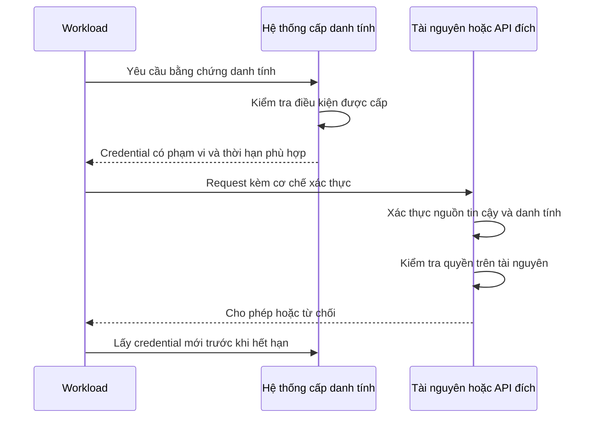

# Workload identity là gì

## 1. Danh tính của phần mềm đang thực hiện công việc

Workload identity là danh tính dùng để nhận diện một khối phần mềm khi nó tương tác với hệ thống khác. Nhờ danh tính này, bên nhận có thể xác thực phần mềm gọi tới, áp dụng quyền truy cập phù hợp và ghi nhận hoạt động để kiểm toán.

Workload có thể là dịch vụ web, tiến trình xử lý hàng đợi, batch job, hàm serverless hoặc một lượt chạy pipeline CI/CD. Nó không nhất thiết trùng với một máy chủ: nhiều workload có thể cùng chạy trên một máy, và một workload có thể có nhiều instance ở các máy khác nhau. Cách hiểu này phù hợp với khái niệm workload trong [SPIFFE Concepts](https://spiffe.io/docs/latest/spiffe-about/spiffe-concepts/).

Ví dụ, ứng dụng Java `orders-api` cần đọc thông tin hàng hóa từ `inventory-api`. Thay vì xem request là “đến từ mạng nội bộ nên được tin”, hệ thống muốn xác định:

> Request này do workload orders-api trong môi trường production thực hiện, với bằng chứng được bên nhận kiểm tra.

Danh tính trả lời câu hỏi “ai đang gọi”. Chính sách trả lời câu hỏi “bên gọi được làm gì”. Hai câu hỏi cần được giải quyết riêng.

## 2. Vì sao IAM cần danh tính cho workload?

Một hệ thống không chỉ có người dùng. Sau khi người dùng bấm đặt hàng, nhiều thành phần tự động có thể tiếp tục xử lý:

```text
Người dùng
  -> orders-api
  -> payment-worker
  -> message broker
  -> dịch vụ lưu trữ và hệ thống báo cáo
```

Mỗi thành phần có một nhiệm vụ và một tập quyền khác nhau. Nếu mọi thành phần dùng chung một credential quản trị, hệ thống gặp ba vấn đề:

1. Khó giới hạn quyền theo nhiệm vụ.
2. Khó xác định thành phần nào đã thực hiện một thao tác.
3. Khi credential bị lộ, phải xử lý ảnh hưởng trên nhiều workload cùng lúc.

Ví dụ, `report-worker` chỉ cần đọc dữ liệu tổng hợp và ghi báo cáo. Nó không cần xóa hàng đợi thanh toán hoặc sửa cấu hình IAM. Một danh tính riêng giúp gắn đúng các quyền này với nhiệm vụ của nó.

Workload identity cũng giúp tách vòng đời ứng dụng khỏi tài khoản cá nhân. Dịch vụ không nên phụ thuộc vào access key của lập trình viên đang trực ca. Tuy vậy, mỗi danh tính phần mềm vẫn cần một nhóm con người chịu trách nhiệm quản lý, rà soát quyền và xử lý sự cố.

## 3. Phân biệt identity, credential, principal và permission

| Khái niệm | Ý nghĩa | Ví dụ trong hệ thống báo cáo |
| --- | --- | --- |
| Identity | Danh tính mà hệ thống muốn nhận diện | Workload report-worker ở production |
| Identifier | Giá trị định danh | Một URI hoặc ID do nền tảng quản lý |
| Principal | Chủ thể được policy đánh giá | Danh tính đã được xác thực khi gọi API |
| Credential | Bằng chứng phục vụ xác thực | Token ngắn hạn hoặc certificate cùng cơ chế chứng minh sở hữu khóa |
| Issuer | Bên cấp bằng chứng danh tính | Dịch vụ định danh được tin cậy |
| Permission | Thao tác được phép trên tài nguyên | Đọc dữ liệu báo cáo |
| Owner | Bên chịu trách nhiệm quản trị | Nhóm vận hành báo cáo |

Một tên như `report-worker` không phải bí mật và tự nó không chứng minh nguồn gọi. Kẻ khác có thể gửi cùng chuỗi đó trong một HTTP header.

Credential mới là một phần của cơ chế chứng minh danh tính. Bên nhận cần kiểm tra bằng chứng theo giao thức và quan hệ tin cậy đã được thiết lập. Chỉ đọc một claim rồi lấy tên workload ra không đủ để xác thực.

Một identity có thể tồn tại qua nhiều lần đổi credential. Ngược lại, một credential bị lộ có thể cho phép kẻ khác hành động dưới identity đó trong phạm vi còn được hệ thống chấp nhận. Vì vậy, không đồng nhất “có danh tính” với “phần mềm chắc chắn không bị xâm nhập”.

### Khác với danh tính con người

| Khía cạnh | Danh tính con người | Danh tính workload |
| --- | --- | --- |
| Chủ thể hoạt động | Người sử dụng hệ thống | Phần mềm hoặc lượt chạy tự động |
| Bằng chứng thường gặp | Đăng nhập, yếu tố xác thực, phiên người dùng | Bằng chứng runtime, token, certificate hoặc cơ chế nền tảng |
| Vòng đời | Tuyển dụng, chuyển vai trò, nghỉ việc | Triển khai, mở rộng, cập nhật, dừng workload |
| Đơn vị chịu trách nhiệm | Người dùng và đơn vị quản lý | Nhóm sở hữu ứng dụng hoặc nền tảng |
| Cách áp dụng quyền | Theo chức trách và ngữ cảnh | Theo nhiệm vụ, tài nguyên và môi trường chạy |

Một workload thường không thể thực hiện thao tác MFA tương tác như con người ở mỗi lần gọi API. Điều này không cho phép hạ thấp kiểm soát xác thực; cơ chế chứng minh phải phù hợp với môi trường thực thi và mức rủi ro.

## 4. Mô hình hoạt động cơ bản

Một mô hình tổng quát gồm workload, hệ thống cấp danh tính và tài nguyên đích:



Đây là sơ đồ khái niệm. Một triển khai có thể dùng agent trên node, metadata service, token exchange, SDK hoặc thành phần proxy; không phải mọi nền tảng đều có đúng cùng một chuỗi thông điệp.

### 4.1. Workload được nhận diện ban đầu bằng cách nào?

Trước khi cấp credential, hệ thống phải có căn cứ để biết workload nào đang yêu cầu. Căn cứ có thể đến từ nền tảng chạy, danh tính máy, đối tượng triển khai, service account hoặc bằng chứng do một issuer khác đã được tin cậy cấp.

Quá trình kiểm chứng các thuộc tính này thường được gọi là attestation. Ví dụ, [SPIRE Concepts](https://spiffe.io/docs/latest/spire-about/spire-concepts/) mô tả việc đối chiếu thuộc tính quan sát được của node và tiến trình với điều kiện đăng ký để cấp danh tính tương ứng.

Một quy tắc do workload tự khai như `service=payment` chỉ đáng tin nếu hệ thống có cách kiểm chứng và kiểm soát ai được tạo workload mang thuộc tính đó. Nếu bất kỳ bên nào cũng tự gắn nhãn để nhận identity đặc quyền, cơ chế cấp danh tính đã bị mở quá rộng.

Attestation không mặc nhiên có nghĩa đã chứng minh phần mềm hoàn toàn an toàn. Mức bảo đảm phụ thuộc dữ liệu được kiểm tra, cách bảo vệ nền tảng và quyền của bên có thể sửa cấu hình triển khai.

### 4.2. Credential cần được bên nhận kiểm tra

Với token, bên nhận cần kiểm tra bảo vệ mật mã, issuer, bên nhận dự kiến và thời hạn theo profile. Với xác thực dùng certificate, nó cần kiểm tra chuỗi tin cậy, danh tính mong đợi và cơ chế chứng minh sở hữu khóa tương ứng.

Không chấp nhận một certificate tùy ý chỉ vì nó tồn tại, hoặc một token tùy ý chỉ vì nó có trường `sub`. Cấu hình trust quyết định bên cấp nào được phép chứng thực danh tính nào.

### 4.3. Xác thực thành công chưa tạo ra quyền

Sau khi nhận diện đúng `report-worker`, tài nguyên vẫn phải đánh giá policy. Workload được nhận diện hợp lệ có thể không có quyền đọc một kho dữ liệu hoặc thực hiện một method cụ thể.

Credential trả lời vấn đề bằng chứng; policy định nghĩa quyền. Việc hai dịch vụ dùng được mTLS cũng không tự tạo ra quy tắc “dịch vụ A chỉ được gọi chức năng đọc của dịch vụ B”.

## 5. Ví dụ: workload tạo báo cáo theo nguyên tắc ít quyền nhất

Giả sử `report-worker` chạy định kỳ trong production. Nó cần:

- Đọc dữ liệu tổng hợp đơn hàng.
- Ghi file vào vùng báo cáo.
- Không sửa dữ liệu nguồn.
- Không đọc bí mật của ứng dụng khác.

Ta chọn định danh minh họa theo dạng SPIFFE:

```text
spiffe://prod.example.test/reporting/report-worker
```

SPIFFE dùng URI để định danh workload trong một trust domain, và SVID là tài liệu có thể kiểm chứng gắn với danh tính đó. Xem [SPIFFE Concepts](https://spiffe.io/docs/latest/spiffe-about/spiffe-concepts/). Chuỗi trên là ví dụ, không phải một identity đang được triển khai.

Policy khái niệm có thể viết như sau:

```yaml
principal: spiffe://prod.example.test/reporting/report-worker
allow:
  - action: orders.summary.read
    resource: orders-api/summary
  - action: report.write
    resource: storage/reports/daily/*
```

YAML trên chỉ diễn tả ý định phân quyền, không phải cú pháp triển khai của SPIFFE, Kubernetes hay nhà cung cấp cloud. SPIFFE định danh không tự áp dụng các quyền được viết trong ví dụ này.

Khi nhận request đọc dữ liệu, API có thể thực hiện logic:

```text
caller = authenticateUsingTrustedMechanism(request)

if caller.identity != expectedReportWorkerIdentity:
    deny

if not policy.allows(
    caller,
    action = "orders.summary.read",
    resource = "orders-api/summary"
):
    deny

return aggregatedOrderData
```

`authenticateUsingTrustedMechanism` là một hàm khái niệm. Nó phải lấy danh tính từ cơ chế đã xác thực, không từ header tự khai như `X-Workload-Name`.

Nếu request đi qua proxy, cần biết điểm kết thúc xác thực ở đâu và thông tin danh tính được chuyển tiếp thế nào. Cho phép client bên ngoài tự gửi một header trông giống kết quả xác thực sẽ làm mất ranh giới tin cậy.

### Một identity cho nhiều replica có phù hợp không?

Có thể, nếu các replica cùng thực hiện một nhiệm vụ và cần cùng quyền. Danh tính logic `report-worker` có thể ổn định trong khi instance được tạo, dừng và thay thế.

Để điều tra sự cố, log vẫn nên có metadata đáng tin về instance, lượt chạy hoặc deployment. Dùng chung danh tính logic cho các replica không đồng nghĩa phải mất khả năng phân biệt request đến từ lượt chạy nào.

Ngược lại, không gom `report-worker`, `payment-worker` và công cụ quản trị vào cùng identity chỉ vì chúng cùng chạy trên một node. Nhiệm vụ và phạm vi quyền khác nhau là căn cứ để tách.

## 6. Service account, managed identity và federation liên quan thế nào?

### 6.1. Service account là một cách biểu diễn danh tính phần mềm

Trong Kubernetes, ServiceAccount là một danh tính không phải con người, có phạm vi namespace. Pod có thể dùng credential của ServiceAccount để nhận diện với bên chấp nhận cơ chế đó. Xem [Kubernetes Service Accounts](https://kubernetes.io/docs/concepts/security/service-accounts/).

Cần phân biệt đối tượng ServiceAccount với token cấp cho nó. Đối tượng biểu diễn danh tính; token là một dạng credential.

Gán một ServiceAccount cho Pod cũng không tự động cấp quyền vào mọi API hay cloud. Quyền Kubernetes phụ thuộc policy tương ứng; quyền của hệ thống khác cần cấu hình trust và authorization ở hệ thống đó.

Nếu nhiều workload không liên quan dùng cùng một service account có quyền rộng, việc có ServiceAccount vẫn chưa đạt mục tiêu phân tách danh tính.

### 6.2. Managed identity chuyển việc quản lý credential xuống nền tảng

Một cơ chế managed identity có thể cho ứng dụng lấy token thông qua danh tính do nền tảng quản lý, giảm nhu cầu để nhà phát triển lưu credential ứng dụng dài hạn. Microsoft mô tả mô hình này trong [Managed identities for Azure resources](https://learn.microsoft.com/en-us/entra/identity/managed-identities-azure-resources/overview).

Lợi ích này không có nghĩa bên vận hành không còn phải cấp quyền hoặc quản lý vòng đời. Identity gắn nhầm vào một ứng dụng, hoặc identity được cấp quá nhiều quyền, vẫn gây rủi ro.

Tương tự, [AWS IAM roles](https://docs.aws.amazon.com/IAM/latest/UserGuide/id_roles.html) hỗ trợ cấp credential tạm thời cho phiên sử dụng role. Role còn có thể được dùng cho con người; không phải cứ thấy một IAM role là mặc nhiên đó chỉ là workload identity.

### 6.3. Federation nối các miền tin cậy

Workload identity federation cho phép một hệ thống dựa trên bằng chứng từ miền đã được tin cậy để cấp hoặc chấp nhận quyền cho workload ở miền khác.

Ví dụ, pipeline CI/CD lấy token từ nền tảng chạy pipeline, sau đó dùng cơ chế liên kết để truy cập tài nguyên cloud. Mục tiêu là tránh phải sao chép một khóa cloud dài hạn vào mọi pipeline.

[Google Cloud Workload Identity Federation](https://docs.cloud.google.com/iam/docs/workload-identity-federation) mô tả mô hình dùng danh tính liên kết cho workload bên ngoài, thay cho service account key, cùng ánh xạ thuộc tính và điều kiện truy cập.

Federation cần ràng buộc cụ thể: tin issuer nào, subject nào, audience nào và ngữ cảnh nào được nhận quyền. Không dùng quy tắc quá rộng như “mọi token của nền tảng CI này đều được deploy production”.

Ví dụ thiết kế có thể giới hạn đúng repository, nhánh hoặc môi trường triển khai do issuer chứng thực. Tuy nhiên, vẫn phải quản lý ai có quyền sửa pipeline hoặc tạo lượt chạy thỏa các điều kiện đó.

Workload identity là khái niệm tổng quát; service account, managed identity, federation và SPIFFE là những cơ chế liên quan ở các lớp khác nhau. Chúng không phải các tên gọi luôn thay thế được cho nhau.

## 7. Phân tách người triển khai, workload và người dùng cuối

Một request trong hệ thống có thể liên quan tới ba danh tính:

| Danh tính | Ví dụ | Câu hỏi phục vụ kiểm toán |
| --- | --- | --- |
| Người thay đổi hệ thống | Kỹ sư triển khai bản phát hành | Ai đã sửa và triển khai ứng dụng? |
| Workload đang chạy | orders-api ở production | Thành phần nào thực hiện request? |
| Người dùng nghiệp vụ | Khách hàng đang đặt đơn | Thao tác được thực hiện cho ai? |

Nếu `orders-api` gọi API thanh toán thay cho khách hàng, danh tính workload cho biết thành phần gọi tới. Nó không tự chứng minh khách hàng có quyền thanh toán đơn hàng đó.

Bên nhận có thể cần cả ngữ cảnh ứng dụng và ngữ cảnh người dùng đã được xác thực, hoặc một cơ chế ủy quyền rõ ràng. Không thêm `user_id` tùy ý vào request rồi coi đó là ủy quyền hợp lệ.

Chiều ngược lại cũng quan trọng: một tác vụ hệ thống như tổng hợp số liệu ban đêm có thể không có người dùng cuối đang hiện diện. Khi đó, quyền của workload được cấp cho nhiệm vụ tự động, không cần giả lập tài khoản cá nhân để giải thích mỗi request.

Việc tách ba danh tính giúp truy vết đúng trách nhiệm mà không trộn quyền quản trị triển khai với quyền truy cập dữ liệu lúc chạy.

## 8. Vòng đời và các kiểm soát cần đi cùng

Một mô hình quản trị workload identity có thể gồm:

1. Xác định nhiệm vụ, nhóm sở hữu và tài nguyên cần truy cập.
2. Cấp identity và cấu hình điều kiện workload được nhận identity đó.
3. Gắn quyền tối thiểu theo action, resource và môi trường.
4. Cấp credential qua kênh phù hợp, bảo vệ nơi lưu và cách sử dụng.
5. Làm mới credential, theo dõi lỗi và rà soát hoạt động.
6. Khi dừng workload, gỡ quyền, dừng cấp mới và xử lý credential còn hiệu lực.

Đây là khung thiết kế tổng quát. Hiệu lực thu hồi cụ thể phụ thuộc credential, policy, cache và cách bên nhận thực thi kiểm tra.

### Danh tính ngắn hạn không đồng nghĩa không có bí mật

Token, private key hoặc credential tạm thời vẫn cần được bảo vệ. Lợi ích là giảm việc phân phối khóa dài hạn bằng tay và có thể giới hạn thời gian lạm dụng, không phải làm biến mất hoàn toàn dữ liệu nhạy cảm.

Nếu tiến trình khác đọc được credential của workload, nó có thể mạo danh trong phạm vi cơ chế cho phép. Cần bảo vệ phân tách runtime, quyền đọc file, bộ nhớ, endpoint cấp danh tính và đường truy cập metadata.

### Workload không được nhận quyền chỉ vì ở trong mạng nội bộ

IP có thể thay đổi, bị dùng chung hoặc chỉ cho biết vị trí mạng. Network policy và phân đoạn mạng vẫn hữu ích, nhưng không thay thế hoàn toàn xác thực danh tính và phân quyền.

Tương tự, node identity và workload identity có độ hạt khác nhau. Cấp mọi Pod cùng quyền của node có thể khiến một workload bị xâm nhập ảnh hưởng tới tài nguyên của workload khác.

### Dừng cấp mới chưa chắc chặn ngay mọi hoạt động cũ

Nếu credential còn được chấp nhận, hoặc một kết nối đã xác thực vẫn tiếp tục tồn tại theo policy, việc dừng issuer cấp mới có thể chưa ngắt truy cập ngay. Hệ thống cần hiểu rõ hạn credential, cơ chế thu hồi và thời điểm đánh giá lại quyền.

Không xử lý lỗi làm mới credential bằng cách âm thầm chuyển sang một khóa quản trị dùng chung. Hành vi khi nền tảng định danh lỗi cần được thiết kế rõ, phù hợp với giới hạn hiệu lực và mức rủi ro.

## 9. Kiểm toán và các lỗi thiết kế thường gặp

Một sự kiện truy cập hữu ích có thể chứa:

```text
workload_identity: danh tính đã được xác thực
instance_or_run_id: instance hoặc lượt chạy liên quan
issuer_or_trust_domain: nguồn chứng thực
action: thao tác được yêu cầu
resource: tài nguyên đích
decision: allow hoặc deny
policy_reference: policy dẫn tới quyết định
correlation_id: mã liên kết xử lý
```

Đây là schema log minh họa. Metadata dùng cho điều tra cần có nguồn và mức tin cậy rõ ràng. Không ghi token thô, private key hoặc credential vào log.

| Lỗi thiết kế | Hệ quả |
| --- | --- |
| Mọi dịch vụ dùng chung một identity quản trị | Phạm vi ảnh hưởng lớn, khó truy trách nhiệm |
| Tách identity nhưng gắn cùng toàn quyền | Không tạo được giới hạn quyền thực chất |
| Tin tên workload trong request tự khai | Có thể bị mạo danh |
| Cho workload tự chọn identity đặc quyền | Vượt qua kiểm soát cấp danh tính |
| Dùng cùng identity cho test và production | Rò rỉ quyền giữa môi trường |
| Chỉ kiểm tra credential mà bỏ qua policy | Workload hợp lệ có thể truy cập quá mức |
| Cho phép pipeline không tin cậy nhận quyền deploy | Chiếm quyền qua chuỗi triển khai |
| Dừng ứng dụng nhưng để quyền và credential tồn tại | Tạo danh tính hoặc quyền mồ côi |
| Xem credential ngắn hạn là không cần bảo vệ | Vẫn có thể bị sao chép và lạm dụng |

Một bài tập thiết kế nhỏ: `report-worker` cần thêm quyền đọc dữ liệu khách hàng để tạo báo cáo mới. Không nên chỉ thêm quyền toàn bộ database cho thuận tiện. Cần xác định trường dữ liệu cần thiết, tài nguyên được đọc, ràng buộc môi trường, nhóm phê duyệt và cách kiểm toán. Danh tính riêng là điểm gắn policy, còn chất lượng phân quyền phụ thuộc các quyết định đó.

Workload identity đưa phần mềm trở thành một chủ thể IAM có thể nhận diện, cấp quyền và quản lý vòng đời. Một thiết kế đầy đủ phải nối được danh tính với workload thật, bảo vệ credential và áp dụng đúng quyền tại tài nguyên được truy cập.
