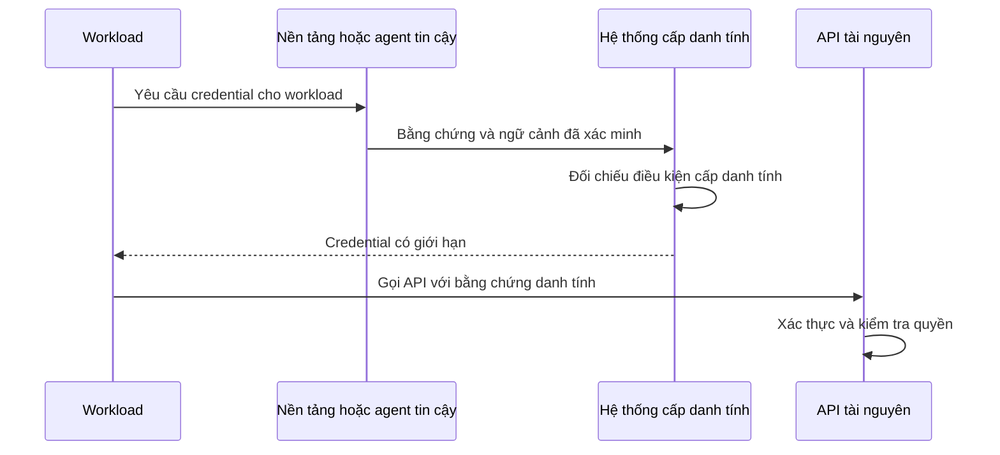

# Machine identity

Một chương trình xử lý hóa đơn cần đọc hàng đợi, gọi dịch vụ thuế và ghi kết quả vào kho dữ liệu. Các thao tác diễn ra tự động, không có nhân viên đăng nhập trước mỗi lần gọi. Hệ thống vẫn phải xác định ai đang gọi, bằng chứng nào xác nhận danh tính ấy và chương trình được phép tác động tới những tài nguyên nào.

Machine identity giải quyết phần danh tính cho các thực thể không phải con người. Trong một hệ thống IAM, danh tính này cần được cấp quyền, kiểm toán và quản lý vòng đời với trách nhiệm rõ ràng, tương tự yêu cầu quản trị danh tính người dùng nhưng phù hợp với cách máy và phần mềm hoạt động.

## 1. Machine identity bao gồm những gì?

Trong bài học này, machine identity được hiểu là danh tính dùng để nhận diện và xác thực một thực thể phi con người, chẳng hạn máy chủ, thiết bị, ứng dụng, dịch vụ hoặc tác vụ tự động. Thuật ngữ giữa các nền tảng có thể khác nhau. Một cách phân loại phổ biến đặt device identity và workload identity trong nhóm machine identity; workload đại diện cho phần mềm, còn device đại diện cho thiết bị. Xem [Microsoft Learn: Workload identities, other machine identities, and human identities](https://learn.microsoft.com/en-us/entra/workload-id/workload-identities-overview#workload-identities-other-machine-identities-and-human-identities).

Ví dụ trong hệ thống xử lý hóa đơn:

| Thực thể | Danh tính cần xem xét | Mục đích |
|---|---|---|
| Máy ảo chạy ứng dụng | Danh tính instance hoặc host | Tương tác với nền tảng và dịch vụ hạ tầng |
| Tiến trình xử lý hóa đơn | Danh tính workload | Đọc hàng đợi và ghi kết quả hóa đơn |
| Tác vụ triển khai CI/CD | Danh tính automation | Triển khai phiên bản ứng dụng được cho phép |
| Thiết bị quét tại kho | Danh tính thiết bị | Gửi dữ liệu từ một thiết bị đã đăng ký |

Một máy vật lý không nhất thiết chỉ có một danh tính phục vụ mọi mục đích. Trên cùng máy có thể có agent giám sát, ứng dụng hóa đơn và dịch vụ sao lưu, mỗi thành phần cần tập quyền riêng.

Ngược lại, một workload logic có thể chạy nhiều replica. Trong SPIFFE, khái niệm workload có thể nhỏ hơn một node hoặc trải trên nhiều node. Vì vậy, workload identity không bị buộc phải đồng nhất với một máy cụ thể. Xem [SPIFFE Concepts: Workload](https://spiffe.io/docs/latest/spiffe-about/spiffe-concepts/#workload).

## 2. Tách danh tính, credential và quyền

Ba khái niệm này thường xuất hiện cùng nhau nhưng có vai trò khác nhau:

| Khái niệm | Câu hỏi được trả lời | Ví dụ minh họa |
|---|---|---|
| Identity / principal | Thực thể đang được nhận diện là ai? | `invoice-worker` trong production |
| Credential | Thực thể chứng minh danh tính bằng gì? | Token ngắn hạn hoặc chứng thư gắn với khóa riêng |
| Authorization policy | Danh tính đó được phép làm gì? | Chỉ đọc hàng đợi hóa đơn thuộc một phạm vi |

Một chuỗi định danh như `invoice-worker` có thể bị bất kỳ tiến trình nào tự khai. Credential và cơ chế xác thực giúp bên nhận kiểm tra rằng bên gọi có đủ bằng chứng để đại diện danh tính đó.

Credential có thể được thay nhiều lần mà danh tính logic vẫn giữ nguyên. Ví dụ, một dịch vụ đổi khóa và nhận chứng thư mới mỗi chu kỳ, trong khi chính sách vẫn cấp quyền cho cùng danh tính dịch vụ.

Một bản ghi quản trị minh họa có thể như sau. Đây là dữ liệu mô tả tự đặt cho bài học, không phải schema của một sản phẩm:

```yaml
identity: invoice-worker-production
kind: workload
ownerTeam: finance-platform
environment: production
purpose: Process invoice messages
credentialMode: short-lived-certificate
allowedActions:
  - consume:invoice-input
  - publish:invoice-result
reviewOn:
  - ownership-change
  - permission-change
  - service-retirement
```

Bản ghi cần có người hoặc nhóm chịu trách nhiệm dù chủ thể hoạt động là phần mềm. Khi phát hiện truy cập bất thường, tổ chức phải biết ai có quyền cô lập workload và phê duyệt thay đổi quyền của nó.

### Những dữ liệu không đủ làm bằng chứng danh tính

IP, hostname, tên container hoặc header `X-Service-Name` có thể hữu ích cho định tuyến và quan sát. Chúng không tự chứng minh bên gọi có quyền đại diện một principal. IP có thể được tái sử dụng, nhiều workload có thể cùng đi qua NAT và header có thể bị client tự đặt.

Nếu proxy truyền danh tính đã xác thực tới ứng dụng qua metadata, ứng dụng cần một kênh tin cậy với proxy và kiểm soát việc ghi đè metadata. Không coi một header xuất hiện trong HTTP request bất kỳ là bằng chứng mật mã.

## 3. Chọn độ chi tiết của danh tính

Giả sử ba chương trình cùng chạy trên một máy:

```text
Máy chủ A
  ├─ invoice-worker: xử lý hóa đơn
  ├─ metrics-agent: gửi số liệu giám sát
  └─ backup-agent: sao lưu dữ liệu
```

Nếu cả ba dùng một credential có quyền quản trị rộng, việc một agent bị chiếm quyền có thể ảnh hưởng các chức năng còn lại. Log cũng khó phân biệt chương trình nào thực sự dùng credential chung.

Thiết kế có thể tách theo mục đích:

- `invoice-worker`: đọc hàng đợi đầu vào và ghi kết quả xử lý.
- `metrics-agent`: chỉ gửi metric tới nơi tiếp nhận được chỉ định.
- `backup-agent`: đọc dữ liệu cần sao lưu và ghi vào kho sao lưu đã giới hạn.

Độ chi tiết phải phù hợp với ranh giới bảo mật và khả năng vận hành. Không nhất thiết tạo một principal mới cho mọi tiến trình ngắn hạn nếu các replica thực sự cùng chức năng và cùng chính sách. Tuy nhiên, các workload có quyền hoặc mức tin cậy khác nhau cần được tách để giảm phạm vi ảnh hưởng khi sự cố xảy ra.

Nên phân biệt ít nhất các phạm vi có yêu cầu cách ly rõ ràng, như production và thử nghiệm, hoặc pipeline triển khai và ứng dụng đang phục vụ nghiệp vụ. Một identity của môi trường thử nghiệm không nên có quyền ghi dữ liệu production chỉ vì hai dịch vụ có cùng tên.

Nếu nhiều replica dùng chung danh tính workload, vẫn cần thông tin phiên bản chạy, instance hoặc chứng thư cụ thể trong bằng chứng kiểm toán. Principal logic giúp áp dụng chính sách; ngữ cảnh instance giúp điều tra sự kiện.

## 4. Các hình thức credential thường gặp

Machine identity không bắt buộc dùng một loại credential duy nhất. Cần chọn theo giao thức, nền tảng và khả năng bảo vệ khóa:

| Hình thức | Cách sử dụng điển hình | Điểm cần quản lý |
|---|---|---|
| API key hoặc bí mật chia sẻ | Ứng dụng trình bí mật theo hợp đồng dịch vụ | Lưu trữ, phạm vi quyền, rotation và nguy cơ sao chép |
| OAuth access token | Workload dùng token để gọi API | Issuer, audience, thời hạn và quyền được cấp |
| Chứng thư X.509 cùng khóa riêng | Xác thực bằng TLS/mTLS trong thiết kế phù hợp | Chuỗi tin cậy, danh tính trong chứng thư và bảo vệ khóa riêng |
| SSH key hoặc SSH certificate | Xác thực host hoặc client theo vai trò SSH | Phân biệt danh tính máy chủ, tài khoản và quyền thực thi |
| Credential tạm thời của nền tảng cloud | Ứng dụng dùng credential được nền tảng cấp | Điều kiện nhận credential, policy và cơ chế làm mới |

Chứng thư thường chứa dữ liệu công khai; phần cần giữ bí mật là khóa riêng tương ứng. Việc sao chép chứng thư công khai không tự cho phép giả mạo kết nối nếu bên tấn công không kiểm soát khóa riêng và giao thức xác thực hoạt động đúng.

Với bearer token, bên giữ token có thể sử dụng nó trong phạm vi token được chấp nhận. Credential ngắn hạn giảm khoảng thời gian khai thác khi bị lộ nhưng không làm token hết nhạy cảm.

Trong AWS, IAM role gắn với EC2 có thể cung cấp credential tạm thời cho ứng dụng thay cho phân phối access key dài hạn. AWS cũng lưu ý ứng dụng trên cùng instance có thể cùng chịu phạm vi role của instance, nên cần cân nhắc ranh giới workload. Xem [AWS IAM: Use an IAM role for applications on EC2](https://docs.aws.amazon.com/IAM/latest/UserGuide/id_roles_use_switch-role-ec2.html).

Đây là ví dụ về khả năng của một nền tảng, không có nghĩa mọi workload phải được chạy trên EC2 hoặc mọi máy đều tự có credential an toàn mà không cần cấu hình.

## 5. Bootstrap: bằng cách nào máy được nhận credential đầu tiên?

Một dịch vụ cấp credential phải xác định ai đang yêu cầu trước khi cấp danh tính. Nếu chỉ cần khai tên `invoice-worker-production`, bất kỳ phần mềm nào cũng có thể xin quyền của dịch vụ đó.

Bootstrap là quá trình thiết lập quan hệ tin cậy ban đầu. Tùy môi trường, bằng chứng có thể đến từ nền tảng cloud, hệ thống điều phối, phần cứng bảo vệ khóa hoặc một quy trình đăng ký được kiểm soát.

Trong SPIRE, node attestation xác minh node, còn workload attestation đánh giá thuộc tính của tiến trình qua nguồn tin cậy và đối chiếu với điều kiện đã đăng ký. Xem [SPIRE Concepts: Attestation](https://spiffe.io/docs/latest/spire-about/spire-concepts/#attestation).

Một luồng khái niệm có thể như sau:



Đây là sơ đồ trách nhiệm; cách chuyển credential thực tế phụ thuộc nền tảng. Hệ thống cần kiểm soát cả bên được xin danh tính lẫn bên được sửa quy tắc cấp danh tính.

Ví dụ, nếu một người có thể tùy ý gán workload bất kỳ vào service account đặc quyền, việc token ngắn hạn được cấp đúng kỹ thuật vẫn chưa ngăn người đó đạt quyền cao. Quyền tạo workload, chọn service account, sửa policy và truy cập credential đều là một phần của ranh giới bảo mật.

“Không phải tự quản lý secret dài hạn trong mã ứng dụng” cũng không có nghĩa hệ thống không còn bí mật. Khóa ký của issuer, khóa riêng và credential bootstrap vẫn cần được bảo vệ; trách nhiệm có thể chuyển sang nền tảng hoặc dịch vụ danh tính.

## 6. Workload identity trong Kubernetes và SPIFFE

### Kubernetes ServiceAccount

Kubernetes ServiceAccount là một loại tài khoản phi con người, có phạm vi namespace, mà Pod và các thành phần khác có thể dùng để xác thực. Quyền được cấp riêng qua cơ chế như RBAC. Kubernetes hỗ trợ token ngắn hạn thông qua TokenRequest và projected volume trong cấu hình phù hợp. Xem [Kubernetes: Service Accounts](https://kubernetes.io/docs/concepts/security/service-accounts/).

Một cấu hình danh tính minh họa cần được nhìn trong đủ ngữ cảnh:

```text
Cluster:        production-cluster
Namespace:      finance
ServiceAccount: invoice-worker
Workload:       chương trình xử lý hóa đơn
```

Tên `invoice-worker` ở cluster khác hoặc namespace khác không tự là cùng một principal. Một token ServiceAccount cũng không mặc nhiên được mọi API bên ngoài cluster chấp nhận; hệ thống đích phải có quan hệ tin cậy và kiểm tra token theo hợp đồng của mình.

Ứng dụng nhận credential có rotation cần đọc credential mới đúng cách. Nếu chỉ đọc một token lúc khởi động và giữ mãi trong bộ nhớ, ứng dụng có thể tiếp tục gửi token cũ sau khi nền tảng đã cấp token mới.

### SPIFFE ID và bằng chứng danh tính

SPIFFE phân biệt SPIFFE ID, trust domain và tài liệu có thể xác minh gọi là SVID. ID định danh workload; SVID cung cấp bằng chứng gắn với danh tính đó. Các dạng được tài liệu mô tả gồm X.509-SVID và JWT-SVID. Xem [SPIFFE Concepts](https://spiffe.io/docs/latest/spiffe-about/spiffe-concepts/).

Ví dụ một SPIFFE ID:

```text
spiffe://prod.example.org/finance/invoice-worker
```

Định danh này chỉ có ý nghĩa xác thực khi bên nhận kiểm tra bằng chứng tương ứng và chấp nhận trust domain theo cấu hình. Việc đưa nguyên chuỗi ấy vào một header không tương đương trình SVID hợp lệ.

Các mô hình này có thể kết hợp trong một kiến trúc, nhưng Kubernetes ServiceAccount, SPIFFE ID và cloud role không phải những tên gọi có thể thay thế nhau máy móc. Cần ánh xạ có kiểm soát giữa các miền danh tính khi liên kết chúng.

## 7. Xác thực máy và phân quyền thao tác là hai bước

Giả sử `invoice-worker` trình chứng thư hợp lệ qua mTLS tới API hóa đơn. Kết nối đã xác thực danh tính vẫn chưa quyết định workload có được xóa dữ liệu, đọc hóa đơn của tenant khác hay sửa quyền IAM hay không.

Một policy minh họa có thể diễn đạt:

```text
Principal: spiffe://prod.example.org/finance/invoice-worker
Cho phép:  nhận thông điệp từ invoice-input
Cho phép:  gửi kết quả tới invoice-result
Giới hạn:  chỉ dữ liệu thuộc phạm vi được giao
Không cấp: quản trị IAM hoặc cấp credential cho workload khác
```

Trong thiết kế này, tài nguyên cần kiểm tra đủ bằng chứng và điều kiện:

1. Bên phát hành hoặc trust root có nằm trong cấu hình tin cậy không?
2. Credential còn hợp lệ và có được sử dụng đúng mục đích không?
3. Bên gọi có chứng minh quyền sử dụng credential theo giao thức không?
4. Principal đã xác thực có được policy cho phép thao tác trên tài nguyên cụ thể không?
5. Các điều kiện tenant, môi trường và trạng thái nghiệp vụ có đạt không?

TLS chỉ xác thực máy chủ trong một kết nối thông thường không tự xác thực client như mTLS. Ngay cả khi mTLS xác thực hai phía, ứng dụng vẫn cần quyết định principal nào được gọi endpoint nào.

Nếu workload hành động thay mặt người dùng, phải xác định riêng danh tính workload và ngữ cảnh ủy quyền của người dùng. Quyền ứng dụng tự có không được dùng để bỏ qua mọi giới hạn của người dùng gọi vào ứng dụng.

## 8. Quản lý vòng đời machine identity

Các workload thường được tạo và xóa tự động, nên quản trị thủ công từng credential dễ bỏ sót. Vòng đời cần gắn với vòng đời dịch vụ và hạ tầng:

| Giai đoạn | Công việc cần kiểm soát |
|---|---|
| Đăng ký | Xác định mục đích, chủ sở hữu, môi trường và danh tính cần cấp |
| Cấp phát | Kiểm tra điều kiện nhận credential, đặt giới hạn quyền |
| Hoạt động | Theo dõi truy cập, tự làm mới credential và kiểm tra lỗi |
| Thay đổi | Xem xét lại quyền khi đổi chức năng, owner hoặc môi trường |
| Sự cố | Cô lập workload, xử lý credential và cập nhật policy |
| Ngừng dùng | Gỡ liên kết cấp danh tính, quyền và credential còn liên quan |

Thay credential và thu hồi identity là hai việc khác nhau. Đổi khóa có thể vẫn cho principal dùng quyền cũ. Ngừng cấp credential mới cũng chưa chắc làm credential đã phát hành mất hiệu lực ngay tại mọi bên nhận.

Với chứng thư hoặc token được xác minh tại chỗ, thời hạn, cơ chế kiểm tra trạng thái, cache và kết nối đã thiết lập có thể ảnh hưởng thời gian vô hiệu hóa thực tế. Cần kiểm thử kịch bản thu hồi thay vì chỉ xác nhận rằng một đối tượng đã bị xóa trong giao diện IAM.

Một quy trình ứng phó có thể gồm: chặn quyền của principal ở tài nguyên, chặn khả năng xin credential mới, xử lý credential bị lộ, cô lập môi trường thực thi và điều tra các hành động trước đó. Các bước cụ thể phụ thuộc khả năng của nền tảng và mức độ sự cố.

Khi chuyển owner hoặc nhóm vận hành, cần cập nhật trách nhiệm và quyền quản trị danh tính. Danh tính máy không nên trở thành tài khoản vô chủ chỉ vì nhân viên tạo nó đã nghỉ việc.

## 9. Những sai lầm thường gặp

| Sai lầm | Hệ quả | Hướng xử lý |
|---|---|---|
| Dùng tài khoản cá nhân cho tác vụ chạy nền | Automation gắn với vòng đời và quyền của một người | Tạo principal phù hợp cho automation, có owner rõ ràng |
| Nhúng khóa dài hạn vào image hoặc source code | Nhiều bản sao chứa credential khó kiểm soát | Tách cấp credential khỏi bản build, bảo vệ nguồn cấp |
| Dùng chung một identity cho các dịch vụ khác chức năng | Phạm vi ảnh hưởng lớn và khó truy vết | Chia theo mục đích, quyền và ranh giới tin cậy |
| Tin mọi request từ mạng nội bộ | Chuyển vị trí mạng thành quyền ngầm | Xác thực principal và kiểm tra policy ở nơi thực thi |
| Coi chứng thư hợp lệ là quyền quản trị | Nhầm xác thực với phân quyền | Ánh xạ danh tính đã xác thực vào quyền cụ thể |
| Có rotation nhưng ứng dụng không nhận credential mới | Lỗi truy cập khi credential cũ hết hạn | Kiểm tra cơ chế reload và hành vi kết nối |
| Xóa workload nhưng giữ quyền và credential còn dùng được | Quyền truy cập tồn tại ngoài vòng đời dự kiến | Kiểm tra đầy đủ chuỗi ngừng cấp, thu hồi và gỡ quyền |

Managed identity hoặc credential ngắn hạn không làm một workload đã bị chiếm quyền trở nên vô hại. Kẻ tấn công trong tiến trình có thể dùng quyền hợp lệ của tiến trình đó. Vì vậy, quyền ít nhất, cách ly workload, bảo vệ đường cấp credential và giám sát hành vi vẫn cần hoạt động cùng nhau.

Các secret còn tồn tại cần có phạm vi sử dụng và trách nhiệm quản lý rõ. Chỉ chuyển secret từ source code sang biến môi trường chưa giải quyết toàn bộ nguy cơ lộ qua công cụ chẩn đoán, log hoặc quyền đọc tiến trình.

## 10. Bằng chứng kiểm toán và tự kiểm tra

Một sự kiện truy cập của machine identity nên giúp trả lời được: principal nào, bằng chứng nào đã được xác thực, instance nào thực hiện, tác động tới tài nguyên nào và policy nào cho phép hoặc từ chối. Thông tin như owner, môi trường, workload version và correlation ID giúp nối sự kiện kỹ thuật với trách nhiệm vận hành.

Không đưa token nguyên vẹn hoặc khóa riêng vào log. Có thể dùng định danh credential không nhạy cảm, mã sự kiện và các thuộc tính cần thiết theo chính sách lưu trữ của tổ chức.

Với hệ thống hóa đơn, hãy kiểm tra các tình huống sau:

| Tình huống | Hành vi mong đợi |
|---|---|
| Workload đúng identity và đúng quyền nhận thông điệp | Cho phép tác vụ tương ứng |
| Một workload khác tự khai cùng tên qua HTTP header | Không coi là đã xác thực |
| Identity staging gọi tài nguyên production | Từ chối nếu không có quan hệ quyền được phê duyệt |
| Credential hợp lệ nhưng thao tác ngoài policy | Từ chối thao tác |
| Credential đã được làm mới | Ứng dụng tiếp tục dùng credential mới đúng cách |
| Một replica bị cô lập | Có đủ dữ liệu để xác định hoạt động của replica đó |
| Dịch vụ ngừng dùng | Khả năng nhận credential và quyền còn lại được xử lý đầy đủ |
| Workload bị chiếm quyền nhưng credential vẫn hợp lệ | Có biện pháp hạn chế tác động và ứng phó ngoài kiểm tra credential |

Machine identity có giá trị khi nối được danh tính đã xác thực với quyền tối thiểu, môi trường thực thi và một chủ sở hữu chịu trách nhiệm. Quản lý tốt mối liên hệ này giúp tự động hóa hoạt động mà vẫn kiểm soát được ai đang truy cập tài nguyên và khi nào quyền ấy phải kết thúc.
