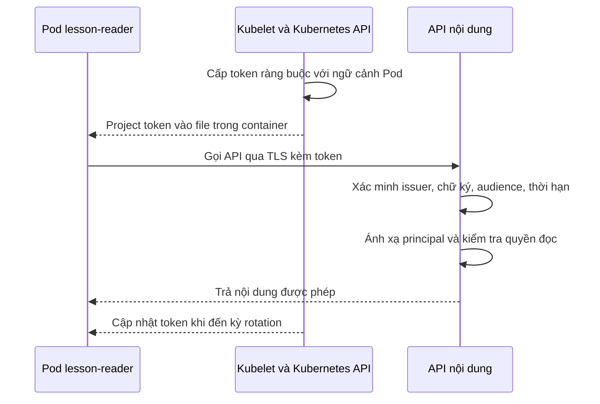

# Pod identity

Pod identity là cách xác lập danh tính cho workload chạy trong Pod để workload chứng minh mình là ai khi gọi Kubernetes API, API nội bộ hoặc dịch vụ bên ngoài. Trong Kubernetes, ServiceAccount là một thành phần nền tảng của cơ chế này. Danh tính workload giúp thay việc phân phối khóa dùng chung bằng thông tin xác thực gắn với ngữ cảnh triển khai và chính sách được quản lý.

Ví dụ, ứng dụng `lesson-reader` chỉ cần đọc nội dung bài học. Nó không nên dùng khóa của quản trị viên hoặc toàn bộ quyền cloud của node. Mục tiêu của thiết kế là cho ứng dụng đúng quyền đọc cần thiết, có vòng đời credential rõ ràng và đủ dấu vết để kiểm toán.

## 1. Phân biệt các thành phần

| Thành phần | Vai trò trong thiết kế danh tính |
|---|---|
| Workload | Ứng dụng hoặc tác vụ cần truy cập tài nguyên |
| Pod | Đơn vị triển khai chứa một hoặc nhiều container |
| ServiceAccount | Danh tính Kubernetes mà Pod được cấu hình sử dụng |
| Credential | Token hoặc tài liệu xác thực được cấp để chứng minh danh tính |
| Trust policy | Quy định bên nhận tin issuer và chủ thể nào |
| Authorization policy | Quy định chủ thể được làm gì trên tài nguyên nào |

ServiceAccount thuộc namespace; Pod chọn ServiceAccount bằng `spec.serviceAccountName`. Nếu không chỉ định, Kubernetes dùng ServiceAccount `default` trong namespace. Tài liệu [Kubernetes Service Accounts](https://kubernetes.io/docs/concepts/security/service-accounts/) mô tả việc sử dụng token ngắn hạn qua TokenRequest và projected volume trong các phiên bản hiện đại.

Pod có ServiceAccount không đồng nghĩa ServiceAccount đó được cấp mọi quyền. Xác thực danh tính và phân quyền vẫn là hai quyết định riêng.

## 2. Danh tính logic khác với một lần chạy Pod

Giả sử Deployment của `lesson-reader` có ba replica cùng sử dụng:

```text
Namespace: training
ServiceAccount: lesson-reader
Subject điển hình: system:serviceaccount:training:lesson-reader
```

Các replica có thể có cùng danh tính ServiceAccount, dù Pod name và Pod UID khác nhau. Vì vậy, “mỗi Pod có token riêng” không đồng nghĩa “mỗi replica có một principal logic hoàn toàn riêng”.

Trong thiết kế ứng dụng, nên tách:

- Danh tính logic để gán quyền cho dịch vụ, như `lesson-reader` của môi trường production.
- Thông tin instance như Pod UID để đối chiếu một lần chạy khi điều tra.
- Danh tính của node để thực hiện chức năng hạ tầng.

Pod name, địa chỉ IP hoặc một label do workload tự đặt không đủ làm bằng chứng xác thực. Chúng có thể hữu ích cho quan sát vận hành nhưng phải được gắn với nguồn và ngữ cảnh đáng tin cậy.

Nếu cần hai tác vụ có quyền khác nhau, nên cân nhắc ServiceAccount và đơn vị triển khai riêng. Không gom tác vụ đọc bài và tác vụ quản trị người dùng vào cùng một danh tính rồi hy vọng từng container luôn chỉ dùng phần quyền phù hợp.

## 3. Một luồng dùng token trực tiếp với API nội bộ

Ví dụ này giả định API nội dung được cấu hình tin token từ issuer Kubernetes phù hợp. Đây là một phương án tích hợp, không phải hành vi tự có của mọi API:



API cần biết trước issuer nào được tin, audience nào dành cho mình và subject nào có quyền. Không phải cứ là token ServiceAccount là được phép vào mọi dịch vụ trong cluster.

Khi kiểm tra danh tính qua nhiều cluster, đừng chỉ so chuỗi `system:serviceaccount:training:lesson-reader`. Cần gắn nó với issuer hoặc kết nối cluster đã được xác minh, vì cùng tên namespace và ServiceAccount có thể xuất hiện ở nhiều nơi.

## 4. Ví dụ cấu hình projected token

Manifest dưới đây minh họa riêng phần danh tính. Nó giả định namespace `training` đã có; image là tên giả, API đích cần được cấu hình riêng. Đây không phải bộ manifest production hoàn chỉnh và không cần triển khai để hiểu bài:

```yaml
apiVersion: v1
kind: ServiceAccount
metadata:
  name: lesson-reader
  namespace: training
automountServiceAccountToken: false
---
apiVersion: v1
kind: Pod
metadata:
  name: lesson-reader-demo
  namespace: training
spec:
  serviceAccountName: lesson-reader
  automountServiceAccountToken: false
  containers:
    - name: app
      image: registry.example.org/training/lesson-reader:demo
      env:
        - name: WORKLOAD_TOKEN_FILE
          value: /var/run/workload-identity/token
      volumeMounts:
        - name: workload-token
          mountPath: /var/run/workload-identity
          readOnly: true
  volumes:
    - name: workload-token
      projected:
        sources:
          - serviceAccountToken:
              path: token
              audience: https://api.training.example.org
              expirationSeconds: 900
```

Trong ví dụ, `automountServiceAccountToken: false` tắt cơ chế mount credential mặc định; projected volume được khai báo rõ vẫn cung cấp token cho ứng dụng. Audience hướng token tới API nội dung. `expirationSeconds` là thời hạn yêu cầu, không phải lý do để ứng dụng tự bỏ qua thời hạn thực của token.

`WORKLOAD_TOKEN_FILE` là biến do ứng dụng minh họa tự quy ước để chỉ đường dẫn file, không phải biến chuẩn tự được mọi SDK nhận biết. Tham khảo cơ chế tại [Configure Service Accounts for Pods](https://kubernetes.io/docs/tasks/configure-pod-container/configure-service-account/).

Manifest này không cấp RBAC và cũng không cấp quyền cloud. Nó chỉ thể hiện Pod dùng danh tính nào và nhận credential theo cách nào.

## 5. Kiểm tra token và quyền ở API đích

Với API nội dung trong ví dụ, một hợp đồng xác minh có thể gồm:

| Nội dung kiểm tra | Điều kiện minh họa |
|---|---|
| Issuer và khóa | Đúng issuer/khóa của kết nối cluster được tin |
| Audience | Dành cho `https://api.training.example.org` |
| Thời hạn | Token đang trong cửa sổ được chấp nhận |
| Subject | Đúng ServiceAccount đã được cấp quyền |
| Ngữ cảnh ràng buộc | Phù hợp yêu cầu kiểm tra instance và trạng thái |
| Chính sách dữ liệu | Chỉ đọc loại nội dung mà dịch vụ được phép |

Mã giả cho quyết định ứng dụng:

```text
identity = verifyWorkloadCredential(request.token, trustedCluster)
require identity.isIntendedFor(CONTENT_API)
require policy.allows(identity.principal, "lesson:read", requestedLesson)
return requestedLesson
```

Không cấp quyền chỉ vì request gửi header tên namespace, Pod name hoặc ServiceAccount. Các thông tin tự khai có thể bị giả mạo; lớp nhận phải xác minh credential và ngữ nghĩa của thông tin được sử dụng.

Danh tính `lesson-reader` cũng không chứng minh một người dùng cụ thể có quyền đọc bài. Nếu nghiệp vụ cần kiểm tra quyền của người dùng cuối, phải mang và xác minh thêm ngữ cảnh ủy quyền phù hợp. Không dùng danh tính dịch vụ để vô tình bỏ qua ranh giới dữ liệu của người dùng hoặc tenant.

## 6. Kubernetes RBAC, quyền cloud và quyền ứng dụng là các lớp riêng

| Nơi thực thi | Chính sách chi phối |
|---|---|
| Kubernetes API | Cơ chế authorization của cluster, thường có RBAC |
| Dịch vụ cloud | IAM của nhà cung cấp và cấu hình trust/association |
| API nghiệp vụ | Chính sách của ứng dụng nhận yêu cầu |
| Đường mạng | Chính sách mạng và kiểm soát kết nối tương ứng |

Một RoleBinding Kubernetes không tự cấp quyền đọc bucket cloud. Ngược lại, một quyền đọc object storage không cho phép ServiceAccount liệt kê Secret trong Kubernetes. NetworkPolicy cũng không thay thế xác thực hoặc quyết định quyền trong API.

Các sản phẩm dùng cơ chế khác nhau để nối danh tính Pod với cloud. Ví dụ, [Workload Identity Federation for GKE](https://docs.cloud.google.com/kubernetes-engine/docs/concepts/workload-identity) phân biệt Kubernetes ServiceAccount với IAM service account và mô tả cách workload truy cập Google Cloud. Không nên coi hai đối tượng này là một tài khoản duy nhất.

[Amazon EKS Pod Identity](https://docs.aws.amazon.com/eks/latest/userguide/pod-identities.html) dùng association giữa IAM role và ServiceAccount trong namespace/cluster; nó không dùng cùng cơ chế OIDC identity provider như IRSA. Vì vậy, “Pod identity” là khái niệm rộng, còn tên tính năng và luồng cấp credential phải xem theo nền tảng cụ thể.

Trong mọi trường hợp, cần chỉ rõ principal nguồn, điều kiện trust, principal hoặc role đích và tập tài nguyên được phép. Chỉ bật một tính năng danh tính chưa chứng minh ứng dụng đã nhận đúng quyền ít nhất.

## 7. Rotation phải được ứng dụng sử dụng đúng

Kubelet có thể cập nhật projected token trước khi token hết hạn. Ứng dụng phải đọc được bản mới; giữ nguyên một token đọc lúc khởi động trong bộ nhớ vô hạn sẽ làm mất lợi ích của rotation.

Một chiến lược ứng dụng đề xuất:

1. Đọc credential qua cơ chế được SDK hoặc thư viện hỗ trợ cho nền tảng.
2. Nếu tự đọc file, thiết kế việc nạp lại theo cơ chế cập nhật của volume.
3. Không sao chép token vào image, ConfigMap hoặc cấu hình bất biến của ứng dụng.
4. Không đưa giá trị token vào log khi gặp lỗi xác thực.
5. Quan sát lỗi refresh và hết hạn mà không tự chuyển sang credential rộng quyền hơn.

Đối với ứng dụng Java, việc thay token ở file không tự sửa một HTTP client đã gắn cố định header Authorization từ lần đầu khởi động. Cần kiểm tra cách client hoặc SDK lấy credential mới. Nếu dùng SDK cloud, chọn cơ chế credential phù hợp với nền tảng thay vì tự quản lý token exchange khi không cần thiết.

Có cơ chế rotation không bảo đảm mọi lần gọi đều thành công: phụ thuộc cấp token, hệ thống trust và dịch vụ đích vẫn có thể lỗi. Khi không xác thực được, ứng dụng không nên tự dùng khóa quản trị dự phòng để tiếp tục thực hiện cùng thao tác.

## 8. Quyền triển khai cũng là một phần của trust

Tách ServiceAccount chỉ có tác dụng khi quyền sử dụng và thay đổi workload được kiểm soát. Nếu một người có thể tạo hoặc sửa workload để chạy dưới một ServiceAccount đặc quyền, họ có thể hưởng khả năng truy cập của danh tính đó.

[Kubernetes RBAC Good Practices](https://kubernetes.io/docs/concepts/security/rbac-good-practices/) nêu nguy cơ leo thang từ quyền tạo workload và khuyến nghị giới hạn quyền, xem xét ranh giới namespace và những tài nguyên workload có thể truy cập.

Trong thiết kế đề xuất cho hệ thống đào tạo:

- `lesson-reader` không được cấp quyền quản trị cluster chỉ để đọc nội dung.
- Tác vụ quản trị có ServiceAccount và quy trình triển khai riêng.
- Quyền thay pod template, chọn ServiceAccount, exec hoặc thêm container chẩn đoán được kiểm soát theo mức rủi ro.
- Admission policy có thể hạn chế các kết hợp workload–ServiceAccount được phép.
- Không cấp rộng quyền tạo token cho ServiceAccount đặc quyền.

Việc tắt automount mặc định chỉ giảm cấp credential không cần thiết. Nó không ngăn người có quyền tạo Pod tùy ý khai báo một volume token hoặc chọn danh tính khác nếu chính sách triển khai vẫn cho phép.

## 9. Pod identity không thay thế cô lập runtime

Một Pod có nhiều container có thể có các bề mặt chia sẻ và mức tin cậy khác nhau. Chỉ mount credential vào container cần nó giúp giảm phơi lộ, nhưng không biến Pod thành môi trường có bảo đảm cô lập tuyệt đối giữa mọi thành phần.

Cần kết hợp kiểm soát đặc quyền, quyền truy cập host, volume và runtime. [Pod Security Standards](https://kubernetes.io/docs/concepts/security/pod-security-standards/) định nghĩa các mức kiểm soát giúp hạn chế cấu hình Pod nguy hiểm; chúng bổ sung cho quản lý danh tính chứ không tự cấp quyền nghiệp vụ.

Với môi trường cloud, còn cần kiểm tra Pod có lấy được credential của node qua metadata service hay không. Tài liệu EKS cảnh báo rằng nếu không hạn chế IMDS, workload có thể còn truy cập node role; bật Pod Identity không tự làm credential node biến mất.

Một hệ thống khác có thể dùng danh tính workload theo SPIFFE và tài liệu xác thực SVID. [SPIFFE Overview](https://spiffe.io/docs/latest/spiffe-about/overview/) mô tả cách nhận diện workload mà không phải phân phối khóa tĩnh cho từng ứng dụng. Tuy nhiên, có ServiceAccount không đồng nghĩa cluster đã triển khai SPIFFE hoặc có chứng thực đầy đủ cho binary đang chạy.

## 10. Vòng đời Pod và thu hồi quyền

Token ràng buộc với Pod và token được xác minh offline có đặc tính thu hồi khác nhau. Theo [Managing Service Accounts](https://kubernetes.io/docs/reference/access-authn-authz/service-accounts-admin/), xác minh JWT offline không tự kiểm tra đối tượng ràng buộc còn tồn tại; token có thể vẫn được coi hợp lệ đến khi hết hạn. Khi cần xác nhận trạng thái ràng buộc hiện tại, dùng TokenReview với Kubernetes API theo cơ chế được hỗ trợ.

Không nên kết luận rằng xóa Pod làm mọi hệ thống bên ngoài lập tức từ chối mọi credential. Nếu token nguồn đã được đổi thành credential cloud, credential đích có thời hạn và cơ chế thu hồi riêng. Cache ở API đích cũng có thể kéo dài thời gian quan sát thay đổi.

Một quy trình ngừng workload cần xem xét:

| Thành phần | Việc cần đánh giá |
|---|---|
| Pod và controller | Có còn instance cũ hoặc controller tạo lại Pod không? |
| ServiceAccount và trust | Có còn được phép cấp hoặc đổi credential không? |
| Chính sách tài nguyên | Principal còn quyền tại hệ thống đích không? |
| Credential đã phát hành | Hết hạn hoặc bị vô hiệu hóa theo cơ chế nào? |
| Cache và phiên | Khi nào điểm thực thi nhận biết thay đổi? |

Việc xóa rồi tạo lại ServiceAccount cùng tên cũng cần được xem như thay đổi vòng đời danh tính. Nếu hệ thống bên ngoài ánh xạ chỉ theo tên/subject, cần đánh giá nó có tiếp tục gán quyền cho đối tượng mới hay không; không tự coi mọi lần tái tạo là một principal nghiệp vụ đã được phê duyệt.

## 11. Kiểm toán và khoanh vùng lỗi

Nhật ký nên giúp liên kết principal logic với lần chạy mà không lưu token thô. Một tập thông tin minh họa gồm kết nối cluster/issuer đã xác minh, namespace, ServiceAccount, Pod UID nếu được cung cấp đáng tin cậy, tài nguyên đích, thao tác và kết quả chính sách.

Khi truy cập thất bại, có thể khoanh vùng theo từng lớp:

| Hiện tượng | Câu hỏi điều tra |
|---|---|
| Ứng dụng không thấy file token | Volume có được khai báo và mount vào đúng container không? |
| Chạy một lúc rồi lỗi xác thực | Ứng dụng có đọc token mới sau rotation không? |
| Token bị từ chối ngay | Issuer, audience, thời hạn và cấu hình trust có khớp không? |
| Xác thực được nhưng không đọc dữ liệu | Quyền tại tài nguyên đích có đúng không? |
| Workload có quyền lớn hơn dự kiến | Có dùng nhầm ServiceAccount, node role hoặc credential tĩnh không? |
| Tắt workload nhưng vẫn thấy truy cập | Có replica khác, token cũ, credential đã đổi hoặc cache còn hiệu lực không? |

Không giải quyết lỗi quyền bằng cách gán quyền quản trị toàn hệ thống trước khi xác định đúng principal đang được sử dụng. Chẩn đoán phải kiểm tra cả đường lấy credential, vì ứng dụng có thể đang dùng một nguồn khác với nguồn mà người vận hành dự kiến.

## 12. Tự kiểm tra bằng tình huống

**Hai replica dùng cùng ServiceAccount. Chúng có nhất thiết là hai danh tính phân quyền riêng không?**

Không. Chúng có thể cùng principal ServiceAccount; thông tin instance được dùng để phân biệt lần chạy. Muốn quyền khác nhau cần mô hình assignment hoặc danh tính phù hợp.

**Pod đã có ServiceAccount nhưng không đọc được object storage. Có nên thêm RoleBinding Kubernetes thật rộng không?**

Không. Cần xác định cơ chế credential và chính sách ở object storage/cloud IAM. RoleBinding không tự cấp quyền ở hệ thống bên ngoài.

**Token được rotate ở projected volume nhưng Java client vẫn gửi token cũ. Cần sửa ở đâu?**

Cần kiểm tra cách ứng dụng hoặc SDK nạp lại credential. Rotation tại hạ tầng chỉ có ích khi phần gửi yêu cầu sử dụng bản mới.

**Xóa Pod có đảm bảo API offline lập tức phát hiện token bị thu hồi không?**

Không. API xác minh offline thường cần chờ thời hạn hoặc cơ chế trạng thái bổ sung. Phải thiết kế và đo thời gian thu hồi theo điểm thực thi thực tế.

Một thiết kế Pod identity tốt gắn danh tính với workload phù hợp, giới hạn ai được sử dụng danh tính đó, cấp credential có vòng đời rõ ràng và thực thi quyền tại đúng hệ thống đích. Danh tính, credential, trust và authorization phải được quản lý cùng nhau để đạt nguyên tắc ít quyền nhất.
