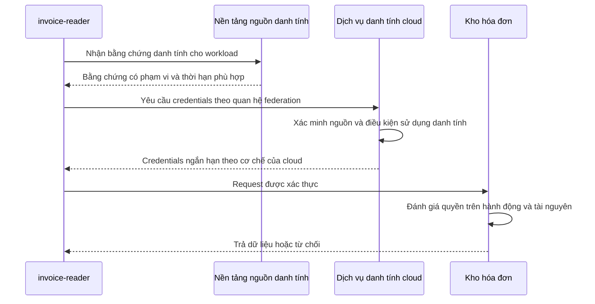

# Cloud workload identity

**Cloud workload identity** là cách một ứng dụng, dịch vụ, container hoặc job tự động có danh tính được nền tảng đám mây nhận biết để truy cập tài nguyên. Thay vì đưa một access key dài hạn vào mã nguồn, hệ thống gắn workload với danh tính được quản lý hoặc thiết lập quan hệ tin cậy với nguồn danh tính của workload, rồi cấp thông tin xác thực phù hợp khi chạy.

Ví dụ, dịch vụ `invoice-reader` cần đọc hóa đơn từ kho lưu trữ cloud. Dịch vụ không cần tài khoản cá nhân của lập trình viên và cũng không cần quyền quản trị toàn bộ tài khoản cloud. Nó cần một danh tính production riêng, được phép đọc đúng vùng dữ liệu hóa đơn và có thể được theo dõi trong nhật ký truy cập.

Trong IAM, mục tiêu là quản lý được ai hoặc thành phần nào đang truy cập, vì sao workload được sử dụng danh tính đó, danh tính có quyền gì và cách thu hồi quyền khi workload ngừng hoạt động.

## 1. Danh tính, credentials và quyền là ba phần khác nhau

Một workload có tên hoặc nhãn chưa đồng nghĩa nó đã có quyền truy cập cloud. Cần phân biệt:

| Thành phần | Vai trò | Ví dụ với invoice-reader |
|---|---|---|
| Danh tính workload | Đại diện cho phần mềm hoặc nhiệm vụ đang chạy | Danh tính dành cho dịch vụ đọc hóa đơn production |
| Bằng chứng từ môi trường chạy | Giúp nền tảng nhận biết workload phù hợp | Token do nền tảng đã tin cậy cấp hoặc cơ chế nhận credentials tại runtime |
| Quan hệ tin cậy | Xác định workload nào được dùng danh tính hoặc đổi lấy credentials | Chỉ chấp nhận ServiceAccount đã chỉ định trong cluster production |
| Credentials sử dụng tài nguyên | Thông tin xác thực để gọi dịch vụ cloud | Access token hoặc bộ credentials tạm thời dùng ký request |
| Chính sách quyền | Xác định hành động và tài nguyên được phép | Đọc đối tượng trong vùng hóa đơn, không xóa hoặc sửa |

Credentials ngắn hạn không phải lúc nào cũng là JWT mà ứng dụng gửi dưới dạng Bearer token. Tùy nền tảng, ứng dụng có thể nhận một access token hoặc một bộ credentials tạm thời để ký request theo giao thức của dịch vụ cloud.

Danh tính workload cũng không phải danh tính người dùng đang gọi ứng dụng. Nếu Mai mở một hóa đơn qua `invoice-reader`, hệ thống có thể cần kiểm tra cả quyền của Mai đối với hóa đơn và quyền cloud của dịch vụ đối với kho lưu trữ. Việc dịch vụ đọc được đối tượng không tự chứng minh Mai được xem nó.

## 2. Hai mô hình thường gặp

### Danh tính do môi trường cloud quản lý

Nền tảng gắn một danh tính với tài nguyên chạy ứng dụng, chẳng hạn VM, task hoặc dịch vụ được quản lý. Ứng dụng dùng SDK hoặc cơ chế được nền tảng cung cấp để nhận credentials cho danh tính đó.

Trong mô hình này, nhóm vận hành không phải đặt một khóa dài hạn của tài khoản cá nhân vào cấu hình ứng dụng. Tuy vậy, cần biết chính xác ranh giới gắn danh tính là VM, task, Pod hay tài nguyên khác. Nếu nhiều ứng dụng dùng chung ranh giới đó, chúng có thể dùng chung khả năng truy cập được cấp.

### Federation từ nguồn danh tính khác

Workload chạy trong Kubernetes, hệ thống CI/CD, on-premises hoặc cloud khác có thể có bằng chứng danh tính từ một nguồn đã được cloud đích tin cậy. Cơ chế federation kiểm tra bằng chứng và điều kiện liên kết trước khi cho workload truy cập với quyền tương ứng.

Với một luồng federation dùng OIDC, việc kiểm tra thường liên quan đến issuer, subject, audience và các thuộc tính được cấu hình. Nhưng không phải mọi cơ chế workload identity đều là cùng một luồng OIDC hoặc dùng cùng tên tham số.

Google Cloud Workload Identity Federation, chẳng hạn, hỗ trợ cấp quyền trực tiếp cho principal liên kết hoặc truy cập thông qua service account impersonation; không nên coi impersonation là bước bắt buộc trong mọi triển khai. Xem [Google Cloud: Workload Identity Federation](https://docs.cloud.google.com/iam/docs/workload-identity-federation).

## 3. Một luồng federation minh họa

Giả sử `invoice-reader` chạy trong cluster Kubernetes production và cần truy cập kho hóa đơn ở cloud đích:



Đây là luồng logic tự tạo để giải thích trách nhiệm. SDK, agent hoặc dịch vụ nền tảng có thể thực hiện một số bước thay cho ứng dụng. Sơ đồ không yêu cầu ứng dụng phải tự tải, parse và trao đổi token bằng mã viết tay.

Có hai quyết định riêng cần kiểm tra khi tích hợp:

1. Workload hiện tại có được dùng danh tính cloud đã chọn không?
2. Với danh tính đó, request có được đọc đối tượng hóa đơn đang yêu cầu không?

Nếu bước thứ nhất thành công nhưng quyền đọc chưa được cấp, request đến kho lưu trữ vẫn bị từ chối. Nếu quyền đọc đã cấp nhưng quan hệ federation không khớp, workload có thể thất bại ngay khi nhận credentials.

## 4. Đối chiếu một số cách triển khai trên cloud

Tên sản phẩm và đối tượng IAM khác nhau giữa các nhà cung cấp. Có thể đối chiếu ở mức khái niệm như sau:

| Nền tảng | Cơ chế minh họa | Điểm cần quản lý |
|---|---|---|
| AWS | IAM role cho workload và temporary security credentials | Ai được sử dụng role, quyền của role và phạm vi credentials |
| Azure | Managed identity và các quan hệ workload identity federation phù hợp | Tài nguyên nào được dùng danh tính, quyền trên dịch vụ đích và vòng đời danh tính |
| Google Cloud | Danh tính service account hoặc principal qua Workload Identity Federation | Principal nào được tin, quyền truy cập trực tiếp hoặc quyền impersonation nếu dùng |

Trên Amazon EC2, ứng dụng có thể dùng credentials tạm thời của IAM role được gắn với instance. AWS cũng phân biệt role ở cấp task trong ECS với role của instance bên dưới. Không nên suy ra mọi tiến trình trên cùng VM tự có danh tính ứng dụng tách biệt. Xem [AWS: IAM roles for applications running on EC2](https://docs.aws.amazon.com/IAM/latest/UserGuide/id_roles_use_switch-role-ec2.html).

Azure có managed identity system-assigned gắn vòng đời với tài nguyên và user-assigned có vòng đời độc lập, có thể được gắn cho nhiều tài nguyên. Khi xóa workload, cần kiểm tra loại danh tính thực tế để xử lý quyền và các tham chiếu còn lại. Xem [Microsoft: Managed identities overview](https://learn.microsoft.com/en-us/entra/identity/managed-identities-azure-resources/overview).

Không chuyển nguyên cấu hình trust của nhà cung cấp này sang nhà cung cấp khác chỉ bằng cách đổi tên role. Cách định danh principal, audience, điều kiện liên kết và nguồn cung cấp credentials phải được cấu hình theo sản phẩm đang dùng.

## 5. Thiết kế quan hệ tin cậy đủ hẹp

Một issuer có thể cấp token cho rất nhiều workload. Chỉ tin issuer mà không giới hạn workload cụ thể có thể khiến một ứng dụng ngoài dự kiến sử dụng danh tính cloud production.

Với `invoice-reader`, nhóm thiết kế có thể ghi hợp đồng minh họa:

```yaml
# Mô tả thiết kế; không phải manifest triển khai của nhà cung cấp.
workload: invoice-reader
environment: production
source:
  issuer: https://cluster-prod.example.com
  subject: system:serviceaccount:billing:invoice-reader
  expectedAudience: <AUDIENCE_DA_CAU_HINH_CHO_CO_CHE_TRAO_DOI>
targetIdentity: invoice-reader-prod
allowedAccess:
  action: read-invoice-objects
  resourceBoundary: production-invoice-storage
owner: billing-platform-team
```

Các giá trị này chỉ giải thích ý định. `expectedAudience`, tên danh tính và hành động trong ví dụ không phải giá trị có thể dùng chung cho AWS, Azure hoặc Google Cloud. Cấu hình thực phải dựa trên hợp đồng của cơ chế trao đổi đã chọn.

Issuer và subject cần được xem cùng nhau. ServiceAccount có cùng tên trong cluster thử nghiệm không tự là workload production. Namespace cũng không phải bằng chứng độc lập nếu bên không đáng tin cậy có thể tạo workload hoặc nhận token dưới ServiceAccount được phép.

Microsoft Entra dùng cấu hình federated identity credential để mô tả nguồn token được tin cậy, với các giá trị issuer, subject và audience tương ứng của mô hình đó. Xem [Microsoft: Federated identity credentials overview](https://learn.microsoft.com/graph/api/resources/federatedidentitycredentials-overview?view=graph-rest-1.0).

Với CI/CD, quan hệ trust cần xét repository, nhánh hoặc môi trường triển khai theo claims và cơ chế thực tế của nền tảng. Không cho một job chạy mã từ pull request chưa được tin cậy sử dụng danh tính deploy production chỉ vì nó xuất phát từ cùng hệ thống CI.

## 6. Tách quyền sử dụng danh tính khỏi quyền trên tài nguyên

Một workload chỉ đọc hóa đơn nên có quyền phục vụ nhiệm vụ đó. Nó không cần được sửa IAM policy, tạo khóa dài hạn hoặc thay quan hệ federation của chính mình.

Đặc biệt, cần quản lý cả những quyền gián tiếp:

- Ai được gắn danh tính có quyền cao vào một VM hoặc ứng dụng mới?
- Ai được triển khai mã chạy dưới danh tính production?
- Ai được tạo Pod dùng ServiceAccount đã được liên kết với quyền cloud?
- Ai được sửa issuer, subject hoặc điều kiện của quan hệ federation?
- Ai được cấp thêm quyền cho danh tính đích?

Nếu một người có thể thay mã của `invoice-reader`, họ có thể tác động đến những request mà workload thực hiện với quyền của nó. Vì vậy, quyền triển khai mã vào workload đặc quyền cũng là một phần của ranh giới bảo mật, dù người đó không trực tiếp cầm credentials cloud.

Trong ví dụ, pipeline deploy và ứng dụng runtime nên có danh tính riêng. Pipeline có thể cần cập nhật phiên bản dịch vụ nhưng không cần đọc nội dung hóa đơn. Dịch vụ runtime cần đọc dữ liệu nhưng không cần triển khai phiên bản khác hay cấp quyền cho một client mới.

Ở lớp ứng dụng, quyền cloud cũng cần đủ hẹp cho vùng dữ liệu được phép. Nếu danh tính workload đọc được toàn bộ kho của nhiều tenant, ứng dụng vẫn phải áp dụng chính sách tenant cho người dùng; đồng thời nhóm thiết kế nên đánh giá có thể chia nhỏ quyền cloud để giảm phạm vi ảnh hưởng khi workload bị chiếm hay không.

## 7. Kubernetes ServiceAccount không tự là cloud identity

Kubernetes ServiceAccount là danh tính trong ngữ cảnh cluster. Danh tính đó có thể tham gia quan hệ với cloud API, nhưng không tự có quyền cloud chỉ vì một Pod khai báo `serviceAccountName`.

Kubernetes hỗ trợ token ServiceAccount ngắn hạn qua TokenRequest và projected volume; token có thể được cấp cho audience phù hợp. Phải có cơ chế cloud integration và trust tương ứng để sử dụng nó bên ngoài cluster. Xem [Kubernetes: Service Accounts](https://kubernetes.io/docs/concepts/security/service-accounts/).

Khi triển khai `invoice-reader`, nhóm vận hành cần đối chiếu đủ các phần: ServiceAccount của Pod, cơ chế nhận credentials cloud, quan hệ liên kết, quyền trên tài nguyên và SDK hỗ trợ cách nhận credentials đó. Không chỉ kiểm tra tên ServiceAccount rồi kết luận tích hợp đã hoạt động.

Danh tính ở cấp Pod cũng không thay thế cách ly runtime. Nếu ứng dụng còn truy cập được credentials quyền rộng của node hoặc một workload khác, việc cấu hình danh tính riêng chưa đủ để bảo đảm phạm vi truy cập thực tế.

AWS lưu ý việc hạn chế truy cập Instance Metadata Service liên quan đến cách ly credentials khi dùng IAM roles for service accounts; container cũng không trở thành một ranh giới bảo mật độc lập chỉ nhờ cơ chế danh tính. Xem [AWS EKS: IAM roles for service accounts](https://docs.aws.amazon.com/eks/latest/userguide/iam-roles-for-service-accounts.html).

Do đó, cần đánh giá quyền đọc file token, quyền truy cập agent hoặc metadata endpoint, đặc quyền container và cách ly giữa các workload. Có credentials ngắn hạn vẫn không có nghĩa mã đang chạy trong workload không thể sử dụng chúng trái mục đích nếu workload bị chiếm.

## 8. Nhận và làm mới credentials trong ứng dụng

Ứng dụng nên dùng cơ chế credentials provider được SDK và nền tảng hỗ trợ cho môi trường chạy. Provider thường có thể xử lý nhận credentials và làm mới theo vòng đời, nhưng khả năng cụ thể phụ thuộc SDK, phiên bản và cấu hình.

Mã giả tự tạo sau diễn tả cách tổ chức trách nhiệm:

```text
credentialsProvider = configureProviderForApprovedRuntimeIdentity()
storageClient = createStorageClient(credentialsProvider)

for each invoiceRequest:
    authorizeBusinessRequest(invoiceRequest)
    storageClient.read(approvedInvoiceLocation(invoiceRequest))
```

Ứng dụng không chép một lần credentials tạm thời vào biến cố định rồi giả định chúng tồn tại mãi. Với token được cập nhật trong file, cách đọc hoặc provider phải hỗ trợ nhận bản mới theo cơ chế tích hợp; chỉ đọc file lúc khởi động có thể khiến một tiến trình chạy lâu lỗi khi token cũ hết hạn.

Trong production, cần kiểm tra danh tính thực tế mà SDK đã chọn. Một chuỗi tìm credentials có thể tìm thấy biến môi trường hoặc cấu hình khác ngoài ý định. Kết quả gọi API thành công chưa chứng minh ứng dụng đang dùng đúng danh tính workload có quyền tối thiểu.

Khi làm mới thất bại, hệ thống cần cảnh báo và thử lại có giới hạn phù hợp. Không chuyển sang khóa quản trị dự phòng được giấu trong cấu hình để giữ ứng dụng hoạt động, vì cách đó làm mất ranh giới quyền đã thiết kế.

## 9. Vòng đời, thu hồi và sự cố

Một danh tính workload cần có chủ sở hữu, môi trường sử dụng và nhiệm vụ được phê duyệt. Khi dịch vụ bị thay thế hoặc ngừng hoạt động, phải rà soát danh tính, binding quyền và quan hệ federation còn lại.

Với danh tính có vòng đời độc lập hoặc được nhiều tài nguyên dùng chung, xóa một instance không đủ để kết luận danh tính không còn được dùng. Ngược lại, xóa một danh tính dùng chung mà chưa kiểm kê phụ thuộc có thể làm gián đoạn nhiều workload.

Khi nghi ngờ `invoice-reader` bị chiếm, kế hoạch xử lý có thể gồm cô lập workload, chặn nguồn mã hoặc nguồn token bị lạm dụng, thu hẹp trust, thu hồi quyền và điều tra những request đã thực hiện. Cần phân biệt việc ngừng cấp credentials mới với tác động lên credentials đã phát hành.

Hiệu lực thu hồi phụ thuộc loại credentials, chính sách dịch vụ và cache của từng nền tảng. Không tự hứa rằng xóa một federation binding sẽ ngay lập tức làm mọi token hoặc phiên credentials đang có mất hiệu lực ở mọi API.

Credentials ngắn hạn giảm khoảng thời gian sử dụng của một bản bị lộ, nhưng kẻ kiểm soát workload vẫn có thể nhận bản mới nếu quan hệ trust và khả năng chạy mã của họ còn tồn tại. Xử lý sự cố cần giải quyết quyền tiếp tục nhận credentials, không chỉ chờ bản hiện tại hết hạn.

## 10. Kiểm chứng và kiểm toán triển khai

Các tình huống sau là gợi ý kiểm chứng cho dịch vụ đọc hóa đơn:

| Tình huống | Điều cần quan sát |
|---|---|
| Workload production đúng danh tính | Đọc được đúng vùng hóa đơn đã cấp |
| Cùng tên ServiceAccount trong cluster thử nghiệm | Không sử dụng được danh tính production ngoài trust đã duyệt |
| Subject hoặc audience của bằng chứng không khớp | Bị từ chối tại cơ chế nhận credentials |
| Danh tính hợp lệ nhưng gọi thao tác xóa | Bị từ chối theo quyền tài nguyên |
| Đọc dữ liệu ngoài vùng cho phép | Không vượt qua giới hạn tài nguyên đã cấu hình |
| Credentials đến hạn làm mới | Ứng dụng nhận bản mới qua provider theo thiết kế |
| Dịch vụ cấp credentials tạm không khả dụng | Có quan sát lỗi và hành vi phù hợp, không dùng quyền cao dự phòng |
| Còn khóa tĩnh trong biến môi trường | Phát hiện nguồn credentials thực tế, không nhầm với workload identity |
| Một workload khác trên cùng môi trường chạy | Không sử dụng được danh tính đặc quyền ngoài ranh giới đã phê duyệt |
| Workload ngừng hoạt động | Danh tính và các binding dư được xử lý theo vòng đời và phụ thuộc |

Nhật ký kiểm toán nên liên hệ được workload nguồn, danh tính hoặc phiên credentials đích, hành động, tài nguyên và thời điểm. Khi có impersonation, cần bảo toàn khả năng truy vết chuỗi sử dụng danh tính theo dữ liệu nền tảng cung cấp. Không ghi source token, access token hoặc secret của bộ credentials vào log thông thường.

Cloud workload identity giúp giảm việc phân phối khóa dài hạn cho ứng dụng, nhưng giá trị quản trị nằm ở cả chuỗi: nguồn chứng minh workload, điều kiện sử dụng danh tính, quyền tài nguyên, cách ly runtime và vòng đời thu hồi. Đó là những phần cần được thiết kế cùng nhau để workload có đúng quyền cho đúng nhiệm vụ trong hệ thống IAM.
