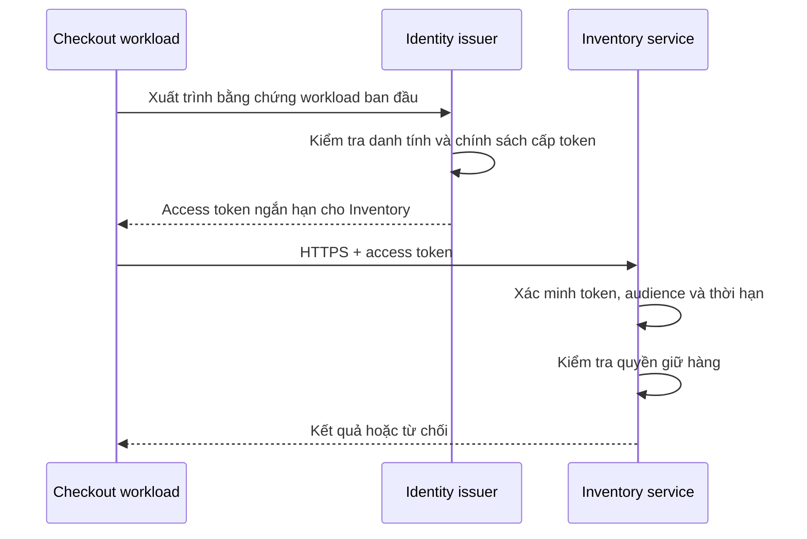

# Service-to-service authentication

## 1. Vì sao các dịch vụ cần xác thực lẫn nhau?

Trong một ứng dụng thương mại điện tử, dịch vụ `checkout` gọi `inventory` để giữ hàng, gọi `payment` để thanh toán và gọi `notification` để gửi thông báo. Các yêu cầu này do phần mềm tạo ra, không phải do người dùng trực tiếp đăng nhập vào từng dịch vụ.

Nếu `inventory` chỉ kiểm tra rằng yêu cầu đến từ mạng nội bộ, một tiến trình bị chiếm quyền trong cùng mạng có thể giả làm `checkout`. Nếu mọi dịch vụ dùng chung một API key, hệ thống khó phân biệt ai thực hiện thao tác và khó thu hồi riêng một bên gọi.

**Service-to-service authentication**, hay xác thực giữa các dịch vụ, là quá trình một dịch vụ kiểm tra bằng chứng danh tính của dịch vụ khác khi giao tiếp. Nó thuộc phạm vi **workload identity**: danh tính dành cho ứng dụng, tiến trình, container hoặc tác vụ tự động.

Một thiết kế đầy đủ cần trả lời các câu hỏi:

- Dịch vụ đang kết nối có thực sự là bên mà nó khai báo không?
- Bằng chứng danh tính do bên nào phát hành, còn hiệu lực không và dành cho nơi nhận nào?
- Danh tính đã xác thực được phép thực hiện thao tác gì trên tài nguyên cụ thể?
- Khi workload dừng hoặc bị xâm nhập, quyền truy cập của nó kết thúc như thế nào?

Mục tiêu của bài là hiểu luồng xác thực này, lựa chọn bằng chứng phù hợp và kết nối kết quả xác thực với nguyên tắc ít quyền nhất, vòng đời credential và kiểm toán trong IAM.

## 2. Phân biệt danh tính, bằng chứng xác thực và quyền hạn

Ba khái niệm thường xuất hiện cùng nhau nhưng không thể thay thế cho nhau.

| Khái niệm | Câu hỏi được trả lời | Ví dụ |
|---|---|---|
| Danh tính workload | Ai đang hoạt động? | `svc:prod:checkout` |
| Credential hoặc bằng chứng xác thực | Dựa vào đâu để tin danh tính đó? | Chứng thư kèm bằng chứng sở hữu khóa riêng, access token hợp lệ |
| Quyền truy cập | Danh tính đó được làm gì? | Giữ hàng trong kho, nhưng không sửa giá sản phẩm |

Một service account có thể biểu diễn danh tính của workload. Access token hoặc chứng thư là bằng chứng gắn với danh tính ấy trong một khoảng thời gian. Credential được thay mới không nhất thiết làm thay đổi danh tính logic.

Xác thực và phân quyền cũng là hai bước khác nhau:

```text
Nhận yêu cầu
    → Kiểm tra bằng chứng xác thực
    → Xác định principal đã được tin cậy
    → Đánh giá chính sách cho action + resource + context
    → Cho phép hoặc từ chối
```

Ví dụ, `checkout` có thể xác thực thành công khi gọi `inventory`, nhưng vẫn phải bị từ chối nếu yêu cầu xóa toàn bộ kho. Chứng thư hợp lệ hoặc token có chữ ký đúng không có nghĩa là bên gọi được phép làm mọi việc.

Nên tách danh tính theo dịch vụ và môi trường khi các đối tượng có quyền hoặc vòng đời khác nhau. `svc:dev:checkout` và `svc:prod:checkout` không nên dùng chung credential. Nhiều replica của cùng dịch vụ có thể cùng mang một danh tính logic, trong khi hệ thống ghi nhận thêm instance hoặc phiên credential để phục vụ điều tra. Mỗi replica vẫn có thể có khóa riêng và credential riêng.

## 3. Những bên tham gia và ranh giới tin cậy

Một mô hình phổ biến gồm bốn thành phần:

1. **Caller**: workload chủ động gửi yêu cầu, chẳng hạn `checkout`.
2. **Callee**: dịch vụ nhận yêu cầu, chẳng hạn `inventory`.
3. **Identity issuer hoặc authorization server**: bên phát hành bằng chứng danh tính hoặc access token theo chính sách.
4. **Hạ tầng tin cậy**: cơ chế nhận diện workload ban đầu, quản lý khóa, trust store và phân phối cấu hình xác minh.

Caller cần xác thực đúng callee để tránh gửi token hoặc dữ liệu tới một máy chủ giả. Trong HTTPS thông thường, việc này dựa trên kiểm tra chứng thư máy chủ và tên máy chủ theo cấu hình TLS. Callee cũng cần xác thực caller, bằng mTLS, token hoặc một cơ chế phù hợp khác.



Sơ đồ thể hiện một luồng dùng token; nó không yêu cầu mỗi yêu cầu nghiệp vụ đều phải gọi issuer. Caller có thể tái sử dụng token còn hiệu lực theo chính sách, còn resource server có thể xác minh JWT bằng khóa công khai đã được phân phối an toàn.

Điểm khởi đầu quan trọng là **bootstrap trust**: làm sao issuer nhận ra workload trước khi cấp credential đầu tiên? Bằng chứng có thể đến từ môi trường thực thi, danh tính nền tảng, chứng thư được provision an toàn hoặc một credential bootstrap được quản lý. Đổi một mật khẩu dài hạn lấy token ngắn hạn không tự loại bỏ rủi ro của mật khẩu gốc.

## 4. Các cơ chế xác thực thường gặp

### 4.1. Shared secret và API key

Caller gửi một giá trị bí mật mà callee biết cách kiểm tra. Đây là cách dễ tích hợp, nhưng mức an toàn phụ thuộc nhiều vào cách cấp phát, lưu giữ và thu hồi secret.

Nếu dùng API key, cần ít nhất tách key theo caller và môi trường, truyền qua TLS, giới hạn quyền và quản lý rotation. Một key dùng chung cho nhiều dịch vụ làm mất khả năng quy trách nhiệm và khiến phạm vi ảnh hưởng của việc lộ key tăng lên.

API key thường hoạt động như một bearer credential: ai có giá trị hợp lệ có thể sử dụng nó. Không nên nhúng key vào mã nguồn, image container, URL hoặc log. Nếu key cần tồn tại lâu, hệ thống phải có cách thay và thu hồi riêng từng key.

Không nên nhầm API key với chữ ký cho từng yêu cầu. Một cơ chế ký request bằng khóa bí mật có thể chứng minh bên gọi sở hữu khóa mà không gửi khóa trực tiếp, nhưng vẫn cần thiết kế chuẩn hóa dữ liệu ký, thời gian, nonce và chống phát lại. Không tự sáng tạo giao thức chữ ký khi đã có cơ chế được hệ thống hỗ trợ.

### 4.2. Mutual TLS — mTLS

Trong TLS thông thường, client xác thực máy chủ. Với **mTLS**, phía máy chủ cũng yêu cầu và kiểm tra chứng thư của client. Trong quá trình bắt tay, mỗi phía phải chứng minh khả năng sử dụng khóa riêng tương ứng; chỉ sao chép chứng thư công khai là chưa đủ.

Một triển khai mTLS cần kiểm tra các yếu tố phù hợp với cấu hình của nó:

- Chuỗi chứng thư đi tới trust anchor được cho phép.
- Chứng thư còn hiệu lực và phù hợp với mục đích sử dụng.
- Danh tính trong chứng thư khớp với quy tắc nhận diện workload, thường được ánh xạ từ các định danh trong SAN.
- Phía đối diện chứng minh sở hữu khóa riêng theo giao thức TLS.
- Chính sách phân quyền cho danh tính đã xác thực.

Không nên tin mọi chứng thư do một CA phát hành mà không kiểm tra danh tính và phạm vi sử dụng. Hai workload có chứng thư hợp lệ trong cùng hệ thống vẫn có thể có quyền hoàn toàn khác nhau.

mTLS cung cấp xác thực ở kết nối vận chuyển và bảo vệ dữ liệu trên đoạn kết nối đó. Nó không tự diễn đạt đầy đủ quyền nghiệp vụ như “chỉ được giữ hàng cho tenant A”, và không tự biến mọi request trên kết nối thành hợp lệ về mặt phân quyền.

### 4.3. Access token dành cho API

Caller lấy access token từ authorization server và gửi token tới resource server. Token có thể là JWT chứa claim hoặc là opaque token cần được kiểm tra bằng cơ chế tra cứu phù hợp.

Với một luồng OAuth client credentials, workload xác thực như một client rồi nhận access token theo quyền đã cấp. Đây là luồng cho client hành động theo quyền của chính nó; không nên diễn giải token đó thành bằng chứng một người dùng đã đăng nhập hoặc đã đồng ý cho một hành động cụ thể.

Cách client xác thực với authorization server có thể dùng secret, khóa bất đối xứng hoặc cơ chế được hệ thống hỗ trợ. Vì vậy, tên luồng `client_credentials` không đồng nghĩa với việc bắt buộc phải rải client secret dài hạn vào mọi ứng dụng.

Ở nơi hỗ trợ workload federation, workload có thể dùng bằng chứng từ một môi trường đã được tin cậy để đổi lấy token cho dịch vụ đích. Quan hệ federation phải ràng buộc rõ issuer, subject, audience và danh tính đích được phép nhận. Chấp nhận mọi subject của một issuer đáng tin có thể cấp quyền vượt xa dự định.

### 4.4. Kết hợp mTLS với token

mTLS và access token có thể cùng xuất hiện nhưng phải xác định vai trò của từng lớp. Ví dụ, mTLS xác thực workload tại ranh giới mesh, còn access token mang quyền gọi API hoặc thông tin ủy quyền cần thiết.

| Cơ chế | Cung cấp chủ yếu | Điểm cần thiết kế thêm |
|---|---|---|
| API key riêng cho caller | Bằng chứng caller biết secret | Lưu trữ, phân quyền, rotation và thu hồi |
| mTLS | Xác thực hai đầu kết nối và mã hóa đường truyền | Ánh xạ chứng thư thành principal, quyền nghiệp vụ, vòng đời chứng thư |
| Access token | Bằng chứng quyền truy cập theo issuer và chính sách | Xác minh token, audience, thời hạn và quyền cho tài nguyên |
| mTLS kết hợp token | Bằng chứng ở kết nối và ở tầng yêu cầu | Quan hệ giữa hai danh tính, kiểm tra nhất quán và vận hành cả hai lớp |

Một bearer token gửi qua mTLS vẫn không tự trở thành token ràng buộc với chứng thư. Muốn có thuộc tính ràng buộc như vậy, bên phát hành và bên nhận phải hỗ trợ cơ chế tương ứng và thực sự kiểm tra bằng chứng sở hữu khóa. Nếu chỉ bật mTLS mà bỏ qua ràng buộc token, không được khẳng định token đánh cắp không thể được dùng lại ở mọi nơi.

## 5. Xác minh access token đúng ngữ cảnh

Giả sử issuer phát hành JWT với payload minh họa sau; các mốc thời gian chỉ dùng để giải thích cấu trúc:

```json
{
  "iss": "https://identity.internal",
  "sub": "svc:prod:checkout",
  "aud": "https://inventory.internal",
  "scope": "inventory.reserve",
  "iat": 1800000000,
  "nbf": 1800000000,
  "exp": 1800000300,
  "jti": "token-7f2c"
}
```

Ý nghĩa của các trường phải được thống nhất trong contract của issuer và resource server:

- `iss` xác định bên phát hành mà `inventory` chấp nhận.
- `sub` xác định principal theo quy ước của hệ thống, ở đây là workload `checkout` trong production.
- `aud` giới hạn nơi token được sử dụng. Token dành cho `inventory` không được mặc nhiên chấp nhận tại `payment`.
- `scope` biểu diễn phạm vi quyền theo quy ước cấp token; resource server phải kiểm tra quyền tương ứng với thao tác thực tế.
- `nbf` và `exp` giới hạn khoảng thời gian token được chấp nhận.
- `iat` cho biết thời điểm phát hành; không thay thế kiểm tra hết hạn.
- `jti` là định danh token. Sự hiện diện của nó không tự chống phát lại nếu bên nhận không có cơ chế phát hiện và xử lý phát lại.

Một resource server xác minh JWT cần sử dụng thư viện phù hợp và cấu hình tin cậy trước. Các kiểm tra thường gồm:

1. Xác nhận loại credential được endpoint chấp nhận; không dùng ID token để thay access token cho API chỉ vì cả hai cùng có dạng JWT.
2. Kiểm tra chữ ký theo thuật toán được cho phép và khóa của issuer đã cấu hình. Không để token tự quyết định thuật toán hoặc nguồn tải khóa tùy ý.
3. Kiểm tra issuer chính xác, audience phù hợp và thời hạn hiệu lực, với độ lệch đồng hồ nhỏ đã quy định.
4. Kiểm tra các claim bắt buộc, định dạng và quy tắc ánh xạ subject thành principal.
5. Kiểm tra scope hoặc quyền tương ứng với action, rồi đánh giá các điều kiện tài nguyên và tenant cần thiết.
6. Nếu dùng token ràng buộc khóa hoặc chứng thư, kiểm tra cả ràng buộc và bằng chứng liên quan theo cơ chế đang triển khai.

**Decode payload không phải xác minh token.** Base64url chỉ là cách biểu diễn dữ liệu. Đọc được `sub` từ payload không chứng minh rằng caller sở hữu danh tính đó. JWT có chữ ký cũng không mặc nhiên che giấu nội dung; không đặt secret hoặc dữ liệu nhạy cảm không cần thiết vào payload.

Với opaque token, resource server có thể sử dụng introspection hoặc cơ chế xác minh do nền tảng cung cấp. Việc cache kết quả phải có giới hạn thời gian và đánh đổi rõ ràng về khả năng thu hồi. Không coi một giá trị token bất kỳ là hợp lệ chỉ vì nó có độ dài hoặc tiền tố đúng.

## 6. Minh họa luồng gọi giữa Checkout và Inventory

Yêu cầu nghiệp vụ là `checkout` được giữ một lượng hàng cho một đơn hàng hợp lệ. Nó không được cập nhật giá, xóa sản phẩm hoặc truy cập mọi tenant chỉ nhờ danh tính dịch vụ.

### 6.1. Phía caller

Caller lấy token dành cho `inventory` qua thành phần quản lý credential. Thành phần này chịu trách nhiệm cache có giới hạn, làm mới trước khi hết hạn và phối hợp để nhiều request không đồng thời xin token không cần thiết.

Mã Java dưới đây minh họa ranh giới trách nhiệm; `TokenProvider` là abstraction của ứng dụng, không phải tên một SDK cụ thể:

```java
interface TokenProvider {
    String accessTokenFor(String audience);
}

final class InventoryClient {
    private final java.net.http.HttpClient http;
    private final TokenProvider tokens;

    InventoryClient(java.net.http.HttpClient http, TokenProvider tokens) {
        this.http = http;
        this.tokens = tokens;
    }

    java.net.http.HttpResponse<String> reserve(String reservationJson)
            throws java.io.IOException, InterruptedException {
        String token = tokens.accessTokenFor("https://inventory.internal");

        var request = java.net.http.HttpRequest.newBuilder()
                .uri(java.net.URI.create(
                        "https://inventory.internal/reservations"))
                .timeout(java.time.Duration.ofSeconds(3))
                .header("Authorization", "Bearer " + token)
                .header("Content-Type", "application/json")
                .POST(java.net.http.HttpRequest.BodyPublishers
                        .ofString(reservationJson))
                .build();

        return http.send(request,
                java.net.http.HttpResponse.BodyHandlers.ofString());
    }
}
```

Đoạn mã không triển khai việc phát hành hoặc xác minh token. `HttpClient` cần được cấu hình TLS và trust store đúng với môi trường; nếu dùng mTLS, cần thêm cấu hình client certificate và private key qua cơ chế quản lý credential phù hợp. Không tắt kiểm tra chứng thư để làm cho lời gọi “chạy được”.

Địa chỉ dịch vụ ở ví dụ là cấu hình tin cậy, không lấy trực tiếp từ input của người dùng. Nếu caller được phép gửi bearer token tới một URL tùy ý, kẻ tấn công có thể điều hướng request tới máy chủ do họ kiểm soát. Cần kiểm soát cả đích gọi và hành vi chuyển hướng để tránh làm lộ credential.

### 6.2. Phía callee

`inventory` sử dụng middleware hoặc thành phần xác thực để tạo security context tin cậy trước khi xử lý nghiệp vụ. Luồng xử lý ở mức khái niệm là:

```text
token = lấy bearer credential từ request
principal = tokenVerifier.verify(
    token,
    trustedIssuer = "https://identity.internal",
    expectedAudience = "https://inventory.internal"
)

require principal có quyền "inventory.reserve"
require principal được phép thao tác trên tenant của reservation
require reservation thỏa các điều kiện nghiệp vụ

tạo reservation
```

`tokenVerifier.verify` phải bao gồm các kiểm tra mật mã và claim đã nêu, không chỉ parse JSON. Kết quả xác thực cần được truyền qua security context do server kiểm soát, không lấy từ một header như `X-Service-Name` mà caller có thể tự đặt.

Trong API HTTP, credential thiếu hoặc không hợp lệ thường dẫn tới `401`; danh tính hợp lệ nhưng thiếu quyền thường dẫn tới `403`, theo contract của API. Phản hồi không nên chứa token, private key hoặc thông tin nội bộ quá chi tiết. Log phía server có thể phân loại nguyên nhân cụ thể để vận hành và điều tra.

Với thao tác tạo reservation, thiết kế chống xử lý trùng cũng quan trọng. Một request đã xác thực vẫn có thể được gửi lại do timeout hoặc retry. Idempotency phục vụ tính đúng đắn nghiệp vụ; nó không thay thế xác thực hay chính sách chống phát lại credential.

## 7. Dịch vụ gọi thay mặt người dùng

Một request có thể liên quan đồng thời đến hai danh tính:

- **Actor workload**: dịch vụ đang trực tiếp gọi API, chẳng hạn `checkout`.
- **Người dùng hoặc chủ thể được đại diện**: người mua đang tạo đơn hàng.

Token chỉ đại diện cho workload không chứng minh người mua được phép đặt đơn cho tenant nào. Ngược lại, token đại diện cho người dùng không nhất thiết cho biết đầy đủ dịch vụ trung gian nào đang sử dụng token đó.

Cần xác định rõ mô hình:

| Tình huống | Bằng chứng và chính sách cần quan tâm |
|---|---|
| Tác vụ nền đồng bộ tồn kho | Danh tính workload và quyền hệ thống đã cấp |
| Checkout giữ hàng cho đơn người dùng | Danh tính caller cùng ngữ cảnh người dùng hoặc ủy quyền đáng tin khi nghiệp vụ yêu cầu |
| Dịch vụ trung gian gọi API khác | Token dành cho API đích hoặc luồng trao đổi/ủy quyền được hệ thống hỗ trợ |

Không chuyển tiếp mù token đầu vào tới mọi downstream service. Token có thể có audience không phù hợp, quyền quá rộng hoặc bị lộ ở một trust boundary mới. Khi cần token downstream, sử dụng cơ chế cấp hoặc trao đổi token được authorization server hỗ trợ, với phạm vi và audience phù hợp.

Để tránh **confused deputy**, `inventory` không chỉ tin rằng một caller quyền cao nói “người dùng này đã được phép”. Nó cần kiểm tra bằng chứng hoặc ngữ cảnh ủy quyền theo contract tin cậy. Trong hệ thống nhiều tenant, tenant do request khai báo phải được đối chiếu với quyền đã cấp và tài nguyên thực tế, không tự trở thành quyền chỉ vì nó nằm trong một header.

## 8. Xác thực trong service mesh và qua proxy

Service mesh có thể tự động cấp chứng thư và thực hiện mTLS giữa các proxy. Điều đó giúp giảm việc từng ứng dụng tự quản lý TLS, nhưng cần hiểu rõ đoạn nào thực sự được bảo vệ và ai xác minh danh tính.

```text
Ứng dụng A → Proxy A == mTLS == Proxy B → Ứng dụng B
```

Trong mô hình này, mTLS thường kết thúc tại proxy. Ứng dụng B có thể dựa vào kết quả xác thực của proxy nếu đường truyền từ proxy tới ứng dụng và cơ chế chuyển security context được bảo vệ đúng.

Các câu hỏi thiết kế cần trả lời gồm:

- Có thể gọi thẳng ứng dụng B và bỏ qua proxy không?
- Đường giữa proxy và ứng dụng được bảo vệ bằng cách nào?
- Header danh tính do proxy tạo có bị caller giả mạo hoặc chèn thêm không?
- Danh tính workload tại proxy được ánh xạ vào chính sách ứng dụng như thế nào?
- Nếu vừa có token vừa có danh tính mTLS, ứng dụng xử lý trường hợp hai danh tính không phù hợp ra sao?

Nếu ứng dụng tin header do proxy tạo, proxy phải loại bỏ hoặc ghi đè header tương ứng từ nguồn không tin cậy, và ứng dụng chỉ nhận security context qua đường đã được bảo vệ. Việc đặt tên header có chữ “trusted” không tạo ra ranh giới tin cậy.

Network policy, firewall và phân đoạn mạng vẫn hữu ích để giảm bề mặt tấn công. Tuy nhiên, địa chỉ IP, namespace hoặc việc nằm trong cùng cluster không tự chứng minh danh tính dịch vụ. Xác thực workload và kiểm soát mạng cần phối hợp với nhau.

## 9. Vòng đời credential và xử lý sự cố

### 9.1. Cấp phát và rotation

Một vòng đời thường gồm: xác minh workload ban đầu, cấp credential, sử dụng trong thời gian hiệu lực, làm mới và ngừng cấp khi workload không còn được phép hoạt động.

Credential ngắn hạn làm giảm khoảng thời gian một credential bị lộ có thể bị lợi dụng, nhưng không giúp nhiều nếu kẻ tấn công vẫn có quyền liên tục xin credential mới. Khi xử lý xâm nhập, cần kiểm soát cả workload, quyền xin credential và quan hệ tin cậy của issuer.

Rotation cần có khoảng chuyển tiếp phù hợp để những credential còn được phép sử dụng vẫn được xác minh. Khi xoay khóa ký JWT, issuer có thể phải tiếp tục công bố khóa xác minh cũ trong thời gian các token tương ứng còn hợp lệ. Khi xoay CA, phải lập kế hoạch cho cả trust bundle và chứng thư đang dùng; không đồng nhất xoay chứng thư với xoay trust anchor.

Caller không nên đợi đúng thời điểm hết hạn mới làm mới credential. Có thể làm mới sớm với độ lệch ngẫu nhiên để giảm tải đồng loạt, đồng thời tránh để nhiều luồng cùng thực hiện refresh. Đồng bộ đồng hồ và theo dõi lỗi thời gian giúp tránh từ chối bất ngờ.

### 9.2. Thu hồi và thời gian còn hiệu lực

Không phải mọi cơ chế đều hỗ trợ thu hồi tức thì. JWT được xác minh offline có thể tiếp tục được chấp nhận đến khi hết hạn nếu bên nhận không có thông tin thu hồi bổ sung. Chứng thư mTLS đã bị thu hồi cũng chỉ bị từ chối theo cơ chế và chính sách mà bên xác minh thực sự triển khai; kết nối đã thiết lập có thể cần được xử lý riêng.

Khi một workload bị nghi xâm nhập, phương án phản ứng có thể kết hợp:

- Ngăn workload tiếp tục hoạt động hoặc xin credential mới.
- Thu hồi hoặc đổi credential bootstrap liên quan.
- Áp dụng chính sách từ chối danh tính tại resource server hoặc lớp thực thi chính sách.
- Dùng cơ chế thu hồi có sẵn và xử lý các kết nối đang tồn tại khi cần.
- Điều tra những hành động đã thực hiện dựa trên log và dấu vết phân tán.

Không nên mặc định xoay khóa ký chung cho toàn hệ thống mỗi khi một access token đơn lẻ bị lộ. Hành động đó có phạm vi ảnh hưởng lớn; cách phản ứng phụ thuộc loại credential bị lộ và khả năng thu hồi đang có.

### 9.3. Issuer hoặc hệ thống xác minh tạm thời không sẵn sàng

Với JWT, resource server có thể tiếp tục kiểm tra token chưa hết hạn bằng các khóa tin cậy đã cache còn được phép dùng. Nhưng nếu gặp khóa chưa biết và không lấy được cấu hình tin cậy phù hợp, nó không được bỏ qua kiểm tra chữ ký. Caller cũng không nên dùng lại token đã hết hạn chỉ vì issuer đang lỗi.

Với introspection, cách xử lý phụ thuộc vào kết quả cache còn hiệu lực và chính sách xác minh đã thiết kế. Khi không thể xác minh credential, phải từ chối truy cập theo contract thay vì chuyển sang tin header tự khai báo hoặc bỏ qua authentication. Thời gian cache, thời hạn token và yêu cầu thu hồi cần được cân nhắc cùng yêu cầu sẵn sàng.

## 10. Kiểm toán và những lỗi thiết kế phổ biến

Log hữu ích nên ghi nhận danh tính caller sau xác thực, dịch vụ đích, action, tài nguyên hoặc tenant phù hợp, kết quả cho phép/từ chối, thời gian và correlation ID. Có thể thêm mã lý do xác thực thất bại hoặc định danh credential không bí mật khi cần cho điều tra. Correlation ID chỉ phục vụ liên kết sự kiện, không phải bằng chứng danh tính.

Không log nguyên access token, API key, private key hoặc toàn bộ header `Authorization`. Hạn chế cả việc các thư viện HTTP, proxy và công cụ tracing tự thu thập các giá trị này. Danh tính workload và thông tin người dùng trong log cũng cần được quản lý theo quyền truy cập và thời hạn lưu giữ phù hợp.

| Lỗi thiết kế | Hệ quả | Hướng xử lý |
|---|---|---|
| Tin mọi request trong mạng nội bộ | Tiến trình bị chiếm quyền dễ giả mạo caller | Xác thực workload tại ranh giới nhận request |
| Dùng chung một secret cho nhiều dịch vụ | Khó quy trách nhiệm và thu hồi riêng | Tách danh tính, credential và chính sách |
| Chỉ decode JWT | Có thể tin dữ liệu chưa được xác thực | Xác minh chữ ký, issuer, audience và thời hạn |
| Chấp nhận token của API khác | Token vượt qua ranh giới nơi nhận | Kiểm tra audience theo từng resource server |
| Coi mTLS là quyền nghiệp vụ | Mọi workload có chứng thư có thể được cấp quyền quá mức | Ánh xạ principal và thực thi authorization |
| Tin header danh tính trực tiếp từ caller | Caller tự mạo danh dịch vụ hoặc tenant | Dùng security context đã xác thực, bảo vệ đường proxy |
| Cho token tồn tại quá lâu, không có kế hoạch rotation | Credential bị lộ có thể được dùng lâu | Giới hạn thời hạn và thiết kế vòng đời rõ ràng |
| Bỏ kiểm tra khi issuer lỗi | Sự cố vận hành trở thành lỗ hổng truy cập | Dùng cache hợp lệ và từ chối khi không xác minh được |

## 11. Bài tập áp dụng

Giả sử hệ thống có `checkout`, `inventory`, `reporting` và `payment`. `checkout` cần giữ hàng; `reporting` chỉ đọc số liệu tồn kho tổng hợp. Cả hai chạy trong production, còn môi trường development có các bản triển khai riêng.

Hãy thiết kế luồng xác thực và phân quyền với các yêu cầu:

1. Xác định danh tính workload cho từng dịch vụ và môi trường.
2. Chọn cơ chế cấp credential ban đầu và giải thích bằng chứng bootstrap đến từ đâu.
3. Chỉ ra bên nào xác thực chứng thư hoặc token và trust boundary của từng lần kiểm tra.
4. Thiết kế audience và quyền để token của `inventory` không dùng được ở `payment`.
5. Mô tả cách từ chối `reporting` khi nó gọi API giữ hàng, dù credential của nó hợp lệ.
6. Giải thích cách làm mới credential và phản ứng khi một replica `checkout` bị xâm nhập.
7. Xác định các trường log cần ghi mà không làm lộ credential.

Một phương án hợp lý có thể cấp token ngắn hạn riêng theo audience cho từng caller, cho `checkout` quyền giữ hàng và chỉ cho `reporting` quyền đọc báo cáo. Nếu dùng mTLS, chứng thư xác định caller còn policy của `inventory` quyết định action nào được phép. Trong cả hai trường hợp, quyền truy cập tenant hoặc đơn hàng vẫn phải được kiểm tra theo nghiệp vụ; danh tính dịch vụ hợp lệ không thay thế điều kiện đó.

## 12. Các điểm cần ghi nhớ

Xác thực giữa các dịch vụ bắt đầu từ danh tính workload có thể kiểm chứng, đi qua cơ chế cấp và xác minh credential, rồi kết nối với quyết định phân quyền cho từng thao tác. TLS giúp caller xác thực đích và bảo vệ đường truyền; mTLS bổ sung xác thực client; access token có thể mang phạm vi truy cập cho API theo contract của issuer và resource server.

Một thiết kế đáng tin cậy cần giữ đúng audience, kiểm tra bằng chứng thay vì tin dữ liệu tự khai báo, tách quyền giữa các dịch vụ và quản lý vòng đời credential. Khi có người dùng, proxy hoặc nhiều tenant tham gia, phải giữ rõ ai là actor, ai được đại diện và thành phần nào chịu trách nhiệm xác minh từng thông tin. Những ranh giới đó quyết định hệ thống có giữ được nguyên tắc ít quyền nhất và có thể kiểm toán khi xảy ra sự cố hay không.
