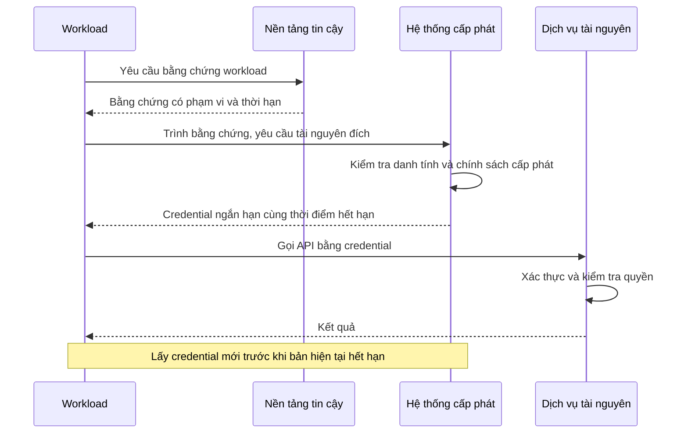

# Short-lived credential trong workload identity

## 1. Credential ngắn hạn giải quyết vấn đề gì?

Một dịch vụ xử lý hóa đơn cần gọi API kế toán và đọc dữ liệu từ kho lưu trữ. Nếu dịch vụ dùng một API key không có ngày hết hạn, bản sao key bị lộ trong log hoặc bản sao lưu có thể tiếp tục được sử dụng cho đến khi tổ chức phát hiện và vô hiệu hóa key đó. Mỗi lần đổi key còn phải phân phối lại cho những nơi đang sử dụng.

**Short-lived credential** là bằng chứng xác thực có thời hạn hiệu lực ngắn và được cấp lại theo một quy trình có kiểm soát. Thay vì giữ một bí mật dùng nhiều tháng trong cấu hình, workload nhận credential dùng trong một khoảng thời gian giới hạn, rồi lấy credential mới khi cần tiếp tục hoạt động.

Trong IAM, workload có thể là service, container, máy ảo, tác vụ CI/CD hoặc một job chạy theo lịch. Credential ngắn hạn giúp workload chứng minh danh tính mà không phải phụ thuộc hoàn toàn vào bí mật tĩnh được phân phối thủ công.

Ba khái niệm cần tách biệt:

- **Danh tính workload:** workload là ai, chẳng hạn `invoice-reader` thuộc môi trường production.
- **Credential:** bằng chứng workload trình cho bên xác thực, chẳng hạn access token hoặc chứng thư kèm khả năng chứng minh quyền giữ private key tương ứng.
- **Quyền truy cập:** danh tính đó được làm gì với tài nguyên nào, trong điều kiện nào.

Credential hết hạn không có nghĩa danh tính bị xóa. Credential mới cũng không mặc nhiên có quyền rộng hơn credential cũ. Quyền phải được quyết định bằng chính sách cấp phát và chính sách của dịch vụ đích.

## 2. Những dạng credential thường gặp

| Dạng credential | Cách workload sử dụng | Điểm cần lưu ý |
| --- | --- | --- |
| Access token có hạn | Gửi token khi gọi API | Bearer token bị sao chép có thể bị dùng lại trong thời gian còn hiệu lực, nếu không có ràng buộc bổ sung |
| Bộ thông tin truy cập tạm thời | Dùng định danh, bí mật và thông tin phiên theo cơ chế của hệ thống | Phải thay cả bộ theo kết quả cấp phát, không ghép thành phần của hai lần cấp khác nhau |
| Chứng thư ngắn hạn | Dùng chứng thư cùng private key trong giao thức xác thực như mTLS | Chứng thư công khai không phải bí mật; bảo vệ private key và quá trình cấp chứng thư mới là trọng tâm |
| Tài khoản cơ sở dữ liệu có lease | Dùng tài khoản tạm thời do hệ thống cấp phát quản lý | Hết lease hoặc hết hạn đăng nhập chưa chắc kết thúc các kết nối đã mở |
| URL được ký có thời hạn | Truy cập một tài nguyên hoặc thao tác đã được ký cho phép | URL có thể đóng vai trò capability; người có URL có thể dùng nó theo điều kiện của cơ chế ký |

“Ngắn hạn” mô tả thời hạn, không quy định credential phải dùng JWT. Một token opaque cũng có thể ngắn hạn. JWT có chữ ký nhưng vẫn thường có thể đọc payload; không đưa bí mật vào payload chỉ vì token đã được ký.

Token dùng để chứng minh danh tính với hệ thống cấp phát cũng chưa chắc dùng được với API đích. Ví dụ, ID token hoặc assertion dùng trong liên kết danh tính không tự động trở thành access token hợp lệ cho mọi dịch vụ. Bên nhận phải kiểm tra đúng loại token, issuer, audience và các ràng buộc của giao thức.

## 3. Luồng cấp phát cho workload

Một thiết kế điển hình có bốn bên:

1. Workload muốn truy cập tài nguyên.
2. Nền tảng hoặc nguồn tin cậy cung cấp bằng chứng về workload.
3. Hệ thống cấp phát kiểm tra bằng chứng và phát credential phù hợp.
4. Dịch vụ đích xác thực credential rồi đánh giá quyền truy cập.



Nguồn bằng chứng có thể là cơ chế danh tính gắn với máy ảo, token của service account, danh tính job CI/CD hoặc cơ chế attestation do nền tảng quản lý. Hệ thống cấp phát không nên chỉ tin các trường do workload tự khai như `service=invoice-reader` hoặc `environment=production`.

Ví dụ, job triển khai có thể cung cấp bằng chứng về repository, workflow, nhánh và môi trường. Chính sách cấp phát cần kiểm tra các thuộc tính đã được nguồn tin cậy xác nhận. Chỉ kiểm tra tên repository mà bỏ qua nhánh hoặc môi trường có thể cho phép một job ngoài phạm vi mong muốn nhận quyền production.

### Bài toán khởi đầu tin cậy

Để nhận credential ngắn hạn, workload cần một cách xác thực ban đầu. Đây là bài toán **bootstrap trust**. Nếu thay API key tĩnh bằng token sống ngắn nhưng vẫn dùng một bí mật vĩnh viễn trong cùng file cấu hình để xin token, hệ thống vẫn còn một điểm rủi ro dài hạn.

Danh tính do nền tảng cung cấp hoặc liên kết danh tính có thể giảm nhu cầu tự giữ bí mật này. Tuy nhiên, endpoint cấp danh tính, token nguồn và quyền truy cập agent vẫn cần được bảo vệ. Kẻ tấn công điều khiển workload có thể tiếp tục xin credential mới, dù từng credential riêng lẻ có tuổi thọ ngắn.

## 4. Thời hạn ngắn giảm rủi ro đến đâu?

Giả sử một credential có hiệu lực từ 10:00 đến 10:15. Nếu bị đánh cắp lúc 10:12, thời gian còn lại theo lịch là khoảng ba phút. Nếu bị đánh cắp lúc 10:01, khoảng thời gian đó là mười bốn phút. Khả năng sử dụng thực tế còn phụ thuộc việc dịch vụ có thực thi hạn dùng, thu hồi và các ràng buộc bổ sung hay không.

Có thể diễn đạt giới hạn cơ bản như sau:

```text
Thời gian hiệu lực còn lại = max(0, thời điểm hết hạn - thời điểm hiện tại)
```

Không nên diễn giải công thức thành “credential ngắn hạn chắc chắn chỉ gây thiệt hại nhỏ”. Kẻ tấn công có thể đọc nhiều dữ liệu, tạo tài khoản khác hoặc thay đổi chính sách ngay trong khoảng thời gian ngắn đó. Nếu credential có quyền tạo bí mật dài hạn, tác động còn có thể vượt xa thời hạn của credential ban đầu.

Ba lớp kiểm soát cần phối hợp:

- **Thời hạn:** giảm khoảng thời gian credential bị lộ có thể tiếp tục sử dụng.
- **Phạm vi quyền:** giới hạn tài nguyên, thao tác, tenant và môi trường được phép truy cập.
- **Bảo vệ đường cấp phát:** ngăn kẻ tấn công liên tục lấy credential mới.

Short-lived credential không thay thế nguyên tắc ít quyền nhất. Một token có quyền quản trị toàn hệ thống trong năm phút vẫn là credential có tác động lớn.

## 5. Chọn TTL theo nhu cầu thực tế

TTL, hay time to live, thường chỉ khoảng thời gian credential được phép có hiệu lực kể từ khi cấp. Không có một TTL đúng cho mọi workload.

| Yếu tố | Câu hỏi thiết kế |
| --- | --- |
| Mức đặc quyền | Credential có thể chỉ đọc dữ liệu, ghi dữ liệu hay thay đổi quyền IAM? |
| Kiểu công việc | Đây là API chạy liên tục, job ngắn hay tác vụ kéo dài nhiều giờ? |
| Khả năng làm mới | Ứng dụng có credential provider tự động hay chỉ đọc cấu hình một lần? |
| Độ sẵn sàng của bên cấp phát | Hệ thống chịu được bao lâu nếu tạm thời không lấy được credential mới? |
| Chi phí cấp phát | Có giới hạn tần suất, chi phí ký, tải kiểm tra hoặc yêu cầu attestation không? |
| Cơ chế thu hồi | Credential có thể bị chặn trước hạn hay chủ yếu dựa vào hết hạn? |
| Hành vi của dịch vụ đích | Hạn dùng được kiểm tra trên từng request, khi bắt tay hay theo phiên? |

TTL quá dài làm tăng thời gian phơi nhiễm khi credential bị lộ. TTL quá ngắn làm tăng tần suất cấp phát và yêu cầu vận hành, đặc biệt khi hàng nghìn instance cùng khởi động hoặc làm mới.

Ví dụ minh họa: một dịch vụ thử nghiệm có thể nhận token mười lăm phút và bắt đầu làm mới khi còn khoảng ba phút. Đây là thông số để giải thích cơ chế, không phải khuyến nghị cố định cho production. Thời điểm làm mới thực tế phải tính đến độ trễ, sai lệch đồng hồ, giới hạn cấp phát và khả năng xử lý lỗi.

Thời hạn do phía cấp phát kiểm soát và phía nhận thực thi. Workload không thể kéo dài hiệu lực bằng cách sửa trường hết hạn trong cache. Nếu chính sách yêu cầu TTL tối đa, hệ thống cấp phát phải áp dụng giới hạn đó kể cả khi workload yêu cầu thời hạn dài hơn.

## 6. Quản lý vòng đời trong ứng dụng

Ứng dụng chạy lâu nên sử dụng một **credential provider** chịu trách nhiệm lấy và quản lý credential. Các phần xử lý nghiệp vụ yêu cầu credential còn dùng được từ provider, thay vì tự đọc token lúc khởi động rồi giữ mãi trong biến cố định.

Vòng đời cơ bản gồm:

1. Lấy credential lần đầu bằng nguồn danh tính được tin cậy.
2. Lưu credential trong bộ nhớ cùng metadata cần thiết.
3. Cung cấp credential cho các request có đúng phạm vi.
4. Chủ động lấy credential mới trước khi bản hiện tại hết hạn.
5. Thay toàn bộ bộ credential một cách nguyên tử sau khi nhận và kiểm tra kết quả cấp phát mới.
6. Ngừng dùng bản cũ khi hết hạn hoặc khi nhận tín hiệu thu hồi phù hợp.

### Làm mới không đồng nghĩa gia hạn bản cũ

Một lần làm mới thường tạo credential mới với thời hạn mới. Credential cũ có thể vẫn còn hiệu lực đến hạn của nó. Thay credential trong cache không tự động vô hiệu hóa bản cũ đã bị sao chép.

Ngoài ra, access token ngắn hạn không có nghĩa refresh token cũng ngắn hạn. Nếu hệ thống sử dụng refresh token, refresh token là credential cần được bảo vệ, có chính sách thời hạn, luân chuyển và thu hồi riêng. Một số mô hình workload không cần refresh token; workload trình lại bằng chứng danh tính để lấy access token mới.

### Làm mới sớm, có phân tán thời điểm

Không nên đợi đến đúng giây cuối mới bắt đầu gọi hệ thống cấp phát. Có thể chọn một khoảng đệm và một lượng ngẫu nhiên nhỏ để các instance không đồng loạt làm mới:

```text
Thời điểm làm mới
    = thời điểm hết hạn
    - khoảng đệm vận hành
    - jitter ngẫu nhiên trong giới hạn
```

Khoảng đệm phải đủ cho quá trình cấp phát và sai lệch thời gian dự kiến. Jitter giúp phân tán tải; nó không kéo dài hiệu lực credential. Nếu thời hạn được cấp ngắn hơn dự kiến, provider phải điều chỉnh lịch theo thời hạn thực nhận.

Với các phép đo khoảng thời gian và chờ retry, nên dùng đồng hồ đơn điệu khi có thể. Với thời điểm tuyệt đối trong credential, cần đồng hồ hệ thống được đồng bộ và chính sách sai lệch thời gian có giới hạn. Không chữa lỗi đồng hồ bằng cách cho phép token hết hạn từ lâu vẫn được chấp nhận.

### Tránh nhiều luồng cùng xin credential

Khi nhiều request cùng phát hiện credential sắp hết hạn, chúng không nên tạo hàng trăm yêu cầu cấp phát giống nhau. Provider cần phối hợp theo từng khóa cache để chỉ một tác vụ làm mới đang chạy; các request khác dùng kết quả chung hoặc bản hiện tại nếu bản đó vẫn hợp lệ và còn đủ thời gian cho thao tác dự kiến.

Khóa cache cần phản ánh đầy đủ ngữ cảnh sử dụng, chẳng hạn:

```text
(workload identity, tenant, audience, role hoặc permission set, điều kiện phiên)
```

Chỉ dùng tên service làm khóa có thể khiến request của tenant này nhận nhầm credential của tenant khác. Không tái sử dụng token cấp cho API kế toán để gọi API quản trị chỉ vì cùng một workload sở hữu hai loại quyền.

Đoạn giả mã sau minh họa luồng điều phối, không phải thư viện xác thực hoàn chỉnh:

```text
getCredential(context):
    key = buildCacheKey(context)
    current = cache.read(key)

    if current còn hợp lệ và chưa đến thời điểm làm mới:
        return current

    return singleFlight(key, function():
        current = cache.read(key)
        if current còn hợp lệ và chưa cần làm mới:
            return current

        try:
            issued = issuer.obtain(trustedEvidence(), context)
            validateIssuanceResponse(issued, context)
            cache.atomicReplace(key, issued)
            return issued
        catch lỗi cấp phát:
            if current vẫn hợp lệ và đủ thời gian cho request dự kiến:
                scheduleBoundedRetry(key)
                return current
            raise CredentialUnavailable
    )
```

Việc kiểm tra credential tại dịch vụ đích vẫn bắt buộc. Kiểm tra phía client chỉ giúp ứng dụng quản lý credential đúng cách; client không có quyền tự tuyên bố rằng một token phải được server chấp nhận.

## 7. Xác thực và phân quyền ở dịch vụ đích

Đối với token có chữ ký, dịch vụ cần dùng cơ chế kiểm tra đáng tin cậy thay vì chỉ giải mã payload. Tùy giao thức, việc kiểm tra bao gồm chữ ký, thuật toán cho phép, nguồn khóa tin cậy, issuer, audience, thời hạn và các điều kiện bắt buộc khác. Với token opaque, dịch vụ có thể dựa vào tra cứu hoặc introspection theo thiết kế của hệ thống.

Sau khi xác thực thành công, dịch vụ vẫn phải quyết định quyền. Ví dụ:

```text
Danh tính: invoice-reader của production
Audience: accounting-api
Thao tác được cấp: đọc hóa đơn
Phạm vi tài nguyên: tenant-42
Yêu cầu thực tế: xóa hóa đơn thuộc tenant-77
Kết quả: từ chối dù credential còn hiệu lực
```

Audience giới hạn bên nhận dự kiến, không thay thế việc kiểm tra quyền đối với từng tài nguyên. Ngược lại, quyền `invoice:read` cũng không đủ nếu token được cấp cho một audience khác.

## 8. Hết hạn, thu hồi và kết nối đang tồn tại

Các sự kiện sau có ý nghĩa khác nhau:

| Sự kiện | Tác động cần hiểu đúng |
| --- | --- |
| Ngừng cấp credential mới cho workload | Chặn các lần cấp tiếp theo; credential đã cấp có thể vẫn dùng được |
| Credential hết hạn | Bên nhận phải từ chối việc sử dụng theo quy tắc của cơ chế xác thực |
| Thu hồi credential trước hạn | Cần cơ chế thực thi mà bên nhận có thể nhận biết, chẳng hạn tra cứu trạng thái hoặc danh sách chặn |
| Thay đổi chính sách quyền | Tác động tùy nơi quyền được đánh giá và cách cache; quyền nhúng trong credential có thể không tự cập nhật |
| Dừng workload | Không bảo đảm các bản credential đã bị sao chép ra ngoài cũng mất hiệu lực |

Một JWT tự chứa không tự nhận biết rằng issuer vừa thay đổi ý định. Nếu dịch vụ chỉ xác thực chữ ký và thời hạn, token có thể tiếp tục được chấp nhận đến khi hết hạn. Muốn thu hồi sớm cần thiết kế thêm cơ chế phù hợp, đồng thời cân nhắc độ trễ đồng bộ và hành vi khi hệ thống kiểm tra trạng thái gặp lỗi.

Thời hạn credential và tuổi thọ kết nối cũng không luôn trùng nhau. Một kết nối cơ sở dữ liệu đã xác thực hoặc một kênh mTLS đã thiết lập có thể tiếp tục tồn tại theo chính sách riêng của dịch vụ. Cần xác định rõ hệ thống có kiểm tra lại, giới hạn tuổi phiên hoặc đóng kết nối khi nào, thay vì mặc định mọi kết nối sẽ bị cắt đúng thời điểm credential hết hạn.

Nếu ứng dụng duy trì connection pool, kế hoạch thay credential còn phải tính đến cách tạo kết nối mới, thời gian sống tối đa của kết nối và hành vi với giao dịch đang chạy.

## 9. Xử lý lỗi mà vẫn giữ nguyên ranh giới bảo mật

### Hệ thống cấp phát tạm thời không truy cập được

Nếu credential hiện tại vẫn hợp lệ, ứng dụng có thể tiếp tục dùng nó trong giới hạn cho phép và thử cấp lại với backoff cùng jitter. Số lần thử và tổng thời gian chờ cần có giới hạn, tôn trọng tín hiệu giới hạn tần suất nếu giao thức cung cấp.

Nếu không còn credential hợp lệ, ứng dụng phải từ chối hoặc trì hoãn thao tác phụ thuộc xác thực. Không tự đổi sang API key quản trị lưu sẵn hoặc bỏ qua kiểm tra quyền để giữ dịch vụ chạy.

### Request bị từ chối xác thực

Trong giao thức có lỗi xác thực riêng, ứng dụng có thể xóa đúng mục cache, lấy credential mới và thử lại có giới hạn nếu nguyên nhân phù hợp. Cần tránh vòng lặp cấp token vô hạn khi lỗi thực tế là sai audience, sai issuer hoặc cấu hình trust không hợp lệ.

Không mặc định mọi lỗi `401` đều do token hết hạn, hoặc mọi lỗi `403` đều giải quyết được bằng làm mới. Cần dựa vào hợp đồng lỗi của dịch vụ. Một lỗi thiếu quyền thường cần sửa yêu cầu hoặc chính sách, không phải xin thêm nhiều credential cùng quyền.

Với thao tác ghi như tạo hóa đơn hoặc chuyển tiền, không tự động phát lại request nếu chưa biết request trước đã được thực thi hay chưa. Chỉ retry khi thao tác có tính idempotent, có cơ chế idempotency được server thực thi hoặc đã xác minh được kết quả trước đó.

### Sai lệch đồng hồ

Nếu nhiều instance cùng báo token chưa có hiệu lực hoặc đã hết hạn bất thường, cần kiểm tra đồng bộ thời gian, độ trễ lấy token và lịch làm mới. Nới rộng khoảng chấp nhận sai lệch quá mức có thể làm mất ý nghĩa của TTL ngắn.

## 10. Bảo vệ credential và đường cấp phát

Credential ngắn hạn vẫn là dữ liệu nhạy cảm trong thời gian sử dụng. Một số nguyên tắc thực hành:

- Ưu tiên cache trong bộ nhớ và giao diện cấp credential của nền tảng hoặc SDK phù hợp, tránh nhúng credential vào source code, image hoặc artifact CI/CD.
- Không ghi token, private key, bí mật phiên hoặc URL được ký đầy đủ vào log, trace, thông báo lỗi hay kết quả test.
- Bảo vệ kênh truyền và xác thực bên cấp phát; không bỏ kiểm tra chứng thư TLS khi gặp lỗi kết nối.
- Giới hạn tiến trình hoặc container được truy cập endpoint danh tính, socket agent và tệp chứa credential. Tính ngắn hạn không thay thế phân quyền hệ điều hành.
- Khi bắt buộc dùng tệp, giới hạn quyền đọc, thời gian tồn tại và phạm vi mount; tránh để tệp đi vào backup hoặc gói chẩn đoán.
- Giới hạn quyền của danh tính nguồn và quyền yêu cầu credential. Workload được đọc một kho dữ liệu không cần quyền xin credential cho mọi vai trò.

Environment variable không tự tạo thành kho bí mật an toàn; nó có thể xuất hiện trong dump, công cụ chẩn đoán hoặc thông tin tiến trình tùy môi trường. Không chỉ đánh giá nơi lưu credential, mà còn đánh giá mọi thành phần có thể quan sát hoặc sao chép nó.

## 11. Quan sát, kiểm toán và ứng phó sự cố

Theo dõi ít nhất hai luồng sự kiện: **cấp credential** và **sử dụng tài nguyên**. Một lần cấp thành công chưa chứng minh workload chỉ thực hiện các thao tác hợp lệ sau đó.

Các chỉ số hữu ích gồm tỷ lệ cấp phát thất bại, độ trễ cấp phát, số lần làm mới trên mỗi instance, thời gian hiệu lực còn lại khi bắt đầu request và tỷ lệ từ chối do hết hạn. Mức tăng bất thường có thể chỉ ra lỗi đồng hồ, refresh storm hoặc workload liên tục khởi động lại.

Log nên dùng mã tương quan, định danh workload, audience, kết quả cấp phát và thời điểm hết hạn khi phù hợp với chính sách dữ liệu. Không dùng toàn bộ credential làm mã tương quan; cũng không log payload tùy tiện vì claims có thể chứa dữ liệu nhạy cảm.

Khi nghi credential bị lộ, cần xem xét đồng thời:

1. Chặn đường cấp mới nếu workload hoặc bằng chứng nguồn đã bị xâm nhập.
2. Thu hồi hoặc chặn credential đã cấp bằng cơ chế mà dịch vụ đích hỗ trợ.
3. Kiểm tra các hành động đã thực hiện, đặc biệt thay đổi quyền và tạo credential khác.
4. Làm sạch nguồn rò rỉ và khôi phục workload từ trạng thái đáng tin cậy.
5. Xử lý các phiên hoặc kết nối còn tồn tại theo chính sách của tài nguyên.

Chỉ chờ token hết hạn không đủ nếu kẻ tấn công vẫn có thể xin token mới hoặc đã tạo được một đường truy cập bền vững khác.

## 12. Ví dụ thiết kế cho dịch vụ đọc hóa đơn

Dịch vụ `invoice-reader` phục vụ tenant-42 trong production. Mỗi instance lấy bằng chứng danh tính từ nền tảng và đổi lấy access token chỉ dùng với `accounting-api`.

Chính sách được mô tả ở mức ý tưởng như sau, không phải cú pháp cấu hình của một sản phẩm cụ thể:

```text
Nguồn tin cậy: danh tính production do nền tảng xác nhận
Workload được phép: invoice-reader
Bên nhận token: accounting-api
Thao tác: invoice:read
Tài nguyên: hóa đơn của tenant-42
Thời hạn: hữu hạn, bị chặn bởi TTL tối đa phía cấp phát
Quyền tạo hoặc thay đổi credential IAM: không được cấp
```

Provider cache riêng credential theo ngữ cảnh tenant và audience, chủ động làm mới trước hạn, phân tán thời điểm giữa các instance và chỉ có một lần làm mới đang chạy cho mỗi khóa. API kế toán kiểm tra token cùng quyền truy cập tenant trên từng request phù hợp với thiết kế xác thực.

Nếu một token bị lộ, kẻ có token không được phép đọc tenant khác hoặc chuyển sang API quản trị chỉ vì token còn hạn. Nếu chính workload bị chiếm quyền, cần chặn cơ chế cấp phát và xử lý sự cố ở workload; TTL ngắn chỉ giới hạn từng credential đã cấp.

Qua ví dụ này, short-lived credential là một phần của quản lý vòng đời truy cập: danh tính được xác minh khi cấp, quyền được giới hạn theo công việc, credential được thay tự động và mọi lần sử dụng vẫn chịu kiểm soát của tài nguyên đích.
