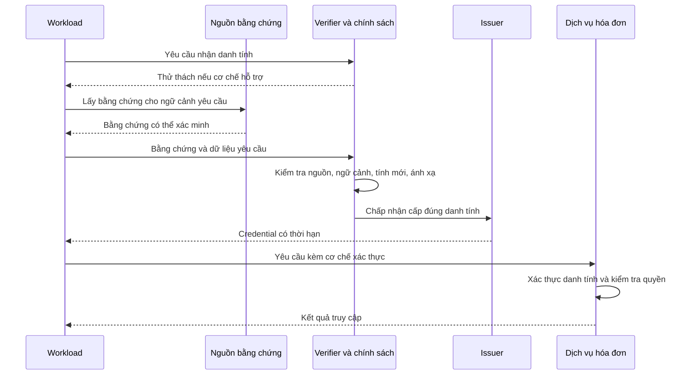

# Identity attestation: xác minh danh tính của workload bằng bằng chứng

## 1. Vì sao workload cần chứng minh mình là ai?

Trong IAM, workload là một chương trình đang thực thi công việc: dịch vụ backend, tiến trình xử lý hàng đợi, container, tác vụ theo lịch hoặc một phiên chạy CI/CD. Những thành phần này cũng cần truy cập tài nguyên, nhưng không thể đăng nhập như con người bằng mật khẩu và MFA tương tác.

Giả sử dịch vụ `invoice-worker` cần ghi hóa đơn vào một kho dữ liệu. Nếu bất kỳ chương trình nào cũng có thể gửi chuỗi `name=invoice-worker` rồi nhận quyền ghi, hệ thống chỉ đang tin vào lời tự giới thiệu. Đổi sang một API key tĩnh giải quyết được một phần: bên gọi phải giữ khóa. Tuy nhiên, khóa bị sao chép có thể được dùng từ một chương trình hoặc môi trường khác mà không còn phản ánh workload ban đầu.

**Identity attestation** là quá trình kiểm tra bằng chứng về một thực thể thực thi, sau đó đối chiếu bằng chứng với chính sách để quyết định có công nhận danh tính hoặc cấp thông tin xác thực cho thực thể đó hay không. Trong bài này, đối tượng chính là workload; một số hệ thống còn cần attestation cho node hoặc môi trường nơi workload chạy.

Câu hỏi cần trả lời không chỉ là “bên gọi biết bí mật nào?”, mà còn là:

- Bằng chứng này do nguồn nào cung cấp và có thể kiểm tra được không?
- Bằng chứng nói về đúng workload, đúng phiên chạy hoặc đúng môi trường đang được xét không?
- Bằng chứng còn đủ mới và có gắn với yêu cầu hiện tại không?
- Các thuộc tính đã xác minh có đủ điều kiện để được ánh xạ sang danh tính yêu cầu không?

Attestation là một phần của nền tảng tin cậy trong IAM. Nó hỗ trợ cấp và quản lý danh tính workload; việc workload được làm gì vẫn cần chính sách phân quyền riêng.

## 2. Phân biệt attestation, authentication và authorization

Ba khái niệm có liên quan nhưng giải quyết ba câu hỏi khác nhau.

| Khái niệm | Câu hỏi chính | Ví dụ trong một luồng workload identity |
| --- | --- | --- |
| Attestation | Có bằng chứng đáng tin nào để công nhận các thuộc tính và danh tính của thực thể này? | Kiểm tra bằng chứng từ nền tảng rằng workload thuộc namespace và service account được phép |
| Authentication — xác thực | Bên gọi có chứng minh được danh tính đã được công nhận không? | Dịch vụ đích xác minh chứng thư và việc bên gọi nắm giữ khóa riêng tương ứng qua mTLS |
| Authorization — phân quyền | Danh tính đó được thực hiện hành động nào trên tài nguyên nào? | Cho `invoice-worker` tạo hóa đơn trong tenant được chỉ định, không cho xóa hóa đơn |

Trong thực tế, một giao thức hoặc một loại token có thể tham gia nhiều bước. Không nên phân loại chỉ bằng định dạng dữ liệu. Một JWT không tự động trở thành bằng chứng attestation đáng tin chỉ vì có chữ ký; cần biết ai ký, ký để phục vụ mục đích gì, xác nhận điều gì và verifier có chấp nhận nguồn đó hay không.

Ví dụ một luồng cấp chứng thư:

1. Workload đưa ra bằng chứng đủ điều kiện nhận danh tính `invoice-worker`.
2. Bộ xác minh kiểm tra bằng chứng và chính sách ánh xạ danh tính.
3. Hệ thống cấp một chứng thư có thời hạn, gắn danh tính với một khóa công khai.
4. Workload dùng khóa riêng tương ứng để xác thực với dịch vụ đích.
5. Dịch vụ đích áp dụng chính sách phân quyền cho danh tính đã xác thực.

Attestation thành công không có nghĩa là workload được cấp mọi quyền trong hệ thống. Danh tính đã xác thực cũng không thay thế việc kiểm tra tenant, loại thao tác và phạm vi dữ liệu.

## 3. Các thành phần của một hệ thống attestation

Một mô hình tổng quát có thể gồm các vai trò sau. Chúng có thể nằm trong một dịch vụ hoặc được tách thành nhiều thành phần.

| Thành phần | Trách nhiệm | Điều cần tin cậy hoặc kiểm tra |
| --- | --- | --- |
| Workload yêu cầu danh tính | Gửi yêu cầu và bằng chứng; khi cần, chứng minh quyền giữ khóa | Không tin trực tiếp mọi thuộc tính workload tự khai |
| Nguồn tạo bằng chứng | Xác nhận thuộc tính của node, workload hoặc phiên thực thi | Nguồn đó có thẩm quyền xác nhận đúng loại thuộc tính này |
| Verifier — bộ xác minh | Kiểm tra tính hợp lệ, tính mới và ý nghĩa của bằng chứng | Cấu hình nguồn tin cậy và logic xác minh |
| Chính sách ánh xạ | Chọn danh tính dựa trên thuộc tính đã xác minh | Điều kiện đủ chặt, tránh nhiều workload không liên quan cùng khớp |
| Issuer — bên cấp credential | Cấp token hoặc chứng thư theo kết quả được chấp nhận | Chỉ cấp đúng danh tính, đúng phạm vi và thời hạn |
| Dịch vụ đích | Xác thực credential và kiểm tra quyền truy cập | Nguồn cấp, đối tượng nhận và quy tắc phân quyền của chính dịch vụ |

Điểm bắt đầu của chuỗi tin cậy được gọi là **trust anchor**. Đó có thể là khóa của nguồn cấp được cấu hình tin cậy hoặc một gốc tin cậy phần cứng trong mô hình có sử dụng phần cứng. Việc hệ thống nhìn thấy một chữ ký hợp lệ chỉ có ý nghĩa khi khóa ký được nối tới nguồn tin cậy phù hợp.

Một lỗi thiết kế thường gặp là để yêu cầu tự chỉ định khóa xác minh, rồi chấp nhận chữ ký tạo bởi chính khóa đó. Khi ấy kẻ giả mạo có thể tạo cả nội dung lẫn khóa ký. Verifier phải chọn nguồn tin cậy theo cấu hình và chính sách, thay vì cho phép dữ liệu chưa tin cậy tự quyết định toàn bộ cách xác minh.

## 4. Những loại bằng chứng thường gặp

### 4.1. Bằng chứng từ nền tảng thực thi

Nền tảng có thể cung cấp một tài liệu có chữ ký hoặc một token mô tả thực thể thực thi. Các thuộc tính có thể liên quan đến tài khoản nền tảng, dự án, cluster, namespace, service account hoặc định danh của phiên chạy.

Verifier cần hiểu ngữ nghĩa từng thuộc tính. Một service account thường đại diện cho một nhóm workload được cấu hình dùng chung nó; tên service account không nhất thiết xác định duy nhất một container hoặc một lần chạy. Nếu chính sách cần phân biệt từng phiên, bằng chứng phải có mức định danh tương ứng và được xác minh theo mức đó.

Độ tin cậy của cách này phụ thuộc vào nền tảng và việc quản trị nó. Người có thể tạo workload bằng service account nhạy cảm có thể tạo một workload mới đủ điều kiện nhận danh tính đó. Attestation không tự sửa được quyền triển khai quá rộng.

### 4.2. Thuộc tính do thành phần tin cậy quan sát

Một agent hoặc thành phần quản lý thực thi có thể quan sát tiến trình gọi, tài khoản hệ điều hành, container hoặc quan hệ với workload đã đăng ký. Hệ thống dùng các thuộc tính quan sát được làm selector để chọn danh tính.

Phải phân biệt rõ hai nguồn thông tin:

```text
Workload tự khai:       "Tôi thuộc namespace production."
Thành phần tin cậy xác nhận: tiến trình gọi thuộc workload có namespace production.
```

Hai chuỗi có cùng nội dung nhưng mức tin cậy khác nhau. Chỉ so sánh một nhãn do bên gọi tự gửi không tương đương với việc xác minh nhãn từ môi trường tin cậy.

### 4.3. Bằng chứng dựa trên phần cứng hoặc đo lường môi trường

Một số mô hình dùng khả năng phần cứng hoặc môi trường thực thi để tạo bằng chứng về trạng thái được đo lường, cấu hình khởi động hoặc một môi trường cô lập. Verifier so sánh kết quả với chính sách chấp nhận tương ứng.

Đây là một lựa chọn có yêu cầu và giả định riêng, không phải điều kiện bắt buộc cho mọi workload identity. Không nên coi attestation từ nền tảng, attestation tiến trình và attestation phần cứng là có cùng mức bảo đảm.

Đặc biệt, việc một phép đo khớp với giá trị được phê duyệt không chứng minh toàn bộ chương trình không có lỗ hổng, không xử lý dữ liệu độc hại hoặc luôn hành xử đúng sau thời điểm đo. Kết luận phải nằm trong phạm vi mà bằng chứng thực sự xác nhận.

## 5. Từ bằng chứng đến credential: một luồng minh họa

Xét một hệ thống cấp chứng thư ngắn hạn cho `invoice-worker`. Sơ đồ sau là mô hình khái niệm; không phải giao thức hay API của một sản phẩm cụ thể.



Các cơ chế attestation khác nhau không nhất thiết có đủ mọi bước như sơ đồ. Chẳng hạn, có loại bằng chứng sử dụng thời gian hết hạn và audience thay cho một thử thách trực tiếp. Vì vậy, yêu cầu kiểm tra phải phù hợp với hợp đồng của từng loại bằng chứng, không thể thêm một nonce ở bên ngoài rồi mặc định đã chống replay.

Luồng trên có hai quyết định cần tách biệt:

- Verifier chấp nhận bằng chứng có nghĩa là bằng chứng thỏa điều kiện đã định.
- Issuer cấp danh tính có nghĩa là kết quả đó còn phải phù hợp với chính sách cấp danh tính được yêu cầu.

Không được cho phép workload dùng bằng chứng của một workload ít đặc quyền để tự chọn một danh tính đặc quyền cao hơn.

## 6. Verifier cần kiểm tra những gì?

### 6.1. Nguồn phát hành và tính toàn vẹn

Verifier kiểm tra bằng chứng bằng cơ chế tương ứng: chữ ký, chuỗi chứng thư hoặc cơ chế xác minh đã được thiết kế cho loại bằng chứng đó. Nó phải chấp nhận đúng nguồn phát hành và đúng loại bằng chứng.

Một token do hệ thống phát triển ký không nên được chấp nhận cho danh tính production chỉ vì định dạng và thuật toán chữ ký giống nhau. Tương tự, một tài liệu có thể là dữ liệu hợp lệ từ một nguồn tin cậy nhưng không được nguồn đó phát hành để làm bằng chứng cho quy trình đang xét.

### 6.2. Đối tượng nhận và mục đích sử dụng

Nếu bằng chứng có audience hoặc một cách ràng buộc mục đích tương đương, verifier cần kiểm tra nó theo cấu hình. Audience giúp giới hạn nơi một bằng chứng được chấp nhận; nó không tự xác định workload được cấp quyền nào.

Ví dụ, token dành cho một dịch vụ nội bộ khác không được tự động chấp nhận tại endpoint cấp danh tính. Khi một loại bằng chứng không có audience, thiết kế phải dựa vào các ràng buộc khác được hỗ trợ và đánh giá giới hạn của chúng, thay vì giả định trường này luôn tồn tại.

### 6.3. Tính mới và khả năng chống phát lại

Tùy cơ chế, các kiểm tra có thể gồm thời gian phát hành, thời gian hết hạn, khoảng lệch đồng hồ được chấp nhận hoặc thử thách một lần. Nếu dùng nonce, nonce phải khó đoán, có thời hạn, được gắn với phiên yêu cầu và nằm trong phần được bảo vệ của bằng chứng hoặc giao thức.

Một nonce do bên gọi tự chèn vào trường không được ký không làm cho bằng chứng cũ trở thành mới. Một cache kết quả xác minh cũng không nên kéo dài kết luận vượt quá thời hạn hoặc ngữ cảnh được phép.

Thời hạn ngắn thu hẹp cửa sổ sử dụng bằng chứng bị đánh cắp, nhưng không loại bỏ việc tái sử dụng trong khoảng còn hiệu lực.

### 6.4. Chủ thể, môi trường và phiên thực thi

Verifier đối chiếu các thuộc tính cần thiết với chính sách: nguồn quản lý, miền tin cậy, môi trường, namespace, service account hoặc định danh thực thể. Không phải hệ thống nào cũng cần hoặc có mọi thuộc tính này.

Tên có thể tái sử dụng sau khi tài nguyên bị xóa. Nếu chính sách yêu cầu phân biệt thực thể cũ với thực thể mới, cần sử dụng định danh có tính chất phù hợp và được nguồn tin cậy xác nhận. Thêm một ID do bên gọi tự khai không giải quyết được vấn đề này.

### 6.5. Ràng buộc với bên đang yêu cầu

Nếu bằng chứng có thể bị chuyển cho tiến trình khác, xác minh nội dung của nó chưa chắc chứng minh tiến trình hiện tại là chủ thể mong muốn. Cần xem xét cách hệ thống xác định bên gọi: thông tin tiến trình do hệ điều hành cung cấp, kênh agent được bảo vệ, thử thách hoặc cơ chế chứng minh quyền giữ khóa.

Trong luồng cấp chứng thư, chứng minh đang giữ khóa riêng tương ứng với khóa công khai yêu cầu giúp tránh một số sai lệch về khóa. Tuy nhiên, chỉ chứng minh giữ khóa không đủ để chứng minh workload đủ điều kiện nhận danh tính; bước đó vẫn cần bằng chứng và chính sách. Nếu thiết kế yêu cầu gắn bằng chứng với chính khóa đó, ràng buộc phải được kiểm tra rõ trong giao thức.

## 7. Node attestation và workload attestation

Trong một kiến trúc có agent trên máy thực thi, có thể tồn tại hai tầng xác minh.

**Node attestation** kiểm tra node hoặc môi trường nơi agent hoạt động có được phép tham gia miền tin cậy hay không. **Workload attestation** xác định workload nào đang yêu cầu credential và workload đó được ánh xạ sang danh tính nào.

Ví dụ:

```text
Nền tảng tin cậy xác nhận node N thuộc cụm xử lý hóa đơn.
Agent trên N xác định tiến trình P thuộc workload invoice-worker.
Chính sách cho phép các thuộc tính đã xác minh của P nhận danh tính hóa đơn.
```

Chấp nhận node không đồng nghĩa chấp nhận mọi tiến trình trên node cho cùng một danh tính. Một tiến trình xử lý log trên node đó không nên nhận credential của `invoice-worker` chỉ vì cùng máy.

Ngược lại, nếu agent hoặc node là điểm quan sát bắt buộc mà đã bị kiểm soát, độ tin cậy của các thuộc tính workload do nó cung cấp có thể suy giảm. Mức ảnh hưởng cụ thể phụ thuộc cách cách ly, khóa và các nguồn bằng chứng bổ sung trong thiết kế.

Do đó, cần xác định rõ ranh giới tin cậy: hệ thống đang tin vào control plane, host, agent, phần cứng hay một tổ hợp những thành phần này. Không có cách gọi chung “attestation” nào làm biến mất các giả định đó.

## 8. Ánh xạ bằng chứng sang danh tính một cách có giới hạn

Một chính sách ánh xạ tốt dựa trên thuộc tính được xác minh, có phạm vi rõ và không cho bên gọi tự nâng quyền.

Ví dụ sau chỉ minh họa logic, không phải schema cấu hình của một nền tảng:

```text
Nếu tất cả điều kiện đều đúng:
  nguồn bằng chứng đã xác minh = platform-prod
  miền môi trường đã xác minh = production
  cluster đã xác minh = finance-prod
  namespace đã xác minh = billing
  service account đã xác minh = invoice-worker
Thì:
  danh tính được cấp = workload:production:billing:invoice-worker
Ngược lại:
  từ chối cấp danh tính này
```

Các điều kiện cần kết hợp theo đúng ý định. Nếu vô tình chuyển một tập điều kiện bắt buộc từ “và” sang “hoặc”, workload chỉ cần khớp một thuộc tính, chẳng hạn namespace, là có thể nhận danh tính nhạy cảm.

Một nhãn như `app=invoice-worker` thường không đủ mạnh nếu người triển khai có thể tùy ý gán nhãn. Nếu service account được dùng chung cho nhiều ứng dụng, việc chọn service account đó cũng tạo ra một nhóm danh tính rộng hơn mong muốn. Chính sách phải được đánh giá cùng quyền tạo workload, quyền gán service account và quyền sửa cấu hình nền tảng.

Sau khi nhận danh tính, `invoice-worker` vẫn chỉ nên có quyền phục vụ nghiệp vụ của nó. Ví dụ, chính sách ở dịch vụ hóa đơn cho phép tạo bản ghi nhưng từ chối xóa hàng loạt; chính sách ở dịch vụ nhân sự không cấp quyền nào cho danh tính này.

## 9. Ví dụ xuyên suốt: cấp danh tính cho một phiên xử lý hóa đơn

### 9.1. Tình huống hợp lệ

Một workload chạy trong môi trường production, thuộc namespace `billing` và service account `invoice-worker`. Nguồn bằng chứng được tin cậy xác nhận các thuộc tính đó. Workload yêu cầu đúng danh tính đã được đăng ký cho tổ hợp này.

Verifier kiểm tra nguồn, các ràng buộc ngữ cảnh, thời hạn và điều kiện chính sách. Issuer cấp credential có thời hạn phù hợp. Dịch vụ hóa đơn xác thực credential rồi kiểm tra quyền tạo hóa đơn cho phạm vi nghiệp vụ được cấp.

Kết quả cần hiểu là: hệ thống có cơ sở chấp nhận danh tính theo mô hình tin cậy của nó. Kết quả không nói rằng mọi hóa đơn do workload tạo ra đều đúng về nghiệp vụ; quy tắc nghiệp vụ vẫn phải kiểm tra riêng.

### 9.2. Workload ở môi trường phát triển tự nhận là production

Workload gửi trường tự khai `environment=production`, nhưng bằng chứng đã xác minh cho biết nó thuộc môi trường development. Chính sách phải sử dụng thuộc tính từ bằng chứng đáng tin và từ chối cấp danh tính production.

Nếu verifier ghép dữ liệu theo cách để trường tự khai ghi đè trường đã xác minh, ranh giới tin cậy đã bị phá vỡ dù việc kiểm tra chữ ký vẫn thành công.

### 9.3. Bằng chứng bị đánh cắp

Kẻ tấn công có một bản sao bằng chứng còn hiệu lực. Nếu đó là bằng chứng dạng bearer và endpoint chỉ yêu cầu đưa ra bản sao đó, kẻ tấn công có thể được chấp nhận trong phạm vi mà bằng chứng cho phép. Audience và thời hạn có thể hạn chế nơi sử dụng, thời gian sử dụng, nhưng không tự biến bearer thành bằng chứng giữ khóa.

Thiết kế có ràng buộc với khóa, kênh hoặc bên gọi cần kiểm tra đúng ràng buộc đó. Đồng thời, endpoint lấy bằng chứng hoặc credential phải được bảo vệ để workload khác không thể truy cập nhầm qua quyền đọc file, socket dùng chung hoặc một đường gọi bị lạm dụng.

### 9.4. Workload đã bị xâm nhập nhưng vẫn đúng danh tính

Một lỗi trong ứng dụng cho phép kẻ tấn công điều khiển chính tiến trình hợp lệ. Tiến trình có thể tiếp tục thỏa các điều kiện attestation về môi trường và service account.

Đây là giới hạn quan trọng: danh tính đúng không bảo đảm hành vi đúng. Quyền tối thiểu, kiểm tra dữ liệu đầu vào, cách ly tài nguyên, giám sát và khả năng vô hiệu hóa quyền vẫn cần thiết.

## 10. Vòng đời, gia hạn và thu hồi

Attestation thường xuất hiện khi workload khởi động hoặc cần nhận credential mới. Khi credential sắp hết hạn, hệ thống có thể yêu cầu xác minh lại theo chính sách và cơ chế đã chọn.

Cần phân biệt ba thời điểm:

| Thời điểm | Quyết định hoặc trạng thái | Giới hạn cần nhớ |
| --- | --- | --- |
| Kiểm tra bằng chứng | Thuộc tính được chấp nhận tại thời điểm xác minh | Một số trạng thái có thể thay đổi sau đó |
| Cấp hoặc gia hạn credential | Danh tính được phép sử dụng trong thời hạn quy định | Từ chối gia hạn không tự vô hiệu hóa mọi credential cũ |
| Sử dụng credential ở dịch vụ đích | Dịch vụ đích quyết định có chấp nhận truy cập hay không | Còn phụ thuộc cách xác thực, chính sách và trạng thái phiên/kết nối |

Credential ngắn hạn giúp hạn chế thời gian tồn tại của quyền đã cấp, nhưng không đồng nghĩa thu hồi tức thì. Một hệ thống chỉ kiểm tra chữ ký và hạn dùng tại dịch vụ đích có thể tiếp tục chấp nhận credential cũ cho đến khi nó hết hạn. Kết nối hoặc phiên đang hoạt động còn có quy tắc riêng về thời điểm đánh giá lại.

Khi workload không còn được tin cậy, phản ứng có thể gồm chặn cấp mới, chặn gia hạn, cập nhật chính sách ở tài nguyên và xử lý phiên hoặc kết nối đang tồn tại. Thiết kế phải nêu rõ bước nào có hiệu lực ngay, bước nào có độ trễ và credential nào còn được chấp nhận.

Gia hạn cũng cần xử lý tình huống nguồn xác minh tạm thời không khả dụng. Không nên biến lỗi xác minh thành cấp danh tính vô điều kiện. Chính sách dùng lại credential còn hiệu lực, thời gian đệm và phản ứng khi hết hạn phải được quy định rõ theo yêu cầu vận hành.

## 11. Những sai lầm thiết kế cần nhận diện

| Sai lầm | Hệ quả | Hướng xử lý |
| --- | --- | --- |
| Tin tên workload do request tự khai | Chương trình khác có thể mạo danh | Dùng thuộc tính được nguồn tin cậy xác nhận |
| Chỉ kiểm tra chữ ký mà bỏ qua ngữ cảnh | Bằng chứng hợp lệ bị dùng sai nơi hoặc sai mục đích | Kiểm tra nguồn, loại bằng chứng và ràng buộc ngữ cảnh được hỗ trợ |
| Dùng nhãn dễ sửa làm điều kiện duy nhất | Quyền gán nhãn trở thành quyền nhận danh tính | Kết hợp điều kiện phù hợp và kiểm soát quyền triển khai |
| Cho mọi workload trên node cùng credential | Mất phân tách danh tính giữa các ứng dụng | Xác minh workload và cấp theo đúng ánh xạ |
| Cho bên gọi tùy chọn danh tính sau khi attestation đạt | Workload ít quyền có thể xin danh tính nhiều quyền | Ràng buộc danh tính được cấp với chính sách ánh xạ |
| Ghi nguyên token hoặc bằng chứng nhạy cảm vào log | Log có thể trở thành nguồn rò rỉ credential | Ghi metadata cần thiết, che hoặc loại bỏ bí mật |
| Đồng nhất attestation với kiểm tra an toàn ứng dụng | Bỏ qua rủi ro từ workload hợp lệ bị xâm nhập | Duy trì quyền tối thiểu và kiểm soát ở tài nguyên |
| Coi hết hạn ngắn là thu hồi tức thì | Đánh giá thấp cửa sổ truy cập còn lại | Mô tả và kiểm tra toàn bộ cơ chế vô hiệu hóa quyền |

## 12. Quan sát và kiểm toán quyết định attestation

Một bản ghi quyết định nên giúp trả lời “tại sao danh tính này được cấp hoặc bị từ chối?” mà không trở thành bản sao của credential.

Các thông tin hữu ích có thể gồm mã yêu cầu, thời điểm, nguồn bằng chứng, định danh chủ thể trong phạm vi được phép ghi, phiên bản chính sách, danh tính được cấp, hạn dùng và mã lý do chấp nhận hoặc từ chối. Đối với thông tin nhạy cảm, cần giới hạn quyền đọc và chính sách lưu giữ phù hợp.

Ví dụ bản ghi minh họa:

```text
request_id: req-482
evidence_source: platform-prod
policy_version: workload-policy-17
requested_identity: workload:production:billing:invoice-worker
decision: DENY
reason: ENVIRONMENT_MISMATCH
```

Mã lỗi ổn định giúp phân biệt bằng chứng hết hạn, nguồn không được chấp nhận, sai ngữ cảnh và không khớp ánh xạ danh tính. Tránh chỉ ghi “unauthorized” cho mọi lỗi, vì khi đó khó xác định lỗi cấu hình, lỗi đồng hồ hay một yêu cầu mạo danh.

Khi điều tra một lần cấp danh tính, cần liên hệ được quyết định attestation với lần cấp credential và sự kiện truy cập ở dịch vụ đích. Không cần đưa khóa riêng hoặc toàn bộ token vào log để đạt mục tiêu này.

## 13. Tự kiểm tra cách hiểu

**Một token có chữ ký hợp lệ có đủ để nhận danh tính production không?** Không. Còn phải kiểm tra nguồn, ngữ cảnh, hiệu lực và việc các thuộc tính được xác minh có khớp chính sách cấp danh tính production hay không.

**Node đã qua attestation thì mọi workload trên node có được tin cậy như nhau không?** Không. Cần xác định workload đang yêu cầu và ánh xạ riêng; mức tin cậy của node chỉ là một phần của mô hình.

**Đổi một nhãn cấu hình có phải lúc nào cũng làm credential đang tồn tại mất hiệu lực không?** Không. Nó có thể ảnh hưởng việc cấp hoặc gia hạn tiếp theo, còn credential và phiên hiện tại phụ thuộc cơ chế kiểm tra, thu hồi của hệ thống.

**Workload qua attestation có thể bị lợi dụng để thực hiện hành vi sai không?** Có. Attestation xác nhận những thuộc tính nằm trong phạm vi bằng chứng; nó không bảo đảm ứng dụng không bị xâm nhập hoặc mọi yêu cầu nghiệp vụ đều hợp lệ.

**Tại sao cần bảo vệ quyền triển khai cùng với chính sách attestation?** Vì người có thể tạo workload thỏa điều kiện ánh xạ có thể tạo một thực thể mới nhận danh tính tương ứng. Chính sách danh tính và quyền quản trị nền tảng phải được xem xét cùng nhau.

## 14. Các điểm cần ghi nhớ

Identity attestation tạo cơ sở để công nhận danh tính workload bằng cách kiểm tra bằng chứng và áp dụng chính sách. Giá trị của nó nằm ở nguồn tin cậy, ngữ nghĩa thuộc tính, tính mới và cách ràng buộc bằng chứng với thực thể đang yêu cầu, không chỉ ở việc có một chữ ký.

Trong một hệ thống IAM hoàn chỉnh, attestation hỗ trợ cấp danh tính; authentication chứng minh danh tính khi truy cập; authorization giới hạn hành động trên tài nguyên. Cả ba cần kết hợp với vòng đời credential, quản trị quyền triển khai và kiểm toán để duy trì nguyên tắc ít quyền nhất cho workload.
