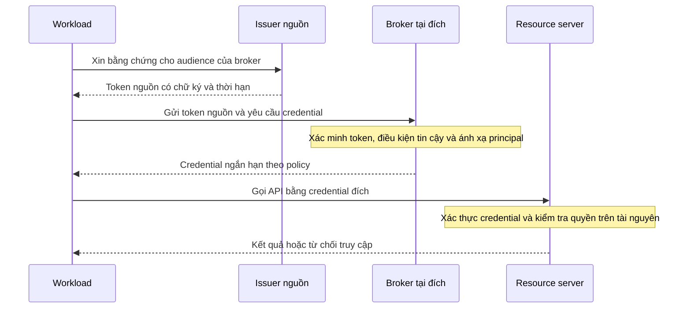

# Workload identity federation

## 1. Bài toán: workload cần quyền nhưng không nên giữ khóa dài hạn

Một pipeline triển khai cần đẩy image vào registry. Một dịch vụ chạy trên Kubernetes cần đọc object trong kho lưu trữ. Một tiến trình ở trung tâm dữ liệu cần gọi API trên nền tảng khác. Trong cả ba trường hợp, bên nhận phải biết chương trình nào đang yêu cầu truy cập và chương trình đó được phép làm gì.

Cách triển khai đơn giản là cấp một API key hoặc khóa của tài khoản dịch vụ, lưu vào secret của pipeline hay máy chủ rồi sử dụng nhiều lần. Tuy nhiên, khóa có thể bị sao chép sang môi trường khác, khó phân biệt từng lần chạy và tiếp tục có giá trị sau khi workload ban đầu đã kết thúc. Việc luân chuyển khóa cũng cần phối hợp giữa nơi cấp, nơi lưu và mọi nơi sử dụng.

**Workload identity federation** là cơ chế để miền đích tin cậy bằng chứng danh tính do một miền nguồn phát hành cho workload. Miền đích kiểm tra bằng chứng, xác định principal tương ứng và áp dụng chính sách của mình. Một cách triển khai phổ biến là đổi token nguồn lấy credential ngắn hạn dùng tại hệ thống đích.

Workload có thể sử dụng danh tính đã được nền tảng chạy của nó xác nhận, thay vì phải mang sẵn một khóa dài hạn của miền đích. Điều này giảm nhu cầu phân phối khóa đến từng workload; nó không loại bỏ mọi khóa ký, token hay thành phần cần bảo vệ trong hệ thống IAM.

Trong phạm vi IAM, cần tách ba câu hỏi:

- **Nguồn xác nhận điều gì?** Chẳng hạn một job thuộc dự án nào, hoặc workload đang chạy dưới service account nào.
- **Đích chấp nhận bằng chứng nào?** Issuer, audience, subject và điều kiện ngữ cảnh phải khớp cấu hình tin cậy.
- **Principal được làm gì?** Quyền đối với API và tài nguyên vẫn do cơ chế phân quyền tại đích quyết định.

## 2. Các thành phần và ranh giới tin cậy

| Thành phần | Vai trò trong federation | Ví dụ minh họa |
| --- | --- | --- |
| Workload | Chương trình cần truy cập tài nguyên bên ngoài miền chạy | Job triển khai, pod, tiến trình xử lý dữ liệu |
| Issuer nguồn | Xác nhận danh tính workload và phát hành bằng chứng | Hệ thống CI hoặc nền tảng điều phối workload |
| Bằng chứng nguồn | Token hoặc assertion chứng minh danh tính, có thời hạn và đối tượng nhận cụ thể | JWT được ký dành cho một broker |
| Bên nhận tin cậy | Kiểm tra bằng chứng và ánh xạ danh tính | Federation endpoint, broker hoặc security token service |
| Principal tại đích | Danh tính mà hệ thống đích dùng để phân quyền | Federated principal, role session hoặc tài khoản dịch vụ được phép sử dụng |
| Resource server | Thực thi quyền đối với tài nguyên | Registry, object storage, API nội bộ |

Trong bài này, **broker** là tên gọi chung cho thành phần tiếp nhận bằng chứng và cấp credential tại đích. Nó có thể là dịch vụ riêng hoặc một phần của hệ thống IAM. Không phải kiến trúc federation nào cũng có đủ các thành phần dưới dạng dịch vụ độc lập.

Việc tin cậy issuer không có nghĩa là tin cậy mọi danh tính mà issuer có thể xác nhận. Ví dụ, một nền tảng CI phục vụ hàng nghìn repository không nên khiến mọi pipeline trên nền tảng đó có quyền triển khai production của doanh nghiệp.

Mỗi quan hệ tin cậy cần thu hẹp đến đúng nhóm workload dự kiến. Quyền quản trị issuer nguồn, cấu hình federation và policy đích vì vậy đều thuộc chuỗi kiểm soát truy cập.

## 3. Luồng truy cập điển hình



Luồng này có hai cổng quyết định khác nhau:

1. **Cổng federation:** workload có được chấp nhận làm principal tại đích hoặc được phép sử dụng danh tính đích đã chọn hay không.
2. **Cổng tài nguyên:** principal đó có được thực hiện hành động cụ thể trên tài nguyên cụ thể hay không.

Đổi token thành công nhưng gọi API bị từ chối có thể là hành vi đúng: danh tính được chấp nhận nhưng chưa có quyền cho thao tác đang yêu cầu. Ngược lại, việc gắn quyền vào một tài khoản đích chưa đủ để workload bên ngoài có thể sử dụng tài khoản đó; còn cần quan hệ tin cậy và quyền chuyển sang danh tính đó nếu kiến trúc yêu cầu.

Một giao thức liên quan là OAuth 2.0 Token Exchange, cho phép yêu cầu token từ security token service bằng token đầu vào. Đây là một cơ chế có thể dùng để xây dựng luồng trên, không phải tên gọi chung cho mọi giao thức federation. [RFC 8693](https://www.rfc-editor.org/rfc/rfc8693.html)

## 4. Kiểm tra bằng chứng nguồn

Với mô hình sử dụng JWT, đọc được payload không có nghĩa là đã xác thực được danh tính. Một JWT có chữ ký thường vẫn có thể đọc nội dung; chữ ký bảo vệ tính toàn vẹn và chứng minh nguồn ký, không tự bảo mật nội dung payload.

Các giá trị quan trọng thường bao gồm:

| Giá trị | Ý nghĩa cần đối chiếu |
| --- | --- |
| `iss` | Issuer chính xác đã được cấu hình tin cậy |
| `sub` | Subject trong không gian danh tính của issuer đó |
| `aud` | Bên nhận mà token được phát hành để sử dụng |
| `exp`, `nbf` | Khoảng thời gian được chấp nhận theo profile token |
| Thuộc tính bổ sung | Dự án, môi trường, workflow hoặc thông tin workload mà policy yêu cầu |

Broker phải xác minh chữ ký bằng khóa gắn với issuer đã tin cậy và chỉ chấp nhận thuật toán được cấu hình cho loại token đó. Việc kiểm tra issuer, audience và quy tắc dành riêng cho từng loại JWT giúp tránh chấp nhận nhầm token được phát hành cho ngữ cảnh khác. [RFC 8725](https://www.rfc-editor.org/rfc/rfc8725.html)

Trong thiết kế thực tế còn cần chú ý những điểm sau:

- Không ghép subject từ hai issuer khác nhau thành một danh tính chỉ vì chuỗi `sub` giống nhau. Cặp issuer và subject tạo nên ngữ cảnh định danh.
- Không sử dụng một claim trước khi token đã được xác minh để ra quyết định cấp quyền. Payload do bên gọi tự tạo có thể có hình thức giống payload hợp lệ.
- Không để một URL khóa tùy ý trong token tự trở thành nguồn khóa tin cậy. Việc lấy khóa phải đi theo cấu hình và cơ chế discovery đã được kiểm soát.
- Claim phục vụ điều kiện truy cập phải do nguồn có thẩm quyền xác nhận. Một nhãn do người gửi job tự điền không mặc nhiên có độ tin cậy ngang với định danh dự án do nền tảng phát hành.
- Claim bắt buộc bị thiếu phải dẫn tới từ chối, thay vì tự gán một giá trị rộng hơn hoặc giá trị của môi trường production.

### Hai audience có thể khác nhau

Trong luồng đổi token, token nguồn có thể dành cho broker, còn credential đầu ra dành cho API đích. Đây là hai lần sử dụng token với hai bên nhận khác nhau.

Ví dụ, token nguồn có `aud = urn:example:artifact-broker` không mặc nhiên là token truy cập registry. Registry cũng không nên chấp nhận token đó chỉ vì issuer nguồn nằm trong một danh sách tin cậy ở nơi khác. Mỗi bên nhận cần kiểm tra loại credential và audience theo hợp đồng của chính mình.

## 5. Ánh xạ danh tính và cấp quyền

Sau khi xác minh bằng chứng, hệ thống cần quyết định các thuộc tính nguồn tương ứng với principal nào tại đích. Có hai kiểu bố trí thường gặp:

| Kiểu bố trí | Cách phân quyền | Điểm cần kiểm soát |
| --- | --- | --- |
| Phân quyền trực tiếp cho federated principal | Policy tài nguyên tham chiếu danh tính hoặc tập danh tính liên kết | Phạm vi tập danh tính và điều kiện thuộc tính |
| Sử dụng role hoặc tài khoản dịch vụ tại đích | Workload được phép nhận một phiên hoặc credential của danh tính đích | Quyền được sử dụng danh tính đích và quyền mà danh tính đó đang có |

Hai kiểu này phụ thuộc khả năng của nền tảng. Không nên giả định rằng mọi sản phẩm dùng cùng thuật ngữ hay có cùng bước trung gian.

Nếu dùng một tài khoản dịch vụ tại đích, cần xét riêng:

- **Ai được sử dụng tài khoản?** Chỉ workload khớp quan hệ tin cậy đã xác định.
- **Tài khoản được làm gì?** Chỉ các thao tác và tài nguyên cần cho nhiệm vụ.
- **Hành vi có truy vết được về nguồn không?** Log cần giữ đủ thông tin về danh tính nguồn và phiên đích theo khả năng hệ thống.

Gộp nhiều workload vào một tài khoản quản trị chung có thể khiến federation vẫn hoạt động nhưng mất lợi ích cô lập quyền. Chẳng hạn pipeline build chỉ cần ghi artifact, còn pipeline release cần triển khai một dịch vụ. Hai nhiệm vụ này không nên mặc nhiên nhận cùng quyền quản trị toàn bộ dự án.

## 6. Ví dụ: pipeline chỉ được ghi artifact của một ứng dụng

Giả sử doanh nghiệp có repository chứa ứng dụng `invoice-api`. Chỉ workflow release của repository đó, chạy trong môi trường release đã được bảo vệ, được ghi artifact vào vùng lưu trữ riêng của ứng dụng. Workflow kiểm tra pull request không có quyền này.

Ví dụ sau sử dụng **claim và policy giả định để diễn giải**, không phải cấu hình có thể chép nguyên vào một nhà cung cấp. Tên claim, định dạng subject, cơ chế bảo vệ môi trường và cách ánh xạ phải được đối chiếu với nền tảng triển khai.

Payload nguồn minh họa:

```json
{
  "iss": "https://ci.example.org/oidc",
  "sub": "project:repo-471:workflow:release:environment:production",
  "aud": "urn:example:artifact-broker",
  "repository_id": "repo-471",
  "workflow_id": "release",
  "environment": "production",
  "iat": 1900000000,
  "exp": 1900000300
}
```

Các mốc thời gian chỉ minh họa một khoảng hiệu lực năm phút. Payload này không chứa chữ ký và không phải credential để sử dụng thực tế.

Một policy ở mức ý tưởng có thể diễn đạt như sau:

```yaml
# Pseudoconfiguration: không phải schema của một sản phẩm.
trustedSource:
  issuer: https://ci.example.org/oidc
  acceptedAudience: urn:example:artifact-broker
  requiredClaims:
    sub: project:repo-471:workflow:release:environment:production
    repository_id: repo-471
    workflow_id: release
    environment: production
mappedPrincipal: artifact-writer-invoice-api
destinationPermission:
  action: artifact.upload
  resource: artifacts/invoice-api/releases/*
credentialPolicy:
  maximumLifetimeSeconds: 600
  allowPrivilegeExpansion: false
```

`artifact.upload` và đường dẫn tài nguyên ở trên cũng là ký hiệu minh họa. Khi triển khai phải dùng quyền, resource identifier và điều kiện hỗ trợ thực tế của hệ thống đích.

Policy này có ý nghĩa chỉ khi nền tảng CI thực sự bảo đảm các claim nói trên. Cần kiểm soát ai được sửa workflow release, ai được phê duyệt môi trường và loại job nào có thể xin token mang các thuộc tính đó. Chỉ kiểm tra tên nhánh `main` trong khi người không được tin cậy có thể sửa workflow hoặc giả lập nhãn môi trường sẽ không tạo ra ranh giới triển khai đáng tin cậy.

Định danh ổn định như ID repository thường hữu ích hơn tên hiển thị dễ đổi hoặc tái sử dụng. Tuy vậy, ID ổn định cũng không thay thế việc quản trị quyền trong repository: người chiếm quyền điều khiển nguồn vẫn có thể làm cho nền tảng phát hành một token hợp lệ cho workload nguy hiểm.

### Các yêu cầu phải bị từ chối

| Tình huống | Kết quả mong đợi |
| --- | --- |
| Cùng issuer nhưng repository khác | Không nhận được credential của `invoice-api` |
| Đúng repository nhưng là workflow kiểm tra pull request | Không vượt qua điều kiện release |
| Đúng subject nhưng audience dành cho hệ thống khác | Bị từ chối tại cổng federation |
| Token hết hạn hoặc bị sửa payload | Bị từ chối khi xác thực bằng chứng |
| Đổi token hợp lệ rồi ghi sang vùng artifact của ứng dụng khác | Bị từ chối tại cổng tài nguyên |
| Token thiếu claim môi trường bắt buộc | Bị từ chối, không tự suy ra production |

Bảng này giúp phân biệt việc kiểm tra danh tính với việc kiểm tra phạm vi quyền. Một thiết kế đầy đủ cần cả hai lớp.

## 7. Ví dụ khác: workload Kubernetes truy cập hệ thống bên ngoài

Trong một kiến trúc có hỗ trợ, pod có thể nhận token của service account với audience dành cho bên nhận federation. Bên nhận xác minh issuer của cluster, audience và danh tính service account rồi cấp quyền tại hệ thống bên ngoài.

Subject có dạng `system:serviceaccount:namespace:name` thường biểu diễn danh tính service account trong Kubernetes. Tuy nhiên, cùng chuỗi subject có thể xuất hiện ở những cluster khác nhau. Vì vậy, chỉ kiểm tra namespace và tên service account mà bỏ qua issuer của cluster sẽ làm mất một phần ngữ cảnh danh tính.

Cũng cần phân biệt **tên logic** với **thực thể có vòng đời cụ thể**. Nếu xóa rồi tạo lại service account cùng tên, quan hệ federation dựa riêng vào tên có thể tiếp tục khớp. Khi cần ràng buộc đến đúng thực thể, phải xem hệ thống nguồn có cung cấp định danh bất biến phù hợp và bên nhận có hỗ trợ kiểm tra nó hay không. Không tự giả định rằng đổi hoặc xóa một đối tượng ở nguồn sẽ tức thì vô hiệu mọi credential đã cấp ở đích.

Quyền tạo pod hoặc chạy mã dưới service account được tin cậy là quyền có tác động đến truy cập bên ngoài cluster. Một người có thể không có quyền trực tiếp trên object storage nhưng vẫn tiếp cận được nó nếu được tùy ý tạo workload sử dụng danh tính đã liên kết với quyền lưu trữ.

Federation vì thế kéo dài chuỗi tin cậy từ miền đích về cơ chế quản trị workload tại miền nguồn.

## 8. Vòng đời token và khả năng thu hồi

Federation thường đi kèm credential ngắn hạn, nhưng cần quản lý ít nhất hai vòng đời: bằng chứng nguồn và credential đích. Hai credential có thể có thời điểm hết hạn khác nhau.

Ví dụ, token nguồn còn hiệu lực hai phút có thể được dùng để yêu cầu credential đích sống thêm mười phút nếu chính sách của dịch vụ cho phép. Không được suy luận rằng credential đầu ra tự động hết hạn cùng token đầu vào. Thiết kế cần quy định rõ giới hạn thời gian và chấp nhận rủi ro tương ứng với nhiệm vụ.

Khi vận hành:

- Chỉ xin credential khi cần; giữ trong bộ nhớ hoặc cơ chế lưu trữ runtime được bảo vệ thay vì ghi vào repository hay artifact.
- Khi cần gia hạn, lấy bằng chứng mới từ nền tảng nguồn theo cơ chế được hỗ trợ. Không giả định token nguồn hoặc credential đích luôn có refresh token.
- Nếu cache credential, tách cache theo danh tính nguồn, danh tính đích, audience, phạm vi và ngữ cảnh phân quyền cần thiết. Một cache chung có thể vô tình đưa credential production cho một workload khác.
- Làm mới trước thời điểm hết hạn với khoảng đệm hợp lý, đồng thời tránh để nhiều instance cùng xin token vào một thời điểm.
- Khi issuer hoặc broker gặp sự cố, giới hạn retry và báo lỗi rõ ràng. Không tự động quay về một khóa quản trị dài hạn chỉ để duy trì luồng truy cập.

Xóa một binding federation thường nhằm chặn các lần nhận credential tiếp theo. Credential đã cấp có thể vẫn dùng được tới khi hết hạn, trừ khi hệ thống có cơ chế thu hồi hoặc kiểm tra policy khiến nó mất hiệu lực sớm hơn. Hiệu quả của việc xóa quyền tài nguyên cũng phụ thuộc cách đích đánh giá quyền và độ trễ lan truyền cấu hình.

Kế hoạch ứng phó cần phân biệt chặn phát hành mới, vô hiệu phiên hiện có và chặn hành động tại tài nguyên. Chỉ sửa một phía có thể chưa đạt mục tiêu dừng truy cập ngay.

## 9. Rủi ro thường bị bỏ sót

### Tin cậy quá rộng

Điều kiện kiểu “mọi token từ nền tảng CI này” hoặc “mọi workload trong namespace này” chỉ phù hợp khi toàn bộ phạm vi đó thực sự có cùng mức tin cậy. Một namespace dùng chung cho nhiều nhóm thường không phải ranh giới đủ hẹp cho quyền production.

### Nhầm kiểm soát môi trường chạy với bảo vệ credential

Token ngắn hạn vẫn là credential. Nếu là bearer token, người lấy được nó có thể sử dụng trong thời gian còn hiệu lực theo điều kiện mà bên nhận áp dụng. Không in token vào log, không nhúng vào thông báo lỗi và không chuyển nó qua artifact dùng chung.

Federation cũng không chứng minh workload đang chạy mã an toàn. Nếu runtime bị chiếm quyền, kẻ tấn công có thể tận dụng quyền xin token hợp lệ của runtime đó. Cần kết hợp cô lập workload, quyền triển khai, bảo vệ mã nguồn và quyền tài nguyên tối thiểu.

### Confused deputy và yêu cầu danh tính đích tùy ý

Một broker có quyền cấp nhiều loại phiên có thể bị lợi dụng nếu chỉ xác thực token rồi làm theo mọi role hoặc tài khoản do bên gọi yêu cầu. Broker phải kiểm tra quan hệ giữa danh tính nguồn và danh tính đích được phép sử dụng. Bên gọi không được tự quyết rằng token hợp lệ của workload A đủ để nhận credential của tài khoản quản trị B.

### Ánh xạ mất ngữ cảnh

Nếu mọi pipeline đều trở thành principal `ci-runner`, hệ thống có thể khó tách quyền và điều tra nguồn truy cập. Cần bảo toàn hoặc ghi nhận những thuộc tính cần thiết như issuer, ID dự án, loại workload và phiên thực thi, đồng thời tránh đưa dữ liệu nhạy cảm không cần thiết vào token hay log.

## 10. Quan sát và chẩn đoán lỗi theo từng cổng

Log hữu ích nên nối được sự kiện phát hành bằng chứng, yêu cầu federation và lần truy cập tài nguyên. Có thể ghi thời điểm, issuer, subject hoặc định danh đã chuẩn hóa, principal đích, kết quả policy, correlation ID và tài nguyên được yêu cầu. Dữ liệu cụ thể còn phụ thuộc tính năng và chính sách riêng tư của nền tảng.

Không ghi toàn bộ token hay credential. Chỉ cần thông tin đủ để liên kết sự kiện và phân biệt nguyên nhân.

| Biểu hiện | Câu hỏi chẩn đoán phù hợp |
| --- | --- |
| Workload không lấy được bằng chứng nguồn | Runtime có quyền xin đúng loại token và audience không? |
| Broker từ chối issuer hoặc chữ ký | Cấu hình issuer, nguồn khóa và quá trình đổi khóa có khớp không? |
| Broker từ chối điều kiện | Subject và claim thực tế có đúng với binding đã cấu hình không? |
| Token bị xem là hết hạn hoặc chưa có hiệu lực | Đồng hồ và cách tính thời hạn có phù hợp không? |
| Đổi token thành công nhưng API từ chối | Principal thực tế có quyền trên đúng tài nguyên và thao tác không? |
| Truy cập hoạt động rồi thất bại sau một khoảng thời gian | Credential có được làm mới đúng cách, cache có giữ token hết hạn không? |

Khi claim thực tế khác kỳ vọng, cần tìm nguyên nhân trong hợp đồng danh tính nguồn hoặc cấu hình ánh xạ. Nới điều kiện để chấp nhận mọi subject có thể che lỗi trước mắt nhưng đồng thời mở rộng quyền cho workload ngoài dự kiến.

## 11. Đưa federation vào vòng đời quản trị IAM

Một binding federation là một đường cấp quyền cần có chủ sở hữu và mục đích rõ ràng, tương tự một role binding hoặc quyền sử dụng tài khoản dịch vụ. Khi đưa workload vào vận hành, cần xác định nguồn phát hành, danh tính được chấp nhận, tài nguyên cần dùng, thời hạn credential và cách truy vết.

Khi workload thay đổi, cần đánh giá tác động của việc chuyển repository, đổi cluster, đổi workflow, thay quyền quản trị nguồn hoặc dùng môi trường release mới. Một thay đổi nhỏ ở nguồn có thể làm mất khả năng truy cập hoặc làm cho một tập workload khác khớp điều kiện tin cậy.

Khi workload ngừng hoạt động, thu hồi binding không còn cần thiết, dọn quyền đích không còn người sử dụng và kiểm tra các credential đang tồn tại theo cơ chế mà nền tảng hỗ trợ. Không giữ một quan hệ tin cậy không có chủ sở hữu chỉ vì chưa thấy hoạt động gần đây.

Các tài khoản quản trị có thể sửa issuer, cấu hình federation hoặc quyền của principal đích cần được bảo vệ tương xứng. Workload không thực hiện MFA như con người; thay vào đó, độ tin cậy đến từ nền tảng chạy, cơ chế cấp bằng chứng và các kiểm soát quản trị bảo vệ chuỗi đó.

## 12. Tự kiểm tra mức hiểu

1. Tại sao chỉ xác minh chữ ký token chưa đủ để cho workload truy cập production?
2. Nếu cùng issuer phát hành token cho hai repository, policy nào ngăn repository còn lại nhận quyền của ứng dụng này?
3. Vì sao token dành cho broker không mặc nhiên dùng được tại API tài nguyên?
4. Điều gì còn có thể xảy ra sau khi xóa một binding federation nếu credential đích chưa hết hạn?
5. Quyền tạo workload dưới một service account có liên hệ thế nào với quyền trên hệ thống bên ngoài?

Một thiết kế federation có thể giải thích rõ danh tính nguồn, điều kiện tin cậy, principal đích, phạm vi hành động và vòng đời credential. Nếu một mắt xích chưa rõ, việc loại bỏ khóa dài hạn tự nó chưa đủ để bảo đảm quyền truy cập được giới hạn đúng.
