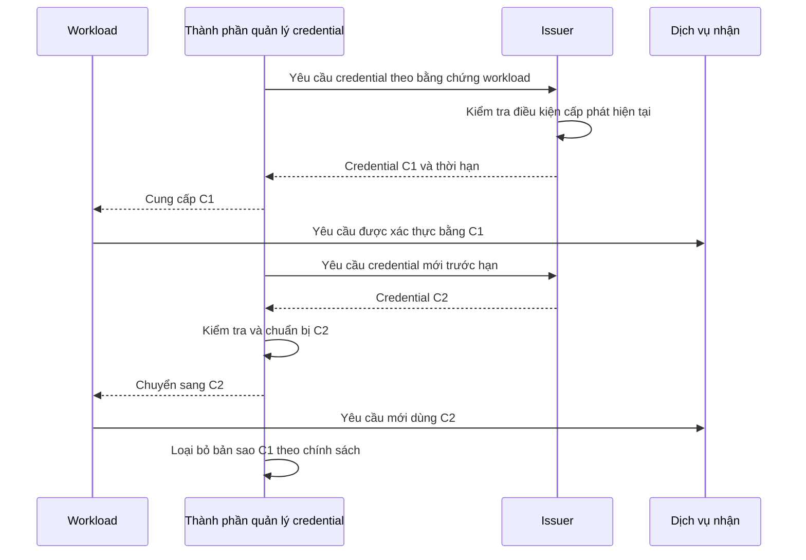

# Identity rotation trong workload identity

Một dịch vụ có thể chạy liên tục nhiều tuần, nhưng bằng chứng mà nó dùng để chứng minh danh tính không nên mặc nhiên có cùng tuổi thọ. Nếu một credential bị lấy cắp, thời gian credential còn được chấp nhận ảnh hưởng trực tiếp đến khoảng thời gian kẻ tấn công có thể mạo danh workload.

Trong ngữ cảnh workload identity, **identity rotation** thường chỉ việc luân chuyển credential, khóa và tài liệu chứng minh danh tính trong khi giữ ổn định danh tính logic của workload. Việc đổi principal hoặc định danh dịch vụ là một thay đổi khác, cần xử lý như di chuyển danh tính và quyền truy cập.

Bài học này giúp người học phân biệt các đối tượng cần luân chuyển, thiết kế vòng đời credential tự động, duy trì kết nối khi chuyển đổi và xử lý trường hợp không gia hạn được hoặc nghi ngờ lộ khóa.

## 1. Phân biệt danh tính với bằng chứng danh tính

Giả sử dịch vụ `invoice-worker` được phép đọc một hàng đợi và ghi kết quả xử lý hóa đơn. Chính sách cấp quyền nên gắn với danh tính dịch vụ trong môi trường tương ứng, thay vì gắn với một chuỗi token sẽ thay đổi thường xuyên.

| Đối tượng | Vai trò | Thay đổi khi nào? |
| --- | --- | --- |
| Danh tính logic, như `invoice-worker` trong production | Cho biết workload nào đang truy cập | Khi thay đổi ranh giới dịch vụ, môi trường, chủ sở hữu hoặc mô hình quyền |
| Credential, như access token hoặc chứng thư | Cung cấp bằng chứng để bên nhận xác thực danh tính | Theo tuổi thọ, chính sách cấp phát hoặc sự kiện bảo mật |
| Khóa riêng của workload | Chứng minh quyền sở hữu khóa trong cơ chế dùng khóa bất đối xứng | Theo chính sách luân chuyển khóa; thay chứng thư không tự bảo đảm đã thay khóa |
| Khóa ký của issuer hoặc CA | Làm cơ sở xác minh credential do bên cấp phát hành | Theo vòng đời hạ tầng tin cậy hoặc khi xử lý sự cố |
| Trust bundle hoặc tập khóa xác minh | Cho bên nhận biết những khóa phát hành nào được tin cậy | Khi thêm, thay hoặc loại bỏ khóa tin cậy |

Ví dụ, hai credential `C1` và `C2` có thể cùng đại diện cho `invoice-worker`. Chúng có thời điểm cấp, thời điểm hết hạn và định danh credential khác nhau. Bên nhận vẫn áp dụng cùng chính sách tối thiểu quyền cho dịch vụ này.

Nếu mỗi lần gia hạn lại tạo một principal mới, chính sách và bản ghi kiểm toán dễ bị phân mảnh. Ngược lại, nếu mọi replica dùng chung một khóa riêng lâu dài, mất một replica có thể làm lộ credential của cả nhóm. Cần chọn rõ mức định danh và phạm vi credential: dịch vụ, instance, phiên chạy hay tác vụ.

## 2. Rotation giảm rủi ro nào?

### 2.1. Giới hạn thời gian sử dụng credential bị lấy cắp

Credential có thời hạn ngắn giúp giới hạn khoảng thời gian một bản sao bị đánh cắp có thể vượt qua kiểm tra thời hạn. Tuy nhiên, điều này chỉ hữu ích khi các bên nhận thực sự kiểm tra hiệu lực và workload có thể nhận credential mới mà không cần lưu một bí mật lâu dài tương đương.

Ví dụ, một bearer token còn hiệu lực trong 15 phút có thể tiếp tục bị sử dụng trong phần thời gian còn lại nếu không có cơ chế chặn bổ sung. Việc cấp token mới cho workload hợp lệ không tự làm token cũ mất hiệu lực.

### 2.2. Giảm phụ thuộc vào thao tác thủ công

Một vòng đời tự động giúp dịch vụ không phải chờ con người thay token trong biến môi trường hoặc triển khai lại chỉ để gia hạn. Tự động hóa cũng cho phép phát hiện sớm các lỗi như agent không kết nối được issuer, ứng dụng không nạp credential mới hoặc bên nhận chưa nhận khóa xác minh mới.

### 2.3. Rotation không thay thế các biện pháp khác

Credential ngắn hạn không sửa được chính sách cấp quá nhiều quyền. Nó cũng không khắc phục một host vẫn đang bị kiểm soát: kẻ tấn công có thể tiếp tục yêu cầu credential mới nếu vẫn đáp ứng điều kiện cấp phát hoặc chiếm được đường gia hạn.

Ngoài ra, thời hạn credential không phải lúc nào cũng là thời hạn của phiên ứng dụng hay kết nối đã xác thực. Một kênh TLS thiết lập trước khi chứng thư hết hạn không mặc nhiên bị đóng đúng lúc chứng thư hết hạn. Cần xem xét riêng tuổi thọ kết nối, cơ chế tái xác thực và cách thực thi thay đổi quyền.

## 3. Vòng đời rotation tự động

Một thiết kế thông thường có ba vai trò: workload, thành phần quản lý credential và issuer. Thành phần quản lý có thể là thư viện trong ứng dụng, agent, proxy hoặc cơ chế do nền tảng cung cấp.



Quá trình này cần bảo đảm các điều kiện sau:

1. Issuer xác định workload đủ điều kiện nhận credential cho đúng danh tính. Tùy nền tảng, việc này dựa vào attestation, danh tính của nền tảng hoặc một chuỗi trao đổi credential được kiểm soát.
2. Credential mới có đúng subject, issuer, đối tượng sử dụng và thời hạn theo hợp đồng. Không được nhận credential cho môi trường hoặc workload khác chỉ vì chữ ký hợp lệ.
3. Ứng dụng sử dụng được credential mới trước khi credential hiện tại hết hiệu lực.
4. Quyết định cấp lại phải tôn trọng trạng thái workload và chính sách hiện tại. Một workload đã bị vô hiệu hóa không nên được tiếp tục gia hạn vô thời hạn.
5. Credential hết hạn không được tiếp tục dùng để mở truy cập mới; không bỏ qua xác thực chỉ để duy trì khả dụng.

SPIFFE minh họa cách tách định danh ổn định khỏi bằng chứng ngắn hạn: SPIFFE ID định danh workload, còn SVID mang bằng chứng có thể xác minh. Workload API cung cấp credential và dữ liệu tin cậy; tài liệu SPIFFE mô tả việc tự động luân chuyển khóa và chứng thư có thời hạn ngắn. [Nguồn: SPIFFE Concepts](https://spiffe.io/docs/latest/spiffe-about/spiffe-concepts/).

## 4. Chọn thời điểm gia hạn và khoảng chồng lấn

### 4.1. Không chờ đến sát hạn

Thời điểm gia hạn cần chừa đủ thời gian cho yêu cầu cấp phát, retry, nạp credential, kiểm tra kết nối và sai lệch đồng hồ. Những yếu tố này phụ thuộc vào hệ thống; không có một tỷ lệ gia hạn cố định phù hợp cho mọi nền tảng.

Một điều kiện thiết kế có thể diễn đạt như sau:

```text
Thời gian còn lại khi bắt đầu gia hạn
    > ngân sách yêu cầu cấp mới
    + ngân sách retry
    + thời gian nạp và chuyển đổi
    + biên an toàn đồng hồ và vận hành
```

Các thành phần trên là ngân sách cần đo và lựa chọn, không phải cam kết rằng issuer luôn phục hồi trong thời gian đó. Khi hệ thống cung cấp SDK hoặc lịch gia hạn chính thức, cần hiểu và dùng cơ chế đó thay vì tự thêm một vòng lặp có thể xung đột.

Jitter làm lệch nhẹ thời điểm gia hạn giữa các replica. Nếu hàng nghìn replica cùng khởi động lúc 10:00 rồi cùng gia hạn lúc 10:40, issuer có thể gặp một đợt tải đột biến ngay cả khi tải trung bình thấp.

### 4.2. Ví dụ chồng lấn hai credential

Đây là lịch giả định để minh họa, không phải cấu hình bắt buộc:

| Thời điểm | Sự kiện |
| --- | --- |
| 10:00 | Cấp `C1`, hết hạn lúc 11:00 |
| 10:40 | Bắt đầu gia hạn, nhận `C2`, hết hạn lúc 11:40 |
| 10:42 | Ứng dụng đã nạp `C2`; yêu cầu mới bắt đầu dùng `C2` |
| 10:42–11:00 | `C1` có thể vẫn được bên nhận chấp nhận nếu chưa bị thu hồi hoặc chặn |
| 11:00 | `C1` hết hạn; bên nhận kiểm tra thời hạn phải từ chối việc dùng `C1` để xác thực mới |

Khoảng chồng lấn hỗ trợ chuyển đổi, nhưng cũng là khoảng cả hai credential có thể được chấp nhận. Không giữ credential cũ vô thời hạn để phòng lỗi. Nếu `C1` bị lộ, lịch chuyển đổi bình thường có thể phải nhường chỗ cho quy trình xử lý sự cố.

### 4.3. Cân bằng tuổi thọ và khả năng vận hành

Tuổi thọ ngắn làm tăng tần suất cấp phát và mức phụ thuộc vào đường gia hạn. Tuổi thọ dài tăng khoảng thời gian tồn tại của credential bị đánh cắp. Khi lựa chọn, cần xét độ nhạy cảm của quyền, đặc tính workload, độ tin cậy của issuer và khả năng chặn credential trước hạn.

Một batch job chạy trong vài phút có nhu cầu khác dịch vụ xử lý liên tục. Một hệ thống ở vùng kết nối gián đoạn cũng có ràng buộc khác một cụm nội bộ ổn định. Không giải quyết sự khác biệt này bằng cách cấp mọi workload một credential dài hạn dùng chung.

## 5. Cấp mới thành công chưa đồng nghĩa chuyển đổi thành công

Rotation có ít nhất ba kết quả cần phân biệt: issuer đã cấp credential mới, workload đã nạp credential mới và dịch vụ nhận đã xác thực thành công credential mới.

### 5.1. Token và cache trong ứng dụng

Nếu ứng dụng chỉ đọc token lúc khởi động rồi cache vô hạn, việc nền tảng cập nhật token trên đĩa không có tác dụng với các yêu cầu tiếp theo. Thành phần gửi yêu cầu cần lấy token từ nguồn có hỗ trợ cập nhật hoặc sử dụng cơ chế refresh phù hợp với thư viện.

Không đưa token vào log để kiểm tra phiên bản. Có thể quan sát thời điểm hết hạn, phiên bản do hệ thống quản lý cấp hoặc định danh credential phù hợp, với kiểm soát truy cập cho dữ liệu quan sát.

### 5.2. Chứng thư, khóa riêng và TLS context

Chứng thư mới và khóa riêng tương ứng phải được nạp nhất quán. Nếu ứng dụng đọc chứng thư mới nhưng khóa cũ, bắt tay TLS có thể thất bại. Việc thay từng file độc lập có thể tạo một khoảng thời gian quan sát thấy cặp dữ liệu không đồng bộ.

Một cách thiết kế là chuẩn bị một bộ credential hoàn chỉnh, kiểm tra bộ đó rồi chuyển tham chiếu đang dùng sang bộ mới bằng cơ chế nguyên tử phù hợp. Cơ chế chính xác phụ thuộc thư viện và nền tảng; thay file không tự bảo đảm một `SSLContext` hoặc connection pool hiện hữu đã được cập nhật.

Tài liệu tích hợp SPIFFE mô tả SPIFFE Helper có thể nhận và ghi credential, theo dõi hạn dùng, chủ động lấy bản mới và gửi tín hiệu cho tiến trình con. Điều này minh họa hai trách nhiệm riêng: phân phối credential và khiến ứng dụng sử dụng credential đã đổi. [Nguồn: Working with SVIDs](https://spiffe.io/docs/latest/deploying/svids/).

### 5.3. Kết nối và tác vụ đang chạy

Yêu cầu đã gửi hoặc một stream dài có thể gắn với trạng thái xác thực cũ. Cần xác định cách xử lý kết nối đang mở: cho hoàn thành trong giới hạn, giảm tuổi thọ connection pool, tái kết nối hoặc đóng theo chính sách sự cố.

Không đóng đồng loạt mọi kết nối chỉ vì nhận một credential mới nếu điều đó gây gián đoạn không cần thiết. Ngược lại, không giả định rằng một kết nối tồn tại hàng ngày vẫn đáp ứng yêu cầu kiểm soát quyền chỉ vì đã xác thực ở lần bắt tay đầu tiên.

## 6. Luân chuyển khóa của issuer và dữ liệu tin cậy

Rotation credential của workload và rotation khóa ký của issuer là hai quá trình có liên quan nhưng khác phạm vi. Nếu workload đã nhận token mới ký bằng `K2`, còn dịch vụ nhận chỉ biết `K1`, việc xác thực vẫn thất bại.

Với một đợt thay khóa ký JWT có kế hoạch, trình tự minh họa là:

1. Phân phối khóa công khai `K2` qua kênh tin cậy đến bên xác minh trước khi dùng nó để ký.
2. Xác nhận đường cập nhật khóa hoạt động, kể cả các cache và instance ít phát sinh lưu lượng.
3. Bắt đầu phát hành token ký bằng `K2`.
4. Giữ khả năng xác minh `K1` cho những token cũ còn hợp lệ trong phạm vi chính sách đã định.
5. Sau khi token cũ cuối cùng hết hiệu lực, cộng biên thời gian đã chấp thuận, loại `K1` khỏi tập khóa được chấp nhận.

Nếu `K1` ký token cuối cùng lúc 10:00 và tuổi thọ tối đa của các token đó là một giờ, loại `K1` lúc 10:05 sẽ làm hỏng những token còn hiệu lực đến 11:00. Nếu token có nhiều loại tuổi thọ, cần xét tất cả loại thuộc phạm vi khóa đó.

Đối với PKI, còn phải xét chuỗi chứng thư, intermediate CA, trust anchor và đường xây dựng chuỗi của bên nhận. Không sao chép máy móc lịch thay khóa JWT sang việc thay root CA. Nguyên tắc chung là bảo đảm đường tin cậy mới đã sẵn sàng trước khi phát hành credential phụ thuộc vào nó.

Trong sự cố lộ khóa ký hoặc CA, có thể cần loại bỏ tin cậy cũ sớm và chấp nhận ảnh hưởng khả dụng. Đây là một quyết định ứng cứu khác với chồng lấn để bảo trì định kỳ.

## 7. Mô hình logic quản lý rotation

Đoạn giả mã dưới đây mô tả hành vi mong muốn, không phải một SDK hay mã để triển khai trực tiếp. Các hàm cấp phát và xác minh phải được hiện thực bằng cơ chế tin cậy của nền tảng.

```text
activeCredential = NONE

onCredentialReceived(candidate):
    verifyCandidateMatchesExpectedWorkload(candidate)
    verifyIssuerAudienceAndLifetimeWhereApplicable(candidate)
    verifyCredentialAndPrivateKeyMatchWhereApplicable(candidate)
    preparedClient = prepareClientUsing(candidate)
    probeAuthenticationWithoutBusinessSideEffects(preparedClient)

    previous = atomicSwapActiveCredentialAndClient(
        candidate, preparedClient
    )
    retirePreviousWithinConnectionAndRetentionPolicy(previous)
    emitRotationSuccessWithoutSecretMaterial()

onRefreshFailure(error):
    recordFailureWithoutSecretMaterial(error)
    if activeCredential exists and isStillValid(activeCredential):
        retryWithBackoffAndJitterWithinRemainingBudget()
    else:
        stopCreatingRequestsRequiringThisCredential()
        exposeCredentialUnavailableState()

beforeNewAuthenticatedRequest():
    snapshot = readActiveCredentialAndClientAtomically()
    requireUsableCredential(snapshot)
    sendRequestUsing(snapshot)
```

Một số điểm cần diễn giải rõ:

- Bước probe chỉ kiểm tra xác thực qua một đường kiểm tra phù hợp; không tạo hóa đơn, chuyển tiền hoặc gọi thao tác có tác dụng phụ để thử credential.
- Nếu probe thất bại, không chuyển sang candidate chưa dùng được. Vẫn phải theo dõi thời gian còn lại của credential hiện tại và cảnh báo nguyên nhân.
- Việc “retire” bản cũ tại workload không chứng minh mọi bản sao bị lấy cắp đã bị thu hồi tại bên nhận.
- Nếu có nhiều luồng cùng phát hiện sắp hết hạn, cơ chế single-flight hoặc quản lý tập trung giúp tránh cấp lại đồng thời không cần thiết.
- Tiếp tục retry để phục hồi là hợp lệ; tiếp tục gửi yêu cầu bằng credential đã hết hạn hoặc nới lỏng xác thực là không hợp lệ.

Ứng dụng nên dùng thành phần credential đã có hỗ trợ rotation khi phù hợp. Tự viết vòng lặp gia hạn chỉ nên được cân nhắc khi hiểu rõ hợp đồng cấp phát, đồng hồ, cache, retry và cách thư viện sử dụng credential.

## 8. Ví dụ: invoice-worker gọi dịch vụ lưu trữ

Giả sử có 20 replica của `invoice-worker`. Mỗi replica nhận credential ngắn hạn theo điều kiện của nền tảng. Dịch vụ lưu trữ cho phép danh tính này ghi vào vùng kết quả hóa đơn, nhưng không cho đọc dữ liệu nhân sự.

Luồng vận hành mong muốn gồm:

1. Replica khởi động và chứng minh mình đủ điều kiện nhận danh tính của workload trong production.
2. Thành phần quản lý nhận credential, thiết lập client và chỉ báo sẵn sàng sau khi đường truy cập cần thiết hoạt động.
3. Các replica gia hạn trước hạn với lịch có jitter.
4. Mỗi replica chuyển client cho yêu cầu mới sang credential vừa nhận.
5. Kết nối cũ được xử lý theo giới hạn tuổi thọ và chính sách của dịch vụ.
6. Khi một replica kết thúc, việc cấp credential cho phiên chạy đó phải bị ngăn theo cơ chế của nền tảng; quyền xử lý các credential còn sống được xác định riêng.

Giả sử issuer đã cấp bản mới, nhưng năm replica vẫn báo lỗi sau hạn của bản cũ. Cần kiểm tra chúng có thật sự nạp credential và cập nhật client hay không. Chỉ tăng TTL có thể che lỗi reload mà không sửa nguyên nhân.

Nếu lỗi xảy ra ở mọi replica chỉ khi issuer thay khóa ký, cần kiểm tra đường phân phối và cache khóa xác minh ở dịch vụ lưu trữ. Cấp lại token nhiều lần bằng cùng khóa mới không giúp một bên nhận vẫn chỉ tin khóa cũ.

Quyền không được tăng lên trong lúc chuyển đổi để “thử cho chạy”. Credential mới cho cùng workload phải tiếp tục chịu chính sách tối thiểu quyền đã xác định.

## 9. Xử lý khi nghi ngờ lộ credential

Rotation định kỳ là hoạt động phòng ngừa. Khi có bằng chứng credential bị lấy cắp, chỉ yêu cầu một credential mới là chưa đủ.

Cần xác định ít nhất ba câu hỏi: credential nào đã lộ, kẻ tấn công còn khả năng xin credential mới không và những bên nhận nào có thể vẫn chấp nhận credential cũ.

Một quy trình ứng cứu có thể gồm:

1. Cô lập workload hoặc môi trường bị xâm nhập và chặn đường cấp lại trái phép.
2. Vô hiệu hóa registration, điều kiện attestation hoặc quyền cấp phát liên quan khi cơ chế hỗ trợ.
3. Chặn credential cũ bằng cơ chế thu hồi, deny policy hoặc thay đổi tin cậy phù hợp với loại credential.
4. Đánh giá và xử lý các phiên, stream hoặc kết nối đã được thiết lập bằng credential đó.
5. Cấp credential mới cho workload sạch và xác nhận quyền truy cập cần thiết.
6. Đối chiếu audit để tìm hành động phát sinh trong khoảng credential có thể bị lạm dụng.

Với token tự chứa được kiểm tra ngoại tuyến, ngừng cấp token mới không tự thông báo cho mọi bên nhận rằng token cũ đã bị thu hồi. Muốn dừng trước hạn cần một cơ chế thực thi bổ sung tại nơi xác minh hoặc nơi cấp quyền. Khả năng cụ thể phụ thuộc thiết kế.

Với chứng thư và khóa riêng bị lộ, cũng không được mặc định mọi hệ thống đã kiểm tra thu hồi theo thời gian thực. Phải biết cơ chế đang triển khai, thời gian lan truyền và ảnh hưởng đến các kết nối đã mở.

## 10. Theo dõi rotation bằng tín hiệu vận hành

Đếm số lần issuer cấp credential là chưa đủ. Tín hiệu tốt cần phản ánh cả cấp phát, nạp, sử dụng và từ chối.

| Tín hiệu | Ý nghĩa khi có bất thường | Hướng kiểm tra |
| --- | --- | --- |
| Thời gian còn lại của credential đang được ứng dụng dùng | Có nguy cơ hết hạn dù issuer có thể vẫn hoạt động | Lịch gia hạn, đường gọi issuer, cache và reload |
| Lần rotation thành công gần nhất tại workload | Không có bằng chứng chuyển đổi trong thời gian dự kiến | Agent, SDK, luồng xử lý cập nhật |
| Số lỗi gia hạn theo nguyên nhân | Phân biệt quá tải, mạng, từ chối cấp phát, lỗi định danh | Issuer, chính sách và bằng chứng workload |
| Độ trễ từ lúc cấp đến lúc dùng bản mới | Phát hiện bản mới bị kẹt ở bước phân phối hoặc nạp | File watcher, TLS context, client cache |
| Lỗi xác thực sau rotation | Có thể sai audience, issuer, khóa tin cậy hoặc thời gian | Log lý do từ chối đã lọc dữ liệu nhạy cảm |
| Số bên nhận còn dùng dữ liệu tin cậy cũ | Có nguy cơ lỗi khi chuyển khóa ký | Cache khóa và đường phân phối trust bundle |

Ngưỡng cảnh báo nên gắn với ngân sách phục hồi. Nếu cần mười phút để xử lý một lỗi phổ biến mà cảnh báo chỉ xuất hiện khi credential còn hai phút, cảnh báo đến quá muộn cho tình huống đó.

Không ghi bearer token, khóa riêng hoặc toàn bộ header xác thực vào log. Nhật ký nên giúp liên hệ danh tính workload, thời điểm, issuer, kết quả và định danh sự kiện; dữ liệu nhận diện instance cũng cần được quản lý phù hợp, tránh tạo số lượng nhãn metric không giới hạn.

## 11. Các tình huống cần kiểm chứng khi thiết kế

Những tình huống sau là bài tập kiểm chứng cho hệ thống triển khai, không phải một lần QA hay chạy thử đã được thực hiện trong bài viết này.

### Tình huống A: Issuer gián đoạn tạm thời

Workload đang có credential còn hiệu lực nhưng một lượt gia hạn thất bại. Hành vi mong muốn là tiếp tục dùng credential hợp lệ trong giới hạn chính sách, retry có backoff và jitter, đồng thời quan sát thời gian còn lại. Nếu credential hết hạn trước khi phục hồi, những thao tác cần danh tính đó phải dừng hoặc trả lỗi rõ ràng.

### Tình huống B: Credential mới đã xuất hiện nhưng ứng dụng không reload

Hệ thống phải phân biệt được “đã cấp” và “đang dùng”. Kiểm tra bằng yêu cầu mới hoặc telemetry phía client và bên nhận phù hợp. Không kết luận thành công chỉ từ thời gian cập nhật của file credential.

### Tình huống C: Khóa xác minh mới chưa đến bên nhận

Triển khai canary hoặc một bước kiểm tra có kiểm soát để phát hiện sự lệch nhau giữa phát hành và xác minh. Với thay khóa có kế hoạch, hoàn tất phân phối tin cậy mới trước khi mở rộng phát hành bằng khóa mới.

### Tình huống D: Một replica bị xâm nhập

Kiểm tra có thể ngăn replica đó nhận credential mới hay không, có thể chặn credential đã phát hành đến mức nào và phạm vi ảnh hưởng là một instance hay cả dịch vụ. Kết quả phụ thuộc cách tách khóa, attestation và chính sách cấp phát; không chỉ phụ thuộc TTL.

### Tình huống E: Đổi principal

Nếu chuyển từ `invoice-worker-v1` sang một principal mới, cần chuyển chính sách và đối chiếu audit như một đợt di chuyển danh tính. Thời gian cả hai principal có quyền phải được giới hạn và theo dõi. Gia hạn một credential bình thường không đòi hỏi quy trình thay principal này.

## 12. Câu hỏi tự kiểm tra

**Vì sao đã cấp credential mới mà credential cũ vẫn gọi API được?**

Vì cấp mới và thu hồi là hai hành động khác nhau. Credential cũ có thể vẫn còn hạn và chưa bị chặn tại bên nhận. Một kết nối đã xác thực trước đó cũng có thể có vòng đời riêng.

**Thay chứng thư có chắc đã thay khóa riêng không?**

Không. Có thể cấp chứng thư mới cho cùng một khóa. Nếu mục tiêu là giảm thời gian tồn tại của khóa hoặc xử lý lộ khóa, cần xác nhận quy trình thực sự tạo và chuyển sang khóa mới.

**Có nên kéo dài TTL mỗi khi thấy lỗi hết hạn?**

Cần xác định nguyên nhân trước. Lỗi có thể nằm ở đường gia hạn, quyền cấp phát, tải issuer, đồng hồ hoặc cơ chế nạp credential. TTL dài hơn là một thay đổi về rủi ro và khả dụng, không phải cách sửa mặc định cho lỗi rotation.

**Một thiết kế rotation hoàn chỉnh cần chứng minh điều gì?**

Workload hợp lệ nhận được credential đúng phạm vi, chuyển sang sử dụng bản mới trước hạn, loại bỏ bản cũ theo chính sách và có hành vi rõ ràng khi cấp lại thất bại. Hệ thống còn phải kiểm soát dữ liệu tin cậy, phiên đã mở và khả năng chặn truy cập khi có sự cố. Danh tính logic và quyền tối thiểu phải tiếp tục nhất quán trong suốt quá trình.
