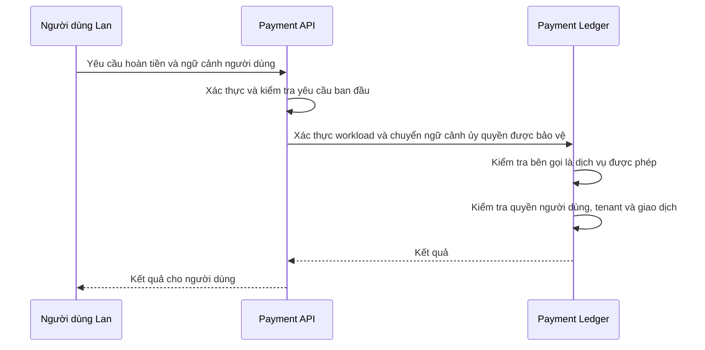

# Human identity khác workload identity như thế nào?

## 1. Hai loại chủ thể cùng cần IAM

Trong quản lý danh tính và quyền truy cập, **human identity** đại diện cho một con người, còn **workload identity** đại diện cho một thành phần phần mềm đang thực thi công việc. Cả hai đều cần được nhận diện, xác thực, cấp quyền, theo dõi và thu hồi quyền, nhưng không có cùng vòng đời hoặc cách chứng minh danh tính.

Ví dụ, một hệ thống thanh toán có các chủ thể sau:

- Lan là nhân viên kế toán, đăng nhập để xem hóa đơn và yêu cầu hoàn tiền.
- `payment-api` là dịch vụ nhận yêu cầu thanh toán từ ứng dụng.
- `settlement-job` là tác vụ tự động đối soát giao dịch mỗi đêm.
- Một phiên chạy CI/CD xây dựng và triển khai phiên bản mới của `payment-api`.

Lan là chủ thể con người. Ba thành phần còn lại là các workload. Người tạo hoặc vận hành chúng vẫn cần được ghi nhận, nhưng workload không trở thành human identity chỉ vì có một người chịu trách nhiệm.

Sự phân biệt này quyết định hệ thống dùng cách xác thực nào, quyền thuộc về ai và phải vô hiệu hóa điều gì khi nhân viên nghỉ việc hoặc một dịch vụ bị xâm nhập. Nếu dùng chung tài khoản cho mọi trường hợp, những quyết định đó trở nên khó thực hiện và khó kiểm toán.

## 2. Phân biệt danh tính, tài khoản và thông tin xác thực

Trước khi so sánh, cần tách ba khái niệm thường bị dùng lẫn nhau.

| Khái niệm | Ý nghĩa | Ví dụ với con người | Ví dụ với workload |
| --- | --- | --- | --- |
| Danh tính — identity | Đại diện cho chủ thể trong một ngữ cảnh tin cậy | Nhân viên Lan trong tổ chức | Dịch vụ `payment-api` trong môi trường production |
| Tài khoản hoặc bản ghi principal | Đối tượng hệ thống dùng để quản lý thuộc tính và quyền của chủ thể | Tài khoản nhân viên trong hệ thống quản lý danh tính | Service account hoặc principal được đăng ký cho dịch vụ |
| Thông tin xác thực — credential | Dữ liệu hoặc phương tiện dùng để chứng minh danh tính | Passkey, mật khẩu kết hợp yếu tố bổ sung, chứng thư | Token, chứng thư và khóa riêng, hoặc credential được nền tảng cấp |

Một người có thể có nhiều tài khoản cho những ngữ cảnh khác nhau, chẳng hạn tài khoản thông thường và tài khoản quản trị. Một workload cũng có thể có nhiều instance chạy đồng thời, sử dụng credential khác nhau nhưng cùng đại diện cho một danh tính dịch vụ.

Vì vậy, không nên đồng nhất identity với một token cụ thể. Khi token được thay mới, danh tính logic có thể vẫn giữ nguyên. Ngược lại, hai bên cùng dùng một credential có thể khiến hệ thống chỉ nhìn thấy một principal, dù thực tế có nhiều người hoặc nhiều chương trình khác nhau đang sử dụng nó.

**Principal** là thực thể mà hệ thống có thể gắn quyền và đưa ra quyết định truy cập. Thuật ngữ này có thể áp dụng cho cả con người lẫn workload; tên gọi principal không tự chỉ ra loại chủ thể.

## 3. Bảng so sánh cốt lõi

| Khía cạnh | Human identity | Workload identity |
| --- | --- | --- |
| Chủ thể được đại diện | Một con người | Dịch vụ, tiến trình, tác vụ hoặc phiên thực thi phần mềm |
| Nguồn vòng đời | Tuyển dụng, hợp đồng, thay đổi vai trò, nghỉ việc | Triển khai, khởi động, mở rộng số instance, kết thúc job, ngừng dịch vụ |
| Cách tương tác | Có thể tham gia đăng nhập, xác nhận và khôi phục tài khoản | Thường cần hoạt động tự động, không có người xác nhận mỗi lần |
| Bằng chứng nhận diện | Thông tin nhân sự hoặc quy trình định danh, cùng cơ chế đăng nhập | Bằng chứng từ môi trường thực thi, đăng ký workload hoặc cơ chế bootstrap được tin cậy |
| Xác thực điển hình | Đăng nhập qua IdP, MFA, passkey hoặc chứng thư tùy thiết kế | Token có thời hạn, mTLS, credential được cấp theo workload hoặc liên kết danh tính |
| Cách tổ chức quyền | Theo nhiệm vụ, bộ phận, vai trò và ngữ cảnh của người dùng | Theo chức năng phần mềm, tài nguyên phụ thuộc, môi trường và phiên thực thi |
| Chủ thể chịu trách nhiệm quản lý | Chính người dùng cùng các bộ phận quản lý liên quan | Đội hoặc người sở hữu workload, dù họ không phải principal thực thi |
| Dấu vết truy cập cần thiết | Người nào thực hiện hành động và trong phiên nào | Workload nào, instance hoặc job nào thực thi; người dùng nào được đại diện nếu có |
| Rủi ro nổi bật | Lừa đảo đăng nhập, chiếm phiên, lạm dụng quyền người dùng | Rò rỉ secret, chiếm workload, cấu hình cấp danh tính quá rộng, dùng chung credential |

Đây là các khác biệt thiết kế, không phải quy tắc rằng credential của hai loại phải có định dạng khác nhau. Cả người dùng và workload đều có thể sử dụng token hoặc chứng thư. Ý nghĩa của credential phụ thuộc chủ thể mà nó đại diện và cách nó được cấp, xác minh, sử dụng.

## 4. Human identity gắn với con người và trách nhiệm cá nhân

### 4.1. Vòng đời theo quan hệ với tổ chức

Một tài khoản nhân viên thường bắt đầu từ quan hệ lao động hoặc hợp đồng. Khi người đó đổi bộ phận, đổi nhiệm vụ hoặc nghỉ việc, tổ chức cần cập nhật hoặc thu hồi quyền tương ứng.

Mô hình thường gặp là joiner–mover–leaver:

1. **Joiner:** tạo tài khoản và cấp quyền cần cho vai trò ban đầu.
2. **Mover:** thay đổi quyền khi nhiệm vụ hoặc quan hệ công việc thay đổi.
3. **Leaver:** vô hiệu hóa khả năng truy cập khi quan hệ kết thúc.

Tài khoản tồn tại nhiều năm không có nghĩa mọi quyền và mọi phiên đăng nhập đều nên tồn tại trong từng ấy thời gian. Quyền cần được rà soát; phiên và credential cần được quản lý theo mức rủi ro của hành động.

### 4.2. Có thể yêu cầu người dùng tham gia xác thực

Con người có thể thao tác với thiết bị xác thực, chấp nhận một thử thách hoặc xác nhận lại trước hành động nhạy cảm. Vì thế, MFA và xác thực tăng cường theo ngữ cảnh là các công cụ phù hợp trong nhiều luồng human identity.

Không phải mọi API request của người dùng đều phải xuất hiện một màn hình MFA. Thông thường, người dùng đăng nhập để tạo phiên hoặc nhận credential, rồi ứng dụng sử dụng chúng theo chính sách. Yêu cầu xác thực lại phụ thuộc hành động, thời gian, rủi ro và thiết kế phiên.

### 4.3. Khả năng truy trách nhiệm không chỉ là biết tên đăng nhập

Một tài khoản riêng giúp gắn sự kiện với một người, nhưng vẫn cần ngữ cảnh: thời điểm, phiên, thiết bị, cơ chế xác thực và hành động. Khi tài khoản bị chiếm, log chứng minh credential của tài khoản đã được sử dụng; không tự chứng minh chính người sở hữu đã chủ ý thực hiện hành động đó.

Vì vậy, không nên dùng chung tài khoản cá nhân giữa nhiều người. Cũng không nên để một chương trình âm thầm dùng tài khoản đó cho các hoạt động tự động, vì log sẽ khó phân biệt hành động trực tiếp của người với hành động của chương trình.

## 5. Workload identity gắn với chức năng thực thi

### 5.1. Vòng đời có thể ngắn và thay đổi nhanh

Một instance của dịch vụ có thể chỉ tồn tại trong vài phút, trong khi dịch vụ logic tồn tại nhiều năm. Một job CI/CD có thể kết thúc ngay sau khi triển khai xong. Hệ thống IAM cho workload phải xử lý được việc cấp và thay credential tự động mà không phụ thuộc vào thao tác đăng nhập của con người cho mỗi lần chạy.

Cần phân biệt:

- **Danh tính dịch vụ logic:** cho biết đây là `payment-api` của production.
- **Danh tính hoặc định danh phiên thực thi:** giúp phân biệt instance, container hoặc lần chạy cụ thể khi cần.

Không phải kiến trúc nào cũng cần một principal cấp quyền riêng cho từng instance. Tuy nhiên, nếu nhiều instance dùng chung danh tính dịch vụ, hệ thống vẫn nên có cách ghi nhận phiên thực thi phù hợp với yêu cầu điều tra và vận hành. Không nên khẳng định một token chung xác định được duy nhất từng tiến trình nếu thiết kế thực tế không cung cấp thông tin đó.

### 5.2. Không có người đứng cạnh mỗi lần cần truy cập

Một tác vụ đối soát ban đêm phải tự nhận credential hoặc sử dụng cơ chế xác thực đã được thiết kế cho nó. Bắt job nhập mật khẩu và chờ người duyệt MFA mỗi lần chạy làm mất tính tự động, đồng thời dễ dẫn đến việc lưu credential cá nhân trong cấu hình để né quy trình.

Workload có thể sử dụng bằng chứng từ nền tảng hoặc môi trường thực thi để nhận credential có thời hạn. Hệ thống có thể kiểm tra thuộc tính như môi trường, service account hoặc ngữ cảnh chạy trước khi cấp danh tính. Cách này vẫn có giả định tin cậy; credential không tự xuất hiện mà không có nguồn cấp hoặc cơ chế bootstrap.

### 5.3. Workload vẫn cần người sở hữu

Danh tính không phải con người không đồng nghĩa với danh tính không có người chịu trách nhiệm. Mỗi workload cần có đội hoặc đầu mối sở hữu để giải thích mục đích, phê duyệt quyền, xử lý sự cố và ngừng sử dụng danh tính khi phần mềm không còn hoạt động.

Người sở hữu có thể thay đổi mà không cần đổi toàn bộ danh tính dịch vụ. Khi một kỹ sư chuyển nhóm, đội mới có thể tiếp quản workload; không nên để dịch vụ ngừng chạy chỉ vì tài khoản cá nhân của kỹ sư đó bị vô hiệu hóa.

## 6. Vì sao không dùng tài khoản cá nhân cho chương trình?

Giả sử Lan tạo một access token từ tài khoản của mình rồi đưa vào tác vụ đối soát. Tác vụ có thể chạy được, nhưng thiết kế đã gắn hoạt động tự động vào quyền và vòng đời của Lan.

Những vấn đề có thể xuất hiện:

| Vấn đề | Ví dụ cụ thể |
| --- | --- |
| Quyền rộng hơn nhu cầu của tác vụ | Lan được xem nhiều loại dữ liệu, trong khi job chỉ cần đọc giao dịch đã chốt |
| Vòng đời bị nối sai | Lan nghỉ việc và token bị thu hồi khiến job ngừng hoạt động |
| Khó truy trách nhiệm | Log chỉ thấy tài khoản Lan, không biết Lan thao tác hay job thực thi |
| Khó chuyển giao | Đổi người phụ trách đòi hỏi thay credential trong nhiều nơi |
| Rò rỉ credential gây ảnh hưởng rộng | Secret bị lấy từ pipeline có thể mở quyền vượt ngoài phạm vi job |

Thiết kế phù hợp hơn là tạo danh tính riêng cho `settlement-job`, cấp đúng quyền đọc giao dịch cần đối soát và ghi kết quả vào nơi được chỉ định. Lan hoặc đội của Lan được ghi nhận là người quản lý workload, thay vì trở thành principal mà job mượn để truy cập.

Việc dùng một service account cũng chưa đủ nếu account đó là tài khoản dùng chung cho hàng chục ứng dụng với quyền quản trị toàn hệ thống. Mục tiêu là phân tách quyền và vòng đời theo trách nhiệm thực tế, không chỉ đổi tên tài khoản.

## 7. Xác thực: phương tiện có thể giống nhau, ý nghĩa khác nhau

### 7.1. Đừng phân loại danh tính chỉ bằng token

Một JWT có thể đại diện cho người dùng, cho ứng dụng hoặc cho một ngữ cảnh có cả hai. Một chứng thư cũng có thể đại diện cho con người, thiết bị hoặc dịch vụ tùy cách cấp và cách xác minh.

Khi tiếp nhận credential, hệ thống cần hiểu hợp đồng của nguồn cấp: chủ thể là ai, credential dành cho tài nguyên nào, còn hiệu lực không và những thuộc tính nào được tin cậy. Không nên mặc định một trường có tên `sub`, `user` hoặc `client` luôn mang cùng ý nghĩa ở mọi nguồn cấp.

### 7.2. MFA của người dùng không tự bảo vệ credential của workload

Lan có thể đăng nhập bằng MFA trước khi cấu hình một pipeline. Điều đó giúp bảo vệ hoạt động đăng nhập của Lan, nhưng không có nghĩa secret mà pipeline lưu sau đó được bảo vệ khỏi sao chép hoặc lạm dụng lúc chạy.

Ngược lại, việc workload dùng hai secret tĩnh không tự động tạo ra bảo đảm tương đương với một cơ chế MFA đã được thiết kế đúng cho người dùng. Cần xem xét yếu tố, nguồn tin cậy, cách bảo vệ và ràng buộc với chủ thể, thay vì đếm số trường credential.

### 7.3. Giảm secret tĩnh không có nghĩa không còn credential

Một cơ chế workload identity có thể giúp ứng dụng không phải giữ mật khẩu dài hạn trong file cấu hình. Tuy vậy, vẫn tồn tại khóa, token, chứng thư hoặc bằng chứng ở một hoặc nhiều thành phần của hệ thống.

Vẫn cần bảo vệ nơi cấp credential, kênh truyền và bộ nhớ hoặc file chứa credential khi sử dụng. Credential ngắn hạn bị đánh cắp vẫn có thể có giá trị trong khoảng còn hiệu lực, tùy cơ chế ràng buộc và kiểm tra ở tài nguyên.

## 8. Phân quyền: chức năng phần mềm và nhiệm vụ người dùng

Human identity thường được cấp quyền theo nhiệm vụ của người dùng. Workload identity thường được cấp quyền theo chức năng kỹ thuật hoặc nghiệp vụ của phần mềm. Cả hai đều phải tuân theo nguyên tắc ít quyền nhất.

Ví dụ:

```text
Người dùng Lan:
  Có thể yêu cầu hoàn tiền trong phạm vi nghiệp vụ được giao.

Workload payment-api:
  Có thể gọi endpoint thực hiện hoàn tiền của payment-ledger.
  Không được sửa hồ sơ nhân sự.

Workload settlement-job:
  Có thể đọc giao dịch đã chốt và ghi báo cáo đối soát.
  Không được tạo yêu cầu hoàn tiền.
```

Đây là mô tả chính sách khái niệm, không phải cú pháp cấu hình của một sản phẩm.

RBAC hoặc ABAC đều có thể áp dụng cho cả hai loại danh tính. Với con người, thuộc tính có thể là nhóm nghiệp vụ và phạm vi phụ trách; với workload, có thể là môi trường và chức năng dịch vụ. Không nên cho rằng RBAC chỉ dành cho người hoặc ABAC chỉ dành cho máy.

Tách principal giữa development và production cũng giúp tránh một môi trường ít được kiểm soát nhận quyền trên dữ liệu production chỉ vì cùng tên ứng dụng. Môi trường cần được xác định từ nguồn tin cậy, không phải một tham số tùy ý do bên gọi tự gửi.

## 9. Khi một yêu cầu có cả người dùng lẫn workload

Nhiều hành động không thể mô tả chỉ bằng một loại danh tính. Lan bấm “Hoàn tiền”, ứng dụng gửi yêu cầu đến `payment-api`, rồi dịch vụ này gọi `payment-ledger`. Có ít nhất hai câu hỏi:

1. `payment-api` có phải dịch vụ được phép gọi `payment-ledger` không?
2. Người dùng mà dịch vụ đang đại diện có được hoàn tiền giao dịch cụ thể này không?

Xác thực dịch vụ chỉ trả lời một phần. Nếu mọi yêu cầu đi qua `payment-api` đều được hoàn tiền bất kể quyền người dùng, dịch vụ đã trở thành một đường nâng quyền.



Sơ đồ thể hiện các kiểm tra logic. Cơ chế truyền ngữ cảnh có thể khác giữa các kiến trúc; không phải cứ chuyển nguyên token đầu vào là hợp lệ. Token dành cho `payment-api` có thể không được chấp nhận ở `payment-ledger`. Việc truyền tiếp, trao đổi token hoặc dùng một cơ chế ủy quyền khác phải theo hợp đồng của hệ thống.

Ngữ cảnh người dùng không nên chỉ là một header như `X-User: lan` mà bên gọi bất kỳ có thể tự sửa. Dịch vụ nhận phải có cơ sở tin cậy ngữ cảnh đó và biết bên trung gian nào đã chuyển nó. Các gateway hoặc proxy cũng cần kiểm soát việc loại bỏ và thiết lập lại những header thuộc miền tin cậy của mình.

Trong log, nên phân biệt **chủ thể được đại diện** và **bên thực thi hành động**. Tên trường cụ thể phụ thuộc hệ thống; điều quan trọng là không làm mất dấu workload trung gian khi giữ danh tính người dùng, hoặc làm mất dấu người dùng khi chỉ ghi danh tính dịch vụ.

## 10. Workload có quyền riêng hay đang được ủy quyền?

Hai chế độ này cần được phân biệt trong chính sách.

### 10.1. Hoạt động theo quyền của chính workload

`settlement-job` chạy theo lịch và đọc các giao dịch đã chốt. Không có một người dùng đang đăng nhập để tác vụ đại diện trong mỗi lần chạy. Tác vụ sử dụng quyền được cấp cho danh tính của chính nó.

Người bật lịch chạy hoặc phê duyệt triển khai vẫn là dữ liệu kiểm toán quan trọng. Tuy nhiên, không nên tạo một danh tính người dùng giả để khiến log của job trông giống thao tác tương tác.

### 10.2. Hoạt động thay mặt người dùng

`payment-api` xử lý yêu cầu hoàn tiền của Lan. Trong trường hợp này, quyền gọi liên dịch vụ của `payment-api` không tự cho Lan quyền trên mọi giao dịch. Hệ thống còn phải kiểm tra phạm vi ủy quyền, quyền của Lan và điều kiện nghiệp vụ.

Có thể hình dung quyết định cho phép như sau:

```text
Cho phép hoàn tiền khi đồng thời thỏa:
  Workload gọi đến được phép sử dụng chức năng hoàn tiền.
  Ngữ cảnh người dùng hoặc ủy quyền đã được xác minh.
  Người dùng được phép hoàn tiền cho tenant và giao dịch này.
  Hành động nằm trong phạm vi ủy quyền được chấp nhận.
  Các điều kiện nghiệp vụ bắt buộc đều đạt.
```

Đây là cách diễn giải cho ví dụ, không phải công thức áp dụng giống nhau cho mọi hệ thống. Một số kiến trúc dùng quyết định hoặc grant được phê duyệt trước; khi ấy hệ thống phải xác minh grant tương ứng và các ràng buộc của nó.

### 10.3. Tác vụ bất đồng bộ sau khi phiên người dùng kết thúc

Một người dùng có thể yêu cầu tạo báo cáo mất nhiều phút. Workload xử lý hàng đợi tiếp tục công việc khi trình duyệt đã đóng. Trường hợp này cần quy định rõ quyền đã được ghi nhận tại lúc nhận yêu cầu hay phải được kiểm tra lại lúc thực thi, và điều gì xảy ra nếu quyền của người dùng bị thu hồi trong khoảng chờ.

Không nên mặc định phiên trình duyệt còn tồn tại mãi, hoặc lưu mật khẩu người dùng trong hàng đợi để đăng nhập lại. Tác vụ cần danh tính workload riêng và một biểu diễn công việc hoặc ủy quyền được bảo vệ, có phạm vi và vòng đời thích hợp.

## 11. Vòng đời và thu hồi quyền khác nhau ở điểm nào?

| Sự kiện | Đối với human identity | Đối với workload identity |
| --- | --- | --- |
| Nhân viên nghỉ việc | Vô hiệu hóa tài khoản, xử lý phiên và quyền của người đó | Đổi người sở hữu nếu cần; rà soát credential hoặc cấu hình người đó có thể kiểm soát |
| Một instance bị dừng | Không trực tiếp quyết định vòng đời tài khoản người dùng | Ngừng cấp hoặc gia hạn cho instance theo thiết kế; xử lý credential còn hiệu lực |
| Ứng dụng ngừng sử dụng | Người dùng có thể vẫn cần tài khoản cho ứng dụng khác | Ngừng danh tính dịch vụ và các quyền, liên kết tin cậy không còn cần thiết |
| Một credential bị lộ | Xử lý credential, phiên và phạm vi ảnh hưởng của tài khoản | Xử lý credential, môi trường chạy và khả năng tiếp tục xin credential mới |
| Đổi chức năng nghiệp vụ | Rà soát vai trò và nhiệm vụ của người dùng | Rà soát quyền theo chức năng mới của phần mềm |

Thu hồi cũng cần phân biệt chặn cấp mới, chặn gia hạn và vô hiệu hóa credential đang tồn tại. Một token có thời hạn ngắn không đồng nghĩa có thể bị thu hồi tức thì ở mọi dịch vụ. Kết nối hoặc phiên đã thiết lập có thể có quy tắc đánh giá lại riêng.

Đối với workload bị xâm nhập, chỉ xoay token có thể chưa đủ nếu tiến trình bị kiểm soát vẫn có quyền xin token mới. Cần xử lý cơ sở cấp danh tính, môi trường thực thi hoặc chính sách tài nguyên tương ứng với tình huống.

Đối với con người, đổi mật khẩu cũng không nên được mặc định là đã chấm dứt mọi phiên và mọi credential dẫn xuất. Hiệu lực thực tế phụ thuộc cơ chế quản lý phiên và thu hồi của hệ thống.

## 12. Một số trường hợp dễ phân loại nhầm

### 12.1. “Tài khoản này có tên robot nên chắc là workload identity”

Tên không đủ để xác định loại chủ thể. Một tài khoản tên `robot-admin` nhưng dùng mật khẩu chung cho cả đội là một thiết kế khó truy trách nhiệm. Cần xem ai sử dụng nó, nó đại diện cho gì và quyền được quản lý ra sao.

### 12.2. “Kỹ sư khởi chạy job nên job có danh tính của kỹ sư”

Người khởi chạy và principal thực thi là hai dữ kiện riêng. Một lần triển khai có thể được Lan phê duyệt nhưng thực thi bằng danh tính của pipeline. Log nên giữ cả dấu vết phê duyệt lẫn danh tính thực thi, thay vì gộp chúng thành một.

### 12.3. “Có người sở hữu service account nên đó là human identity”

Người sở hữu là đầu mối quản lý. Chủ thể được service account đại diện vẫn có thể là dịch vụ. Cần tách thông tin quản trị với thông tin dùng để quyết định truy cập lúc chạy.

### 12.4. “Mọi thiết bị đều là workload”

Danh tính thiết bị đại diện cho một thiết bị hoặc một thực thể quản lý tương ứng; workload identity đại diện cho phần mềm thực thi. Một thiết bị có thể chạy nhiều workload và được nhiều người sử dụng. Tùy kiến trúc, quyết định truy cập có thể cần cả người dùng, thiết bị và workload.

### 12.5. “Cùng mạng nội bộ thì không cần phân biệt danh tính”

Vị trí mạng không cho biết bên gọi là ai hoặc được phép làm gì. Một workload khác cùng mạng có thể có chức năng và quyền hoàn toàn khác. Kiểm soát mạng hỗ trợ giới hạn đường truy cập, nhưng không thay thế danh tính và phân quyền ở tài nguyên.

## 13. Các câu hỏi cần trả lời khi thiết kế

Để chọn mô hình phù hợp, hãy bắt đầu từ chủ thể và hành động cụ thể:

1. Hành động này do con người trực tiếp yêu cầu, do chương trình tự động thực hiện hay có cả hai?
2. Principal nào cần xuất hiện trong quyết định phân quyền, và ai là người hoặc đội sở hữu principal đó?
3. Hệ thống có cơ sở nào để tin danh tính: đăng nhập người dùng, bằng chứng môi trường hay một cơ chế khác?
4. Credential có phạm vi tài nguyên và thời hạn thế nào; bên nào có thể lấy, lưu hoặc sử dụng nó?
5. Workload hoạt động bằng quyền riêng hay đang đại diện cho người dùng trong một phạm vi đã xác định?
6. Khi người dùng đổi vai trò, instance bị dừng hoặc ứng dụng ngừng hoạt động, quyền nào phải thay đổi?
7. Log có phân biệt được người khởi tạo, workload thực thi và đối tượng tài nguyên bị tác động không?

Ví dụ, với một job đọc dữ liệu đối soát, câu trả lời có thể là: workload chạy tự động bằng quyền riêng, danh tính do nền tảng cấp theo ngữ cảnh chạy, quyền chỉ đọc tập dữ liệu cần thiết, đội tài chính sở hữu và mỗi lần chạy có mã tương quan trong log. Khi đã mô tả được như vậy, việc chọn token, chứng thư hay cơ chế cấp credential mới có cơ sở rõ ràng.

## 14. Những điểm cần ghi nhớ

Human identity và workload identity khác nhau trước hết ở chủ thể được đại diện và vòng đời quản lý. Con người có thể tham gia đăng nhập và xác nhận tương tác; workload cần xác thực tự động dựa trên một cơ sở tin cậy phù hợp với môi trường thực thi.

Cả hai đều cần quyền tối thiểu, credential được bảo vệ, khả năng thu hồi và kiểm toán. Một yêu cầu có thể đồng thời mang danh tính người dùng và workload; giữ rõ hai vai trò giúp kiểm tra đúng quyền, tránh việc dịch vụ trở thành đường nâng quyền và xác định đúng trách nhiệm khi điều tra sự kiện.
