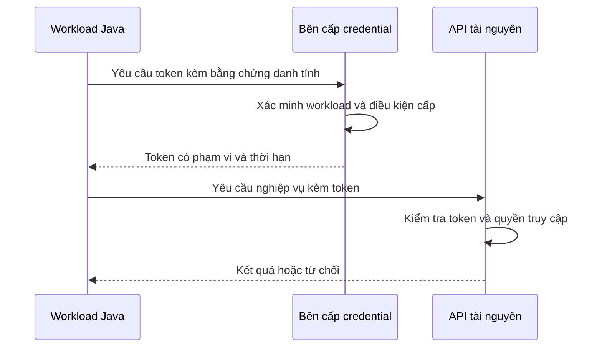

# Service account là gì?

## 1. Danh tính dành cho phần mềm thực hiện công việc

**Service account**, hay tài khoản dịch vụ, là một danh tính được tạo để ứng dụng, dịch vụ hoặc tác vụ tự động sử dụng khi truy cập tài nguyên. Nó giúp hệ thống nhận biết phần mềm nào đang gửi yêu cầu và quyết định phần mềm đó được phép làm gì.

Ví dụ, một batch job Java chạy mỗi đêm để đọc dữ liệu hóa đơn và tạo báo cáo. Công việc phải tiếp tục ngay cả khi người viết chương trình đổi mật khẩu, nghỉ phép hoặc rời công ty. Thay vì chạy bằng tài khoản cá nhân của lập trình viên, job sử dụng service account dành riêng cho chức năng xuất báo cáo.

Khi job truy cập database hoặc API, tài khoản dịch vụ là danh tính có thể được ghi trong quyết định cấp quyền và audit log. Người vận hành vẫn chịu trách nhiệm về job, nhưng không cần đưa credential cá nhân của mình vào ứng dụng.

Một service account có thể được dùng bởi:

- Dịch vụ backend gọi API của dịch vụ khác.
- Batch job đọc dữ liệu và tạo báo cáo.
- Pipeline CI/CD triển khai một ứng dụng.
- Agent giám sát gửi số liệu vận hành.
- Tiến trình sao lưu hoặc đồng bộ dữ liệu.

Tên gọi và cách triển khai khác nhau giữa hệ điều hành, database, nền tảng container và hệ thống IAM. Điểm chung là danh tính này phục vụ **hoạt động của phần mềm**, với quyền và vòng đời cần được quản lý rõ ràng.

## 2. Service account nằm ở đâu trong mô hình IAM?

Để hiểu tài khoản dịch vụ, cần tách bốn khái niệm thường bị gộp làm một.

| Khái niệm | Ý nghĩa | Ví dụ minh họa |
|---|---|---|
| Danh tính hoặc principal | Chủ thể được hệ thống nhận diện để đưa ra quyết định truy cập | Principal của job `invoice-report-prod` |
| Credential | Bằng chứng hoặc phương tiện được dùng để chứng minh danh tính | Token truy cập, khóa riêng gắn với chứng thư, secret |
| Quyền hoặc permission | Hành động được phép thực hiện trên một phạm vi tài nguyên | Đọc hóa đơn đã chốt, ghi file vào vùng báo cáo |
| Role hoặc nhóm quyền | Cách tập hợp và gán một số quyền cho chủ thể | Role đọc dữ liệu báo cáo |

Service account là **danh tính**, không phải bản thân mật khẩu, token hoặc role của nó.

Một service account có thể tồn tại lâu dài trong khi credential được thay nhiều lần. Thay token không nhất thiết tạo danh tính mới. Ngược lại, xóa một token khỏi cấu hình ứng dụng không đồng nghĩa đã xóa tài khoản hoặc thu hồi các credential khác của cùng tài khoản.

Tương tự, tài khoản dịch vụ không tự có quyền quản trị chỉ vì nó được dùng bởi phần mềm. Quyền của nó do chính sách và các grant liên quan quyết định. Một tài khoản chỉ được đọc một bảng dữ liệu vẫn là service account; một tài khoản có quyền quản trị toàn hệ thống cũng là service account, nhưng mang mức rủi ro lớn hơn rất nhiều.

### Xác thực và phân quyền là hai câu hỏi riêng

**Xác thực** trả lời: “Yêu cầu này thực sự đến từ danh tính nào?” **Phân quyền** trả lời: “Danh tính đó được thực hiện hành động này trên tài nguyên này không?”

Giả sử service account của job đã xác thực thành công với API hóa đơn. Điều đó chưa có nghĩa nó được xóa hóa đơn, thay đổi quyền người dùng hoặc đọc dữ liệu của mọi đơn vị kinh doanh. API vẫn phải áp dụng chính sách cho từng loại thao tác và phạm vi dữ liệu.

Việc biết tên tài khoản cũng không chứng minh danh tính. Nếu client gửi một header tự đặt là `X-Service-Account: invoice-report-prod`, server không thể chỉ dựa vào chuỗi này để tin rằng client là job hợp lệ. Danh tính phải được suy ra từ một cơ chế xác thực đáng tin cậy và được kiểm tra ở phía nhận.

## 3. Khác gì tài khoản người dùng?

Tài khoản người dùng đại diện cho một con người. Tài khoản dịch vụ đại diện cho phần mềm hoặc chức năng tự động. Sự khác biệt này ảnh hưởng đến cách cấp credential, thiết kế quyền, giám sát và thu hồi.

| Khía cạnh | Tài khoản người dùng | Tài khoản dịch vụ |
|---|---|---|
| Chủ thể sử dụng | Một người cụ thể | Ứng dụng, dịch vụ hoặc tác vụ tự động |
| Cách hoạt động thường gặp | Tương tác qua giao diện, công cụ hoặc phiên đăng nhập | Chạy tự động, có thể liên tục hoặc theo lịch |
| Chứng minh danh tính | Có thể dùng mật khẩu, MFA, passkey hoặc cơ chế khác phù hợp | Thường dùng credential hoặc cơ chế xác thực phù hợp với máy |
| Cơ sở cấp quyền | Vai trò công việc và nhiệm vụ của người dùng | Nhu cầu kỹ thuật của workload trên tài nguyên cụ thể |
| Thay đổi vòng đời | Chuyển nhóm, đổi chức vụ, nghỉ việc | Triển khai, thay đổi chức năng, chuyển môi trường, ngừng vận hành |
| Trách nhiệm quản lý | Gắn với người sở hữu tài khoản | Phải có owner là người hoặc nhóm chịu trách nhiệm |

Service account thường không cần đăng nhập tương tác như một người dùng. Khi nền tảng hỗ trợ, nên hạn chế những kiểu đăng nhập không cần thiết. Tuy nhiên, “không tương tác” không có nghĩa là “không cần bảo vệ”: credential của nó có thể được chương trình sử dụng với tốc độ cao và trong thời gian dài.

Không nên giải quyết việc ứng dụng không nhập được mã MFA bằng cách nhúng mật khẩu tài khoản cá nhân rồi bỏ MFA cho người đó. Cần sử dụng cơ chế dành cho workload, đồng thời kiểm soát chặt người có quyền quản trị, cấp credential hoặc thay đổi chính sách của tài khoản dịch vụ.

Owner của service account không đồng nghĩa ứng dụng chạy dưới danh tính cá nhân của owner. Owner là bên chịu trách nhiệm giải thích mục đích, duyệt nhu cầu quyền, xử lý cảnh báo và xác nhận khi tài khoản không còn cần thiết.

## 4. Service account, workload identity và các thuật ngữ gần nhau

**Workload identity** là khái niệm rộng về việc nhận diện và xác thực phần mềm đang chạy. Service account là một cách biểu diễn hoặc cung cấp danh tính cho workload trong nhiều nền tảng.

Một workload có thể có một service account riêng. Nhiều replica của cùng một dịch vụ cũng có thể dùng chung một danh tính logic. Ngược lại, một ứng dụng có thể cần các danh tính khác nhau cho runtime và pipeline triển khai vì hai chức năng có nhu cầu quyền khác nhau.

Một số thuật ngữ cần hiểu theo phạm vi của hệ thống đang sử dụng:

- **Tài khoản hệ điều hành:** quyết định tiến trình chạy với user, group và quyền truy cập cục bộ nào. Một tài khoản được tạo riêng để chạy daemon có thể là service account ở lớp hệ điều hành.
- **Tài khoản database:** được database nhận diện để kiểm tra quyền đối với schema, bảng hoặc thao tác. Tài khoản này có thể dành riêng cho ứng dụng.
- **Principal trên nền tảng IAM:** là chủ thể mà nền tảng dùng để xác thực và gán quyền đối với API hoặc tài nguyên do nó quản lý.
- **Managed identity hoặc danh tính được nền tảng quản lý:** giảm việc ứng dụng phải tự lưu trữ credential dài hạn, nhưng mô hình principal và cấp quyền cụ thể phụ thuộc nền tảng.
- **OAuth client:** định danh một client trong giao thức OAuth. Một client hoạt động thay mặt chính nó có thể gắn với danh tính ứng dụng, nhưng không thể mặc định mọi OAuth client đều là service account hoặc có cùng mô hình quyền.

Các đối tượng ở những lớp này không tự động trở thành một danh tính duy nhất. Tiến trình chạy dưới user `report-worker` trên hệ điều hành vẫn có thể kết nối database bằng một tài khoản khác và gọi API bằng một principal khác nữa. Cần biết chính xác hệ thống đích đang nhìn thấy chủ thể nào.

## 5. Một tài khoản dịch vụ thực hiện yêu cầu như thế nào?

Xét mô hình trong đó workload nhận token từ một bên cấp credential. Luồng cơ bản gồm các bước:

1. Workload được gắn với một danh tính đã cấp phát.
2. Workload chứng minh đủ điều kiện để nhận credential, chẳng hạn thông qua cơ chế của nền tảng hoặc một assertion từ nguồn tin cậy.
3. Bên cấp xác minh yêu cầu và cấp token phù hợp.
4. Workload gửi token khi gọi tài nguyên đích qua kết nối được bảo vệ.
5. Tài nguyên kiểm tra token và áp dụng chính sách phân quyền.
6. Hệ thống ghi nhận danh tính, thao tác, tài nguyên và kết quả truy cập.



Đây là mô hình minh họa, không phải mọi service account đều dùng token hay một dịch vụ cấp riêng. Một ứng dụng có thể xác thực trực tiếp với database hoặc sử dụng chứng thư để thiết lập mTLS. Trong mô hình nào, bên nhận vẫn cần cơ sở đáng tin cậy để nhận diện chủ thể và đánh giá quyền.

Credential ngắn hạn giúp giới hạn thời gian một credential bị lấy cắp có thể được sử dụng. Nhưng nếu kẻ tấn công còn kiểm soát workload hoặc đường cấp credential, họ có thể tiếp tục lấy credential mới. Vì vậy, phải bảo vệ cả môi trường chạy và quyền nhận credential, không chỉ giảm thời hạn token.

Một token được cấp cho API báo cáo cũng không nên mặc nhiên dùng được ở API quản trị. Các ràng buộc như đối tượng nhận token, thời hạn và phạm vi quyền phải được áp dụng theo cơ chế cụ thể của hệ thống.

## 6. Ví dụ: thiết kế danh tính cho batch job Java

Giả sử ứng dụng Java `invoice-report` chạy mỗi đêm để tạo báo cáo. Nhu cầu nghiệp vụ của nó là:

- Đọc dữ liệu hóa đơn đã chốt trong phạm vi được giao.
- Ghi file mới vào vùng lưu trữ báo cáo.
- Gửi một sự kiện thông báo báo cáo đã hoàn tất.

Nó không cần tạo người dùng, cấp role, sửa hóa đơn hoặc xóa toàn bộ vùng lưu trữ.

Có thể mô tả ý định thiết kế như sau. Các trường dưới đây chỉ là thông tin minh họa, không phải cú pháp triển khai của một nhà cung cấp IAM:

```yaml
principal: invoice-report-prod
workload: invoice-report
environment: production
owner: finance-platform-team
purpose: Tao bao cao hoa don hang dem
allowed_operations:
  - read_closed_invoices_in_assigned_scope
  - create_report_objects_in_assigned_location
  - publish_report_completed_event
```

Từ nhu cầu đó, nhóm triển khai ánh xạ sang các role, grant hoặc chính sách mà từng hệ thống đích hỗ trợ. Nếu nền tảng không có một role khớp hoàn toàn, cần thiết kế phạm vi quyền phù hợp hoặc xem lại cách truy cập; không tự động chọn role quản trị cho tiện.

### Tách runtime khỏi triển khai

Pipeline CI/CD có thể cần triển khai phiên bản mới của `invoice-report`. Quyền triển khai không phải quyền nghiệp vụ của job đang chạy.

Nên phân biệt hai danh tính:

| Danh tính | Nhiệm vụ | Quyền điển hình theo phạm vi cần thiết |
|---|---|---|
| Danh tính triển khai | Cập nhật workload và cấu hình được phép | Thay phiên bản ứng dụng, gắn cấu hình trong phạm vi triển khai |
| Danh tính runtime | Thực hiện tác vụ báo cáo | Đọc dữ liệu được giao, tạo file báo cáo, gửi sự kiện |

Nếu danh tính runtime có quyền tự sửa chính sách hoặc cấp thêm quyền, một lỗ hổng trong ứng dụng có thể trở thành đường nâng quyền. Nếu danh tính triển khai có thể thay code hoặc gắn một danh tính runtime mạnh hơn, quyền đó cũng cần được xem là nhạy cảm.

### Tách môi trường

Môi trường phát triển và production thường cần principal riêng. Việc dùng chung credential khiến một cấu hình ở máy phát triển có thể trở thành đường truy cập dữ liệu production, đồng thời làm audit khó phân biệt nguồn.

Tên có hậu tố `prod` chỉ giúp người đọc hiểu mục đích; nó không phải ranh giới bảo mật. Ranh giới thực sự nằm ở principal, chính sách, trust và tài nguyên mà hệ thống thực thi.

### Kiểm chứng cả điều được phép và điều bị cấm

Sau khi gán quyền, không chỉ kiểm tra job tạo được báo cáo. Cần kiểm tra những hành động ngoài phạm vi, chẳng hạn thao tác sửa hóa đơn hoặc đọc khu vực dữ liệu khác, bị từ chối đúng như thiết kế.

Việc kiểm tra này phải dùng dữ liệu và môi trường thích hợp để không gây tác động nghiệp vụ. Mục tiêu là chứng minh quyền khớp nhu cầu, thay vì kết luận “ứng dụng chạy được nên quyền đã đúng”.

## 7. Cấp credential cho service account

Service account không bắt buộc phải có mật khẩu hoặc một file khóa dài hạn. Cơ chế cấp credential phụ thuộc môi trường chạy và hệ thống đích.

| Cách tiếp cận | Đặc điểm | Điểm phải quản lý |
|---|---|---|
| Credential do nền tảng cấp ngắn hạn | Ứng dụng nhận credential dựa trên danh tính của môi trường chạy | Workload nào được nhận credential, trust, thời hạn, quyền trên tài nguyên |
| Federation | Đổi bằng chứng từ một hệ thống tin cậy lấy credential ở hệ thống khác | Issuer, subject, điều kiện đổi token và phạm vi tin cậy |
| Chứng thư và khóa riêng | Dùng cơ chế mật mã để chứng minh quyền sở hữu khóa | Bảo vệ khóa riêng, cấp phát, gia hạn và thu hồi |
| Secret hoặc khóa tĩnh | Tương đối dễ tích hợp với hệ thống cũ | Lưu trữ an toàn, phân phối, rotation, phát hiện lộ và thu hồi |

Khi môi trường hỗ trợ phù hợp, cơ chế cấp credential ngắn hạn tự động có thể giảm nhu cầu phát tán secret dài hạn. Điều này không loại bỏ việc quản lý owner, quyền, audit và vòng đời của principal.

Nếu phải dùng secret tĩnh, không đặt trực tiếp trong mã nguồn hoặc commit vào repository. Nên dùng cơ chế lưu trữ và phân phối secret có kiểm soát, hạn chế bên được đọc và lập kế hoạch thay credential. Không ghi secret vào log để hỗ trợ debug.

Không phân phối credential runtime cho cả nhóm để mọi người tiện đăng nhập dưới danh tính dịch vụ. Khi người vận hành cần kiểm tra, nên dùng danh tính cá nhân cùng quyền quản trị hoặc cơ chế đóng vai có giới hạn và audit phù hợp. Quyền sử dụng hoặc đóng vai service account cũng là một quyền cần được kiểm soát.

## 8. Vòng đời của tài khoản dịch vụ

Một service account không nên được tạo rồi để tồn tại vô hạn mà không có người chịu trách nhiệm. Vòng đời tối thiểu bao gồm:

1. **Yêu cầu và xác định mục đích:** workload nào cần tài khoản, tại sao cần và tài nguyên nào liên quan.
2. **Cấp phát:** tạo principal trong đúng môi trường, ghi owner và định danh có thể truy vết.
3. **Cấp quyền:** gán quyền ít nhất cần thiết, xem cả quyền gián tiếp và quyền nhận credential.
4. **Cấp credential và sử dụng:** triển khai cách xác thực phù hợp, bảo vệ credential và thu thập audit.
5. **Rà soát và thay đổi:** đánh giá quyền khi chức năng, môi trường, owner hoặc mức nhạy cảm thay đổi.
6. **Thu hồi và kết thúc:** ngừng cấp credential mới, xử lý credential và phiên hiện có, gỡ quyền và ngăn tự động hóa tạo lại truy cập cũ.

Thay credential và rà soát quyền là hai công việc khác nhau. Rotation giúp thay bằng chứng xác thực; nó không tự giảm quyền dư thừa. Một token mới của cùng service account vẫn có thể thừa hưởng quyền quá rộng nếu chính sách không được thay đổi.

Khi workload ngừng hoạt động, chỉ xóa cấu hình ứng dụng chưa chắc đã thu hồi principal ở hệ thống đích. Ngược lại, xóa principal cũng không bảo đảm mọi token hoặc phiên đã cấp lập tức mất hiệu lực. Cần xử lý theo cách từng hệ thống xác thực, phân quyền và quản lý phiên.

## 9. Audit và trách nhiệm khi nhiều instance dùng chung tài khoản

Audit log nên cho biết principal nào thực hiện hành động gì, trên tài nguyên nào, khi nào và kết quả ra sao. Với service account, log còn cần thông tin giúp truy nguồn workload: môi trường, instance, execution ID hoặc request ID khi hệ thống hỗ trợ.

Nếu mười replica cùng dùng `invoice-report-prod`, principal giúp nhận diện chức năng ứng dụng, nhưng một mình nó chưa chỉ ra replica nào gửi yêu cầu. Có thể cần đối chiếu audit ở bên cấp credential, log nền tảng và log ứng dụng để xác định execution cụ thể.

Điều này khác với dùng chung một service account cho nhiều ứng dụng không liên quan. Trong trường hợp đó, quyền thường bị cộng dồn, khó phân biệt ai cần quyền nào và khó thu hồi mà không ảnh hưởng ứng dụng khác.

Mức độ tách danh tính nên phản ánh ranh giới chức năng, môi trường, quyền và nhu cầu truy vết. Không nhất thiết tạo một principal lâu dài cho mọi tiến trình ngắn hạn; nhưng không nên gom các workload có nhu cầu và mức tin cậy khác nhau chỉ để giảm số tài khoản.

Audit cũng cần theo dõi hoạt động quản lý: ai tạo tài khoản, ai cấp credential, ai đổi policy và ai cho phép một workload sử dụng danh tính này. Một yêu cầu nghiệp vụ mang danh tính dịch vụ có thể bắt nguồn từ một thay đổi quản trị trước đó.

## 10. Những hiểu nhầm thường gặp

### “Service account là một mật khẩu dùng chung”

Tài khoản là chủ thể; mật khẩu hoặc secret chỉ là một dạng credential. Chia sẻ secret rộng rãi làm mất khả năng kiểm soát ai có thể hành động dưới danh tính đó.

### “Phần mềm nội bộ thì có thể dùng tài khoản admin”

Vị trí trong mạng không thay thế giới hạn quyền. Khi ứng dụng bị khai thác hoặc credential bị lộ, phạm vi thiệt hại phụ thuộc quyền thực tế của service account.

### “Tạo tài khoản riêng là đã đạt least privilege”

Tách danh tính giúp đặt ranh giới và truy vết, nhưng phải tiếp tục giới hạn quyền. Một tài khoản riêng với role toàn quyền vẫn vi phạm nguyên tắc ít quyền nhất.

### “Không có người đăng nhập nên không cần owner”

Chính vì tài khoản chạy tự động và có thể tồn tại qua nhiều đợt thay nhân sự, cần owner rõ ràng để xử lý cảnh báo và quyết định khi nào thu hồi.

### “Đăng nhập thành công nghĩa là được phép làm mọi việc”

Xác thực chỉ xác định danh tính. Quyền đối với hành động, tài nguyên và dữ liệu vẫn cần được đánh giá riêng.

### “Dùng credential tự động thì không còn rủi ro credential”

Credential ngắn hạn vẫn có thể bị sử dụng trong thời gian còn hiệu lực. Nếu môi trường chạy hoặc quyền nhận credential bị chiếm, kẻ tấn công có thể tiếp tục nhận credential mới. Cơ chế tự động giảm một số gánh nặng vận hành, nhưng không thay thế kiểm soát truy cập.

### “Chỉ cần đổi tên tài khoản để chuyển ứng dụng”

Tên hiển thị không quyết định toàn bộ quan hệ quyền. Việc chuyển tài khoản sang một mục đích khác có thể giữ lại grant, trust hoặc đường cấp credential cũ. Nhu cầu mới cần được đánh giá lại theo danh tính và quyền thực tế.

## 11. Cách nhận diện một thiết kế service account có thể quản lý được

Với mỗi tài khoản dịch vụ, nhóm vận hành nên giải thích được: workload nào sử dụng nó, ai chịu trách nhiệm, nó được cấp credential bằng cách nào, được truy cập tài nguyên nào và sẽ bị thu hồi ra sao.

Một thiết kế tốt cho phép thay credential mà không thay danh tính tùy tiện, thay owner mà không đưa tài khoản cá nhân vào runtime, và thay chức năng ứng dụng mà vẫn rà soát lại quyền. Audit phải giúp nối hoạt động máy với quyết định quản lý của con người.

Service account đem lại một ranh giới rõ ràng giữa phần mềm thực hiện công việc và người quản lý phần mềm đó. Giá trị của ranh giới này chỉ phát huy khi đi cùng quyền tối thiểu, cơ chế xác thực phù hợp, owner rõ ràng và việc quản lý xuyên suốt vòng đời workload.
