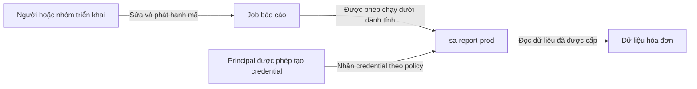

# Service account scope

## 1. Scope của service account là phạm vi nào?

Một service account là danh tính kỹ thuật được workload sử dụng để xác thực và truy cập tài nguyên. Ví dụ, một job tổng hợp báo cáo cần đọc dữ liệu hóa đơn mà không phụ thuộc tài khoản cá nhân của nhân viên vận hành.

**Service account scope** trong thiết kế IAM là phạm vi mà danh tính kỹ thuật đó được phép hoạt động: phục vụ workload nào, ở môi trường nào, thực hiện hành động nào trên tài nguyên nào và trong điều kiện nào. Phạm vi này hình thành từ các policy và cơ chế sử dụng danh tính; không nhất thiết tồn tại dưới dạng một thuộc tính duy nhất có tên `scope` trên đối tượng service account.

Một yêu cầu rõ ràng có thể là:

> Job báo cáo hóa đơn production được đọc các tệp đầu vào trong vùng dữ liệu dành riêng cho hóa đơn; không được sửa dữ liệu nguồn, đọc báo cáo nhân sự hoặc thay đổi policy IAM.

Ngược lại, mô tả “service account của hệ thống báo cáo” chưa đủ để xác định ranh giới quyền. Nó cho biết mục đích nhưng chưa chỉ ra tài nguyên, hành động hay chủ thể có thể sử dụng tài khoản.

Trong thực tế, từ scope dễ bị dùng cho nhiều khái niệm khác nhau:

| Khía cạnh | Câu hỏi cần trả lời | Điều không được suy diễn |
| --- | --- | --- |
| Phạm vi định danh | Tài khoản được tạo trong tenant, project, domain hoặc namespace nào? | Nơi tạo tự động giới hạn toàn bộ quyền truy cập |
| Phạm vi sử dụng | Workload hoặc principal nào được sử dụng danh tính này? | Biết tên tài khoản đồng nghĩa có quyền dùng nó |
| Phạm vi tài nguyên | Danh tính truy cập được tài nguyên nào? | Chỉ tài nguyên cùng nơi tạo tài khoản mới có thể được truy cập |
| Phạm vi hành động | Danh tính được đọc, ghi, xóa hay quản trị gì? | Role có tên phù hợp chắc chắn chỉ chứa đúng quyền cần thiết |
| Phạm vi credential | Token hoặc phiên hiện tại được dùng ở đâu, cho mục đích gì và bao lâu? | Một token hẹp chứng minh toàn bộ service account luôn có quyền hẹp |

Mục tiêu của bài là xác định được các ranh giới này và tránh cấp quyền rộng hơn nhiệm vụ của workload.

## 2. Nơi tạo danh tính không phải toàn bộ ranh giới truy cập

Một nền tảng có thể đặt service account trong một project hoặc namespace để tổ chức, định danh và quản lý vòng đời. Nhưng quyền truy cập còn do các policy liên quan quyết định.

Ví dụ, `sa-report-prod` được tạo trong project báo cáo nhưng có thể được cấp quyền đọc dữ liệu ở project tài chính nếu nền tảng và chính sách tổ chức cho phép. Chiều ngược lại, việc nằm trong project báo cáo không tự chứng minh nó có quyền đọc mọi tài nguyên của project đó.

Tương tự, một danh tính thuộc namespace cụ thể có thể được cấp quyền trên tài nguyên bên ngoài namespace hoặc ngoài hệ thống điều phối thông qua binding phù hợp. Muốn biết phạm vi thực tế, cần xem policy và quan hệ tin cậy thay vì chỉ nhìn tên hoặc nơi tạo tài khoản.

Quyền cũng có thể đến từ nhiều nguồn: binding trực tiếp, membership của nhóm, policy ở tài nguyên, quyền kế thừa từ cấp cha hoặc một phiên sử dụng danh tính khác. Không nên kết luận tài khoản đã có quyền tối thiểu chỉ vì binding trực tiếp của nó trông có vẻ hẹp.

Thứ tự đánh giá allow, deny, điều kiện và giới hạn phiên tùy thuộc nền tảng. Không có một phép cộng hay phép giao đơn giản có thể áp dụng nguyên xi cho mọi hệ thống IAM. Cần kiểm tra cơ chế tính quyền hiệu lực của hệ thống đang sử dụng.

## 3. Tách quyền của service account và quyền sử dụng service account

Service account có thể xuất hiện ở cả hai phía của quan hệ phân quyền:

- Nó là **principal** được phép truy cập dữ liệu hoặc API.
- Nó có thể là **đối tượng cần bảo vệ**, khi người hoặc workload khác yêu cầu sử dụng, tạo credential hay thay đổi cấu hình của nó.

Ví dụ, `sa-report-prod` có quyền đọc kho dữ liệu hóa đơn. Một pipeline được quyền triển khai job chạy dưới danh tính đó. Người kiểm soát pipeline vì vậy có thể có một đường gián tiếp tới dữ liệu, dù tài khoản cá nhân của họ không có quyền đọc trực tiếp.



Sơ đồ thể hiện các đường sử dụng quyền cần được quản trị; nó không có nghĩa mọi quyền sửa job đều tự động cấp quyền nhận token trên mọi nền tảng. Khả năng thực tế phụ thuộc cơ chế triển khai, danh tính chạy và các kiểm soát bổ sung.

Một ví dụ cụ thể từ Google Cloud là nguy cơ leo thang quyền qua impersonation, tạo khóa hoặc thay đổi tài nguyên đang gắn service account có quyền cao. Bài học chung là phải kiểm soát cả việc sử dụng danh tính lẫn quyền của danh tính đó. [Google Cloud: Best practices for using service accounts securely](https://docs.cloud.google.com/iam/docs/best-practices-service-accounts)

Các quyền sau cần được đánh giá riêng, không gộp tất cả dưới một nhãn “quản lý service account”:

| Khả năng | Tác động đến phạm vi quyền |
| --- | --- |
| Sử dụng service account cho một workload | Cho phép workload chạy với quyền đã cấp cho danh tính |
| Nhận credential hoặc impersonate | Có thể cho phép principal thực hiện hành động dưới danh tính đích |
| Tạo hoặc xuất khóa | Có thể tạo một đường sử dụng danh tính bên ngoài môi trường chạy dự kiến |
| Sửa policy của service account | Có thể thay đổi chủ thể được phép sử dụng hoặc quản trị danh tính |
| Sửa policy tài nguyên đích | Có thể mở rộng quyền mà danh tính được hưởng |
| Sửa mã chạy dưới service account | Có thể thay đổi hành vi sử dụng các quyền hiện có |

Tên quyền, cách tách quyền và tác động cụ thể phải được đối chiếu với nền tảng. Không mặc định rằng mọi người quản lý metadata đều có tất cả khả năng trong bảng, hoặc rằng quyền quản lý hoàn toàn không liên quan đến truy cập dữ liệu.

## 4. Thu hẹp đồng thời tài nguyên và hành động

Để giới hạn service account, trước hết hãy mô tả công việc bằng cặp **hành động trên tài nguyên**, rồi bổ sung điều kiện cần thiết.

Giả sử job `invoice-report` thực hiện ba bước nghiệp vụ:

1. Đọc tệp hóa đơn đầu vào của một kỳ báo cáo.
2. Tính toán trong bộ nhớ hoặc vùng tạm của job.
3. Ghi kết quả sang vùng báo cáo đã xác định.

Thiết kế quyền cần phân biệt vùng đầu vào và đầu ra:

| Tài nguyên | Quyền cần thiết | Quyền không thuộc nhiệm vụ |
| --- | --- | --- |
| Dữ liệu hóa đơn đầu vào | Đọc đối tượng cần xử lý; liệt kê nếu cách truy xuất yêu cầu | Ghi đè, xóa hoặc thay đổi policy |
| Vùng kết quả báo cáo | Tạo kết quả theo thiết kế xuất báo cáo | Quản trị toàn kho lưu trữ hoặc đọc dữ liệu phòng ban khác |
| Hệ thống ghi log | Gửi log của ứng dụng theo cơ chế được hỗ trợ | Xóa log kiểm toán hoặc tắt thu thập log |
| Cấu hình IAM | Không cần quyền thay đổi cho luồng nghiệp vụ này | Tự cấp role, tạo khóa cho danh tính khác |

Quyền liệt kê cần được xem xét riêng. Một tài khoản chỉ cần đọc một đối tượng đã biết tên có thể không cần liệt kê toàn bộ kho. Ngược lại, một thư viện cần khám phá tệp đầu vào có thể thực sự cần quyền liệt kê ở phạm vi phù hợp. Không thêm quyền chỉ vì tiện, nhưng cũng không bỏ qua phụ thuộc thật sự của thao tác.

“Chỉ đọc” vẫn có thể là quyền rất rộng nếu áp dụng cho toàn bộ dữ liệu nhạy cảm. Scope hẹp phải xét cả số lượng tài nguyên, loại dữ liệu và tác động khi bị lộ, không chỉ xét việc tài khoản có được ghi hay không.

### Khi hệ thống không hỗ trợ giới hạn đủ nhỏ

Không phải dịch vụ nào cũng hỗ trợ policy tới từng hàng, đường dẫn hoặc prefix. Một chuỗi như `invoices/*` trong tài liệu thiết kế không tự tạo ra ranh giới nếu API đích không thực thi điều kiện tương ứng.

Khi cần cô lập mà cơ chế policy không đủ chi tiết, có thể phải tách kho dữ liệu, tách tài nguyên, dùng API trung gian thực thi quyền hoặc chọn mô hình dữ liệu khác. Không nên dùng quy ước đặt tên làm bằng chứng rằng truy cập đã bị giới hạn.

## 5. Ví dụ policy ở mức ý tưởng

Ví dụ dưới đây mô tả một **tác vụ chỉ đọc dữ liệu đầu vào** của hệ thống báo cáo. Đây là pseudoconfiguration để thể hiện ý định, không phải schema hoặc tập quyền có thể triển khai trực tiếp trên một sản phẩm.

```yaml
# Pseudoconfiguration: đối chiếu lại với cơ chế IAM của nền tảng.
serviceAccount: sa-invoice-reader-prod
purpose: Đọc dữ liệu hóa đơn đầu vào cho job báo cáo

useBinding:
  allowedWorkload: runtime/prod/invoice-report
  allowedEnvironment: production

resourceBinding:
  principal: sa-invoice-reader-prod
  actions:
    - object.read
  resource: data/prod/invoices/input/*

credentialConstraints:
  intendedAudience: invoice-data-api
  maximumLifetimeSeconds: 900
```

`object.read`, resource pattern và các trường ràng buộc đều là ký hiệu minh họa. Cần xác minh dịch vụ đích hỗ trợ giới hạn tới phạm vi tài nguyên mong muốn, bên cấp credential thực thi audience và thời hạn tương ứng, và workload thực tế có đúng danh tính đã khai báo.

Policy này thể hiện hai quyết định khác nhau: workload nào được sử dụng service account và service account được đọc tài nguyên nào. Phần thời hạn giới hạn một credential, không thay thế binding trên dữ liệu.

Việc ví dụ chỉ liệt kê một allow không chứng minh đã có một deny tuyệt đối đối với mọi hành động khác. Nếu service account còn nhận một role rộng từ nơi khác, quyền hiệu lực có thể vượt quá ý định trong ví dụ. Cần xem toàn bộ các nguồn cấp quyền áp dụng.

Nếu job còn cần ghi báo cáo, phải cấp đúng quyền ghi lên đúng vùng đầu ra theo thiết kế; không sửa scope đầu vào thành quyền quản trị toàn bộ kho để giải quyết nhu cầu đó.

## 6. OAuth scope, audience và thời hạn không thay thế IAM policy

Trong OAuth 2.0, tham số `scope` diễn đạt phạm vi truy cập mà client yêu cầu hoặc authorization server cấp cho token. Các giá trị scope do authorization server định nghĩa và có phân biệt chữ hoa, chữ thường. Không nên tự suy nghĩa từ tên scope mà bỏ qua hợp đồng của API. [RFC 6749, mục 3.3](https://www.rfc-editor.org/rfc/rfc6749.html#section-3.3)

Trong bài này cần phân biệt:

- **Quyền IAM của service account:** danh tính có thể được cho phép làm gì theo policy tại hệ thống đích.
- **Scope hoặc giới hạn phiên:** một credential cụ thể có thể bị giới hạn thêm về loại thao tác.
- **Audience:** bên nhận dự kiến của token theo loại token và cơ chế xác thực đang dùng.
- **Thời hạn:** khoảng thời gian credential còn được chấp nhận theo quy tắc của hệ thống.

Ví dụ, token sống 15 phút nhưng mang quyền xóa toàn bộ dữ liệu vẫn có thể gây thiệt hại lớn trong 15 phút đó. Token đúng audience cũng không chứng minh danh tính chỉ được đọc một thư mục. Mỗi cơ chế giải quyết một phần khác nhau của yêu cầu truy cập.

Một token có scope đọc không tự cấp quyền đọc tài nguyên nếu API còn yêu cầu quyền IAM mà principal chưa có. Ngược lại, nếu service account được cấp quyền rộng và bên sử dụng có thể nhận credential khác rộng hơn, việc một ứng dụng hiện đang xin scope hẹp chưa đủ bảo đảm service account đã được giới hạn.

Mối quan hệ cụ thể giữa scope, role, resource policy và phiên phải theo cơ chế của sản phẩm. Một số hệ thống không dùng OAuth scope cho service account; không nên ép mọi nền tảng vào cùng một mô hình.

## 7. Chọn ranh giới theo workload và môi trường

Một service account dùng chung cho nhiều chức năng phải tích lũy quyền của tất cả chức năng đó. Khi một workload bị xâm nhập, các workload còn lại có thể bị ảnh hưởng qua quyền dùng chung.

Giả sử hệ thống có ba nhiệm vụ:

| Workload | Danh tính minh họa | Phạm vi chính |
| --- | --- | --- |
| Đọc dữ liệu đầu vào production | `sa-invoice-reader-prod` | Đọc dữ liệu hóa đơn đầu vào |
| Xuất báo cáo production | `sa-report-writer-prod` | Ghi kết quả vào vùng báo cáo |
| Triển khai ứng dụng | `sa-invoice-deployer-prod` | Cập nhật đúng ứng dụng theo quy trình triển khai |

Tách danh tính theo nhiệm vụ có ý nghĩa khi những nhiệm vụ đó có ranh giới thực thi và phân quyền riêng. Nếu cùng một tiến trình có thể tùy ý sử dụng cả ba credential, việc tạo ba tên tài khoản tự nó không tạo ra sự cô lập mong muốn.

Môi trường development, staging và production thường có mức rủi ro và quyền quản trị khác nhau. Dùng một service account có cả quyền development và production khiến việc xâm nhập môi trường ít được bảo vệ hơn trở thành một đường tới production.

Tuy nhiên, không cần mặc định tạo một service account cho từng instance ngắn hạn. Nhiều replica của cùng một workload có cùng mục đích và ranh giới tin cậy có thể dùng chung một danh tính logic, trong khi log giữ thông tin instance hoặc phiên để truy vết. Tiêu chí tách là khác biệt về nhiệm vụ, quyền và mức tin cậy, không chỉ là số tiến trình.

Tên tài khoản nên giúp con người nhận diện mục đích và môi trường, nhưng tên chỉ hỗ trợ quản trị. Tên chứa `prod` không ngăn được workload development sử dụng tài khoản nếu policy vẫn cho phép.

## 8. Kiểm tra các đường mở rộng quyền gián tiếp

Một service account có thể chỉ mang role đọc dữ liệu nhưng vẫn có phạm vi ảnh hưởng lớn nếu được phép tạo credential cho tài khoản mạnh hơn. Vì vậy, kiểm tra scope cần xét những hành động làm xuất hiện thêm quyền, không chỉ danh sách API dữ liệu đang dùng.

Các câu hỏi cần trả lời gồm:

- Tài khoản có thể sử dụng hoặc impersonate danh tính khác không?
- Tài khoản có thể thay đổi policy, group membership hoặc cấu hình tin cậy không?
- Tài khoản có thể tạo khóa hay credential cho danh tính có quyền cao hơn không?
- Tài khoản có thể sửa mã hoặc cấu hình của workload chạy dưới danh tính mạnh hơn không?
- Tài khoản có thể đọc secret chứa credential của hệ thống khác không?

Ví dụ, quyền đọc đúng một secret vẫn rất nhạy cảm nếu secret đó chứa khóa quản trị cơ sở dữ liệu. Phạm vi API “đọc một đối tượng” không phản ánh đầy đủ phạm vi quyền có thể đạt được từ nội dung của đối tượng đó.

Tương tự, một tài khoản triển khai không nhất thiết có quyền đọc dữ liệu trực tiếp, nhưng nếu được phép triển khai mã tùy ý vào dịch vụ có quyền đọc dữ liệu thì cần đánh giá đường gián tiếp này. Quy trình phê duyệt mã, bảo vệ pipeline và giới hạn danh tính runtime là một phần của thiết kế scope.

## 9. Kiểm chứng phạm vi bằng yêu cầu được phép và bị từ chối

Một yêu cầu thành công chỉ chứng minh luồng nghiệp vụ chạy được. Muốn đánh giá ranh giới, cần xác định cả những hành động gần với nhiệm vụ nhưng phải thất bại.

Với `sa-invoice-reader-prod` trong ví dụ chỉ đọc:

| Yêu cầu | Kết quả dự kiến | Ranh giới được kiểm chứng |
| --- | --- | --- |
| Đọc đối tượng hóa đơn đầu vào đã được cấp | Thành công | Quyền cần cho nghiệp vụ |
| Ghi đè hoặc xóa dữ liệu đầu vào | Bị từ chối | Hành động |
| Đọc dữ liệu nhân sự | Bị từ chối | Tài nguyên và miền dữ liệu |
| Workload development xin sử dụng danh tính production | Bị từ chối | Chủ thể sử dụng và môi trường |
| Tạo credential cho tài khoản quản trị | Bị từ chối | Đường mở rộng quyền |
| Dùng token tại bên nhận không phù hợp | Bị từ chối theo hợp đồng token | Audience |
| Dùng credential sau khi hết hạn | Bị từ chối | Vòng đời credential |

Kết quả từ chối cần đến từ kiểm soát đang đánh giá. Ví dụ, lỗi mạng không chứng minh policy tài nguyên đúng; không tìm thấy đối tượng cũng chưa chứng minh tài khoản không có quyền đọc nó. Cần xem principal thực tế, tài nguyên được yêu cầu và lý do đánh giá quyền nếu nền tảng cung cấp.

Khi một thao tác cần thiết bị từ chối, hãy xác định quyền thiếu và dependency thực tế rồi sửa đúng binding. Cấp role quản trị để làm cho lỗi biến mất thường khiến phạm vi vượt xa nhu cầu ban đầu.

## 10. Duy trì scope trong vòng đời service account

Phạm vi quyền có thể mở rộng dần khi hệ thống thêm tính năng, chuyển dữ liệu hoặc thay đổi pipeline. Vì vậy, scope cần được quản trị như một quyết định có chủ sở hữu, không chỉ là cấu hình lúc tạo tài khoản.

Thông tin quản trị nên cho biết mục đích, nhóm chịu trách nhiệm, workload sử dụng, môi trường, các quyền chính và lý do tồn tại. Đây là thông tin phục vụ vòng đời; không cần đưa mọi thông tin đó vào token hoặc log truy cập.

Khi thay đổi quyền:

1. Đối chiếu hành động mới với nhiệm vụ của workload và ranh giới tài nguyên.
2. Xác định việc bổ sung quyền có làm thay đổi mức tin cậy hoặc tạo đường sử dụng danh tính khác không.
3. Kiểm tra quyền kế thừa và các binding khác để tránh tưởng rằng một thay đổi cục bộ đã thu hẹp toàn bộ quyền.
4. Xác minh luồng được phép và những yêu cầu ngoài phạm vi quan trọng.
5. Ghi nhận thay đổi và theo dõi truy cập sau triển khai.

Khi giảm quyền hoặc ngừng workload, cần xem cả binding tài nguyên, binding sử dụng danh tính, khóa dài hạn và phiên đang tồn tại. Xóa một khóa không nhất thiết chặn workload dùng cơ chế nhận credential khác. Xóa một binding cấp credential mới cũng không mặc nhiên làm mọi token đã cấp mất hiệu lực ngay.

Thời điểm thay đổi policy có hiệu lực, khả năng thu hồi token và cách kiểm tra quyền của phiên hiện có tùy nền tảng. Kế hoạch thu hồi cần phù hợp với cơ chế thực tế thay vì suy luận từ một thao tác xóa duy nhất.

## 11. Cách diễn đạt một scope có thể kiểm tra được

Thay cho câu “tài khoản dành cho báo cáo, quyền chỉ đọc”, hãy mô tả:

> `sa-invoice-reader-prod` phục vụ job đọc đầu vào của báo cáo hóa đơn production. Chỉ runtime đã được phê duyệt được sử dụng danh tính. Tài khoản đọc đúng vùng dữ liệu hóa đơn đầu vào, không có quyền sửa dữ liệu, quản trị policy hoặc nhận credential của danh tính khác. Credential được cấp cho bên nhận xác định với thời hạn theo chính sách vận hành. Các quyền kế thừa và đường sử dụng danh tính phải được tính vào việc xác minh phạm vi.

Mô tả này nối được workload, chủ thể được sử dụng tài khoản, hành động, tài nguyên và vòng đời credential. Đó là cơ sở để chuyển yêu cầu nghiệp vụ thành policy cụ thể và kiểm tra rằng quyền tối thiểu đang được thực thi.
