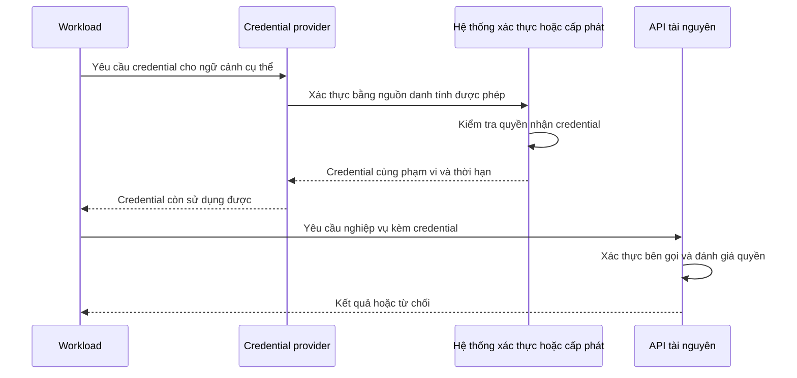

# Service account credential

## 1. Service account dùng gì để chứng minh danh tính?

Một dịch vụ tạo báo cáo cần đọc dữ liệu từ API nội bộ vào mỗi đêm. API không thể chỉ tin dòng chữ `caller=report-service` do bên gọi tự gửi. Nó cần bằng chứng để xác định yêu cầu thực sự đến từ một bên được phép đại diện cho service account đó.

**Service account credential** là thông tin hoặc bằng chứng mà phần mềm sử dụng trong quá trình xác thực với tư cách một service account. Credential có thể là mật khẩu, client secret, cặp access key, private key, chứng thư kèm private key, hoặc token. Cách sử dụng và mức độ nhạy cảm của từng thành phần phụ thuộc cơ chế xác thực.

Service account là một danh tính phục vụ hoạt động của phần mềm, không phải bản thân chuỗi bí mật. Một account có thể có nhiều credential, và credential có thể được thay mà danh tính cùng các quyền gắn với account vẫn giữ nguyên.

Ba lớp cần phân biệt trong IAM:

| Lớp | Câu hỏi | Ví dụ |
| --- | --- | --- |
| Danh tính | Phần mềm đang đại diện cho ai? | Service account `report-reader-prod` |
| Credential | Bằng chứng xác thực là gì? | Access token cấp cho service account đó |
| Quyền | Danh tính được làm gì? | Đọc báo cáo thuộc một nhóm tài nguyên cụ thể |

Biết tên account không đồng nghĩa có thể xác thực. Có credential hợp lệ cũng không đồng nghĩa được thực hiện mọi thao tác. Dịch vụ đích cần xác thực credential rồi kiểm tra quyền với yêu cầu cụ thể.

## 2. Những dạng credential phổ biến

### 2.1. Mật khẩu của service account

Một số hệ thống xác thực bằng tên account và mật khẩu. Với tài khoản máy, mật khẩu nên được sinh ngẫu nhiên và quản lý bởi cơ chế dành cho phần mềm, thay vì dùng tên dự án hoặc một mật khẩu con người dễ nhớ.

Vấn đề thường gặp không chỉ là mật khẩu yếu, mà là mật khẩu bị sao chép vào nhiều file cấu hình và nhiều môi trường. Khi cần thay hoặc thu hồi, tổ chức không còn biết đầy đủ những nơi đang sử dụng.

Mật khẩu service account không nên trở thành mật khẩu dùng chung cho cả nhóm vận hành. Người quản trị cần dùng danh tính cá nhân và cơ chế quản trị có kiểm soát để giữ được khả năng truy vết.

### 2.2. Client secret

Trong cơ chế client authentication, một ứng dụng có thể có client identifier và client secret. Client identifier thường dùng để định danh client, còn client secret là phần cần bảo mật. Không được mặc định mọi giá trị có tên `client_id` đều là bí mật hoặc rằng chỉ biết `client_id` là đủ xác thực.

Một hệ thống cấp token có thể nhận client credential hợp lệ rồi phát access token để ứng dụng gọi API. Khi đó có hai lần sử dụng credential khác nhau:

```text
Ứng dụng -- client credential --> Hệ thống cấp token
Ứng dụng -- access token -----> API tài nguyên
```

Client secret không tự động là credential mà API tài nguyên chấp nhận. Ngược lại, một access token cấp cho API cũng không tự động cho phép ứng dụng quản lý cấu hình client.

### 2.3. Access key và secret key

Một số nền tảng cấp bộ credential gồm định danh key và secret tương ứng. Định danh giúp phía xác thực chọn thông tin kiểm tra; secret được dùng theo giao thức của hệ thống, chẳng hạn để tạo chữ ký cho yêu cầu.

Nếu credential tạm thời có thêm session token, ứng dụng phải quản lý cả bộ như một đơn vị. Không ghép access key từ lần cấp này với secret hoặc session token của lần cấp khác.

Tên trường giống nhau không bảo đảm hai nền tảng dùng cùng cơ chế ký. Ứng dụng nên dùng thư viện xác thực phù hợp thay vì tự ghép chuỗi hoặc tự thiết kế thuật toán chữ ký.

### 2.4. Cặp khóa và chứng thư

Với cơ chế bất đối xứng, private key dùng để tạo bằng chứng sở hữu khóa; public key hoặc chứng thư giúp bên nhận kiểm tra bằng chứng theo một mô hình tin cậy.

Private key là phần phải được bảo vệ. Public key và chứng thư công khai không phải bí mật tương đương private key, nhưng việc thay đổi chúng trong cấu hình tin cậy vẫn là một thao tác nhạy cảm. Kẻ có quyền thay public key tin cậy có thể đưa khóa của mình vào hệ thống.

Trong mTLS, bên gọi trình chứng thư và chứng minh quyền giữ private key tương ứng trong quá trình bắt tay. Chỉ sao chép chứng thư công khai không đủ để đại diện cho service account. Ngược lại, nếu private key bị lộ, việc chứng thư có thời hạn dài có thể làm tăng thời gian rủi ro.

Một tệp credential chứa private key có thể đồng thời chứa tên account, key ID và địa chỉ hệ thống cấp phát. Không nên coi toàn bộ tệp là thông tin cấu hình vô hại chỉ vì trong đó có nhiều trường công khai.

### 2.5. Token

Access token có thể là chuỗi opaque hoặc token có cấu trúc. Với bearer token, bên có token có thể trình nó để yêu cầu truy cập trong phạm vi token được chấp nhận. Một số thiết kế ràng buộc token với khóa hoặc kênh, nhưng không được mặc định rằng mọi token đều có khả năng chống sao chép này.

Token có chữ ký không đồng nghĩa payload được mã hóa. Giải mã payload để đọc claims cũng không phải xác thực token. Bên nhận cần thực hiện đầy đủ quy trình kiểm tra phù hợp với loại token.

| Dạng credential | Thành phần cần đặc biệt bảo vệ | Rủi ro tiêu biểu |
| --- | --- | --- |
| Tên account và mật khẩu | Mật khẩu | Bị sao chép vào cấu hình hoặc dùng chung giữa nhiều hệ thống |
| Client identifier và client secret | Client secret | Bị dùng để xin thêm token khi đường cấp phát còn cho phép |
| Access key và secret key | Secret và các thành phần phiên nhạy cảm | Bị dùng để ký yêu cầu ngoài workload dự kiến |
| Chứng thư và private key | Private key; quyền thay đổi cấu hình trust | Giả mạo bên gọi hoặc đưa khóa không được phép vào hệ thống |
| Bearer access token | Token | Bị phát lại trong thời gian còn hiệu lực |

## 3. Credential dài hạn, credential ngắn hạn và danh tính được quản lý

Credential dài hạn thường có tuổi thọ lớn và cần một quy trình phân phối, luân chuyển, thu hồi rõ ràng. Credential ngắn hạn có thời điểm hết hạn gần hơn và thường được lấy lại tự động bằng một nguồn danh tính khác.

Tuổi thọ và quyền truy cập là hai chiều độc lập. Một token quản trị toàn hệ thống có hiệu lực vài phút vẫn có thể gây tác động lớn. Một secret chỉ được đọc một tài nguyên vẫn cần được bảo vệ dù quyền hạn của nó hẹp.

Trong mô hình danh tính do nền tảng quản lý, ứng dụng có thể lấy token từ một giao diện credential provider mà không tự giữ một private key hoặc client secret dài hạn. Liên kết danh tính cũng có thể cho phép workload trình bằng chứng do nền tảng tin cậy cấp để nhận credential cho hệ thống đích.

Điều này không có nghĩa hệ thống hoạt động mà không cần xác thực hoặc không tồn tại credential. Nó có nghĩa một phần việc quản lý và chứng minh danh tính được chuyển cho nền tảng hoặc cơ chế liên kết. Token nguồn, endpoint danh tính, agent và quyền xin token vẫn là những thành phần cần bảo vệ.

Ví dụ, một service account của nền tảng chạy container và một service account của hệ thống đám mây có thể là hai principal khác nhau. Cấu hình liên kết xác định principal nguồn nào được phép nhận credential đại diện cho principal đích. Không thể chỉ đặt hai account cùng tên rồi xem chúng là cùng một danh tính.

## 4. Quy trình sử dụng từ workload đến tài nguyên



Không phải mọi hệ thống đều cần bước đổi token. Một service có thể xác thực trực tiếp với tài nguyên bằng mTLS hoặc một cơ chế khác. Sơ đồ thể hiện mô hình có cấp phát để làm rõ rằng **quyền lấy credential** và **quyền sử dụng tài nguyên** là hai điểm kiểm soát riêng.

Ứng dụng cần lấy credential đúng ngữ cảnh: account, môi trường, tenant, audience hoặc tài nguyên đích và phạm vi quyền. Một token cho API lưu trữ không tự động phù hợp với API quản trị, dù cả hai được gọi từ cùng một tiến trình.

Trong ứng dụng nhiều tenant, cache credential chỉ theo tên service account có thể không đủ. Khóa cache phải phản ánh các thành phần làm thay đổi danh tính hoặc phạm vi credential. Nếu không, yêu cầu của tenant này có thể nhận nhầm credential dành cho tenant khác.

## 5. Ai có quyền sử dụng hoặc tạo credential?

Một service account có thể chỉ có quyền đọc dữ liệu, nhưng người có quyền tạo credential cho account đó có khả năng đại diện cho nó. Vì vậy, kiểm soát quyền của account là chưa đủ; cần kiểm soát cả các thao tác liên quan đến credential.

Các quyền sau cần được xem xét riêng theo khả năng của nền tảng:

- Đọc một secret đã lưu.
- Tạo key hoặc client secret mới.
- Xin token đại diện cho service account.
- Gắn service account vào một workload.
- Thay đổi nguồn danh tính được tin cậy để liên kết hoặc impersonate.
- Thay đổi role và các quyền gắn với service account.

Ví dụ, lập trình viên có thể không đọc được secret production nhưng vẫn có quyền triển khai một workload tùy ý chạy dưới service account production. Workload đó có thể lấy credential và sử dụng quyền của account. Ranh giới thực tế khi đó nằm ở quyền triển khai và quyền gắn danh tính, không chỉ ở quyền đọc secret.

Tương tự, một kho secret được bảo vệ tốt không giải quyết được vấn đề nếu quá nhiều người có quyền tạo thêm key cho cùng account. Đánh giá IAM cần theo dõi mọi đường có thể đưa một bên đến khả năng hành động với tư cách service account.

## 6. Cấp phát và lưu trữ credential

### Định danh và trách nhiệm trước khi tạo

Trước khi cấp credential, cần biết nó phục vụ workload nào, dùng ở môi trường nào, tài nguyên nào cần truy cập và ai chịu trách nhiệm. Chủ sở hữu là cá nhân hoặc nhóm có thể quyết định về vòng đời account, không phải chỉ là một địa chỉ email còn tồn tại.

Nên tách service account theo ranh giới công việc và môi trường có ý nghĩa. Dùng chung một account giữa tác vụ backup, website và pipeline triển khai làm tăng phạm vi tác động của credential bị lộ, đồng thời làm log khó quy trách nhiệm.

### Chọn nơi lưu theo cơ chế sử dụng

Nếu cần lưu bí mật dài hạn, kho quản lý secret có thể cung cấp kiểm soát truy cập, version, audit và hỗ trợ luân chuyển. Tuy nhiên, workload vẫn cần một cơ chế xác thực để đọc secret. Nếu lại dùng một secret khác trong source code để mở kho secret, hệ thống chỉ chuyển vị trí của bài toán bootstrap.

Các nguyên tắc thực hành gồm:

1. Ưu tiên cơ chế danh tính workload hoặc credential provider phù hợp khi hệ thống hỗ trợ.
2. Chỉ phân phối credential cho những tiến trình thật sự cần dùng.
3. Tránh nhúng credential vào source code, container image, artifact hoặc file mẫu.
4. Khi dùng tệp, giới hạn quyền đọc, phạm vi mount, nơi sao lưu và thời gian tồn tại.
5. Khi có thể, tránh xuất private key khỏi nơi lưu khóa được quản lý; chỉ cho phép thực hiện thao tác ký có kiểm soát.

Đưa secret vào environment variable không tự động làm nó an toàn. Tùy môi trường, secret vẫn có thể xuất hiện trong dump, công cụ hỗ trợ hoặc dữ liệu quan sát tiến trình. Cần đánh giá toàn bộ đường phân phối và các bên có thể đọc giá trị đó.

### Không để lộ qua kênh quan sát

Không log header chứa token, mật khẩu, private key, toàn bộ tệp credential hoặc URL có quyền truy cập được nhúng trong đó. Việc che ở giao diện cuối chưa đủ nếu log thô, trace hoặc hệ thống thu thập lỗi đã nhận bí mật trước đó.

Có thể dùng định danh account, credential ID không bí mật hoặc mã tương quan do hệ thống tạo để hỗ trợ điều tra. Không tự chọn một đoạn của secret làm mã nhận diện mặc định; nên dùng trường định danh mà cơ chế credential cung cấp hoặc một cách đối chiếu được thiết kế riêng.

## 7. Luân chuyển credential mà không làm gián đoạn dịch vụ

**Rotation** là thay credential đang dùng bằng credential mới theo kế hoạch hoặc khi có sự cố. Rotation không mặc nhiên thay danh tính service account, cũng không mặc nhiên thay quyền của account.

Một quy trình có giai đoạn chồng lấn có thể gồm:

1. Tạo credential mới bằng một bên có quyền cấp phát phù hợp.
2. Phân phối version mới cho các workload dự kiến.
3. Để ứng dụng nạp credential mới theo cơ chế an toàn.
4. Xác nhận các instance và job có liên quan đã chuyển sang version mới.
5. Vô hiệu hóa credential cũ.
6. Theo dõi lỗi xác thực và hoàn tất việc xóa bản cũ khi phù hợp.

Khả năng giữ hai credential cùng lúc phụ thuộc nền tảng. Nếu hệ thống chỉ cho phép một mật khẩu hiện hành, cần phương án đồng bộ thay đổi hoặc cơ chế khác phù hợp với giới hạn đó. Không áp dụng máy móc quy trình chồng lấn cho một hệ thống không hỗ trợ.

Giai đoạn chồng lấn phải có giới hạn. Tạo key mới mỗi tháng nhưng không thu hồi key cũ chỉ làm số credential có thể bị lạm dụng tăng dần.

### Ứng dụng phải thực sự nhận được credential mới

Thay secret trong kho không bảo đảm tiến trình đang chạy đã dùng giá trị mới. Một số ứng dụng chỉ đọc cấu hình lúc khởi động; một số client giữ bản credential trong bộ nhớ; connection pool có thể tiếp tục sử dụng kết nối đã xác thực trước đó.

Trước khi vô hiệu hóa bản cũ, cần kiểm tra hành vi nạp lại của ứng dụng. Có thể dùng provider hỗ trợ cập nhật, đọc version khi tạo kết nối mới hoặc triển khai lại theo quy trình đã kiểm chứng. Không ghi đè từng thành phần của bộ credential trong khi các luồng khác đang đọc; nên thay toàn bộ bản credential theo một thao tác nhất quán.

Nếu credential ngắn hạn được cấp tự động, quá trình lấy mới thường diễn ra liên tục. Cần làm mới trước hạn, phân tán thời điểm giữa các instance và tránh nhiều luồng đồng thời xin cùng một credential. Vẫn phải phân biệt việc lấy token mới với việc thay secret hoặc khóa gốc dùng để xin token.

## 8. Thu hồi và xử lý credential bị lộ

Các thao tác dưới đây có liên quan nhưng không tương đương:

| Thao tác | Kết quả cần xác minh |
| --- | --- |
| Xóa bản secret khỏi file cấu hình | Bản sao ở nơi khác và credential phía xác thực có thể vẫn còn hiệu lực |
| Vô hiệu hóa một key | Các yêu cầu mới dùng key đó bị từ chối theo cơ chế của hệ thống |
| Chặn quyền cấp token mới | Các access token đã cấp có thể vẫn dùng được đến khi hết hạn hoặc bị thu hồi |
| Thu hồi token hoặc phiên | Bên nhận phải có cơ chế thực thi và thời gian phản ánh trạng thái thu hồi |
| Vô hiệu hóa service account | Tác động phụ thuộc nền tảng, cache và cơ chế xác thực của tài nguyên |
| Xóa quyền truy cập tài nguyên | Cần xét nơi quyền được đánh giá và khả năng quyền đã được nhúng trong credential |

Không nên cam kết rằng “xóa private key là mọi access token cũ lập tức mất hiệu lực”. Key có thể chỉ được dùng ở bước xin token. Token đã phát hành có vòng đời và cơ chế kiểm tra riêng.

Tương tự, hết hạn credential hoặc khóa account chưa chắc cắt mọi kết nối đã mở. Các phiên cơ sở dữ liệu hoặc kênh kết nối lâu dài có thể chịu chính sách riêng về kiểm tra lại và kết thúc phiên.

Khi phát hiện lộ credential, cần xác định đúng đối tượng bị lộ, ngăn sử dụng tiếp và ngăn cấp mới qua đường bị xâm nhập. Sau đó kiểm tra hoạt động đã xảy ra, đặc biệt thao tác tạo thêm credential, thay đổi quyền hoặc chuyển dữ liệu. Thay credential mà giữ nguyên workload đã bị chiếm quyền có thể làm credential mới tiếp tục bị lộ.

Nếu bí mật từng được đưa vào repository, xóa nó khỏi phiên bản mới không phải là thu hồi. Các bản clone, lịch sử, log CI và artifact có thể đã chứa bản sao. Credential đó phải được xử lý ở phía hệ thống xác thực, đồng thời khắc phục nguồn rò rỉ.

## 9. Service account credential không đại diện mặc nhiên cho người dùng

Khi ứng dụng gọi API bằng service account, API thường thấy danh tính của ứng dụng hoặc dịch vụ. Điều đó không chứng minh người dùng cuối nào đã yêu cầu thao tác.

Ví dụ, web app dùng service account có quyền đọc dữ liệu của nhiều phòng ban. Nếu người dùng chỉ được xem dữ liệu phòng A, ứng dụng vẫn phải kiểm tra quyền người dùng trước khi gọi API. Chỉ gửi một trường `userId` trong request không tự tạo thành bằng chứng ủy quyền đáng tin cậy.

Khi nghiệp vụ cần hành động thay mặt người dùng, phải thiết kế cơ chế delegation hoặc kiểm tra quyền người dùng phù hợp, đồng thời ghi lại cả actor và subject khi mô hình hỗ trợ. Không biến service account thành lối đi để bỏ qua chính sách người dùng.

Tài khoản máy thường xác thực theo cơ chế tự động, không nhập mã MFA tương tác cho mỗi lần gọi. Điều này không đồng nghĩa các thao tác quản trị account cũng được bỏ kiểm soát mạnh. Quyền tạo key, sửa trust, cấp quyền và cho phép impersonation cần được quản lý riêng, có thể bao gồm xác thực mạnh của người quản trị và phê duyệt theo chính sách tổ chức.

## 10. Ví dụ thiết kế cho một dịch vụ báo cáo

Giả sử hệ thống có hai môi trường staging và production. Mỗi môi trường dùng một service account riêng. Dịch vụ production chỉ cần đọc tập dữ liệu báo cáo, không cần tạo người dùng hoặc thay đổi chính sách IAM.

Thiết kế ở mức ý tưởng:

```text
Workload: report-worker
Môi trường: production
Service account: report-reader-prod
Nguồn xác thực ban đầu: danh tính workload được nền tảng xác nhận
Credential sử dụng với tài nguyên: access token có thời hạn
Tài nguyên đích: reporting-api
Quyền: đọc tập dữ liệu báo cáo được chỉ định
Quyền quản lý credential của account: tách khỏi quyền chạy workload
```

Ứng dụng lấy credential qua provider thay vì truyền secret trực tiếp vào nhiều lớp nghiệp vụ:

```text
runReport(reportRequest):
    authorizeBusinessRequest(reportRequest)

    credential = provider.getValidCredential(
        identity = "report-reader-prod",
        audience = "reporting-api",
        permissionContext = reportRequest.allowedDataset
    )

    result = reportingClient.readDataset(
        reportRequest.allowedDataset,
        credential
    )

    auditReportResult(result, không ghi credential)
    return result
```

Đây là giả mã để thể hiện trách nhiệm, không phải API của một SDK cụ thể. Kiểm tra nghiệp vụ trong ứng dụng không thay thế việc API đích xác thực và phân quyền. Tham số `permissionContext` cũng không tự tạo ra quyền; bên cấp phát và bên tài nguyên phải thực thi chính sách tương ứng.

Người vận hành theo dõi việc cấp token và truy cập dữ liệu bằng định danh account cùng mã tương quan. Nếu staging bị xâm nhập, credential staging không được chấp nhận để nhận danh tính production. Việc tách account và ràng buộc nguồn cấp phát giúp giữ ranh giới này rõ ràng.

## 11. Những lỗi thiết kế dễ gặp

| Lỗi | Hệ quả | Cách xử lý phù hợp |
| --- | --- | --- |
| Dùng một account cho mọi dịch vụ và môi trường | Phạm vi tác động lớn, khó truy vết bên gọi | Tách danh tính theo ranh giới công việc và mức tin cậy |
| Lưu secret trong image hoặc source code | Credential đi theo mọi bản sao artifact | Tách credential khỏi artifact, cấp lúc chạy qua cơ chế được quản lý |
| Chỉ giới hạn quyền đọc kho secret | Bỏ sót quyền tạo key, xin token hoặc gắn account vào workload | Kiểm kê mọi đường có thể đại diện cho account |
| Tạo credential mới nhưng giữ bản cũ vô thời hạn | Số credential còn hiệu lực tăng dần | Đặt hạn hoàn tất rotation và xác nhận thu hồi bản cũ |
| Coi token có chữ ký là đã mã hóa | Claims nhạy cảm có thể bị đọc | Giới hạn dữ liệu trong token và bảo vệ toàn bộ token |
| Cho rằng access token mới thu hồi token cũ | Bản bị đánh cắp vẫn có thể dùng | Thiết kế và kiểm tra cơ chế thu hồi độc lập |
| Tự động chuyển sang secret quản trị khi token hết hạn | Sự cố vận hành trở thành leo thang quyền | Thử lại có giới hạn và từ chối thao tác khi thiếu credential hợp lệ |
| Đánh đồng service account với người dùng cuối | Bỏ qua kiểm tra quyền nghiệp vụ | Xác định rõ danh tính dịch vụ và cơ chế ủy quyền người dùng |

## 12. Tiêu chí đánh giá một thiết kế credential

Một thiết kế có thể vận hành được cần trả lời rõ các câu hỏi: credential thuộc danh tính nào, ai được cấp hoặc đọc nó, workload nhận nó bằng cách nào, tài nguyên nào chấp nhận nó, quyền nào được áp dụng và thời hạn thực tế là bao lâu.

Vòng đời cũng phải có điểm kết thúc rõ ràng. Cần biết cách thay credential mà ứng dụng thực sự nạp được bản mới, cách ngăn sử dụng bản cũ, cách chặn cấp mới khi workload bị xâm nhập và cách nhận biết các phiên còn tồn tại. Các phép kiểm chứng quan trọng là credential sai audience bị từ chối, account không được đọc tài nguyên ngoài phạm vi, bản cũ không còn dùng được sau bước thu hồi được thiết kế và log không chứa bí mật.

Service account credential vì thế cần được quản lý như một quyền đại diện cho danh tính máy. Bảo vệ chuỗi bí mật là một phần của công việc; quản lý bên được đại diện, đường cấp phát, phạm vi quyền và toàn bộ vòng đời mới quyết định ranh giới truy cập của hệ thống.
