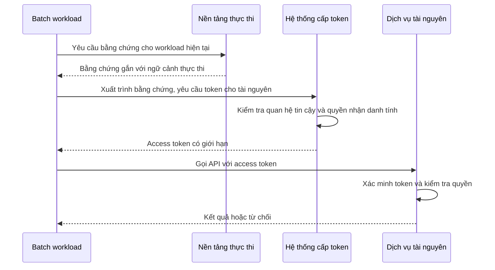

# Non-interactive authentication

## 1. Xác thực không tương tác là gì?

**Non-interactive authentication** là quá trình một chương trình chứng minh danh tính mà không yêu cầu con người trực tiếp nhập mật khẩu, mã OTP hoặc chấp thuận đăng nhập ở mỗi lần thực thi. Chương trình có thể là dịch vụ chạy liên tục, batch job, tác vụ theo lịch hoặc pipeline triển khai.

Trong IAM, **service account** là một tài khoản hoặc principal dành cho phần mềm sử dụng khi thực hiện nhiệm vụ. Chẳng hạn, tác vụ `report-exporter` chạy mỗi đêm để đọc dữ liệu tổng hợp và ghi báo cáo vào kho lưu trữ. Tác vụ phải tự xác thực với những hệ thống đó, ngay cả khi không có nhân viên trực ca đăng nhập.

Không tương tác không có nghĩa là không xác thực, không kiểm soát hoặc không có người chịu trách nhiệm. Con người vẫn cần phê duyệt việc tạo tài khoản, xác định quyền, quản lý cấu hình tin cậy và xử lý sự cố. Điểm khác biệt là bằng chứng xác thực cho từng lần chạy được cung cấp và kiểm tra bằng cơ chế tự động.

Một thiết kế tốt phải trả lời được bốn câu hỏi:

- Chương trình đang chạy dưới danh tính nào?
- Dựa vào bằng chứng nào để tin rằng nó được phép sử dụng danh tính đó?
- Danh tính này được truy cập tài nguyên nào và thực hiện hành động gì?
- Khi nhiệm vụ kết thúc hoặc bị xâm nhập, quyền sử dụng danh tính được chấm dứt ra sao?

## 2. Phân biệt tài khoản, workload, credential và quyền

Không nên đồng nhất service account với một mật khẩu đặt trong file cấu hình. Tài khoản biểu diễn danh tính; credential chỉ là một phương tiện để chứng minh hoặc sử dụng danh tính đó.

| Thành phần | Vai trò | Ví dụ |
|---|---|---|
| Workload | Chương trình hoặc phiên thực thi đang hoạt động | Một lần chạy batch xuất báo cáo |
| Service account | Principal được hệ thống nhận diện và cấp quyền | `svc:prod:report-exporter` |
| Credential hoặc assertion | Bằng chứng dùng trong quá trình xác thực hoặc đổi token | Chứng thư, chữ ký bằng khóa riêng, assertion từ nền tảng |
| Access token | Credential truy cập tài nguyên trong phạm vi và thời hạn nhất định | Token dành cho dịch vụ lưu trữ báo cáo |
| Chính sách phân quyền | Quyết định hành động nào được cho phép | Chỉ ghi vào vùng báo cáo đã chỉ định |

Một service account có thể tồn tại lâu hơn nhiều so với từng credential của nó. Việc xoay khóa hoặc cấp token mới không nhất thiết tạo ra tài khoản mới. Ngược lại, xóa một file secret trên một máy không đồng nghĩa tài khoản đã bị vô hiệu hóa hoặc mọi bản sao credential đã mất hiệu lực.

Danh tính cục bộ và danh tính từ xa cũng có thể khác nhau. Một tiến trình chạy dưới tài khoản hệ điều hành chuyên dụng có thể bị hạn chế truy cập file trên máy, nhưng điều đó không tự làm nó được xác thực với một API ở máy khác. Cần chỉ rõ cơ chế chuyển từ ngữ cảnh thực thi sang bằng chứng mà hệ thống đích chấp nhận.

## 3. Xác thực có tương tác và không tương tác

| Khía cạnh | Có tương tác | Không tương tác |
|---|---|---|
| Chủ thể thường gặp | Người dùng đang đăng nhập | Workload hoặc tác vụ tự động |
| Bằng chứng có thể sử dụng | Mật khẩu, passkey, MFA, phiên người dùng | Secret, khóa, chứng thư, assertion hoặc danh tính nền tảng |
| Cách xử lý challenge | Người dùng thực hiện thao tác | Chương trình xử lý theo giao thức được hỗ trợ |
| Vòng đời hoạt động | Thường gắn với phiên làm việc của người dùng | Gắn với lần chạy hoặc vòng đời workload |
| Trách nhiệm quản trị | Chủ tài khoản và đơn vị quản lý người dùng | Owner nghiệp vụ, nhóm vận hành và quản trị IAM |

Một service account không có người dùng ngồi chờ để nhập OTP. Giải pháp không phải là lấy tài khoản cá nhân, tắt MFA rồi cất mật khẩu vào pipeline. Cách đó làm trộn danh tính con người với phần mềm và khiến tự động hóa phụ thuộc vào vòng đời của một nhân viên.

Thay vào đó, cần dùng loại principal và cơ chế xác thực được thiết kế cho workload. MFA vẫn có thể bảo vệ những thao tác của người quản trị như đăng nhập hệ thống quản lý, phê duyệt quyền hoặc thay đổi cấu hình cấp credential. Bản thân workload chứng minh danh tính bằng cơ chế máy có thể thực hiện, chẳng hạn sở hữu khóa hoặc được nền tảng thực thi xác nhận.

Một phiên trình duyệt còn hiệu lực không biến một luồng đăng nhập dành cho con người thành phương án tự động hóa bền vững. Script điều khiển trình duyệt để nhập mật khẩu hoặc lưu cookie của nhân viên vẫn mang các rủi ro của tài khoản và phiên người dùng đó.

## 4. Luồng xác thực cơ bản

Một luồng không tương tác thường có ba giai đoạn: nhận diện workload ban đầu, cấp bằng chứng truy cập và xác minh tại tài nguyên.



Đây là một mô hình minh họa dùng danh tính nền tảng, không phải giao thức bắt buộc cho mọi hệ thống. Với cơ chế khác, workload có thể trình secret hoặc ký yêu cầu bằng khóa riêng. Dù dùng cách nào, phải có một điểm khởi đầu tin cậy.

**Bootstrap trust** là vấn đề xác lập niềm tin ban đầu đó. Nếu chương trình cần đăng nhập vào secret store để lấy mật khẩu, nó phải có bằng chứng nào để đăng nhập vào secret store? Chuyển secret từ file này sang kho khác không tự giải quyết bootstrap; cần một phương thức cấp quyền truy cập kho, chẳng hạn danh tính nền tảng hoặc credential ban đầu được provision an toàn.

Quyền nhận credential và quyền dùng tài nguyên là hai ranh giới liên quan nhưng khác nhau. Một workload chỉ nên được nhận đúng danh tính đã chỉ định; danh tính đó chỉ nên có các quyền cần thiết tại tài nguyên đích.

## 5. Các phương thức xác thực không tương tác

### 5.1. Mật khẩu hoặc shared secret

Một số hệ thống chấp nhận username/password của service account, client secret hoặc API key. Chương trình cung cấp giá trị bí mật theo cơ chế mà hệ thống hỗ trợ.

Ưu điểm là dễ tích hợp với nhiều hệ thống, nhưng secret có thể bị sao chép và sử dụng từ nơi khác nếu không có ràng buộc bổ sung. Mỗi bản sao trong máy chủ, pipeline, file backup hoặc máy cá nhân làm tăng khó khăn khi thu hồi.

Nếu phải sử dụng shared secret, cần:

- Cấp credential riêng cho từng ứng dụng và môi trường có quyền hoặc vòng đời khác nhau.
- Lưu trữ trong cơ chế quản lý secret có kiểm soát truy cập, thay vì mã nguồn hoặc image.
- Chỉ phân phối cho workload cần sử dụng và tránh lưu bản sao không cần thiết.
- Truyền qua kênh được bảo vệ, có rotation và cách thu hồi đã xác định.
- Theo dõi việc sử dụng mà không ghi giá trị secret vào log.

Secret là phương tiện xác thực, không phải nơi định nghĩa toàn bộ quyền. Một API key riêng cho chương trình vẫn phải được gắn với chính sách truy cập phù hợp; tính ngẫu nhiên hoặc độ dài của key không thay thế least privilege.

### 5.2. Khóa bất đối xứng và chứng thư

Workload giữ khóa riêng và chứng minh khả năng sử dụng khóa đó. Bên xác minh dùng khóa công khai hoặc chuỗi chứng thư phù hợp để kiểm tra bằng chứng. Ví dụ, workload có thể dùng chứng thư client trong mTLS hoặc ký một assertion theo giao thức được hệ thống hỗ trợ.

Khóa riêng không cần được gửi trực tiếp cho bên xác minh, nhưng vẫn phải được bảo vệ. Nếu kẻ tấn công có thể đọc khóa hoặc gọi chức năng ký với quyền của workload, họ có thể khai thác quyền tương ứng. Kho khóa có hỗ trợ phần cứng hoặc khóa không xuất được giúp giảm một số rủi ro, nhưng không tự ngăn mọi hành vi lạm dụng từ tiến trình đã bị chiếm quyền.

Chứng thư công khai không phải secret. Tuy nhiên, chỉ có một chứng thư hợp lệ cũng không đủ để mạo danh: giao thức cần kiểm tra bằng chứng sở hữu khóa riêng tương ứng. Việc kiểm tra thời hạn, trust anchor và ánh xạ danh tính vẫn là trách nhiệm của hệ thống xác minh.

Rotation bao gồm cả việc cấp credential mới và bảo đảm bên nhận nhận diện được khóa hoặc chứng thư mới. Xoay chứng thư của một workload khác với thay đổi CA hoặc trust store của cả hệ thống.

### 5.3. OAuth client credentials

Trong luồng client credentials, một client xác thực với authorization server để nhận access token theo quyền của chính client đó. Luồng này phù hợp với nhiều tình huống máy gọi API mà không có người dùng tham gia trực tiếp.

Client có thể xác thực bằng secret hoặc cơ chế khác được authorization server hỗ trợ. Vì vậy, sử dụng client credentials không bắt buộc đồng nghĩa với việc mỗi ứng dụng phải cất một mật khẩu dài hạn.

Cần phân biệt:

- **Xác thực client**: authorization server kiểm tra client nào đang yêu cầu token.
- **Cấp token**: authorization server quyết định audience, phạm vi và thời hạn được cấp.
- **Xác minh tại API**: resource server kiểm tra token và quyết định quyền đối với request cụ thể.

Workload đề nghị một scope không có nghĩa là tự được cấp scope đó. Quyền phải nằm trong chính sách cho phép và được resource server kiểm tra. Token của client cũng không mặc nhiên đại diện cho một người dùng đã đăng nhập.

Không giả định mọi luồng client credentials đều cung cấp refresh token. Chương trình phải dùng cơ chế làm mới hoặc xin lại token mà authorization server thực sự hỗ trợ, thay vì thiết kế dựa vào một refresh token chưa được cấp.

### 5.4. Managed identity và workload federation

Một nền tảng thực thi có thể cấp bằng chứng cho workload dựa trên danh tính và ngữ cảnh được nền tảng quản lý. Ứng dụng dùng bằng chứng đó để lấy token, thay vì tự giữ một shared secret dài hạn do nhóm phát triển phân phối.

Với workload federation, một hệ thống có thể tin bằng chứng từ hệ thống khác theo cấu hình đã phê duyệt. Ví dụ, một pipeline triển khai được phép đổi assertion do nền tảng CI phát hành thành credential ngắn hạn của một tài khoản triển khai.

Quan hệ tin cậy cần ràng buộc cụ thể những yếu tố mà nền tảng hỗ trợ, chẳng hạn issuer, subject, audience, repository, môi trường hoặc nhánh triển khai. Tin mọi workload do một issuer phát hành có thể cho phép những chương trình ngoài dự định nhận cùng danh tính đặc quyền.

“Không phân phối secret dài hạn cho ứng dụng” không có nghĩa hệ thống không còn credential hoặc không còn khả năng bị đánh cắp token. Token ngắn hạn vẫn cần được bảo vệ; môi trường thực thi và quyền nhận danh tính vẫn là ranh giới an ninh quan trọng.

## 6. Chọn phương thức theo khả năng của hệ thống

| Tình huống | Cách tiếp cận có thể phù hợp | Điểm cần kiểm tra |
|---|---|---|
| Workload chạy trên nền tảng có danh tính quản lý | Nhận credential qua danh tính nền tảng | Workload nào được gắn danh tính và có thể truy cập cơ chế cấp token |
| Pipeline ở một nền tảng, tài nguyên ở nơi khác | Federation để nhận token ngắn hạn | Điều kiện issuer, subject, audience và ranh giới runner |
| Hệ thống dùng PKI sẵn có | Chứng thư hoặc cơ chế ký được hỗ trợ | Bảo vệ khóa riêng, mapping principal và rotation |
| API chấp nhận OAuth | Client credentials hoặc luồng workload được hỗ trợ | Client authentication, audience, scope và kiểm tra tại API |
| Hệ thống cũ chỉ nhận mật khẩu | Tài khoản chuyên dụng và quản lý secret | Phân phối, rotation, giới hạn quyền và kế hoạch thay thế |

Lựa chọn phụ thuộc khả năng của nền tảng, tài nguyên đích và yêu cầu vận hành. Không nên thêm một proxy hoặc một bộ chuyển đổi credential mà chưa xác định nó đang trở thành bên được tin cậy nào, giữ secret gì và có thể cấp quyền cho ai.

Nếu cơ chế nền tảng yêu cầu nhận token từ một endpoint cục bộ, cần kiểm soát workload nào có thể gọi endpoint đó. Một lỗ hổng cho phép ứng dụng truy cập tài nguyên nội bộ tùy ý có thể dẫn tới đánh cắp credential từ môi trường thực thi. Danh tính nền tảng vẫn cần được kết hợp với cách ly workload và quyền tối thiểu.

## 7. Ví dụ: batch job xuất báo cáo

Giả sử `report-exporter` chạy hằng đêm với hai nhiệm vụ: đọc dữ liệu đã tổng hợp từ dịch vụ báo cáo và ghi file kết quả vào vùng lưu trữ dành riêng cho nó. Nó không cần đọc dữ liệu khách hàng thô hoặc xóa báo cáo đã lưu.

### 7.1. Thiết kế danh tính và quyền

Định danh logic của service account là `svc:prod:report-exporter`. Môi trường development sử dụng một principal khác, với tài nguyên và credential riêng.

| Đích truy cập | Quyền cần thiết | Quyền không cần cấp |
|---|---|---|
| Dịch vụ dữ liệu tổng hợp | Đọc tập dữ liệu báo cáo đã chỉ định | Đọc dữ liệu thô hoặc quản trị người dùng |
| Kho lưu trữ báo cáo | Ghi vào vùng dành cho exporter | Xóa dữ liệu, quản trị policy hoặc truy cập vùng khác |
| Hệ thống cấp credential | Nhận token cho những đích đã phê duyệt | Nhận credential của service account khác |

Đây là mô hình quyền ở mức khái niệm; tên action cụ thể phụ thuộc sản phẩm. “Ghi” cũng phải được làm rõ: có cho ghi đè file cũ hay chỉ tạo file mới? Nếu cần lưu trữ bất biến, cần policy hoặc cơ chế của kho lưu trữ đáp ứng yêu cầu đó, không chỉ dựa vào tên role.

### 7.2. Trình tự thực thi

```text
1. Scheduler khởi động workload trong môi trường đã phê duyệt.
2. Workload lấy bằng chứng cho danh tính thực thi của chính nó.
3. Hệ thống cấp token kiểm tra quyền nhận service account tương ứng.
4. Workload nhận token dành cho dịch vụ dữ liệu tổng hợp.
5. Dịch vụ dữ liệu xác minh token và quyền đọc tập dữ liệu.
6. Workload nhận token phù hợp cho dịch vụ lưu trữ.
7. Dịch vụ lưu trữ xác minh token và quyền ghi đúng vùng báo cáo.
8. Workload ghi nhận kết quả nghiệp vụ và kết thúc.
```

Không dùng token dành cho dịch vụ dữ liệu để gọi kho lưu trữ nếu kho không phải audience được cấp. Cũng không chỉ dựa vào tên file trong request để xác định quyền; dịch vụ đích phải kiểm tra tài nguyên thực tế được truy cập.

### 7.3. Vòng lặp xử lý token

Mã giả sau minh họa hành vi của workload, không phải cấu hình hay API của một nhà cung cấp cụ thể:

```text
token = credentialProvider.obtainFor(targetResource)

if token không còn đủ hiệu lực cho request dự kiến:
    token = credentialProvider.obtainFreshFor(targetResource)

response = callResourceOverProtectedChannel(token, request)

if response cho biết credential bị từ chối:
    phân loại lỗi theo contract của API
    chỉ làm mới và thử lại có giới hạn nếu lỗi có thể phục hồi

if response cho biết thiếu quyền:
    ghi sự kiện với principal và action
    kết thúc bằng lỗi phân quyền
```

Làm mới token không sửa được một policy thiếu quyền. Retry vô hạn khi gặp lỗi xác thực hoặc phân quyền chỉ làm tăng tải và che giấu nguyên nhân. Với thao tác ghi, retry còn phải tuân thủ quy tắc idempotency để tránh tạo dữ liệu trùng khi kết quả lần gọi trước chưa rõ.

Nếu job chạy lâu hơn thời hạn token, credential provider cần hỗ trợ làm mới trong khi job còn được phép hoạt động. Thời hạn token giới hạn quyền sử dụng token; nó không tự bảo đảm thời điểm kết thúc của tiến trình hoặc chặn các token mới nếu workload vẫn được cấp quyền nhận chúng.

## 8. Xác minh ở phía tài nguyên

Một chương trình không được coi là đáng tin chỉ vì không có giao diện đăng nhập. Resource server vẫn phải xác minh credential bằng cơ chế mà nó hỗ trợ.

Với access token dạng JWT, các kiểm tra thường bao gồm chữ ký theo cấu hình tin cậy, issuer, audience, thời hạn và các claim bắt buộc. Chỉ giải mã payload để đọc tên service account không phải xác thực. JWT có chữ ký cũng không mặc nhiên mã hóa nội dung, nên không đưa secret hoặc dữ liệu nhạy cảm không cần thiết vào payload.

Với opaque token, hệ thống cần dùng cơ chế xác minh hoặc introspection phù hợp; một chuỗi trông giống token không tự trở thành bằng chứng hợp lệ. Với chứng thư, cần kiểm tra chuỗi tin cậy, thời hạn, mục đích sử dụng và danh tính, đồng thời xác minh bằng chứng sở hữu khóa qua giao thức tương ứng.

Sau xác thực, resource server phải thực thi authorization cho action và tài nguyên. Ví dụ, `report-exporter` có credential hợp lệ vẫn phải bị từ chối nếu nó yêu cầu đổi policy của kho báo cáo. Thông tin tenant hoặc vùng lưu trữ do caller tự truyền phải được đối chiếu với quyền đã cấp.

Nếu workload hành động thay mặt người dùng, cần một contract ủy quyền rõ ràng để giữ được thông tin người dùng và actor khi cần. Token chỉ đại diện cho service account không chứng minh rằng bất kỳ người dùng cụ thể nào đã được phép thực hiện hành động đó.

## 9. Bảo vệ credential trong quá trình chạy

Credential có thể bị lộ không chỉ trong mã nguồn mà còn qua log, tham số dòng lệnh, biến môi trường, crash dump, file tạm, cache hoặc artifact của pipeline.

Không có một phương thức truyền secret nào tự an toàn trong mọi môi trường. Biến môi trường có thể tiện sử dụng nhưng vẫn có khả năng xuất hiện trong thông tin chẩn đoán hoặc bị tiến trình có đủ quyền đọc. File secret cần quyền truy cập phù hợp và vòng đời rõ ràng. Credential trong bộ nhớ vẫn có thể bị khai thác nếu chính tiến trình đã bị kiểm soát.

Một số nguyên tắc thực tế:

- Không ghi nguyên password, token, API key hoặc private key vào log và trace.
- Tránh truyền secret qua tham số dòng lệnh nếu có thể bị hiển thị trong thông tin tiến trình.
- Không đóng gói credential vào source control, image, file cấu hình mẫu hoặc artifact phát hành.
- Chỉ cho workload cần thiết truy cập credential provider hoặc secret store tương ứng.
- Hạn chế sao chép credential giữa máy, môi trường và các bước pipeline.
- Bảo vệ cả kênh truyền lẫn cơ chế xác thực máy chủ; không tắt kiểm tra chứng thư để khắc phục lỗi kết nối.

Trong CI/CD, cần phân biệt mã được tin cậy và mã đến từ nguồn chưa được phê duyệt. Nếu một runner chạy mã tùy ý cùng quyền lấy token triển khai production, credential ngắn hạn vẫn có thể bị lạm dụng ngay trong thời gian job hoạt động. Điều kiện federation và quyền runner phải phản ánh ranh giới tin cậy đó.

## 10. Vòng đời service account và khả năng thu hồi

### 10.1. Owner và phạm vi sử dụng

Mỗi service account cần có owner chịu trách nhiệm, mục đích rõ ràng, những workload được sử dụng và tập quyền tương ứng. Owner có thể là nhóm quản lý ứng dụng; không nên để tài khoản trở thành tài sản không ai nhận trách nhiệm khi người tạo ban đầu chuyển công việc.

Không dùng một service account cho mọi ứng dụng trong tổ chức. Phân tách theo mục đích, môi trường hoặc ranh giới quyền giúp thu hồi và điều tra có chọn lọc. Tuy nhiên, không nhất thiết tạo principal cho mọi lần chạy nếu danh tính logic chung đã phù hợp; có thể ghi thêm run ID hoặc instance ID để truy vết.

### 10.2. Rotation và làm mới

Shared secret hoặc khóa cần có cách thay thế được thử nghiệm và kiểm soát. Một giai đoạn chuyển tiếp có thể cho phép credential cũ và mới cùng tồn tại trong thời gian hạn chế, nhưng credential cũ phải được thu hồi sau khi chuyển đổi hoàn tất.

Token ngắn hạn cần được làm mới trước khi hết hạn theo chính sách. Cache token nên có khóa phân biệt đúng đích, danh tính và các thuộc tính liên quan; không dùng nhầm token của principal hoặc audience khác. Cần phối hợp các lần refresh để nhiều luồng hoặc replica không đồng loạt gây tải lên hệ thống cấp token.

Đồng bộ thời gian và độ lệch đồng hồ được phép giúp tránh việc một bên coi token chưa có hiệu lực hoặc đã hết hạn ngoài dự kiến. Không giải quyết lỗi đồng hồ bằng cách bỏ kiểm tra thời hạn.

### 10.3. Khi không còn nhu cầu sử dụng hoặc nghi bị xâm nhập

Ngừng một job theo lịch không đủ để bảo đảm quyền đã chấm dứt. Cần xem xét cả tài khoản, credential đang có, quyền nhận token mới và quyền trên các tài nguyên đích.

Một trình tự xử lý có thể gồm:

1. Ngăn workload không còn được phép tiếp tục hoạt động hoặc nhận credential mới.
2. Thu hồi secret, khóa hoặc quan hệ federation liên quan theo phạm vi sự cố.
3. Gỡ các quyền không còn cần tại tài nguyên, hoặc áp dụng chính sách từ chối theo cơ chế hỗ trợ.
4. Đánh giá những token hoặc phiên đã được cấp và cách chấm dứt chúng.
5. Kiểm tra log để xác định hành động đã thực hiện và xác nhận trạng thái sau thay đổi.

Vô hiệu hóa tài khoản không phải lúc nào cũng làm mọi access token đã cấp mất hiệu lực tức thì. Token được xác minh offline có thể vẫn được chấp nhận đến khi hết hạn nếu bên nhận không có cơ chế thu hồi bổ sung. Vì vậy, thời hạn token, cách xác minh và phương án phản ứng sự cố phải được thiết kế cùng nhau.

Nếu hệ thống cấp token đang lỗi, workload có thể dùng credential cache còn hợp lệ theo chính sách; không tiếp tục dùng credential đã hết hạn hoặc bỏ xác thực để duy trì job. Khi không thể xác minh danh tính, tài nguyên phải từ chối truy cập theo contract của nó.

## 11. Kiểm toán và các lỗi thường gặp

Một bản ghi kiểm toán hữu ích cần cho biết principal đã được xác thực, workload hoặc lần chạy liên quan, action, tài nguyên, kết quả và thời điểm. Tùy yêu cầu, có thể ghi phương thức xác thực, issuer hoặc định danh credential không bí mật. Log không được chứa chính giá trị credential.

Tên job hoặc run ID do caller khai báo có thể hỗ trợ liên kết sự kiện, nhưng không thay thế danh tính đã được hệ thống xác minh. Cần phân biệt dữ liệu tự khai báo với security context đáng tin cậy.

| Lỗi | Vì sao nguy hiểm? | Cách cải thiện |
|---|---|---|
| Dùng tài khoản cá nhân cho batch | Phụ thuộc nhân sự, khó phân biệt hành vi người và máy | Service account chuyên dụng với owner rõ ràng |
| Tắt MFA của người dùng để chạy script | Làm yếu luồng xác thực dành cho con người | Cơ chế workload được nền tảng hỗ trợ |
| Một credential dùng cho mọi môi trường | Lộ ở development có thể ảnh hưởng production | Tách danh tính, credential và tài nguyên |
| Cấp quyền quản trị để tránh job lỗi | Phạm vi ảnh hưởng khi bị chiếm quyền quá lớn | Xác định action và tài nguyên tối thiểu |
| Đưa secret vào image hoặc artifact | Secret đi theo mọi bản sao triển khai | Cấp credential tại thời điểm chạy theo quyền |
| Tin mọi assertion từ một issuer | Workload ngoài dự định có thể nhận danh tính | Ràng buộc subject, audience và ngữ cảnh được phép |
| Retry mọi lỗi bằng cách xin token mới | Che giấu lỗi policy và gây tải không cần thiết | Phân loại lỗi, retry có giới hạn |
| Chỉ dừng scheduler khi thu hồi | Credential hoặc quyền có thể còn sử dụng được | Kiểm tra cả vòng đời account, token và policy |

## 12. Bài tập áp dụng

Một tổ chức có job xuất báo cáo hằng đêm, pipeline triển khai production và một tích hợp cũ chỉ chấp nhận username/password. Cả ba đang dùng chung tài khoản do một nhân viên tạo ra.

Hãy đề xuất thiết kế mới bằng cách:

1. Tách các principal theo mục đích và môi trường, chỉ định owner cho từng principal.
2. Chọn cơ chế xác thực tự động phù hợp với khả năng từng hệ thống và nêu nguồn bootstrap trust.
3. Xác định tài nguyên và action tối thiểu cho từng nhiệm vụ.
4. Giải thích điều kiện nào cho phép pipeline nhận danh tính triển khai production.
5. Thiết kế rotation cho tích hợp cũ và làm mới token cho workload dùng token ngắn hạn.
6. Mô tả cách thu hồi quyền khi pipeline bị xâm nhập, bao gồm token đã được cấp.
7. Xác định thông tin cần ghi vào log và thông tin phải được che giấu.

Một phương án hợp lý có thể dùng danh tính nền tảng cho job báo cáo, federation có điều kiện cho pipeline và secret được quản lý cho tích hợp cũ. Ba phương án không cần dùng cùng một loại credential, nhưng đều phải có danh tính riêng, quyền rõ ràng, vòng đời có thể quản lý và bằng chứng kiểm toán.

## 13. Các điểm cần ghi nhớ

Xác thực không tương tác cho phép phần mềm chứng minh danh tính tự động; nó không loại bỏ trách nhiệm quản trị hay yêu cầu xác thực. Service account biểu diễn principal, credential cung cấp bằng chứng và policy quyết định quyền truy cập.

Thiết kế cần làm rõ nguồn tin cậy ban đầu, giới hạn ai được nhận credential, bảo vệ bằng chứng trong quá trình chạy và kiểm tra quyền tại tài nguyên. Credential ngắn hạn giúp giới hạn rủi ro theo thời gian, trong khi phân tách danh tính, least privilege, thu hồi và kiểm toán giúp giới hạn phạm vi ảnh hưởng trong toàn bộ vòng đời tự động hóa.
