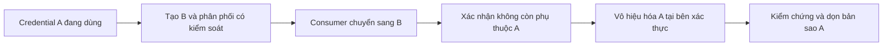

# Service account rotation

## 1. Rotation thay credential, không mặc nhiên thay danh tính

Một service account là danh tính được phần mềm sử dụng để truy cập tài nguyên. Danh tính này có thể tồn tại qua nhiều phiên bản ứng dụng, còn bằng chứng dùng để xác thực nó cần được thay theo vòng đời phù hợp.

**Service account rotation** trong vận hành thường chỉ việc thay credential của tài khoản dịch vụ, chuyển các workload sang credential mới và loại bỏ khả năng sử dụng credential cũ. Credential có thể là mật khẩu, client secret, khóa API, khóa riêng gắn với chứng thư hoặc một loại khóa xác thực khác.

Ví dụ, dịch vụ Java `invoice-worker` dùng một secret để xác thực trước khi nhận token truy cập API. Rotation thành công không chỉ là tạo secret mới. Các instance phải thực sự sử dụng secret mới, secret cũ phải bị vô hiệu hóa tại bên xác thực và những token đã cấp bằng secret cũ phải được xử lý theo cơ chế của hệ thống.

Thông thường principal, mục đích nghiệp vụ và quyền của tài khoản được giữ ổn định trong lần rotation. Tạo một service account khác rồi chuyển quyền sang đó là **di chuyển danh tính**. Cách này đôi khi cần thiết, nhưng có thêm tác động đến role binding, trust, audit và các tham chiếu theo principal; không nên xem nó giống hệt thay một credential.

## 2. Phân biệt rotation, refresh, expiration và revocation

| Khái niệm | Điều xảy ra | Điều không tự được bảo đảm |
|---|---|---|
| Rotation | Thay credential đang sử dụng bằng credential mới | Credential cũ đã bị thu hồi hoặc mọi consumer đã chuyển xong |
| Refresh hoặc cấp mới ngắn hạn | Nhận token hay credential mới để tiếp tục hoạt động | Credential gốc dùng để cấp mới đã được thay |
| Expiration | Credential hết thời hạn hiệu lực | Credential bị lộ sẽ mất tác dụng trước thời điểm hết hạn |
| Revocation | Bên có thẩm quyền vô hiệu hóa credential hoặc khả năng sử dụng nó | Mọi token dẫn xuất và phiên đang mở đều lập tức kết thúc |
| Permission review | Đánh giá, điều chỉnh quyền của principal | Credential đã được thay hoặc bản sao credential cũ đã bị xóa |

Nếu ứng dụng lấy access token mới mỗi lần token cũ gần hết hạn nhưng luôn dùng cùng một client secret trong nhiều năm, đó chưa phải rotation của client secret. Ngược lại, thay secret không tự giảm quyền dư thừa của service account.

Một lần rotation đầy đủ phải giải quyết được ba câu hỏi:

1. Credential mới đã được bên xác thực chấp nhận và workload sử dụng chưa?
2. Credential cũ còn được bên xác thực chấp nhận ở đâu không?
3. Token, chứng thư hoặc phiên đã tồn tại trước thời điểm thu hồi còn khả năng truy cập nào?

## 3. Vì sao cần rotation?

Credential có thể bị sao chép vào cấu hình cũ, công cụ hỗ trợ, bản sao lưu hoặc môi trường không còn được kiểm soát như trước. Rotation giúp giới hạn thời gian một credential cụ thể được duy trì và tạo cơ hội kiểm tra lại cách phân phối, sử dụng và thu hồi nó.

Rotation cũng là một năng lực ứng phó sự cố. Nếu chỉ biết tạo secret mà chưa từng thực hiện chuyển đổi và thu hồi, khi secret bị lộ nhóm vận hành có thể phải chọn giữa để truy cập nguy hiểm tiếp diễn và làm ứng dụng ngừng hoạt động đột ngột.

Tần suất rotation cần dựa trên loại credential, mức nhạy cảm, khả năng tự động hóa và yêu cầu thực tế. Không có một chu kỳ duy nhất phù hợp cho mọi mật khẩu, chứng thư và token. Credential bị nghi lộ phải được xử lý theo sự cố, không chờ đến lịch thay định kỳ.

Rotation không thay thế least privilege. Một credential mới có toàn quyền vẫn gây thiệt hại lớn nếu bị chiếm. Nó cũng không loại bỏ rủi ro khi kẻ tấn công còn kiểm soát workload hoặc quyền đọc kho secret: họ có thể lấy credential mới ngay sau khi thay.

## 4. Kiểm kê trước khi thay

Đối tượng cần kiểm kê là toàn bộ đường sử dụng credential, không chỉ deployment đang nhìn thấy trong production.

| Thành phần | Điều cần biết trước rotation |
|---|---|
| Principal và môi trường | Đúng tài khoản nào, môi trường nào, owner nào chịu trách nhiệm? |
| Bên xác thực | Hệ thống nào kiểm tra mật khẩu, secret, khóa hoặc chứng thư? |
| Loại credential | Có thời hạn không, có hỗ trợ nhiều credential đồng thời không? |
| Consumer | Replica, batch job, pipeline, agent và công cụ nào đang dùng credential? |
| Nơi phân phối | Secret store, cấu hình triển khai, volume, biến môi trường hoặc cơ chế cấp tự động nào? |
| Cách nạp cấu hình | Ứng dụng nạp khi khởi động, theo sự kiện hay định kỳ; có cache không? |
| Credential dẫn xuất | Secret này có được dùng để lấy token, mở phiên hoặc nhận credential khác không? |
| Điểm thu hồi | Vô hiệu hóa ở đâu, hiệu lực lan truyền và cache ảnh hưởng thế nào? |
| Tự động hóa | IaC, GitOps, rollback deployment hoặc restore có thể đưa bản cũ trở lại không? |

Job cuối tháng, môi trường dự phòng và pipeline bảo trì rất dễ bị bỏ sót vì không tạo lưu lượng thường xuyên. Không thể kết luận chúng đã chuyển chỉ vì trong giờ quan sát không thấy sử dụng credential cũ.

Mỗi credential nên có một ID hoặc version để theo dõi mà không lộ giá trị bí mật. Tuy nhiên, version trong kho secret và ID credential ở bên xác thực có thể là hai định danh khác nhau. Hồ sơ rotation cần thể hiện quan hệ giữa chúng, thay vì mặc định hai hệ thống dùng cùng số phiên bản.

## 5. Chọn chiến lược theo khả năng của hệ thống

### 5.1. Cho phép hai credential cùng hoạt động trong thời gian chuyển đổi

Nếu bên xác thực hỗ trợ nhiều credential cho cùng principal, có thể tạo credential mới trước khi vô hiệu hóa credential cũ. Khoảng thời gian cả hai được chấp nhận giúp triển khai dần và kiểm chứng mà không buộc mọi instance đổi cùng một thời điểm.



Khoảng chồng lấp phải có thời hạn và owner. Nếu tạo B nhưng giữ A mãi, số credential hợp lệ tăng lên và mục tiêu rotation chưa đạt.

Hai credential cùng principal thường chịu cùng tập quyền của principal đó, trừ khi nền tảng có cơ chế ràng buộc riêng. Không nên gán quyền rộng hơn cho B chỉ để vượt qua lỗi khi chuyển đổi.

### 5.2. Chỉ có một credential hoạt động

Một số hệ thống thay mật khẩu là làm credential cũ mất hiệu lực ngay đối với lần xác thực tiếp theo. Khi đó cần phối hợp thời điểm cập nhật bên xác thực với cập nhật consumer, có thể phải dùng cửa sổ bảo trì hoặc một cơ chế chuyển đổi do nền tảng hỗ trợ.

Chỉ triển khai ứng dụng theo kiểu rolling không tự tạo ra rotation không gián đoạn. Các instance còn dùng A có thể thất bại sau khi mật khẩu đổi sang B; các instance nạp B trước khi bên xác thực chấp nhận B cũng có thể thất bại.

Nếu phải dùng một principal thay thế để có thời gian chồng lấp, cần quản lý nó như một lần di chuyển danh tính: kiểm tra quyền tương đương cần thiết, ánh xạ audit, consumer và việc thu hồi principal cũ.

### 5.3. Credential ngắn hạn được cấp tự động

Với cơ chế cấp token hoặc credential ngắn hạn, ứng dụng thường cần một credential provider có khả năng lấy mới trước khi credential hiện tại hết hiệu lực. Trách nhiệm rotation được chia giữa nền tảng và ứng dụng theo cơ chế triển khai.

Nhóm vận hành vẫn cần biết bên nào quản lý bootstrap credential, trust và quyền nhận credential. Việc token tự đổi không chứng minh một secret dài hạn nằm phía dưới đã được thay, và không chứng minh workload không còn đường nhận credential sau khi bị thu hồi.

## 6. Quy trình rotation có kiểm soát

### Bước 1: Xác định điều kiện bắt đầu và hoàn tất

Ghi rõ principal, môi trường, credential A, phạm vi consumer, người chịu trách nhiệm, chiến lược chuyển đổi và thời điểm phải vô hiệu hóa A. Xác định trước điều kiện dừng khi phát hiện lỗi, đồng thời phân biệt rotation định kỳ với rotation do nghi ngờ bị lộ.

Điều kiện hoàn tất nên yêu cầu B hoạt động, A không còn được chấp nhận theo phạm vi đã xác định, consumer đã chuyển và ảnh hưởng đến token hoặc phiên cũ đã được xử lý. “Secret store có version mới” chưa đủ.

### Bước 2: Tạo credential B ở đúng bên có thẩm quyền

Credential mới phải được cấp hoặc đăng ký theo cơ chế mà hệ thống đích thực sự xác thực. Tạo một chuỗi ngẫu nhiên rồi ghi nó vào kho secret không làm bên xác thực tự chấp nhận chuỗi đó.

Chỉ thành phần có quyền quản lý credential phù hợp mới được tạo, kích hoạt hoặc thu hồi B. Quyền thay credential của một service account nhạy cảm có thể cho phép bên giữ quyền đó hành động dưới danh tính dịch vụ; vì vậy đây là quyền quản trị cần bảo vệ và audit.

Không thay principal, role và hàng loạt cấu hình không liên quan trong cùng một thao tác chỉ để rotation. Phạm vi thay đổi rõ ràng giúp xác định nguyên nhân nếu ứng dụng gặp lỗi.

### Bước 3: Phân phối B mà không lộ giá trị

Lưu B qua cơ chế secret đã chọn và chỉ cho consumer hợp lệ đọc. Dùng ID hoặc version để triển khai, theo dõi và đối chiếu. Không đưa giá trị B vào log, ticket, ảnh chụp màn hình hoặc tham số có thể bị ghi lại ngoài ý muốn.

Việc cập nhật một secret alias như `current` không bảo đảm tất cả ứng dụng đã nạp bản mới. Cần kiểm tra cơ chế phân phối thực tế: file được cập nhật có thể chưa được tiến trình đọc lại, biến môi trường thường không tự đổi trong tiến trình đang chạy, và cache trong SDK có vòng đời riêng.

### Bước 4: Chuyển một nhóm consumer đại diện sang B

Thử trên một instance hoặc một execution phù hợp với kế hoạch triển khai. Kiểm tra việc lấy token hoặc mở kết nối mới, sau đó kiểm tra thao tác nghiệp vụ có quyền tối thiểu cần thiết.

Kiểm tra phải chứng minh B thực sự được dùng. Nếu SDK tự fallback sang A, một yêu cầu thành công chưa chứng minh chuyển đổi thành công. Ưu tiên bằng chứng từ credential ID, audit của bên xác thực hoặc một luồng kiểm tra được cô lập khỏi credential cũ.

Phân biệt lỗi xác thực, lỗi phân quyền và lỗi mạng. Không tăng quyền của service account để xử lý một lỗi chưa được xác định nguyên nhân.

### Bước 5: Chuyển toàn bộ consumer và xử lý cache

Mở rộng triển khai đến các replica, region, lịch chạy và môi trường dự phòng thuộc phạm vi. Kiểm tra cả cấu hình dùng cho lần khởi động sau và bản mẫu deployment có thể được rollback.

Với connection pool, cần biết việc cập nhật credential áp dụng cho kết nối mới hay cả kết nối hiện hữu. Một kết nối database đã xác thực có thể tiếp tục tồn tại sau khi mật khẩu thay đổi, tùy hệ thống. Kiểm tra một truy vấn trên kết nối cũ không chứng minh ứng dụng mở được kết nối mới bằng B.

Nếu cần tạo lại pool hoặc phiên để kiểm chứng, phải thực hiện theo kế hoạch phù hợp với tải và khả năng chịu lỗi của ứng dụng. Không làm mới đồng loạt mọi kết nối chỉ để tiện quan sát khi điều đó có thể gây gián đoạn.

### Bước 6: Vô hiệu hóa A tại bên xác thực

Sau khi xác nhận các consumer hợp lệ đã chuyển theo kế hoạch, vô hiệu hóa hoặc thu hồi A ở hệ thống có thẩm quyền. Xóa version A khỏi kho secret chỉ loại bỏ một nơi lưu bản sao; nó không tự vô hiệu hóa bản đã được sao chép ra ngoài.

Xác minh trạng thái sau thay đổi và khả năng A còn được chấp nhận ở các điểm liên quan. Xét đến thời gian lan truyền, cache và các kênh xác thực khác được kiểm kê. Không chờ hết hạn tự nhiên nếu đang xử lý credential bị lộ và hệ thống có cách chặn sớm phù hợp.

### Bước 7: Kiểm chứng, dọn bản sao và kết thúc

Xác nhận B tiếp tục hoạt động và những lần sử dụng A bị từ chối vì lý do xác thực hoặc chính sách mong đợi. Thử nghiệm âm tính phải nằm trong phạm vi được phép và không tạo tác động nghiệp vụ.

Dọn các bản sao A trong cấu hình, secret version và tài liệu vận hành theo chính sách lưu giữ. Nếu A từng xuất hiện trong log, artifact hoặc repository, xử lý các nơi đó theo quy trình tương ứng; việc thu hồi tại nguồn vẫn là bước quyết định để ngăn bản sao tiếp tục được sử dụng.

Lưu bằng chứng bằng principal ID, credential ID, version, dấu thời gian, mã triển khai và kết quả kiểm chứng. Không cần giữ giá trị secret cũ trong báo cáo để chứng minh đã thay nó.

## 7. Credential cũ bị thu hồi, token cũ có mất hiệu lực không?

Câu trả lời phụ thuộc cơ chế xác thực. Hãy xét một client secret được dùng để lấy access token:

```text
Client secret A -> Bên cấp token -> Access token T -> API tài nguyên
```

Thu hồi A có thể chặn lần lấy token mới bằng A. Nhưng token T đã được cấp có thể vẫn hợp lệ đến khi hết hạn nếu API chỉ kiểm tra chữ ký, thời hạn và những ràng buộc trong token, không kiểm tra trạng thái thu hồi liên quan.

Vì vậy cần phân biệt hai thời điểm:

- Thời điểm A không còn dùng được để xác thực hoặc lấy credential mới.
- Thời điểm mọi khả năng truy cập dẫn xuất từ A đã bị chặn hoặc hết hiệu lực có kiểm chứng.

Không mặc định hai thời điểm này trùng nhau. Có thể phải thu hồi phiên, dùng cơ chế vô hiệu hóa token mà hệ thống hỗ trợ hoặc áp dụng chặn tại tài nguyên đích. Thời hạn token thực tế, sai lệch đồng hồ cho phép, cache và độ trễ áp dụng chính sách đều có thể ảnh hưởng việc xác nhận.

Với chứng thư, rotation có thể bao gồm cấp chứng thư mới cùng khóa riêng mới theo yêu cầu. Cần phân biệt thay credential của workload với xoay khóa ký của bên cấp chứng thư hoặc của một identity provider dùng chung. Thay khóa ký dùng chung có phạm vi ảnh hưởng rộng hơn và không nên được dùng tùy tiện để xử lý một service account.

Việc có cơ chế thu hồi chứng thư cũng chưa chứng minh mọi bên nhận đang thực thi kiểm tra thu hồi. Phải xác minh cách hệ thống đích chấp nhận danh tính, kể cả các kết nối mTLS đã tồn tại.

## 8. Ví dụ rotation cho một ứng dụng Java có nhiều instance

Giả sử `invoice-worker-prod` có ba instance thường trực, một batch job cuối tháng và một cấu hình DR. Bên xác thực hỗ trợ hai client secret hoạt động đồng thời. Ứng dụng dùng secret để lấy token gọi API hóa đơn.

Một kế hoạch có thể được biểu diễn như sau. Đây là mô hình vận hành minh họa, không phải schema hay API của một nhà cung cấp:

```yaml
principal: invoice-worker-prod
old_credential_id: credential-A
new_credential_id: credential-B
consumers:
  - runtime-instances
  - month-end-job
  - disaster-recovery-deployment
completion:
  new_credential_verified: required
  consumers_migrated: required
  old_credential_disabled_at_issuer: required
  derived_access_handled: required
```

Nhóm vận hành tạo B, lưu vào secret store rồi chuyển một instance để kiểm tra. Audit ở bên cấp token xác nhận yêu cầu dùng B. Sau đó nhóm triển khai đến hai instance còn lại, cập nhật mẫu batch job và cấu hình DR.

Chỉ nhìn thấy ba instance thường trực khỏe mạnh là chưa đủ. Nhóm cần kiểm tra đường lấy credential của batch job và cấu hình sẽ được dùng khi DR khởi động. Có thể thực hiện kiểm tra có kiểm soát phù hợp, không cần chạy toàn bộ nghiệp vụ cuối tháng chỉ để xác minh secret.

Khi mọi consumer đã chuyển, nhóm vô hiệu hóa A. B tiếp tục lấy token thành công; yêu cầu mới bằng A bị từ chối. Các access token cũ được đánh giá riêng theo chính sách token và cơ chế thu hồi của hệ thống.

Hồ sơ rotation ghi ID A và B, version phân phối tương ứng, consumer đã chuyển, thời điểm vô hiệu hóa A và kết quả kiểm chứng. Hồ sơ không chứa giá trị của hai secret.

### Tránh giữ một credential snapshot trong ứng dụng

Ứng dụng dùng credential tự làm mới cần phân biệt provider với giá trị credential lấy ra tại một thời điểm:

```text
Sai về mặt thiết kế khi credential có thời hạn:
    lúc khởi động: token = provider.getToken()
    mọi yêu cầu về sau: luôn dùng biến token ban đầu

Thiết kế phù hợp hơn:
    cấu hình client sử dụng credential provider có khả năng refresh
    provider trả credential còn hiệu lực theo cơ chế của nó
    theo dõi lỗi refresh và thời hạn thay vì ghi giá trị token
```

Đây là giả mã về trách nhiệm, không phải hướng dẫn phải gọi bên cấp token cho mỗi request. SDK hoặc provider có thể cache và làm mới an toàn. Cần hiểu hợp đồng của client thực tế, tránh tự triển khai refresh theo cách gây bão yêu cầu hoặc để nhiều luồng đồng thời thay credential không nhất quán.

## 9. Rollback và rotation do lộ credential

### Rotation định kỳ chưa có dấu hiệu lộ

Trong thời gian chuyển đổi, nếu B gặp lỗi và A vẫn được cho phép theo kế hoạch, có thể tạm dừng rollout hoặc quay lại cấu hình trước đó trong giới hạn đã xác định. Phải ghi rõ trạng thái, consumer đã chuyển và thời hạn xử lý, tránh để cả hai credential tồn tại vô thời hạn.

Khi A đã bị thu hồi, một bản deployment cũ chứa A không còn là rollback khả dụng. Phải sửa cấu hình rollback để dùng credential hợp lệ hoặc cấp credential thay thế theo quy trình. Khả năng khôi phục phiên bản ứng dụng và khả năng khôi phục credential là hai vấn đề khác nhau.

### Credential bị nghi lộ

Không giữ A hoạt động chỉ để đạt chuyển đổi không gián đoạn nếu điều đó tiếp tục cho phép truy cập nguy hiểm. Cần ưu tiên containment theo mức rủi ro: chặn A, xử lý token hoặc phiên còn tồn tại và khôi phục dịch vụ bằng credential được phân phối qua môi trường đáng tin cậy.

Nếu kẻ tấn công còn quyền đọc secret store hoặc sửa workload, chỉ thay A bằng B có thể làm B bị lộ ngay. Cần xử lý đường xâm nhập và quyền liên quan, không coi rotation là toàn bộ quá trình ứng phó.

Không bật lại credential đã xác định bị lộ để rollback. Nếu cần khôi phục, cấp credential khác và kiểm tra consumer, môi trường triển khai cùng quyền nhận credential.

## 10. Tự động hóa rotation cần điều phối được trạng thái

Một tác vụ rotation tự động nên biết đang ở giai đoạn nào: đã tạo B, đã phân phối, đã xác nhận consumer, đã vô hiệu hóa A hay đã hoàn tất kiểm chứng. Nếu job bị dừng giữa chừng, lần chạy lại phải xác định trạng thái thực tế trước khi làm tiếp.

Đặc biệt cần tránh hai tác vụ rotation cùng thao tác trên một principal. Ví dụ, tác vụ thứ nhất đang chuyển consumer từ A sang B trong khi tác vụ thứ hai tạo C rồi vô hiệu hóa B vì cho rằng B đã cũ. Kết quả là consumer vừa chuyển xong lập tức thất bại.

Cơ chế khóa hoặc điều phối tương đương, định danh lần chạy, giới hạn retry và thao tác có thể chạy lại an toàn giúp giảm rủi ro này. Quyền của hệ thống rotation cũng nên giới hạn đến các principal cần quản lý, không mặc định có toàn quyền IAM.

Tín hiệu theo dõi hữu ích gồm số lỗi xác thực theo credential ID nếu có, số lần lấy credential mới thất bại, consumer chưa chuyển, credential sắp hết hạn và credential cũ vẫn được sử dụng. Không thu thập giá trị credential để phục vụ dashboard.

## 11. Các lỗi thường làm rotation chưa hoàn tất

| Sai lầm | Hậu quả | Cách nhận diện hoặc khắc phục |
|---|---|---|
| Chỉ tạo B rồi kết thúc ticket | A vẫn là đường truy cập hợp lệ | Yêu cầu bằng chứng vô hiệu hóa A tại bên xác thực |
| Chỉ đổi secret version trong kho lưu trữ | Consumer chưa nạp B hoặc nguồn xác thực chưa chấp nhận B | Đối chiếu cả bên xác thực và từng cơ chế nạp cấu hình |
| Thử thành công nhưng SDK dùng fallback | Tưởng đã chuyển trong khi vẫn phụ thuộc A | Kiểm chứng credential ID hoặc cô lập đường dùng B |
| Chỉ kiểm tra kết nối cũ trong pool | Không biết kết nối mới có xác thực được không | Kiểm tra một lần xác thực hoặc kết nối mới có kiểm soát |
| Bỏ quên job thưa và DR | Lỗi xuất hiện rất lâu sau rotation | Kiểm kê consumer và cập nhật cấu hình cho lần chạy tiếp theo |
| Giữ A vô thời hạn để rollback | Tích lũy credential còn hiệu lực | Đặt hạn chồng lấp và điều kiện thu hồi rõ ràng |
| Cho rằng thu hồi secret hủy mọi token | Truy cập dẫn xuất vẫn tiếp tục | Đánh giá riêng token, chứng thư và phiên đã cấp |
| Tăng quyền để làm B chạy được | Rotation trở thành đường mở rộng đặc quyền | Phân loại lỗi và giữ phạm vi quyền đã xác định |
| Chạy nhiều rotation không điều phối | Credential vừa dùng đã bị tác vụ khác thu hồi | Quản lý trạng thái và quyền sở hữu lần chạy |

Một lần rotation có thể được đóng khi credential mới được sử dụng ổn định, credential cũ đã được vô hiệu hóa theo phạm vi, truy cập dẫn xuất đã được xử lý và cấu hình triển khai không còn phụ thuộc vào bản cũ. Bằng chứng phải giúp giải thích các điều kiện đó mà không làm lộ secret. Đây là cách quản lý credential xuyên suốt vòng đời, thay vì chỉ tạo thêm một khóa mới cho service account.
