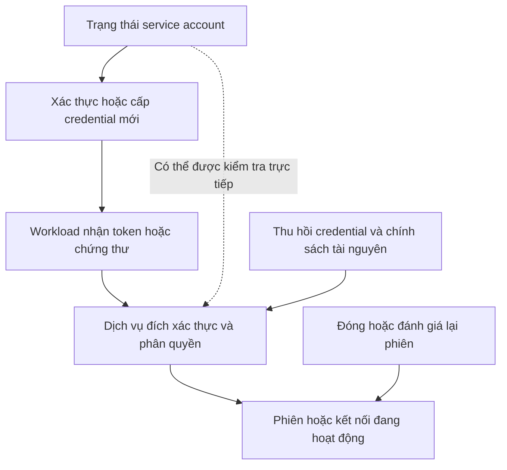

# Service account disable: vô hiệu hóa tài khoản dịch vụ

## 1. Disable service account có ý nghĩa gì?

Service account là principal được dùng để đại diện cho một dịch vụ, tác vụ hoặc thành phần phần mềm khi truy cập tài nguyên. **Disable service account** là thao tác đưa tài khoản đó vào trạng thái bị vô hiệu hóa theo cơ chế của hệ thống quản lý danh tính.

Mục đích thường là ngăn tài khoản tiếp tục được sử dụng, nhưng tác động chính xác phụ thuộc nền tảng: hệ thống có thể từ chối xác thực mới, từ chối cấp credential mới, từ chối một số hoạt động thay mặt tài khoản hoặc áp dụng kiểm tra trạng thái khi truy cập. Không được mặc định mọi nền tảng đều xử lý toàn bộ những trường hợp đó giống nhau.

Ví dụ, `invoice-export-prod` là service account của tác vụ xuất hóa đơn. Khi tác vụ bị ngừng sử dụng, đội vận hành muốn ngăn danh tính này tiếp tục truy cập kho hóa đơn. Đặt tài khoản thành disabled là một thay đổi quan trọng ở lớp danh tính. Tuy nhiên, để kết luận truy cập đã bị chặn, còn phải biết credential, phiên và các dịch vụ nhận yêu cầu xử lý trạng thái đó như thế nào.

Điểm cốt lõi là phân biệt **trạng thái quản lý của tài khoản** với **khả năng truy cập thực tế ở tài nguyên**. Một trang quản trị hiển thị disabled không tự chứng minh mọi token cũ, kết nối cơ sở dữ liệu hay phiên ứng dụng đã bị vô hiệu hóa.

## 2. Disable khác gì với những thao tác liên quan?

| Thao tác | Đối tượng tác động chính | Điều không nên mặc định |
| --- | --- | --- |
| Disable tài khoản | Trạng thái của principal trong hệ thống quản lý danh tính | Mọi credential và phiên tồn tại trước đó đều mất hiệu lực ngay |
| Xóa tài khoản | Bản ghi danh tính và quan hệ liên quan theo cơ chế của nền tảng | Có thể khôi phục nguyên vẹn principal và mọi liên kết quyền |
| Thu hồi credential | Một hoặc một tập credential | Tài khoản không thể nhận credential khác |
| Xoay credential | Thay credential đang sử dụng bằng credential mới | Credential cũ hoặc phiên dẫn xuất đã tự động hết hiệu lực |
| Gỡ quyền | Quan hệ phân quyền hoặc chính sách truy cập | Tài khoản không còn xác thực được ở mọi nơi |
| Dừng workload | Tiến trình hoặc tài nguyên thực thi | Credential đã bị sao chép sang nơi khác không còn dùng được |

Disable thường có khả năng đảo ngược bằng enable, nhưng khả năng đảo ngược không làm thao tác này trở thành không có rủi ro. Một tài khoản dùng bởi tác vụ sao lưu, hàng đợi hoặc dịch vụ nền có thể làm gián đoạn nhiều chức năng khi bị vô hiệu hóa.

Ngược lại, chỉ dừng một container không phải là disable service account. Nếu credential đã bị lấy ra ngoài container, người giữ credential có thể tiếp tục thử truy cập từ nơi khác. Trong xử lý sự cố, có thể cần phối hợp nhiều thao tác vì chúng giải quyết những lớp khác nhau.

## 3. Khi nào cần vô hiệu hóa tài khoản dịch vụ?

### 3.1. Workload đã ngừng sử dụng

Một dịch vụ cũ đã được thay thế hoặc một tác vụ thử nghiệm đã kết thúc. Nếu tài khoản vẫn tồn tại với quyền truy cập và cơ chế nhận credential, nó tạo ra một đường truy cập không còn phục vụ nhu cầu rõ ràng.

Disable có thể là một bước trước khi xóa theo quy trình vòng đời của tổ chức. Trong khoảng theo dõi, nếu phát hiện một phụ thuộc hợp lệ chưa được chuyển đổi, vẫn có thể đánh giá phương án khôi phục mà chưa mất bản ghi danh tính. Điều này không thay thế việc xử lý credential cũ hoặc dọn các quyền không còn cần thiết.

### 3.2. Có dấu hiệu credential hoặc workload bị xâm nhập

Tài khoản xuất hiện trong những truy cập bất thường, credential được phát hiện ở vị trí không được phép hoặc workload đang sử dụng tài khoản đã bị kiểm soát. Disable có thể giúp hạn chế việc tiếp tục sử dụng danh tính theo khả năng của nền tảng.

Trong tình huống này, việc vô hiệu hóa cần được xem cùng với chặn cấp mới, thu hồi credential, xử lý phiên và kiểm soát tại tài nguyên. Nếu chỉ đổi trạng thái rồi kết thúc điều tra, các đường truy cập còn hiệu lực có thể bị bỏ sót.

### 3.3. Tạm ngừng theo quyết định vận hành

Một đợt triển khai có lỗi, một tích hợp bị tạm ngừng hoặc một đối tác không còn được phép sử dụng chức năng trong một khoảng thời gian. Cần xác định rõ chủ thể nào phải bị chặn và điều kiện nào cho phép enable lại.

Không nên dùng disable một tài khoản dùng chung làm cách tắt một tính năng nhỏ nếu điều đó vô tình ảnh hưởng các workload khác. Thiết kế danh tính đủ tách biệt giúp phạm vi tác động dễ kiểm soát hơn.

## 4. Tác động nằm ở nhiều lớp

Một service account thường xuất hiện trong một chuỗi hoạt động:



Các mũi tên thể hiện những điểm có thể chịu ảnh hưởng, không phải cam kết rằng một thao tác disable tự động cập nhật tất cả điểm đó. Mỗi kiến trúc cần xác định nơi nào kiểm tra trạng thái tài khoản và thời điểm kiểm tra.

### 4.1. Xác thực hoặc cấp credential mới

Đây thường là một trong những điểm mà trạng thái disabled có thể được thực thi. Nhưng cần kiểm tra mọi cách tài khoản nhận credential: dùng secret, dùng chứng thư, liên kết danh tính từ môi trường thực thi hoặc cơ chế cho phép một principal khác hành động thay mặt tài khoản.

Nếu có nhiều bên cấp hoặc nhiều đường xác thực, chặn một đường không chứng minh các đường còn lại đã bị chặn. Việc workload tự động thử lại bằng một danh tính dự phòng cũng cần được nhận diện; tác vụ tiếp tục chạy không nhất thiết có nghĩa service account bị disable vẫn đang được dùng.

### 4.2. Credential đã được phát hành

Một token đang còn hiệu lực có thể được dịch vụ đích kiểm tra bằng chữ ký và thời hạn mà không hỏi lại trạng thái tài khoản cho mỗi request. Trong mô hình đó, thay đổi trạng thái ở hệ thống quản lý danh tính có thể chưa ảnh hưởng ngay đến token đã phát hành.

Một cơ chế khác có thể kiểm tra trạng thái trực tuyến hoặc hỗ trợ thu hồi. Hiệu lực thực tế còn phụ thuộc dữ liệu trạng thái, cache, độ trễ đồng bộ và cách tài nguyên sử dụng kết quả. Không nên suy ra hành vi từ tên gọi token hoặc định dạng JWT.

### 4.3. Phiên và kết nối đã thiết lập

Ứng dụng có thể đã tạo phiên của riêng nó sau khi xác thực. Một kết nối cơ sở dữ liệu hoặc một kênh liên dịch vụ cũng có thể chỉ xác thực tại thời điểm thiết lập, tùy giao thức và cấu hình.

Nếu credential hết hạn hoặc tài khoản bị disable, phiên đang tồn tại có thể cần một cơ chế đóng, hết hạn hoặc đánh giá lại riêng. Chỉ thử mở một kết nối mới chưa đủ để xác nhận hành vi của kết nối đã mở từ trước.

### 4.4. Quyền và tài nguyên không biến mất cùng tài khoản disabled

Tài khoản bị disable vẫn có thể còn các role binding, quyền trên kho dữ liệu, quan hệ ủy quyền và các bản ghi cấu hình. Những quan hệ này quan trọng vì nếu enable lại, một phần quyền có thể tiếp tục có hiệu lực theo cơ chế của hệ thống.

Disable vì tạm ngừng và dọn quyền vì ngừng sử dụng là hai quyết định khác nhau. Cần quản lý cả hai để tránh việc enable lại một tài khoản vô tình khôi phục quyền rộng đã bị lãng quên.

## 5. Xác định đúng tài khoản và phạm vi phụ thuộc

Trước khi thay đổi trạng thái, cần định vị principal bằng định danh đáng tin cậy trong đúng miền quản lý. Tên hiển thị có thể trùng giữa môi trường development và production hoặc bị dùng lại sau khi tài nguyên cũ bị xóa.

Những dữ kiện cần làm rõ gồm:

- Định danh tài khoản và môi trường mà nó thuộc về.
- Đội sở hữu, mục đích sử dụng và những workload đang được phép dùng tài khoản.
- Tài nguyên được truy cập, loại thao tác và mức độ quan trọng của chức năng.
- Các cơ chế cấp credential, gia hạn, ủy quyền hoặc hành động thay mặt tài khoản.
- Phiên, kết nối hoặc công việc dài hạn có thể tồn tại sau thời điểm disable.
- Đường quản trị độc lập để kiểm tra và khôi phục nếu cần.

Một tài khoản không có sự kiện truy cập gần đây chưa chắc không còn được sử dụng. Tác vụ cuối tháng, khôi phục dự phòng hoặc xử lý dữ liệu theo mùa có thể ít chạy. Sự thiếu vắng log cũng có thể do phạm vi log không bao phủ đường truy cập liên quan.

Nếu nhiều workload dùng chung một service account, cần liệt kê các bên dùng đó. Giả sử `finance-shared` được cả job xuất hóa đơn và job sao lưu sử dụng; disable để dừng xuất hóa đơn có thể làm mất cả chức năng sao lưu. Đây là dấu hiệu cần xem lại cách phân tách danh tính và quyền, không chỉ là vấn đề đặt lịch thay đổi.

## 6. Từ yêu cầu disable đến trạng thái đã được xác nhận

Một thao tác quản trị thành công ở lớp API chưa chắc đã là trạng thái cuối cùng cần đạt. Có thể tách quá trình thành các mốc khái niệm:

| Mốc theo dõi | Ý nghĩa | Bằng chứng phù hợp |
| --- | --- | --- |
| Đã yêu cầu disable | Lệnh hoặc yêu cầu đã được hệ thống nhận | Kết quả tác vụ quản trị và mã yêu cầu |
| Trạng thái đã cập nhật | Nguồn quản lý hiển thị đúng principal bị disabled | Đọc lại trạng thái từ nguồn quản lý |
| Đường cấp mới đã bị chặn | Những cách nhận credential nằm trong phạm vi đều không còn được chấp nhận | Kiểm tra phù hợp từng đường cấp |
| Truy cập cần chặn đã bị chặn | Tài nguyên không còn chấp nhận những truy cập mục tiêu | Kết quả kiểm tra và log ở tài nguyên |
| Phụ thuộc đã được xử lý | Tác động vận hành đã được giải thích và kiểm soát | Theo dõi tác vụ, phiên và chức năng liên quan |

Đây là các mốc quản lý công việc, không phải tên trạng thái bắt buộc trong mọi sản phẩm IAM.

Nếu một thao tác có thể tự động hóa, nên dùng ý nghĩa “đặt trạng thái thành disabled” thay vì “đảo trạng thái hiện tại”. Cách đặt trạng thái rõ ràng tránh việc một lần retry vô tình enable lại tài khoản. Khi có nhiều người hoặc hệ thống cùng quản lý, cần xử lý thay đổi đồng thời bằng cơ chế thích hợp mà nền tảng hỗ trợ.

Nếu lệnh hết thời gian chờ, không nên mặc định thao tác thất bại rồi thực hiện một hành động ngược lại. Trước hết cần đọc lại trạng thái và tìm kết quả tác vụ, vì thay đổi có thể đã được áp dụng dù phản hồi không đến nơi gọi.

## 7. Quy trình minh họa cho một lần disable có kế hoạch

Xét `invoice-export-prod`, một service account chỉ dành cho tác vụ xuất hóa đơn đã được thay thế.

### Bước 1: Xác nhận danh tính và mục tiêu

Đội sở hữu xác nhận đúng principal production và mục tiêu là ngừng khả năng xuất hóa đơn của tác vụ cũ. Việc xác nhận cần dựa trên định danh và cấu hình thực tế; không chỉ dựa vào tên chứa chuỗi `prod`.

### Bước 2: Kiểm tra bên sử dụng và công việc còn tồn tại

Xác định nơi workload lấy credential, các lịch chạy, tác vụ đang thực hiện và tài nguyên đích. Nếu có một phiên xuất dữ liệu đang chạy, cần quyết định cho hoàn tất hay chấm dứt theo mục tiêu thay đổi.

Tài khoản thay thế, nếu có, cần có quyền phù hợp với chức năng mới. Việc chuyển đổi không nên mặc định sao chép toàn bộ quyền cũ vì có thể giữ lại quyền vượt nhu cầu.

### Bước 3: Vô hiệu hóa qua cơ chế quản lý có thẩm quyền

Một principal quản trị được cấp đúng quyền thực hiện thay đổi và ghi nhận lý do. Đường quản trị này cần độc lập với tài khoản đang bị disable để tránh tự làm mất khả năng kiểm tra hoặc khôi phục.

Trong bài học này, đây là mô tả quy trình; không có lệnh nền tảng cụ thể hay thao tác thực tế trên một tài khoản nào.

### Bước 4: Đọc lại và kiểm tra các đường truy cập

Đọc lại trạng thái tài khoản, kiểm tra việc nhận credential mới và kiểm tra hành vi tại kho hóa đơn. Nếu còn token hoặc phiên cũ, xử lý theo cơ chế và mục tiêu đã xác định, thay vì chỉ chờ vì giao diện đã hiển thị disabled.

### Bước 5: Theo dõi tác động và chốt trạng thái vận hành

Tác vụ cũ không được tiếp tục truy cập; chức năng thay thế và các workload không liên quan cần hoạt động đúng phạm vi. Các sự kiện retry, lỗi xác thực và hàng đợi tồn đọng phải được giải thích để không bỏ sót một phụ thuộc còn dùng tài khoản cũ.

Sau đó, đội sở hữu có thể tiếp tục bước dọn credential, quyền và cấu hình thừa theo vòng đời. Việc xóa tài khoản, nếu cần, là một thao tác riêng với điều kiện và tác động riêng.

## 8. Ví dụ về độ trễ hiệu lực

Giả sử một mô hình minh họa có các điều kiện sau:

- Credential mới bị từ chối sau khi thay đổi disabled có hiệu lực tại bên cấp.
- Một access token đã được cấp lúc 09:58, có hạn đến 10:13.
- Dịch vụ đích chỉ kiểm tra chữ ký và hạn token cho từng request, không kiểm tra lại trạng thái tài khoản và không có cơ chế thu hồi token đó.
- Không xét các credential hoặc phiên khác trong ví dụ này.

Tài khoản bị disable lúc 10:00. Khi đó:

```text
09:58  Access token được cấp.
10:00  Tài khoản bị disable; đường cấp mới bị chặn khi thay đổi có hiệu lực.
10:05  Token cũ vẫn có thể được dịch vụ đích chấp nhận theo các giả định trên.
10:13  Token cũ hết hạn; kiểm tra hạn dùng sẽ từ chối nó, có xét chính sách lệch đồng hồ.
```

Ví dụ không có nghĩa mọi nền tảng đều có cửa sổ 13 phút hoặc dùng hạn token như nhau. Nó cho thấy cần tách thời điểm đổi trạng thái với thời điểm tài nguyên ngừng chấp nhận credential đã phát hành.

Nếu token được dùng để mở một phiên riêng lúc 10:05, còn phải xét chính sách của phiên đó. Nếu còn một loại credential khác hoặc một đường ủy quyền khác, thời điểm 10:13 không thể được dùng để kết luận toàn bộ tài khoản đã mất khả năng truy cập.

Muốn đưa ra thời hạn chặn truy cập có cơ sở, cần biết các đường truy cập, hạn credential, cơ chế thu hồi, độ trễ áp dụng và hành vi phiên. Khi chưa có dữ kiện, phải ghi rõ phần chưa xác nhận thay vì suy đoán từ một loại token duy nhất.

## 9. Disable trong xử lý sự cố

Khi nghi ngờ tài khoản bị lạm dụng, mục tiêu là giảm khả năng tiếp tục truy cập và hiểu phạm vi ảnh hưởng. Disable là một công cụ, không phải kết luận rằng sự cố đã được xử lý xong.

Các lớp cần xem xét có thể gồm:

| Lớp | Câu hỏi cần trả lời |
| --- | --- |
| Danh tính | Tài khoản đã bị vô hiệu hóa tại nguồn quản lý chưa? |
| Cấp credential | Workload hoặc bên được ủy quyền có còn nhận credential mới không? |
| Credential tồn tại | Token, khóa hoặc chứng thư nào còn có thể được chấp nhận? |
| Tài nguyên | Có cần chính sách từ chối hoặc biện pháp chặn riêng tại đích không? |
| Phiên và kết nối | Có phiên đang hoạt động cần đóng hoặc đánh giá lại không? |
| Môi trường thực thi | Workload bị kiểm soát có còn khả năng tiếp tục hoạt động hoặc dùng danh tính khác không? |
| Kiểm toán | Có thể xác định hành động, thời gian, tài nguyên và đường truy cập liên quan không? |

Nếu nguyên nhân là môi trường thực thi bị kiểm soát, chỉ xoay credential rồi enable lại có thể tạo lại cùng điều kiện bị lạm dụng. Cần xử lý căn nguyên và cơ sở cấp danh tính trước khi phục hồi theo mục tiêu vận hành.

Không nên ghi khóa riêng, mật khẩu hoặc toàn bộ token vào báo cáo sự cố để chứng minh đã tìm thấy chúng. Có thể sử dụng mã credential, dấu nhận diện phù hợp và các bản ghi sự kiện theo khả năng của hệ thống, đồng thời bảo vệ dữ liệu điều tra.

## 10. Enable lại không đơn giản là hoàn tác mọi thứ

Enable thay đổi trạng thái tài khoản về khả năng được sử dụng theo nền tảng, nhưng không đảm bảo khôi phục nguyên trạng mọi thành phần đã thay đổi trong lúc xử lý.

Trước khi enable lại, cần trả lời:

1. Lý do disable đã được giải quyết hay chưa?
2. Workload nào sẽ được phép sử dụng tài khoản sau phục hồi?
3. Credential cũ nào còn tồn tại, và credential nào cần được thay hoặc thu hồi?
4. Quyền hiện tại có còn phù hợp với nhiệm vụ không?
5. Các biện pháp chặn tạm thời tại tài nguyên, phiên hoặc môi trường cần được xử lý thế nào?
6. Có thể kiểm tra chức năng hợp lệ mà vẫn giới hạn phạm vi ảnh hưởng không?

Một rủi ro đáng chú ý là credential cũ chưa bị xóa hoặc thu hồi. Nếu enable làm cho credential đó lại được chấp nhận, một bản sao bị đánh cắp có thể tiếp tục tạo ra rủi ro. Hành vi cụ thể cần được kiểm tra theo nền tảng; không nên suy luận rằng disabled đã tự hủy mọi credential.

Sau enable, workload có thể vẫn thất bại vì cache trạng thái, credential hết hạn, phiên đã đóng hoặc chính sách từ chối ở tài nguyên chưa được gỡ. Đọc lại trạng thái tài khoản cần đi cùng kiểm tra chức năng; không nên cấp quyền quản trị rộng chỉ để làm biến mất lỗi chưa được phân tích.

## 11. Kiểm tra hiệu lực cần có cả kết quả từ chối và chức năng hợp lệ

Một kế hoạch kiểm tra cần mô tả rõ hành vi mong đợi ở từng điểm. Các kiểm tra dưới đây là minh họa cho việc thiết kế xác minh, không phải những thao tác đã được thực hiện trong bài.

| Kiểm tra | Kết quả cần quan sát | Vì sao cần |
| --- | --- | --- |
| Đọc trạng thái đúng principal | Trạng thái disabled tại nguồn quản lý | Xác nhận thay đổi được áp dụng đúng đối tượng |
| Yêu cầu credential mới bằng từng đường được quản lý | Bị từ chối nếu đó là hành vi disable mà nền tảng phải thực thi | Phát hiện đường cấp bị bỏ sót |
| Truy cập bằng credential đã cấp trước thay đổi | Kết quả khớp cơ chế thu hồi, hạn dùng và mục tiêu ngăn chặn | Xác định quyền còn tồn tại |
| Sử dụng phiên hoặc kết nối đã có | Bị đóng, hết hạn hoặc được xử lý theo mục tiêu đã xác định | Tránh chỉ kiểm tra kết nối mới |
| Chức năng của workload không thuộc phạm vi disable | Vẫn hoạt động nếu không phụ thuộc tài khoản bị chặn | Phát hiện tác động lan rộng |
| Đối chiếu log tại bên cấp và tài nguyên | Sự kiện khớp principal, thời gian và lý do từ chối | Phân biệt lỗi truy cập thật với lỗi hạ tầng |

Một lỗi mạng, lỗi DNS hoặc HTTP 500 không phải bằng chứng rằng IAM đã từ chối tài khoản. Cần quan sát lý do phù hợp và sự kiện liên quan. Tương tự, một tác vụ không chạy không chứng minh tài khoản đã mất quyền; có thể tác vụ chỉ chưa đến lịch hoặc đang gặp lỗi khác.

Khi kiểm tra token cũ, không cần phát tán token vào nhiều công cụ hoặc log. Phương pháp kiểm tra nên giữ credential trong phạm vi kiểm soát và chỉ lưu kết quả cần thiết.

## 12. Kiểm toán quyết định disable

Sự kiện quản trị cần giúp trả lời ai đã thay đổi tài khoản, thay đổi tài khoản nào, vì sao và kết quả ra sao. Một bản ghi có ích có thể chứa:

```text
event: service_account_state_change
target_principal: service-account:production:invoice-export
requested_state: disabled
previous_state: enabled
operator: admin-principal-42
reason: workload_retired
change_id: change-508
management_readback: disabled
access_verification: recorded_separately
```

Đây là ví dụ dữ liệu khái niệm, không phải schema bắt buộc của một sản phẩm. Những trường quan trọng là định danh mục tiêu rõ ràng, principal thực hiện, thời điểm, lý do và bằng chứng kết quả. Nếu lệnh được một pipeline quản trị thực thi, có thể cần ghi thêm người hoặc quy trình đã khởi tạo thay đổi, đồng thời vẫn giữ danh tính thực thi của pipeline.

Nên phân biệt log thay đổi trạng thái với log xác minh truy cập. Sự kiện đầu chứng minh thay đổi quản trị; sự kiện sau giúp chứng minh tác động ở các đường truy cập được kiểm tra. Hai loại bằng chứng bổ sung cho nhau.

## 13. Những sai lầm thường gặp

| Sai lầm | Hệ quả | Cách tiếp cận phù hợp hơn |
| --- | --- | --- |
| Disable theo tên hiển thị mà không kiểm tra định danh | Có thể tác động nhầm tài khoản hoặc môi trường | Xác minh principal và miền quản lý trước thay đổi |
| Đồng nhất disabled với thu hồi tức thì | Bỏ sót token hoặc phiên còn được chấp nhận | Kiểm tra hiệu lực theo từng lớp |
| Chỉ kiểm tra một secret | Bỏ sót đường liên kết hoặc ủy quyền khác | Lập danh sách cơ chế cấp và sử dụng danh tính |
| Disable tài khoản dùng chung để dừng một job | Gián đoạn workload không liên quan | Hiểu phụ thuộc và phân tách danh tính theo trách nhiệm |
| Enable lại mà không xét credential đã lộ | Có thể khôi phục đường lạm dụng cũ | Xử lý căn nguyên, credential và quyền trước phục hồi |
| Dùng chính tài khoản mục tiêu để quản trị việc khôi phục | Mất khả năng kiểm tra hoặc phục hồi sau disable | Duy trì đường quản trị độc lập phù hợp |
| Xem tài khoản ít log là chắc chắn không còn dùng | Bỏ sót tác vụ định kỳ hoặc log không đầy đủ | Kết hợp thông tin sở hữu, cấu hình và chu kỳ công việc |
| Xóa ngay khi mục tiêu chỉ là tạm ngừng | Khó khôi phục danh tính và liên kết cần thiết | Chọn thao tác theo mục tiêu và vòng đời thực tế |

## 14. Những điểm cần ghi nhớ

Disable service account là thay đổi trạng thái của một danh tính dịch vụ. Muốn biết truy cập đã bị chặn tới đâu, cần xem hành vi cấp credential mới, credential còn tồn tại, kiểm tra ở tài nguyên và phiên đang hoạt động.

Một lần disable được quản lý tốt phải định vị đúng principal, hiểu phụ thuộc, đọc lại trạng thái và xác minh hiệu lực theo mục tiêu. Khi phục hồi, cần kiểm tra lại căn nguyên, credential và quyền để việc enable không mở lại đường truy cập ngoài ý muốn.
